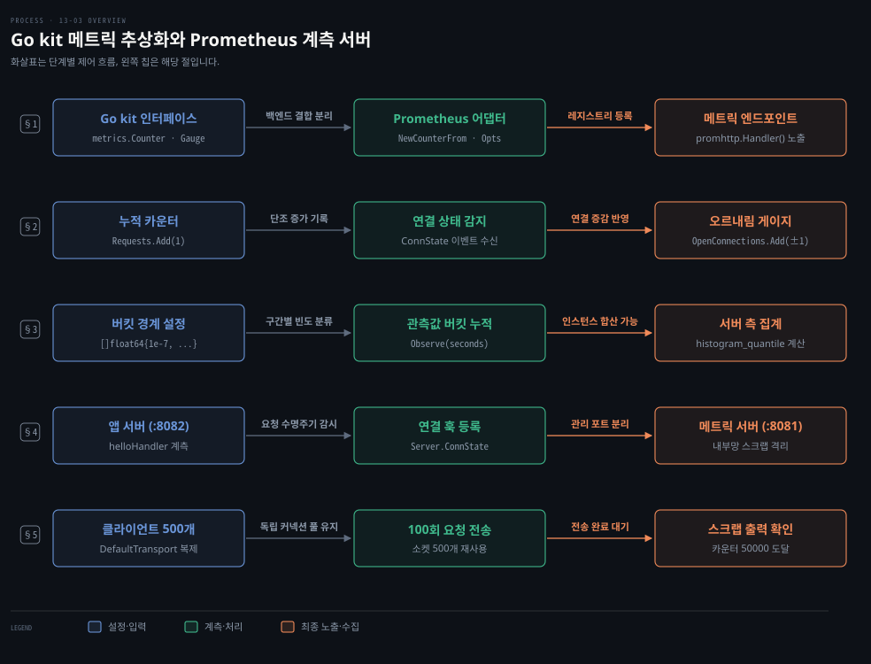
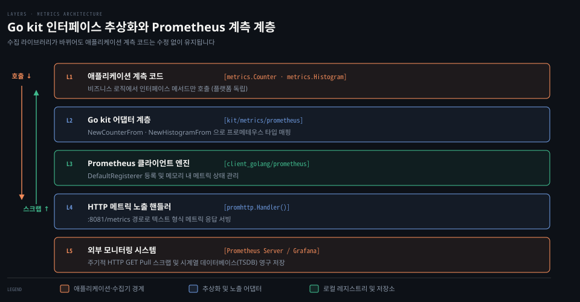
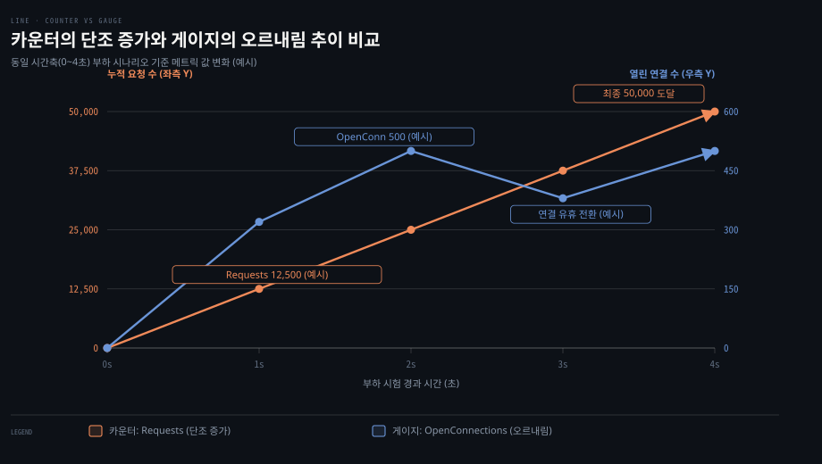
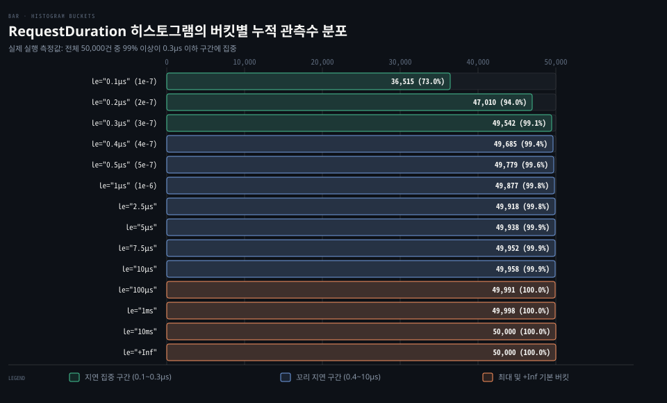
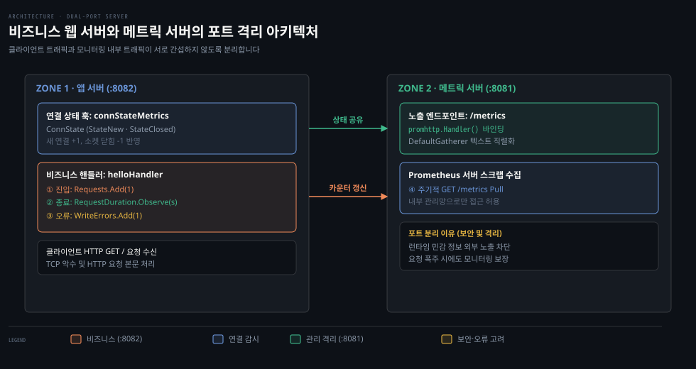
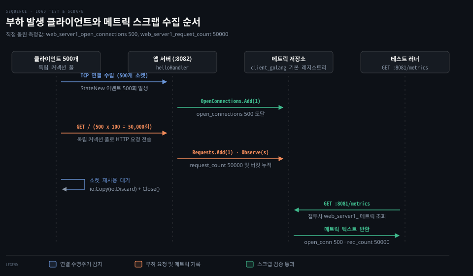

# 메트릭은 카운터·게이지·히스토그램으로 서버를 재고 Prometheus 가 그 값을 긁어 간다

---

> 로그가 과거에 어떤 일이 일어났는지 추적하는 감사 기록이라면, 메트릭은 현재 서비스가 어떤 상태에 있는지 수치로 진단하는 건강 검진표입니다. Go kit 의 메트릭 인터페이스를 앞에 두면 비즈니스 로직을 모니터링 백엔드에서 떼어 낼 수 있고, 프로메테우스 어댑터와 전용 엔드포인트를 붙여 외부 수집기가 안전하게 수치를 긁어 가게 만듭니다.


## 핵심 요약

> 메트릭은 오버헤드가 적고 보관 비용이 저렴해 서비스 전반을 조밀하게 측정할 수 있으며 단조 증가하는 카운터, 오르내리는 게이지, 구간별 빈도를 세는 히스토그램으로 현재 상태를 숫자로 요약합니다.

Go 애플리케이션에 모니터링 라이브러리를 직접 결합하면 백엔드를 바꿀 때 모든 코드를 고쳐야 합니다. Go kit 의 `metrics` 패키지는 인터페이스만 노출하여 계측 코드와 프로메테우스 구체 구현체를 분리합니다.

카운터는 오르기만 하므로 프로세스가 재시작되어 값이 리셋되어도 비율을 계산할 수 있고 게이지는 현재 열린 연결 수나 메모리 사용량처럼 오르내리는 값을 기록합니다. 히스토그램은 관측값을 정해진 버킷에 나눠 담아 서버 쪽에서 여러 인스턴스의 버킷을 합산해 백분위수를 계산할 수 있게 합니다.

계측된 HTTP 서버는 비즈니스 포트와 메트릭 노출 포트를 분리해 내부 런타임 정보의 유출을 막고, `http.Server.ConnState` 훅으로 TCP 연결 수명주기를 감지해 현재 활성 연결 수를 게이지에 반영합니다.


## 학습 목표

> 이 편을 읽고 나면 아래 다섯 가지를 스스로 해낼 수 있습니다.

1. 로그와 메트릭의 책임 차이를 짚고, Go kit 의 인터페이스 추상화로 프로메테우스 어댑터를 분리할 수 있습니다.
2. 카운터와 게이지의 상태 전이 특성을 구분하고, 카운터 리셋 상황에서도 비율이 계산되는 원리를 설명할 수 있습니다.
3. 히스토그램의 누적 버킷 구조와 서머리의 차이를 비교하고, 중앙 프로메테우스 서버에서 집계가 가능한 형식을 선택할 수 있습니다.
4. `http.Server.ConnState` 훅을 사용해 연결 시작과 종료를 게이지에 연결하고, 메트릭 포트를 분리하는 보안 이유를 설명할 수 있습니다.
5. 대규모 동시 요청 환경에서 커넥션 풀 공유 문제를 해결하고, 노출된 메트릭 엔드포인트의 실제 텍스트 출력을 검증할 수 있습니다.

아래는 이 편의 5개 절 흐름을 한눈에 정리한 개념도입니다. 줄마다 한 절의 핵심 제어와 데이터 이동을 맡습니다.




## 1. 메트릭은 로그가 답하기 어려운 "지금 얼마나"를 숫자로 재고 Go kit 은 그 숫자를 Prometheus 형식으로 낸다

> 요청이 폭주하거나 지연이 길어질 때 로그만 뒤져서는 시스템 전체의 현재 처리량과 소켓 상태를 실시간으로 파악하기 어렵습니다.

로그는 시스템이 특정 상태에 도달하기까지의 사건 기록을 남깁니다. 하지만 요청 수천 건이 쏟아지는 순간 "지금 열린 연결이 몇 개인가", "지난 1분간 요청 지연시간의 99분위수는 얼마인가" 같은 질문에 로그는 즉시 답하지 못합니다. 텍스트 로그를 모두 파싱하고 집계해야 하기 때문입니다. 반면 **계측(Instrumentation)** 은 현재 서비스 상태를 추론하기 위해 수치를 수집하는 과정입니다.

메트릭은 로그에 비해 런타임 오버헤드가 적고 네트워크 전송과 저장소 비용이 낮습니다. 시스템에 잠재된 문제가 주말 장애로 번지기 전에 조기 경보를 울리려면 모든 핵심 경로를 조밀하게 계측해야 합니다.

모니터링 도구는 프로메테우스뿐 아니라 다양하게 존재하므로 비즈니스 코드에 특정 라이브러리를 직접 엮으면 백엔드 교체 시 코드 전체를 수정해야 합니다. Go kit 의 `metrics` 패키지는 인터페이스 레이어로 동작하여 비즈니스 코드와 모니터링 백엔드를 떼어 놓습니다. Go kit 의 공식 저장소 문서에 따르면 Go kit 은 마이크로서비스 구축을 위한 프로그래밍 도구 모음으로, 특정 모니터링 도구에 종속되지 않는 플러그형 전송과 직렬화 추상화를 목표로 합니다.

Go 표준 라이브러리는 Go 1.21에 구조화 로깅 패키지인 `log/slog` 를 도입했습니다. 로깅 미들웨어와 구조화 로그의 연동은 [13-04 net-http 는 타임아웃을 직접 정하고 미들웨어는 Handler 를 감싸며 slog 로 구조화 로그를 남깁니다](../../../01_language/book/lgo_learning-go/13-04.net-http%20%EB%8A%94%20%ED%83%80%EC%9E%84%EC%95%84%EC%9B%83%EC%9D%84%20%EC%A7%81%EC%A0%91%20%EC%A0%95%ED%95%98%EA%B3%A0%20%EB%AF%B8%EB%93%A4%EC%9B%A8%EC%96%B4%EB%8A%94%20Handler%20%EB%A5%BC%20%EA%B0%90%EC%8B%B8%EB%A9%B0%20slog%20%EB%A1%9C%20%EA%B5%AC%EC%A1%B0%ED%99%94%20%EB%A1%9C%EA%B7%B8%EB%A5%BC%20%EB%82%A8%EA%B9%81%EB%8B%88%EB%8B%A4.md) 에서 다룹니다. 하지만 표준 라이브러리의 [`expvar`](https://pkg.go.dev/expvar) 는 카운터 같은 변수를 `/debug/vars` 에 JSON 으로 내보내는 데 그쳐 히스토그램이나 Prometheus 노출 형식이 없으므로 Go kit 이나 프로메테우스 라이브러리를 사용합니다.

자바 생태계에서 마이크로미터와 메트릭 이 벤더 독립적 파사드를 제공하듯 Go 에서는 Go kit 의 `metrics` 패키지가 같은 역할을 맡습니다. 메트릭 데이터 모델 일반론은 [계측](../../../06_observability/book/observability_with_grafana/02-01.%EA%B3%84%EC%B8%A1%20%E2%80%94%20%EB%A1%9C%EA%B7%B8%20%ED%98%95%EC%8B%9D%C2%B7%EB%A9%94%ED%8A%B8%EB%A6%AD%20%ED%83%80%EC%9E%85%C2%B7%ED%8A%B8%EB%A0%88%EC%9D%B4%EC%8B%B1%20%ED%94%84%EB%A1%9C%ED%86%A0%EC%BD%9C%C2%B7%EC%9D%B8%ED%94%84%EB%9D%BC%20%ED%91%9C%EC%A4%80.md) 에서 다룹니다.

아래 코드는 메트릭 의존성을 한곳으로 격리하는 `metrics/metrics.go` 의 설정부입니다. 본문의 예제는 동작 확인을 위해 모듈 경로를 `example.com/npg13-3` 으로 설정했습니다.

```go
package metrics

import (
	"flag"

	// Go kit 메트릭 추상 인터페이스
	"github.com/go-kit/kit/metrics"
	// 프로메테우스 구현체 어댑터
	"github.com/go-kit/kit/metrics/prometheus"
	// 프로메테우스 공식 클라이언트 라이브러리
	prom "github.com/prometheus/client_golang/prometheus"
)

var (
	// 프로메테우스 메트릭 이름 접두사로 쓰일 네임스페이스와 서브시스템
	Namespace = flag.String("namespace", "web", "metrics namespace")
	Subsystem = flag.String("subsystem", "server1", "metrics subsystem")
)
```

프로메테우스는 메트릭 이름 앞에 네임스페이스와 서브시스템을 붙여 체계화합니다. 서비스 이름을 네임스페이스에 두고 노드나 호스트 이름을 서브시스템에 배치하면 메트릭 식별자가 `web_server1_...` 형태로 지정됩니다. 애플리케이션의 나머지 코드는 오직 `metrics.Counter` 나 `metrics.Gauge` 같은 인터페이스만 참조하므로 향후 모니터링 대상을 다른 플랫폼으로 바꾸더라도 어댑터 패키지만 교체하면 됩니다.

다만 메트릭 변수는 패키지를 초기화할 때 만들어져 `main` 의 `flag.Parse()` 보다 먼저 이름이 정해집니다([패키지 초기화](https://go.dev/ref/spec#Package_initialization)). 그래서 `-namespace=api` 로 실행해도 메트릭 이름은 `web_server1_` 그대로이고, 출력을 거르는 접두사만 바뀌어 `Current Metrics:` 아래에 아무 줄도 찍히지 않습니다.




## 2. 카운터는 오르기만 하고 게이지는 오르내려서 요청 수와 열린 연결 수를 각각 맡는다

> 서버에 유입되는 요청 총량과 현재 처리 중인 동시 연결 수는 시간의 흐름에 따라 변화하는 양상이 근본적으로 다릅니다.

**카운터(Counter)** 는 오직 증가하기만 하는 단조 증가 수치입니다. 전체 요청 수, 쓰기 오류 발생 횟수, 완료된 작업 수를 셀 때 카운터를 씁니다. 프로메테우스에서 카운터는 `Add(delta)` 메서드로 값을 올리며 음수 값은 허용하지 않습니다.

서버가 재시작되면 메모리에 있던 카운터 값은 0으로 초기화됩니다. 그럼에도 시스템의 초당 요청 비율을 카운터로 계산하는 데는 문제가 없습니다. 프로메테우스 공식 문서에 따르면 `rate()` 와 `increase()` 함수는 연속된 시계열 샘플에서 이전 값보다 작은 값이 들어오면 프로세스 재시작으로 자동 판정하고 증가분을 보정하여 계산합니다. 카운터의 이러한 리셋 복구 원리와 시계열 데이터 모델은 [Prometheus 데이터 모델](../../../06_observability/book/mastering_prometheus/03-01.%EB%8D%B0%EC%9D%B4%ED%84%B0%20%EB%AA%A8%EB%8D%B8.md) 에 정리돼 있습니다.

**게이지(Gauge)** 는 값이 올라갈 수도 있고 내려갈 수도 있는 메트릭입니다. 현재 열려 있는 TCP 연결 수, 사용 중인 메모리 크기, 대기 큐의 길이처럼 순간적인 상태를 잴 때 씁니다. 게이지는 순간의 스냅샷을 나타내므로 카운터처럼 `rate()` 로 초당 처리량을 계산하는 용도로는 쓰이지 않습니다.

아래 코드는 요청 수와 오류 수를 셀 두 개의 카운터와 활성 연결 수를 추적할 게이지를 Go kit 인터페이스 변수로 선언하는 부분입니다.

```go
var (
	// 전체 요청 수를 세는 카운터
	Requests metrics.Counter = prometheus.NewCounterFrom(
		prom.CounterOpts{
			Namespace: *Namespace,
			Subsystem: *Subsystem,
			Name:      "request_count",
			Help:      "Total requests",
		},
		[]string{},
	)

	// 소켓 쓰기 실패를 추적하는 카운터
	WriteErrors metrics.Counter = prometheus.NewCounterFrom(
		prom.CounterOpts{
			Namespace: *Namespace,
			Subsystem: *Subsystem,
			Name:      "write_errors_count",
			Help:      "Total write errors",
		},
		[]string{},
	)

	// 현재 활성화된 TCP 연결 수를 나타내는 게이지
	OpenConnections metrics.Gauge = prometheus.NewGaugeFrom(
		prom.GaugeOpts{
			Namespace: *Namespace,
			Subsystem: *Subsystem,
			Name:      "open_connections",
			Help:      "Current open connections",
		},
		[]string{},
	)
)
```

각 변수의 공개 타입은 Go kit 의 `metrics.Counter` 와 `metrics.Gauge` 인터페이스입니다. 실제 구현체는 Go kit 의 프로메테우스 어댑터인 `NewCounterFrom` 과 `NewGaugeFrom` 이 생성합니다. 설정 구조체인 `prom.CounterOpts` 와 `prom.GaugeOpts` 에는 네임스페이스와 서브시스템, 메트릭 이름, 그리고 메트릭의 용도를 설명하는 도움말 문자열을 지정합니다.

Go kit 의 `metrics.Gauge` 는 값을 특정 수치로 고정하는 `Set(value)` 뿐 아니라 상대적 증감을 반영하는 `Add(delta)` 메서드를 제공합니다. 따라서 연결이 닫힐 때는 `OpenConnections.Add(-1)` 처럼 음수를 더해 게이지를 내립니다.




## 3. 히스토그램은 미리 정한 버킷에 세고 서머리는 클라이언트에서 분위수를 계산한다

> 단순히 평균 응답 속도만 측정하면 대다수 사용자가 겪는 지연과 극소수의 느린 꼬리 지연을 구분해 낼 수 없습니다.

단순히 평균 응답 시간만 계산해서는 대다수 정상 요청과 소수의 지연 요청을 가려내지 못합니다. 관측값의 분포를 파악하려면 구간별 빈도를 세어야 합니다. 요청 지연시간이나 응답 크기처럼 관측값의 분포를 측정할 때는 **히스토그램**과 **서머리**를 씁니다. 두 메트릭은 관측값을 수집한다는 점은 같지만 백분위수를 계산하는 주체와 집계 가능 여부에서 큰 차이를 보입니다.

히스토그램은 측정 전에 버킷 경계를 미리 정의합니다. 관측값이 들어오면 그 값 이하 조건에 해당하는 모든 버킷의 카운터를 1씩 올립니다. 즉 프로메테우스의 히스토그램은 구간별 독립 빈도가 아니라 누적 카운터를 유지합니다. 또한 히스토그램은 모든 관측값의 총합인 `_sum` 과 총 관측 횟수인 `_count` 두 개의 추가 카운터를 함께 기록합니다.

서머리는 미리 정해진 버킷 없이 클라이언트 애플리케이션 내부에서 스트리밍 알고리즘을 사용해 실시간으로 백분위수를 계산하여 노출합니다. 프로메테우스 공식 문서에 따르면 서머리는 클라이언트에서 분위수 연산을 수행하므로 관측 시 CPU 비용이 히스토그램보다 상대적으로 큽니다. 반면 히스토그램은 단순히 카운터를 올리므로 클라이언트 계측 비용이 저렴합니다.

가장 중요한 차이는 다중 서버 환경에서의 **집계 가능 여부**입니다. 각 서버가 자체 계산한 백분위수는 수학적으로 서로 더하거나 평균을 낼 수 없습니다. 99분위수끼리 평균을 내는 것은 통계적으로 무의미하기 때문입니다. 따라서 서머리는 여러 인스턴스에 걸쳐 통합 백분위수를 구할 수 없습니다. 반면 히스토그램은 각 서버의 원시 버킷 카운터를 프로메테우스 서버가 수집한 뒤, `histogram_quantile(0.95, sum(rate(...)) by (le))` 처럼 전체 인스턴스의 버킷을 합산하여 중앙에서 분위수를 계산할 수 있습니다.

아래 코드는 요청 지연시간을 측정하기 위해 사용자 정의 버킷을 지정한 히스토그램 선언입니다. 로컬호스트 통신 환경에서는 지연시간이 마이크로초 단위 이하로 짧기 때문에 초 단위의 작은 버킷 경계를 지정했습니다.

```go
var (
	// 요청 지연시간을 초 단위로 측정하는 히스토그램
	RequestDuration metrics.Histogram = prometheus.NewHistogramFrom(
		prom.HistogramOpts{
			Namespace: *Namespace,
			Subsystem: *Subsystem,
			// 로컬 통신 지연에 맞춘 서브마이크로초~밀리초 구간 버킷
			Buckets: []float64{
				0.0000001, 0.0000002, 0.0000003, 0.0000004, 0.0000005,
				0.000001, 0.0000025, 0.000005, 0.0000075, 0.00001,
				0.0001, 0.001, 0.01,
			},
			Name: "request_duration_histogram_seconds",
			Help: "Total duration of all requests",
		},
		[]string{},
	)
)
```

만약 동일한 측정을 서머리로 바꾸려면 `prometheus.NewSummaryFrom` 을 호출하고 `prom.SummaryOpts` 를 넘깁니다. Go kit 에서는 서머리 역시 `metrics.Histogram` 인터페이스로 다룹니다. 관측하려는 값의 범위를 전혀 예측할 수 없는 특수한 경우가 아니라면 중앙 프로메테우스 서버에서 유연하게 쿼리하고 합산할 수 있는 히스토그램을 사용하는 것이 권장됩니다.




## 4. 계측한 HTTP 서버는 핸들러가 요청을 세고 ConnState 훅이 연결 수를 세며 메트릭은 다른 포트로 낸다

> 비즈니스 로직과 모니터링 엔드포인트를 같은 HTTP 서버와 포트에 묶어 두면, 외부 사용자에게 내부 런타임 지표가 노출되거나 트래픽 폭주 시 모니터링 수집이 마비될 위험이 있습니다.

핸들러 안에서 요청을 처리하는 일과 별개로 서버 전체의 네트워크 연결 상태를 놓치면 커넥션 누수를 감지하지 못합니다. 또한 비즈니스 요청과 모니터링 트래픽을 한곳에 섞으면 시스템 장애 시 원인 분석이 마비될 위험이 있습니다. HTTP 서버를 계측할 때는 요청 단위의 이벤트와 네트워크 연결 단위의 수명주기를 분리해 측정해야 합니다. 요청 처리는 HTTP 핸들러 안에서 계측하고 TCP 연결의 생성과 종료는 서버의 `ConnState` 훅으로 감지합니다.

Go 표준 라이브러리의 `net/http.Server` 는 연결 상태가 바뀔 때마다 호출되는 `ConnState func(net.Conn, http.ConnState)` 필드를 제공합니다. 공식 문서에 명시된 연결 수명주기에 따르면 모든 TCP 연결은 `http.StateNew` 로 시작해 첫 바이트를 읽으면 `http.StateActive` 로 전이되고 요청 처리를 마치면 `http.StateIdle` 상태로 유지됩니다. 그리고 소켓이 끊어지면 종단 상태인 `http.StateClosed` 로 전이됩니다.

하이재킹한 연결은 또 다른 종단 상태인 `http.StateHijacked` 로 끝나 `StateClosed` 를 거치지 않습니다([ConnState](https://pkg.go.dev/net/http#ConnState)). 이 서버처럼 하이재킹하지 않을 때 이 전이 과정을 감시하면 열린 연결 수를 정확하게 증감시킬 수 있습니다.

또한 프로메테우스 엔드포인트는 내부 시스템 정보인 Go 런타임 버전과 고루틴 개수, 힙 할당량, 가비지 컬렉션 주기를 여과 없이 노출합니다. 이 정보를 공용 서비스 포트에 그대로 열어 두면 보안상 취약점이 됩니다. 비즈니스 서버(`:8082`)와 메트릭 서버(`:8081`)를 물리적으로 다른 포트로 분리하면 메트릭 포트는 사내 사설망이나 모니터링 에이전트만 접근하도록 방화벽으로 차단할 수 있습니다.

아래 코드는 `instrumentation/main.go` 에서 두 대의 HTTP 서버를 초기화하고 핸들러와 연결 상태 훅을 연결하는 구현입니다.

```go
package main

import (
	"bytes"
	"flag"
	"fmt"
	"io"
	"log"
	"net"
	"net/http"
	"sync"
	"time"

	"github.com/prometheus/client_golang/prometheus/promhttp"

	"example.com/npg13-3/instrumentation/metrics"
)

var (
	metricsAddr = flag.String("metrics", "127.0.0.1:8081", "metrics listen address")
	webAddr     = flag.String("web", "127.0.0.1:8082", "web listen address")
)

// 요청 수와 처리 지연시간을 측정하는 비즈니스 핸들러
func helloHandler(w http.ResponseWriter, _ *http.Request) {
	// 핸들러 진입 시 전체 요청 카운터 1 증가
	metrics.Requests.Add(1)

	// 핸들러 반환 시 경과 시간을 초 단위로 히스토그램에 기록
	defer func(start time.Time) {
		metrics.RequestDuration.Observe(time.Since(start).Seconds())
	}(time.Now())

	_, err := w.Write([]byte("Hello!"))
	if err != nil {
		metrics.WriteErrors.Add(1)
	}
}

// TCP 리스너와 서버 타임아웃, 상태 훅을 구성하는 헬퍼 함수
func newHTTPServer(addr string, mux http.Handler, stateFunc func(net.Conn, http.ConnState)) error {
	l, err := net.Listen("tcp", addr)
	if err != nil {
		return err
	}

	srv := &http.Server{
		Addr:              addr,
		Handler:           mux,
		IdleTimeout:       time.Minute,
		ReadHeaderTimeout: 30 * time.Second,
		ConnState:         stateFunc,
	}

	// 백그라운드 고루틴으로 서빙 루프 실행
	go func() { log.Fatal(srv.Serve(l)) }()

	return nil
}

// TCP 연결의 생성과 종료를 감지해 게이지를 갱신하는 훅 함수
func connStateMetrics(_ net.Conn, state http.ConnState) {
	switch state {
	case http.StateNew:
		// 새 TCP 연결이 맺어지면 게이지 1 증가
		metrics.OpenConnections.Add(1)
	case http.StateClosed:
		// TCP 소켓이 닫히면 게이지 1 감소
		metrics.OpenConnections.Add(-1)
	}
}
```

`newHTTPServer` 는 타임아웃을 명시해 유휴 연결 누수를 방지합니다. 서버 타임아웃 설계는 [09-01 Go HTTP 서버는 타임아웃을 정하고 핸들러에 의존성을 주입하며 httptest 로 시험한다](./09-01.Go%20HTTP%20%EC%84%9C%EB%B2%84%EB%8A%94%20%ED%83%80%EC%9E%84%EC%95%84%EC%9B%83%EC%9D%84%20%EC%A0%95%ED%95%98%EA%B3%A0%20%ED%95%B8%EB%93%A4%EB%9F%AC%EC%97%90%20%EC%9D%98%EC%A1%B4%EC%84%B1%EC%9D%84%20%EC%A3%BC%EC%9E%85%ED%95%98%EB%A9%B0%20httptest%20%EB%A1%9C%20%EC%8B%9C%ED%97%98%ED%95%9C%EB%8B%A4.md) 에서 다룹니다.

메트릭 서버는 `mux.Handle("/metrics", promhttp.Handler())` 로 표준 프로메테우스 핸들러를 등록하며 상태 훅 인자에는 `nil` 을 넘깁니다. 반면 웹 서버는 `http.HandlerFunc(helloHandler)` 와 `connStateMetrics` 훅을 함께 넘겨 요청과 연결 상태를 모두 계측합니다.




## 5. 클라이언트 500개가 100번씩 부르면 카운터·게이지·버킷 값이 실제로 어떻게 찍히는지 본다

> 고루틴 500개를 띄워 요청을 보낼 때 표준 HTTP 클라이언트를 기본 설정 그대로 쓰면, 커넥션 풀링 동작 때문에 기대했던 연결 500개가 유지되지 않습니다.

Go 의 `http.Client` 는 `Transport` 필드가 비어 있으면 공유 전역 객체인 `http.DefaultTransport` 를 사용합니다. 공식 패키지 문서에 명시되어 있듯 `http.Transport` 의 `MaxIdleConnsPerHost` 필드는 호스트당 유지할 최대 유휴 연결 수를 제어하며, 0으로 두면 기본 상수인 `DefaultMaxIdleConnsPerHost`(= 2)가 적용됩니다.

만약 클라이언트 500개가 동일한 `DefaultTransport` 를 공유하면 동시에 몰린 요청은 제한 없이(`MaxConnsPerHost` 기본값 0) 새 연결을 열지만, 응답이 끝난 연결은 호스트당 2개만 풀에 남고 나머지는 닫힙니다([Transport](https://pkg.go.dev/net/http#Transport)). 이 기기에서 요청을 클라이언트당 5번으로 줄여 돌리자 새 연결이 1,005개 열렸고 끝난 뒤 게이지는 2였습니다. 100번씩 보내면 연결을 열고 닫는 일이 쌓여 `connect: can't assign requested address` 로 멈췄습니다.

500개의 독립된 소켓 연결을 재현하려면 각 클라이언트가 독립적인 전송 객체를 가져야 합니다. `http.DefaultTransport.(*http.Transport).Clone()` 을 호출하면 기본 전송 설정을 깊은 복사한 독립 커넥션 풀을 클라이언트마다 부여할 수 있습니다.

또한 클라이언트는 응답 본문을 끝까지 읽고 반드시 닫아야 합니다. 최신 Go 표준 라이브러리 규격에 맞춰 `io.Copy(io.Discard, resp.Body)` 로 본문을 비우고 `resp.Body.Close()` 를 호출해야 해당 소켓이 커넥션 풀에 반환되어 다음 루프에서 재사용됩니다.

아래 코드는 클라이언트 500개가 각각 100회씩 총 50,000건의 GET 요청을 보내고 부하가 끝난 직후 `:8081/metrics` 엔드포인트를 호출해 수집된 수치를 확인하는 `main` 함수의 나머지 구현입니다.

```go
func main() {
	flag.Parse()

	// 메트릭 서빙용 HTTP 서버 시작 (:8081)
	mux := http.NewServeMux()
	mux.Handle("/metrics", promhttp.Handler())
	if err := newHTTPServer(*metricsAddr, mux, nil); err != nil {
		log.Fatal(err)
	}
	fmt.Printf("Metrics listening on %q ...\n", *metricsAddr)

	// 비즈니스 앱 서버 시작 (:8082)
	if err := newHTTPServer(*webAddr, http.HandlerFunc(helloHandler), connStateMetrics); err != nil {
		log.Fatal(err)
	}
	fmt.Printf("Web listening on %q ...\n\n", *webAddr)

	clients := 500
	gets := 100
	wg := new(sync.WaitGroup)

	fmt.Printf("Spawning %d connections to make %d requests each ...", clients, gets)
	for i := 0; i < clients; i++ {
		wg.Add(1)
		go func() {
			defer wg.Done()

			// 클라이언트마다 독립된 커넥션 풀을 갖도록 Transport 복제
			c := &http.Client{
				Transport: http.DefaultTransport.(*http.Transport).Clone(),
			}

			for j := 0; j < gets; j++ {
				resp, err := c.Get(fmt.Sprintf("http://%s/", *webAddr))
				if err != nil {
					log.Fatal(err)
				}
				// 소켓 재사용을 위해 응답 본문을 소진하고 닫음
				_, _ = io.Copy(io.Discard, resp.Body)
				_ = resp.Body.Close()
			}
		}()
	}
	wg.Wait()
	fmt.Print(" done.\n\n")

	// 메트릭 엔드포인트 쿼리 및 접두사 필터링 출력
	resp, err := http.Get(fmt.Sprintf("http://%s/metrics", *metricsAddr))
	if err != nil {
		log.Fatal(err)
	}

	b, err := io.ReadAll(resp.Body)
	if err != nil {
		log.Fatal(err)
	}
	_ = resp.Body.Close()

	metricsPrefix := fmt.Sprintf("%s_%s", *metrics.Namespace, *metrics.Subsystem)
	fmt.Println("Current Metrics:")
	for _, line := range bytes.Split(b, []byte("\n")) {
		if bytes.HasPrefix(line, []byte(metricsPrefix)) {
			fmt.Printf("%s\n", line)
		}
	}
}
```

이 프로그램을 실제로 빌드하고 실행한 콘솔 출력 결과는 아래와 같습니다.

```pseudocode
Metrics listening on "127.0.0.1:8081" ...
Web listening on "127.0.0.1:8082" ...

Spawning 500 connections to make 100 requests each ... done.

Current Metrics:
web_server1_open_connections 500
web_server1_request_count 50000
web_server1_request_duration_histogram_seconds_bucket{le="1e-07"} 36515
web_server1_request_duration_histogram_seconds_bucket{le="2e-07"} 47010
web_server1_request_duration_histogram_seconds_bucket{le="3e-07"} 49542
web_server1_request_duration_histogram_seconds_bucket{le="4e-07"} 49685
web_server1_request_duration_histogram_seconds_bucket{le="5e-07"} 49779
web_server1_request_duration_histogram_seconds_bucket{le="1e-06"} 49877
web_server1_request_duration_histogram_seconds_bucket{le="2.5e-06"} 49918
web_server1_request_duration_histogram_seconds_bucket{le="5e-06"} 49938
web_server1_request_duration_histogram_seconds_bucket{le="7.5e-06"} 49952
web_server1_request_duration_histogram_seconds_bucket{le="1e-05"} 49958
web_server1_request_duration_histogram_seconds_bucket{le="0.0001"} 49991
web_server1_request_duration_histogram_seconds_bucket{le="0.001"} 49998
web_server1_request_duration_histogram_seconds_bucket{le="0.01"} 50000
web_server1_request_duration_histogram_seconds_bucket{le="+Inf"} 50000
web_server1_request_duration_histogram_seconds_sum 0.011452461999998078
web_server1_request_duration_histogram_seconds_count 50000
```

실행 결과를 분석하면 수집된 상태의 의미가 명확해집니다.

- `open_connections 500`: 500개 클라이언트가 100회 요청을 마친 뒤에도 소켓을 닫지 않고 유휴 커넥션 풀에 유지하고 있어 엔드포인트를 찌르는 시점에 열린 연결 수가 정확히 500개로 집계됩니다.
- `request_count 50000`: 500개 클라이언트의 각 100회 요청이 누락 없이 모두 성공했습니다.
- `write_errors_count` 생략: 부하 테스트 중 쓰기 오류가 발생하지 않아 카운터가 증가하지 않았습니다. Go kit 어댑터는 카운터를 레이블 벡터(`CounterVec`)로 등록하고, 벡터는 레이블 값 조합을 처음 쓸 때 시계열을 만들기 때문에([GetMetricWithLabelValues](https://pkg.go.dev/github.com/prometheus/client_golang/prometheus#CounterVec.GetMetricWithLabelValues)) 한 번도 `Add` 하지 않은 카운터는 출력에 없습니다. 레이블 없는 `prom.NewCounter` 를 직접 등록하면 같은 상황에서도 `0` 으로 나옵니다.
- 히스토그램 버킷 분포: 각 버킷은 해당 시간 이하 조건으로 끝난 누적 횟수입니다. 전체 50,000건 중 36,515건(73%)이 100나노초 이하에 처리되었고 49,542건(99.1%)이 300나노초 이하에 완료되었습니다. 10밀리초 버킷에서 50,000건 전체가 포함되었습니다. OS 스레드 스케줄링과 CPU 캐시 상태에 따른 미세 지연 때문에 개별 버킷 값은 실행할 때마다 조금씩 달라집니다.
- `_sum` 과 `_count`: 50,000건의 총 요청 시간 합계는 약 0.0115초로 기록되었습니다. 프로메테우스 서버는 `_sum` 을 `_count` 로 나누어 전체 평균 응답 시간을 계산할 수 있습니다.




## 결정 치트시트

> 모니터링 요구사항과 수집 환경에 따라 메트릭 타입과 노출 방식을 선택하는 기준입니다.

| 측정 대상 및 요구 상황 | 권장 메트릭 및 아키텍처 | 근거와 설계상 대가 |
|---|---|---|
| 요청 수, 오류 수, 누적 트래픽 | 카운터 (`metrics.Counter`) | 단조 증가하며 프로세스가 재시작되어 0으로 리셋되어도 프로메테우스 `rate()` 함수가 자동 보정함. 순간의 높낮이는 나타내지 못함 |
| 현재 연결 수, 메모리 사용량, 큐 크기 | 게이지 (`metrics.Gauge`) | 순간의 활성 상태를 나타내며 `Add(±delta)` 로 오르내림을 반영함. 시간당 처리율 계산용으로는 쓸 수 없음 |
| 요청 지연시간, 응답 크기 분포 | 히스토그램 (`metrics.Histogram`) | 관측 시 연산 비용이 저렴하고 중앙 서버에서 `histogram_quantile` 로 다중 인스턴스 합산이 가능함. 예상 수치에 맞는 버킷을 미리 정해야 함 |
| 단일 서버 전용, 버킷 경계 미지정 수치 | 서머리 (`prometheus.NewSummaryFrom`) | 버킷 설정 없이 클라이언트가 직접 백분위수를 계산함. 여러 서버 인스턴스 간 분위수 합산이 수학적으로 불가능함 |
| 프로덕션 웹 애플리케이션 계측 | 이중 포트 분리 (`:8082`, `:8081`) | 외부 사용자에게 내부 런타임 정보 노출을 방지하고 트래픽 폭주 시에도 수집 통로를 보장함. 리스너 2개와 방화벽 포트 관리가 필요함 |
| 클라이언트 부하 시험에서 소켓 수 측정 | 전송 계층 복제 (`Clone()`) | `DefaultTransport` 의 호스트당 유휴 연결 한도(2개)를 우회하여 클라이언트별 독립 커넥션을 맺음. 고루틴마다 소켓 리소스가 할당됨 |


## 면접 대비

> 아래 질문에 답하면서 Go 기반 메트릭 수집과 프로메테우스 연동 원리를 점검해 보세요.

1. 로그와 메트릭의 책임 차이를 설명하고, 비즈니스 코드에 특정 모니터링 라이브러리를 직접 결합하지 않고 Go kit 같은 인터페이스를 사용하는 이점을 설명해 주세요.
2. 카운터와 게이지의 상태 전이 차이를 설명하고, 카운터 메트릭이 프로세스 재시작으로 인해 0으로 초기화되었을 때 모니터링 시스템이 처리율을 복구하는 원리를 설명해 주세요.
3. 히스토그램과 서머리의 핵심 차이점을 클라이언트 연산 비용, 버킷 설정, 그리고 다중 인스턴스 합산 가능 여부 관점에서 비교해 주세요.
4. Go HTTP 서버에서 `http.Server.ConnState` 훅이 호출되는 시점과 연결 수명주기를 설명하고, 비즈니스 서빙 포트와 메트릭 포트를 분리해야 하는 보안 및 신뢰성 이유를 설명해 주세요.


## 정답 (자답 후 펼치기)

> 위 §면접 대비의 질문에 먼저 스스로 답한 뒤 읽으세요.

### 정답 1 — 로그와 메트릭의 책임 분리와 인터페이스 추상화

로그는 시스템에서 발생한 구체적인 사건의 맥락과 원인을 사후에 추적하기 위한 감사 기록이며 상세한 텍스트 정보를 담아 용량이 크고 실시간 집계 비용이 높습니다. 반면 메트릭은 현재 서비스의 처리량, 지연시간, 소켓 수 같은 상태를 정량적인 숫자로 측정하여 조기 경보와 시스템 추세를 감시하는 데 최적화된 저비용 데이터입니다.

Go kit 의 `metrics` 패키지는 `Counter`, `Gauge`, `Histogram` 같은 핵심 인터페이스만 비즈니스 로직에 노출합니다. 따라서 구체적인 백엔드가 프로메테우스에서 StatsD 나 다른 APM 도구로 교체되더라도 비즈니스 핸들러와 도메인 코드는 수정할 필요 없이 어댑터 생성 코드만 교체하면 되는 유연성을 제공합니다.

### 정답 2 — 카운터와 게이지의 전이 규칙 및 리셋 보정

카운터는 오직 증가만 가능한 단조 증가 수치로 누적 요청 수나 오류 횟수를 추적하며 게이지는 메모리 사용량이나 현재 열린 연결 수처럼 증가와 감소를 반복하는 현재 상태의 스냅샷을 추적합니다.

카운터를 집계하는 프로메테우스의 `rate()` 나 `increase()` 함수는 연속된 시계열 데이터 포인트를 검사합니다. 만약 현재 샘플의 값이 바로 이전 샘플의 값보다 작아지면 프로세스 재시작으로 인한 카운터 리셋이 발생한 것으로 판단합니다. 프로메테우스는 리셋 직전의 값과 리셋 이후의 증가분을 연결하여 자동으로 누락된 수치를 보정하므로 서버가 재시작해도 초당 처리율을 이어서 계산할 수 있습니다.

### 정답 3 — 히스토그램과 서머리의 구조적 트레이드오프

히스토그램은 관측 전에 버킷 경계를 미리 정의하며 관측 시 해당 경계 이하의 카운터만 증가시키므로 클라이언트의 CPU 오버헤드가 거의 없습니다. 반면 서머리는 버킷 경계 설정 없이 클라이언트 내부에서 스트리밍 알고리즘을 수행해 분위수를 직접 계산하므로 관측 시 클라이언트 연산 비용이 상대적으로 높습니다.

가장 결정적인 차이는 집계 가능성입니다. 서머리가 자체 계산한 99분위수 값들은 서로 다른 서버 인스턴스 간에 산술 평균을 낼 수 없으므로 전체 클러스터 단위의 통합 분위수를 구할 수 없습니다. 반면 히스토그램은 각 인스턴스의 버킷별 누적 카운터를 프로메테우스 서버로 전송하므로 중앙 서버에서 `histogram_quantile()` 함수를 통해 여러 서버의 버킷을 합산하여 클러스터 전체의 분위수를 계산할 수 있습니다.

### 정답 4 — ConnState 수명주기와 이중 포트 분리 이유

`http.Server.ConnState` 훅은 TCP 연결 상태가 변화할 때마다 호출됩니다. 클라이언트가 연결을 수립하면 `StateNew` 로 시작해 첫 요청 바이트를 읽을 때 `StateActive` 로 전이되고 요청 처리가 끝나 keep-alive 대기 상태에 들어가면 `StateIdle` 로 바뀝니다. 클라이언트가 연결을 끊거나 타임아웃으로 소켓이 닫히면 최종적으로 `StateClosed` 상태가 호출됩니다. 이 상태 전이를 추적하여 `StateNew` 에서 1을 더하고 `StateClosed` 에서 1을 빼면 활성 소켓 수를 정확히 계측할 수 있습니다.

메트릭 포트(`:8081`)를 비즈니스 포트(`:8082`)와 격리하는 첫 번째 이유는 보안입니다. `/metrics` 엔드포인트는 Go 런타임 메모리 할당, GC 정지 시간, 고루틴 개수, 바이너리 버전 등 시스템 내부 정보를 모두 노출하므로 외부 사용자가 접근하지 못하도록 사내 사설망으로만 차단해야 합니다. 두 번째 이유는 가용성입니다. 비즈니스 서비스에 대규모 요청 폭주가 발생해 서빙 스레드가 포화되더라도 독립된 포트와 리스너를 유지하면 중앙 모니터링 시스템이 안전하게 메트릭을 수집하여 장애 원인을 진단할 수 있습니다.


## 참고 자료

- 《Network Programming with Go》 Adam Woodbeck, 2021. ISBN 978-1-7185-0088-4.
- 원문 범위: Chapter 13 Logging and Metrics — Instrumenting Your Code ~ Chapter Summary (Listing 13-19~13-30).
- [Prometheus 공식 문서: Metric Types](https://prometheus.io/docs/concepts/metric_types/): Counter, Gauge, Histogram, Summary 네 가지 핵심 데이터 모델의 정의와 동작 명세.
- [Prometheus 공식 문서: Histograms and Summaries](https://prometheus.io/docs/practices/histograms/): 히스토그램과 서머리의 연산 비용, 버킷 구성, 집계 가능성 비교 가이드.
- [Go kit metrics 공식 패키지 문서](https://pkg.go.dev/github.com/go-kit/kit/metrics): 플랫폼 독립적 메트릭 인터페이스 추상화 정의.
- [Go kit metrics/prometheus 어댑터 패키지 문서](https://pkg.go.dev/github.com/go-kit/kit/metrics/prometheus): 프로메테우스 클라이언트 바인딩 어댑터 구현체.
- [Prometheus client_golang 공식 패키지 문서](https://pkg.go.dev/github.com/prometheus/client_golang/prometheus): 레지스트리 및 메트릭 옵션 구조체 정의.
- [Prometheus promhttp 공식 패키지 문서](https://pkg.go.dev/github.com/prometheus/client_golang/prometheus/promhttp): HTTP 수집 핸들러 `promhttp.Handler()` 명세.
- [Go net/http 공식 패키지 문서](https://pkg.go.dev/net/http): `ConnState` 훅 수명주기, `Transport.Clone()`, `DefaultMaxIdleConnsPerHost` 명세.


## 관련 문서

- [09-01 Go HTTP 서버는 타임아웃을 정하고 핸들러에 의존성을 주입하며 httptest 로 시험한다](./09-01.Go%20HTTP%20%EC%84%9C%EB%B2%84%EB%8A%94%20%ED%83%80%EC%9E%84%EC%95%84%EC%9B%83%EC%9D%84%20%EC%A0%95%ED%95%98%EA%B3%A0%20%ED%95%B8%EB%93%A4%EB%9F%AC%EC%97%90%20%EC%9D%98%EC%A1%B4%EC%84%B1%EC%9D%84%20%EC%A3%BC%EC%9E%85%ED%95%98%EB%A9%B0%20httptest%20%EB%A1%9C%20%EC%8B%9C%ED%97%98%ED%95%9C%EB%8B%A4.md): HTTP 서버의 타임아웃 설정과 리스너 구성을 다룹니다.
- [09-02 미들웨어는 핸들러를 감싸고 ServeMux 는 경로를 나누며 HTTP2 서버 푸시는 브라우저가 걷어냈다](./09-02.%EB%AF%B8%EB%93%A4%EC%9B%A8%EC%96%B4%EB%8A%94%20%ED%95%B8%EB%93%A4%EB%9F%AC%EB%A5%BC%20%EA%B0%90%EC%8B%B8%EA%B3%A0%20ServeMux%20%EB%8A%94%20%EA%B2%BD%EB%A1%9C%EB%A5%BC%20%EB%82%98%EB%88%84%EB%A9%B0%20HTTP2%20%EC%84%9C%EB%B2%84%20%ED%91%B8%EC%8B%9C%EB%8A%94%20%EB%B8%8C%EB%9D%BC%EC%9A%B0%EC%A0%80%EA%B0%80%20%EA%B1%B7%EC%96%B4%EB%83%88%EB%8B%A4.md): 핸들러 래핑과 요청 파이프라인 처리를 다룹니다.
- [04-02 io 의 Copy·MultiWriter·TeeReader 로 연결을 잇고 엿본다](./04-02.io%20%EC%9D%98%20Copy%C2%B7MultiWriter%C2%B7TeeReader%20%EB%A1%9C%20%EC%97%B0%EA%B2%B0%EC%9D%84%20%EC%9E%87%EA%B3%A0%20%EC%97%BF%EB%B3%B8%EB%8B%A4.md): 응답 본문 비우기와 스트림 복사를 다룹니다.
- [10-01 Caddy 는 JSON 설정을 관리 API 로 실시간 바꾸고 모듈과 어댑터로 넓힌다](./10-01.Caddy%20%EB%8A%94%20JSON%20%EC%84%A4%EC%A0%95%EC%9D%84%20%EA%B4%80%EB%A6%AC%20API%20%EB%A1%9C%20%EC%8B%A4%EC%8B%9C%EA%B0%84%20%EB%B0%94%EA%BE%B8%EA%B3%A0%20%EB%AA%A8%EB%93%88%EA%B3%BC%20%EC%96%B4%EB%8C%91%ED%84%B0%EB%A1%9C%20%EB%84%93%ED%9E%8C%EB%8B%A4.md): 관리 API 포트 분리와 엣지 프록시 계측을 다룹니다.
- [Learning Go 13-04 net-http 는 타임아웃을 직접 정하고 미들웨어는 Handler 를 감싸며 slog 로 구조화 로그를 남깁니다](../../../01_language/book/lgo_learning-go/13-04.net-http%20%EB%8A%94%20%ED%83%80%EC%9E%84%EC%95%84%EC%9B%83%EC%9D%84%20%EC%A7%81%EC%A0%91%20%EC%A0%95%ED%95%98%EA%B3%A0%20%EB%AF%B8%EB%93%A4%EC%9B%A8%EC%96%B4%EB%8A%94%20Handler%20%EB%A5%BC%20%EA%B0%90%EC%8B%B8%EB%A9%B0%20slog%20%EB%A1%9C%20%EA%B5%AC%EC%A1%B0%ED%99%94%20%EB%A1%9C%EA%B7%B8%EB%A5%BC%20%EB%82%A8%EA%B9%81%EB%8B%88%EB%8B%A4.md): 표준 `log/slog` 를 통한 구조화 로깅 기법을 다룹니다.
- [관측 가능성과 그라파나 02-01 계측 — 로그 형식·메트릭 타입·트레이싱 프로토콜·인프라 표준](../../../06_observability/book/observability_with_grafana/02-01.%EA%B3%84%EC%B8%A1%20%E2%80%94%20%EB%A1%9C%EA%B7%B8%20%ED%98%95%EC%8B%9D%C2%B7%EB%A9%94%ED%8A%B8%EB%A6%AD%20%ED%83%80%EC%9E%85%C2%B7%ED%8A%B8%EB%A0%88%EC%9D%B4%EC%8B%B1%20%ED%94%84%EB%A1%9C%ED%86%A0%EC%BD%9C%C2%B7%EC%9D%B8%ED%94%84%EB%9D%BC%20%ED%91%9C%EC%A4%80.md): 클라우드 네이티브 관측 가능성과 메트릭 전송 표준을 다룹니다.
- [Mastering Prometheus 03-01 데이터 모델](../../../06_observability/book/mastering_prometheus/03-01.%EB%8D%B0%EC%9D%B4%ED%84%B0%20%EB%AA%A8%EB%8D%B8.md): 카운터, 게이지, 히스토그램의 심화 PromQL 쿼리 및 rate 연산 보정을 다룹니다.
- [Mastering Prometheus 01-01 관측 가능성·모니터링·Prometheus의 자리](../../../06_observability/book/mastering_prometheus/01-01.%EA%B4%80%EC%B8%A1%20%EA%B0%80%EB%8A%A5%EC%84%B1%C2%B7%EB%AA%A8%EB%8B%88%ED%84%B0%EB%A7%81%C2%B7Prometheus%EC%9D%98%20%EC%9E%90%EB%A6%AC.md): 풀(Pull) 기반 아키텍처의 설계 배경을 다룹니다.
- [Network Programming with Go 정독 인덱스](./README.md): NPG 서가 전체 챕터 구성과 학습 진행 상황.
