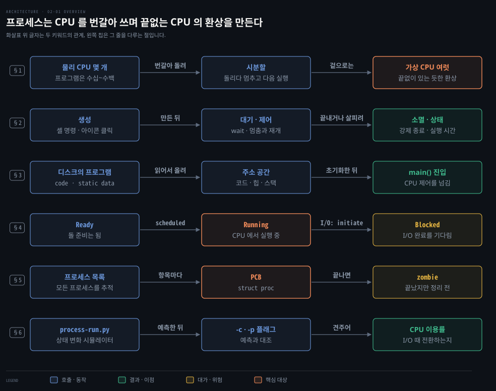
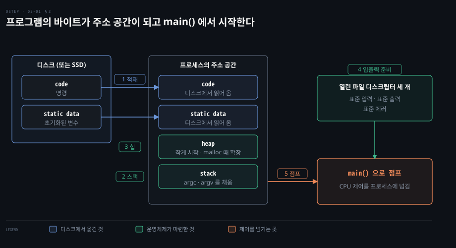
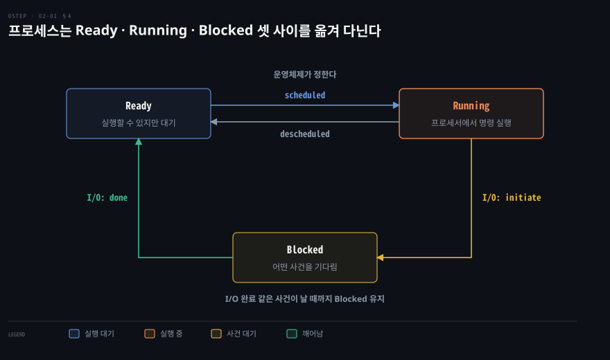
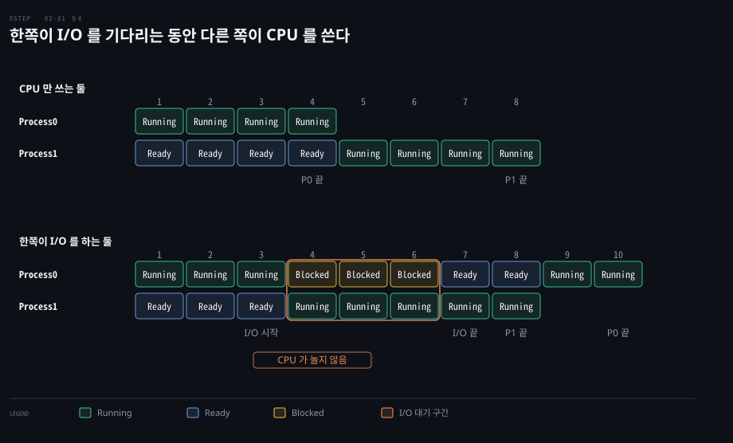
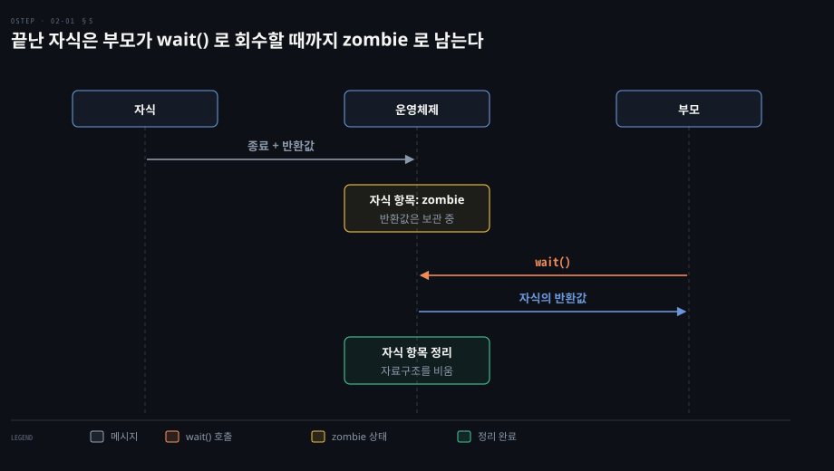

# CPU 가 끝없이 있는 듯 보이게 하는 법 — 프로세스 추상·상태 전이·프로세스 목록
---

## 핵심 요약

> 운영체제는 실행 중인 프로그램을 프로세스라는 추상으로 묶고, 프로세스 여럿이 CPU 를 번갈아 쓰게 해서 CPU 가 끝없이 있는 듯한 환상을 만듭니다.
>
> 프로세스는 상태를 오가며 실행되고, 운영체제는 프로세스마다 기록을 남겨 이를 추적합니다.

풀어야 할 문제는 프로세스가 무엇인지, 디스크의 프로그램이 어떻게 프로세스가 되는지, 운영체제가 프로세스를 어떻게 기록하는지입니다.

프로세스의 한 순간은 프로세스가 접근하는 메모리, 레지스터, 열어 둔 파일로 요약됩니다. 프로그램은 코드 적재, 스택과 힙 마련, 표준 입출력 준비를 거쳐 `main()` 에서 시작합니다. 실행 중에는 Running, Ready, Blocked 셋을 오가고 끝나면 부모가 회수하기 전까지 zombie 로 남습니다. 운영체제는 프로세스마다 정보를 담는 구조체인 PCB(process control block)를 두고 이를 프로세스 목록으로 묶습니다.


## 학습 목표

이 내용을 읽고 나면:

1. 프로세스가 무엇이고 시분할이 CPU 의 환상을 어떻게 만드는지, 메커니즘과 정책이 무엇을 가르는지 설명할 수 있습니다.
2. 프로세스를 요약하는 기계 상태의 구성요소와 프로세스 API 다섯 종류를 말할 수 있습니다.
3. 프로그램이 프로세스가 되는 단계를 순서대로 말할 수 있습니다.
4. Running, Ready, Blocked 사이의 전이 네 개와 그 원인을 상태 추적 표에서 읽어 낼 수 있습니다.
5. 프로세스 목록, PCB, zombie 의 역할을 말하고 리눅스 `ps` 의 STAT 글자와 연결할 수 있습니다.

아래 개념도는 프로세스 한 개의 일생을 가운데 줄에 왼쪽에서 오른쪽으로 놓고, 그 위아래에 일생을 받치는 띠를 하나씩 얹었습니다. 가운데 줄은 프로그램 적재에서 시작해 실행 중의 세 상태를 거쳐 zombie 와 부모의 회수로 끝납니다. 적재는 3절이, 세 상태는 4절이, zombie 와 회수는 5절이 다룹니다.

위 띠는 물리 CPU 몇 개를 번갈아 돌려 CPU 가 끝없이 있는 듯 보이게 하는 시분할이고 1절이 다룹니다. 이 띠가 프로세스가 Ready 와 Running 을 오가는 까닭을 줍니다. 아래 띠는 운영체제가 PCB 와 프로세스 목록으로 일생 전체를 추적하는 방법이고 5절이 다룹니다. 파란 칸은 일생 줄과 시분할 띠이고 주황 칸은 이 글이 고른 핵심인 CPU 환상이며 초록 칸은 운영체제의 추적 장치입니다. 오른쪽 위 회색 칸은 2절의 프로세스 API 로, 줄기에 들지 않아 점선으로만 이었습니다.




## 프로세스 한 개의 일생

> 프로세스 한 개는 생성·적재·실행·회수의 일생을 거치며, 운영체제는 이 전 과정을 프로세스 목록과 PCB 로 추적합니다.

1절이 프로세스 추상과 기계 상태의 틀을 세우고, 2~4절이 API 요청부터 적재·실행·상태 전이까지를 따라갑니다. 5절은 이 전 생애를 담는 자료구조(프로세스 목록·PCB)와 종료 후 회수(`zombie`)를 다룹니다.

| 단계 | 주체 | 받치는 개념 | 맡는 절 |
|---|---|---|---|
| 1 추상과 기계 상태 | 운영체제 | 프로세스, 기계 상태, 시분할 | 1 |
| 2 생성 요청 | 사용자 · 프로그램 | 프로세스 API | 2 |
| 3 적재와 시작 | 운영체제 | 주소 공간, 스택, 힙, 파일 디스크립터 | 3 |
| 4 실행과 전이 | 운영체제(스케줄러) | Running, Ready, Blocked | 4 |
| 5 목록 추적과 회수 | 운영체제 | 프로세스 목록, PCB, zombie | 5 |

6절은 이 흐름을 시뮬레이터로 확인하는 숙제라 단계에 속하지 않습니다. 3단계에서 `main()` 으로 CPU 를 넘기는 방법은 [CPU 를 직접 쓰게 하면서 통제권을 지키는 법](./04-01.CPU%20%EB%A5%BC%20%EC%A7%81%EC%A0%91%20%EC%93%B0%EA%B2%8C%20%ED%95%98%EB%A9%B4%EC%84%9C%20%ED%86%B5%EC%A0%9C%EA%B6%8C%EC%9D%84%20%EC%A7%80%ED%82%A4%EB%8A%94%20%EB%B2%95%20%E2%80%94%20%EC%A0%9C%ED%95%9C%EB%90%9C%20%EC%A7%81%EC%A0%91%20%EC%8B%A4%ED%96%89%C2%B7trap%C2%B7%ED%83%80%EC%9D%B4%EB%A8%B8%20%EC%9D%B8%ED%84%B0%EB%9F%BD%ED%8A%B8.md)(04-01 노트)에서 다룹니다. 4단계의 전이를 실제로 일으키는 문맥 교환도 그 노트의 주제입니다.


## 1. 프로세스 추상과 시분할

> 프로세스는 실행 중인 프로그램이고, 운영체제는 프로세스를 번갈아 돌리는 시분할로 CPU 가 여럿 있는 듯한 환상을 만듭니다.
>
> 물리 CPU 는 몇 개뿐인데 어떻게 끝없는 CPU 환상을 만들지 묻고, 프로세스의 기계 상태와 메커니즘·정책의 구분을 세웁니다.

흐름 위치: 1 추상과 기계 상태 · 받치는 개념 — 프로세스, 시분할, 기계 상태

### CPU 환상이라는 문제

데스크톱에서는 웹 브라우저, 메일 프로그램, 게임, 음악 플레이어를 한꺼번에 돌립니다. 시스템은 겉보기에 수십, 수백 개의 프로세스를 동시에 돌립니다. 사용자는 CPU 가 비어 있는지 걱정하지 않고 프로그램을 실행하기만 하면 됩니다.

여기서 이 장의 핵심 질문이 나옵니다. 물리 CPU 는 몇 개뿐인데, 운영체제는 어떻게 CPU 가 거의 끝없이 있는 듯한 환상을 줄 수 있습니까?[^crux]

운영체제는 CPU 를 가상화해서 환상을 만듭니다. 한 프로세스를 돌리다 멈추고 다른 프로세스를 돌리기를 되풀이하면, 물리 CPU 가 하나여도 가상 CPU 가 여럿 있는 듯 보입니다.

### 시분할과 공간 분할

**시분할**(time sharing)은 자원을 한 주체가 잠깐 쓰고 다음 주체가 잠깐 쓰는 식으로 나눠 쓰게 하는 기본 기법입니다. CPU 와 네트워크 링크가 이렇게 나뉩니다. 대가는 성능으로, CPU 를 나눠 쓰면 프로세스마다 더 느리게 돕니다.

시분할의 짝은 자원을 공간으로 쪼개 주체마다 몫을 주는 **공간 분할**(space sharing)입니다.

| 공유 방식 | 나누는 방법 | 예 |
|---|---|---|
| 시분할 | 시간을 쪼개 번갈아 씀 | CPU, 네트워크 링크 |
| 공간 분할 | 공간을 쪼개 주체마다 몫을 줌 | 디스크 공간 |

디스크 공간에서는 블록 하나가 파일 하나에 할당되면, 사용자가 그 파일을 지우기 전에는 다른 파일에 주어지지 않습니다.

### 메커니즘과 정책

CPU 가상화를 잘 구현하려면 저수준 장치와 고수준 판단이 모두 필요합니다.

**메커니즘**(mechanism)은 필요한 기능을 구현하는 저수준 방법이나 규약입니다.

문맥 교환(context switch)이 한 예입니다. 이는 운영체제가 한 CPU 에서 프로그램 하나를 멈추고 다른 프로그램을 시작하는 능력입니다. 현대 운영체제는 모두 이 시분할 메커니즘을 씁니다. 문맥 교환이 레지스터를 옮기는 방식은 [제한된 직접 실행 노트(04-01)](./04-01.CPU%20%EB%A5%BC%20%EC%A7%81%EC%A0%91%20%EC%93%B0%EA%B2%8C%20%ED%95%98%EB%A9%B4%EC%84%9C%20%ED%86%B5%EC%A0%9C%EA%B6%8C%EC%9D%84%20%EC%A7%80%ED%82%A4%EB%8A%94%20%EB%B2%95%20%E2%80%94%20%EC%A0%9C%ED%95%9C%EB%90%9C%20%EC%A7%81%EC%A0%91%20%EC%8B%A4%ED%96%89%C2%B7trap%C2%B7%ED%83%80%EC%9D%B4%EB%A8%B8%20%EC%9D%B8%ED%84%B0%EB%9F%BD%ED%8A%B8.md)의 4절에서 봅니다.

메커니즘 위에 놓이는 운영체제의 판단이 **정책**(policy)입니다. 정책은 운영체제 안에서 결정을 내리는 알고리즘입니다. CPU 에서 돌 수 있는 프로그램이 여럿일 때 어느 것을 돌릴지는 스케줄링 정책이 정합니다.

스케줄링 정책은 대체로 과거 정보, 작업 부하 특성, 성능 지표를 바탕으로 결정합니다.

- 과거 정보: 지난 1분 동안 어느 프로그램이 더 돌았는지 봅니다.
- 작업 부하 특성: 실행 중인 프로그램이 어떤 종류의 작업인지 봅니다.
- 성능 지표: 대화형 성능과 처리량 가운데 무엇을 최적화할지 정합니다.

메커니즘은 어떻게(how)에 답하고 정책은 어느 것(which)에 답합니다. 둘을 나누면 메커니즘을 고치지 않고 정책만 바꿀 수 있습니다. 이것이 모듈성이라는 일반 설계 원칙의 한 형태입니다.

### 프로세스를 이루는 기계 상태

프로세스는 실행 중인 프로그램입니다. 프로그램 자체는 디스크에 놓인 명령 묶음과 약간의 정적 데이터일 뿐입니다. 운영체제가 그 바이트를 가져와 실행해서 쓸모 있는 것으로 바꿉니다. 프로그램과 프로세스의 구분은 [TLPI 노트](../tlpi_the-linux-programming-interface/06-01.%ED%94%84%EB%A1%9C%EC%84%B8%EC%8A%A4%EB%8A%94%20%ED%94%84%EB%A1%9C%EA%B7%B8%EB%9E%A8%EC%97%90%20%EC%BB%A4%EB%84%90%EC%9D%B4%20%EC%9E%90%EC%9B%90%EC%9D%84%20%EB%B6%99%EC%9D%B8%20%EA%B2%83%EC%9D%B4%EB%8B%A4.md)에서 따로 다룹니다.

한 순간의 프로세스는 실행 중에 읽거나 바꿀 수 있는 자원의 목록으로 요약할 수 있으며 이를 **기계 상태**(machine state)라 부릅니다. 기계 상태는 크게 주소 공간, 레지스터(PC 와 스택·프레임 포인터 포함), 입출력 정보 셋으로 나뉩니다.

| 구성요소 | 담는 것 | 프로세스의 일부인 이유 |
|---|---|---|
| 주소 공간(address space) | 프로세스가 접근할 수 있는 메모리 | 명령과 읽고 쓰는 데이터가 메모리에 있음 |
| 레지스터 | 명령이 읽고 바꾸는 값 | 많은 명령이 레지스터를 직접 다룸 |
| 레지스터 — 프로그램 카운터(PC, IP) | 다음에 실행할 명령 | 실행 위치를 정함 |
| 레지스터 — 스택·프레임 포인터 | 스택의 위치 | 스택이 함수 인자, 지역 변수, 반환 주소를 담음 |
| 입출력 정보 | 프로세스가 열어 둔 파일 목록 | 프로그램이 영속 저장 장치에도 접근함 |

이 구성요소가 5절의 PCB 에서 필드로 다시 나옵니다.


## 2. 프로세스 API 다섯 종류

> 어떤 운영체제의 프로세스 인터페이스에도 생성, 소멸, 대기, 기타 제어, 상태 조회의 다섯 기능이 형태만 달리해 들어 있습니다. 실제 호출 이름은 [프로세스 생성을 fork 와 exec 으로 쪼갠 이유](./03-01.%ED%94%84%EB%A1%9C%EC%84%B8%EC%8A%A4%20%EC%83%9D%EC%84%B1%EC%9D%84%20fork%20%EC%99%80%20exec%20%EC%9C%BC%EB%A1%9C%20%EC%AA%BC%EA%B0%A0%20%EC%9D%B4%EC%9C%A0%20%E2%80%94%20wait%C2%B7%EC%85%B8%20%EB%A6%AC%EB%8B%A4%EC%9D%B4%EB%A0%89%EC%85%98%C2%B7%EC%8B%9C%EA%B7%B8%EB%84%90.md)에서 다루고, 이 절은 기능의 종류만 세웁니다.

흐름 위치: 2 생성 요청 · 받치는 개념 — 프로세스 API

프로세스를 만들고 다루는 일은 운영체제가 내놓는 인터페이스를 거칩니다. 이 인터페이스를 프로세스 API 라 부르고 현대 운영체제는 어떤 형태로든 이를 제공합니다.

| 기능 | 하는 일 | 쓰이는 때 |
|---|---|---|
| 생성(Create) | 새 프로세스를 만듦 | 셸에 명령을 치거나 앱 아이콘을 더블클릭하면 운영체제가 지정한 프로그램의 프로세스를 만듦 |
| 소멸(Destroy) | 프로세스를 강제로 끝냄 | 스스로 끝나지 않는 폭주 프로세스를 사용자가 멈추려 할 때 |
| 대기(Wait) | 프로세스가 실행을 마칠 때까지 기다림 | 다른 프로세스의 종료를 기다려야 할 때 |
| 기타 제어(Miscellaneous Control) | 정지(suspend)했다가 재개(resume)함 | 프로세스를 한동안 멈췄다가 이어서 실행할 때 |
| 상태(Status) | 실행 시간이나 현재 상태 같은 정보를 얻음 | 프로세스가 지금 무엇을 하는지 알고 싶을 때 |

많은 프로세스는 일을 마치면 스스로 끝납니다. 소멸 기능은 그러지 않는 프로세스를 위한 것입니다.

이 가운데 생성은 3절의 적재 과정으로, 상태는 4절의 세 상태와 5절의 `ps` 로 이어집니다. 대기는 5절의 `wait()`, 기타 제어는 5절의 정지 상태(`T`)로 이어집니다. 소멸은 스스로 끝나지 않는 프로세스를 강제로 끝낼 때 씁니다.


## 3. 프로그램에서 프로세스로

> 운영체제는 디스크의 코드와 정적 데이터를 주소 공간에 올리고 스택을 마련합니다. 힙 메모리도 마련할 수 있고, 표준 입출력을 연 뒤 `main()` 으로 점프해 프로세스를 시작합니다.

흐름 위치: 3 적재와 시작 · 받치는 개념 — 주소 공간, 스택, 힙, 파일 디스크립터

디스크에 놓인 프로그램의 바이트가 실행 중인 프로세스가 되려면 운영체제가 몇 가지 일을 순서대로 해야 합니다. 아래 그림은 디스크의 프로그램에서 주소 공간이 만들어지고 `main()` 으로 넘어가기까지를 한 장에 담았습니다.



왼쪽 디스크에 있는 것은 code 와 static data 둘뿐입니다. 이 둘만 주소 공간으로 옮겨집니다. 스택과 표준 입출력은 운영체제가 새로 마련하고 힙은 작게 마련할 수 있습니다. 그림의 번호 1~5 는 운영체제가 일을 하는 순서이고, 위아래 자리는 주소 공간 안 영역의 배치입니다. 그래서 힙 상자가 스택 상자 위에 있어도 번호는 스택이 2, 힙이 3 입니다. 아래 세 소절이 이 번호 순서대로 1, 2·3, 4·5 를 맡습니다. 마지막 화살표가 CPU 제어를 프로세스에 넘기는 자리입니다.

### 코드와 정적 데이터 적재

운영체제가 프로그램을 돌리려고 처음 하는 일은 코드와 정적 데이터를 메모리에 올리는 것입니다. 정적 데이터는 초기화된 변수 같은 값입니다. 프로그램은 디스크(요즘 시스템에서는 플래시 기반 SSD)에 실행 파일 형식으로 있습니다. 운영체제는 그 바이트를 읽어 프로세스의 주소 공간 안 어딘가에 놓습니다.

초기의 단순한 운영체제는 프로그램을 실행하기 전에 한꺼번에 올리는 **즉시 적재**(eager loading)를 썼습니다. 현대 운영체제는 코드와 데이터 조각을 실행 중 필요할 때만 올리는 **지연 적재**(lazy loading)를 씁니다. 지연 적재가 실제로 동작하려면 페이징과 스와핑을 알아야 하는데, 이는 메모리 가상화 파트의 주제입니다.

### 스택과 힙 마련

코드와 정적 데이터가 올라가면 운영체제는 프로그램의 런타임 스택에 쓸 메모리를 할당합니다. C 프로그램은 스택에 지역 변수, 함수 인자, 반환 주소를 둡니다. 운영체제는 스택을 인자로 채우기도 합니다. `main()` 함수의 매개변수인 `argc` 와 `argv` 배열을 채워 넣습니다.

운영체제는 힙에 쓸 메모리도 할당할 수 있습니다. C 프로그램에서 힙은 명시적으로 요청한 동적 할당 데이터를 담습니다. 프로그램은 `malloc()` 으로 공간을 요청하고 `free()` 로 명시적으로 돌려줍니다. 연결 리스트, 해시 테이블, 트리 같은 자료구조가 힙을 필요로 합니다.

힙은 처음에는 작습니다. 프로그램이 돌면서 `malloc()` 으로 메모리를 더 요청하면 운영체제가 개입해 프로세스에 메모리를 더 할당할 수 있습니다.

### 입출력 준비와 main() 진입

운영체제는 입출력과 관련한 초기화도 합니다. 유닉스 계열에서는 프로세스마다 표준 입력, 표준 출력, 표준 에러의 파일 디스크립터(file descriptor) 셋이 기본으로 열려 있습니다. 파일 디스크립터는 프로세스가 열어 둔 입출력 대상을 가리키는 번호입니다. 이 디스크립터 덕에 프로그램은 터미널에서 입력을 읽고 화면에 출력을 찍을 수 있습니다.

코드와 정적 데이터를 올리고 스택을 만들어 초기화한 뒤 입출력을 준비하면 무대가 마련됩니다.

마지막 일이 프로그램을 진입점인 `main()` 에서 시작하는 것입니다. 운영체제가 `main()` 루틴으로 점프하면 새 프로세스에 CPU 제어가 넘어가고 프로그램이 실행을 시작합니다. 이 점프에 쓰이는 전용 메커니즘은 [제한된 직접 실행 노트(04-01)](./04-01.CPU%20%EB%A5%BC%20%EC%A7%81%EC%A0%91%20%EC%93%B0%EA%B2%8C%20%ED%95%98%EB%A9%B4%EC%84%9C%20%ED%86%B5%EC%A0%9C%EA%B6%8C%EC%9D%84%20%EC%A7%80%ED%82%A4%EB%8A%94%20%EB%B2%95%20%E2%80%94%20%EC%A0%9C%ED%95%9C%EB%90%9C%20%EC%A7%81%EC%A0%91%20%EC%8B%A4%ED%96%89%C2%B7trap%C2%B7%ED%83%80%EC%9D%B4%EB%A8%B8%20%EC%9D%B8%ED%84%B0%EB%9F%BD%ED%8A%B8.md)의 2절에 있습니다.


## 4. 프로세스 상태와 전이

> 프로세스는 Running, Ready, Blocked 셋 가운데 하나에 있고, 운영체제의 선택과 I/O 같은 사건이 상태를 옮깁니다. 다른 프로세스가 I/O 를 기다리는 동안 CPU 가 놀지 않게 하는 것이 전이의 쓸모입니다.

흐름 위치: 4 실행과 전이 · 받치는 개념 — Running, Ready, Blocked

### 세 상태와 네 전이

프로세스가 어느 순간 어떤 상태인지는 이른 시기의 컴퓨터 시스템에서 이미 쓰인 개념입니다. 단순화하면 상태는 셋입니다. 아래 그림에 세 상태와 그 사이의 전이 네 개를 그렸습니다.



Running 은 프로세스가 프로세서에서 명령을 실행 중인 상태입니다. Ready 는 실행할 준비가 됐지만 운영체제가 지금은 돌리지 않기로 한 상태입니다. Blocked 는 프로세스가 한 연산 때문에 어떤 사건이 일어나기 전에는 실행할 수 없는 상태입니다. 디스크에서 읽거나 네트워크에서 패킷을 기다리는 프로세스가 대표적입니다. 그 프로세스가 Blocked 가 되면 다른 프로세스가 프로세서를 씁니다.

Ready 와 Running 사이의 이동은 운영체제의 재량입니다. Ready 에서 Running 으로 옮기면 프로세스가 scheduled 된 것이고 Running 에서 Ready 로 옮기면 descheduled 된 것입니다.

프로세스가 I/O 를 시작해 Blocked 가 되면 운영체제는 I/O 완료 같은 사건이 일어날 때까지 그 상태로 둡니다. 사건이 일어나면 프로세스는 다시 Ready 가 됩니다. 운영체제가 정하면 곧바로 Running 으로 이어질 수도 있습니다.

### 시간 순서로 따라가기

시각마다 프로세스 둘의 상태를 적어 보면 전이가 어떻게 이어지는지 보입니다. 아래 그림의 위쪽 표는 CPU 만 쓰는 두 프로세스이고 아래쪽 표는 한쪽이 I/O 를 하는 경우입니다.



위쪽 표에서 Process0 은 시각 1~4 에 Running 이고 그동안 Process1 은 Ready 입니다. 시각 4 에 Process0 이 끝나면 Process1 이 시각 5~8 에 Running 이고 시각 8 에 끝납니다.

아래쪽 표에서는 Process0 이 시각 3 에 I/O 를 시작합니다. 시각 4~6 에 Process0 은 Blocked 이고 운영체제는 CPU 를 쓰지 않는 Process0 을 두고 Process1 을 돌립니다. Process1 이 도는 시각 7 에 I/O 가 끝나서 Process0 은 Ready 로 옮겨집니다.

시각 8 에 Process1 이 끝난 뒤에야 Process0 이 시각 9~10 에 Running 이 되고 끝납니다.

### 운영체제가 내리는 결정

이 단순한 예에서도 운영체제는 결정을 여러 번 내립니다. 먼저 Process0 이 I/O 를 시작했을 때 Process1 을 돌리기로 합니다. CPU 를 계속 바쁘게 해서 자원 이용률을 높이는 결정입니다. 시각 7 에 I/O 가 끝났는데도 Process0 으로 돌아가지 않은 것도 운영체제의 결정입니다. 책은 이 결정이 좋은지 분명하지 않다고 적고 독자에게 어떻게 생각하는지 묻습니다.

이런 결정은 운영체제의 스케줄러가 내립니다. 어느 프로세스를 먼저 돌릴지 정하는 CPU 스케줄링 정책은 CPU 스케줄링 장에서 따로 다룹니다. 그런데 프로세스가 Running 인 동안 CPU 를 쥔 것은 그 프로세스이므로 운영체제 코드는 돌지 않습니다. 운영체제가 Running 을 Ready 로 내리려면 먼저 CPU 를 되찾아야 합니다.[^regain] 그 방법과 상태를 실제로 옮기는 저수준 장치인 문맥 교환은 [제한된 직접 실행 노트(04-01)](./04-01.CPU%20%EB%A5%BC%20%EC%A7%81%EC%A0%91%20%EC%93%B0%EA%B2%8C%20%ED%95%98%EB%A9%B4%EC%84%9C%20%ED%86%B5%EC%A0%9C%EA%B6%8C%EC%9D%84%20%EC%A7%80%ED%82%A4%EB%8A%94%20%EB%B2%95%20%E2%80%94%20%EC%A0%9C%ED%95%9C%EB%90%9C%20%EC%A7%81%EC%A0%91%20%EC%8B%A4%ED%96%89%C2%B7trap%C2%B7%ED%83%80%EC%9D%B4%EB%A8%B8%20%EC%9D%B8%ED%84%B0%EB%9F%BD%ED%8A%B8.md)에서 이어집니다.


## 5. 프로세스 목록과 zombie

> 운영체제는 프로세스마다 PCB 하나를 두고 프로세스 목록으로 묶어 상태를 추적하며, 끝난 프로세스는 zombie 로 남아 부모가 반환값을 가져갈 때까지 기다립니다.

흐름 위치: 5 목록 추적과 회수 · 받치는 개념 — 프로세스 목록, PCB, zombie

### 프로세스 목록과 PCB

운영체제도 프로그램이라서 중요한 정보를 추적하는 자료구조를 씁니다. 시스템의 모든 프로세스 정보를 담는 목록을 **프로세스 목록**(process list, task list 라고도 함)이라 부릅니다.[^plist] 뒤의 xv6 `ptable.proc` 이 그런 목록입니다. 프로세스 상태를 추적하려면 Ready 인 프로세스를 모아 두고 지금 도는 프로세스가 무엇인지 따로 기록하는 구조가 대개 필요합니다. Blocked 프로세스도 추적해야 I/O 가 끝났을 때 맞는 프로세스를 깨워 Ready 로 돌릴 수 있습니다.

프로세스 하나의 정보를 담는 개별 구조체를 **PCB**(Process Control Block)라 부릅니다. 프로세스 기술자(process descriptor)라고도 합니다. C 구조체에 프로세스별 정보를 담은 것이 전부입니다.

### xv6 의 struct proc

교육용 커널 xv6 가 프로세스마다 추적하는 정보는 아래 코드에 있습니다.[^xv6] 리눅스에서 같은 역할을 하는 구조체는 `task_struct` 입니다.[^task]

```c
// the registers xv6 will save and restore
// to stop and subsequently restart a process
struct context {
  int eip;
  int esp;
  int ebx;
  int ecx;
  int edx;
  int esi;
  int edi;
  int ebp;
};

// the different states a process can be in
enum proc_state { UNUSED, EMBRYO, SLEEPING,
                  RUNNABLE, RUNNING, ZOMBIE };

// the information xv6 tracks about each process
// including its register context and state
struct proc {
  char *mem;              // Start of process memory
  uint sz;                // Size of process memory
  char *kstack;           // Bottom of kernel stack
                          // for this process
  enum proc_state state; // Process state
  int pid;                // Process ID
  struct proc *parent;    // Parent process
  void *chan;             // If !zero, sleeping on chan
  int killed;             // If !zero, has been killed
  struct file *ofile[NOFILE]; // Open files
  struct inode *cwd;      // Current directory
  struct context context; // Switch here to run process
  struct trapframe *tf;   // Trap frame for the
                          // current interrupt
};
```

xv6 의 `proc.c` 는 `struct proc` 을 `ptable.proc` 배열로 모아 프로세스 목록으로 씁니다. 위 코드는 단순화본이라 xv6 소스의 `proc.h` 와 필드 이름이 조금 다릅니다.[^xv6src]

아래 표에서 메모리·레지스터·열린 파일은 1절의 기계 상태에 해당하고 나머지 네 항목은 운영체제가 프로세스를 관리하려고 따로 두는 정보로 볼 수 있습니다.

| 항목 | 필드 | 담는 것 |
|---|---|---|
| 메모리 | `mem`, `sz` | 프로세스 메모리의 시작과 크기 |
| 커널 스택 | `kstack` | 이 프로세스의 커널 스택 바닥 |
| 레지스터 | `context` | 멈춘 프로세스의 레지스터 값 |
| 열린 파일 | `ofile`, `cwd` | 열린 파일들과 현재 디렉터리 |
| 식별과 관계 | `pid`, `parent` | 프로세스 ID 와 부모 프로세스 |
| 상태 | `state`, `chan`, `killed` | 프로세스 상태, 잠든 대상, 종료 표시 |
| 인터럽트 | `tf` | 현재 인터럽트의 trap frame |

`kstack` 은 이 프로세스가 커널에서 실행될 때 쓰는 스택입니다. `tf` 는 시스템 콜이나 인터럽트로 커널에 들어갈 때 되돌아갈 사용자 레지스터와 PC 를 커널 스택에 담아 두는 구조체인 trap frame 을 가리킵니다. 둘이 왜 필요한지는 trap 을 다루는 [제한된 직접 실행 노트(04-01)](./04-01.CPU%20%EB%A5%BC%20%EC%A7%81%EC%A0%91%20%EC%93%B0%EA%B2%8C%20%ED%95%98%EB%A9%B4%EC%84%9C%20%ED%86%B5%EC%A0%9C%EA%B6%8C%EC%9D%84%20%EC%A7%80%ED%82%A4%EB%8A%94%20%EB%B2%95%20%E2%80%94%20%EC%A0%9C%ED%95%9C%EB%90%9C%20%EC%A7%81%EC%A0%91%20%EC%8B%A4%ED%96%89%C2%B7trap%C2%B7%ED%83%80%EC%9D%B4%EB%A8%B8%20%EC%9D%B8%ED%84%B0%EB%9F%BD%ED%8A%B8.md)의 2절에서 이어집니다.

xv6 는 프로세스를 멈추고 다시 시작하려고 `context` 구조체에 레지스터를 저장하고 복원합니다. 프로세스가 멈추면 레지스터가 이 메모리 위치에 저장됩니다. 저장된 값을 실제 물리 레지스터에 되돌려 놓으면 운영체제가 프로세스를 다시 실행할 수 있습니다. 이 기법이 문맥 교환입니다.

프로세스의 ID 와 부모 관계, 부모가 끝났을 때 자식이 어떻게 되는지는 [TLPI 노트](../tlpi_the-linux-programming-interface/06-01.%ED%94%84%EB%A1%9C%EC%84%B8%EC%8A%A4%EB%8A%94%20%ED%94%84%EB%A1%9C%EA%B7%B8%EB%9E%A8%EC%97%90%20%EC%BB%A4%EB%84%90%EC%9D%B4%20%EC%9E%90%EC%9B%90%EC%9D%84%20%EB%B6%99%EC%9D%B8%20%EA%B2%83%EC%9D%B4%EB%8B%A4.md)가 다룹니다. 리눅스의 실제 task 구조와 스택은 [프로세스와 스레드 노트](../linux-kernel-programming/06-01.%ED%94%84%EB%A1%9C%EC%84%B8%EC%8A%A4%EC%99%80%20%EC%8A%A4%EB%A0%88%EB%93%9C%20%281%29%20%E2%80%94%20%EC%BB%A8%ED%85%8D%EC%8A%A4%ED%8A%B8%C2%B7VAS%C2%B7%EC%8A%A4%ED%83%9D.md)에 있습니다.

### 끝났지만 정리 전인 zombie

`enum proc_state` 의 이름은 본문의 세 상태와 이렇게 대응합니다. `RUNNING` 은 Running 이고 `RUNNABLE` 은 Ready 이며 `SLEEPING` 은 Blocked 입니다. 프로세스는 `chan` 에 기다리는 대상을 적고 `SLEEPING` 이 됩니다. xv6 `proc.c` 에서 같은 `chan` 으로 `wakeup()` 이 불리면 `RUNNABLE` 로 돌아옵니다.[^xv6src]

나머지 셋은 세 상태 밖에 있습니다. `UNUSED` 는 `ptable.proc` 배열에서 비어 있는 칸입니다. 시스템에 따라 프로세스를 만드는 동안 머무는 초기 상태를 두기도 합니다. `EMBRYO` 가 그 상태입니다. xv6 `proc.c` 의 `allocproc()` 은 빈 `UNUSED` 칸을 찾아 `EMBRYO` 로 바꿉니다.[^xv6src] 프로세스가 이미 끝났지만 아직 정리되지 않은 최종 상태를 둘 수도 있습니다. 유닉스 계열에서 이 최종 상태가 **zombie** 입니다.

zombie 상태는 쓸모가 있습니다. 다른 프로세스, 보통은 그 프로세스를 만든 부모가 반환값을 살펴 방금 끝난 프로세스가 성공했는지 볼 수 있습니다. 유닉스 계열에서 프로그램은 일을 성공적으로 마치면 0 을, 아니면 0 이 아닌 값을 돌려줍니다.

부모는 끝으로 `wait()` 같은 호출을 한 번 더 합니다. 이 호출이 자식의 완료를 기다리면서 운영체제에 그 프로세스를 가리키던 자료구조를 정리해도 된다고 알립니다. 아래 그림에 이 순서를 그렸습니다.



zombie 는 정리되기 전까지 커널의 프로세스 테이블에서 칸 하나를 차지합니다. 테이블이 가득 차면 새 프로세스를 만들 수 없습니다.[^wait]

부모가 먼저 끝나면 살아 있는 고아 자식뿐 아니라 zombie 자식도 입양됩니다. 입양하는 쪽은 `init` 이거나 가장 가까운 `subreaper` 입니다. `init` 은 부팅 때 처음 뜨는 PID 1 프로세스입니다.[^init] `subreaper` 는 고아가 된 자손을 `init` 대신 입양하도록 지정한 조상 프로세스입니다.[^subr]

`init` 은 입양한 zombie 를 자동으로 `wait` 해서 없앱니다.[^wait] 반면 `subreaper` 는 입양한 자식이 끝나면 `SIGCHLD` 신호를 받습니다. 그때 직접 `wait` 를 호출해 종료 상태를 확인하고 회수할 수 있습니다.[^subr]

### 리눅스에서 상태를 보는 곳

리눅스의 `ps` 는 STAT 열에 프로세스 상태를 글자로 보입니다. 주요 글자를 이 장의 상태와 이으면 아래와 같습니다.[^ps]

| STAT 글자 | `ps` 의 설명 | 이 장의 상태 |
|---|---|---|
| R | running or runnable(실행 큐에 있음) | Running 과 Ready 둘 다 |
| S | interruptible sleep(사건 완료를 기다림) | Blocked |
| D | uninterruptible sleep(대개 I/O) | Blocked |
| T | job control 신호로 멈춤 | 해당 상태 없음(2절의 정지와 같은 종류) |
| Z | defunct, 끝났지만 부모가 회수하지 않음 | zombie |

`S` 와 `D` 는 둘 다 Blocked 이지만 깨우는 조건이 다릅니다. `ps(1)` 에서 `S` 는 interruptible sleep 이고, `D` 는 uninterruptible sleep 입니다.

`ps` 는 `/proc` 파일을 읽어 상태를 보입니다. 리눅스 커널은 `TASK_INTERRUPTIBLE` 상태를 `S` 로, `TASK_UNINTERRUPTIBLE` 상태를 `D` 로 `/proc` 에 내보냅니다.[^sleep] `TASK_INTERRUPTIBLE` 대기는 기다리는 조건이 참이 되거나 신호를 받을 때까지 프로세스를 재웁니다. `TASK_UNINTERRUPTIBLE` 대기는 조건이 참이 될 때까지 재웁니다. 대표 매크로가 `wait_event_interruptible()` 과 `wait_event()` 입니다.

`T` 는 `SIGSTOP` 같은 정지 신호로 멈춘 프로세스이고 `SIGCONT` 가 다시 돌게 합니다.[^sig]

`ps` 의 R 은 지금 도는 프로세스와 돌 차례를 기다리는 프로세스를 가르지 않고 둘 다 R 로 보입니다. `/proc/<pid>/status` 의 State 줄도 같은 계열의 글자를 씁니다.[^proc]


## 6. process-run.py 숙제

> 4장의 숙제는 `process-run.py` 시뮬레이터로 프로세스의 상태가 어떻게 바뀌는지 예측하고 확인하는 것입니다. 이 노트는 시뮬레이터를 돌리지 않았으므로 어떤 값도 싣지 않았고, 무엇을 보는 숙제인지만 적습니다.

흐름 위치: 흐름 밖 — 4절의 상태 전이를 시뮬레이터로 확인하는 숙제

`process-run.py` 는 프로그램이 CPU 를 쓰거나 I/O 를 하는 동안 프로세스 상태가 어떻게 바뀌는지 보여 줍니다. 예를 들어 CPU 를 쓰는 일은 덧셈 명령 실행이고, I/O 는 디스크에 요청을 보내고 끝나기를 기다리는 일입니다. 질문은 대체로 먼저 예측한 뒤 `-c` 와 `-p` 플래그로 맞는지 확인하는 순서를 따릅니다.[^hw]

표의 명령은 아래 여섯 플래그를 조합합니다.[^hw]

- `-l X1:Y1,X2:Y2,...`: 쉼표로 나눈 프로세스 목록입니다. `X` 는 명령 수, `Y` 는 각 명령이 CPU 명령일 확률(0~100)입니다(예: `5:100` 은 CPU 명령 5개, `1:0` 은 I/O 요청 1개).
- `-s`: 무작위 프로세스를 만드는 난수 시드입니다.
- `-S`: I/O 를 내었을 때의 전환 정책입니다(`SWITCH_ON_IO` 는 다른 프로세스로 전환, `SWITCH_ON_END` 는 끝날 때까지 대기).
- `-I`: I/O 가 끝난 직후의 실행 정책입니다(`IO_RUN_IMMEDIATE` 는 곧바로 실행, `IO_RUN_LATER` 는 차례가 올 때까지 대기).
- `-c` 와 `-p`: `-c` 는 실행 추적 답을 계산해 찍고, `-p` 는 `-c` 와 함께 쓸 때 끝부분 통계를 출력합니다.

| 번호 | 플래그 | 보는 것 |
|---|---|---|
| 1 | `-l 5:100,5:100` | 두 프로세스가 CPU 만 쓸 때 CPU 이용률이 얼마여야 하는가 |
| 2 | `-l 4:100,1:0` | 명령 4개를 모두 CPU 에 쓰는 프로세스와 I/O 하나를 내고 기다리는 프로세스가 모두 끝나는 데 걸리는 시간 |
| 3 | `-l 1:0,4:100` | 두 프로세스의 순서를 바꾸면 결과가 달라지는가 |
| 4 | `-l 1:0,4:100 -c -S SWITCH_ON_END` | I/O 를 하는 동안 다른 프로세스로 전환하지 않을 때 일어나는 일 |
| 5 | `-l 1:0,4:100 -c -S SWITCH_ON_IO` | I/O 를 기다리는 동안 다른 프로세스로 전환할 때 일어나는 일 |
| 6 | `-l 3:0,5:100,5:100,5:100 -S SWITCH_ON_IO -c -p -I IO_RUN_LATER` | I/O 가 끝나도 하던 프로세스를 계속 돌릴 때 자원이 잘 쓰이는가 |
| 7 | 6번과 같은 프로세스에 `-I IO_RUN_IMMEDIATE` | I/O 를 끝낸 프로세스를 바로 돌리면 무엇이 다르고 왜 좋은 생각일 수 있는가 |
| 8 | `-s 1 -l 3:50,3:50` 등 | 무작위로 만든 프로세스의 상태 추적을 예측하고 `-I` 와 `-S` 의 두 값을 견줌 |

4~8번은 4절의 「운영체제가 내리는 결정」에서 본 결정을 플래그로 바꿔 보는 질문입니다. I/O 때 다른 프로세스로 넘어갈지, I/O 가 끝났을 때 곧바로 돌릴지가 그 결정입니다.


## 연습 문제

> 1~3번은 본문을 떠올려 답하고 4~6번은 본문의 그림과 코드를 읽고 답하며 7~10번은 전이와 API 와 `ps` 글자를 상황에 맞춰 봅니다. 답을 적은 뒤 정답 절과 맞춰 봅니다.

1. 프로세스와 프로그램은 무엇이 다릅니까? 시분할은 CPU 가 끝없이 있는 듯한 환상을 어떻게 만들고 그 대가는 무엇입니까?
2. 프로세스의 기계 상태를 이루는 구성요소를 말하고 각각이 프로세스의 일부인 이유를 한 줄로 설명해 보십시오.
3. 디스크의 프로그램이 프로세스가 되기까지 운영체제가 하는 일을 순서대로 말해 보십시오. 즉시 적재와 지연 적재는 어떻게 다릅니까?
4. 상태 추적 그림의 아래쪽 표에서 시각 7 에 Process0 이 Ready 인데 시각 8 에도 Ready 인 이유는 무엇입니까?
5. `struct proc` 에서 기계 상태의 세 구성요소(메모리, 레지스터, 열린 파일)에 해당하는 필드는 각각 무엇입니까?
6. zombie 상태는 왜 필요합니까? 부모가 `wait()` 를 부르지 않으면 어떻게 됩니까?
7. 상태 추적 그림의 아래쪽 표에서 상태가 바뀌는 다음 네 지점을 짚어 보십시오. Process0 의 시각 3→4, Process1 의 시각 3→4, Process0 의 시각 6→7, Process0 의 시각 8→9 는 각각 어떤 전이이고 원인은 무엇입니까?
8. 같은 표의 시각 4~6 에서 Blocked 상태는 자원 이용률에 어떤 차이를 만듭니까?
9. 프로세스 API 다섯 종류를 말해 보십시오. 5절에서 부모가 zombie 를 정리할 때 부르는 `wait()` 는 그중 어느 기능입니까?
10. `ps` 의 STAT 이 R, D, Z 인 프로세스는 각각 이 장의 어느 상태입니까? S 와 D 는 둘 다 Blocked 인데 무엇이 다릅니까?


## 정답 (자답 후 펼치기)

### 정답 1

프로그램은 디스크에 놓인 명령과 약간의 정적 데이터입니다. 프로세스는 운영체제가 그 프로그램을 실행 중인 것입니다.

시분할은 프로세스를 잠깐 돌리고 멈추고 다른 프로세스를 돌리기를 되풀이해 물리 CPU 가 하나여도 가상 CPU 가 여럿인 듯 보이게 합니다. 대가는 성능입니다. CPU 를 나눠 쓰므로 프로세스마다 더 느리게 돕니다.

### 정답 2

구성요소는 주소 공간, 레지스터, 입출력 정보(열어 둔 파일)입니다. 주소 공간은 명령과 데이터가 메모리에 있어서 프로세스의 일부입니다. 레지스터도 많은 명령이 직접 읽고 바꾸므로 프로세스의 일부입니다. 레지스터 가운데 프로그램 카운터는 다음에 실행할 명령을, 스택 포인터와 프레임 포인터는 함수 인자와 지역 변수와 반환 주소를 담는 스택을 가리킵니다. 프로그램이 영속 저장 장치에도 접근하므로 열어 둔 파일 목록도 기계 상태에 들어갑니다.

### 정답 3

먼저 코드와 정적 데이터를 디스크에서 읽어 주소 공간에 올립니다. 이어서 스택 메모리를 할당해 `argc` 와 `argv` 로 채웁니다. 힙 메모리도 작게 마련할 수 있고 표준 입력과 출력과 에러의 파일 디스크립터 세 개를 엽니다.

마지막으로 `main()` 으로 점프해 CPU 제어를 프로세스에 넘깁니다. 즉시 적재는 실행 전에 한꺼번에 올리는 방식이고 지연 적재는 코드와 데이터 조각을 필요할 때만 올리는 방식이며 현대 운영체제가 후자를 씁니다.

### 정답 4

시각 7 에 I/O 가 끝나서 Process0 은 Blocked 에서 Ready 가 됩니다. 그러나 운영체제가 Process1 을 계속 돌리기로 했으므로 Process0 은 시각 8 에도 Ready 이고 Process1 이 시각 8 에 끝난 뒤인 시각 9 에야 Running 이 됩니다. 이 선택이 좋은지 판단하는 일은 스케줄러의 정책에 속합니다.

### 정답 5

메모리는 `mem` 과 `sz` 이고 프로세스 메모리의 시작과 크기를 담습니다. 레지스터는 `context` 이며 프로세스가 멈출 때 레지스터 값이 여기에 저장됩니다. 열린 파일은 `ofile` 이고 현재 디렉터리를 담은 `cwd` 가 곁에 있습니다.

### 정답 6

zombie 는 프로세스가 끝났지만 정리되지 않은 최종 상태입니다. 이 상태가 있어야 부모가 반환값을 살펴 자식이 성공했는지 알 수 있습니다. 부모가 `wait()` 를 부르면 반환값을 가져가고 운영체제가 자식의 자료구조를 정리합니다. 부모가 부르지 않으면 zombie 는 커널의 프로세스 테이블 칸 하나를 계속 차지하고 테이블이 가득 차면 새 프로세스를 만들 수 없습니다. 부모가 끝나면 `init` 이나 `subreaper` 가 자식을 입양하며, `init` 은 입양한 zombie 를 자동으로 `wait` 해서 없앱니다.

### 정답 7

Process0 의 시각 3→4 는 Running 에서 Blocked 로 가는 I/O: initiate 전이입니다. 시각 3 에 Process0 이 디스크 I/O 를 시작했기 때문입니다. Process1 의 시각 3→4 는 Ready 에서 Running 으로 가는 scheduled 전이입니다. 운영체제가 Process0 이 CPU 를 쓰지 않는 것을 알아보고 Process1 을 돌리기로 했습니다.

Process0 의 시각 6→7 은 Blocked 에서 Ready 로 가는 I/O: done 전이이고 I/O 가 끝나서 일어납니다. Process0 의 시각 8→9 는 Ready 에서 Running 으로 가는 scheduled 전이입니다. Process1 이 시각 8 에 끝난 뒤 Process0 이 돕니다.

### 정답 8

Blocked 는 어떤 사건이 일어나기 전에는 실행할 수 없는 상태라서 운영체제가 그 프로세스 대신 다른 프로세스를 돌릴 수 있습니다. 그래서 시각 4~6 에 Process1 이 돌아 CPU 가 계속 바쁘고 자원 이용률이 올라갑니다.

### 정답 9

다섯 기능은 생성, 소멸, 대기, 기타 제어, 상태 조회입니다. `wait()` 는 자식이 끝나기를 기다리는 호출이므로 대기에 해당합니다. 5절에서 부모는 이 호출로 zombie 의 반환값을 가져가고 운영체제가 자식의 자료구조를 정리합니다.

### 정답 10

R 은 running 또는 runnable 이라 Running 과 Ready 둘 다에 해당하고 `ps` 는 둘을 가르지 않습니다. D 는 uninterruptible sleep 이라 Blocked 이고 대개 I/O 를 기다립니다. Z 는 zombie 입니다.

S 도 Blocked 입니다. 다만 S 는 interruptible sleep 이라 커널의 `TASK_INTERRUPTIBLE` 대기에 해당합니다. 이 대기는 기다리는 조건이 참이 되거나 신호를 받으면 깨어납니다. D 는 uninterruptible sleep 이라 `TASK_UNINTERRUPTIBLE` 대기에 해당하며 조건이 참이 될 때까지 재웁니다.


## 참고 자료

확인한 현재 값은 다음과 같습니다. 4장 PDF 바닥글은 [VERSION 1.10]이고 2026-11-19 에 조회했습니다. ps(1) man 페이지는 procps-ng 2025-04-23 판입니다.

proc_pid_status(5) 와 wait(2) 는 Linux man-pages 6.19 로 각각 2026-02-08 판과 2026-06-05 판입니다. 이 글에서는 `process-run.py` 를 포함해 어떤 프로그램도 실행하지 않았고 실행 결과는 싣지 않았습니다.

- 《Operating Systems: Three Easy Pieces》(Remzi H. Arpaci-Dusseau · Andrea C. Arpaci-Dusseau, Arpaci-Dusseau Books) 4장
- [4장 PDF](https://pages.cs.wisc.edu/~remzi/OSTEP/cpu-intro.pdf)
- [ps(1)](https://man7.org/linux/man-pages/man1/ps.1.html)
- [proc_pid_status(5)](https://man7.org/linux/man-pages/man5/proc_pid_status.5.html)
- [wait(2)](https://man7.org/linux/man-pages/man2/wait.2.html)
- [signal(7)](https://man7.org/linux/man-pages/man7/signal.7.html)
- [PR_SET_CHILD_SUBREAPER(2const)](https://man7.org/linux/man-pages/man2/PR_SET_CHILD_SUBREAPER.2const.html)
- [systemd(1)·init](https://man7.org/linux/man-pages/man1/init.1.html)
- [Linux 의 task_struct (include/linux/sched.h)](https://github.com/torvalds/linux/blob/v6.12/include/linux/sched.h)
- [Linux 의 wait.h](https://github.com/torvalds/linux/blob/v6.12/include/linux/wait.h)
- [Linux 의 fs/proc/array.c](https://github.com/torvalds/linux/blob/v6.12/fs/proc/array.c)
- [xv6-public 의 proc.c](https://github.com/mit-pdos/xv6-public/blob/eeb7b415dbcb/proc.c)
- [6장 PDF](https://pages.cs.wisc.edu/~remzi/OSTEP/cpu-mechanisms.pdf)
- [ostep-homework 의 cpu-intro](https://github.com/remzi-arpacidusseau/ostep-homework/tree/master/cpu-intro)
- [이 책의 인덱스](./README.md) — 앞뒤 장의 노트 목록
- [CPU 를 직접 쓰게 하면서 통제권을 지키는 법](./04-01.CPU%20%EB%A5%BC%20%EC%A7%81%EC%A0%91%20%EC%93%B0%EA%B2%8C%20%ED%95%98%EB%A9%B4%EC%84%9C%20%ED%86%B5%EC%A0%9C%EA%B6%8C%EC%9D%84%20%EC%A7%80%ED%82%A4%EB%8A%94%20%EB%B2%95%20%E2%80%94%20%EC%A0%9C%ED%95%9C%EB%90%9C%20%EC%A7%81%EC%A0%91%20%EC%8B%A4%ED%96%89%C2%B7trap%C2%B7%ED%83%80%EC%9D%B4%EB%A8%B8%20%EC%9D%B8%ED%84%B0%EB%9F%BD%ED%8A%B8.md) — trap 진입과 타이머 인터럽트·문맥 교환
- [TLPI 의 프로세스와 PID 노트](../tlpi_the-linux-programming-interface/06-01.%ED%94%84%EB%A1%9C%EC%84%B8%EC%8A%A4%EB%8A%94%20%ED%94%84%EB%A1%9C%EA%B7%B8%EB%9E%A8%EC%97%90%20%EC%BB%A4%EB%84%90%EC%9D%B4%20%EC%9E%90%EC%9B%90%EC%9D%84%20%EB%B6%99%EC%9D%B8%20%EA%B2%83%EC%9D%B4%EB%8B%A4.md) — 프로그램과 프로세스의 구분, 부모 종료 뒤 init 입양
- [운영체제 노트의 프로세스](../systems-performance/03-01.%EC%9A%B4%EC%98%81%EC%B2%B4%EC%A0%9C%20%E2%80%94%20%EC%BB%A4%EB%84%90%C2%B7%EC%8B%9C%EC%8A%A4%ED%85%9C%20%EC%BD%9C%C2%B7%EC%9D%B8%ED%84%B0%EB%9F%BD%ED%8A%B8%C2%B7%ED%94%84%EB%A1%9C%EC%84%B8%EC%8A%A4.md) — 커널 진입 경로와 모드·컨텍스트 전환
- [프로세스와 스레드 노트의 컨텍스트](../linux-kernel-programming/06-01.%ED%94%84%EB%A1%9C%EC%84%B8%EC%8A%A4%EC%99%80%20%EC%8A%A4%EB%A0%88%EB%93%9C%20%281%29%20%E2%80%94%20%EC%BB%A8%ED%85%8D%EC%8A%A4%ED%8A%B8%C2%B7VAS%C2%B7%EC%8A%A4%ED%83%9D.md) — 리눅스 VAS 세그먼트와 유저·커널 두 스택

[^crux]: 4장 핵심 문제 상자는 "THE CRUX OF THE PROBLEM: HOW TO PROVIDE THE ILLUSION OF MANY CPUS? Although there are only a few physical CPUs available, how can the OS provide the illusion of a nearly-endless supply of said CPUs?"라고 적습니다. <https://pages.cs.wisc.edu/~remzi/OSTEP/cpu-intro.pdf>
[^xv6]: 4장 그림 4.5 의 코드입니다. 4장 참고문헌은 책이 xv6 의 옛 판(2012-01-30-1-g1c41342)을 쓰고 있어 책의 일부 예제가 최신 xv6 와 맞지 않을 수 있다고 적습니다. <https://pages.cs.wisc.edu/~remzi/OSTEP/cpu-intro.pdf>
[^wait]: wait(2) 의 NOTES 는 끝났지만 wait 되지 않은 자식이 "zombie" 가 되고, 커널이 부모가 나중에 wait 로 정보를 얻을 수 있게 PID, 종료 상태, 자원 사용 정보를 최소한으로 유지한다고 적습니다. zombie 가 제거되지 않으면 커널 프로세스 테이블의 칸을 차지하고 테이블이 차면 더 만들 수 없으며, 부모가 끝나면 zombie 자식은 init(1) 또는 PR_SET_CHILD_SUBREAPER 로 정해진 가장 가까운 subreaper 가 입양하고 init(1) 이 자동으로 wait 를 수행한다고 적습니다(Linux man-pages 6.19, 2026-06-05). <https://man7.org/linux/man-pages/man2/wait.2.html>
[^ps]: ps(1) 의 PROCESS STATE CODES 는 D 를 "uninterruptible sleep (usually I/O)", R 을 "running or runnable (on run queue)", S 를 "interruptible sleep (waiting for an event to complete)", T 를 "stopped by job control signal", Z 를 "defunct (zombie) process, terminated but not reaped by its parent"라고 적습니다(procps-ng 2025-04-23). <https://man7.org/linux/man-pages/man1/ps.1.html>
[^proc]: proc_pid_status(5) 는 State 필드를 "R (running)", "S (sleeping)", "D (disk sleep)", "T (stopped)", "t (tracing stop)", "Z (zombie)", "X (dead)" 중 하나라고 적습니다(Linux man-pages 6.19, 2026-02-08). <https://man7.org/linux/man-pages/man5/proc_pid_status.5.html>
[^hw]: 4장 숙제 문항은 `-c` 와 `-p` 로 예측을 확인하라고 하고, ostep-homework 저장소 cpu-intro 의 README 는 `-S` 값으로 SWITCH_ON_IO 와 SWITCH_ON_END 를, `-I` 값으로 IO_RUN_LATER 와 IO_RUN_IMMEDIATE 를 적으며 `-c` 는 답을 계산해 주고 `-p` 는 끝에 통계를 찍는다고 적습니다. <https://github.com/remzi-arpacidusseau/ostep-homework/tree/master/cpu-intro>
[^regain]: 6장은 프로세스가 CPU 에서 돌고 있으면 정의상 운영체제는 돌고 있지 않으며, 돌지 않는 운영체제는 아무 동작도 할 수 없다고 적고, 이 문제를 「CPU 제어를 되찾는 법」이라는 핵심 문제로 세웁니다. <https://pages.cs.wisc.edu/~remzi/OSTEP/cpu-mechanisms.pdf>
[^plist]: 4장 4.5절은 운영체제가 "some kind of process list for all processes that are ready"(Ready 인 프로세스의 목록)와 지금 도는 프로세스를 추적하는 정보를 둘 것이라고 적습니다. 같은 장의 상자글은 프로세스 목록이 "all the running programs in the system"을 추적한다고, 요점 정리 상자는 목록이 "information about all processes in the system"을 담고 그 항목을 때로 PCB 라고 부른다고 적습니다. 이 노트는 상자글 둘의 범위를 따릅니다. <https://pages.cs.wisc.edu/~remzi/OSTEP/cpu-intro.pdf>
[^task]: Linux v6.12 의 `include/linux/sched.h` 가 `struct task_struct` 를 정의하고 프로세스 상태를 그 안의 `__state` 필드에 둡니다(2026-11-19 조회). <https://github.com/torvalds/linux/blob/v6.12/include/linux/sched.h>
[^xv6src]: xv6-public 커밋 eeb7b415dbcb 의 `proc.h` 는 `enum procstate { UNUSED, EMBRYO, SLEEPING, RUNNABLE, RUNNING, ZOMBIE }` 를 정의합니다. `proc.c` 에서 `ptable` 은 `struct proc proc[NPROC]` 배열을 담고, `allocproc()` 은 "Look in the process table for an UNUSED proc. If found, change state to EMBRYO" 주석대로 빈 칸을 EMBRYO 로 바꿉니다. `scheduler()` 는 `RUNNABLE` 인 프로세스만 고르고, `sleep()` 은 `chan` 을 적고 `SLEEPING` 으로 바꾸며, `wakeup1()` 은 같은 `chan` 으로 잠든 프로세스를 `RUNNABLE` 로 바꿉니다(2026-11-19 조회). <https://github.com/mit-pdos/xv6-public/blob/eeb7b415dbcb/proc.c> <https://github.com/mit-pdos/xv6-public/blob/eeb7b415dbcb/proc.h>
[^init]: systemd(1) man 페이지는 systemd 가 부팅 때 첫 프로세스(PID 1)로 돌면 init 시스템으로 동작하고 `/sbin/init` 심볼릭 링크로 설치된다고 적습니다(systemd 252, 2026-11-19 조회). <https://man7.org/linux/man-pages/man1/init.1.html>
[^subr]: prctl(2const) 의 PR_SET_CHILD_SUBREAPER 는 subreaper 가 자손 프로세스에게 init(1) 역할을 하며, 프로세스가 고아가 되면 가장 가까운 살아 있는 조상 subreaper 에게 입양되고 고아가 끝나면 subreaper 가 SIGCHLD 신호를 받아 wait(2) 로 종료 상태를 확인할 수 있다고 적습니다(Linux man-pages 6.19, 2026-02-08). <https://man7.org/linux/man-pages/man2/PR_SET_CHILD_SUBREAPER.2const.html>
[^sleep]: ps(1) 는 "This ps works by reading the virtual files in /proc"라고 적습니다. Linux v6.12 의 `fs/proc/array.c` 는 `/proc/<pid>/stat` 의 상태 글자와 `/proc/<pid>/status` 의 State 줄을 `get_task_state()` 로 만듭니다. `include/linux/sched.h` 는 `TASK_INTERRUPTIBLE` 을 0x1, `TASK_UNINTERRUPTIBLE` 을 0x2 로 정의하고, `task_index_to_char()` 가 상태 비트의 자리(`fls()`)로 글자표 "RSDTtXZPI" 에서 글자를 골라 각각 S 와 D 가 됩니다. `wait.h` 는 `wait_event_interruptible()` 이 프로세스를 TASK_INTERRUPTIBLE 로 재우고 조건이 참이 되거나 신호를 받을 때까지 둔다고, `wait_event()` 는 TASK_UNINTERRUPTIBLE 로 재우고 조건이 참이 될 때까지 둔다고 적습니다(2026-11-22 조회). <https://github.com/torvalds/linux/blob/v6.12/fs/proc/array.c> <https://github.com/torvalds/linux/blob/v6.12/include/linux/sched.h> <https://github.com/torvalds/linux/blob/v6.12/include/linux/wait.h>
[^sig]: signal(7) 의 표는 SIGSTOP 을 "Stop process", SIGCONT 를 "Continue if stopped" 로 적습니다(Linux man-pages 6.19, 2026-02-08). <https://man7.org/linux/man-pages/man7/signal.7.html>
