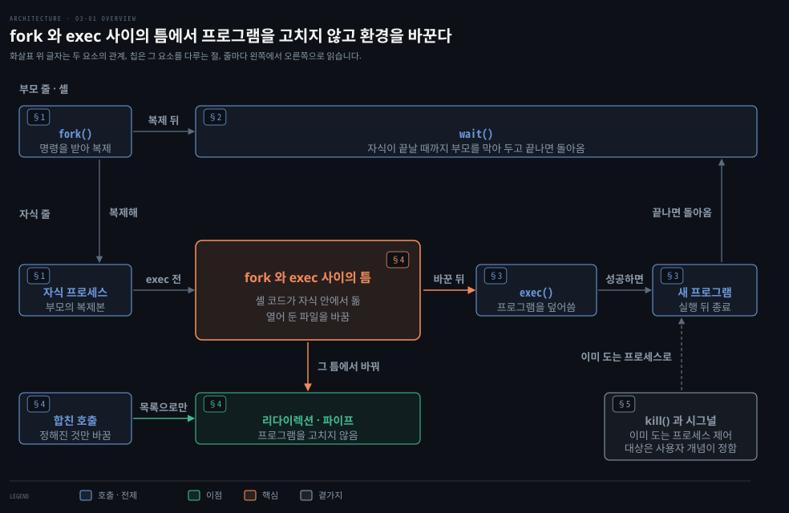
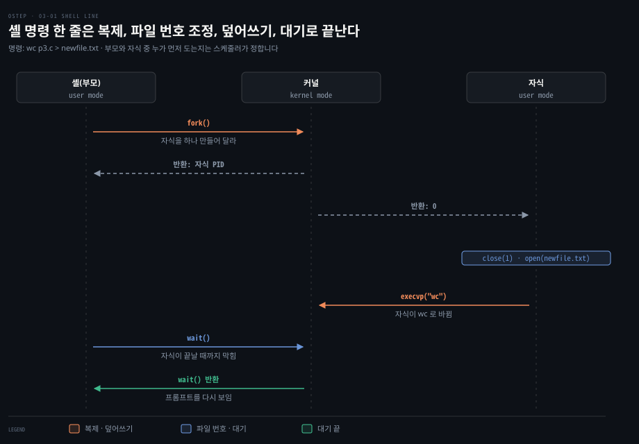
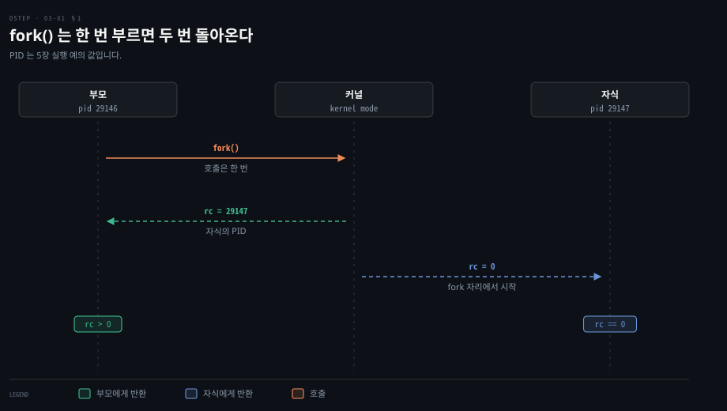
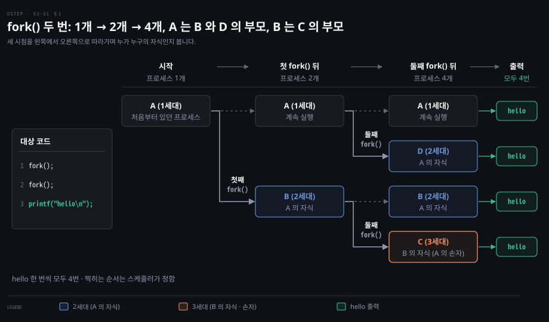
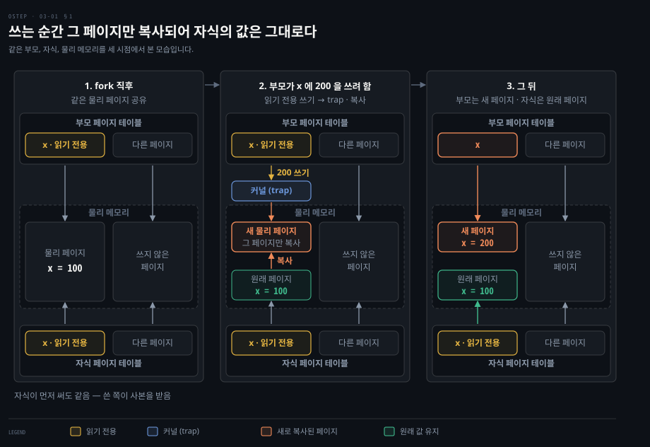
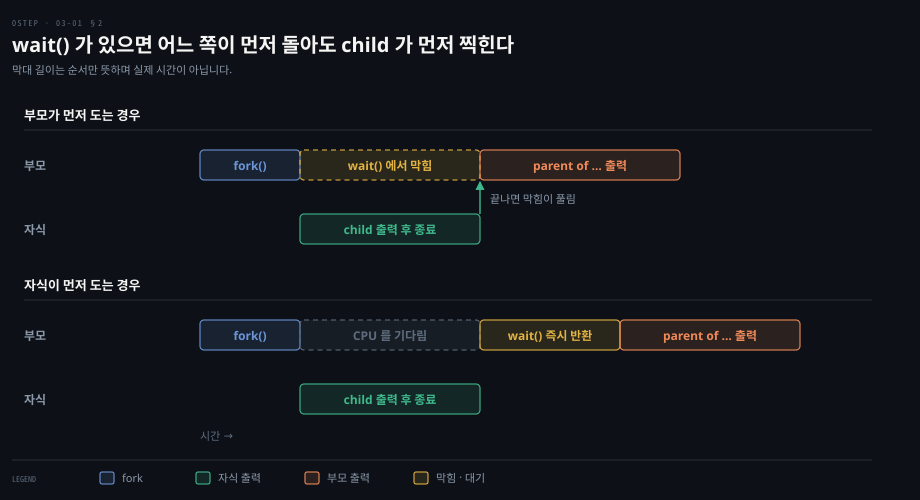
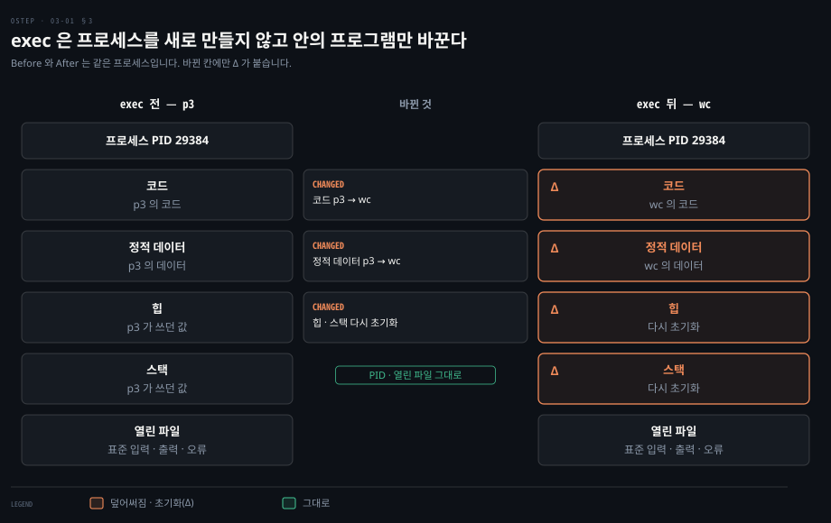
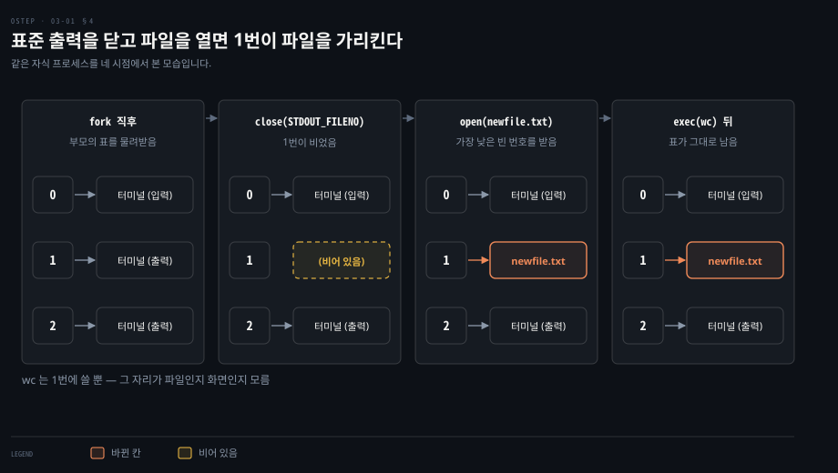
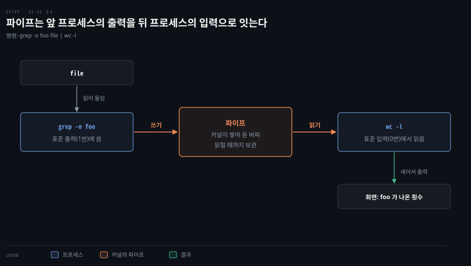
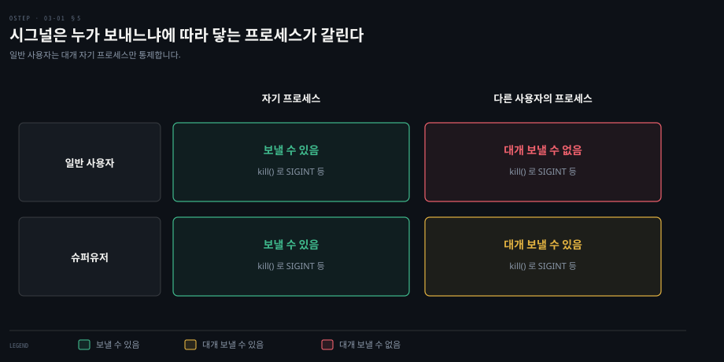

# 프로세스 생성을 fork 와 exec 으로 쪼갠 이유 — wait·셸 리다이렉션·시그널
---

## 핵심 요약

> fork 는 부모를 복제하고 exec 은 그 복제본에 다른 프로그램을 덮어쓰며 부모는 wait 로 자식이 끝나기를 기다립니다. 
>
> 생성을 둘로 나눈 덕에 셸은 둘 사이에서 자식이 열어 둔 파일을 바꿔 놓을 수 있어 프로그램을 고치지 않고도 리다이렉션과 파이프가 됩니다.

풀어야 할 문제는 프로세스를 만들고 다루는 인터페이스를 운영체제가 어떻게 내놓느냐입니다. 기능이 강력하면서 쓰기 쉽고 빨라야 합니다.[^crux] 유닉스의 답은 호출 몇 개의 조합입니다. `fork()` 가 복제를, `wait()` 가 기다림을, `exec()` 가 덮어쓰기를 맡습니다. `kill()` 과 시그널이 이미 도는 프로세스를 제어합니다.

이 글은 5장 전체를 다룹니다. 5장은 호출을 코드 네 편으로 하나씩 쌓아 갑니다. p1.c 는 `fork()` 만 씁니다. p2.c 는 `wait()` 를 더합니다. p3.c 는 `exec()` 를 더합니다. p4.c 는 출력 리다이렉션을 더합니다. 앞 코드가 뒤 코드의 바탕이라 절 순서가 코드 순서와 같습니다.


## 학습 목표

이 내용을 읽고 나면:

1. `fork()` 가 부모의 복제본을 만들고 반환값으로 부모와 자식을 가르는 방식을 설명할 수 있습니다.
2. 부모와 자식의 출력 순서가 고정되지 않는 이유와 `wait()` 가 순서를 정하는 방식을 설명할 수 있습니다.
3. `exec()` 이 새 프로세스를 만들지 않고 실행 중인 프로세스의 프로그램을 바꾸는 방식과, 성공하면 돌아오지 않는 이유를 말할 수 있습니다.
4. fork 와 exec 을 나눈 덕에 셸이 리다이렉션과 파이프를 만드는 순서를 호출 단위로 말할 수 있습니다.
5. 시그널과 사용자 개념으로 프로세스 제어가 누구에게 허용되는지 설명할 수 있습니다.

아래 개념도는 이 글의 줄기를 부모 줄과 자식 줄 두 개로 그립니다. 위쪽이 셸인 부모 줄이고 아래쪽이 자식 줄이며 줄마다 왼쪽에서 오른쪽으로 읽습니다. 노드 안쪽 칩은 그 노드를 다루는 절이고 화살표 위 글자는 두 요소가 이어지는 관계입니다. 파란색은 호출과 전제를, 초록색은 이점을 뜻하고 주황색이 핵심이며 회색이 곁가지입니다.

부모 줄에서 1절은 `fork()` 의 복제를 다루고 2절은 `wait()` 로 막혔다가 돌아오는 장면을 다룹니다. 자식 줄은 부모의 복제본으로 시작해 `exec()` 으로 다른 프로그램을 덮어쓰며 3절이 이 덮어쓰기를 다룹니다. 둘 사이의 주황색 틈이 이 그림의 중심입니다. 4절은 셸 코드가 그 틈에서 자식이 열어 둔 파일을 바꿔 프로그램을 고치지 않고 리다이렉션과 파이프를 만든다고 설명합니다. 아래쪽은 이 이점을 생성과 실행을 합친 호출과 맞댑니다. 회색 노드는 두 줄 바깥에서 이미 도는 프로세스를 제어하는 5절의 시그널과 사용자입니다.




## 셸 명령 한 줄의 일생

> 셸이 명령 한 줄을 실행하는 한 바퀴는 복제, 파일 번호 조정, 덮어쓰기, 대기의 네 단계이고, 시그널은 어느 단계에서든 끼어들 수 있습니다.



그림은 셸이 `wc p3.c > newfile.txt` 를 받아 실행하는 동안 셸(부모)과 자식이 부르는 호출을 순서대로 보입니다. 1단계에서 4단계까지가 명령 한 줄에 한 번씩 일어나고 번호 붙은 절이 단계를 나눠 맡습니다.

| 단계 | 주체 | 받치는 개념 | 맡는 절 |
|---|---|---|---|
| 1 복제 | 셸(부모) → 커널 | `fork()` 와 반환값 | 1 |
| 2 파일 번호 조정 | 자식 | `close()`·`open()`, 파일 디스크립터 | 4 |
| 3 덮어쓰기 | 자식 → 커널 | `exec()` 과 argv | 3 |
| 4 대기 | 셸(부모) | `wait()` 와 비결정성 | 2 |
| 5 제어 | 사용자·커널 | 시그널, 사용자 | 5 |

2단계는 리다이렉션이 없는 명령에서는 건너뜁니다. 5단계는 1~4단계 어디서든 일어나므로 순서에 속하지 않습니다. 절 번호가 단계 번호와 다른 것은 코드가 p1 에서 p4 로 쌓이는 순서로 설명하기 때문입니다.


## 1. fork 로 프로세스 복제하기

> `fork()` 는 호출한 프로세스를 거의 그대로 복제해 자식 프로세스를 만듭니다. 자식은 `main()` 의 처음이 아니라 `fork()` 에서 돌아오는 자리부터 실행됩니다.

흐름 위치: 1 복제 · 받치는 개념 — `fork()` 와 반환값

`fork()` 는 프로세스를 만드는 [시스템 콜](./04-01.CPU%20%EB%A5%BC%20%EC%A7%81%EC%A0%91%20%EC%93%B0%EA%B2%8C%20%ED%95%98%EB%A9%B4%EC%84%9C%20%ED%86%B5%EC%A0%9C%EA%B6%8C%EC%9D%84%20%EC%A7%80%ED%82%A4%EB%8A%94%20%EB%B2%95%20%E2%80%94%20%EC%A0%9C%ED%95%9C%EB%90%9C%20%EC%A7%81%EC%A0%91%20%EC%8B%A4%ED%96%89%C2%B7trap%C2%B7%ED%83%80%EC%9D%B4%EB%A8%B8%20%EC%9D%B8%ED%84%B0%EB%9F%BD%ED%8A%B8.md)이지만 실행할 프로그램의 이름을 받지 않습니다. 호출한 프로세스를 복제하기 때문에 호출은 한 번인데 `fork()` 에서 돌아오는 쪽은 둘이 됩니다. 시스템 콜이 trap 으로 커널에 들어가는 길은 6장 노트가 다룹니다.

### 한 번 호출하고 두 번 돌아오기

p1.c 는 `fork()` 를 한 번 부르고 반환값으로 부모와 자식의 갈래를 나눕니다. 그림은 호출 하나가 둘로 갈라지는 순서입니다.



`fork()` 를 호출한 쪽이 부모이고 새로 생긴 쪽이 자식입니다. 둘 다 `fork()` 에서 돌아오지만 돌려받는 값이 다릅니다. 부모는 자식의 PID 인 29147 을 받고 자식은 0 을 받습니다. PID(프로세스 식별자)는 프로세스를 가리키는 번호입니다. 프로세스와 PID 의 기본은 [Linux 프로세스 노트](../tlpi_the-linux-programming-interface/06-01.%ED%94%84%EB%A1%9C%EC%84%B8%EC%8A%A4%EB%8A%94%20%ED%94%84%EB%A1%9C%EA%B7%B8%EB%9E%A8%EC%97%90%20%EC%BB%A4%EB%84%90%EC%9D%B4%20%EC%9E%90%EC%9B%90%EC%9D%84%20%EB%B6%99%EC%9D%B8%20%EA%B2%83%EC%9D%B4%EB%8B%A4.md)가 다룹니다.

p1.c~p4.c 의 출력은 모두 5장에 실린 값이고 PID 는 실행할 때마다 달라집니다. p1.c 의 코드는 이렇습니다.

```c
#include <stdio.h>
#include <stdlib.h>
#include <unistd.h>

int main(int argc, char *argv[]) {
  printf("hello (pid:%d)\n", (int) getpid());
  int rc = fork();
  if (rc < 0) {
    // fork failed
    fprintf(stderr, "fork failed\n");
    exit(1);
  } else if (rc == 0) {
    // child (new process)
    printf("child (pid:%d)\n", (int) getpid());
  } else {
    // parent goes down this path (main)
    printf("parent of %d (pid:%d)\n",
            rc, (int) getpid());
  }
  return 0;
}
```

```bash
./p1
```

```bash
hello (pid:29146)
parent of 29147 (pid:29146)
child (pid:29147)
```

hello 는 한 번만 찍힙니다. 자식은 `main()` 부터 시작하지 않고 `fork()` 를 직접 부른 것처럼 그 자리에서 생기기 때문입니다. 자식은 부모의 사본이지만 서로 독립입니다. 둘은 주소 공간과 레지스터, PC 를 따로 두기 때문에 한쪽이 변수를 바꿔도 다른 쪽에는 보이지 않습니다.[^fork] 주소 공간은 프로세스가 보는 자기만의 메모리이고, PC 는 다음에 실행할 명령의 주소를 담은 레지스터입니다.

다른 점은 반환값입니다. 이 차이 덕에 `rc == 0` 이면 자식, 0 보다 크면 부모로 코드가 갈립니다. `rc` 가 0 보다 작으면 fork 가 실패한 것이라 p1.c 는 오류를 찍고 끝냅니다.

### 출력 순서가 갈리는 이유

p1.c 의 출력 순서는 실행마다 다를 수 있습니다. 자식이 만들어지면 신경 쓸 활성 프로세스가 둘이 되고 CPU 가 하나라고 가정하면 그 시점에 부모와 자식 중 어느 쪽이든 돌 수 있기 때문입니다. 앞의 실행에서는 부모가 먼저 찍었고 아래 실행 예에서는 자식이 먼저 찍습니다.

```bash
hello (pid:29146)
child (pid:29147)
parent of 29147 (pid:29146)
```

어느 프로세스를 돌릴지는 CPU 스케줄러가 정합니다. 스케줄러는 복잡해서 무엇을 고를지 단정할 수 없습니다. 스케줄러가 프로세스를 바꾸는 방식은 6장 노트가 다룹니다. 이 비결정성은 멀티스레드 프로그램에서 더 까다로운 문제를 낳고 병행성을 다루는 둘째 부분에서 다시 나옵니다.

### fork 두 번과 프로세스 트리

`fork()` 를 두 번 이어 부르면 프로세스 수가 1개에서 2개, 4개로 늡니다. 처음 있던 프로세스와 첫 자식이 각각 두 번째 `fork()` 를 부르기 때문입니다.



처음부터 있던 프로세스를 A, 첫 `fork()` 에서 A 가 만든 자식을 B 라 합니다. 둘째 `fork()` 에서 B 가 만든 자식이 C 이고 A 가 만든 둘째 자식이 D 입니다. 그래서 A 는 B 와 D 의 부모이고 B 는 C 의 부모입니다. A → B → C 가 세 세대입니다.

아래 예제는 5장에 없는 코드이고 직접 컴파일해 돌린 결과입니다(macOS, 2026-11-22). Linux 에서는 Debian 13, 커널 7.2.12, gcc 16.2.0 으로 같은 날 다섯 번 돌려 프로세스 넷과 같은 부모 관계를 확인했습니다. 아래 출력은 macOS 에서 찍힌 것입니다. 두 `fork()` 뒤에 `hello` 와 자기 PID, 부모 PID(`getppid()`)를 찍습니다. 끝나기 전에 `while (wait(NULL) > 0);` 으로 자식을 모두 기다립니다. 부모가 먼저 끝나면 `getppid()` 가 다른 프로세스를 가리키게 되기 때문입니다. `wait()` 는 2절이 다룹니다.

```c
#include <stdio.h>
#include <unistd.h>
#include <sys/wait.h>

int main(void) {
  fork();
  fork();
  printf("hello (pid:%d ppid:%d)\n",
         (int) getpid(), (int) getppid());
  while (wait(NULL) > 0);
  return 0;
}
```

```bash
hello (pid:38661 ppid:38547)
hello (pid:38662 ppid:38660)
hello (pid:38660 ppid:38547)
hello (pid:38547 ppid:38190)
```

출력의 `ppid` 칸을 보면 누가 누구의 자식인지 읽힙니다. `38547` 이 자식을 둘(`38660`·`38661`) 두었으므로 `38547` 이 A 입니다. `38660` 은 `38662` 의 부모이므로 `38660` 이 B 이고 `38662` 가 C 입니다. 자식이 없는 `38661` 이 D 입니다.

### Linux 에서 fork 의 비용

Linux 에서 `fork()` 는 논리적으로는 메모리의 사본을 만들고 물리적으로는 쓸 때 복사합니다. copy-on-write 는 두 프로세스가 같은 물리 페이지를 나눠 쓰다가 한쪽이 쓸 때 그 페이지를 복사하는 방식입니다. 그래서 `fork()` 에 드는 시간과 메모리는 부모의 페이지 테이블을 복사하고 자식의 task 구조를 새로 만드는 만큼입니다.[^fork] 페이지 테이블은 가상 주소를 물리 주소로 옮기는 표이고, task 구조는 커널이 자식 프로세스를 관리하려고 따로 두는 구조체입니다.



fork 직후에는 부모와 자식의 페이지 테이블이 `x = 100` 이 들어 있는 같은 물리 페이지를 가리킵니다. 이 페이지는 두 쪽 모두에서 읽기 전용입니다.[^cow] 부모가 `x` 에 200 을 쓰려 하면 그 페이지가 읽기 전용이라 커널로 들어갑니다(trap). 커널은 그 페이지 하나만 새 물리 페이지에 복사합니다.[^cow] 그 뒤 부모는 새 페이지를 가리키고 거기에 200 을 씁니다. 자식은 원래 페이지를 그대로 가리켜 `x` 는 100 입니다.

자식의 항목은 그 뒤에도 읽기 전용으로 남습니다. 자식이 `x` 에 쓰려 하면 폴트가 한 번 더 나지만, 커널이 그 페이지를 자식만 쓴다고 확인해 복사 없이 쓰기 가능으로 바꿉니다.[^cowwp]

아직 아무도 쓰지 않은 나머지 페이지는 두 프로세스가 계속 같은 물리 페이지로 가리킵니다. 자식이 먼저 써도 쓴 쪽이 사본을 받습니다. 쓰는 순간 갈라지므로 한쪽이 고친 값은 다른 쪽에 보이지 않습니다.


## 2. wait 로 자식의 끝 기다리기

> `wait()` 는 부모를 자식이 끝날 때까지 막아 두므로 `fork()` 만 쓴 p1.c 와 달리 출력 순서가 자식 먼저로 고정됩니다.

흐름 위치: 4 대기 · 받치는 개념 — `wait()` 와 비결정성

p1.c 에서는 부모와 자식 중 누가 먼저 찍을지 정할 수 없었습니다. 부모가 자식이 끝나기를 기다리게 하면 이 불확실성이 사라집니다.

### 부모를 막아 순서 고정하기

p2.c 는 p1.c 의 부모 갈래에 `wait(NULL)` 한 줄을 더해 부모를 막습니다. 그림은 부모가 먼저 도는 경우와 자식이 먼저 도는 경우를 시간축 위에 놓은 것입니다.



두 경우 모두 자식의 `child` 가 부모의 `parent of` 보다 앞에 찍힙니다. 부모가 먼저 돌면 `wait()` 에서 막혀 자식이 끝나기를 기다립니다. 자식이 먼저 돌면 자식이 끝난 뒤에 부모가 `wait()` 를 부릅니다. p2.c 의 코드는 이렇습니다.

```c
#include <stdio.h>
#include <stdlib.h>
#include <unistd.h>
#include <sys/wait.h>

int main(int argc, char *argv[]) {
  printf("hello (pid:%d)\n", (int) getpid());
  int rc = fork();
  if (rc < 0) {         // fork failed; exit
    fprintf(stderr, "fork failed\n");
    exit(1);
  } else if (rc == 0) { // child (new process)
    printf("child (pid:%d)\n", (int) getpid());
  } else {              // parent goes down this path
    int rc_wait = wait(NULL);
    printf("parent of %d (rc_wait:%d) (pid:%d)\n",
            rc, rc_wait, (int) getpid());
  }
  return 0;
}
```

```bash
./p2
```

```bash
hello (pid:29266)
child (pid:29267)
parent of 29267 (rc_wait:29267) (pid:29266)
```

`wait()` 는 자식이 실행을 마칠 때까지 부모의 실행을 늦춥니다. 자식이 끝나면 부모의 막힘이 풀리고 `wait()` 가 부모에게 돌아옵니다. 출력의 `rc_wait` 가 자식의 PID 와 같은 29267 입니다. 부모가 먼저 돌아도 곧바로 `wait()` 를 불러 막히므로 자식이 먼저 찍습니다. 자식이 이미 끝났다면 `wait()` 는 기다리지 않고 바로 돌아옵니다.[^wait]

`wait()` 의 인자는 자식의 종료 상태를 받을 자리입니다. p2.c 는 `NULL` 을 줘서 종료 상태를 받지 않습니다.[^wait] 자식이 여럿이면 `wait()` 한 번은 자식 하나가 끝나면 돌아옵니다. 자식이 하나도 없으면 -1 을 돌려주고 `errno` 는 `ECHILD` 입니다.[^wait]

### wait 가 돌아오는 때

`wait()` 에는 더 완전한 형제인 `waitpid()` 가 있습니다. `waitpid()` 는 기다릴 자식을 PID 로 고르고 옵션으로 동작을 바꿉니다. 기본값으로는 끝난 자식만 기다립니다.[^wait]

`wait()` 가 자식이 끝나기 전에 돌아오는 경우도 있습니다. 시그널 핸들러가 호출을 중간에 끊는 경우가 한 예입니다.[^wait] 또 부모가 살아 있는 동안 `wait()` 를 부르지 않으면 끝난 자식은 zombie 로 남습니다. zombie 는 끝났지만 부모가 아직 종료 상태를 가져가지 않은 프로세스이고, 자세한 내용은 [앞 장 노트의 zombie 절](./02-01.CPU%20%EA%B0%80%20%EB%81%9D%EC%97%86%EC%9D%B4%20%EC%9E%88%EB%8A%94%20%EB%93%AF%20%EB%B3%B4%EC%9D%B4%EA%B2%8C%20%ED%95%98%EB%8A%94%20%EB%B2%95%20%E2%80%94%20%ED%94%84%EB%A1%9C%EC%84%B8%EC%8A%A4%20%EC%B6%94%EC%83%81%C2%B7%EC%83%81%ED%83%9C%20%EC%A0%84%EC%9D%B4%C2%B7%ED%94%84%EB%A1%9C%EC%84%B8%EC%8A%A4%20%EB%AA%A9%EB%A1%9D.md#끝났지만-정리-전인-zombie)이 다룹니다. 부모가 `wait()` 를 부르면 zombie 가 시스템에서 지워지고 부모는 자식의 종료 상태를 얻습니다.[^wait]


## 3. exec 으로 프로그램 덮어쓰기

> `exec()` 은 새 프로세스를 만들지 않고 호출한 프로세스의 코드와 정적 데이터를 다른 실행 파일로 덮어씁니다. 성공하면 호출한 자리로 돌아오지 않습니다.

흐름 위치: 3 덮어쓰기 · 받치는 개념 — `exec()` 과 argv

p2.c 처럼 `fork()` 만 쓰면 자식은 부모와 같은 프로그램의 복사본으로만 돕니다. 다른 프로그램을 돌리려면 자식 안에서 `exec()` 을 불러야 합니다. 프로그램은 코드와 정적 데이터를 메모리에 적재하고 스택과 힙을 마련한 뒤 시작하는데, 이 과정은 [앞 장 노트의 3절](./02-01.CPU%20%EA%B0%80%20%EB%81%9D%EC%97%86%EC%9D%B4%20%EC%9E%88%EB%8A%94%20%EB%93%AF%20%EB%B3%B4%EC%9D%B4%EA%B2%8C%20%ED%95%98%EB%8A%94%20%EB%B2%95%20%E2%80%94%20%ED%94%84%EB%A1%9C%EC%84%B8%EC%8A%A4%20%EC%B6%94%EC%83%81%C2%B7%EC%83%81%ED%83%9C%20%EC%A0%84%EC%9D%B4%C2%B7%ED%94%84%EB%A1%9C%EC%84%B8%EC%8A%A4%20%EB%AA%A9%EB%A1%9D.md#3-프로그램에서-프로세스로)이 다룹니다.

### 호출 한 번으로 프로그램이 바뀌기

p3.c 의 자식은 단어 수를 세는 프로그램 `wc` 를 돌립니다. 그림은 `exec()` 호출 전후에 같은 프로세스의 메모리 구획이 어떻게 바뀌는지 보입니다.



`exec()` 은 실행 파일의 이름과 인자를 받아 그 파일에서 코드와 정적 데이터를 읽어 현재 프로세스의 코드 구획과 정적 데이터를 덮어씁니다. 힙과 스택 같은 나머지 메모리 구획은 다시 초기화됩니다. 운영체제는 그 프로그램을 돌리면서 받은 인자를 그 프로세스의 argv 로 넘깁니다. 그림에서 보듯 새 프로세스는 생기지 않습니다. 실행 중이던 프로그램(p3)이 다른 프로그램(wc)으로 바뀝니다. 자식에게 인자 목록과 환경 목록을 넘기는 방식은 [인자·환경 목록 노트](../tlpi_the-linux-programming-interface/06-03.%EB%B6%80%EB%AA%A8%EA%B0%80%20%EC%9E%90%EC%8B%9D%EC%97%90%EA%B2%8C%20%EA%B1%B4%EB%84%A4%EB%8A%94%20%EA%B2%83%EC%9D%80%20%EC%9D%B8%EC%9E%90%20%EB%AA%A9%EB%A1%9D%EA%B3%BC%20%ED%99%98%EA%B2%BD%20%EB%AA%A9%EB%A1%9D%EC%9D%B4%EB%8B%A4.md)가 다룹니다.

p3.c 의 코드는 이렇습니다.

```c
#include <stdio.h>
#include <stdlib.h>
#include <unistd.h>
#include <string.h>
#include <sys/wait.h>

int main(int argc, char *argv[]) {
  printf("hello (pid:%d)\n", (int) getpid());
  int rc = fork();
  if (rc < 0) {         // fork failed; exit
    fprintf(stderr, "fork failed\n");
    exit(1);
  } else if (rc == 0) { // child (new process)
    printf("child (pid:%d)\n", (int) getpid());
    char *myargs[3];
    myargs[0] = strdup("wc");   // program: "wc"
    myargs[1] = strdup("p3.c"); // arg: input file
    myargs[2] = NULL;           // mark end of array
    execvp(myargs[0], myargs); // runs word count
    printf("this shouldn't print out");
  } else {              // parent goes down this path
    int rc_wait = wait(NULL);
    printf("parent of %d (rc_wait:%d) (pid:%d)\n",
            rc, rc_wait, (int) getpid());
  }
  return 0;
}
```

```bash
./p3
```

```bash
hello (pid:29383)
child (pid:29384)
      29     107    1030 p3.c
parent of 29384 (rc_wait:29384) (pid:29383)
```

자식은 `execvp()` 로 `wc` 를 돌려 `p3.c` 의 줄 수, 단어 수, 바이트 수를 셉니다. 출력의 `29 107 1030` 이 그 세 값입니다. `execvp()` 다음 줄의 `this shouldn't print out` 은 출력에 없습니다. `exec()` 이 성공하면 그 프로세스에서 `exec()` 을 부른 코드는 이미 지워졌으므로 돌아올 자리가 없기 때문입니다. 성공한 `exec()` 은 돌아오지 않습니다.[^exec] 실패하면 -1 을 돌려주므로 그다음 줄이 실행됩니다.[^exec]

### exec 변형 이름의 글자

Linux 에는 `exec()` 변형이 여섯 개 있고 모두 `execve(2)` 위에 얹혀 있습니다.[^exec3] 이름에서 `exec` 뒤에 붙는 글자가 인자와 환경을 건네는 방식을 정합니다.[^exec3]

| 글자 | 뜻 | 변형 |
|---|---|---|
| l | 인자를 하나씩 나열해 줍니다(list) | `execl()`, `execlp()`, `execle()` |
| v | 인자를 배열로 줍니다(vector) | `execv()`, `execvp()`, `execvpe()` |
| p | `PATH` 에서 실행 파일을 찾습니다 | `execlp()`, `execvp()`, `execvpe()` |
| e | 새 프로그램의 환경을 직접 줍니다(environment) | `execle()`, `execvpe()` |

`e` 가 없는 변형은 호출한 프로세스의 환경을 그대로 넘깁니다.[^exec3] p3.c 의 `execvp()` 는 `myargs` 배열(v)로 인자를 주고 `wc` 를 `PATH` 에서 찾습니다(p). 덕분에 경로 없이 `wc` 만 적어도 됩니다.


## 4. fork 와 exec 을 나눈 이유

> 둘을 나눠 두면 셸이 `fork()` 와 `exec()` 사이에서 자식의 환경을 바꿀 수 있고 그 틈이 리다이렉션과 파이프를 만듭니다.

흐름 위치: 2 파일 번호 조정 · 받치는 개념 — 파일 디스크립터, 리다이렉션

프로그램 하나를 띄우는 데 호출을 둘로 나누는 구조는 필요 이상으로 복잡해 보입니다. 그러나 나눠 두면 `fork()` 다음부터 `exec()` 전까지 틈이 생깁니다. 셸은 그 틈에서 곧 실행될 프로그램의 환경을 평범한 코드로 바꿀 수 있습니다. 환경을 바꾸는 기능이 새로 필요해도 두 호출의 인자를 늘리지 않아도 됩니다.

### 셸이 명령을 실행하는 순서

셸은 평범한 사용자 프로그램입니다. 프롬프트를 보이고 사용자가 명령을 입력하기를 기다립니다. 명령은 실행 파일 이름과 인자입니다. 입력이 들어오면 셸은 파일 시스템에서 실행 파일이 있는 자리를 찾습니다. 이어서 `fork()` 로 자식을 만들고 `exec()` 변형 하나로 명령을 돌립니다. 그동안 `wait()` 로 명령이 끝나기를 기다립니다. 자식이 끝나면 셸은 `wait()` 에서 돌아와 프롬프트를 다시 보입니다. 앞의 그림이 이 순서입니다.

### 출력 리다이렉션의 구현

둘을 나눈 이점이 가장 잘 보이는 예가 출력 리다이렉션입니다. 다음 명령은 `wc` 의 출력을 화면 대신 파일로 보냅니다. `>` 가 그 표시입니다.

```bash
# wc 의 출력을 화면이 아니라 newfile.txt 로 보냅니다
wc p3.c > newfile.txt
```

셸 코드 가운데 일부는 자식 안에서 돕니다. 이 부분이 자식이 만들어진 뒤 `exec()` 을 부르기 전에 표준 출력을 닫고 `newfile.txt` 를 엽니다. 그러면 곧 실행될 `wc` 의 모든 출력이 화면 대신 파일로 갑니다. 자식의 파일 번호 표는 부모 표의 사본이라 자식이 표준 출력을 닫아도 부모 셸의 표준 출력은 그대로입니다.[^fork] 그 덕에 셸은 `wc` 가 끝난 뒤 같은 화면에 다음 프롬프트를 찍을 수 있습니다.

이 방법이 통하는 이유는 둘입니다. 첫째, 열린 파일은 기본적으로 `exec()` 호출을 지나도 열린 채 남습니다.[^exec] 둘째, `open()` 은 쓰고 있지 않은 가장 작은 번호를 돌려줍니다.[^open] 아래 그림은 자식의 파일 번호 표가 `fork()` 직후부터 `exec()` 뒤까지 바뀌는 모습입니다.



프로세스는 열어 둔 파일을 파일 디스크립터라는 번호로 가리킵니다. 표준 입력은 0번, 표준 출력은 1번, 표준 오류는 2번입니다.[^posix] 표준 출력(`STDOUT_FILENO`)을 닫으면 1번이 비고, 다음 `open()` 이 가장 작은 빈 번호인 그 1번을 받습니다. 그 뒤 `printf()` 처럼 표준 출력에 쓰는 루틴은 화면이 아니라 새로 연 파일로 투명하게 갑니다.

p4.c 는 이 과정을 코드로 옮긴 것입니다. 파일 이름만 `newfile.txt` 대신 `p4.output` 이고 `wc` 가 세는 파일은 `p4.c` 입니다.

```c
#include <stdio.h>
#include <stdlib.h>
#include <unistd.h>
#include <string.h>
#include <fcntl.h>
#include <sys/stat.h>
#include <sys/wait.h>

int main(int argc, char *argv[]) {
  int rc = fork();
  if (rc < 0) {
    // fork failed
    fprintf(stderr, "fork failed\n");
    exit(1);
  } else if (rc == 0) {
    // child: redirect standard output to a file
    close(STDOUT_FILENO);
    open("./p4.output", O_CREAT|O_WRONLY|O_TRUNC,
         S_IRWXU);
    // now exec "wc"...
    char *myargs[3];
    myargs[0] = strdup("wc");          // program: wc
    myargs[1] = strdup("p4.c"); // arg: file to count
    myargs[2] = NULL;                  // mark end of array
    execvp(myargs[0], myargs); // runs word count
  } else {
    // parent goes down this path (main)
    int rc_wait = wait(NULL);
  }
  return 0;
}
```

```bash
./p4
cat p4.output
```

```bash
      32     109     846 p4.c
```

이 출력에서 볼 점이 둘입니다. 먼저 `./p4` 를 실행하면 아무 일도 없는 것처럼 프롬프트가 바로 돌아옵니다. 자식이 `fork()` 로 만들어져 `wc` 를 실행했지만 출력이 `p4.output` 으로 갔기 때문입니다. 다음으로 `cat p4.output` 을 하면 `wc` 의 출력이 모두 들어 있습니다.

### 파이프

유닉스 파이프도 비슷한 방식으로 구현됩니다. 쓰는 호출은 `pipe()` 입니다. 한 프로세스의 출력을 커널 안의 파이프(큐)에 잇고 다른 프로세스의 입력을 같은 파이프에 잇습니다. 그러면 앞 프로세스의 출력이 막힘 없이 뒤 프로세스의 입력이 되어 명령을 길게 이을 수 있습니다.



파일에서 단어를 찾아 그 단어가 몇 번 나오는지 세는 일이 그 예입니다. `grep` 과 `wc` 를 파이프로 이으면 됩니다.

```bash
# file 에서 foo 가 나온 자리만 한 줄씩 뽑고, 그 줄 수를 셉니다
grep -o foo file | wc -l
```

`pipe()` 는 단방향 데이터 통로를 만듭니다. 두 파일 디스크립터를 돌려주고 하나는 읽는 쪽 끝, 다른 하나는 쓰는 쪽 끝입니다. 쓰는 쪽 끝에 쓴 데이터는 읽는 쪽 끝에서 읽힐 때까지 커널이 버퍼에 쌓아 둡니다.[^pipe]

셸이 `grep -o foo file | wc -l` 을 실행하는 호출 순서는 이렇습니다.

1. 셸이 `pipe()` 를 부릅니다. 읽는 끝과 쓰는 끝, 두 파일 디스크립터가 생깁니다.
2. 셸이 `fork()` 를 두 번 부릅니다. `pipe()` 가 `fork()` 앞에 있어야 두 자식이 같은 파이프를 가리키는 파일 디스크립터를 물려받습니다.[^pipe]
3. 앞 자식은 쓰는 끝을 1번 자리에, 뒤 자식은 읽는 끝을 0번 자리에 놓습니다.
4. 각 프로세스가 파이프에 필요 없는 끝을 닫고, 두 자식이 `exec()` 변형으로 `grep` 과 `wc` 를 돌립니다. 셸은 두 자식이 끝나기를 `wait()` 합니다.[^pipeorder]

3번에서 `dup2()` 는 지정한 번호가 다른 파일 디스크립터와 같은 파일을 가리키도록 바꾸므로 이 일에 쓸 수 있습니다.[^dup] xv6 셸은 `close()` 뒤에 `dup()` 을 불러 같은 일을 합니다.[^pipeorder]

`pipe(p)` 가 채우는 `p[0]` 은 읽는 끝이고 `p[1]` 은 쓰는 끝입니다.[^pipe] `fork()` 를 두 번 하면 셸과 앞 자식, 뒤 자식이 저마다 `p[1]` 의 사본을 듭니다.[^pipeorder] 읽는 쪽 `read()` 는 쓰는 끝을 가리키는 파일 디스크립터가 모두 닫혀야 입력 끝(EOF)을 봅니다.[^pipe7] 그래서 셸이나 `wc` 쪽 자식이 `p[1]` 을 열어 둔 채면 `grep` 이 끝나도 `wc` 는 계속 기다립니다. 반대로 읽는 끝이 모두 닫히면 쓰는 쪽은 `SIGPIPE` 시그널을 받습니다.[^pipe7]

### 설계에 대한 평가와 반론

저자들은 `fork()` 와 `exec()` 의 조합이 단순하면서 강력하다고 평가합니다. 프로세스 생성 API 를 설계하는 방법은 많지만 유닉스 설계자들이 옳게 설계했다는 판단입니다. 저자들은 Lampson 이 논문 「Hints for Computer Systems Design」에서 한 말을 설계 원칙으로 가져와 이름 붙였습니다. "옳게 만들라. 추상화도 단순함도 옳게 만드는 일을 대신하지 못한다"는 뜻이고, 그 이름이 Lampson 의 법칙입니다.

`fork()` 에 대한 비판도 있습니다. 논문 「A fork() in the road」는 `fork()` 의 문제를 짚고 `spawn()` 같은 더 단순한 프로세스 생성 API 를 대안으로 제안합니다. 논문은 Microsoft, 보스턴 대학, ETH 연구자들이 썼고 HotOS '19 에서 발표됐습니다.

생성과 실행을 한 호출로 합친 표준 호출로 `posix_spawn()` 이 있습니다. 이 호출도 자식에서 파일을 열고 닫고 복제하는 일을 file actions 라는 목록으로 미리 받으므로 합친 호출로도 리다이렉션이 됩니다. 다만 바꿀 수 있는 것은 속성 몇 가지와 file actions 의 열기·닫기·복제로 정해져 있습니다. `fork()` 와 `exec()` 사이에서는 어떤 코드든 실행할 수 있다는 점이 다릅니다.[^spawn]


## 5. 시그널과 사용자로 프로세스 제어하기

> 프로세스는 시그널로 멈추거나 끝낼 수 있고 누가 누구에게 시그널을 보낼 수 있는지는 사용자 개념이 정합니다.

흐름 위치: 5 제어 · 받치는 개념 — 시그널, 사용자

`fork()`, `wait()`, `exec()` 은 프로세스를 만들고 잇는 호출입니다. 이미 도는 프로세스를 멈추거나 끝내는 일은 다른 호출이 맡습니다.

### 시그널

`kill()` 시스템 콜은 프로세스에 시그널을 보냅니다. 시그널은 멈춤이나 종료 같은 지시를 담습니다. 키보드로 보내는 시그널은 터미널이 만듭니다. 터미널은 Ctrl-C 를 `SIGINT`(인터럽트)로, Ctrl-Z 를 `SIGTSTP`(정지)로 바꿔 포어그라운드 작업에 보냅니다.[^tty] 포어그라운드 작업은 그 터미널에서 입력을 읽을 수 있는 프로세스 묶음입니다. `SIGINT` 는 보통 프로세스를 끝냅니다. `SIGTSTP` 는 프로세스를 실행 도중에 멈추고, 멈춘 프로세스는 셸 내장 명령 [`fg`](../../docs/cmd/process/jobs%C2%B7bg%C2%B7fg%C2%B7wait.md) 로 다시 돌립니다. 시그널의 번호와 기본 동작은 [시그널 노트](../learning-modern-linux/09-02.%EC%8B%9C%EA%B7%B8%EB%84%90%EC%9D%80%20%EB%B2%88%ED%98%B8%20%ED%95%98%EB%82%98%EB%A7%8C%20%EB%B3%B4%EB%82%B4%EA%B3%A0%20%EB%81%9D%EB%82%98%EB%8A%94%20%EB%AA%A8%EC%96%91%EC%9D%80%20%EC%B2%98%EB%A6%AC%20%EB%B0%A9%EC%8B%9D%EC%9D%B4%20%EC%A0%95%ED%95%9C%EB%8B%A4.md)가 다룹니다.

시그널 하위 체계는 외부 사건을 프로세스에 전하는 기반입니다. 개별 프로세스나 프로세스 그룹 전체에 시그널을 보낼 수 있습니다. 프로세스가 시그널을 받아 처리하는 방법도 있습니다. 프로세스가 `sigaction()` 으로 특정 시그널의 처리 방식을 정해 두면 그 시그널이 올 때 정상 실행을 멈추고 지정한 코드를 실행합니다.[^sigaction] 다만 `SIGKILL` 과 `SIGSTOP` 은 잡을 수도 막을 수도 무시할 수도 없습니다. 그래서 핸들러를 둔 프로세스도 `SIGKILL` 로 끝내고 `SIGSTOP` 으로 멈출 수 있습니다.[^sigaction]

### 사용자와 슈퍼유저

시그널을 누가 누구에게 보낼 수 있는지가 문제입니다. 시스템에는 여러 사람이 동시에 들어올 수 있습니다. 아무나 남의 프로세스에 `SIGINT` 를 보낼 수 있다면 쓰기 편함과 보안이 모두 무너집니다. 그래서 현대 시스템은 사용자 개념을 둡니다. 사용자는 비밀번호로 자격을 증명하고 로그인해 시스템 자원에 접근합니다. 사용자는 프로세스를 하나 이상 띄우고 그 프로세스를 완전히 통제합니다. 멈추거나 죽이는 일도 포함합니다.

일반 사용자는 대개 자기 프로세스만 통제할 수 있습니다. 운영체제는 CPU, 메모리, 디스크 같은 자원을 사용자와 그 프로세스에 나눠 주어 시스템 전체의 목표를 맞춥니다.



시스템에는 일반 사용자의 제약을 받지 않는 관리자가 필요합니다. 관리자는 시스템을 악용하는 프로세스를 그 프로세스를 띄우지 않았더라도 죽일 수 있어야 합니다. 시스템을 끄는 `shutdown` 같은 강력한 명령도 돌릴 수 있어야 합니다. 유닉스 계열은 이 능력을 슈퍼유저(root)에게 줍니다.

Linux 에서 시그널을 보내려면 보내는 프로세스에 특권이 있거나 사용자 번호가 받는 쪽과 맞아야 합니다.[^kill] 특권은 받는 프로세스의 user namespace 에서 `CAP_KILL` 권한이 있다는 뜻입니다. user namespace 는 사용자·그룹 번호와 권한을 격리하는 단위입니다.[^kill]

특권이 있는 슈퍼유저는 같은 namespace 안에서 대개 다른 사용자의 프로세스에도 시그널을 보낼 수 있습니다. 예외로 PID 1 은 핸들러를 설치한 시그널만 받습니다.[^kill] 보안을 높이고 값비싼 실수를 피하려면 평소에는 일반 사용자로 일하는 편이 낫습니다. root 가 필요하면 조심해서 다뤄야 합니다.

### 쓸 만한 도구

프로세스를 다루는 명령줄 도구도 있습니다. 아래 블록은 지금 도는 프로세스를 보는 도구 둘인 [`ps`](../../docs/cmd/process/ps.md)와 [`top`](../../docs/cmd/resource/top%C2%B7htop.md)입니다.

```bash
# 지금 도는 프로세스의 목록을 봅니다. 쓸 만한 플래그는 man 페이지에서 찾습니다
ps

# 프로세스별 CPU 와 자원 사용량을 보여 줍니다
top
```

[`kill`](../../docs/cmd/process/kill%C2%B7pgrep%C2%B7killall.md) 은 프로세스에 임의의 시그널을 보내고 더 쓰기 편한 [`killall`](../../docs/cmd/process/kill%C2%B7pgrep%C2%B7killall.md) 도 같은 일을 합니다. 둘 다 조심해서 써야 합니다. 창 관리자를 실수로 죽이면 지금 앞에 있는 컴퓨터를 다루기 어려워질 수 있습니다.


## 숙제가 보는 것

> 5장의 숙제는 프로세스 트리를 예측하는 시뮬레이션과, 호출의 동작을 직접 확인하는 코드 숙제 여덟 개입니다. 이 글은 숙제를 풀지 않았고 답을 싣지 않았습니다.

시뮬레이션 숙제는 `fork.py` 가 만드는 프로세스 가계도를 예측합니다. 줄마다 보는 것은 다음과 같습니다.

- 프로세스 트리 예측: `./fork.py -s 10` 의 동작을 보고 단계마다 트리를 예측한 뒤 `-c` 로 확인합니다.
- fork 비율: `-f` 로 `fork` 가 다음 동작일 확률을 바꾸면 최종 트리가 어떻게 달라지는지 봅니다.
- 출력 방식 `-t`: 프로세스 트리 모음을 보고 어떤 동작이 있었는지를 거꾸로 맞힙니다.
- 자식이 끝날 때: `-A a+b,b+c,c+d,c+e,c-` 로 가운데 프로세스 `c` 가 끝나면 그 자식들이 트리에서 어떻게 되는지 봅니다. `-R` 옵션이 달라지는 점도 봅니다. 부모가 먼저 끝난 프로세스의 처리는 [Linux 프로세스 노트](../tlpi_the-linux-programming-interface/06-01.%ED%94%84%EB%A1%9C%EC%84%B8%EC%8A%A4%EB%8A%94%20%ED%94%84%EB%A1%9C%EA%B7%B8%EB%9E%A8%EC%97%90%20%EC%BB%A4%EB%84%90%EC%9D%B4%20%EC%9E%90%EC%9B%90%EC%9D%84%20%EB%B6%99%EC%9D%B8%20%EA%B2%83%EC%9D%B4%EB%8B%A4.md)의 부모 종료 절이 다룹니다.
- 최종 트리 `-F`: 중간 단계를 건너뛰고 동작 목록만 보고 최종 트리를 채웁니다.
- `-t` 와 `-F` 함께: 최종 트리만 보고 실제 동작을 알 수 있는 경우와 없는 경우를 가립니다.

코드 숙제는 실제 기계에서 도는 프로그램을 짜서 호출의 동작을 확인합니다. 여덟 문항이 보는 것은 다음과 같습니다.

1. 변수의 값: `fork()` 전에 값을 정한 변수가 자식에서 어떤 값이고 부모와 자식이 각자 바꾸면 어떻게 되는지 봅니다.
2. 파일 디스크립터 공유: `open()` 한 뒤 `fork()` 하면 부모와 자식이 같은 파일 디스크립터에 접근할 수 있는지, 동시에 쓰면 무슨 일이 생기는지 봅니다.
3. wait 없는 순서 보장: 자식이 `hello` 를, 부모가 `goodbye` 를 찍을 때 부모에서 `wait()` 없이 자식이 먼저 찍게 할 수 있는지 봅니다.
4. exec 변형: `/bin/ls` 를 돌리면서 Linux 의 변형 여섯 개를 모두 써 보고 같은 호출에 변형이 많은 이유를 묻습니다.
5. wait 의 반환값: 부모에서 `wait()` 가 무엇을 돌려주는지, 자식에서 `wait()` 를 부르면 어떻게 되는지 봅니다.
6. waitpid: 앞 프로그램을 `waitpid()` 로 바꾸고 어떤 때 쓸모 있는지 묻습니다.
7. 표준 출력을 닫은 뒤: 자식에서 `STDOUT_FILENO` 를 닫은 뒤 `printf()` 를 부르면 어떻게 되는지 봅니다.
8. 파이프로 두 자식 잇기: `pipe()` 로 자식 둘을 만들어 한 자식의 표준 출력을 다른 자식의 표준 입력에 잇습니다.


## 연습 문제

> 1~8번과 10번은 본문에서 배운 호출의 동작과 순서를 설명하는 문제이고 9번은 본문에 없는 조건을 주고 결과를 예측하는 문제입니다. 답을 적은 뒤 정답 절과 맞춰 봅니다.

1. `fork()` 가 부모와 자식에게 돌려주는 값은 각각 무엇이며, 그 차이가 왜 필요합니까?
2. p1.c 의 출력 순서가 실행마다 달라질 수 있는 이유는 무엇이고, p2.c 는 순서를 어떻게 고정합니까?
3. p3.c 에서 `execvp()` 다음 줄의 `printf()` 가 찍히지 않는 이유는 무엇입니까? `exec()` 은 무엇을 바꾸고 무엇을 만들지 않습니까?
4. 셸이 `wc p3.c > newfile.txt` 를 실행할 때 자식 안에서 일어나는 호출을 순서대로 말해 보십시오.
5. `close()` 와 `open()` 을 `fork()` 뒤 자식 안에서 하는 이유는 무엇입니까? 두 호출이 나뉘어 있으면 셸에 무엇이 쉬워집니까?
6. p4.c 에서 `close()` 뒤에 `open()` 한 파일이 표준 출력 자리를 차지하는 이유는 무엇입니까?
7. 셸이 `grep -o foo file | wc -l` 을 실행할 때 `pipe()`, `fork()`, `dup2()`, `exec()` 의 호출 순서를 말해 보십시오. `pipe()` 가 `fork()` 앞에 오는 이유는 무엇입니까?
8. 일반 사용자와 슈퍼유저는 시그널을 보낼 수 있는 대상이 어떻게 다릅니까? Ctrl-C 와 Ctrl-Z 는 각각 어떤 시그널로 바뀌고 누가 바꿉니까?
9. p4.c 에서 `close(STDOUT_FILENO)` 줄을 지우면 `wc` 의 출력은 어디로 갑니까? `p4.output` 에는 무엇이 들어 있습니까?
10. `fork()` 를 두 번 이어 부른 뒤 `printf("hello\n")` 를 부르면 프로세스는 모두 몇 개이고 `hello` 는 몇 번 찍힙니까?


## 정답 (자답 후 펼치기)

> 위 연습 문제 10개에 먼저 자답한 뒤 아래를 읽으세요.

### 정답 1 — fork 의 반환값

부모는 새로 만들어진 자식의 PID 를 받고 자식은 0 을 받습니다. 두 프로세스가 같은 코드로 `fork()` 에서 돌아오기 때문에 반환값이 달라야 코드가 부모 갈래와 자식 갈래를 나눌 수 있습니다. 음수는 fork 실패를 뜻합니다.

### 정답 2 — 출력 순서와 wait

자식이 만들어지면 활성 프로세스가 둘이 됩니다. 어느 쪽을 먼저 돌릴지는 CPU 스케줄러가 정하므로 순서를 단정할 수 없습니다. p2.c 는 부모가 `wait()` 로 자식이 끝나기를 기다립니다. 부모가 먼저 돌면 `wait()` 에서 막히고 자식이 먼저 돌면 `wait()` 가 바로 돌아옵니다. p2.c 에는 시그널 핸들러가 없어 `wait()` 가 자식이 끝나기 전에 돌아오는 일이 없습니다. 그러니 자식이 먼저 찍습니다.

### 정답 3 — exec 이 돌아오지 않는 이유

성공한 `exec()` 은 호출한 프로세스의 코드와 정적 데이터를 새 실행 파일로 덮어쓰고 힙과 스택을 다시 초기화합니다. 호출했던 코드가 없어졌으니 돌아올 자리가 없습니다. 그래서 다음 줄의 `printf()` 가 실행되지 않습니다. 새 프로세스를 만드는 것이 아니라 실행 중인 프로그램이 다른 프로그램으로 바뀝니다.

### 정답 4 — 리다이렉션의 호출 순서

셸이 `fork()` 를 부르면 자식 안에서 `close()` 로 표준 출력을 닫고 `open()` 으로 `newfile.txt` 를 엽니다. 그다음 `exec()` 변형으로 `wc` 를 돌립니다. 열린 파일은 기본적으로 `exec()` 을 지나도 열린 채 남기 때문에 `wc` 는 화면이 아니라 파일에 씁니다.

### 정답 5 — 자식에서 하는 이유와 나눈 이점

자식의 파일 번호 표는 부모 표의 사본입니다. 자식이 표준 출력을 닫아도 부모 셸의 표준 출력은 그대로이므로 셸은 다음 프롬프트를 화면에 찍을 수 있습니다. 부모 셸이 닫았다면 셸 자신의 출력도 파일로 가 버립니다. `fork()` 와 `exec()` 이 나뉘어 있으면 셸이 그 틈에서 `close()` 와 `open()` 같은 평범한 코드로 자식의 환경을 바꿉니다. 합쳐 두면 자식의 환경을 바꾸려는 경우마다 그 방법을 인자로 따로 받아야 합니다.

### 정답 6 — 닫은 뒤 연 파일이 1번을 얻는 이유

`open()` 은 쓰고 있지 않은 가장 작은 파일 디스크립터 번호를 돌려줍니다. 표준 출력을 닫으면 그 번호가 비고 다음 `open()` 이 가장 작은 빈 번호인 그 자리를 받습니다. 그래서 표준 출력에 쓰는 `printf()` 같은 루틴이 새 파일로 갑니다.

### 정답 7 — 파이프의 호출 순서

셸이 먼저 `pipe()` 로 읽는 끝과 쓰는 끝을 만들고 `fork()` 를 두 번 부릅니다. 앞 자식은 `dup2()` 로 쓰는 끝을 1번 자리에, 뒤 자식은 읽는 끝을 0번 자리에 놓습니다. 각 프로세스가 필요 없는 끝을 닫은 뒤 두 자식이 `exec()` 변형으로 `grep` 과 `wc` 를 돌립니다. `pipe()` 를 `fork()` 앞에서 부르는 이유는 자식이 부모의 파일 디스크립터 사본을 물려받기 때문입니다. 각 자식이 `fork()` 뒤에 따로 부르면 두 자식이 서로 다른 파이프를 얻어 이어지지 않습니다.

필요 없는 끝을 닫는 이유 하나는 읽는 쪽 `read()` 가 쓰는 끝을 가리키는 파일 디스크립터가 모두 닫혀야 입력 끝(EOF)을 보기 때문입니다.

### 정답 8 — 시그널을 보낼 수 있는 대상

일반 사용자는 대개 자기 프로세스에만 시그널을 보낼 수 있습니다. Linux 에서는 보내는 프로세스에 특권(`CAP_KILL` 권한)이 있거나 사용자 번호가 받는 프로세스와 맞아야 합니다. 특권이 있는 슈퍼유저는 같은 namespace 안에서 대개 다른 사용자의 프로세스에도 보낼 수 있습니다. 터미널이 Ctrl-C 를 `SIGINT` 로, Ctrl-Z 를 `SIGTSTP` 로 바꿔 포어그라운드 작업에 보냅니다. `SIGINT` 는 보통 프로세스를 끝내고 `SIGTSTP` 는 멈춥니다.

### 정답 9 — close 를 뺀 p4.c

`close(STDOUT_FILENO)` 가 없으면 1번은 열린 채 화면을 가리킵니다. 셸이 0~2번을 열어 줬다면 `open()` 은 가장 작은 빈 번호인 3번을 받습니다. `wc` 는 1번에 쓰므로 출력은 화면에 나옵니다. `p4.output` 은 `O_CREAT` 와 `O_TRUNC` 로 만들어졌지만 아무것도 쓰이지 않아 비어 있습니다.

### 정답 10 — fork 를 두 번 부른 뒤

첫 `fork()` 로 프로세스가 둘(A·B)이 됩니다. 둘 다 두 번째 `fork()` 를 부르므로 B 가 C 를, A 가 D 를 만들어 모두 네 개가 됩니다. A 는 B 와 D 의 부모이고 B 는 C 의 부모라서 A → B → C 세 세대가 됩니다. `printf()` 는 두 `fork()` 뒤에 있으므로 네 프로세스가 각각 한 번씩 `hello` 를 찍어 네 번 찍힙니다. 순서는 정해지지 않습니다. 자세한 트리는 1절 「fork 두 번과 프로세스 트리」 에 있습니다.


## 참고 자료

- 《Operating Systems: Three Easy Pieces》(Remzi H. Arpaci-Dusseau · Andrea C. Arpaci-Dusseau, Arpaci-Dusseau Books) 5장
- [5장 PDF](https://pages.cs.wisc.edu/~remzi/OSTEP/cpu-api.pdf)
- [23장 PDF](https://pages.cs.wisc.edu/~remzi/OSTEP/vm-complete.pdf)
- [fork(2)](https://man7.org/linux/man-pages/man2/fork.2.html)
- [wait(2)](https://man7.org/linux/man-pages/man2/wait.2.html)
- [execve(2)](https://man7.org/linux/man-pages/man2/execve.2.html)
- [exec(3)](https://man7.org/linux/man-pages/man3/exec.3.html)
- [pipe(2)](https://man7.org/linux/man-pages/man2/pipe.2.html)
- [pipe(7)](https://man7.org/linux/man-pages/man7/pipe.7.html)
- [dup(2)](https://man7.org/linux/man-pages/man2/dup.2.html)
- [open(2)](https://man7.org/linux/man-pages/man2/open.2.html)
- [posix_spawn(3)](https://man7.org/linux/man-pages/man3/posix_spawn.3.html)
- [credentials(7)](https://man7.org/linux/man-pages/man7/credentials.7.html)
- [termios(3)](https://man7.org/linux/man-pages/man3/termios.3.html)
- [sigaction(2)](https://man7.org/linux/man-pages/man2/sigaction.2.html)
- [signal(7)](https://man7.org/linux/man-pages/man7/signal.7.html)
- [kill(2)](https://man7.org/linux/man-pages/man2/kill.2.html)
- [user_namespaces(7)](https://man7.org/linux/man-pages/man7/user_namespaces.7.html)
- [xv6 sh.c](https://github.com/mit-pdos/xv6-public/blob/7894fcd21732dd2ddfbb9beca52d037a62ed11f4/sh.c)
- [POSIX unistd.h](https://pubs.opengroup.org/onlinepubs/9799919799/basedefs/unistd.h.html)
- [이 책의 인덱스](./README.md) — 앞뒤 장의 노트 목록
- [5장 앞 노트 — 프로세스 추상·상태 전이](./02-01.CPU%20%EA%B0%80%20%EB%81%9D%EC%97%86%EC%9D%B4%20%EC%9E%88%EB%8A%94%20%EB%93%AF%20%EB%B3%B4%EC%9D%B4%EA%B2%8C%20%ED%95%98%EB%8A%94%20%EB%B2%95%20%E2%80%94%20%ED%94%84%EB%A1%9C%EC%84%B8%EC%8A%A4%20%EC%B6%94%EC%83%81%C2%B7%EC%83%81%ED%83%9C%20%EC%A0%84%EC%9D%B4%C2%B7%ED%94%84%EB%A1%9C%EC%84%B8%EC%8A%A4%20%EB%AA%A9%EB%A1%9D.md) — 프로그램 적재 과정과 미회수 zombie
- [Linux 프로세스 노트](../tlpi_the-linux-programming-interface/06-01.%ED%94%84%EB%A1%9C%EC%84%B8%EC%8A%A4%EB%8A%94%20%ED%94%84%EB%A1%9C%EA%B7%B8%EB%9E%A8%EC%97%90%20%EC%BB%A4%EB%84%90%EC%9D%B4%20%EC%9E%90%EC%9B%90%EC%9D%84%20%EB%B6%99%EC%9D%B8%20%EA%B2%83%EC%9D%B4%EB%8B%A4.md) — PID 순환 발급과 부모 종료 뒤 입양
- [인자·환경 목록 노트](../tlpi_the-linux-programming-interface/06-03.%EB%B6%80%EB%AA%A8%EA%B0%80%20%EC%9E%90%EC%8B%9D%EC%97%90%EA%B2%8C%20%EA%B1%B4%EB%84%A4%EB%8A%94%20%EA%B2%83%EC%9D%80%20%EC%9D%B8%EC%9E%90%20%EB%AA%A9%EB%A1%9D%EA%B3%BC%20%ED%99%98%EA%B2%BD%20%EB%AA%A9%EB%A1%9D%EC%9D%B4%EB%8B%A4.md) — exec 이 넘기는 argv 포인터 배열과 환경 목록의 상속
- [시그널 노트](../learning-modern-linux/09-02.%EC%8B%9C%EA%B7%B8%EB%84%90%EC%9D%80%20%EB%B2%88%ED%98%B8%20%ED%95%98%EB%82%98%EB%A7%8C%20%EB%B3%B4%EB%82%B4%EA%B3%A0%20%EB%81%9D%EB%82%98%EB%8A%94%20%EB%AA%A8%EC%96%91%EC%9D%80%20%EC%B2%98%EB%A6%AC%20%EB%B0%A9%EC%8B%9D%EC%9D%B4%20%EC%A0%95%ED%95%9C%EB%8B%A4.md) — 번호별 기본 동작과 핸들러·잡을 수 없는 시그널

[^crux]: 5장의 핵심 문제 상자는 "HOW TO CREATE AND CONTROL PROCESSES"이고 "What interfaces should the OS present for process creation and control? How should these interfaces be designed to enable powerful functionality, ease of use, and high performance?"라고 적습니다. <https://pages.cs.wisc.edu/~remzi/OSTEP/cpu-api.pdf>
[^fork]: fork(2) 는 "The child process and the parent process run in separate memory spaces. At the time of fork() both memory spaces have the same content."라고 적고, "Under Linux, fork() is implemented using copy-on-write pages, so the only penalty that it incurs is the time and memory required to duplicate the parent's page tables, and to create a unique task structure for the child."라고 적습니다. 자식이 부모의 파일 디스크립터 사본을 물려받는다는 설명도 같은 쪽에 있습니다(Linux man-pages 6.19, 2026-06-05). <https://man7.org/linux/man-pages/man2/fork.2.html>
[^wait]: wait(2) 는 상태 변화를 기다리는 호출이고 "If a child has already changed state, then these calls return immediately. Otherwise, they block until either a child changes state or a signal handler interrupts the call"이라 적습니다. "If wstatus is not NULL, wait() and waitpid() store status information in the int to which it points."라고 적고, 오류로 "ECHILD (for wait()) The calling process does not have any unwaited-for children."를 적습니다. 끝난 자식은 wait 를 하지 않으면 "zombie" 상태로 남고, "By default, waitpid() waits only for terminated children"이라 적습니다(Linux man-pages 6.19, 2026-06-05). <https://man7.org/linux/man-pages/man2/wait.2.html>
[^exec]: execve(2) 는 "execve() executes the program referred to by path. This causes the program that is currently being run by the calling process to be replaced with a new program, with newly initialized stack, heap, and (initialized and uninitialized) data segments."라고 적고, "By default, file descriptors remain open across an execve()."와 "On success, execve() does not return, on error -1 is returned"를 적습니다(Linux man-pages 6.19, 2026-02-08). <https://man7.org/linux/man-pages/man2/execve.2.html>
[^exec3]: exec(3) 는 "The exec() family of functions replaces the current process image with a new process image. The functions described in this manual page are layered on top of execve(2)."라고 적고, "The functions can be grouped based on the letters following the \"exec\" prefix."라며 l·v·e·p 로 묶습니다. p 는 "The file is sought in the colon-separated list of directory pathnames specified in the PATH environment variable."이라 적습니다(Linux man-pages 6.19, 2025-05-17). <https://man7.org/linux/man-pages/man3/exec.3.html>
[^posix]: POSIX.1-2024 의 unistd.h 는 "STDERR_FILENO File number of stderr; 2.", "STDIN_FILENO File number of stdin; 0.", "STDOUT_FILENO File number of stdout; 1."이라 적습니다. <https://pubs.opengroup.org/onlinepubs/9799919799/basedefs/unistd.h.html>
[^open]: open(2) 는 "The file descriptor returned by a successful call will be the lowest-numbered file descriptor not currently open for the process."라고 적습니다(Linux man-pages 6.19, 2026-02-08). <https://man7.org/linux/man-pages/man2/open.2.html>
[^dup]: dup(2) 는 "The dup2() system call performs the same task as dup(), but instead of using the lowest-numbered unused file descriptor, it uses the file descriptor number specified in newfd."라고 적습니다(Linux man-pages 6.19, 2026-02-08). <https://man7.org/linux/man-pages/man2/dup.2.html>
[^pipeorder]: xv6 의 sh.c 는 PIPE 경우에 `pipe(p)` 를 부르고 `fork1()` 을 두 번 부릅니다. 앞 자식은 `close(1); dup(p[1]);` 뒤에 `close(p[0]); close(p[1]);` 을 하고, 뒤 자식은 `close(0); dup(p[0]);` 뒤에 같은 두 `close()` 를 합니다. 부모는 두 끝을 닫고 `wait()` 를 두 번 부릅니다(커밋 7894fcd). <https://github.com/mit-pdos/xv6-public/blob/7894fcd21732dd2ddfbb9beca52d037a62ed11f4/sh.c>
[^spawn]: posix_spawn(3) 는 "The file_actions argument specifies a sequence of file operations that are performed in the child process after the general processing described above, and before it performs the exec(3)."라고 적습니다(Linux man-pages 6.19, 2026-02-08). <https://man7.org/linux/man-pages/man3/posix_spawn.3.html>
[^tty]: credentials(7) 는 "When terminal keys that generate a signal (such as the interrupt key, normally control-C) are pressed, the signal is sent to the processes in the foreground job."라고 적고(Linux man-pages 6.19, 2026-07-02), termios(3) 는 VINTR 가 "Send a SIGINT signal", VSUSP 가 "Send SIGTSTP signal"이며 ISIG 가 켜져 있을 때 인식된다고 적습니다(Linux man-pages 6.18). <https://man7.org/linux/man-pages/man7/credentials.7.html> <https://man7.org/linux/man-pages/man3/termios.3.html>
[^sigaction]: sigaction(2) 는 시그널의 처리 방식을 지정하는 호출이고 "SIGKILL or SIGSTOP, which cannot be caught or ignored."라고 적으며, signal(7) 은 "The signals SIGKILL and SIGSTOP cannot be caught, blocked, or ignored."라고 적습니다(Linux man-pages 6.19, 2026-02-08). <https://man7.org/linux/man-pages/man2/sigaction.2.html> <https://man7.org/linux/man-pages/man7/signal.7.html>
[^kill]: kill(2) 는 "For a process to have permission to send a signal, it must either be privileged (under Linux: have the CAP_KILL capability in the user namespace of the target process), or the real or effective user ID of the sending process must equal the real or saved set-user-ID of the target process."라고 적고, "The only signals that can be sent to process ID 1, the init process, are those for which init has explicitly installed signal handlers."라고 적습니다(Linux man-pages 6.19, 2026-06-05). user namespace 는 user_namespaces(7) 이 설명합니다. <https://man7.org/linux/man-pages/man2/kill.2.html> <https://man7.org/linux/man-pages/man7/user_namespaces.7.html>
[^pipe]: pipe(2) 는 "pipe() creates a pipe, a unidirectional data channel that can be used for interprocess communication."이라 적고, 두 파일 디스크립터 가운데 pipefd[0] 은 읽는 쪽 끝, pipefd[1] 은 쓰는 쪽 끝이며 "Data written to the write end of the pipe is buffered by the kernel until it is read from the read end of the pipe."라고 적습니다. 예제 설명은 "the child inherits a duplicate set of file descriptors that refer to the same pipe. After the fork(2), each process closes the file descriptors that it doesn't need for the pipe"입니다(Linux man-pages 6.19, 2026-02-08). <https://man7.org/linux/man-pages/man2/pipe.2.html>
[^cow]: OSTEP 23장(Complete Virtual Memory Systems)은 23.1절(VAX/VMS)에서 copy-on-write 를 VMS 에 있고 사실상 모든 현대 OS 에도 있는 최적화로 소개합니다. 그 설명은 페이지를 "mark it readonly in both address spaces"로 표시하고, 한 주소 공간이 쓰려 하면 "it will trap into the OS"라고 적습니다. OS 는 "(lazily) allocate a new page, fill it with the data, and map this new page into the address space of the faulting process"라고 적습니다. Linux 에 관해서는 23.2절이 "Linux performs lazy copy-on-write copying of pages upon fork(), thus lowering overheads by avoiding unnecessary copying"이라고 적습니다. <https://pages.cs.wisc.edu/~remzi/OSTEP/vm-complete.pdf>
[^cowwp]: Linux v6.18 의 `mm/memory.c` 에서 `__copy_present_ptes()` 는 "If it's a COW mapping, write protect it both processes."라는 주석 아래에서 부모와 자식의 PTE 를 모두 쓰기 보호합니다. 쓰기 폴트가 나면 `handle_pte_fault()` 가 `if (!pte_write(entry))` 로 `do_wp_page()` 를 부릅니다. `do_wp_page()` 는 "If we encounter a page that is marked exclusive, we must reuse the page without further checks."라고 적고, 페이지가 exclusive 로 표시돼 있거나 `wp_can_reuse_anon_folio()` 가 참이면 `wp_page_reuse()` 로 PTE 에 쓰기 권한을 돌려 줍니다. `wp_can_reuse_anon_folio()` 는 "we've got the only folio reference from our mapping" 일 때, 곧 참조가 하나뿐일 때 참을 돌려 줍니다. 부모가 사본을 받는 `wp_page_copy()` 는 폴트를 낸 쪽의 PTE 만 새 페이지로 바꾸므로 자식의 PTE 는 그대로입니다. Linux 7.2.12 컨테이너에서 실측하면 부모가 쓴 뒤 자식이 쓸 때 minor fault 가 한 번 나고 물리 페이지 번호는 그대로이며 같은 페이지에 다시 쓰면 폴트가 나지 않았습니다(2026-11-22). <https://github.com/torvalds/linux/blob/v6.18/mm/memory.c>
[^pipe7]: pipe(7) 은 "If all file descriptors referring to the write end of a pipe have been closed, then an attempt to read(2) from the pipe will see end-of-file (read(2) will return 0)."라고 적고, "If all file descriptors referring to the read end of a pipe have been closed, then a write(2) will cause a SIGPIPE signal to be generated for the calling process."라고 적습니다. 이어서 "An application that uses pipe(2) and fork(2) should use suitable close(2) calls to close unnecessary duplicate file descriptors; this ensures that end-of-file and SIGPIPE/EPIPE are delivered when appropriate."라고 적습니다(Linux man-pages 6.19, 2026-07-10). <https://man7.org/linux/man-pages/man7/pipe.7.html>
