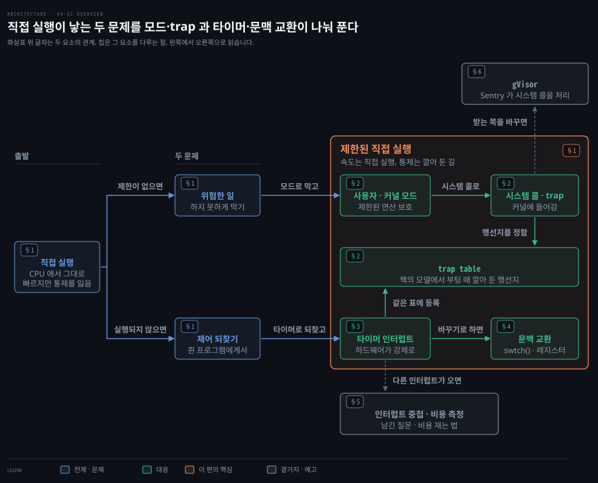
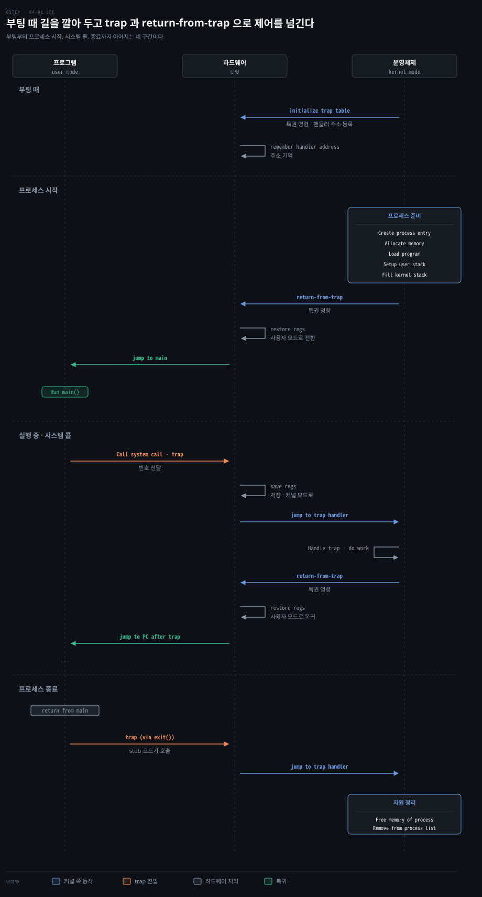
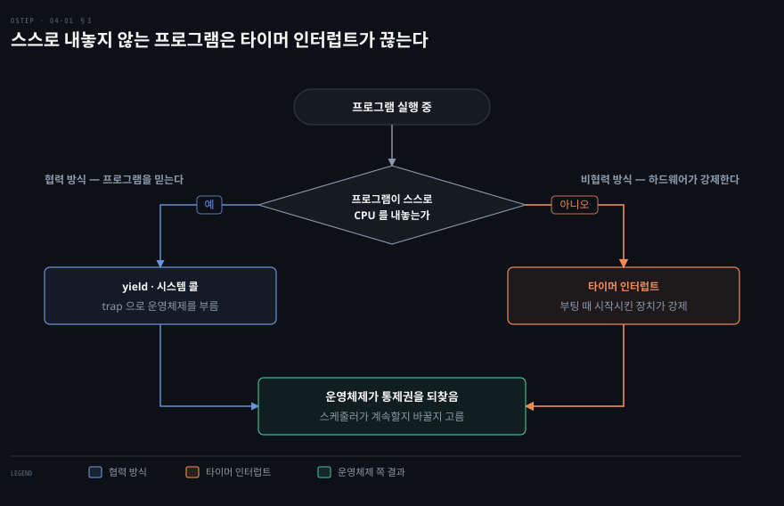
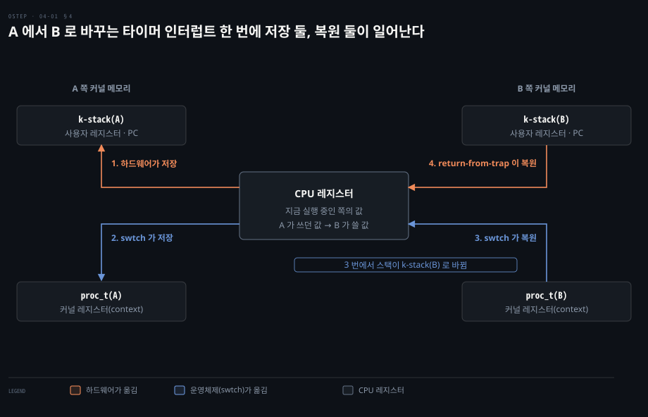
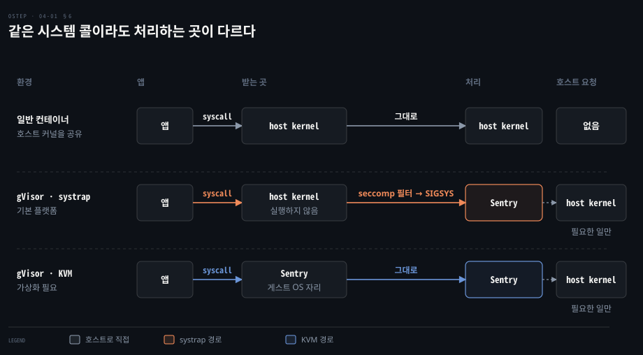

# CPU 를 직접 쓰게 하면서 통제권을 지키는 법 — 제한된 직접 실행·trap·타이머 인터럽트
---

## 핵심 요약

> 운영체제는 프로그램을 CPU 에서 그대로 실행해 속도를 얻고, 하드웨어의 모드·trap·타이머 인터럽트로 통제권을 되찾는 길을 미리 깔아 둡니다. 이 묶음이 제한된 직접 실행입니다.

풀어야 할 문제는 둘입니다. 하나는 프로그램이 위험한 일을 하지 못하게 막는 것이고, 다른 하나는 CPU 를 쥔 프로그램에게서 운영체제가 제어를 되찾는 것입니다. 위험한 일은 사용자 모드와 시스템 콜로 막고 제어는 타이머 인터럽트와 문맥 교환으로 되찾습니다. 이 길이 어디로 이어지는지를 바꾸면 격리 방식이 달라집니다. gVisor 는 시스템 콜을 처리하는 쪽을 호스트 커널에서 자기 안의 Sentry 로 바꿉니다.


## 학습 목표

이 내용을 읽고 나면:

1. 직접 실행이 빠른 이유와, 제한이 없으면 운영체제가 무엇을 잃는지 설명할 수 있습니다.
2. 사용자 모드와 커널 모드, trap 과 return-from-trap 이 시스템 콜 한 번 동안 레지스터를 옮기는 순서를 말할 수 있습니다.
3. 프로그램이 CPU 를 내놓지 않아도 타이머 인터럽트로 통제권을 되찾는 방법을 설명할 수 있습니다.
4. 문맥 교환에서 레지스터가 두 번 저장되는 이유와 `swtch()` 가 하는 일을 말할 수 있습니다.
5. 시스템 콜과 문맥 교환의 비용을 재는 방법과, gVisor 가 시스템 콜을 처리하는 쪽을 바꾸는 방식을 말할 수 있습니다.

아래 개념도는 이 글의 핵심 키워드를 일곱 줄로 묶어 보입니다. 줄마다 왼쪽 칩은 그 줄을 다루는 절을 가리키고 화살표 위 글자는 두 키워드가 어떻게 이어지는지를 나타냅니다.

1행은 직접 실행이 빠르지만 제한이 없으면 통제를 잃으므로 제한된 직접 실행이 필요하다는 문제입니다. 2행은 시스템 콜 경로입니다. 사용자 모드 프로그램이 trap 으로 커널에 들어가면 trap table 이 행선지를 정하고, return-from-trap 으로 돌아옵니다. 3행에서는 협력 방식이 무한 루프 앞에서 막혀 타이머 인터럽트가 필요해집니다.

4행은 문맥 교환입니다. 스케줄러가 프로세스를 바꾸기로 하면 `swtch()` 가 커널 레지스터를 바꿔 B 를 실행합니다. 5·6행은 각각 인터럽트 처리 중 또 인터럽트가 오는 문제와 그 대응, 시스템 콜과 문맥 교환의 비용을 재는 방법입니다. 마지막 7행은 gVisor 가 시스템 콜을 처리하는 쪽을 Sentry 로 바꾸는 방식입니다.




## 제한된 직접 실행의 한 바퀴

> 시분할 한 바퀴는 부팅 때 길을 깔고, 프로그램을 직접 돌리다가, trap 이나 타이머로 통제권을 되찾아 프로세스를 바꾸는 다섯 단계입니다.

CPU 를 여러 프로그램이 나눠 쓰는 일은 한 프로세스를 잠깐 돌리고 다른 프로세스를 돌리는 시분할로 이뤄집니다. 이 글은 그 시분할이 한 바퀴 도는 동안 누가 무엇을 하는지를 따라갑니다. 프로세스의 상태와 목록은 [02-01 노트](./02-01.CPU%20%EA%B0%80%20%EB%81%9D%EC%97%86%EC%9D%B4%20%EC%9E%88%EB%8A%94%20%EB%93%AF%20%EB%B3%B4%EC%9D%B4%EA%B2%8C%20%ED%95%98%EB%8A%94%20%EB%B2%95%20%E2%80%94%20%ED%94%84%EB%A1%9C%EC%84%B8%EC%8A%A4%20%EC%B6%94%EC%83%81%C2%B7%EC%83%81%ED%83%9C%20%EC%A0%84%EC%9D%B4%C2%B7%ED%94%84%EB%A1%9C%EC%84%B8%EC%8A%A4%20%EB%AA%A9%EB%A1%9D.md)가, `fork()` 와 `exec()` 으로 프로세스를 만드는 방식은 [03-01 노트](./03-01.%ED%94%84%EB%A1%9C%EC%84%B8%EC%8A%A4%20%EC%83%9D%EC%84%B1%EC%9D%84%20fork%20%EC%99%80%20exec%20%EC%9C%BC%EB%A1%9C%20%EC%AA%BC%EA%B0%A0%20%EC%9D%B4%EC%9C%A0%20%E2%80%94%20wait%C2%B7%EC%85%B8%20%EB%A6%AC%EB%8B%A4%EC%9D%B4%EB%A0%89%EC%85%98%C2%B7%EC%8B%9C%EA%B7%B8%EB%84%90.md)가 다룹니다. 단계는 다섯이고, 번호 붙은 절이 단계를 나눠 맡습니다.

| 단계 | 주체 | 받치는 개념 | 맡는 절 |
|---|---|---|---|
| 1 길 깔기 | 운영체제(부팅 때) | 특권 명령, trap table, 타이머 시작 | 2, 3 |
| 2 직접 실행 | 프로그램(사용자 모드) | 직접 실행, 사용자 모드 | 1 |
| 3 trap 으로 진입 | 하드웨어 → 운영체제 | 시스템 콜 번호, 커널 스택 | 2, 6 |
| 4 통제권 회수 | 하드웨어(타이머) | 타이머 인터럽트 | 3 |
| 5 프로세스 교체 | 운영체제 | 스케줄러, `swtch()` | 4 |

1단계는 부팅 때 한 번만 일어납니다. 2~5단계는 프로세스가 도는 동안 되풀이됩니다. 5절은 이 흐름이 남긴 질문과 측정 방법을 다루므로 단계에 속하지 않습니다. 6절은 3단계에서 시스템 콜을 처리하는 쪽을 바꾼 사례입니다.


## 1. 속도와 통제를 함께 얻기

> 프로그램을 CPU 에서 직접 돌리면 빠르지만 운영체제가 통제를 잃으므로, 직접 실행에 제한을 거는 것이 장 전체의 출발점입니다.

흐름 위치: 2 직접 실행 · 받치는 개념 — 직접 실행과 두 문제

### 프로세스를 CPU 에서 그대로 돌리기

CPU 를 가상화하려면 두 가지를 함께 얻어야 합니다. 하나는 가상화가 시스템에 큰 부담을 얹지 않는 성능이고, 다른 하나는 프로그램을 효율적으로 돌리면서도 CPU 의 통제를 쥐는 일입니다. 통제가 없으면 프로세스 하나가 영원히 돌며 기계를 독차지하거나, 읽지 말아야 할 정보를 읽을 수 있습니다.[^crux]

성능을 위한 기본 기법이 **직접 실행**(direct execution)입니다. 프로그램을 CPU 에서 그대로 실행하는 방식입니다. 운영체제가 프로그램을 시작하는 순서는 이렇습니다.

1. 프로세스 목록에 항목을 만듭니다.
2. 메모리를 할당하고 디스크에서 프로그램 코드를 올립니다.
3. 진입점인 `main()` 의 주소를 찾아 그곳으로 점프합니다.

이 세 단계를 풀어 쓴 글이 [02-01 노트의 3절](./02-01.CPU%20%EA%B0%80%20%EB%81%9D%EC%97%86%EC%9D%B4%20%EC%9E%88%EB%8A%94%20%EB%93%AF%20%EB%B3%B4%EC%9D%B4%EA%B2%8C%20%ED%95%98%EB%8A%94%20%EB%B2%95%20%E2%80%94%20%ED%94%84%EB%A1%9C%EC%84%B8%EC%8A%A4%20%EC%B6%94%EC%83%81%C2%B7%EC%83%81%ED%83%9C%20%EC%A0%84%EC%9D%B4%C2%B7%ED%94%84%EB%A1%9C%EC%84%B8%EC%8A%A4%20%EB%AA%A9%EB%A1%9D.md#3-프로그램에서-프로세스로)입니다. 제한이 없는 직접 실행에서는 프로그램이 `main()` 에서 돌아오면 운영체제는 메모리를 해제하고 목록에서 항목을 지웁니다. 프로그램이 하드웨어 CPU 에서 곧바로 돌기 때문에 기대하는 만큼 빠릅니다.

### 직접 실행이 낳는 두 문제

직접 실행만으로는 풀리지 않는 질문이 둘 있습니다. 첫째는 프로그램이 원하지 않는 일을 하지 못하게 하면서 효율을 지키는 방법입니다. 둘째는 프로그램이 도는 동안 운영체제가 그 프로그램을 멈추고 다른 프로세스로 바꾸는 방법입니다. 이 두 질문에서 제한된 직접 실행의 "제한"이 나옵니다.

저자들은 제한이 없으면 운영체제가 아무것도 통제하지 못해 "그저 라이브러리"가 된다고 말합니다. 2절은 첫째 문제를, 3·4절은 둘째 문제를 다룹니다.


## 2. 사용자 모드와 시스템 콜

> 프로그램은 제한된 사용자 모드에서 돌고 위험한 일은 trap 으로 커널에 부탁하며, 커널이 부팅 때 깔아 둔 trap table 이 trap 의 행선지를 정합니다.

흐름 위치: 1 길 깔기 → 3 trap 으로 진입 · 받치는 개념 — 사용자 모드, trap table

### 사용자 모드와 커널 모드

프로세스가 디스크 입출력 같은 제한된 연산을 해야 할 때, 아무 프로세스나 마음대로 하게 둘 수는 없습니다. 파일 시스템이 접근 권한을 검사하는데 프로세스가 디스크에 직접 입출력을 낼 수 있다면 디스크 전체를 읽고 쓸 수 있어 모든 보호가 사라집니다.

그래서 프로세서에 모드를 둡니다. **사용자 모드**는 코드가 할 수 있는 일이 제한된 모드입니다. 사용자 모드에서 입출력을 내려 하면 프로세서가 예외를 일으키고, 운영체제는 대개 그 프로세스를 죽입니다. **커널 모드**는 운영체제가 도는 모드로, 입출력 같은 특권 연산과 모든 제한된 명령을 쓸 수 있습니다. 특권 연산을 하는 명령을 **특권 명령**이라 부릅니다. 시스템 콜의 기초는 [Linux 시스템 콜 노트](../../../08_cloud/book/container-security/02-01.Linux%20%EC%8B%9C%EC%8A%A4%ED%85%9C%20%EC%BD%9C%C2%B7%EA%B6%8C%ED%95%9C%C2%B7capability%20%E2%80%94%20%EC%BB%A8%ED%85%8C%EC%9D%B4%EB%84%88%20%EB%B3%B4%EC%95%88%EC%9D%98%20%EB%B0%94%EB%8B%A5.md)가, 모드 전환과 문맥 교환의 구분은 [운영체제 노트](../systems-performance/03-01.%EC%9A%B4%EC%98%81%EC%B2%B4%EC%A0%9C%20%E2%80%94%20%EC%BB%A4%EB%84%90%C2%B7%EC%8B%9C%EC%8A%A4%ED%85%9C%20%EC%BD%9C%C2%B7%EC%9D%B8%ED%84%B0%EB%9F%BD%ED%8A%B8%C2%B7%ED%94%84%EB%A1%9C%EC%84%B8%EC%8A%A4.md)가 따로 다룹니다.

### trap 과 return-from-trap

사용자 프로그램이 디스크를 읽고 싶을 때는 **시스템 콜**을 씁니다. 시스템 콜은 커널이 사용자 프로그램에 기능을 조심스럽게 내놓는 통로입니다. 파일 시스템 접근, 프로세스 생성과 종료, 프로세스 간 통신, 메모리 할당 같은 기능이 이 통로를 거칩니다. 대부분의 운영체제는 수백 개를 제공하고, 초기 유닉스는 스무 개쯤으로 더 간결했습니다.

시스템 콜을 부르려면 프로그램이 **trap** 명령을 실행합니다. 이 명령은 커널로 점프하는 일과 권한을 커널 모드로 올리는 일을 한꺼번에 합니다. 일이 끝나면 운영체제가 **return-from-trap** 명령을 실행해 호출한 프로그램으로 돌아가며 권한을 사용자 모드로 내립니다. 아래 그림은 부팅 때의 준비부터 프로세스 시작, 시스템 콜 한 번, 종료까지의 네 구간을 한 장으로 합친 것입니다.



trap 을 실행할 때 하드웨어는 호출한 쪽의 레지스터를 충분히 저장해야 합니다. 그래야 return-from-trap 때 정확히 돌아올 수 있습니다. 일례로 x86 에서 프로세서는 프로그램 카운터(PC)와 플래그, 몇몇 레지스터를 프로세스별 커널 스택에 밀어 넣습니다. PC 는 다음에 실행할 명령의 주소를 담은 레지스터이고, **커널 스택**은 프로세스마다 하나씩 있는 커널용 스택입니다. return-from-trap 은 그 값을 꺼내 사용자 모드 프로그램의 실행을 이어 갑니다. 다른 하드웨어는 규약이 다르지만 기본 개념은 같습니다.

`open()` 이나 `read()` 가 평범한 C 함수 호출처럼 보이는 것도 이 구조 때문입니다. 실제로 이 둘은 C 라이브러리 함수를 부르는 호출입니다. 라이브러리는 커널과 약속한 규약대로 인자와 시스템 콜 번호를 정해진 자리(스택이나 특정 레지스터)에 두고 trap 명령을 실행합니다. trap 뒤의 라이브러리 코드는 반환값을 풀어 호출한 프로그램에 돌려줍니다. 이 부분은 규약을 정확히 따라야 해서 어셈블리로 손수 짜여 있습니다. 그 덕에 우리는 어셈블리를 쓰지 않고도 커널에 들어갑니다.

x86-64 Linux 에서 시스템 콜을 부르는 trap 명령은 `syscall` 입니다. syscall(2) 문서의 표에서 x86-64 는 명령이 `syscall`, 시스템 콜 번호가 `eax`, 반환값이 `rax` 입니다.[^syscall]

다만 `syscall` 은 앞에서 말한 x86 의 예와 달리 하드웨어가 레지스터를 커널 스택에 밀어 넣는 명령이 아닙니다. 하드웨어는 돌아갈 PC 를 `rcx` 에, 플래그를 `r11` 에 담고 새 `cs`·`ss`·`rip` 를 미리 써 둔 값으로 바꾸고, 스택에는 아무것도 저장하지 않습니다. 스택을 커널 스택으로 바꾸고 레지스터를 밀어 넣는 일은 커널의 진입 코드 `entry_SYSCALL_64` 가 합니다.[^sysentry]

### trap table 과 시스템 콜 번호

trap 이 어느 운영체제 코드를 실행할지는 누가 정합니까? 호출한 프로세스가 점프할 주소를 직접 정하게 할 수는 없습니다. 함수 호출처럼 주소를 고를 수 있다면 프로그램이 커널 안 어디로든 뛸 수 있습니다. 예를 들어 권한 검사 직후 지점으로 점프하면 검사를 건너뛰고, 영리한 프로그래머는 커널이 임의의 코드 조합을 실행하게 만들 수 있습니다.[^retlibc] 저자들은 이를 "아주 나쁜 생각"이라 부릅니다. 그래서 trap 때 실행할 코드는 커널이 통제해야 합니다.

커널은 부팅 때 **trap table** 을 깔아 이를 통제합니다. 기계는 특권 모드로 부팅하므로 하드웨어를 마음대로 설정할 수 있습니다. 운영체제가 처음 하는 일 중 하나는 사건이 났을 때 실행할 코드를 하드웨어에 알려 주는 것입니다. 하드디스크 인터럽트, 키보드 인터럽트, 시스템 콜 같은 사건입니다. 보통 특별한 명령으로 알리고, 하드웨어는 다음 재부팅까지 그 핸들러 위치를 기억합니다.

x86-64 Linux 도 부팅 때 이 등록을 하지만 `syscall` 의 진입점은 표가 아니라 특수 레지스터에 둡니다. v6.12 의 `idt_syscall_init()` 안에 `wrmsrl(MSR_LSTAR, (unsigned long)entry_SYSCALL_64);` 줄이 있습니다. 이 줄은 진입점 `entry_SYSCALL_64` 의 주소를 `MSR_LSTAR` 에 쓰고, `syscall` 명령은 이 값으로 `rip` 를 올립니다.[^lstar]

타이머 인터럽트는 다릅니다. x86 에서 trap table 구실을 하는 표가 IDT(interrupt descriptor table)이고, 타이머 인터럽트는 그 표의 항목으로 등록됩니다.[^idt]

시스템 콜은 번호로 구분합니다. 사용자 코드가 원하는 번호를 레지스터나 스택의 정해진 자리에 두면, 운영체제는 trap 핸들러 안에서 번호가 유효한지 확인한 뒤 해당 코드를 실행합니다. 사용자 코드는 주소를 지정하지 못하고 번호로 서비스를 요청할 뿐이므로 이 간접 단계가 보호 역할을 합니다. 인자도 믿으면 안 됩니다. `write()` 의 버퍼 주소로 커널 영역 주소를 넘기면 커널 메모리 전체를 읽는 길이 열리므로, 운영체제는 인자를 검사해 잘못된 호출을 거절해야 합니다.

trap table 의 위치를 하드웨어에 알리는 명령도 강력한 능력이라 특권 명령입니다. 사용자 모드에서 실행하면 하드웨어가 거부하고 그 프로그램은 대개 종료됩니다.

프로세스를 처음 시작할 때도 같은 길을 씁니다. 운영체제는 프로세스 목록 항목과 메모리를 준비하고 커널 스택에 레지스터와 PC 를 채웁니다. 그 뒤 return-from-trap 을 실행하면 하드웨어가 사용자 모드로 바꾸고 `main()` 으로 점프합니다.

프로세스가 끝날 때도 마찬가지입니다. `main()` 이 돌아가는 곳은 대개 stub 코드이고, 이 코드가 예컨대 `exit()` 시스템 콜로 trap 해 들어갑니다. 그러면 운영체제가 프로세스의 메모리를 해제하고 프로세스 목록에서 항목을 지웁니다. 끝난 자식을 부모가 기다리는 `wait()` 는 [03-01 노트의 2절](./03-01.%ED%94%84%EB%A1%9C%EC%84%B8%EC%8A%A4%20%EC%83%9D%EC%84%B1%EC%9D%84%20fork%20%EC%99%80%20exec%20%EC%9C%BC%EB%A1%9C%20%EC%AA%BC%EA%B0%A0%20%EC%9D%B4%EC%9C%A0%20%E2%80%94%20wait%C2%B7%EC%85%B8%20%EB%A6%AC%EB%8B%A4%EC%9D%B4%EB%A0%89%EC%85%98%C2%B7%EC%8B%9C%EA%B7%B8%EB%84%90.md#2-wait-로-자식의-끝-기다리기)에, 끝났지만 정리 전인 zombie 는 [02-01 노트의 5절](./02-01.CPU%20%EA%B0%80%20%EB%81%9D%EC%97%86%EC%9D%B4%20%EC%9E%88%EB%8A%94%20%EB%93%AF%20%EB%B3%B4%EC%9D%B4%EA%B2%8C%20%ED%95%98%EB%8A%94%20%EB%B2%95%20%E2%80%94%20%ED%94%84%EB%A1%9C%EC%84%B8%EC%8A%A4%20%EC%B6%94%EC%83%81%C2%B7%EC%83%81%ED%83%9C%20%EC%A0%84%EC%9D%B4%C2%B7%ED%94%84%EB%A1%9C%EC%84%B8%EC%8A%A4%20%EB%AA%A9%EB%A1%9D.md#끝났지만-정리-전인-zombie)에 정리돼 있습니다. 제한된 직접 실행 프로토콜은 이렇게 부팅 때와 프로세스 실행 때의 두 단계로 나뉩니다.


## 3. 타이머 인터럽트로 통제권 되찾기

> 프로그램이 CPU 를 스스로 내놓지 않으면 운영체제가 할 수 있는 일이 없으므로, 하드웨어 타이머가 주기적으로 인터럽트를 일으켜 통제권을 강제로 되찾습니다.

흐름 위치: 4 통제권 회수 · 받치는 개념 — 타이머 인터럽트

### 협력 방식의 한계

프로세스가 도는 동안 CPU 는 그 프로세스의 것이고, 정의상 운영체제는 돌고 있지 않습니다. 돌지 않는 운영체제는 아무 일도 할 수 없으므로 프로세스를 바꾸려면 먼저 CPU 의 통제를 되찾아야 합니다.

초기 Macintosh 운영체제와 Xerox Alto 가 쓴 **협력 방식**은 운영체제가 프로세스를 믿는 방식입니다. 너무 오래 도는 프로세스가 있으면 알아서 CPU 를 내놓으리라고 가정합니다. 대부분의 프로세스는 파일을 열어 읽거나 메시지를 보내거나 프로세스를 만들면서 시스템 콜로 통제권을 자주 넘깁니다. 아무 일도 하지 않고 통제권만 넘기는 `yield` 시스템 콜을 따로 두는 시스템도 많습니다. 0 으로 나누거나 접근하면 안 되는 메모리에 접근하는 불법 연산도 운영체제로 trap 을 일으키므로 통제권이 넘어옵니다. 이때 운영체제는 대개 문제를 낸 프로세스를 종료합니다.

협력 방식은 수동적입니다. 악의가 있거나 버그가 있는 프로세스가 시스템 콜 없이 무한 루프에 들어가면 운영체제가 쓸 수 있는 방법은 기계를 재부팅하는 것뿐입니다.

저자들은 재부팅을 우스운 임시방편으로만 보지 않습니다. 재부팅은 소프트웨어를 알려진 상태로 되돌리고 새어 나간 자원을 회수하며 자동화하기도 쉽습니다. 그래서 대규모 인터넷 서비스에서는 기계 묶음을 주기적으로 재부팅하는 일이 흔하다고 말합니다.[^reboot]

### 타이머 인터럽트로 되찾기

하드웨어의 도움 없이는 운영체제가 할 수 있는 일이 거의 없습니다. 그 도움이 **타이머 인터럽트**입니다. 타이머 장치는 몇 밀리초마다 인터럽트를 일으키도록 프로그래밍할 수 있습니다. 인터럽트가 나면 지금 돌던 프로세스가 멈추고, 운영체제에 미리 설정해 둔 **인터럽트 핸들러**가 실행됩니다.

책의 모델에서는 이 핸들러도 시스템 콜 때와 같은 trap table 에 등록되므로 trap handler 라고 부르기도 합니다. x86-64 Linux 에서는 2절에서 본 대로 시스템 콜 진입점은 MSR 에, 타이머 핸들러는 IDT 에 둡니다.

그 순간 운영체제가 CPU 를 되찾으므로 현재 프로세스를 멈추고 다른 프로세스를 시작할 수 있습니다.



시스템 콜 때와 마찬가지로 운영체제는 타이머 인터럽트가 났을 때 실행할 코드를 부팅 때 하드웨어에 알려 둡니다. 부팅 중에 타이머를 시작하는 일도 특권 명령입니다. 타이머가 돌기 시작하면 통제권이 언젠가 돌아온다는 보장이 생겨, 운영체제는 안심하고 사용자 프로그램을 돌립니다. 타이머를 끄는 것도 특권 명령입니다.

인터럽트가 났을 때 하드웨어는 돌던 프로그램의 상태를 충분히 저장해 두어야 합니다. 그래야 뒤이은 return-from-trap 이 그 프로그램을 정확히 되살릴 수 있습니다. 이 동작은 명시적인 시스템 콜 trap 때와 거의 같아서 레지스터가 커널 스택에 저장됩니다. 두 방식은 아래처럼 갈립니다.

| 비교 | 협력 방식 | 타이머 인터럽트 |
|---|---|---|
| 통제권이 넘어오는 때 | 프로그램이 시스템 콜이나 불법 연산을 할 때 | 타이머가 정한 시간이 지날 때 |
| 무한 루프일 때 | 되찾을 방법이 재부팅뿐 | 인터럽트로 되찾음 |
| 필요한 것 | 프로그램의 협조 | 부팅 때 시작시킨 타이머 하드웨어 |


## 4. 문맥 교환이 레지스터를 옮기는 방식

> 운영체제가 통제권을 되찾은 뒤 프로세스를 바꾸기로 하면, 레지스터가 하드웨어와 운영체제 두 곳에서 따로 저장되고 복원되며 이 과정이 문맥 교환입니다.

흐름 위치: 5 프로세스 교체 · 받치는 개념 — 스케줄러, `swtch()`

### 스케줄러의 결정과 문맥 교환

통제권이 시스템 콜로 넘어왔든 타이머 인터럽트로 넘어왔든 결정이 하나 남습니다. 지금 돌던 프로세스를 계속 돌릴지, 다른 프로세스로 바꿀지입니다. 이 결정은 운영체제의 **스케줄러**가 내리며, 정책은 뒤따르는 장이 자세히 다룹니다.

바꾸기로 하면 운영체제는 **문맥 교환**이라는 저수준 코드를 실행합니다. 지금 돌던 프로세스의 레지스터 값 몇 개를 저장하고, 곧 돌 프로세스의 값을 복원하는 일입니다. 이렇게 하면 마지막으로 return-from-trap 이 실행될 때 원래 프로세스로 돌아가지 않고 다른 프로세스가 실행을 이어 갑니다. 저장 대상은 범용 레지스터, PC, 커널 스택 포인터입니다. 스택을 바꾸면 커널은 한 프로세스(끊긴 쪽)의 문맥에서 교환 코드를 호출하고 다른 프로세스(곧 돌 쪽)의 문맥에서 돌아옵니다. 프로세스의 컨텍스트와 스택이 어떻게 구성되는지는 [프로세스와 스레드 노트](../linux-kernel-programming/06-01.%ED%94%84%EB%A1%9C%EC%84%B8%EC%8A%A4%EC%99%80%20%EC%8A%A4%EB%A0%88%EB%93%9C%20%281%29%20%E2%80%94%20%EC%BB%A8%ED%85%8D%EC%8A%A4%ED%8A%B8%C2%B7VAS%C2%B7%EC%8A%A4%ED%83%9D.md)가 다룹니다.

### 레지스터가 두 번 저장되는 이유

프로세스 A 가 돌다가 타이머 인터럽트에 끊기는 장면을 따라가 봅니다. 하드웨어가 A 의 레지스터를 A 의 커널 스택에 저장하고 커널 모드로 들어가 trap 핸들러로 점프합니다. 핸들러에서 운영체제가 A 에서 B 로 바꾸기로 하면 `swtch()` 를 부릅니다. `swtch()` 는 지금 레지스터 값을 A 의 프로세스 구조에 저장합니다. 프로세스 구조는 운영체제가 프로세스마다 두는 기록입니다. [02-01 노트의 5절](./02-01.CPU%20%EA%B0%80%20%EB%81%9D%EC%97%86%EC%9D%B4%20%EC%9E%88%EB%8A%94%20%EB%93%AF%20%EB%B3%B4%EC%9D%B4%EA%B2%8C%20%ED%95%98%EB%8A%94%20%EB%B2%95%20%E2%80%94%20%ED%94%84%EB%A1%9C%EC%84%B8%EC%8A%A4%20%EC%B6%94%EC%83%81%C2%B7%EC%83%81%ED%83%9C%20%EC%A0%84%EC%9D%B4%C2%B7%ED%94%84%EB%A1%9C%EC%84%B8%EC%8A%A4%20%EB%AA%A9%EB%A1%9D.md#5-프로세스-목록과-zombie)에서 PCB 와 xv6 의 `struct proc` 으로 설명합니다.

이어서 B 의 프로세스 구조에서 레지스터를 복원하고 B 의 커널 스택으로 바꿉니다. 마지막으로 운영체제가 return-from-trap 을 실행하면 B 의 레지스터가 복원되고 B 가 돕니다.



이 과정에서 레지스터 저장·복원은 두 종류입니다. 첫째는 타이머 인터럽트가 났을 때입니다. 돌던 프로세스의 사용자 레지스터를 하드웨어가 그 프로세스의 커널 스택에 암묵적으로 저장합니다. 둘째는 운영체제가 A 에서 B 로 바꾸기로 했을 때입니다. 커널 레지스터를 소프트웨어, 곧 운영체제가 프로세스 구조의 메모리에 명시적으로 저장합니다. 뒤의 저장은 시스템을 "A 에서 커널로 막 trap 해 들어온 상태"에서 "B 에서 커널로 막 trap 해 들어온 상태"로 옮깁니다.

### xv6 의 swtch 코드

교육용 운영체제 xv6 의 옛 판 문맥 교환 코드는 아래와 같습니다.[^swtch] 인자 `old` 와 `new` 는 옛 프로세스와 새 프로세스의 프로세스 구조 안에 있는 context 구조입니다.

```asm
# void swtch(struct context *old, struct context *new);
#
# Save current register context in old
# and then load register context from new.
.globl swtch
swtch:
  # Save old registers
  movl 4(%esp), %eax # put old ptr into eax
  popl 0(%eax)        # save the old IP
  movl %esp, 4(%eax) # and stack
  movl %ebx, 8(%eax) # and other registers
  movl %ecx, 12(%eax)
  movl %edx, 16(%eax)
  movl %esi, 20(%eax)
  movl %edi, 24(%eax)
  movl %ebp, 28(%eax)

  # Load new registers
  movl 4(%esp), %eax # put new ptr into eax
  movl 28(%eax), %ebp # restore other registers
  movl 24(%eax), %edi
  movl 20(%eax), %esi
  movl 16(%eax), %edx
  movl 12(%eax), %ecx
  movl 8(%eax), %ebx
  movl 4(%eax), %esp # stack is switched here
  pushl 0(%eax)       # return addr put in place
  ret                 # finally return into new ctxt
```

위쪽 절반은 옛 context 에 IP, 스택 포인터, 나머지 레지스터를 저장합니다. 아래쪽 절반은 새 context 에서 같은 값을 읽어 옵니다.

`%esp` 는 스택 포인터이고, `%eax` 에는 코드 주석대로 `old` 와 `new` 포인터를 차례로 담습니다.

`swtch()` 를 부른 `call` 이 호출한 쪽의 복귀 주소를 스택에 밀어 둡니다. 그래서 첫 `popl 0(%eax)` 가 그 주소를 꺼내 옛 context 의 IP 칸에 저장합니다. `movl 4(%eax), %esp` 줄에서 스택이 새 프로세스의 것으로 바뀝니다. 그다음 `pushl 0(%eax)` 가 새 context 에 저장된 복귀 주소를 새 스택에 놓고, `ret` 가 그 주소를 꺼내 돌아갑니다. 그래서 실행은 새 프로세스의 문맥으로 이어집니다.


## 5. 인터럽트 중첩과 비용 측정

> 인터럽트 처리 중 또 인터럽트가 오는 문제는 동시성 파트의 몫이고, 시스템 콜과 문맥 교환이 실제로 얼마나 드는지는 직접 재 봐야 합니다.

흐름 위치: 흐름 밖 — 이 흐름이 남긴 질문과 비용을 재는 방법

### 인터럽트 처리 중 또 인터럽트가 올 때

시스템 콜을 처리하다가 타이머 인터럽트가 나면 어떻게 됩니까? 인터럽트 처리 중에 다른 인터럽트가 오면 커널이 감당하기 어렵지 않습니까? 운영체제는 실제로 이를 신경 써야 합니다. 저자들은 이 주제를 둘째 파트인 동시성에서 따로 다루겠다며 미뤄 둡니다.

간단한 대응 하나는 인터럽트를 처리하는 동안 인터럽트를 꺼 두는 것입니다. 한 인터럽트를 처리하는 중에는 다른 인터럽트가 CPU 에 전달되지 않습니다. 다만 너무 오래 꺼 두면 인터럽트를 잃을 수 있습니다. 또 커널 내부 자료 구조에 여러 활동이 동시에 접근하지 못하도록 정교한 락 방식이 발전했습니다. 락 방식은 CPU 가 여러 개인 시스템에서 특히 쓸모가 있습니다. 락은 복잡하고 찾기 어려운 버그를 낳는다고 저자들은 경고합니다.

### 시스템 콜 비용 재는 법

시스템 콜의 비용은 비교적 쉽게 잽니다. 가장 단순한 시스템 콜 하나(예를 들어 0 바이트 `read`)를 반복해 부르고 걸린 시간을 반복 횟수로 나누면 한 번의 비용을 추정할 수 있습니다.

타이머의 정밀도와 정확도는 따져야 합니다. `gettimeofday()` 는 1970 년 이후의 시간을 마이크로초 단위로 돌려주지만 마이크로초까지 정밀하다는 뜻은 아닙니다. 이 함수를 연달아 불러 얼마나 정밀한지 먼저 확인하면, 시스템 콜 시험을 몇 번 반복해야 좋은 측정이 되는지 알 수 있습니다. 그래도 모자라면 x86 의 `rdtsc` 명령을 살펴볼 수 있습니다.

### 문맥 교환 비용 재는 법

문맥 교환은 조금 더 까다롭습니다. lmbench 는 한 CPU 위에 프로세스 둘을 두고 둘 사이에 유닉스 파이프 두 개를 놓습니다. 첫째 프로세스가 첫 파이프에 쓰고 둘째 파이프에서 읽으려 기다리면, 운영체제가 첫째를 블록 상태로 두고 둘째로 바꿉니다. 블록 상태는 어떤 사건을 기다리느라 CPU 를 쓰지 않는 상태입니다([02-01 노트의 4절](./02-01.CPU%20%EA%B0%80%20%EB%81%9D%EC%97%86%EC%9D%B4%20%EC%9E%88%EB%8A%94%20%EB%93%AF%20%EB%B3%B4%EC%9D%B4%EA%B2%8C%20%ED%95%98%EB%8A%94%20%EB%B2%95%20%E2%80%94%20%ED%94%84%EB%A1%9C%EC%84%B8%EC%8A%A4%20%EC%B6%94%EC%83%81%C2%B7%EC%83%81%ED%83%9C%20%EC%A0%84%EC%9D%B4%C2%B7%ED%94%84%EB%A1%9C%EC%84%B8%EC%8A%A4%20%EB%AA%A9%EB%A1%9D.md#4-프로세스-상태와-전이)). 둘째는 첫 파이프에서 읽고 둘째 파이프에 씁니다. 이 왕복을 반복하는 비용을 재면 문맥 교환 비용을 추정할 수 있습니다. 파이프 대신 유닉스 소켓 같은 다른 통신 수단도 쓸 수 있습니다.

CPU 가 둘 이상이면 두 프로세스를 같은 프로세서에 묶어 두어야 합니다. 그래야 한 CPU 에서 운영체제가 한 프로세스를 멈추고 다른 프로세스를 되살리는 비용만 잽니다. Linux 에서는 `sched_setaffinity()` 가 한 스레드의 CPU 친화도 마스크를 정해 주므로 이 호출로 묶습니다.[^affinity]

저자들이 소개하는 1996 년 lmbench 결과는 이렇습니다. 200 MHz P6 CPU 의 Linux 1.3.37 에서 시스템 콜이 약 4 마이크로초, 문맥 교환이 약 6 마이크로초였습니다. 현대 시스템은 거의 열 배 좋아져서 2~3 GHz 프로세서에서 1 마이크로초 아래가 나옵니다. Ousterhout 는 많은 운영체제 동작이 메모리를 많이 쓰는데 메모리 대역폭이 프로세서 속도만큼 빨라지지 않았다고 짚었습니다. 그래서 모든 운영체제 동작이 CPU 속도를 따라 빨라지지는 않습니다.[^lmbench]


## 6. gVisor 에서 시스템 콜이 가는 곳

> gVisor 는 시스템 콜을 호스트 커널이 아니라 자기 안의 Sentry 가 처리하게 만드는데, 이는 제한된 직접 실행에서 시스템 콜을 받는 쪽을 바꾸는 일입니다.

흐름 위치: 3 trap 으로 진입 (처리하는 쪽을 바꾼 사례) · 받치는 개념 — Sentry, 플랫폼

### 시스템 콜을 받는 쪽을 바꾸면

앞 절들에서 trap 은 하드웨어가 커널의 핸들러로 보냈습니다. runc 같은 일반 컨테이너에서는 한 호스트의 모든 컨테이너가 같은 커널을 쓰므로 시스템 콜을 받는 쪽이 호스트 커널입니다([Linux 시스템 콜 노트](../../../08_cloud/book/container-security/02-01.Linux%20%EC%8B%9C%EC%8A%A4%ED%85%9C%20%EC%BD%9C%C2%B7%EA%B6%8C%ED%95%9C%C2%B7capability%20%E2%80%94%20%EC%BB%A8%ED%85%8C%EC%9D%B4%EB%84%88%20%EB%B3%B4%EC%95%88%EC%9D%98%20%EB%B0%94%EB%8B%A5.md)가 이 점을 다룹니다).

gVisor 는 이 받는 쪽을 바꿉니다. gVisor 는 Linux 시스템 콜 인터페이스를 처음부터 다시 구현한 **응용 커널**입니다. 샌드박스 안 프로세스의 시스템 콜과 페이지 폴트는 **Sentry** 라는 커널 같은 부분이 가로채 처리합니다. 페이지 폴트는 예외입니다. 예를 들어 접근한 페이지가 지금 물리 메모리에 없으면 프로세서가 프로그램 실행을 끊고 일으킵니다.[^pagefault] gVisor 는 시스템 콜을 호스트로 그대로 넘기지 않습니다.[^gvintro]

예를 들어 샌드박스 안 프로세스가 `getpid(2)` 를 부르면 gVisor 가 이 호출을 가로챕니다. gVisor 는 샌드박스 안 프로세스를 나타내는 자기 PID 표를 따로 들고 있어서, 그 표에서 PID 를 찾아 돌려줍니다. 이 PID 는 호스트의 실제 프로세스가 아닙니다.

다만 Sentry 도 호스트 커널에 제한된 시스템 콜을 부릅니다. 샌드박스 안의 파이프 읽기를 처리하다 `futex(2)` 를 부르는 경우처럼 샌드박스 프로세스의 호출과 일대일로 대응하지는 않습니다. gVisor 가 다시 구현하지 않은 커널 기능은 샌드박스 안에서 쓸 수 없다는 한계도 따릅니다. Gofer 는 곁 프로세스로, Sentry 안에서 처리할 수 없는 요청을 맡고 Sentry 보다 조금 더 신뢰받는 권한으로 돕니다. Sentry 와 Gofer 의 역할은 [컨테이너 격리 노트](../../../08_cloud/book/container-security/08-01.%EC%BB%A8%ED%85%8C%EC%9D%B4%EB%84%88%20%EA%B2%A9%EB%A6%AC%20%EA%B0%95%ED%99%94%20%E2%80%94%20%EC%83%8C%EB%93%9C%EB%B0%95%EC%8B%B1%EC%9D%98%20%EC%84%B8%20%EA%B0%88%EB%9E%98.md)가 샌드박싱 세 갈래의 하나로 설명합니다.



### systrap 과 KVM

시스템 콜을 가로채는 방법이 **플랫폼**이고, 현재 지원하는 플랫폼은 systrap(기본값)과 KVM 둘입니다.[^gvplat] gVisor 는 플랫폼에 시스템 콜 가로채기, 기본적인 문맥 교환, 메모리 매핑을 요구합니다.

systrap 은 기본 플랫폼이고 호스트에 가상화 지원이 없어도 쓸 수 있습니다. 이 플랫폼은 Linux 의 seccomp-bpf 를 시스템 콜을 걸러내는 데 쓰지 않고 가로채는 데 씁니다. seccomp-bpf 는 시스템 콜과 그 인자를 걸러내는 BPF 필터를 커널에 등록하는 기능입니다. 앱이 `syscall` 명령을 실행하면 호스트 커널이 이 필터를 돌립니다. 필터가 `SECCOMP_RET_TRAP` 을 반환하면 커널은 시스템 콜을 실행하지 않고 그 스레드에 SIGSYS 신호를 보냅니다.

신호는 커널이나 다른 프로세스가 프로세스에 보내는 알림이며 자세한 내용은 [03-01 노트의 5절](./03-01.%ED%94%84%EB%A1%9C%EC%84%B8%EC%8A%A4%20%EC%83%9D%EC%84%B1%EC%9D%84%20fork%20%EC%99%80%20exec%20%EC%9C%BC%EB%A1%9C%20%EC%AA%BC%EA%B0%A0%20%EC%9D%B4%EC%9C%A0%20%E2%80%94%20wait%C2%B7%EC%85%B8%20%EB%A6%AC%EB%8B%A4%EC%9D%B4%EB%A0%89%EC%85%98%C2%B7%EC%8B%9C%EA%B7%B8%EB%84%90.md#5-시그널과-사용자로-프로세스-제어하기)에 있습니다. SIGSYS 가 제어를 gVisor 에 넘겨 시스템 콜을 처리하게 합니다.[^seccomp]

KVM 은 커널의 KVM 기능으로 Sentry 가 게스트 운영체제와 가상 머신 모니터(VMM) 노릇을 함께 하게 합니다. 가상화된 하드웨어 계층은 없고 샌드박스는 프로세스 모델을 유지합니다. 샌드박스 안 코드는 게스트 ring 3 에서 돌고, ring 3 은 x86 권한 단계 0~3 가운데 가장 낮은 권한으로 사용자 코드가 쓰는 단계입니다.[^ring] KVM 은 베어메탈에서 가장 잘 돌고 중첩 가상화에서는 systrap 보다 대체로 느립니다.

| 비교 | systrap | KVM |
|---|---|---|
| 가로채는 방법 | seccomp `SECCOMP_RET_TRAP` 으로 SIGSYS 를 보냄 | Sentry 가 게스트 운영체제 자리에 섬 |
| 호스트의 가상화 지원 | 필요 없음 | 필요함 |
| 어울리는 환경 | VM 안이나 가상화 지원이 없는 기계 | 베어메탈 |

두 플랫폼 모두 시스템 콜은 호스트 커널 대신 Sentry 가 처리합니다. 가로채는 방식이 다릅니다. systrap 에서는 앱의 시스템 콜이 먼저 호스트 커널에 들어가고, 커널이 시스템 콜을 실행하는 대신 SIGSYS 로 Sentry 에 넘깁니다. KVM 에서는 플랫폼 문서가 Sentry 를 게스트 운영체제와 VMM 을 겸하는 쪽으로 적으므로 게스트 운영체제 자리에 선다고 볼 수 있습니다. 앱의 시스템 콜이 어떤 명령으로 Sentry 에 닿는지는 확인하지 않았습니다.


## 연습 문제

> 1~4번과 6번은 본문을 떠올려 답하고, 5번은 코드를 읽고 답하며, 7~9번은 본문의 규칙을 새 상황에 적용합니다. 답을 적은 뒤 정답 절과 맞춰 봅니다.

1. 직접 실행만 쓰면 어떤 두 문제가 생깁니까? 각 문제를 푸는 장치는 무엇입니까?
2. trap 에서 return-from-trap 까지 하드웨어와 운영체제의 동작을 순서대로 말해 보십시오. 프로그램이 점프 주소를 직접 정하지 못하게 하는 이유는 무엇입니까?
3. 프로그램이 시스템 콜 없이 무한 루프에 들어가면 협력 방식과 타이머 인터럽트는 각각 어떻게 됩니까?
4. 타이머 인터럽트로 A 에서 B 로 바뀌는 동안 레지스터 저장은 몇 번 어디에 일어나고 누가 합니까?
5. `swtch()` 코드에서 스택이 바뀌는 줄은 어디이고, 마지막 `ret` 가 새 프로세스로 돌아가게 하는 이유는 무엇입니까?
6. gVisor 의 systrap 플랫폼에서 샌드박스 안 프로세스가 시스템 콜을 부르면 trap 은 어디로 가고, 일반 컨테이너와 무엇이 다릅니까?
7. 사용자 프로그램이 `write()` 의 버퍼 주소로 커널 영역 주소를 일부러 넘깁니다. 운영체제가 인자를 검사하지 않으면 무엇이 가능해지고, 검사하면 이 호출의 결과는 어떻게 됩니까?
8. 사용자 모드에서 trap table 위치를 알리는 명령을 실행하면 어떻게 됩니까? 이 명령이 특권 명령이 아니면 프로그램은 무엇을 할 수 있습니까?
9. 시스템 콜 비용을 재려고 0 바이트 `read` 를 반복해 부르면서, 그 전에 `gettimeofday()` 를 연달아 불러 봅니다. 각각 무엇을 알아내려는 것입니까?


## 정답 (자답 후 펼치기)

### 정답 1

첫째는 프로그램이 원하지 않는 일을 하지 못하게 하면서 효율을 지키는 문제입니다. 둘째는 돌고 있는 프로세스를 멈추고 다른 프로세스로 바꾸는 문제입니다. 첫째는 사용자 모드와 시스템 콜(trap)로 풀고 둘째는 타이머 인터럽트와 문맥 교환으로 풉니다. 제한이 없으면 운영체제가 아무것도 통제하지 못합니다.

### 정답 2

프로그램이 trap 을 실행하면 하드웨어가 레지스터를 커널 스택에 저장하고 커널 모드로 바꾼 뒤 trap handler 로 점프합니다. 운영체제는 시스템 콜 번호를 확인해 일을 처리하고 return-from-trap 을 실행합니다. 하드웨어가 레지스터를 복원하고 사용자 모드로 바꿔 trap 다음 PC 로 점프합니다. 주소를 프로그램이 정하게 하면 커널 안 어디로든 뛸 수 있어 권한 검사를 건너뛰는 악용이 가능하므로, 부팅 때 깔린 trap table 과 번호로만 요청하게 합니다.

### 정답 3

협력 방식에서는 통제권이 시스템 콜이나 불법 연산으로만 넘어오므로 되찾을 방법이 재부팅뿐입니다. 타이머 인터럽트에서는 하드웨어 타이머가 일정 시간마다 인터럽트를 일으켜 운영체제의 핸들러가 실행되므로 프로그램의 협조 없이도 통제권이 돌아옵니다.

### 정답 4

두 번입니다. 인터럽트가 났을 때 하드웨어가 A 의 사용자 레지스터를 A 의 커널 스택에 저장합니다. 운영체제가 A 에서 B 로 바꾸기로 했을 때는 `swtch()` 가 커널 레지스터를 A 의 프로세스 구조에 저장합니다. 복원도 두 번입니다. `swtch()` 가 B 의 프로세스 구조에서 복원하고 return-from-trap 때 하드웨어가 B 의 커널 스택에서 복원합니다.

### 정답 5

`movl 4(%eax), %esp` 줄이고 주석이 "stack is switched here" 라고 적습니다. 그다음 `pushl 0(%eax)` 가 새 context 에 저장된 복귀 주소를 새 스택에 놓습니다. `ret` 는 스택에서 복귀 주소를 꺼내 돌아가는데, 스택이 이미 새 프로세스의 것이므로 옛 프로세스가 아니라 새 context 가 저장해 둔 주소로 돌아갑니다.

### 정답 6

systrap 에서도 앱의 `syscall` 명령은 먼저 호스트 커널로 들어갑니다. 커널이 seccomp 필터를 돌려 `SECCOMP_RET_TRAP` 이 나오면 시스템 콜을 실행하지 않고 그 스레드에 SIGSYS 를 보냅니다. 이 신호가 제어를 Sentry 에 넘깁니다.

일반 컨테이너에서는 호스트 커널이 시스템 콜을 그대로 실행합니다. systrap 에서는 호스트 커널이 실행하는 대신 Sentry 에 넘기고, Sentry 가 처리해 필요한 일만 호스트 시스템 콜로 요청합니다.

### 정답 7

운영체제가 검사 없이 그 주소를 읽으면 프로그램이 커널 메모리를 읽는 길이 열립니다. 커널의 가상 메모리에는 보통 시스템의 모든 물리 메모리가 들어 있어서, 다른 프로세스의 메모리까지 읽을 수 있습니다. 운영체제는 시스템 콜 경계에서 인자를 검사해 잘못된 주소면 호출을 거절합니다. Linux 에서 `write()` 는 버퍼가 접근 가능한 주소 공간 밖이면 `EFAULT` 로 실패합니다.[^write2]

### 정답 8

하드웨어가 명령을 거부하고 그 프로그램은 대개 종료됩니다. 특권 명령이 아니라면 프로그램이 trap 때 실행할 코드를 직접 정하는 셈이 되어, 2절에서 점프 주소를 프로그램이 고르게 할 때와 같은 문제가 생깁니다. 프로그램이 자기 코드를 등록해 두면 trap 이 일어날 때마다 그 코드가 커널 모드로 실행되므로 기계를 장악할 수 있습니다.

### 정답 9

0 바이트 `read` 는 가장 단순한 시스템 콜이라, 이를 반복해 걸린 시간을 반복 횟수로 나누면 시스템 콜 한 번의 비용을 추정할 수 있습니다. `gettimeofday()` 는 마이크로초 단위로 값을 돌려주지만 마이크로초까지 정밀하다는 뜻은 아닙니다. 연달아 불러 정밀도를 먼저 확인해야 시스템 콜 시험을 몇 번 반복해야 좋은 측정이 되는지 알 수 있습니다.


## 참고 자료

- 《Operating Systems: Three Easy Pieces》(Remzi H. Arpaci-Dusseau · Andrea C. Arpaci-Dusseau, Arpaci-Dusseau Books) 6장
- [6장 PDF](https://pages.cs.wisc.edu/~remzi/OSTEP/cpu-mechanisms.pdf)
- [syscall(2)](https://man7.org/linux/man-pages/man2/syscall.2.html)
- [sched_setaffinity(2)](https://man7.org/linux/man-pages/man2/sched_setaffinity.2.html)
- [seccomp(2)](https://man7.org/linux/man-pages/man2/seccomp.2.html)
- [Linux v6.12 arch/x86/kernel/cpu/common.c](https://raw.githubusercontent.com/torvalds/linux/v6.12/arch/x86/kernel/cpu/common.c)
- [gVisor 소개 문서](https://gvisor.dev/docs/architecture_guide/intro/)
- [gVisor 플랫폼 문서](https://gvisor.dev/docs/architecture_guide/platforms/)


## 관련 문서

- [이 책의 인덱스](./README.md)
- [Linux 시스템 콜·권한·capability 노트](../../../08_cloud/book/container-security/02-01.Linux%20%EC%8B%9C%EC%8A%A4%ED%85%9C%20%EC%BD%9C%C2%B7%EA%B6%8C%ED%95%9C%C2%B7capability%20%E2%80%94%20%EC%BB%A8%ED%85%8C%EC%9D%B4%EB%84%88%20%EB%B3%B4%EC%95%88%EC%9D%98%20%EB%B0%94%EB%8B%A5.md)
- [컨테이너 격리 강화 노트의 gVisor](../../../08_cloud/book/container-security/08-01.%EC%BB%A8%ED%85%8C%EC%9D%B4%EB%84%88%20%EA%B2%A9%EB%A6%AC%20%EA%B0%95%ED%99%94%20%E2%80%94%20%EC%83%8C%EB%93%9C%EB%B0%95%EC%8B%B1%EC%9D%98%20%EC%84%B8%20%EA%B0%88%EB%9E%98.md)
- [운영체제 노트의 모드 전환과 문맥 교환](../systems-performance/03-01.%EC%9A%B4%EC%98%81%EC%B2%B4%EC%A0%9C%20%E2%80%94%20%EC%BB%A4%EB%84%90%C2%B7%EC%8B%9C%EC%8A%A4%ED%85%9C%20%EC%BD%9C%C2%B7%EC%9D%B8%ED%84%B0%EB%9F%BD%ED%8A%B8%C2%B7%ED%94%84%EB%A1%9C%EC%84%B8%EC%8A%A4.md)
- [프로세스와 스레드 노트의 컨텍스트](../linux-kernel-programming/06-01.%ED%94%84%EB%A1%9C%EC%84%B8%EC%8A%A4%EC%99%80%20%EC%8A%A4%EB%A0%88%EB%93%9C%20%281%29%20%E2%80%94%20%EC%BB%A8%ED%85%8D%EC%8A%A4%ED%8A%B8%C2%B7VAS%C2%B7%EC%8A%A4%ED%83%9D.md)

[^crux]: 6장의 핵심 문제 상자 넷은 다음과 같습니다. "HOW TO EFFICIENTLY VIRTUALIZE THE CPU WITH CONTROL"(장 전체), "HOW TO PERFORM RESTRICTED OPERATIONS"(2절), "HOW TO REGAIN CONTROL OF THE CPU"와 "HOW TO GAIN CONTROL WITHOUT COOPERATION"(3절). 장 전체 상자는 "The OS must virtualize the CPU in an efficient manner while retaining control over the system. To do so, both hardware and operating-system support will be required."라고 적습니다. <https://pages.cs.wisc.edu/~remzi/OSTEP/cpu-mechanisms.pdf>
[^retlibc]: 6장 각주 1 은 권한 검사 직후로 점프하는 상황을 상상해 보라고 하며, 그런 능력이 있으면 영리한 프로그래머가 커널에 임의의 코드 열을 실행시킬 수 있다고 적고 Shacham 의 return-into-libc 논문(CCS '07, "The Geometry of Innocent Flesh on the Bone")을 가리킵니다. <https://pages.cs.wisc.edu/~remzi/OSTEP/cpu-mechanisms.pdf>
[^syscall]: syscall(2) 의 아키텍처별 표에서 x86-64 행은 Instruction 이 `syscall`, System call # 이 `eax`, Retval 이 `rax`, Retval2 가 `rdx` 입니다(Linux man-pages 6.19, 2026-02-02). <https://man7.org/linux/man-pages/man2/syscall.2.html>
[^lstar]: v6.12 태그의 `arch/x86/kernel/cpu/common.c` 에서 `idt_syscall_init()` 이 `wrmsrl(MSR_LSTAR, (unsigned long)entry_SYSCALL_64);` 를 실행합니다(2038 줄). `syscall` 명령은 이 MSR 에 미리 써 둔 값으로 `rip` 를 올립니다(`entry_64.S` 주석 "then loads new ss, cs, and rip from previously programmed MSRs"). <https://raw.githubusercontent.com/torvalds/linux/v6.12/arch/x86/kernel/cpu/common.c>
[^reboot]: 6장 TIP 「Reboot Is Useful」은 재부팅이 소프트웨어를 "a known and likely more tested state" 로 되돌리고, 오래된 자원이나 새어 나간 자원을 회수하며, 자동화하기 쉽다고 적고 Candea 등의 microreboot 논문(OSDI '04)을 가리킵니다. <https://pages.cs.wisc.edu/~remzi/OSTEP/cpu-mechanisms.pdf>
[^affinity]: sched_setaffinity(2) 는 "sched_setaffinity() sets the CPU affinity mask of the thread whose ID is pid to the value specified by mask. If pid is zero, then the calling thread is used."라고 적습니다(Linux man-pages 6.19, 2026-02-08). <https://man7.org/linux/man-pages/man2/sched_setaffinity.2.html>
[^lmbench]: 6장 ASIDE 「How Long Context Switches Take」는 lmbench(McVoy·Staelin, USENIX ATC 1996)가 1996 년 200 MHz P6 CPU 의 Linux 1.3.37 에서 시스템 콜 약 4 마이크로초, 문맥 교환 약 6 마이크로초를 쟀고 현대 시스템은 2~3 GHz 에서 1 마이크로초 아래라고 적으며, Ousterhout(USENIX 1990)가 메모리 대역폭이 프로세서 속도만큼 빨라지지 않았음을 짚었다고 적습니다. <https://pages.cs.wisc.edu/~remzi/OSTEP/cpu-mechanisms.pdf>
[^gvintro]: gVisor 소개 문서는 gVisor 가 Linux 시스템 콜 인터페이스 등을 처음부터 다시 구현한 것이며 "gVisor never passes through any system call to the host."라고 적습니다. getpid(2) 예에서 gVisor 는 호출을 가로채고 "its own PID table" 로 PID 를 찾아 돌려주며, Sentry 는 호스트 Linux 커널에 제한된 시스템 콜을 부르고 futex(2) 를 예로 들어 "they do not map 1-to-1 to the system calls made by the sandboxed processes"라고 적습니다. 처리할 수 없는 요청을 위해 Gofer 라는 sidecar 프로세스가 있으며 "a slightly-more-trusted companion process running in a slightly-more-privileged context"라고 적습니다. <https://gvisor.dev/docs/architecture_guide/intro/>
[^gvplat]: gVisor 플랫폼 문서는 "gVisor requires a platform to implement interception of syscalls, basic context switching, and memory mapping functionality."라고 적습니다. systrap 은 "relies on seccomp's SECCOMP_RET_TRAP feature in order to intercept system calls", KVM 은 "allow the Sentry to act as both guest OS and VMM", systrap 이 "replaced ptrace as the default gVisor platform in mid-2023"이라고 적고, 소개 문서는 KVM 에서 "Sandboxed workload code runs in guest ring 3" 이며 중첩 가상화는 "generally slower than Systrap"이라고 적습니다. <https://gvisor.dev/docs/architecture_guide/platforms/> <https://gvisor.dev/docs/architecture_guide/intro/>
[^seccomp]: seccomp(2) 는 `SECCOMP_RET_TRAP` 을 "This value results in the kernel sending a thread-directed SIGSYS signal to the triggering thread. (The system call is not executed.)"라고 적습니다(Linux man-pages 6.19, 2026-06-05). <https://man7.org/linux/man-pages/man2/seccomp.2.html>
[^sysentry]: v6.12 태그의 `arch/x86/entry/entry_64.S` 주석은 "64-bit SYSCALL saves rip to rcx, clears rflags.RF, then saves rflags to r11, then loads new ss, cs, and rip from previously programmed MSRs."와 "SYSCALL does not save anything on the stack and does not change rsp."라고 적습니다. 커널 진입 코드는 이어서 `movq PER_CPU_VAR(pcpu_hot + X86_top_of_stack), %rsp` 로 스택을 바꾸고 `pushq %r11 /* pt_regs->flags */`, `pushq %rcx /* pt_regs->ip */` 로 레지스터를 직접 저장합니다(62~65, 95, 103, 105 줄). <https://raw.githubusercontent.com/torvalds/linux/v6.12/arch/x86/entry/entry_64.S>
[^idt]: Intel SDM 3A 1부는 "External interrupts, software interrupts and exceptions are handled through the interrupt descriptor table (IDT)."라고 적습니다. v6.12 태그의 `arch/x86/kernel/idt.c` 154 줄은 `INTG(LOCAL_TIMER_VECTOR, asm_sysvec_apic_timer_interrupt)` 로 타이머 인터럽트를 IDT 항목으로 등록합니다. <https://www.intel.com/content/dam/www/public/us/en/documents/manuals/64-ia-32-architectures-software-developer-vol-3a-part-1-manual.pdf> <https://raw.githubusercontent.com/torvalds/linux/v6.12/arch/x86/kernel/idt.c>
[^swtch]: 책의 `swtch` 는 2007 년 판 xv6 코드입니다. xv6-public 커밋 `c95bde8163`(2007-09-27)의 `swtch.S` 는 `popl 0(%eax)  # %eip` 와 `movl 4(%esp), %eax  # not 8(%esp) - popped return address above` 를 담고 있습니다. Intel SDM 3A 1부는 RET 가 "procedures that were called with a CALL instruction" 의 반환용이며 JMP 는 "does not save a return instruction pointer on the stack"이라고 적습니다. <https://github.com/mit-pdos/xv6-public/blob/c95bde8163/swtch.S> <https://www.intel.com/content/dam/www/public/us/en/documents/manuals/64-ia-32-architectures-software-developer-vol-3a-part-1-manual.pdf>
[^pagefault]: Intel SDM 3A 1부는 접근한 페이지가 물리 메모리에 없으면 "the processor interrupts execution of the program (by generating a page-fault exception)"이라고 적습니다. <https://www.intel.com/content/dam/www/public/us/en/documents/manuals/64-ia-32-architectures-software-developer-vol-3a-part-1-manual.pdf>
[^ring]: Intel SDM 3A 1부는 "The processor's segment-protection mechanism recognizes 4 privilege levels, numbered from 0 to 3. The greater numbers mean lesser privileges."라고 적습니다. gVisor 소개 문서는 KVM 플랫폼에서 "Sandboxed workload code runs in guest ring 3"이라고 적습니다. <https://www.intel.com/content/dam/www/public/us/en/documents/manuals/64-ia-32-architectures-software-developer-vol-3a-part-1-manual.pdf> <https://gvisor.dev/docs/architecture_guide/intro/>
[^write2]: write(2) 는 "EFAULT buf is outside your accessible address space."라고 적습니다(Linux man-pages). <https://man7.org/linux/man-pages/man2/write.2.html>
