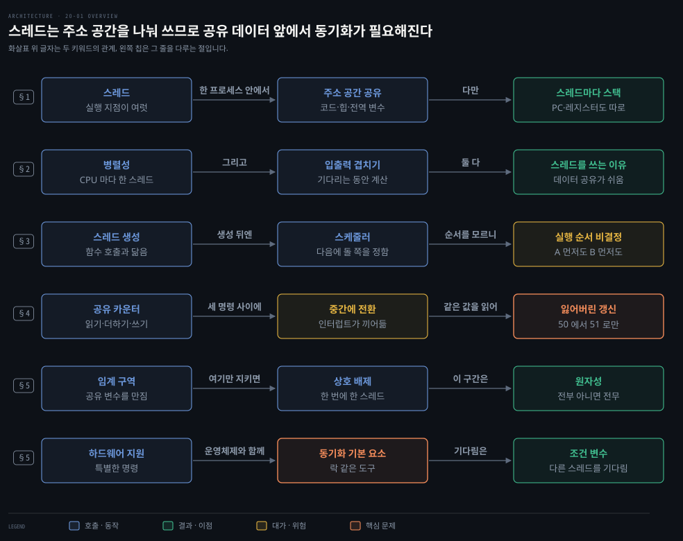
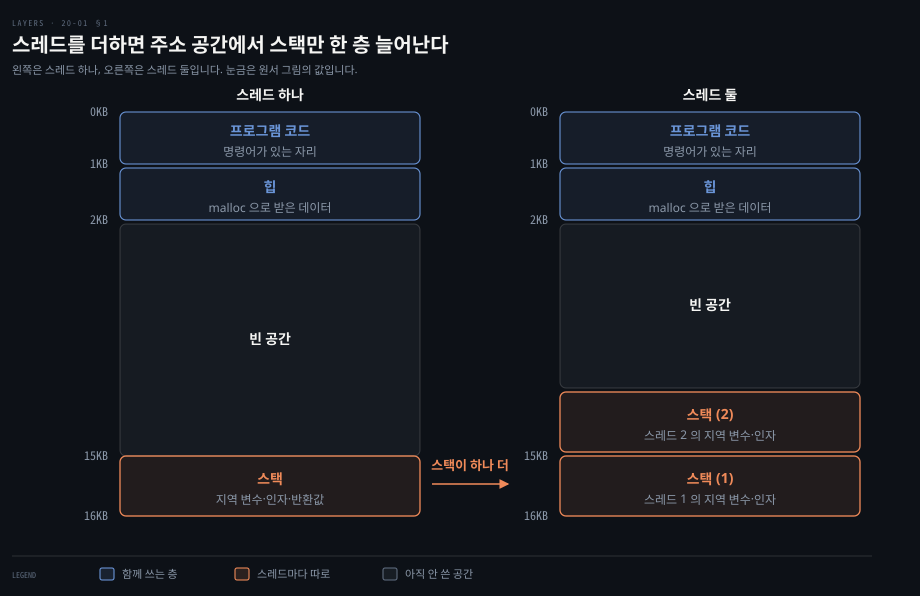
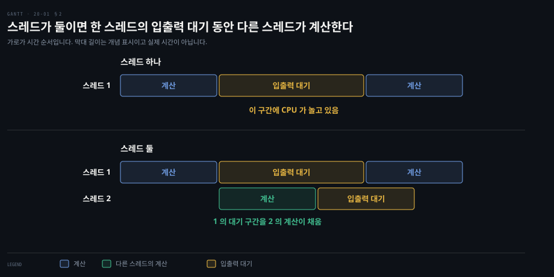
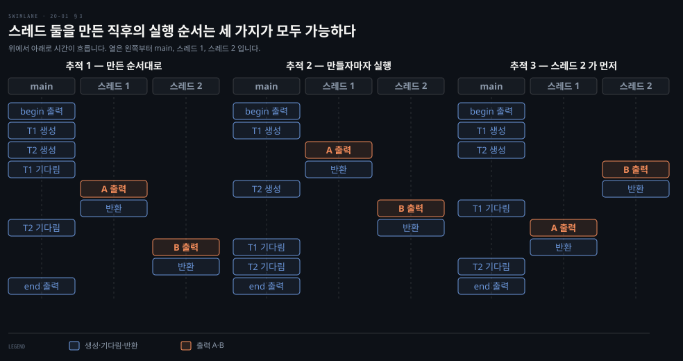
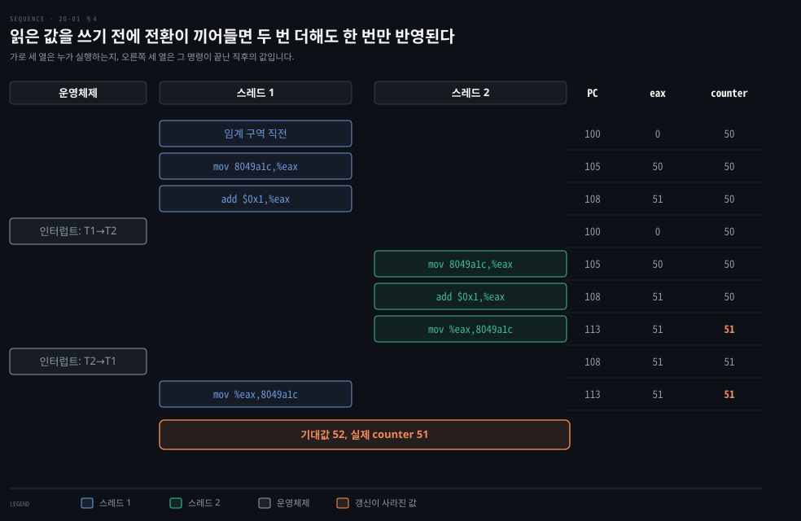
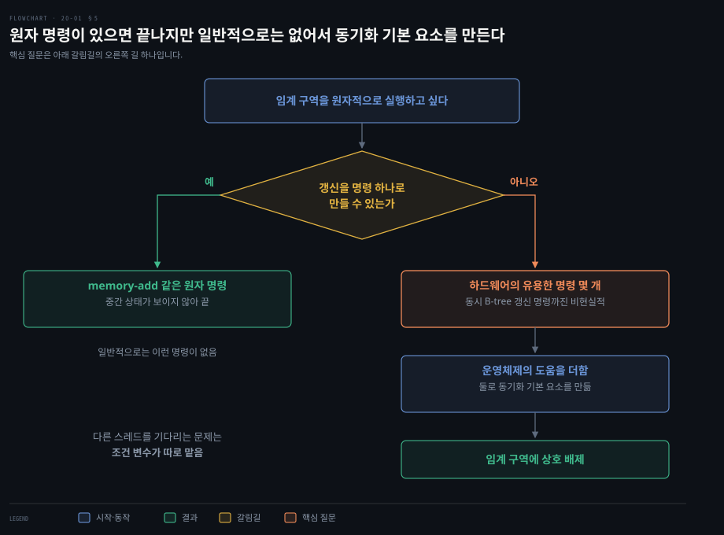

# 스레드가 한 주소 공간을 나눠 쓸 때 생기는 일 — 경쟁 상태·임계 구역·원자성
---

## 핵심 요약

> 스레드는 한 프로세스 안에 실행 지점을 여럿 두는 추상이며, 주소 공간을 함께 쓰므로 공유 변수를 고치는 짧은 구간에서 실행 순서가 결과를 바꿉니다. 이 문제를 푸는 길은 그 구간을 한 번에 한 스레드만 지나게 하는 상호 배제입니다.

스레드는 프로세스와 거의 같지만 주소 공간을 공유하는 점이 다릅니다. 그 덕에 데이터를 나누기 쉽습니다. 입출력을 기다리는 동안 다른 일을 할 수도 있습니다.

대가는 실행 순서에서 치릅니다. 어느 스레드가 언제 돌지는 스케줄러가 정합니다. 그래서 같은 프로그램이 실행마다 다른 결과를 낼 수 있습니다. 특히 공유 카운터를 읽고 더하고 쓰는 세 명령 사이에 전환이 끼어들면 갱신이 사라집니다. 이 현상이 경쟁 상태입니다.

해결하려면 그 세 명령을 나눌 수 없는 하나의 단위, 곧 원자적으로 실행해야 합니다. 그러자면 하드웨어의 명령 몇 개와 운영체제의 도움으로 동기화 기본 요소를 만들어야 합니다. 이 글은 그 문제를 세우는 데까지를 다루고, 도구를 만드는 일은 뒤의 장들이 맡습니다.


## 학습 목표

이 내용을 읽고 나면:

1. 스레드가 프로세스와 같은 점과 다른 점을 주소 공간과 스택으로 설명할 수 있습니다.
2. 스레드를 쓰는 두 이유, 병렬성과 입출력 겹치기를 예로 말할 수 있습니다.
3. 스레드 둘을 만든 프로그램의 실행 순서가 왜 하나로 정해지지 않는지 설명할 수 있습니다.
4. 공유 카운터에서 갱신이 사라지는 과정을 세 명령 수준에서 따라갈 수 있습니다.
5. 임계 구역, 경쟁 상태, 상호 배제, 원자성이 각각 무엇인지 말하고, 왜 동기화 기본 요소가 필요한지 설명할 수 있습니다.

아래 개념도는 이 글의 핵심 키워드를 여섯 줄로 묶었습니다. 줄마다 왼쪽 칩은 그 줄을 다루는 절을 가리키고, 화살표 위 글자는 두 키워드가 어떻게 이어지는지를 나타냅니다.

1행은 스레드가 한 주소 공간을 함께 쓰되 스택은 따로 가진다는 정의입니다. 2행은 병렬성과 입출력 겹치기라는 두 이유입니다. 3행에서는 생성 뒤의 실행 순서를 스케줄러가 정하므로 결과가 비결정적이 됩니다. 4행은 공유 카운터에서 중간에 전환이 끼어 갱신이 사라지는 경쟁 상태입니다. 5행은 그 구간을 임계 구역으로 보고 상호 배제로 지키는 방법이고, 6행은 그 일을 하드웨어와 운영체제가 나눠 맡는다는 예고입니다.




## 스레드 문제가 서는 순서

> 스레드의 정의에서 출발해 쓰는 이유, 실행 순서의 불확실성, 공유 데이터에서 깨지는 장면을 거쳐 해결의 방향까지 다섯 단계로 문제를 세웁니다.

이 글은 해결책이 아니라 문제를 세웁니다. 스레드가 무엇이고 왜 쓰는지부터 시작해 공유 변수 앞에서 무엇이 깨지는지까지를 순서대로 따라갑니다. 프로세스와 문맥 교환은 [02-01 노트](./02-01.CPU%20%EA%B0%80%20%EB%81%9D%EC%97%86%EC%9D%B4%20%EC%9E%88%EB%8A%94%20%EB%93%AF%20%EB%B3%B4%EC%9D%B4%EA%B2%8C%20%ED%95%98%EB%8A%94%20%EB%B2%95%20%E2%80%94%20%ED%94%84%EB%A1%9C%EC%84%B8%EC%8A%A4%20%EC%B6%94%EC%83%81%C2%B7%EC%83%81%ED%83%9C%20%EC%A0%84%EC%9D%B4%C2%B7%ED%94%84%EB%A1%9C%EC%84%B8%EC%8A%A4%20%EB%AA%A9%EB%A1%9D.md)와 [04-01 노트](./04-01.CPU%20%EB%A5%BC%20%EC%A7%81%EC%A0%91%20%EC%93%B0%EA%B2%8C%20%ED%95%98%EB%A9%B4%EC%84%9C%20%ED%86%B5%EC%A0%9C%EA%B6%8C%EC%9D%84%20%EC%A7%80%ED%82%A4%EB%8A%94%20%EB%B2%95%20%E2%80%94%20%EC%A0%9C%ED%95%9C%EB%90%9C%20%EC%A7%81%EC%A0%91%20%EC%8B%A4%ED%96%89%C2%B7trap%C2%B7%ED%83%80%EC%9D%B4%EB%A8%B8%20%EC%9D%B8%ED%84%B0%EB%9F%BD%ED%8A%B8.md)에서 먼저 다뤘습니다.

| 단계 | 질문 | 받치는 개념 | 맡는 절 |
|---|---|---|---|
| 1 정의 | 스레드는 프로세스와 무엇이 다른가 | 주소 공간 공유, 스레드마다 PC·레지스터·스택 | 1 |
| 2 동기 | 왜 프로세스 대신 스레드를 쓰는가 | 병렬성, 입출력 겹치기 | 2 |
| 3 실행 | 만든 스레드는 어떤 순서로 도는가 | 스케줄러, 비결정적 순서 | 3 |
| 4 사고 | 공유 변수를 고치면 무엇이 깨지는가 | 경쟁 상태, 잃어버린 갱신 | 4 |
| 5 방향 | 어떻게 막을 것인가 | 임계 구역, 상호 배제, 원자성 | 5 |

6절은 이 흐름에 속하지 않고, 시뮬레이터로 4~5단계를 직접 확인하는 방법을 다룹니다.


## 1. 스레드와 주소 공간

> 스레드는 한 프로세스 안의 또 하나의 실행 지점으로, 주소 공간은 함께 쓰고 PC·레지스터·스택은 스레드마다 따로 가집니다.

흐름 위치: 1 정의 · 받치는 개념 — 주소 공간 공유, 스레드별 상태

### 실행 지점이 여럿인 프로세스

지금까지 본 프로세스는 명령을 가져오는 곳이 하나, 곧 프로그램 카운터(PC) 하나인 프로그램이었습니다. 스레드를 쓰는 프로그램은 실행 지점이 여럿입니다. 교재는 스레드가 프로세스와 거의 같지만 한 가지가 다르다고 말합니다. 같은 주소 공간을 공유해 같은 데이터에 접근할 수 있다는 점입니다.

스레드 하나의 상태는 프로세스와 비슷합니다. 명령을 가져올 곳을 가리키는 PC 가 있고, 계산에 쓰는 레지스터 묶음을 스레드마다 따로 가집니다. 한 CPU 에서 스레드 T1 을 멈추고 T2 를 돌릴 때는 문맥 교환이 일어나 T1 의 레지스터를 저장하고 T2 의 레지스터를 복원합니다.

프로세스는 이 상태를 프로세스 제어 블록(PCB)에 저장했고, 스레드는 스레드 제어 블록(TCB)에 저장합니다.

프로세스 사이의 문맥 교환과 다른 점이 하나 있습니다. 스레드 사이에서는 주소 공간이 그대로이므로 쓰는 페이지 테이블을 바꿀 필요가 없습니다.

### 스레드마다 스택을 따로 갖는 이유

스레드가 하나인 프로세스의 주소 공간에는 스택이 하나입니다. 스택은 지역 변수, 함수 인자, 반환값이 놓이는 곳입니다. 스레드가 둘이면 각자 다른 함수를 호출하며 일하므로 스택이 스레드마다 하나씩 필요해, 주소 공간에 스택이 둘 생깁니다. 아래 그림에서 달라진 층은 스택뿐이고 코드와 힙은 그대로입니다.



코드와 힙, 전역 변수는 모든 스레드가 함께 씁니다. 반대로 스택에 놓인 지역 변수와 인자는 해당 스레드의 스택에 놓여 스레드가 따로 갖습니다. 어떤 변수가 어느 쪽에 놓였는지가 뒤에서 나올 문제의 경계가 됩니다.

스택이 여럿이 되면 주소 공간의 깔끔한 배치는 무너집니다. 스택이 하나일 때는 스택과 힙이 서로 방해하지 않고 자라다가 공간이 바닥날 때만 문제가 생겼습니다. 이제는 그렇지 않습니다. 그래도 스택은 보통 크지 않아도 되므로 대개 괜찮습니다. 재귀를 많이 쓰는 프로그램이 예외입니다.

### 세부 — 리눅스에서 스레드는 task 하나

리눅스는 스레드를 별도 개념으로 두기보다 프로세스를 만드는 호출의 옵션으로 다룹니다. `clone()` 에 `CLONE_VM` 을 주면 부른 쪽과 만든 쪽이 같은 메모리 공간에서 돌고, 한쪽이 쓴 값이 다른 쪽에도 보입니다.[^clone-vm] `CLONE_THREAD` 를 주면 만든 쪽이 부른 쪽과 같은 스레드 그룹에 들어갑니다. 이 그룹은 POSIX 가 말하는 "PID 를 함께 쓰는 스레드 묶음"을 구현하려고 리눅스 2.4 에 들어왔습니다. 그룹이 공유하는 PID 의 내부 이름이 스레드 그룹 식별자(TGID)입니다.[^clone-thread]

`getpid()` 는 호출한 스레드가 속한 그룹의 TGID 를 돌려주고 스레드는 시스템 전체에서 유일한 스레드 ID(TID)로 구별됩니다.

현재 리눅스의 pthread 구현(NPTL)에서는 한 프로세스의 모든 스레드가 같은 스레드 그룹에 들어가 같은 PID 를 씁니다.[^nptl] `/proc/<pid>/task/<tid>` 아래에서 스레드마다의 정보를 볼 수 있습니다.[^proc-task]

`ps` 에 `-L` 을 주면 스레드마다 한 줄을 보이고 `LWP`(스레드 ID)와 `NLWP`(스레드 수) 열이 붙습니다.[^ps-l]

스레드와 task 구조의 관계는 [커널 노트의 task 구조](../linux-kernel-programming/06-02.%ED%94%84%EB%A1%9C%EC%84%B8%EC%8A%A4%EC%99%80%20%EC%8A%A4%EB%A0%88%EB%93%9C%20%282%29%20%E2%80%94%20task%20%EA%B5%AC%EC%A1%B0%EC%99%80%20current.md)에, 컨텍스트와 스택은 [프로세스와 스레드 노트](../linux-kernel-programming/06-01.%ED%94%84%EB%A1%9C%EC%84%B8%EC%8A%A4%EC%99%80%20%EC%8A%A4%EB%A0%88%EB%93%9C%20%281%29%20%E2%80%94%20%EC%BB%A8%ED%85%8D%EC%8A%A4%ED%8A%B8%C2%B7VAS%C2%B7%EC%8A%A4%ED%83%9D.md)에, `ps -L` 의 쓰임은 [ps 명령 시트](../../docs/cmd/process/ps%20%ED%8A%B8%EB%A6%AC%C2%B7%EC%8A%A4%EB%A0%88%EB%93%9C%C2%B7%EC%83%81%ED%83%9C%20%EC%9D%BD%EA%B8%B0.md)에 있습니다.


## 2. 스레드를 쓰는 이유

> 스레드를 쓰는 이유는 CPU 가 여럿일 때 일을 나누는 병렬성과, 입출력을 기다리는 동안 다른 일을 하는 겹치기, 두 가지입니다.

흐름 위치: 2 동기 · 받치는 개념 — 병렬성, 입출력 겹치기

### 일을 CPU 수만큼 나누기

아주 큰 배열 둘을 더하거나 배열 원소마다 값을 올리는 일을 생각해 보겠습니다. CPU 가 하나면 차례로 처리하면 됩니다. CPU 가 여럿이면 CPU 마다 일부를 맡겨 시간을 크게 줄일 수 있습니다. 단일 스레드 프로그램을 여러 CPU 에서 이렇게 돌게 바꾸는 일이 병렬화이고, CPU 마다 스레드 하나를 두는 것이 자연스럽고 흔한 방법입니다.

### 입출력을 기다리는 동안 다른 일 하기

둘째로, 스레드는 느린 입출력 때문에 프로그램이 멈추는 일을 피하게 해 줍니다. 프로그램은 메시지를 보내거나 받기를 기다립니다. 디스크 입출력이 끝나기를 기다리기도 하고 페이지 폴트가 처리되기를 기다리기도 합니다.

기다리는 동안 CPU 로 계산하거나 입출력을 더 요청하면 좋습니다. 스레드가 여럿이면 한 스레드가 입출력으로 막힌 사이 스케줄러가 준비된 다른 스레드로 바꿔 줍니다. 아래 그림은 같은 일을 스레드 하나로 할 때와 둘로 할 때를 가로 시간 순서로 맞댔습니다.



스레드 하나일 때는 입출력 대기 구간이 그대로 CPU 가 노는 시간입니다. 스레드가 둘이면 스레드 1 이 기다리는 구간을 스레드 2 의 계산이 채웁니다. 이것은 프로세스 여럿이 번갈아 도는 다중 프로그래밍을 한 프로그램 안으로 옮긴 것과 같습니다. 그래서 웹 서버나 데이터베이스 관리 시스템 같은 서버 프로그램이 스레드를 많이 씁니다.

### 프로세스 대신 스레드를 고르는 때

두 경우 모두 프로세스 여럿으로도 만들 수 있습니다. 그래도 스레드는 주소 공간을 공유하므로 데이터를 나누기 쉬워서 위의 두 경우에 자연스러운 선택입니다. 논리적으로 따로인 일이고 메모리에서 나눌 자료 구조가 거의 없다면 프로세스가 더 건전한 선택입니다. 스레드 없이 입출력을 겹치는 다른 길은 [27-01 노트](./27-01.%EC%8A%A4%EB%A0%88%EB%93%9C%20%EC%97%86%EC%9D%B4%20%EB%8F%99%EC%8B%9C%20%EC%84%9C%EB%B2%84%EB%A5%BC%20%EB%A7%8C%EB%93%9C%EB%8A%94%20%EB%B2%95%20%E2%80%94%20%EC%9D%B4%EB%B2%A4%ED%8A%B8%20%EB%A3%A8%ED%94%84%EC%99%80%20select%C2%B7%EB%B9%84%EB%8F%99%EA%B8%B0%20%EC%9E%85%EC%B6%9C%EB%A0%A5.md)가 다룹니다.


## 3. 스레드 생성과 실행 순서

> 스레드를 만들면 함수 호출처럼 보이지만 만든 쪽과 따로 실행되므로, 출력 순서는 스케줄러의 선택에 따라 세 가지 이상으로 갈립니다.

흐름 위치: 3 실행 · 받치는 개념 — 스케줄러, 비결정적 순서

### 스레드 둘을 만드는 프로그램

스레드 둘이 각자 "A" 또는 "B" 를 찍는 프로그램을 보겠습니다. 메인 프로그램이 같은 함수 `mythread()` 를 실행하는 스레드를 둘 만들되, 인자만 문자열 A 와 B 로 다르게 줍니다.

```c
pthread_t p1, p2;                              // 스레드 둘을 가리킬 변수
printf("main: begin\n");                       // 메인 스레드의 시작 알림
Pthread_create(&p1, NULL, mythread, "A");      // 스레드 1 생성, 인자는 "A"
Pthread_create(&p2, NULL, mythread, "B");      // 스레드 2 생성, 인자는 "B"
Pthread_join(p1, NULL);                        // 스레드 1 이 끝나기를 기다림
Pthread_join(p2, NULL);                        // 스레드 2 가 끝나기를 기다림
printf("main: end\n");                         // 둘 다 끝난 뒤 알림
```

`Pthread_create()` 와 `Pthread_join()` 은 교재가 만든 감싸기 함수입니다. 각각 `pthread_create()` 와 `pthread_join()` 을 부릅니다. 반환 코드가 0 이 아니면 메시지를 찍고 바로 끝냅니다. 오류가 났음은 알되 영리하게 처리하지는 않습니다. `pthread_join()` 은 특정 스레드가 끝나기를 기다리는 호출입니다. 이 실행에 쓰인 스레드는 메인, T1, T2 셋입니다.

### 세 가지 실행 순서

만들어진 스레드는 바로 돌 수도 있고, "준비됨" 상태로 대기하다가 나중에 돌 수도 있습니다. 아래 그림은 같은 프로그램이 낼 수 있는 세 가지 순서입니다. 열은 왼쪽부터 main, 스레드 1, 스레드 2 이고 시간은 아래로 흐릅니다.



추적 1 은 main 이 스레드 둘을 모두 만든 뒤 기다리고, T1 이 A 를, T2 가 B 를 찍습니다. 추적 2 는 T1 이 만들어지자마자 A 를 찍고 끝난 뒤에 T2 가 만들어집니다. 이 경우 main 이 T1 을 기다릴 때 T1 은 이미 끝나 있어 즉시 돌아옵니다. 추적 3 은 T2 가 T1 보다 먼저 돌아 B 가 A 보다 먼저 찍힙니다.

### 스케줄러가 정하는 순서

먼저 만든 스레드가 먼저 돌 이유는 없습니다. 어느 스레드가 언제 돌지는 운영체제 스케줄러가 정하고, 스케줄러가 합리적인 알고리즘을 쓰더라도 특정 순간에 무엇이 돌지는 알기 어렵습니다.

스레드를 만드는 일은 함수 호출과 닮았지만, 호출한 함수를 실행하고 돌아오는 대신 시스템이 새 실행 흐름을 만들고 그 흐름은 호출한 쪽과 독립적으로 돕니다. 만든 직후에 돌 수도 있고 한참 뒤에 돌 수도 있습니다. 실행 순서를 가늠하는 것부터 어려운데, 다음 절에서 보듯 공유 데이터가 끼면 상황이 훨씬 나빠집니다.


## 4. 공유 카운터와 경쟁 상태

> 두 스레드가 공유 카운터에 1 을 천만 번씩 더해도 결과는 2천만이 되지 않고 실행마다 달라지며, 원인은 읽고 더하고 쓰는 세 명령 사이의 전환입니다.

흐름 위치: 4 사고 · 받치는 개념 — 경쟁 상태, 잃어버린 갱신

### 천만 번 더하는 두 스레드

이번에는 두 스레드가 전역 변수 `counter` 에 1 을 천만 번(1e7) 씩 더합니다. 올바른 결과는 20,000,000 입니다. 스레드가 하는 일은 아래와 같습니다.

```c
static volatile int counter = 0;               // 두 스레드가 함께 쓰는 전역 변수

void *mythread(void *arg) {                    // 두 스레드가 같이 실행하는 함수
    printf("%s: begin\n", (char *) arg);       // 시작 알림, arg 는 "A" 또는 "B"
    int i;
    for (i = 0; i < 1e7; i++) {                // 천만 번 반복
        counter = counter + 1;                 // 공유 변수에 1 을 더함
    }
    printf("%s: done\n", (char *) arg);        // 끝 알림
    return NULL;                               // 스레드 종료
}
```

교재는 이것이 천만을 더하는 올바른 방법이 아니라 문제를 잘 보이려는 예라고 밝힙니다. 이 코드는 아래 명령으로 컴파일합니다. `-pthread` 는 POSIX 스레드 라이브러리를 링크하는 옵션입니다.[^gcc-pthread]

```bash
# 컴파일하고 실행 (교재가 보여 주는 명령)
gcc -o main main.c -Wall -pthread; ./main
```

교재가 보여 주는 실행 결과에서 첫 번째는 기대한 값이 나옵니다. 그러나 단일 CPU 에서도 늘 그렇지는 않습니다. 교재가 같은 프로그램을 다시 돌려 얻은 두 결과도 아래에 함께 옮깁니다.

```bash
# 교재가 보여 주는 첫 번째 실행의 마지막 줄
main: done with both (counter = 20000000)

# 교재가 보여 주는 두 번째 실행의 마지막 줄
main: done with both (counter = 19345221)

# 교재가 보여 주는 세 번째 실행의 마지막 줄
main: done with both (counter = 19221041)
```

두 번째와 세 번째는 모두 틀렸고 서로 다릅니다. 컴퓨터는 결정적인 결과를 낸다고 배웠는데, 왜 이런 일이 생길까요? 교재는 이 질문을 4절의 중심 문제로 삼습니다.

### 카운터 갱신의 세 명령

원인을 알려면 컴파일러가 `counter = counter + 1` 로 만드는 명령 열을 봐야 합니다. 교재는 x86 에서 대략 아래 세 명령이 된다고 적습니다. 이런 명령 열은 역어셈블러로 볼 수 있고, 리눅스에서는 `objdump -d main` 이 프로그램의 모든 명령을 목록으로 찍어 줍니다.[^objdump]

```asm
mov 0x8049a1c, %eax      # counter 가 있는 주소의 값을 레지스터 eax 로 읽음
add $0x1, %eax           # eax 에 1 을 더함
mov %eax, 0x8049a1c      # eax 를 다시 그 주소에 씀
```

여기서 `counter` 가 주소 0x8049a1c 에 있다고 가정합니다. 변수 앞의 `volatile` 은 컴파일러가 이 접근을 지우거나 합치지 못하게 할 뿐이고, 스레드 사이에서 원자성이나 동기화를 주지는 않습니다.[^volatile]

### 갱신이 사라지는 순서

스레드 1 이 이 구간에 들어가 `counter` 가 50 일 때 값을 eax 로 읽고 1 을 더해 eax 가 51 이 되었다고 합시다. 이때 타이머 인터럽트가 나면 운영체제는 스레드 1 의 PC 와 eax 를 포함한 상태를 TCB 에 저장합니다. 스레드 2 가 뽑혀 같은 구간에 들어가면, 스레드마다 레지스터가 따로이므로 스레드 2 의 eax 는 새로 시작합니다. `counter` 는 아직 50 이라서 스레드 2 는 eax 에 50 을 읽고 51 을 만들어 `counter` 에 51 을 씁니다.

그다음 다시 전환이 일어나 스레드 1 이 돌아옵니다. 스레드 1 은 `mov` 와 `add` 를 끝냈고 마지막 `mov` 만 남았으며 eax 는 51 입니다. 마지막 `mov` 가 51 을 메모리에 쓰므로 `counter` 는 다시 51 이 됩니다. 증가 코드는 두 번 실행됐는데 `counter` 는 50 에서 51 로만 늘었습니다. 올바른 값은 52 입니다.

아래 그림은 이 과정을 명령 직후의 PC, eax, counter 값과 함께 아홉 단계로 나타냈습니다. 코드는 메모리 100 번지에 올라 있다고 가정합니다. x86 은 명령 길이가 달라 `mov` 는 5 바이트, `add` 는 3 바이트를 차지하므로 PC 가 100, 105, 108, 113 으로 움직입니다.



### 용어 정리 — 경쟁 상태와 비결정성

이처럼 결과가 코드의 실행 타이밍에 달린 상황을 **경쟁 상태**(race condition)라고 합니다. 더 정확히는 데이터 경쟁(data race)입니다.

운이 나쁘게 전환이 하필 이 지점에 오면 틀린 결과가 나옵니다. 매번 다른 결과가 나올 수도 있어, 컴퓨터에서 익숙한 결정적인 계산 대신 결과를 알 수 없는 **비결정적**(indeterminate) 상태가 됩니다. 교재는 경쟁 상태가 하나 이상 든 프로그램을 비결정적 프로그램이라고 부릅니다.[^aside]


## 5. 임계 구역과 동기화 지원

> 경쟁 상태가 생기는 코드 구간이 임계 구역이고, 이 구간을 한 번에 한 스레드만 지나게 하는 성질이 상호 배제입니다. 이를 얻으려면 원자성이 필요합니다.

흐름 위치: 5 방향 · 받치는 개념 — 임계 구역, 상호 배제, 원자성

### 임계 구역과 상호 배제

여러 스레드가 실행하면 경쟁 상태가 생기는 코드를 **임계 구역**(critical section)이라고 합니다. 공유 변수, 더 일반적으로는 공유 자원을 만지는 코드 조각으로, 동시에 둘 이상의 스레드가 실행해서는 안 됩니다. 이 코드에 우리가 바라는 성질이 **상호 배제**(mutual exclusion)입니다. 한 스레드가 임계 구역 안에 있으면 다른 스레드는 들어오지 못하게 보장하는 성질입니다.

이 용어들은 대부분 에츠허르 데이크스트라(Edsger Dijkstra)가 만들었습니다. 교재는 그의 1968년 논문 「Cooperating Sequential Processes」를 이 문제를 명료하게 설명한 글로 소개합니다.

### 원자성을 얻는 길

더 강력한 명령을 두어 해결하는 방법이 하나 있습니다. 필요한 일을 그 명령 하나가 한 걸음에 해내면 때아닌 인터럽트가 낄 틈이 없어집니다. 예를 들어 `memory-add 0x8049a1c, $0x1` 같은 명령이 있다고 합시다. 하드웨어가 이를 원자적으로 실행하도록 보장하면 명령 도중에는 끊기지 않습니다. 인터럽트가 나면 그 명령은 아직 실행되지 않았거나 끝까지 실행된 것 둘 중 하나입니다. 중간 상태가 없기 때문입니다.

**원자적**(atomic)이라는 말은 이 문맥에서 "하나의 단위로"라는 뜻이고, 흔히 "전부 아니면 전무"로 새깁니다. 우리가 원하는 것은 위 세 명령을 원자적으로 실행하는 것입니다. 하지만 일반적으로는 그런 명령이 없습니다. 동시 B-트리를 만드는 경우를 떠올려 보면, 하드웨어가 "B-트리의 원자적 갱신" 명령을 지원하기를 바라지는 않을 것입니다.[^tip-atomic]

그래서 하드웨어에는 유용한 명령 몇 개만 요청합니다. 그 위에 **동기화 기본 요소**(synchronization primitive)의 일반적인 집합을 만듭니다. 이 하드웨어 지원에 운영체제의 도움을 더하면 멀티스레드 코드가 임계 구역을 동기화되고 통제된 방식으로 지나게 만들 수 있습니다. 그러면 어려운 동시 실행 속에서도 올바른 결과를 얻습니다. 아래 그림은 갈림길을 따라 이 길을 나타냅니다.



교재는 이 장의 핵심 질문을 다음처럼 던집니다.[^crux] 동기화 기본 요소를 만들려면 하드웨어에서 어떤 지원이 필요한가, 운영체제에서는 어떤 지원이 필요한가를 묻습니다. 그 기본 요소를 어떻게 올바르고 효율적으로 만들지, 프로그램이 이를 써서 원하는 결과를 얻는 방법은 무엇인지도 묻습니다. 그 답은 뒤 장들의 몫이어서 여기서는 문제만 세웁니다.

### 다른 스레드를 기다리는 문제

스레드 사이의 상호작용이 공유 변수 접근뿐인 것은 아닙니다. 한 스레드가 다른 스레드의 어떤 동작이 끝나기를 기다린 뒤에 계속해야 하는 경우도 흔합니다. 예를 들어 프로세스가 디스크 입출력을 하다 잠들었다면, 입출력이 끝났을 때 깨워야 이어서 일할 수 있습니다. 그래서 뒤 장들은 원자성을 위한 동기화 기본 요소뿐 아니라, 이런 잠들고 깨우는 상호작용에 쓰는 방법도 다룹니다. 이 방법이 조건 변수이며, 교재는 이 부분이 지금 이해되지 않아도 괜찮고 조건 변수 장을 읽을 때 분명해진다고 합니다. 스레드를 만들고 기다리고 막는 실제 API 는 [21-01 노트](./21-01.%EC%8A%A4%EB%A0%88%EB%93%9C%EB%A5%BC%20%EB%A7%8C%EB%93%A4%EA%B3%A0%20%EA%B8%B0%EB%8B%A4%EB%A6%AC%EA%B3%A0%20%EB%A7%89%EB%8A%94%20%EB%B2%95%20%E2%80%94%20pthread%20%EC%9D%98%20%EC%83%9D%EC%84%B1%C2%B7join%C2%B7%EB%9D%BD%C2%B7%EC%A1%B0%EA%B1%B4%20%EB%B3%80%EC%88%98.md)에 있습니다.

### 세부 — 왜 운영체제 수업에서 배우는가

운영체제가 최초의 동시성 프로그램이었기 때문입니다. 많은 기법이 운영체제 안에서 쓰려고 만들어졌고, 나중에 멀티스레드 프로세스가 생기면서 응용 프로그래머도 신경 쓰게 되었습니다.

두 프로세스가 같은 파일에 덧붙여 쓰는 경우를 보겠습니다. 둘 다 `write()` 를 불러 파일 끝에 데이터를 더하려 합니다. 그러려면 새 블록을 할당해야 합니다. 파일의 inode 에 그 블록의 위치를 기록하고 파일 크기를 늘어난 값으로 바꾸는 일도 필요합니다.

인터럽트는 언제든 날 수 있으므로 이 공유 구조, 예컨대 할당용 비트맵이나 파일의 inode 를 고치는 코드는 임계 구역입니다. 페이지 테이블, 프로세스 목록, 파일 시스템 구조처럼 사실상 모든 커널 자료 구조가 알맞은 동기화 기본 요소로 접근되어야 합니다. 커널 안의 임계 구역과 data race 는 [커널 동기화 노트](../linux-kernel-programming/12-01.%EC%BB%A4%EB%84%90%20%EB%8F%99%EA%B8%B0%ED%99%94%20%281%29%20%E2%80%94%20%EC%9E%84%EA%B3%84%20%EA%B5%AC%EC%97%AD%EA%B3%BC%20data%20race.md)가 다룹니다.


## 6. 시뮬레이터로 확인하는 법

> 장 끝의 시뮬레이션 숙제는 x86 흉내 프로그램으로 스레드 끼어들기가 경쟁 상태를 만들거나 피하는 장면을 직접 보게 하며, 열 개 질문이 세 프로그램으로 나뉩니다.

흐름 위치: 흐름 밖 — 4·5절의 장면을 직접 돌려 보는 방법

### x86.py 가 하는 일

숙제용 프로그램 `x86.py` 를 돌리면 스레드가 어떻게 끼어드느냐에 따라 경쟁 상태가 생기거나 피해지는 모습이 드러납니다. 사용법은 함께 들어 있는 README 에 있습니다. 아래 명령은 첫 질문이 제시하는 실행 형식으로, 이 글에서는 실행하지 않았고 결과 값도 적지 않습니다.

```bash
# 스레드 1 개, 인터럽트는 100 명령마다, 레지스터 dx 를 추적
./x86.py -t 1 -p loop.s -i 100 -R dx
```

### 질문 열 개가 묻는 것

질문은 세 프로그램에 걸쳐 있습니다.

1~3번은 `loop.s` 입니다. 스레드 하나에서 `%dx` 값을 예측하게 합니다. 스레드를 둘로 늘리면 계산이 달라지는지, 경쟁이 있는지도 묻습니다. 인터럽트 간격을 짧고 무작위로 바꿔 끼어들기 빈도가 영향을 주는지도 봅니다.

4~8번은 주소 2000 의 공유 변수 `value` 를 만지는 `looping-race-nolock.s` 입니다. 스레드 하나일 때의 값을 확인하고, 스레드 둘에서 각 스레드가 왜 세 번 도는지와 최종 값을 묻습니다. 이어서 인터럽트 간격을 무작위나 고정으로 바꿔 봅니다. 임계 구역이 정확히 어디인지, 어떤 간격이 맞는 답을 내는지, 반복을 늘리면 어떤 간격이 뜻밖인지 찾게 합니다.

9~10번은 `wait-for-me.s` 입니다. 두 스레드의 `%ax` 초기값을 서로 바꿔 가며 실행합니다. 두 스레드가 위치 2000 의 값을 어떻게 쓰는지, 스레드 0 이 무엇을 하는지를 묻습니다. 프로그램이 CPU 를 효율적으로 쓰는지도 묻습니다.


## 연습 문제

> 1~5번은 본문을 떠올려 답하고, 6~7번은 본문의 규칙을 새 상황에 적용합니다. 답을 적은 뒤 정답 절과 맞춰 봅니다.

1. 스레드와 프로세스는 문맥 교환에서 무엇이 같고 무엇이 다릅니까?
2. 스레드가 둘인 프로세스의 주소 공간에서 스택은 몇 개이고, 코드와 힙은 몇 개입니까? 왜 그렇게 됩니까?
3. 스레드를 쓰는 이유 둘을 각각 한 문장으로 말해 보십시오.
4. 스레드 둘을 만들어 A 와 B 를 찍게 했을 때 B 가 A 보다 먼저 찍힐 수 있습니까? 이유는 무엇입니까?
5. 공유 카운터가 50 일 때 두 스레드가 각각 1 을 더하는 과정에서 최종 값이 51 이 되는 순서를 세 명령 수준에서 말해 보십시오.
6. 두 스레드가 `counter = counter + 1` 을 한 번씩만 실행하고 시작값은 50 입니다. 스레드 1 이 첫 `mov` 를 실행한 직후 전환이 일어나 스레드 2 가 세 명령을 모두 마칩니다. 이어 스레드 1 이 돌아와 끝내면 최종 값은 얼마입니까?
7. 하드웨어가 `memory-add` 같은 원자 명령을 주는데도 동기화 기본 요소가 더 필요한 이유는 무엇입니까?


## 정답 (자답 후 펼치기)

### 정답 1

둘 다 한 CPU 에서 바꿀 때 멈추는 쪽의 레지스터를 저장하고 새로 돌 쪽의 레지스터를 복원합니다. 프로세스는 상태를 PCB 에, 스레드는 TCB 에 저장합니다. 다른 점도 있습니다. 스레드 사이에서는 주소 공간이 그대로라서 쓰는 페이지 테이블을 바꾸지 않습니다.

### 정답 2

스택은 스레드마다 하나이므로 둘이고, 코드와 힙은 각각 하나입니다. 스레드는 서로 다른 함수를 호출하며 일하므로 지역 변수와 인자를 놓을 스택이 따로 필요합니다. 코드와 힙은 한 주소 공간을 함께 쓰기 때문입니다.

### 정답 3

하나는 병렬성입니다. CPU 가 여럿이면 CPU 마다 스레드 하나로 일을 나눠 더 빨리 끝냅니다. 다른 하나는 입출력 겹치기입니다. 한 스레드가 입출력을 기다리는 동안 다른 스레드가 계산하거나 입출력을 더 요청합니다.

### 정답 4

가능합니다. 먼저 만든 스레드가 먼저 돌 이유가 없고 어느 스레드를 먼저 돌릴지는 스케줄러가 정하기 때문입니다. 스케줄러가 T2 를 먼저 고르면 B 가 먼저 찍힙니다.

### 정답 5

스레드 1 이 값을 읽어 eax 가 50 이 되고 1 을 더해 51 이 된 뒤 전환이 일어납니다. 스레드 2 가 같은 구간을 실행해 50 을 읽고 51 을 만들어 `counter` 에 51 을 씁니다. 스레드 1 이 돌아와 자기 eax 51 을 `counter` 에 쓰므로 최종 값은 51 입니다. 올바른 값은 52 입니다.

### 정답 6

최종 값은 51 입니다. 스레드 1 은 첫 `mov` 에서 50 을 읽었고, 스레드 2 가 세 명령을 마치면 `counter` 는 51 이 됩니다. 스레드 1 은 읽어 둔 50 에서 이어 1 을 더해 51 을 쓰므로, 스레드 2 가 쓴 값을 덮어씁니다. 두 번 더했지만 한 번만 반영됩니다.

### 정답 7

모든 갱신을 위해 하드웨어가 원자 명령을 따로 만들어 줄 수는 없기 때문입니다. 예를 들어 동시 B-트리 같은 구조의 갱신은 명령 하나로 만들기 어렵습니다. 그래서 하드웨어의 명령 몇 개와 운영체제의 도움으로 일반적인 동기화 기본 요소를 만들어 임계 구역을 지킵니다.


## 참고 자료

- 《Operating Systems: Three Easy Pieces》(Remzi H. Arpaci-Dusseau · Andrea C. Arpaci-Dusseau, Arpaci-Dusseau Books) 26장
- [26장 PDF](https://pages.cs.wisc.edu/~remzi/OSTEP/threads-intro.pdf)
- [clone(2)](https://man7.org/linux/man-pages/man2/clone.2.html)
- [proc(5)](https://man7.org/linux/man-pages/man5/proc.5.html)
- [pthreads(7)](https://man7.org/linux/man-pages/man7/pthreads.7.html)
- [ps(1)](https://man7.org/linux/man-pages/man1/ps.1.html)
- [objdump(1)](https://man7.org/linux/man-pages/man1/objdump.1.html)
- [GCC 링크 옵션](https://gcc.gnu.org/onlinedocs/gcc/Link-Options.html)
- [C 언어 volatile 설명](https://en.cppreference.com/w/c/language/volatile)


## 관련 문서

- [이 책의 인덱스](./README.md)
- [02-01 노트의 프로세스 추상과 상태](./02-01.CPU%20%EA%B0%80%20%EB%81%9D%EC%97%86%EC%9D%B4%20%EC%9E%88%EB%8A%94%20%EB%93%AF%20%EB%B3%B4%EC%9D%B4%EA%B2%8C%20%ED%95%98%EB%8A%94%20%EB%B2%95%20%E2%80%94%20%ED%94%84%EB%A1%9C%EC%84%B8%EC%8A%A4%20%EC%B6%94%EC%83%81%C2%B7%EC%83%81%ED%83%9C%20%EC%A0%84%EC%9D%B4%C2%B7%ED%94%84%EB%A1%9C%EC%84%B8%EC%8A%A4%20%EB%AA%A9%EB%A1%9D.md)
- [04-01 노트의 문맥 교환](./04-01.CPU%20%EB%A5%BC%20%EC%A7%81%EC%A0%91%20%EC%93%B0%EA%B2%8C%20%ED%95%98%EB%A9%B4%EC%84%9C%20%ED%86%B5%EC%A0%9C%EA%B6%8C%EC%9D%84%20%EC%A7%80%ED%82%A4%EB%8A%94%20%EB%B2%95%20%E2%80%94%20%EC%A0%9C%ED%95%9C%EB%90%9C%20%EC%A7%81%EC%A0%91%20%EC%8B%A4%ED%96%89%C2%B7trap%C2%B7%ED%83%80%EC%9D%B4%EB%A8%B8%20%EC%9D%B8%ED%84%B0%EB%9F%BD%ED%8A%B8.md)
- [21-01 노트의 스레드 API](./21-01.%EC%8A%A4%EB%A0%88%EB%93%9C%EB%A5%BC%20%EB%A7%8C%EB%93%A4%EA%B3%A0%20%EA%B8%B0%EB%8B%A4%EB%A6%AC%EA%B3%A0%20%EB%A7%89%EB%8A%94%20%EB%B2%95%20%E2%80%94%20pthread%20%EC%9D%98%20%EC%83%9D%EC%84%B1%C2%B7join%C2%B7%EB%9D%BD%C2%B7%EC%A1%B0%EA%B1%B4%20%EB%B3%80%EC%88%98.md)
- [27-01 노트의 스레드 없는 동시 서버](./27-01.%EC%8A%A4%EB%A0%88%EB%93%9C%20%EC%97%86%EC%9D%B4%20%EB%8F%99%EC%8B%9C%20%EC%84%9C%EB%B2%84%EB%A5%BC%20%EB%A7%8C%EB%93%9C%EB%8A%94%20%EB%B2%95%20%E2%80%94%20%EC%9D%B4%EB%B2%A4%ED%8A%B8%20%EB%A3%A8%ED%94%84%EC%99%80%20select%C2%B7%EB%B9%84%EB%8F%99%EA%B8%B0%20%EC%9E%85%EC%B6%9C%EB%A0%A5.md)
- [프로세스와 스레드 노트의 컨텍스트](../linux-kernel-programming/06-01.%ED%94%84%EB%A1%9C%EC%84%B8%EC%8A%A4%EC%99%80%20%EC%8A%A4%EB%A0%88%EB%93%9C%20%281%29%20%E2%80%94%20%EC%BB%A8%ED%85%8D%EC%8A%A4%ED%8A%B8%C2%B7VAS%C2%B7%EC%8A%A4%ED%83%9D.md)
- [프로세스와 스레드 노트의 task 구조](../linux-kernel-programming/06-02.%ED%94%84%EB%A1%9C%EC%84%B8%EC%8A%A4%EC%99%80%20%EC%8A%A4%EB%A0%88%EB%93%9C%20%282%29%20%E2%80%94%20task%20%EA%B5%AC%EC%A1%B0%EC%99%80%20current.md)
- [커널 동기화 노트의 임계 구역](../linux-kernel-programming/12-01.%EC%BB%A4%EB%84%90%20%EB%8F%99%EA%B8%B0%ED%99%94%20%281%29%20%E2%80%94%20%EC%9E%84%EA%B3%84%20%EA%B5%AC%EC%97%AD%EA%B3%BC%20data%20race.md)
- [ps 명령 시트의 스레드 보기](../../docs/cmd/process/ps%20%ED%8A%B8%EB%A6%AC%C2%B7%EC%8A%A4%EB%A0%88%EB%93%9C%C2%B7%EC%83%81%ED%83%9C%20%EC%9D%BD%EA%B8%B0.md)

[^crux]: 26장의 핵심 문제 상자는 「HOW TO SUPPORT SYNCHRONIZATION」 하나입니다. "What support do we need from the hardware in order to build useful synchronization primitives? What support do we need from the OS? How can we build these primitives correctly and efficiently? How can programs use them to get the desired results?" 라고 묻습니다.
[^aside]: 26장 ASIDE 「Key Concurrency Terms」는 네 용어를 이렇게 풉니다. 임계 구역은 공유 자원(보통 변수나 자료 구조)에 접근하는 코드 조각이고, 경쟁 상태(데이터 경쟁)는 여러 실행 흐름이 거의 같은 때에 임계 구역에 들어와 공유 구조를 갱신하려 해서 뜻밖의 결과가 나오는 것입니다. 비결정적 프로그램은 경쟁 상태가 하나 이상 든 프로그램이고, 상호 배제 기본 요소를 쓰면 한 스레드만 임계 구역에 들어가 경쟁을 피하고 결과가 결정적이 됩니다.
[^tip-atomic]: 26장 TIP 「Use Atomic Operations」는 원자적 연산이 컴퓨터 구조, 동시성 코드, 파일 시스템, 데이터베이스 관리 시스템, 분산 시스템까지 시스템을 만드는 가장 강력한 기법 중 하나라고 적고, "all or nothing" 으로 표현하며 파일 시스템이 저널링이나 copy-on-write 로 디스크 상태를 원자적으로 바꾼다고 설명합니다.
[^clone-vm]: clone(2) 는 "If CLONE_VM is set, the calling process and the child process run in the same memory space. In particular, memory writes performed by the calling process or by the child process are also visible in the other process."라고 적습니다(Linux man-pages 6.19, 2026-06-06). <https://man7.org/linux/man-pages/man2/clone.2.html>
[^clone-thread]: clone(2) 는 "If CLONE_THREAD is set, the child is placed in the same thread group as the calling process."와 "Thread groups were a feature added in Linux 2.4 to support the POSIX threads notion of a set of threads that share a single PID. Internally, this shared PID is the so-called thread group identifier (TGID) for the thread group. Since Linux 2.4, calls to getpid(2) return the TGID of the caller."를 적고, 그룹 안 스레드는 시스템 전체에서 유일한 스레드 ID(TID)로 구별된다고 합니다. <https://man7.org/linux/man-pages/man2/clone.2.html>
[^nptl]: pthreads(7) 는 NPTL 을 "With NPTL, all of the threads in a process are placed in the same thread group; all members of a thread group share the same PID."라고 설명합니다(Linux man-pages 6.19, 2026-02-08). <https://man7.org/linux/man-pages/man7/pthreads.7.html>
[^proc-task]: proc(5) 는 "Underneath each of the /proc/pid directories, a task subdirectory contains subdirectories of the form task/tid, which contain corresponding information about each of the threads in the process, where tid is the kernel thread ID of the thread."라고 적습니다(Linux man-pages 6.19, 2026-02-08). <https://man7.org/linux/man-pages/man5/proc.5.html>
[^ps-l]: ps(1) 는 `-L` 을 "Show threads, possibly with LWP and NLWP columns."라고 적고, `lwp` 는 스레드 ID, `nlwp` 는 프로세스의 스레드 수라고 설명합니다. <https://man7.org/linux/man-pages/man1/ps.1.html>
[^gcc-pthread]: GCC 문서는 `-pthread` 를 "Link with the POSIX threads library."라고 적습니다. <https://gcc.gnu.org/onlinedocs/gcc/Link-Options.html>
[^objdump]: objdump(1) 는 `-d`(`--disassemble`)를 "Display the assembler mnemonics for the machine instructions from the input file."라고 적습니다. 26장 TIP 「Know And Use Your Tools」도 같은 용도로 `objdump -d main` 을 보이고 gdb, valgrind, purify 같은 도구도 익히라고 권합니다. <https://man7.org/linux/man-pages/man1/objdump.1.html>
[^volatile]: C 언어 volatile 설명은 "volatile variables are not suitable for communication between threads; they do not offer atomicity, synchronization, or memory ordering."라고 적고, 동기화 없이 다른 스레드가 고치는 volatile 변수를 읽는 일은 data race 때문에 미정의 동작이라고 합니다. <https://en.cppreference.com/w/c/language/volatile>
