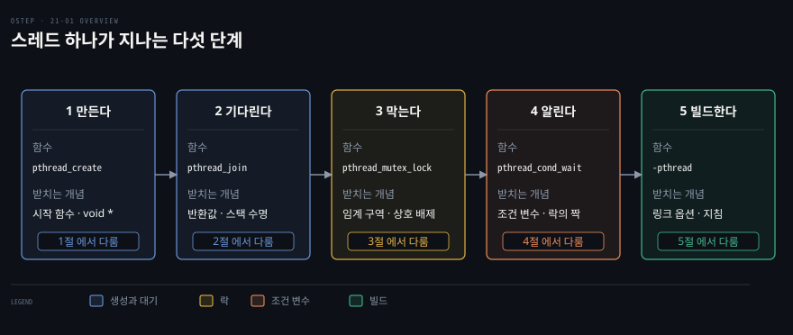
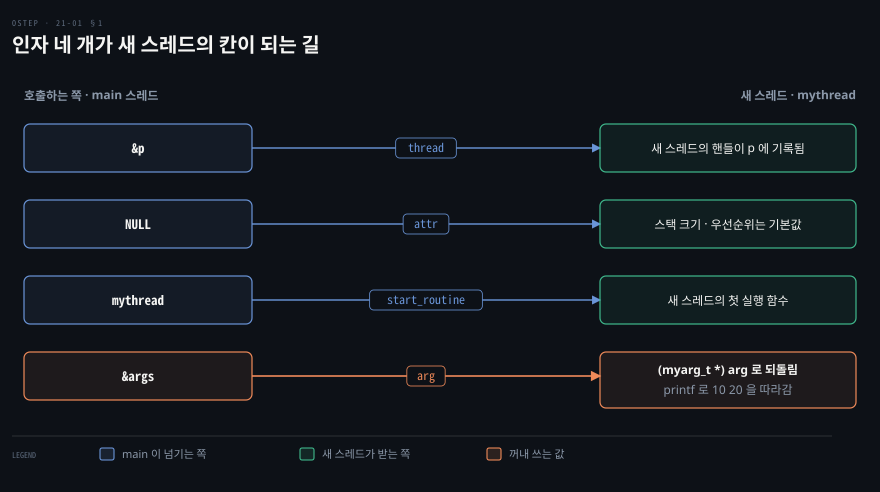
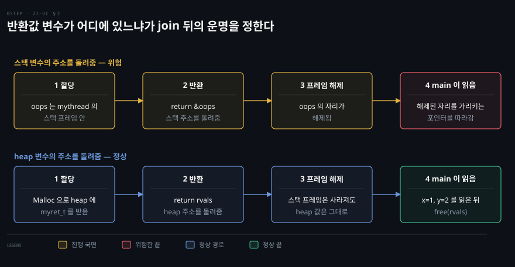
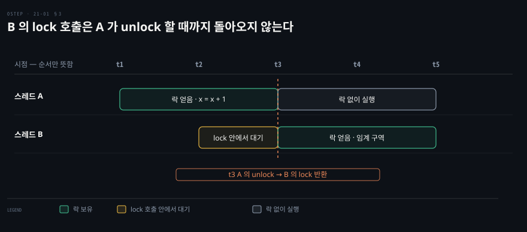
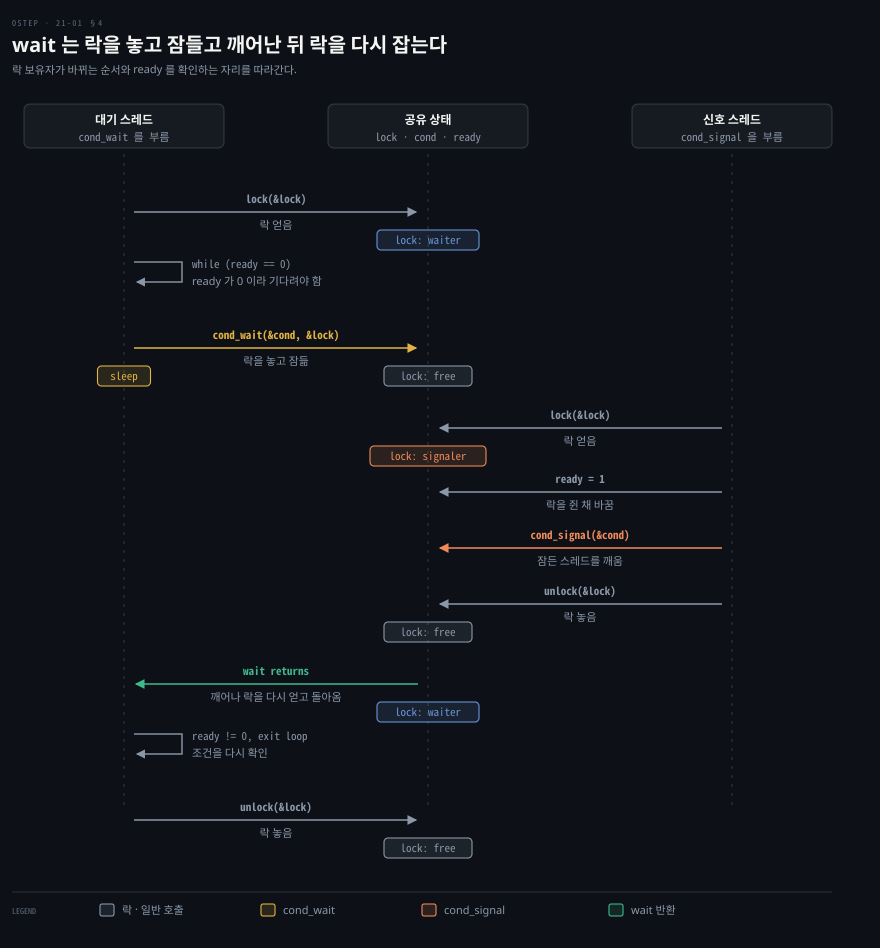
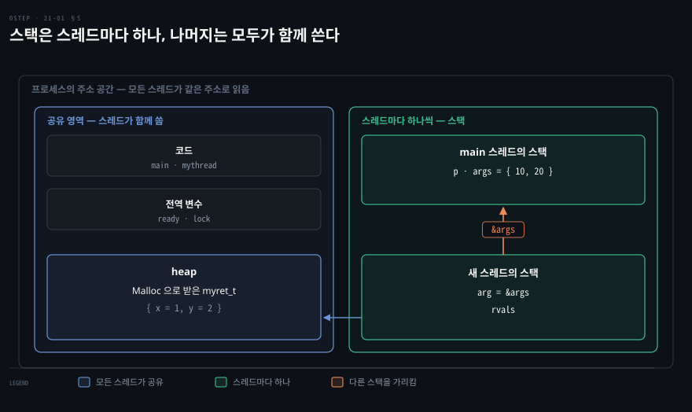

# 스레드를 만들고 기다리고 막는 법 — pthread 의 생성·join·락·조건 변수
---

## 핵심 요약

> POSIX 스레드 라이브러리는 스레드를 만드는 `pthread_create`, 끝나기를 기다리는 `pthread_join`, 임계 구역을 막는 락, 신호를 주고받는 조건 변수를 함수 몇 개로 내놓습니다.

스레드는 같은 주소 공간을 쓰면서 스택만 따로 가지므로 값을 넘기고 받는 방식과 공유 변수를 건드리는 순서가 곧 정확성이 됩니다. 이 글은 네 가지 도구의 호출 모양과 지켜야 할 규칙을 한 번에 훑습니다. 락과 조건 변수는 뒤 장에서 예제와 함께 천천히 다시 나오므로 이 장은 참조용으로 읽는 것이 맞습니다.[^crux]


## 학습 목표

이 내용을 읽고 나면:

1. `pthread_create` 의 네 인자가 새 스레드의 어느 칸이 되는지 말할 수 있습니다.
2. `pthread_join` 으로 반환값을 받는 방법과, 스택 변수의 주소를 돌려주면 안 되는 이유를 설명할 수 있습니다.
3. 락을 초기화하고 오류 코드를 확인해야 하는 이유와 `trylock`·`timedlock` 의 차이를 말할 수 있습니다.
4. `pthread_cond_wait` 가 락을 놓고 다시 잡는 순서와, 조건을 `while` 로 다시 확인하는 이유를 설명할 수 있습니다.
5. `-pthread` 로 빌드하고 스레드 API 를 쓸 때의 지침 여덟 가지를 말할 수 있습니다.

아래 개념도는 이 글의 키워드를 다섯 단계로 묶어 보입니다. 순서는 만들기, 기다리기, 막기, 알리기, 빌드하기입니다.

카드 안의 함수 줄이 각 단계의 대표 함수이고, 아래 칩은 그 단계를 다루는 절입니다.




## 스레드 API 한 바퀴

> 스레드 API 는 만들고, 기다리고, 막고, 알리고, 빌드하는 다섯 단계로 이어지며 번호 붙은 절이 단계를 하나씩 맡습니다.

멀티스레드 프로그램은 스레드를 만드는 일에서 시작합니다. 그 뒤에 기다리기, 공유 변수 지키기, 신호 주고받기가 따라옵니다.

동시성이 왜 어려운지는 26장의 [20-01 노트](./20-01.%EC%8A%A4%EB%A0%88%EB%93%9C%EA%B0%80%20%ED%95%9C%20%EC%A3%BC%EC%86%8C%20%EA%B3%B5%EA%B0%84%EC%9D%84%20%EB%82%98%EB%88%A0%20%EC%93%B8%20%EB%95%8C%20%EC%83%9D%EA%B8%B0%EB%8A%94%20%EC%9D%BC%20%E2%80%94%20%EA%B2%BD%EC%9F%81%20%EC%83%81%ED%83%9C%C2%B7%EC%9E%84%EA%B3%84%20%EA%B5%AC%EC%97%AD%C2%B7%EC%9B%90%EC%9E%90%EC%84%B1.md)가 다루고 스레드 없이 동시 서버를 만드는 길은 [27-01 노트](./27-01.%EC%8A%A4%EB%A0%88%EB%93%9C%20%EC%97%86%EC%9D%B4%20%EB%8F%99%EC%8B%9C%20%EC%84%9C%EB%B2%84%EB%A5%BC%20%EB%A7%8C%EB%93%9C%EB%8A%94%20%EB%B2%95%20%E2%80%94%20%EC%9D%B4%EB%B2%A4%ED%8A%B8%20%EB%A3%A8%ED%94%84%EC%99%80%20select%C2%B7%EB%B9%84%EB%8F%99%EA%B8%B0%20%EC%9E%85%EC%B6%9C%EB%A0%A5.md)가 다룹니다. 프로세스를 만드는 `fork()` 는 [03-01 노트](./03-01.%ED%94%84%EB%A1%9C%EC%84%B8%EC%8A%A4%20%EC%83%9D%EC%84%B1%EC%9D%84%20fork%20%EC%99%80%20exec%20%EC%9C%BC%EB%A1%9C%20%EC%AA%BC%EA%B0%A0%20%EC%9D%B4%EC%9C%A0%20%E2%80%94%20wait%C2%B7%EC%85%B8%20%EB%A6%AC%EB%8B%A4%EC%9D%B4%EB%A0%89%EC%85%98%C2%B7%EC%8B%9C%EA%B7%B8%EB%84%90.md)에서 이미 다뤘습니다.

| 단계 | 하는 일 | 대표 함수 | 맡는 절 |
|---|---|---|---|
| 1 만든다 | 새 스레드를 시작합니다 | `pthread_create` | 1 |
| 2 기다린다 | 스레드가 끝나기를 기다리고 반환값을 받습니다 | `pthread_join` | 2 |
| 3 막는다 | 임계 구역에 한 스레드만 들어가게 합니다 | `pthread_mutex_lock` | 3 |
| 4 알린다 | 조건이 바뀌었음을 다른 스레드에 알립니다 | `pthread_cond_wait` | 4 |
| 5 빌드한다 | 라이브러리를 링크하고 지침을 지킵니다 | `-pthread` | 5 |

1~4단계는 프로그램이 도는 동안 필요한 만큼 이어 쓰고 5단계는 빌드와 사용 규칙입니다.

이 글에는 `Pthread_create` 처럼 첫 글자가 대문자인 이름이 나옵니다. 소문자 함수를 감싸 결과를 확인하는 책의 도우미 함수이고 3절에서 설명합니다.


## 1. 스레드 생성과 시작 함수

> `pthread_create` 는 시작 함수와 인자 하나를 받아 새 스레드를 시작하며 인자와 반환값이 `void *` 라서 어떤 타입이든 포인터로 건넬 수 있습니다.

흐름 위치: 1 만든다 · 받치는 개념 — 시작 함수 · `void *`

### pthread_create 의 네 인자

스레드를 만드는 함수의 선언은 이렇습니다.

```c
#include <pthread.h>
int pthread_create(pthread_t *thread,
                   const pthread_attr_t *attr,
                   void *(*start_routine)(void *),
                   void *arg);
```

선언이 복잡해 보이는 이유는 셋째 인자가 함수 포인터이기 때문입니다. **함수 포인터**는 함수의 주소를 담는 변수로, 어떤 함수를 호출할지를 실행 중에 정하게 해 줍니다. 인자는 넷입니다.

- `thread`: `pthread_t` 타입 변수의 주소입니다. 이 변수가 새 스레드를 가리키는 핸들이 되어 이후 `join` 같은 호출에서 그 스레드를 지목합니다.
- `attr`: 스레드의 속성입니다. 스택 크기나 스케줄링 우선순위가 예입니다. 속성은 `pthread_attr_init()` 으로 따로 초기화하고 대부분은 기본값이면 충분해서 `NULL` 을 넘깁니다.
- `start_routine`: 새 스레드가 처음 실행할 함수입니다. `void *` 인자 하나를 받고 `void *` 를 돌려주는 함수여야 합니다.
- `arg`: `start_routine` 에 그대로 넘어가는 인자입니다.

`void *` 로 받고 돌려주는 이유는 어떤 타입의 인자도 넘기고 어떤 타입의 결과도 돌려줄 수 있게 하려는 것입니다. 인자가 정수 하나이거나 반환값이 정수라면 선언의 타입이 그에 맞게 달라집니다.

`pthread_create` 는 성공하면 0 을 돌려주고 실패하면 `errno` 가 아니라 오류 번호를 직접 돌려줍니다. 실패하면 `*thread` 의 내용은 정해져 있지 않습니다. 자원이 모자라거나 시스템의 스레드 수 제한에 걸리면 `EAGAIN` 이 나옵니다.[^ptc-ret]

### 인자 구조체를 넘기는 예제

값이 둘 이상이면 구조체로 묶어 주소 하나로 넘깁니다. 아래 코드는 책의 그림 27.1 이며 `main` 이 `myarg_t` 에 10 과 20 을 담아 주소를 넘깁니다.

```c
typedef struct { int a; int b; } myarg_t;

void *mythread(void *arg) {
    myarg_t *args = (myarg_t *) arg;      // void * 를 원래 타입으로 되돌림
    printf("%d %d\n", args->a, args->b);
    return NULL;
}

int main(int argc, char *argv[]) {
    pthread_t p;
    myarg_t args = { 10, 20 };
    int rc = pthread_create(&p, NULL, mythread, &args);
    ...
}
```

새 스레드는 받은 `void *` 를 기대하는 타입으로 **형변환**(cast)해서 인자를 꺼냅니다. 형변환은 같은 주소를 다른 타입으로 읽겠다고 컴파일러에 알리는 일입니다. 아래 도식은 네 인자가 새 스레드의 어느 칸이 되는지 보입니다. 새 스레드가 받은 값을 코드에서 꺼내 쓰는 줄은 마지막 `&args` 하나입니다.



### 스레드가 시작한 뒤

`pthread_create` 가 성공하면 호출 스택을 따로 가진 실행 흐름이 하나 더 생깁니다. 그 흐름은 프로그램에 이미 있는 모든 스레드와 같은 주소 공간에서 돕니다.

스택 크기를 속성으로 정하지 않으면 리눅스의 NPTL 구현은 `RLIMIT_STACK` 소프트 한도를 기본 스택 크기로 씁니다. 프로그램이 시작할 때의 값이고 `unlimited` 가 아닐 때의 이야기입니다. 매뉴얼의 예에서는 `ulimit -s` 가 8192 로 8 MB 입니다.[^ptc-stack] 스레드를 많이 만들면 스택이 그만큼 쌓이므로 이 값은 메모리 사용량에 바로 영향을 줍니다.


## 2. join 으로 완료 기다리기

> `pthread_join` 은 지정한 스레드가 끝날 때까지 호출한 스레드를 멈추고 반환값을 받아 오며 반환값은 스택이 아니라 heap 에 두어야 합니다.

흐름 위치: 2 기다린다 · 받치는 개념 — 반환값 · 스택 수명

### pthread_join 으로 기다리기

스레드가 끝나기를 기다리려면 `pthread_join()` 을 호출합니다.

```c
int pthread_join(pthread_t thread, void **value_ptr);
```

첫째 인자는 기다릴 스레드입니다. 이 값은 `pthread_create` 가 채워 준 핸들이므로 보관해 두었다가 넘기면 됩니다. 둘째 인자는 돌려받을 값의 위치입니다. 스레드는 `void *` 를 돌려주고 `join` 은 그 값을 호출자의 변수에 써 넣어야 하므로, 변수의 값이 아니라 변수의 **주소**를 넘깁니다. `void *` 변수의 주소라서 타입이 `void **` 입니다.

`pthread_join` 은 대상 스레드가 끝나야 돌아옵니다. 매뉴얼은 대상이 취소됐다면 `value_ptr` 에 `PTHREAD_CANCELED` 가 들어간다고 적습니다.[^ptj]

### 반환값을 받는 예제와 단순한 경우

아래 코드는 그림 27.2 입니다. 스레드가 `Malloc` 으로 `myret_t` 를 만들어 돌려주고 `main` 은 `join` 뒤에 그 값을 읽고 `free` 합니다.

```c
typedef struct { int x; int y; } myret_t;

void *mythread(void *arg) {
    myret_t *rvals = Malloc(sizeof(myret_t));   // heap 에 할당
    rvals->x = 1;
    rvals->y = 2;
    return (void *) rvals;
}

int main(int argc, char *argv[]) {
    pthread_t p;
    myret_t *rvals;
    myarg_t args = { 10, 20 };
    Pthread_create(&p, NULL, mythread, &args);
    Pthread_join(p, (void **) &rvals);
    printf("returned %d %d\n", rvals->x, rvals->y);
    free(rvals);
    return 0;
}
```

이렇게 매번 값을 묶고 푸는 일이 번거로운 경우가 있습니다. 인자가 없으면 `arg` 자리에 `NULL` 을 넘깁니다. 반환값이 필요 없으면 `pthread_join` 의 둘째 인자에 `NULL` 을 넘깁니다. 값이 하나뿐이면 구조체로 묶지 않고 `long long int` 를 포인터 자리에 직접 실어도 됩니다. 그림 27.3 이 이 경우입니다.

```c
void *mythread(void *arg) {
    long long int value = (long long int) arg;
    printf("%lld\n", value);
    return (void *) (value + 1);
}

int main(int argc, char *argv[]) {
    pthread_t p;
    long long int rvalue;
    Pthread_create(&p, NULL, mythread, (void *) 100);
    Pthread_join(p, (void **) &rvalue);
    printf("returned %lld\n", rvalue);
    return 0;
}
```

### 스택 변수의 주소를 돌려주면 안 되는 이유

반환값을 돌려줄 때 가장 조심할 일은 스레드의 호출 스택에 있는 것을 가리키는 포인터를 돌려주지 않는 것입니다. 그림 27.2 를 고친 아래 코드가 위험한 예입니다.

```c
void *mythread(void *arg) {
    myarg_t *args = (myarg_t *) arg;
    printf("%d %d\n", args->a, args->b);
    myret_t oops;            // 스택에 할당: 위험
    oops.x = 1;
    oops.y = 2;
    return (void *) &oops;
}
```

`oops` 는 `mythread` 의 스택 프레임 안에 있고 함수가 반환하면 그 프레임은 자동으로 해제됩니다. 스택이 쓰기 쉬운 이유가 바로 이 자동 해제입니다.

그러면 `main` 이 받는 포인터는 해제된 자리를 가리킵니다. 이런 포인터를 **댕글링 포인터**(dangling pointer)라고 부릅니다. 읽은 값은 기대와 달라지기 쉽습니다. 우연히 맞게 나올 수도 있어서 맞게 나왔다고 안전한 것은 아닙니다.

gcc 는 이런 코드를 보면 대개 경고를 냅니다. 컴파일러 경고를 챙겨 보아야 하는 이유 중 하나입니다.[^gcc] 아래 도식은 같은 네 국면을 스택 변수와 heap 변수로 나란히 놓습니다. 위 줄은 4국면에서 해제된 자리를 읽고 아래 줄은 heap 값이 그대로라서 읽은 뒤 `free` 합니다.



### join 이 필요 없는 경우

스레드를 하나 만들고 곧바로 `join` 하는 것은 이상한 사용법입니다. 같은 일을 하는 더 쉬운 방법이 **함수 호출**이기 때문입니다. 스레드는 보통 여러 개를 만들어 동시에 일을 시킬 때 의미가 있습니다.

모든 멀티스레드 코드가 `join` 을 쓰는 것도 아닙니다. 멀티스레드 웹 서버는 작업 스레드 여럿을 만들어 두고 메인 스레드가 요청을 받아 계속 넘겨 주기만 합니다. 이렇게 오래 사는 프로그램은 `join` 이 필요 없을 수 있습니다. 반대로 병렬로 일을 나누는 프로그램은 일이 모두 끝난 뒤 종료하거나 다음 단계로 넘어가려고 `join` 을 씁니다.

`join` 이 가능한 스레드를 끝내고도 `join` 하지 않으면 매뉴얼의 표현으로 zombie thread 가 남습니다. 이 스레드는 시스템 자원을 계속 쓰고 쌓이면 새 스레드나 프로세스를 만들 수 없게 됩니다. 이미 `join` 한 스레드를 다시 `join` 하는 것은 동작이 정해져 있지 않습니다.[^ptj]


## 3. 락과 오류 코드 확인

> `pthread_mutex_lock` 과 `unlock` 사이가 임계 구역이 되며 락은 반드시 초기화하고 모든 호출의 반환 코드를 확인해야 합니다.

흐름 위치: 3 막는다 · 받치는 개념 — 임계 구역 · 상호 배제

### lock 과 unlock 의 동작

생성과 `join` 다음으로 쓸모가 큰 것이 락으로 임계 구역을 지키는 함수들입니다. **임계 구역**(critical section)은 공유 변수를 읽고 쓰는 코드 구간입니다. 한 번에 한 스레드만 들어가게 하는 것이 **상호 배제**(mutual exclusion)입니다. 이 목적의 기본 함수 쌍은 다음과 같습니다.

```c
int pthread_mutex_lock(pthread_mutex_t *mutex);
int pthread_mutex_unlock(pthread_mutex_t *mutex);
```

락 이름의 mutex 는 mutual exclusion 을 줄인 말입니다. 쓰는 모양은 이렇습니다.

```c
pthread_mutex_t lock;
pthread_mutex_lock(&lock);
x = x + 1;      // 임계 구역
pthread_mutex_unlock(&lock);
```

`lock` 을 호출했을 때 아무도 락을 쥐고 있지 않으면 그 스레드가 락을 얻고 임계 구역에 들어갑니다. 다른 스레드가 이미 쥐고 있으면 호출은 락을 얻을 때까지 돌아오지 않습니다. 이는 쥔 스레드가 `unlock` 을 불렀다는 뜻입니다. 락 호출 안에서 기다리는 스레드는 여럿일 수 있고 `unlock` 은 락을 쥔 스레드만 불러야 합니다. 아래 도식은 두 스레드의 보유와 대기 구간을 시점 순서로 놓은 것입니다.



그런데 위 코드에는 문제가 두 가지 있습니다. 다음 두 소절이 각각을 다룹니다.

### 락 초기화

첫째 문제는 락을 초기화하지 않은 것입니다. 락은 처음부터 올바른 값을 가져야 `lock` 과 `unlock` 이 의도대로 동작합니다. 초기화 방법은 둘입니다.

```c
// 정적 초기화: 기본값으로 쓸 수 있는 상태가 된다
pthread_mutex_t lock = PTHREAD_MUTEX_INITIALIZER;

// 동적 초기화: 실행 중에 호출한다
int rc = pthread_mutex_init(&lock, NULL);
assert(rc == 0);    // 성공했는지 항상 확인
```

`pthread_mutex_init` 의 둘째 인자는 속성이고 `NULL` 이면 기본값입니다. 둘 다 쓸 수 있지만 보통은 동적 방식을 씁니다. 락을 다 쓰면 짝이 되는 `pthread_mutex_destroy()` 도 불러야 합니다.

같은 스레드가 쥔 락을 다시 잠그면 어떻게 되는지는 락의 종류마다 다릅니다. 매뉴얼의 표에서 NORMAL 은 교착(deadlock)에 빠집니다. ERRORCHECK 는 오류를 돌려줍니다. 기본(DEFAULT) 종류는 동작이 정해져 있지 않습니다.[^mutex-type]

교착은 서로 상대가 쥔 락을 기다리며 영원히 멈춘 상태입니다. 뒤 장에서 자세히 다룹니다.

### 오류 코드 확인과 wrapper

둘째 문제는 `lock` 과 `unlock` 의 반환 코드를 확인하지 않은 것입니다. 유닉스의 거의 모든 라이브러리 함수처럼 이 함수들도 실패할 수 있습니다. 확인하지 않으면 실패가 조용히 지나가고 그러면 여러 스레드가 임계 구역에 함께 들어갈 수 있습니다.

최소한의 방법은 호출이 성공했다고 `assert` 하는 도우미 함수로 감싸는 것입니다. 그림 27.4 가 그 예입니다.

```c
// 실패하면 exit 해도 되는 프로그램에서만 쓴다
void Pthread_mutex_lock(pthread_mutex_t *mutex) {
    int rc = pthread_mutex_lock(mutex);
    assert(rc == 0);
}
```

이 책의 `Malloc`, `Pthread_create`, `Pthread_join` 도 같은 방식입니다.[^wrapper] 실패해도 종료할 수 없는 실제 프로그램은 실패를 검사해 상황에 맞게 대응해야 합니다.

### trylock 과 timedlock

락 획득에는 두 함수가 더 있습니다.

```c
int pthread_mutex_trylock(pthread_mutex_t *mutex);
int pthread_mutex_timedlock(pthread_mutex_t *mutex,
                            struct timespec *abs_timeout);
```

`trylock` 은 락이 이미 쥐어져 있으면 기다리지 않고 실패를 돌려줍니다. 이때 오류 코드는 `EBUSY` 입니다. `timedlock` 은 락을 얻거나 제한 시간이 지나면 돌아옵니다. 책은 제한 시간을 0 으로 주면 `trylock` 과 같아진다고 합니다. 다만 실패 코드는 `trylock` 이 `EBUSY`, `timedlock` 이 `ETIMEDOUT` 로 다릅니다.

`timedlock` 의 제한 시간은 지금부터 몇 초가 아니라 **절대 시각**입니다. 기준은 `CLOCK_REALTIME` 입니다. 락을 기다려야 하는 상황에서 그 시각이 이미 지났다면 곧바로 시간 초과로 끝납니다. 락을 바로 얻을 수 있으면 시각이 지났어도 시간 초과로 실패하지 않습니다. 시간 안에 얻지 못하면 `ETIMEDOUT` 를 돌려줍니다.[^timed]

두 함수는 일반적으로 피하는 것이 좋습니다. 다만 락 획득에서 영원히 멈추지 않는 것이 도움이 되는 경우가 있고 뒤 장의 교착 이야기에서 그런 경우를 만납니다.


## 4. 조건 변수로 신호 보내기

> 조건 변수는 한 스레드가 다른 스레드의 일을 기다릴 때 쓰며 `wait` 는 락을 놓고 잠들었다가 락을 다시 잡고 돌아오기 때문에 조건은 `while` 로 확인합니다.

흐름 위치: 4 알린다 · 받치는 개념 — 조건 변수 · 락의 짝

### wait 와 signal 을 쓰는 모양

스레드 라이브러리의 또 다른 큰 축이 **조건 변수**(condition variable)입니다. 한 스레드가 다른 스레드가 무언가를 해 주기를 기다려야 할 때 신호를 주고받는 도구입니다. 주요 함수는 둘입니다.

```c
int pthread_cond_wait(pthread_cond_t *cond, pthread_mutex_t *mutex);
int pthread_cond_signal(pthread_cond_t *cond);
```

조건 변수에는 그 조건과 짝이 되는 락이 하나 필요합니다. 책은 두 함수를 부를 때 그 락을 쥐고 있으라고 합니다. POSIX 는 `signal` 을 락 없이 불러도 된다고 하면서, 스케줄링을 예측하려면 락을 쥐라고 적습니다.[^condsig]

`pthread_cond_wait` 는 부른 스레드를 재우고 다른 스레드가 신호를 줄 때까지 기다립니다. 기다리는 쪽의 전형적인 모양은 이렇습니다.

```c
pthread_mutex_t lock = PTHREAD_MUTEX_INITIALIZER;
pthread_cond_t cond = PTHREAD_COND_INITIALIZER;

Pthread_mutex_lock(&lock);
while (ready == 0)
    Pthread_cond_wait(&cond, &lock);
Pthread_mutex_unlock(&lock);
```

락과 조건 변수를 초기화한 뒤, 스레드가 `ready` 가 0 이 아닌지 확인합니다. 0 이면 `wait` 를 불러 다른 스레드가 깨울 때까지 잡니다. 조건 변수도 `pthread_cond_init()` 과 `pthread_cond_destroy()` 로 동적으로 초기화할 수 있지만 그만큼 일이 늘어납니다. 깨우는 쪽은 다른 스레드에서 이렇게 씁니다.

```c
Pthread_mutex_lock(&lock);
ready = 1;
Pthread_cond_signal(&cond);
Pthread_mutex_unlock(&lock);
```

책의 규칙은 신호를 줄 때와 `ready` 를 바꿀 때 항상 락을 쥐는 것입니다. 그래야 코드에 **경쟁 조건**(race condition), 곧 실행 순서에 따라 결과가 달라지는 문제가 슬며시 들어오지 않습니다.

### wait 가 락을 놓고 다시 잡는 순서

`wait` 는 락을 두 번째 인자로 받는데 `signal` 은 조건 변수만 받습니다. 이유는 `wait` 가 호출한 스레드를 재우면서 락도 놓기 때문입니다. 놓지 않는다면 다른 스레드가 락을 얻어 신호를 줄 방법이 없습니다. 깨어난 `wait` 는 돌아오기 전에 락을 다시 얻습니다. 그래서 대기 스레드는 시작 부분의 `lock` 과 끝 부분의 `unlock` 사이에서 실행되는 동안 늘 락을 쥐고 있습니다.

매뉴얼도 `wait` 가 락을 원자적으로 놓고 스레드를 조건 변수에서 막는다고 적고 호출 때 락을 쥐고 있지 않으면 오류나 동작 불명이 된다고 적습니다.[^condwait] 아래 시퀀스는 대기 스레드와 신호 스레드 사이에서 락 보유자가 바뀌는 순서를 따라갑니다.



### while 로 조건 다시 확인

기다리는 쪽이 `if` 가 아니라 `while` 로 조건을 다시 확인하는 데는 이유가 있습니다. 어떤 pthread 구현에서는 신호가 없는데도 기다리던 스레드가 깨어날 수 있습니다. 이를 **spurious wakeup**(가짜 깨어남)이라고 부릅니다. 다시 확인하지 않으면 조건이 바뀌지 않았는데도 바뀐 줄 알고 계속 진행합니다. 그래서 깨어남은 사실이 아니라 "무언가 바뀌었을지 모른다"는 힌트로 받아들이는 편이 안전합니다.

POSIX 매뉴얼도 같은 말을 합니다. 조건 변수마다 공유 변수에 관한 불리언 조건이 있습니다. `wait` 에서 돌아왔다는 사실은 그 조건의 값을 알려 주지 않습니다. 그래서 돌아올 때마다 조건을 다시 평가해야 합니다.[^condwait]

자바에서 `Object.wait()` 를 쓸 때도 같은 규칙이 적용됩니다. 호출 스레드가 그 객체의 모니터 락을 가지고 있어야 하고 깨어남을 가짜로 만날 수 있으므로 `while` 루프 안에서 조건을 검사하는 방식이 권장됩니다.[^java]

### 플래그로 신호를 보내면 안 되는 이유

조건 변수와 락 대신 단순한 플래그로 두 스레드가 신호를 주고받고 싶어질 때가 있습니다. 기다리는 쪽을 이렇게 쓰고,

```c
while (ready == 0)
    ;   // 돌면서 기다림
```

신호를 주는 쪽을 `ready = 1;` 로 쓰는 식입니다. 저자들은 절대 이렇게 하지 말라고 합니다. 이유는 둘입니다. 첫째는 오래 돌며 기다리는 동안 CPU 시간만 낭비해서 성능이 나쁜 경우가 많다는 것입니다. 둘째는 오류가 나기 쉽다는 것입니다. 책이 인용한 연구에 따르면 이런 임시 동기화의 약 절반에 버그가 있었습니다. 게으르지 말고 없어도 될 것 같을 때조차 조건 변수를 쓰라고 권합니다.


## 5. 컴파일과 사용 지침

> 빌드할 때 `pthread.h` 를 포함하고 `-pthread` 로 링크하며 스레드마다 스택이 따로라는 사실과 여덟 가지 지침을 지켜야 합니다.

흐름 위치: 5 빌드한다 · 받치는 개념 — 링크 옵션 · 지침

### 컴파일과 실행

이 장의 예제는 모두 쉽게 빌드할 수 있습니다. 코드에서 `pthread.h` 헤더를 포함하고 링크할 때 `-pthread` 플래그로 pthreads 라이브러리를 명시해서 링크합니다.

```bash
gcc -o main main.c -Wall -pthread
```

`main.c` 가 헤더를 포함하면 동시성 프로그램을 빌드한 것입니다. 제대로 동작하는지는 별개의 문제이고 `-Wall` 이 위에서 본 스택 포인터 경고 같은 것을 잡아 주기도 합니다.[^gcc]

### 스레드마다 따로인 스택

스레드를 쓸 때 가장 헷갈리는 것이 무엇이 공유되고 무엇이 따로인지입니다. 한 프로세스의 스레드는 코드·전역 변수·heap 이 있는 한 주소 공간을 함께 씁니다. 스택은 스레드마다 하나씩 따로 가집니다. 그래서 스레드가 실행 중인 함수의 지역 변수는 사실상 그 스레드의 것이고 다른 스레드가 쉽게 접근할 수 없습니다.

데이터를 스레드 사이에서 나누려면 값이 heap 이나 전역처럼 모두가 닿는 곳에 있어야 합니다. 앞의 예제에서 `&args` 가 건너갈 수 있었던 것은 같은 주소 공간이어서입니다. 다만 `main` 의 스택에 있는 `args` 가 살아 있는 동안에만 안전합니다. 아래 도식은 공유 영역과 스레드별 스택을 나눠 보입니다.



### 스레드 API 사용 지침 여덟 가지

책은 장을 마치며 POSIX 스레드를 쓸 때 기억할 지침을 여덟 가지로 모읍니다.

| 지침 | 이 글의 어느 절 |
|---|---|
| 단순하게 유지하기 — 락과 신호 코드는 가능한 한 단순해야 합니다 | 3, 4 |
| 스레드 사이의 상호작용 줄이기 — 검증된 방식으로 하나씩 설계합니다 | 4 |
| 락과 조건 변수 초기화하기 — 안 하면 가끔만 이상하게 실패합니다 | 3 |
| 반환 코드 확인하기 | 3 |
| 인자와 반환값 조심하기 — 스택 변수의 참조를 넘기면 대개 잘못입니다 | 2 |
| 스레드마다 자기 스택이 있음 — 나누려면 heap 이나 전역에 둡니다 | 5 |
| 스레드 사이 신호에는 항상 조건 변수 쓰기 — 플래그는 안 됩니다 | 4 |
| 매뉴얼 활용하기 — 리눅스의 pthread 매뉴얼은 위 내용을 더 자세히 적습니다 | 5 |

이 글이 매뉴얼에서 가져온 사실도 이 마지막 지침에 따른 것입니다. 리눅스에서 `man -k pthread` 를 치면 전체 인터페이스를 이루는 API 가 백 개 넘게 나옵니다. 책은 스레드의 어려움이 API 가 아니라 동시성 프로그램의 까다로운 논리에 있다고 마무리합니다.

### 책의 helgrind 숙제

장 끝의 숙제는 `helgrind` 라는 도구로 간단한 멀티스레드 프로그램의 문제를 찾는 것입니다. 숙제는 아홉 문항이고 다섯 개의 예제 코드를 씁니다.

- `main-race.c`: 데이터 경쟁이 있는 코드입니다. 락을 하나씩 더하며 `helgrind` 의 보고가 어떻게 달라지는지 봅니다.
- `main-deadlock.c`: 교착이 생기는 코드입니다. `helgrind` 가 무엇을 보고하는지 봅니다.
- `main-deadlock-global.c`: 같은 문제가 있는지, `helgrind` 가 같은 오류를 보고해야 하는지를 묻습니다.
- `main-signal.c`: `done` 변수로 신호를 주는 코드입니다. 부모가 시간을 어디에 쓰는지 묻습니다.
- `main-signal-cv.c`: 조건 변수로 바꾼 버전입니다. 정확성과 성능 중 어느 쪽 때문에 이쪽이 낫냐고 묻습니다.

예제 코드는 책의 숙제 내려받기 파일에 들어 있어서 이 노트에서는 실행하지 않았습니다. 직접 돌려 볼 때는 숙제의 README 를 따릅니다.


## 연습 문제

> 1~3번은 본문을 떠올려 답하고, 4~7번은 코드를 읽고 답하며, 8~9번은 본문의 규칙을 새 상황에 적용합니다. 답을 적은 뒤 정답 절과 맞춰 봅니다.

1. `pthread_create` 의 네 인자는 각각 무슨 일을 합니까? 어떤 인자에 `NULL` 을 넘길 수 있습니까?
2. `pthread_join` 의 둘째 인자 타입이 `void **` 인 이유는 무엇입니까? 반환값이 필요 없으면 어떻게 합니까?
3. 스레드 함수가 지역 변수의 주소를 `return` 하면 어떤 일이 생깁니까? 안전하게 돌려주려면 어디에 둡니까?
4. 스레드 A 가 락을 쥔 채 `x = x + 1` 을 하는 중에 스레드 B 가 `pthread_mutex_lock` 을 부릅니다. B 의 호출은 언제 돌아옵니까?
5. 락을 쓰는 아래 코드는 두 가지 결함이 있습니다. 무엇입니까?
   ```c
   pthread_mutex_t lock;
   pthread_mutex_lock(&lock);
   x = x + 1;
   pthread_mutex_unlock(&lock);
   ```
6. `pthread_cond_wait(&cond, &lock)` 이 락을 인자로 받는 이유와, 깨어난 뒤 돌아올 때 하는 일은 무엇입니까?
7. 기다리는 쪽의 `while (ready == 0)` 를 `if` 로 바꾸면 어떤 문제가 생길 수 있습니까?
8. 기다리는 쪽이 `while (ready == 0) ;` 로 돌고 신호 쪽이 `ready = 1;` 만 하는 코드를 리뷰합니다. 문제 두 가지를 말하고 어떻게 고칠지 쓰십시오.
9. 같은 스레드가 기본 종류의 뮤텍스에 `lock` 을 두 번 연달아 부르면 무슨 일이 생깁니까? ERRORCHECK 종류라면 어떻게 달라집니까?


## 정답 (자답 후 펼치기)

### 정답 1

`thread` 는 새 스레드의 핸들을 받을 `pthread_t` 변수의 주소입니다. `attr` 는 스택 크기나 우선순위 같은 속성입니다. `start_routine` 은 새 스레드가 처음 실행할 함수입니다. `arg` 는 그 함수에 그대로 넘어가는 `void *` 인자입니다.

속성이 기본값이면 되므로 `attr` 에 `NULL` 을 넘기고 인자가 필요 없으면 `arg` 에도 `NULL` 을 넘길 수 있습니다. `thread` 는 핸들이 기록될 자리라서 `NULL` 일 수 없습니다.

### 정답 2

`join` 이 돌려받은 값을 호출자의 변수에 써 넣어야 하기 때문입니다. 스레드는 `void *` 를 돌려주므로 그 `void *` 변수의 주소를 넘기면 타입이 `void **` 가 됩니다. 반환값이 필요 없으면 둘째 인자에 `NULL` 을 넘깁니다.

### 정답 3

스택 변수는 함수가 반환할 때 자동으로 해제되므로 돌려받은 포인터는 해제된 자리를 가리키는 댕글링 포인터가 됩니다. 읽은 값이 기대와 다르게 나오기 쉽고 우연히 맞아 보이는 경우도 있습니다. 안전하게 하려면 `Malloc` 으로 heap 에 두고 그 주소를 돌려준 뒤 받은 쪽이 `free` 합니다. 값이 하나뿐이면 포인터 자리에 값을 직접 실을 수도 있습니다.

### 정답 4

A 가 `unlock` 을 불러 락을 놓은 뒤에 돌아옵니다. `lock` 호출은 다른 스레드가 락을 쥐고 있으면 락을 얻을 때까지 돌아오지 않고 돌아올 때는 B 가 락을 얻은 상태입니다. 락을 쥔 스레드만 `unlock` 을 불러야 합니다.

### 정답 5

첫째는 락을 초기화하지 않은 것으로, `PTHREAD_MUTEX_INITIALIZER` 나 `pthread_mutex_init` 으로 초기화해야 합니다. 둘째는 `lock` 과 `unlock` 의 반환 코드를 확인하지 않은 것입니다. 이 함수들도 실패할 수 있고 확인하지 않으면 실패가 조용히 지나가 여러 스레드가 임계 구역에 들어갈 수 있습니다.

### 정답 6

`wait` 는 호출한 스레드를 재우면서 락을 놓아야 합니다. 놓지 않으면 다른 스레드가 락을 얻어 `ready` 를 바꾸고 신호를 줄 수 없기 때문입니다. 깨어난 뒤에는 돌아오기 전에 락을 다시 얻습니다. 그래서 대기 스레드가 `wait` 에서 돌아와 실행되는 동안에는 늘 락을 쥐고 있습니다.

### 정답 7

신호가 없는데도 스레드가 깨어나는 spurious wakeup 이 일어나는 구현이 있습니다. `if` 는 조건을 한 번만 확인하므로 깨어난 스레드는 조건이 바뀌지 않았는데도 바뀐 줄 알고 진행합니다. `while` 은 깨어날 때마다 조건을 다시 확인하고 아니면 다시 잡니다. 매뉴얼도 `wait` 에서 돌아온 뒤에는 조건을 다시 평가하라고 합니다.

### 정답 8

첫째는 돌면서 기다리는 동안 CPU 시간만 낭비한다는 것입니다. 둘째는 오류가 나기 쉽다는 것입니다. 책이 인용한 연구에서 이런 임시 동기화의 약 절반에 버그가 있었습니다.

락과 조건 변수를 만듭니다. 기다리는 쪽은 락을 잡고 `while (ready == 0)` 안에서 `Pthread_cond_wait` 를 부릅니다. 신호 쪽은 락을 쥔 채 `ready = 1` 을 쓰고 `Pthread_cond_signal` 을 부릅니다.

### 정답 9

기본 종류의 뮤텍스는 같은 스레드가 다시 잠글 때의 동작이 정해져 있지 않습니다. 매뉴얼은 NORMAL 종류가 교착에 빠진다고 적습니다. ERRORCHECK 종류는 멈추지 않고 오류 코드를 돌려줍니다. 어느 쪽이든 쥔 락을 다시 잠그는 코드가 되지 않도록 설계하는 것이 먼저입니다.[^mutex-type]


## 참고 자료

- 《Operating Systems: Three Easy Pieces》(Remzi H. Arpaci-Dusseau · Andrea C. Arpaci-Dusseau, Arpaci-Dusseau Books) 27장
- [27장 PDF](https://pages.cs.wisc.edu/~remzi/OSTEP/threads-api.pdf)
- [pthread_create(3)](https://man7.org/linux/man-pages/man3/pthread_create.3.html)
- [pthread_join(3)](https://man7.org/linux/man-pages/man3/pthread_join.3.html)
- [pthread_mutex_lock(3p)](https://man7.org/linux/man-pages/man3/pthread_mutex_lock.3p.html)
- [pthread_mutex_timedlock(3p)](https://man7.org/linux/man-pages/man3/pthread_mutex_timedlock.3p.html)
- [pthread_cond_wait(3p)](https://man7.org/linux/man-pages/man3/pthread_cond_wait.3p.html)
- [pthread_cond_broadcast(3p)](https://man7.org/linux/man-pages/man3/pthread_cond_broadcast.3p.html)
- [Java SE 21 Object 문서](https://docs.oracle.com/en/java/javase/21/docs/api/java.base/java/lang/Object.html)
- [이 책의 인덱스](./README.md) — 앞뒤 장의 노트 목록
- [스레드 없이 동시 서버를 만드는 법 노트](./27-01.%EC%8A%A4%EB%A0%88%EB%93%9C%20%EC%97%86%EC%9D%B4%20%EB%8F%99%EC%8B%9C%20%EC%84%9C%EB%B2%84%EB%A5%BC%20%EB%A7%8C%EB%93%9C%EB%8A%94%20%EB%B2%95%20%E2%80%94%20%EC%9D%B4%EB%B2%A4%ED%8A%B8%20%EB%A3%A8%ED%94%84%EC%99%80%20select%C2%B7%EB%B9%84%EB%8F%99%EA%B8%B0%20%EC%9E%85%EC%B6%9C%EB%A0%A5.md) — 락 없는 select 루프와 비동기 입출력
- [프로세스 생성 노트의 fork](./03-01.%ED%94%84%EB%A1%9C%EC%84%B8%EC%8A%A4%20%EC%83%9D%EC%84%B1%EC%9D%84%20fork%20%EC%99%80%20exec%20%EC%9C%BC%EB%A1%9C%20%EC%AA%BC%EA%B0%A0%20%EC%9D%B4%EC%9C%A0%20%E2%80%94%20wait%C2%B7%EC%85%B8%20%EB%A6%AC%EB%8B%A4%EC%9D%B4%EB%A0%89%EC%85%98%C2%B7%EC%8B%9C%EA%B7%B8%EB%84%90.md) — 프로세스판 생성·대기인 부모 복제와 wait
- [프로세스와 스레드 노트의 컨텍스트와 스택](../linux-kernel-programming/06-01.%ED%94%84%EB%A1%9C%EC%84%B8%EC%8A%A4%EC%99%80%20%EC%8A%A4%EB%A0%88%EB%93%9C%20%281%29%20%E2%80%94%20%EC%BB%A8%ED%85%8D%EC%8A%A4%ED%8A%B8%C2%B7VAS%C2%B7%EC%8A%A4%ED%83%9D.md) — VAS 세그먼트와 스레드당 유저·커널 두 스택
- [프로세스와 스레드 노트의 스레드 쪽](../linux-kernel-programming/06-02.%ED%94%84%EB%A1%9C%EC%84%B8%EC%8A%A4%EC%99%80%20%EC%8A%A4%EB%A0%88%EB%93%9C%20%282%29%20%E2%80%94%20task%20%EA%B5%AC%EC%A1%B0%EC%99%80%20current.md) — 스레드마다 task_struct 하나로 표현되는 커널 구조

[^crux]: 27장의 핵심 문제 상자는 "How to create and control threads"이고 본문은 "What interfaces should the OS present for thread creation and control? How should these interfaces be designed to enable ease of use as well as utility?"라고 묻습니다. 장 첫머리는 이 장이 참조용으로 읽는 편이 낫다고 적습니다. <https://pages.cs.wisc.edu/~remzi/OSTEP/threads-api.pdf>
[^ptc-ret]: pthread_create(3) 의 RETURN VALUE 는 성공하면 0, 실패하면 오류 번호를 돌려주고 `*thread` 의 내용은 정해져 있지 않다고 적으며, ERRORS 는 자원 부족과 시스템의 스레드 수 제한을 `EAGAIN` 으로 듭니다(Linux man-pages 6.19). <https://man7.org/linux/man-pages/man3/pthread_create.3.html>
[^ptc-stack]: pthread_create(3) 는 NPTL 구현에서 프로그램 시작 때의 `RLIMIT_STACK` 소프트 한도가 `unlimited` 가 아니면 그 값이 새 스레드의 기본 스택 크기를 정한다고 적고, 예로 `ulimit -s` 의 8192 를 8 MB 로 보입니다(Linux man-pages 6.19). <https://man7.org/linux/man-pages/man3/pthread_create.3.html>
[^ptj]: pthread_join(3) 은 이미 join 한 스레드를 다시 join 하면 동작이 정해져 있지 않고, join 할 수 있는 스레드를 join 하지 않으면 zombie thread 가 남아 자원을 쓰며 쌓이면 새 스레드나 프로세스를 만들 수 없게 된다고 적습니다(Linux man-pages 6.19, 2025-05-17). 대상이 취소됐다면 `PTHREAD_CANCELED` 가 값으로 들어갑니다. <https://man7.org/linux/man-pages/man3/pthread_join.3.html>
[^gcc]: 27장 각주 2 는 스택 변수의 포인터를 돌려주는 코드에 대해 gcc 가 아마도 경고할 것이라며, 컴파일러 경고에 주의해야 하는 또 하나의 이유라고 적습니다. <https://pages.cs.wisc.edu/~remzi/OSTEP/threads-api.pdf>
[^mutex-type]: pthread_mutex_lock(3p) 의 표에서 같은 스레드가 다시 잠글 때 NORMAL 은 deadlock, ERRORCHECK 는 error returned, DEFAULT 는 undefined behavior 이고, 오류 코드로 `EDEADLK` 가 나옵니다(POSIX 2017). <https://man7.org/linux/man-pages/man3/pthread_mutex_lock.3p.html>
[^wrapper]: 27장 각주 1 은 `Malloc()`, `Pthread_join()`, `Pthread_create()` 같은 도우미 함수가 소문자 이름의 원래 함수를 부르고 예상 밖의 결과가 아닌지 확인한다고 적습니다. <https://pages.cs.wisc.edu/~remzi/OSTEP/threads-api.pdf>
[^timed]: pthread_mutex_timedlock(3p) 는 제한 시간이 `CLOCK_REALTIME` 기준의 절대 시각이고, 그 시각이 이미 지났으면 호출 때 바로 만료된 것으로 본다고 적으며 시간 안에 얻지 못하면 `ETIMEDOUT` 를 돌려줍니다(POSIX 2017). <https://man7.org/linux/man-pages/man3/pthread_mutex_timedlock.3p.html>
[^condwait]: pthread_cond_wait(3p) 는 락을 쥔 채 호출해야 하고 아니면 ERRORCHECK 락에서는 오류, 다른 락에서는 동작 불명이라고 적으며, 함수가 락을 원자적으로 놓고 스레드를 막는다고 합니다. 또 spurious wakeup 이 있을 수 있으므로 돌아올 때마다 조건을 다시 평가해야 한다고 적습니다(POSIX 2017). <https://man7.org/linux/man-pages/man3/pthread_cond_wait.3p.html>
[^condsig]: pthread_cond_broadcast(3p) 는 signal 과 broadcast 를 락 소유 여부와 상관없이 부를 수 있다고 하고, 예측 가능한 스케줄링이 필요하면 `wait` 쪽이 쓰는 락을 쥔 채 부르라고 적습니다(POSIX 2017). <https://man7.org/linux/man-pages/man3/pthread_cond_broadcast.3p.html>
[^java]: Java SE 21 의 Object.wait 문서는 현재 스레드가 그 객체의 모니터 락을 소유해야 한다고 하고, 깨어남이 통지·인터럽트·시간 초과 없이도 일어날 수 있어 조건을 검사하며 아니면 계속 기다려야 한다고 적습니다. API Note 는 조건을 `wait` 호출 둘레의 while 루프에서 확인하는 방식을 권합니다. <https://docs.oracle.com/en/java/javase/21/docs/api/java.base/java/lang/Object.html>
