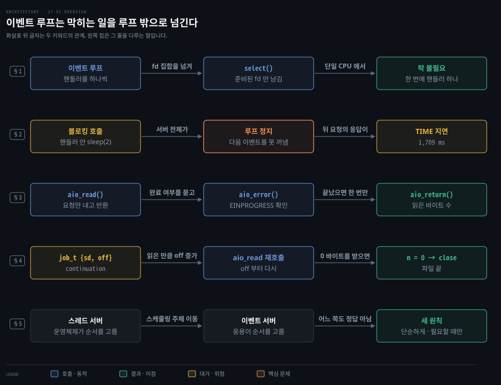
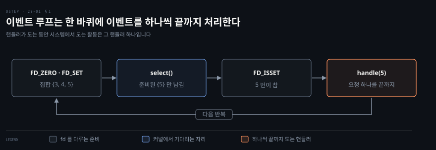
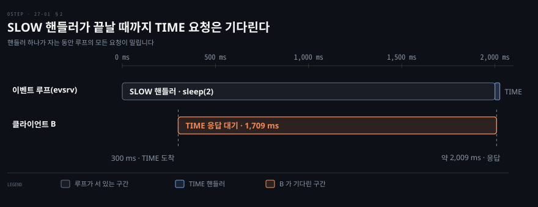
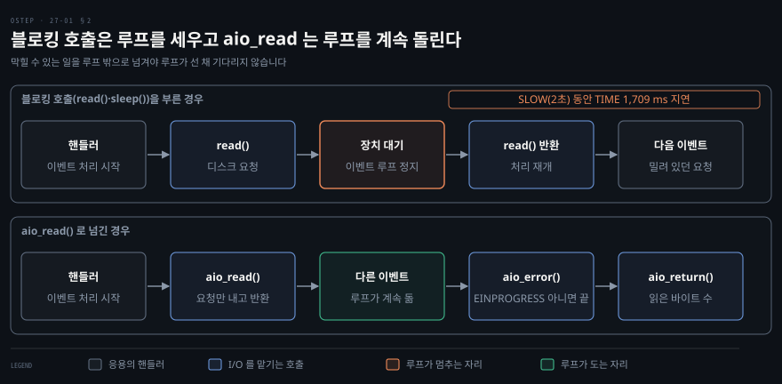
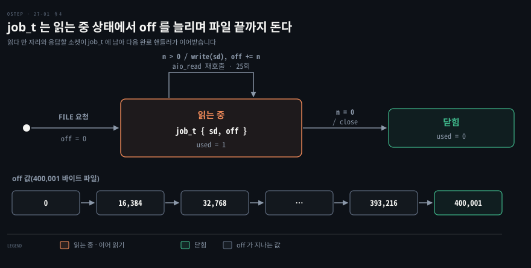

# 스레드 없이 동시 서버를 만드는 법 — 이벤트 루프와 select·비동기 입출력
---

## 핵심 요약

> 이벤트 기반 동시성은 스레드 대신 루프 하나가 준비된 일을 하나씩 끝까지 처리하는 방식이어서, 락이 필요 없고 다음에 무엇을 할지를 응용이 직접 고릅니다.

루프가 기다리는 도구가 `select()` 입니다. 이 루프 안에서 막히는 호출을 하면 서버 전체가 멈추므로 디스크 읽기 같은 일은 비동기 입출력(I/O)으로 넘깁니다. 대가는 상태를 직접 들고 다녀야 하는 복잡함과 CPU(중앙 처리 장치)가 여러 개일 때 되살아나는 락입니다. 어느 쪽도 정답이 아니어서 단순한 방식부터 고르고 병행성은 꼭 필요할 때만 씁니다.[^ver]


## 학습 목표

이 내용을 읽고 나면:

1. 이벤트 루프가 스레드 없이 동시 요청을 처리하는 방식과 락이 필요 없는 이유를 설명할 수 있습니다.
2. `select()` 의 인자와 `FD_ISSET` 으로 준비된 파일 디스크립터(fd)를 고르는 흐름을 말할 수 있습니다.
3. 루프 안의 블로킹 호출이 서버 전체를 멈추는 이유와 비동기 I/O 가 그것을 푸는 순서를 설명할 수 있습니다.
4. 비동기 호출 뒤에 상태를 넘기는 continuation 이 왜 필요한지 예를 들어 말할 수 있습니다.
5. 이벤트 기반으로도 풀리지 않는 어려움 네 가지와 병행성을 고르는 세 원칙을 말할 수 있습니다.

아래 개념도는 이 글의 핵심 키워드를 다섯 줄로 묶어 보입니다. 줄마다 왼쪽 칩이 그 줄을 다루는 절을 가리킵니다. 화살표 위 글자는 두 키워드가 어떻게 이어지는지를 말합니다.

1행은 이벤트 루프가 `select()` 로 준비된 fd 만 골라 핸들러를 하나씩 돌리므로 락이 필요 없다는 내용입니다. 2행은 핸들러 안의 블로킹 호출이 루프를 세우고 뒤 요청의 응답을 1,709 ms 늦춘 실험입니다. 3행은 `aio_read()` 로 요청만 내고 `aio_error()` 와 `aio_return()` 으로 결과를 받는 순서입니다. 4행은 읽다 만 자리와 응답할 소켓을 `job_t` 에 남겨 읽기를 이어 가는 방법입니다. 5행은 스레드 서버와 이벤트 서버 가운데 무엇을 고를지 정하는 기준입니다.




## 1. 이벤트 루프로 락 없이 요청 받기

> 스레드 없이 연결 여럿을 받으려면 다음에 어느 요청을 처리할지 누가 고르는지가 문제이고, 이벤트 루프는 그 선택을 응용 안의 루프 하나로 가져와 락 없이 풉니다.

### 이벤트 루프와 핸들러

이벤트 기반 서버의 뼈대는 세 줄입니다. 루프는 이벤트가 생길 때까지 기다립니다. 이벤트가 돌아오면 하나씩 꺼내 처리하고 다시 기다립니다. 이벤트 하나를 처리하는 코드를 **이벤트 핸들러**라고 부릅니다.

핸들러가 도는 동안은 시스템에서 도는 활동이 그 핸들러 하나뿐이므로 다음에 어느 이벤트를 처리할지 고르는 일이 곧 스케줄링입니다. 스레드 서버에서는 운영체제가 스레드를 고릅니다. 이벤트 서버에서는 응용이 순서를 직접 정합니다.

### select() 로 준비된 fd 고르기

서버가 어느 소켓에 요청이 도착했는지 알려면 시스템 콜이 필요합니다. 그 일을 하는 것이 `select()` 와 `poll()` 입니다. `select()` 는 관심 있는 파일 디스크립터(fd) 집합을 받아 준비될 때까지 기다린 뒤, 준비된 fd 만 집합에 남겨 돌려줍니다. 여기서 준비됐다는 말은 읽거나 쓰는 시스템 콜을 막히지 않고 끝낼 수 있다는 뜻입니다.[^ready]

첫 인자 `nfds` 는 검사할 fd 의 범위를 정해서 0 번부터 `nfds - 1` 번까지만 봅니다. 그래서 집합에 담은 가장 큰 fd 번호에 1 을 더해 넘깁니다. 읽기 집합(`readfds`)은 새 요청이 도착했다는 신호를 줍니다. 쓰기 집합(`writefds`)은 응답을 써도 된다는 신호를 줍니다. 세 번째 집합(`exceptfds`)은 예외 조건을 기다리는 데 쓰는데 이 서버는 쓰지 않습니다. 마지막 인자 `timeout` 이 `NULL` 이면 준비될 때까지 계속 기다립니다. 두 필드가 모두 0 인 `struct timeval` 을 넘기면 확인만 하고 곧바로 돌아옵니다.

한 바퀴의 순서는 이렇습니다. `FD_ZERO` 로 fd 집합을 비우고 `FD_SET` 으로 관심 있는 fd 를 담은 뒤 `select()` 를 부릅니다. 돌아오면 `FD_ISSET` 으로 준비된 fd 를 골라 핸들러에 넘깁니다. 직접 짠 서버(`evsrv.c`)의 루프에서 이 절에 필요한 부분만 남기면 이 모양입니다. 가장 큰 fd 번호 `mx` 를 구하는 줄과 AIO 가 진행 중일 때 쓰는 timeout 은 뺐습니다.

```c
for (;;) {
    fd_set rd; FD_ZERO(&rd); FD_SET(ls, &rd);           // 리스닝 소켓
    for (int i = 0; i < MAXC; i++)
        if (clients[i]) FD_SET(clients[i], &rd);        // 연결된 클라이언트
    select(mx + 1, &rd, NULL, NULL, NULL);              // 준비될 때까지 대기
    if (FD_ISSET(ls, &rd)) { /* accept 해서 clients 에 등록 */ }
    for (int i = 0; i < MAXC; i++)
        if (clients[i] && FD_ISSET(clients[i], &rd)) {
            int c = clients[i]; clients[i] = 0;         // 요청 하나만 받고 목록에서 뺀다
            handle(c);                                  // 이벤트 하나를 끝까지
        }
}
```

이 서버는 연결 하나에서 요청 하나만 받으므로 핸들러를 부르기 전에 그 fd 를 목록에서 뺍니다. 핸들러가 응답한 뒤 소켓을 닫거나 AIO 작업에 넘기기 때문입니다. 목록에 남겨 두면 닫힌 fd 가 다음 바퀴의 `select()` 에 다시 들어갑니다.

그림은 이 루프를 fd 번호가 있는 예로 보입니다. 리스닝 소켓이 3 번이고 연결이 4 번과 5 번이라고 합시다. 5 번에만 요청이 와 있으면 `select()` 가 집합을 `{5}` 로 줄입니다. 핸들러는 5 번 하나를 끝까지 처리합니다.



### 락이 필요 없는 이유와 idle 실험

락이 필요 없는 이유는 이 구조에서 곧바로 나옵니다. CPU 가 하나이고 이벤트를 하나씩 처리하면 핸들러가 다른 핸들러에 끼어들 수 없습니다. 공유 자료를 건드리는 도중에 다른 스레드가 같은 자료를 바꾸는 일이 없습니다. 그래서 스레드 프로그램의 동시성 버그가 기본 구조에서는 나타나지 않습니다.

이벤트 루프가 스레드 없이 여러 연결을 다룬다는 점은 같은 상황에 두 서버를 놓으면 드러납니다. 비교 대상은 한 번에 한 연결만 처리하는 서버(`serial.c`, 28줄)입니다. 이 서버의 핵심은 연결을 받고 요청을 읽고 답하는 세 호출을 차례로 부르는 반복입니다.

```c
for (;;) {
    int c = accept(ls, NULL, NULL);       // 연결이 올 때까지 막힌다
    read(c, req, sizeof(req));            // 요청이 올 때까지 막힌다
    /* 현재 시각을 만들어 write(c, ...) 로 답한다 */
    close(c);
}
```

이 서버에 연결만 열고 아무것도 보내지 않는 클라이언트 A 를 먼저 붙였습니다. 0.2초 뒤에 B 가 `TIME` 을 보내 시각을 물었습니다. 측정 스크립트 `probe.py` 는 B 가 1초까지 응답을 기다리게 했습니다.

```bash
python3 probe.py 5555 idle        # serial 서버
# B: 응답 없음(1초 대기)
```

```bash
python3 probe.py 5556 idle        # evsrv 서버
# B: 13:28:59 (1 ms)
```

serial 서버는 A 의 `read()` 에서 막혀 B 를 받지 못했습니다. evsrv 는 A 를 목록에 둔 채 B 의 요청을 곧바로 처리했습니다.[^lab]

### select 의 한계와 epoll

Linux 의 man 페이지는 `select` 가 `FD_SETSIZE` 값인 1024 보다 작은 fd 번호만 감시할 수 있다고 경고합니다. 그리고 `poll` 이나 `epoll` 을 쓰라고 권합니다.[^select]

`epoll` 은 감시할 fd 목록과 준비된 fd 목록을 커널이 들고 있어서 fd 가 많아도 잘 늘어납니다.[^epoll] 서버 프로세스가 `epoll_wait` 에서 잠들어 있는 모습은 [커널 네트워킹 노트의 strace 출력](../../../08_cloud/book/networking-and-kubernetes/02-01.%EC%BB%A4%EB%84%90%EC%9D%B4%20%ED%8C%A8%ED%82%B7%EC%9D%84%20%EC%A3%BC%EA%B3%A0%EB%B0%9B%EB%8A%94%20%EC%9E%90%EB%A6%AC%20%E2%80%94%20%EC%86%8C%EC%BC%93%C2%B7%EC%9D%B8%ED%84%B0%ED%8E%98%EC%9D%B4%EC%8A%A4%C2%B7veth%C2%B7%EB%B8%8C%EB%A6%AC%EC%A7%80.md)에서 볼 수 있습니다. 자바에서 같은 일을 하는 selector 는 [NIO 서버 노트](../../../01_language/book/jpf_java-performance/10-01.NIO%EC%99%80%20%EC%84%9C%EB%B2%84%20%EC%8A%A4%EB%A0%88%EB%93%9C%20%ED%92%80%20%E2%80%94%20selector%C2%B7worker%C2%B7async%20REST.md)가 다룹니다. `poll` 과 `epoll` 이 폴링 비용과 O(n) 스캔을 어떻게 다루는지는 [성능 노트의 폴링 절](../systems-performance/05-01.%EC%95%A0%ED%94%8C%EB%A6%AC%EC%BC%80%EC%9D%B4%EC%85%98%20%E2%80%94%20%EA%B8%B0%EC%B4%88%EC%99%80%20%EC%84%B1%EB%8A%A5%20%EA%B8%B0%EB%B2%95.md)이 따로 정리합니다.


## 2. 루프를 세우는 블로킹 호출

> 이벤트 루프 안에서 막히는 호출 하나가 서버 전체를 세우고, 일반 파일은 `select()` 로 기다릴 수도 없으므로 오래 걸릴 일은 루프 밖으로 넘겨야 합니다.

### 블로킹·논블로킹 인터페이스

스레드 서버에서는 한 스레드가 디스크를 기다려도 다른 스레드가 돌아서 문제가 없습니다. 이벤트 서버에는 루프 하나뿐이어서 핸들러가 막히면 서버 전체가 멈춥니다. 막는 호출을 **블로킹(동기) 인터페이스**라고 부릅니다. 일을 시작만 하고 곧바로 돌아오는 호출은 논블로킹(비동기) 인터페이스입니다. 이벤트 서버에서는 논블로킹이 필수입니다.

### 핸들러 하나가 루프를 세우는 실험

일부러 막히는 요청(`SLOW`, 핸들러 안에서 `sleep(2)`)을 하나 넣고 0.3초 뒤에 시간을 물어보면 그 영향이 숫자로 보입니다.

```bash
python3 probe.py 5556 slow
# A: slow done
# B: 13:29:01 (1709 ms)
```

B 의 요청은 단순한 `TIME` 인데도 1,709 ms 뒤에 답을 받았습니다. 핸들러 하나가 자는 동안 루프가 서 있었기 때문입니다. 그림의 시간 축에서 B 의 대기는 요청이 도착한 300 ms 에서 시작해 약 2,009 ms 에 끝납니다.



### 일반 파일과 select 의 어긋남

파일 읽기는 `select()` 로 풀리지 않습니다. 일반 파일은 늘 준비된 것으로 돌아옵니다. `poll(2)` 문서는 일반 파일과 블록 장치 같은 대상이 즉시 읽기·쓰기 준비로 돌아온다고 적습니다. `epoll_ctl(2)` 는 일반 파일을 등록하면 `EPERM` 을 돌려준다고 적습니다.[^regular] 직접 확인해도 같았습니다.

```bash
python3 regfile.py
# regular file: ready (0.1 ms)
# empty pipe  : not ready (501 ms)
```

일반 파일은 0.1 ms 에 준비로 돌아왔습니다. 아무도 쓰지 않은 파이프만 timeout 까지 기다렸습니다.

실험에 쓴 파일은 방금 만들어 메모리에 있었습니다. 디스크를 읽어야 할 때도 준비로 돌아온다는 것은 `poll(2)` 문서의 설명입니다. 디스크 I/O 가 오래 걸릴 수 있다는 사실을 `select()` 는 알려 주지 않으므로 이 부분은 비동기 I/O 가 맡습니다.


## 3. aio_read 로 읽기 맡기기

> 디스크 읽기가 루프를 세우지 않게 하려면 요청과 결과 받기를 갈라야 하고, 비동기 I/O 는 요청만 내고 곧바로 돌아온 뒤 끝났는지를 나중에 묻는 방식으로 그렇게 합니다.

### aiocb 와 세 호출

POSIX 비동기 I/O(AIO, Asynchronous I/O)는 요청 하나를 `struct aiocb` 에 담아 냅니다. 읽을 파일은 `aio_fildes`, 위치는 `aio_offset`, 버퍼는 `aio_buf`, 길이는 `aio_nbytes` 에 채웁니다. 채운 뒤에 `aio_read` 를 부릅니다.

`aio_read` 는 요청을 큐에 넣는 즉시 돌아오므로 읽기가 끝났는지는 그때 알 수 없습니다.[^aioread] 끝났는지는 `aio_error` 로 확인합니다. 아직이면 `EINPROGRESS` 를, 성공으로 끝났으면 0 을, 실패했으면 오류 번호를 돌려줍니다.

끝난 뒤에는 `aio_return` 으로 읽은 바이트 수를 받습니다. 이 호출은 요청마다 한 번만, `aio_error` 가 `EINPROGRESS` 가 아닌 값을 돌려준 뒤에 불러야 합니다.[^aioerr]

```c
j->cb.aio_fildes = fd;  j->cb.aio_offset = 0;
j->cb.aio_buf = j->buf; j->cb.aio_nbytes = sizeof(j->buf);
j->cb.aio_sigevent.sigev_notify = SIGEV_NONE;
aio_read(&j->cb);                                  // 바로 돌아온다
...
if (aio_error(&j->cb) != EINPROGRESS) {            // 루프가 한 바퀴 돌 때마다 확인
    ssize_t n = aio_return(&j->cb);                // 읽은 바이트 수
}
```

그림은 같은 읽기를 블로킹 `read()` 로 부를 때와 `aio_read()` 로 넘길 때의 차이를 두 줄로 보입니다. 위 줄에서는 장치를 기다리는 동안 루프가 섭니다. 아래 줄에서는 요청만 낸 핸들러가 돌아와 루프가 다른 이벤트를 처리합니다.



### 완료를 알리는 세 방법

요청이 수십 개이면 `aio_error` 로 하나씩 확인하기가 번거롭습니다. 그래서 완료를 알리는 방법도 고를 수 있습니다. `aio_sigevent` 의 선택지는 세 가지입니다.[^sigev]

| 값 | 완료를 알리는 방식 | 루프에 주는 영향 |
|----|------------------|-----------------|
| `SIGEV_NONE` | 알리지 않고 직접 확인하게 합니다 | 루프가 `aio_error` 를 부를 때를 정합니다 |
| `SIGEV_SIGNAL` | UNIX 시그널로 알립니다 | 하던 일을 멈추고 시그널 핸들러가 먼저 돕니다 |
| `SIGEV_THREAD` | 스레드에서 함수를 실행해 알립니다 | 그 함수가 루프와 같은 자료를 건드리면 락이 다시 필요합니다 |

시그널은 프로세스가 하던 일을 멈추고 시그널 핸들러를 먼저 돌리는 장치이므로 루프 도중에 끼어듭니다. 직접 짠 서버는 `SIGEV_NONE` 을 골라 루프에서 `aio_error` 를 확인하게 했습니다.

### Linux 의 비동기 I/O 세 갈래

AIO 가 없는 환경이라면 네트워크는 이벤트로, 디스크 I/O 는 스레드 풀로 맡기는 절충이 있습니다. 순수한 이벤트 방식은 아니지만 루프가 막히지 않는다는 목적은 지킵니다.

Linux 의 비동기 I/O 는 세 갈래입니다.

- glibc 의 POSIX AIO 는 사용자 공간에서 스레드를 돌려 구현합니다. aio(7) 문서는 이 방식이 비용이 크고 잘 늘어나지 않는다고 적습니다.[^glibcaio]
- 커널이 직접 하는 AIO 는 `io_submit` 계열 시스템 콜입니다.
- io_uring 은 사용자 공간과 커널이 제출 큐와 완료 큐를 공유합니다. 기본 동작에서는 요청마다 완료 이벤트가 하나씩 돌아옵니다. 완료 순서는 제출 순서와 같지 않을 수 있습니다.[^uring] Linux 5.1 에서 들어왔습니다.[^v51]


## 4. 비동기 뒤 상태 넘기기

> 읽기를 맡기고 돌아온 핸들러는 이미 끝나 있으므로, 완료를 처리할 다음 핸들러가 이어받을 정보를 직접 자료 구조에 남겨야 하고 그 밖의 어려움도 남습니다.

### 수동 스택 관리와 continuation

스레드 서버에서 파일을 읽어 소켓으로 보내는 일은 두 줄입니다.

```c
int rc = read(fd, buffer, size);
rc = write(sd, buffer, size);
```

`read()` 가 돌아오면 어느 소켓에 써야 하는지는 스레드의 스택에 `sd` 로 남아 있습니다. 이벤트 서버에서는 읽기를 비동기로 낸 핸들러가 이미 끝났습니다. 읽기 완료는 다음 핸들러가 처리하므로 그 핸들러는 `sd` 를 알지 못합니다.

그래서 완료 핸들러에 필요한 상태를 직접 싸 두는 일이 따로 생깁니다. 이 일을 **수동 스택 관리**라고 부릅니다. 그 해법으로 쓰는 구성 요소가 **continuation** 입니다. 이벤트를 마저 처리할 정보를 자료 구조에 적어 두었다가 완료됐을 때 찾아 씁니다. 예를 들어 fd 를 키로 하는 해시 표에 `sd` 를 넣어 두는 방식입니다.

### 읽기를 이어 붙이는 job_t

직접 짠 서버에서는 요청 하나를 이 구조로 들고 다녔습니다.

```c
typedef struct {
    struct aiocb cb;   // 진행 중인 읽기 요청
    int   sd;          // 읽기가 끝나면 쓸 소켓 — continuation
    off_t off;         // 다음에 읽을 위치 — continuation
    char  buf[16384];
    int   used;
} job_t;
```

`FILE <이름>` 요청을 받는 분기는 먼저 파일 이름을 검사합니다. 이름에 `/` 가 있거나 `.` 으로 시작하면 `denied` 로 거절합니다. 통과한 요청만 `job_t` 에 `sd` 를 적고 첫 `aio_read()` 를 냅니다. 요청에 든 파일 이름은 외부 입력입니다. 검사하지 않으면 서버가 컴퓨터의 다른 파일을 읽어 줍니다. 실제로 `FILE ../x` 를 보내자 서버가 `denied` 를 돌려주었습니다.

```c
char *name = req + 5; name[strcspn(name, "\r\n")] = 0;
if (strchr(name, '/') || name[0] == '.') { reply(sd, "denied\n"); return; }
...
j->sd = sd; j->used = 1;     // 읽기가 끝난 뒤 쓸 소켓을 적어 둔다
aio_read(&j->cb);            // 바로 돌아온다
```

`off` 가 왜 필요한지는 `off` 없이 짠 판에서 드러났습니다. 400,001 바이트 파일을 요청했더니 버퍼 하나 크기인 16,384 바이트만 돌아왔습니다. 버퍼 하나로 한 번 읽고 끝내면 나머지를 이어 읽을 자리가 없기 때문입니다.

읽은 만큼 `off` 를 늘리고 `aio_read()` 를 다시 내도록 고치자 파일 전체가 왔습니다. 그동안 다른 클라이언트의 `TIME` 도 3 ms 에 답했습니다. 읽기 횟수를 세 보니 16,384 바이트가 24번, 6,785 바이트가 1번으로 모두 25번 돌아왔습니다. 26번째 읽기가 0 바이트를 돌려주자 서버가 소켓을 닫았습니다.[^count]

그림은 요청 하나의 `job_t` 가 거치는 상태를 보입니다. 읽는 중 상태에서 읽기가 끝날 때마다 소켓에 쓰고 `off` 를 늘려 다시 읽습니다. 0 바이트가 오면 닫힘으로 넘어갑니다.



구현 부담은 줄 수로 28줄에서 84줄이 되었습니다. 여기에는 `SLOW`·`FILE` 요청과 경로 검사도 들어 있습니다. AIO 완료 처리만 세면 11줄입니다.

이 실험에서는 AIO 의 이점이 숫자로 나오지 않았습니다. 파일이 페이지 캐시에 있으면 블로킹 `read()` 도 거의 즉시 끝나기 때문입니다. 이점을 재려면 캐시를 비운 파일로 동기 `read()` 판과 `aio_read()` 판의 `TIME` 지연을 비교해야 합니다.

### 이벤트로도 남는 네 어려움

이벤트 기반으로도 풀리지 않는 어려움이 네 가지 남습니다.

| 어려움 | 왜 생기는가 | 이 글의 서버에서는 |
|-------|-----------|------------------|
| 여러 CPU | CPU 를 모두 쓰려면 핸들러를 병렬로 돌려야 해서 임계 구역과 락이 다시 필요해집니다 | 핸들러를 하나씩만 돌려 피했습니다 |
| 페이지 폴트 | 핸들러가 접근한 메모리가 디스크로 밀려나 있으면 코드에 블로킹 호출이 없어도 막힙니다 | 피하기 어려운 암묵적 블로킹입니다 |
| 호출 성격의 변화 | 어떤 루틴이 논블로킹에서 블로킹으로 바뀌면 그것을 부르는 핸들러도 둘로 쪼개야 합니다 | 쓰는 API 의 의미가 바뀌지 않았는지 살펴야 합니다 |
| 통합 | `select()` 하나로 모든 I/O 를 기다리면 좋겠지만 보통은 네트워크에 `select()`, 디스크에 AIO 를 따로 씁니다 | AIO 가 진행 중이면 `select()` 의 timeout 을 10 ms 로 두고 한 바퀴마다 `aio_error` 를 확인합니다 |


## 5. 스레드와 이벤트 중 고르는 기준

> 스레드와 이벤트 가운데 어느 쪽이 이기는지는 정해져 있지 않으므로, 단순한 방식부터 고르고 병행성은 꼭 필요할 때만 쓰는 것이 기준입니다.

### 이벤트 서버가 치르는 값

이벤트 기반은 응용이 스케줄링을 쥐는 대신 복잡함과 다른 시스템 활동(예: 페이징)과의 통합 어려움이라는 값을 치릅니다. 그래서 하나의 방식이 이긴 것이 아니라 스레드와 이벤트가 같은 문제의 서로 다른 접근으로 함께 남습니다.

### 병행 프로그램의 세 원칙

병행 프로그램을 짜는 방법으로 세 가지가 권해집니다. 첫째는 단순하게 만드는 것입니다. 스레드 사이의 상호작용을 줄이고 단순한 락과 생산자-소비자 큐처럼 검증된 방식을 씁니다. 둘째는 병행성이 정말 필요할 때만 쓰는 것입니다. 필요 없는 스레드를 더하는 일이 곧 성급한 최적화입니다. 셋째는 병렬성이 필요해도 맵리듀스처럼 락과 조건 변수를 직접 다루지 않는 단순한 형태에서 찾는 것입니다.

### 같은 문제를 다르게 푸는 서버

연결마다 고루틴을 띄우는 Go 서버는 스레드처럼 연결 하나의 코드를 순서대로 쓰는 모델로 동시 연결을 받습니다. [Go 네트워킹 노트의 Accept 루프 절](../npg_network-programming-with-go/03-02.Go%20%EC%9D%98%20TCP%20%EC%97%B0%EA%B2%B0%EC%9D%80%20Listen%C2%B7Accept%C2%B7Dial%20%EC%84%B8%20%ED%98%B8%EC%B6%9C%EB%A1%9C%20%EB%A7%BA%EB%8A%94%EB%8B%A4.md)이 `Accept` 가 연결마다 고루틴을 띄우는 루프를 다룹니다. 반대쪽에서 Redis 처럼 단일 스레드 이벤트 루프로 요청을 받는 서버는 [캐시 전략 노트](../../../03_architecture/book/bytebytego-system-design/02-01.%EC%BA%90%EC%8B%9C%20%EC%A0%84%EB%9E%B5%EC%9D%80%20%EC%9D%BD%EA%B8%B0%C2%B7%EC%93%B0%EA%B8%B0%20%EA%B2%BD%EB%A1%9C%EC%97%90%EC%84%9C%20%EC%BA%90%EC%8B%9C%20%EC%9E%90%EB%A6%AC%EB%A5%BC%20%EC%A0%95%ED%95%98%EA%B3%A0%20Redis%20%EB%8A%94%20%EB%A9%94%EB%AA%A8%EB%A6%AC%EC%99%80%20%EB%8B%A8%EC%9D%BC%20%EC%8A%A4%EB%A0%88%EB%93%9C%20%EC%9D%B4%EB%B2%A4%ED%8A%B8%20%EB%A3%A8%ED%94%84%EB%A1%9C%20%EB%B9%A0%EB%A5%B4%EB%8B%A4.md)가 설명합니다.


## 결정 치트시트

> 이 편의 판단 기준을 한 표에 모았습니다.

| 상황 | 판단 | 근거 |
|------|------|------|
| 감시할 연결의 fd 번호가 1024 이상이 될 때 | `select()` 대신 `poll` 이나 `epoll` 을 씁니다 | `select` 는 `FD_SETSIZE`(1024) 미만의 fd 만 감시합니다 |
| 일반 파일을 읽어야 할 때 | `select()` 로 기다리지 않고 `aio_read` 나 스레드 풀에 맡깁니다 | 일반 파일은 늘 준비됨으로 돌아오고 `epoll` 에는 등록되지 않습니다 |
| AIO 완료를 받는 방법을 고를 때 | 루프가 `aio_error` 를 확인하게 하는 `SIGEV_NONE` 부터 봅니다 | 시그널은 루프에 끼어들고 `SIGEV_THREAD` 는 락을 되살립니다 |
| 핸들러가 `sleep` 이나 `read` 로 막힐 수 있을 때 | 루프 밖으로 넘깁니다 | 핸들러 하나가 막히면 뒤 요청의 응답이 그만큼 늦어집니다 |
| CPU 를 여러 개 모두 써야 할 때 | 핸들러를 병렬로 돌리되 락을 설계합니다 | 한 번에 하나라는 전제가 깨지면 임계 구역이 다시 생깁니다 |
| 새 서버를 처음 만들 때 | 병행성 없이 시작하고 필요가 드러날 때만 더합니다 | 필요 없는 병행성은 성급한 최적화입니다 |


## 면접 대비

> 이 편에서 실제로 물어보기 좋은 것만 골랐습니다.

### 한 줄 정의

- **이벤트 루프**: 준비된 이벤트를 하나씩 꺼내 핸들러를 끝까지 돌리고 다시 기다리는 반복입니다.
- **select()**: 관심 있는 fd 집합 가운데 막히지 않고 I/O 할 수 있는 fd 만 남겨 돌려주는 시스템 콜입니다.
- **AIO**: 요청만 내고 곧바로 돌아온 뒤 `aio_error` 로 끝났는지 묻고 `aio_return` 으로 결과를 받는 비동기 I/O 입니다.
- **continuation**: 이벤트를 마저 처리하는 데 필요한 정보를 자료 구조에 적어 둔 것입니다.

### 핵심 포인트 세 가지

1. 이벤트 서버는 핸들러를 한 번에 하나만 돌리므로 락이 필요 없습니다. 그 대신 다음에 무엇을 처리할지를 응용이 고릅니다. CPU 를 여러 개 쓰려는 순간 락이 돌아옵니다.
2. 루프 안의 블로킹 호출 하나가 서버 전체를 세웁니다. `SLOW` 요청 하나 때문에 단순한 `TIME` 요청이 1,709 ms 뒤에 답을 받았습니다.
3. 비동기로 넘기면 핸들러가 둘로 갈라지므로 `sd` 와 `off` 같은 상태를 직접 들고 다녀야 합니다. 이것이 수동 스택 관리입니다.

### 자주 묻는 질문

- *이벤트 서버에서 왜 락이 필요 없습니까?* 핸들러를 하나씩만 돌려서 한 핸들러가 공유 자료를 바꾸는 동안 다른 핸들러가 끼어들 수 없기 때문입니다.
- *일반 파일 읽기를 `select()` 로 기다리면 안 되는 이유는 무엇입니까?* 일반 파일은 디스크를 읽어야 할 때도 늘 준비됨으로 돌아와서 기다림이 되지 않습니다. 그래서 `read()` 를 부르는 순간 막힐 수 있습니다.
- *`aio_return` 은 언제 부릅니까?* `aio_error` 가 `EINPROGRESS` 가 아닌 값을 돌려준 뒤에 요청마다 한 번만 부릅니다.
- *연결이 수만 개면 무엇을 씁니까?* fd 번호가 1024 이상이 될 수 있으므로 `select()` 대신 `epoll` 을 씁니다.


## 연습 문제

> 1~3번은 본문을 떠올려 답하는 문제이고 4~6번은 본문의 코드와 실험 기록을 읽고 답하는 문제입니다. 답을 적은 뒤 정답 절과 맞춰 봅니다.

1. 한 번에 한 연결만 처리하는 서버와 `select()` 를 쓰는 서버에, 연결만 열고 말이 없는 클라이언트 A 와 시간을 묻는 클라이언트 B 를 붙입니다. 각 서버에서 B 는 어떻게 됩니까? 이유는 무엇입니까?
2. 이벤트 서버가 락 없이도 안전한 이유는 무엇입니까? 이 이유가 깨지는 조건은 무엇입니까?
3. 핸들러 안에서 `sleep(2)` 를 부르는 요청 `SLOW` 를 처리하는 동안 다른 클라이언트의 `TIME` 요청은 어떻게 됩니까? 왜 그렇습니까?
4. 디스크 파일을 읽을 때 `select()` 로 기다리면 안 되는 이유는 무엇입니까? 대신 무엇을 씁니까? `../x` 를 넣은 요청은 어떻게 막습니까?
5. 400,001 바이트 파일을 `aio_read()` 한 번으로 읽으면 일부만 돌아옵니다. 어떻게 고치고, 그 고침이 continuation 이라고 불리는 이유는 무엇입니까?
6. 이벤트 기반 비동기 방식을 쓸 만하다고 어떻게 판단하겠습니까? 직접 짠 두 서버에서 늘어난 구현 부담은 얼마였고, 큰 규모에서는 무엇을 대신 쓸 수 있습니까?


## 정답 (자답 후 펼치기)

### 정답 1

한 연결씩 처리하는 서버는 A 가 연결만 열고 말이 없으면 `read()` 에서 막혀 B 를 받지 못합니다. 같은 서버에서 B 는 1초를 기다려도 응답을 받지 못했습니다. `select()` 서버는 A 를 연결 목록에 두고 읽을 데이터가 생긴 연결만 처리합니다. 그래서 B 가 1 ms 에 시간을 받았습니다. 한 연결의 `read()` 가 끝나기를 기다리지 않고, 준비된 fd 부터 처리하기 때문입니다.

```bash
gcc -Wall -o serial serial.c
gcc -Wall -o evsrv evsrv.c
./serial 5555 &
python3 probe.py 5555 idle
# B: 응답 없음(1초 대기)
```

```bash
./evsrv 5556 &
python3 probe.py 5556 idle
# B: 13:28:59 (1 ms)
```

### 정답 2

핸들러를 한 번에 하나만 돌리므로 한 핸들러가 공유 자료를 바꾸는 동안 다른 핸들러가 끼어들 수 없기 때문입니다. 이 이유가 깨지는 조건은 CPU 를 여러 개 쓰려고 핸들러를 병렬로 돌리는 경우입니다. 그때는 임계 구역과 락이 다시 필요해집니다.

### 정답 3

`TIME` 요청은 `SLOW` 핸들러가 끝날 때까지 처리되지 않습니다. 루프가 하나뿐이고 핸들러가 `sleep(2)` 로 서 있으면 다음 이벤트를 꺼낼 수 없기 때문입니다. 0.3초 뒤에 보낸 `TIME` 의 응답 시간이 1,709 ms 였습니다.

```bash
python3 probe.py 5556 slow
# A: slow done
# B: 13:29:01 (1709 ms)
```

### 정답 4

일반 파일은 디스크를 읽어야 하더라도 `select()` 가 늘 준비된 것으로 돌려주므로 기다림이 되지 않습니다. 실행해 보면 일반 파일은 0.1 ms 에 준비로 나오고 비어 있는 파이프만 timeout 까지 기다립니다. 그래서 `read()` 를 부르는 순간 막힐 수 있습니다. 이 구간을 `aio_read()` 가 맡습니다.

`FILE ../x` 요청은 이름에 `/` 가 있거나 `.` 으로 시작하면 `denied` 로 거절하게 해서 막았고, 실제로 서버가 `denied` 를 돌려주었습니다. 요청에 든 파일 이름은 외부 입력입니다. 검증하지 않으면 서버가 컴퓨터의 다른 파일을 읽어 줍니다.

```bash
python3 regfile.py
# regular file: ready (0.1 ms)
# empty pipe  : not ready (501 ms)
```

### 정답 5

읽은 만큼 `off` 를 늘리고 `aio_offset` 에 반영해 `aio_read()` 를 다시 냅니다. 읽은 바이트 수가 0 이 되면 파일 끝이므로 소켓과 파일을 닫습니다. 이렇게 읽다 만 위치(`off`)와 응답할 소켓(`sd`)을 요청 구조체에 남겨 두었다가 다음 완료 때 이어받으므로 continuation 이라고 부릅니다. 고친 뒤에는 400,001 바이트가 모두 도착했고 `cmp` 로 비교한 결과도 원본과 같았습니다.

```bash
python3 probe.py 5556 file big.txt
# B: 13:29:01 (3 ms)
# A: 400001 bytes (294 ms)
```

```bash
python3 -c 'import socket; s=socket.create_connection(("127.0.0.1",5556)); s.sendall(b"FILE big.txt\n"); open("got.bin","wb").write(b"".join(iter(lambda: s.recv(65536), b"")))'
wc -c big.txt got.bin
# 400001 big.txt
# 400001 got.bin
cmp big.txt got.bin && echo cmp-equal
# cmp-equal
```

### 정답 6

이벤트 방식의 이점은 정답 1 의 idle 비교에서 드러났습니다. serial 서버에서 B 는 응답을 받지 못했고 evsrv 에서는 1 ms 에 받았습니다. AIO 의 이점은 숫자로 나오지 않았습니다. 파일이 이미 메모리(페이지 캐시)에 있으면 블로킹 `read()` 도 거의 즉시 끝나기 때문입니다. `SLOW` 의 1,709 ms 는 AIO 의 이점이 아니라 루프 안에서 막으면 무엇을 잃는지 보여 줍니다.

AIO 를 재려면 캐시를 비운 파일로 동기 `read()` 판과 `aio_read()` 판의 `TIME` 지연을 비교해야 합니다.

구현 부담은 줄 수로 28줄에서 84줄이 되었지만, 여기에는 `SLOW`·`FILE` 요청과 경로 검사도 함께 들어 있습니다.

AIO 완료 처리만 따로 세면 11줄입니다. fd 번호가 1024 이상이면 `poll` 이나 `epoll` 을 쓰고, fd 가 많으면 `epoll` 을 씁니다. 비동기 파일 I/O 에는 `io_uring` 을 쓸 수 있습니다.


## 참고 자료

- 《Operating Systems: Three Easy Pieces》(Remzi H. Arpaci-Dusseau · Andrea C. Arpaci-Dusseau, Arpaci-Dusseau Books) 33장·34장
- [33장 PDF](https://pages.cs.wisc.edu/~remzi/OSTEP/threads-events.pdf)
- [34장 PDF](https://pages.cs.wisc.edu/~remzi/OSTEP/threads-dialogue.pdf)
- [select(2)](https://man7.org/linux/man-pages/man2/select.2.html)
- [poll(2)](https://man7.org/linux/man-pages/man2/poll.2.html)
- [epoll(7)](https://man7.org/linux/man-pages/man7/epoll.7.html)
- [aio(7)](https://man7.org/linux/man-pages/man7/aio.7.html)
- [io_uring(7)](https://man7.org/linux/man-pages/man7/io_uring.7.html)


## 관련 문서

- [이 책의 인덱스](./README.md)
- [성능 노트의 폴링과 논블로킹 I/O](../systems-performance/05-01.%EC%95%A0%ED%94%8C%EB%A6%AC%EC%BC%80%EC%9D%B4%EC%85%98%20%E2%80%94%20%EA%B8%B0%EC%B4%88%EC%99%80%20%EC%84%B1%EB%8A%A5%20%EA%B8%B0%EB%B2%95.md)
- [Go 네트워킹 노트의 Accept 루프](../npg_network-programming-with-go/03-02.Go%20%EC%9D%98%20TCP%20%EC%97%B0%EA%B2%B0%EC%9D%80%20Listen%C2%B7Accept%C2%B7Dial%20%EC%84%B8%20%ED%98%B8%EC%B6%9C%EB%A1%9C%20%EB%A7%BA%EB%8A%94%EB%8B%A4.md)
- [자바 NIO 서버의 selector 와 worker](../../../01_language/book/jpf_java-performance/10-01.NIO%EC%99%80%20%EC%84%9C%EB%B2%84%20%EC%8A%A4%EB%A0%88%EB%93%9C%20%ED%92%80%20%E2%80%94%20selector%C2%B7worker%C2%B7async%20REST.md)
- [커널 네트워킹 노트의 소켓과 epoll](../../../08_cloud/book/networking-and-kubernetes/02-01.%EC%BB%A4%EB%84%90%EC%9D%B4%20%ED%8C%A8%ED%82%B7%EC%9D%84%20%EC%A3%BC%EA%B3%A0%EB%B0%9B%EB%8A%94%20%EC%9E%90%EB%A6%AC%20%E2%80%94%20%EC%86%8C%EC%BC%93%C2%B7%EC%9D%B8%ED%84%B0%ED%8E%98%EC%9D%B4%EC%8A%A4%C2%B7veth%C2%B7%EB%B8%8C%EB%A6%AC%EC%A7%80.md)
- [캐시 전략 노트의 Redis 이벤트 루프](../../../03_architecture/book/bytebytego-system-design/02-01.%EC%BA%90%EC%8B%9C%20%EC%A0%84%EB%9E%B5%EC%9D%80%20%EC%9D%BD%EA%B8%B0%C2%B7%EC%93%B0%EA%B8%B0%20%EA%B2%BD%EB%A1%9C%EC%97%90%EC%84%9C%20%EC%BA%90%EC%8B%9C%20%EC%9E%90%EB%A6%AC%EB%A5%BC%20%EC%A0%95%ED%95%98%EA%B3%A0%20Redis%20%EB%8A%94%20%EB%A9%94%EB%AA%A8%EB%A6%AC%EC%99%80%20%EB%8B%A8%EC%9D%BC%20%EC%8A%A4%EB%A0%88%EB%93%9C%20%EC%9D%B4%EB%B2%A4%ED%8A%B8%20%EB%A3%A8%ED%94%84%EB%A1%9C%20%EB%B9%A0%EB%A5%B4%EB%8B%A4.md)

[^ver]: 확인한 현재 값은 다음과 같습니다. Linux 에서의 실행은 Linux 7.2.12(OrbStack), glibc 2.43 에서 했고, macOS(Darwin 25.6.0)에서는 2026-11-08 에 다시 실행해 같은 양상을 확인했습니다. man 페이지는 Linux man-pages 6.19(페이지 날짜 2026-02-08, `epoll_ctl(2)` 만 2025-12-25)입니다. `io_uring(7)` 만 liburing 프로젝트 문서입니다. kernel.org 의 최신 stable 은 7.3.3(2026-11-06)이고 mainline 은 7.4-rc1(2026-11-01)입니다. <https://www.kernel.org/releases.json> (2026-11-08 조회)
[^ready]: select(2) 는 "A file descriptor is considered ready if it is possible to perform a corresponding I/O operation (e.g., read(2), or a sufficiently small write(2)) without blocking."라고 적고, timeout 에 대해서는 "If timeout is specified as NULL, select() blocks indefinitely waiting for a file descriptor to become ready."라고 적습니다. <https://man7.org/linux/man-pages/man2/select.2.html> (2026-11-08 조회)
[^lab]: 실행한 서버는 `serial.c`(28줄)와 `evsrv.c`(84줄)이고 `gcc -Wall` 로 컴파일했습니다. 이 두 파일과 측정 스크립트 `probe.py`·`regfile.py` 네 파일의 전문은 싣지 않았고 본문에는 필요한 부분만 발췌했습니다. `evsrv` 는 `TIME`, `SLOW`, `FILE <이름>` 세 요청을 받으며 `FILE` 은 `aio_read` 로 읽습니다. 명령은 `./serial 5555`, `./evsrv 5556` 처럼 포트를 인자로 줍니다. 측정값은 한 번의 실행이고, 같은 실험을 다시 돌리면 숫자가 조금 달라졌습니다(앞선 실행에서는 `SLOW` 뒤 `TIME` 지연이 1,701 ms). macOS 에서도 같은 양상이었습니다(1,708 ms). 2026-11-08 macOS 재실행에서는 idle 의 B 가 2 ms, `SLOW` 뒤 `TIME` 이 1,702 ms, 큰 파일 요청 중 `TIME` 이 1 ms 였고 `cmp` 결과는 같았습니다.
[^select]: select(2) 의 DESCRIPTION 첫 문단은 "WARNING: select() can monitor only file descriptors numbers that are less than FD_SETSIZE (1024)—an unreasonably low limit for many modern applications—and this limitation will not change. All modern applications should instead use poll(2) or epoll(7), which do not suffer this limitation."입니다. <https://man7.org/linux/man-pages/man2/select.2.html> (2026-11-08 조회)
[^epoll]: epoll(7) 은 이 API 가 "scales well to large numbers of watched file descriptors"라고 적고, "The interest list (sometimes also called the epoll set)"와 "The ready list"를 설명합니다. 준비 목록은 "dynamically populated by the kernel as a result of I/O activity on those file descriptors"입니다. <https://man7.org/linux/man-pages/man7/epoll.7.html> (2026-11-08 조회)
[^regular]: poll(2) 는 "poll()ing regular files, block devices, and other files with no reasonable polling semantic always returns instantly as ready to read and write."라고 적습니다. epoll_ctl(2) 는 `EPERM` 을 "The target file fd does not support epoll. This error can occur if fd refers to, for example, a regular file or a directory."로 설명합니다. <https://man7.org/linux/man-pages/man2/poll.2.html>, <https://man7.org/linux/man-pages/man2/epoll_ctl.2.html> (2026-11-08 조회)
[^aioread]: aio_read(3) 은 "The "asynchronous" means that this call returns as soon as the request has been enqueued; the read may or may not have completed when the call returns. One tests for completion using aio_error(3)."라고 적습니다. <https://man7.org/linux/man-pages/man3/aio_read.3.html> (2026-11-08 조회)
[^aioerr]: aio_error(3) 은 반환값으로 `EINPROGRESS`(아직 끝나지 않음), `ECANCELED`(취소됨), 0(성공), 양수 오류 번호(실패)를 들고, aio_return(3) 은 "This function should be called only once for any given request, after aio_error(3) returns something other than EINPROGRESS."라고 적습니다. <https://man7.org/linux/man-pages/man3/aio_error.3.html>, <https://man7.org/linux/man-pages/man3/aio_return.3.html> (2026-11-08 조회)
[^sigev]: aio(7) 는 `aio_sigevent` 가 완료 통지를 어떻게 할지 정하며 "Possible values for aio_sigevent.sigev_notify are SIGEV_NONE, SIGEV_SIGNAL, and SIGEV_THREAD."라고 적습니다. <https://man7.org/linux/man-pages/man7/aio.7.html> (2026-11-08 조회)
[^glibcaio]: aio(7) 는 "The current Linux POSIX AIO implementation is provided in user space by glibc. This has a number of limitations, most notably that maintaining multiple threads to perform I/O operations is expensive and scales poorly."라고 적고, 커널 구현으로 `io_submit(2)`, `io_setup(2)`, `io_cancel(2)`, `io_destroy(2)`, `io_getevents(2)` 를 가리킵니다. <https://man7.org/linux/man-pages/man7/aio.7.html> (2026-11-08 조회)
[^uring]: io_uring(7) 은 "io_uring is a Linux-specific API for asynchronous I/O."로 시작하고, 요청은 제출 큐(SQ)에 넣고 완료는 완료 큐(CQ)에서 읽으며 "I/O requests submitted to the kernel can complete in any order."라고 적습니다. 오류는 `res` 에 `-errno` 로 담깁니다. 기본 동작은 요청 하나에 완료 하나이고, `IOSQE_CQE_SKIP_SUCCESS` 처럼 완료를 내지 않거나 멀티샷처럼 여러 번 내는 설정이 예외라고도 적습니다. 이 페이지는 liburing 프로젝트 문서이고, man7.org 가 2026-08-04 에 upstream 에서 가져왔습니다(당시 가장 최근 커밋은 2026-07-28). 페이지 머리의 July 26, 2020 은 그 페이지에 적힌 날짜입니다. <https://man7.org/linux/man-pages/man7/io_uring.7.html> (2026-11-08 조회)
[^v51]: v5.1 태그에 `fs/io_uring.c` 가 있고, kernelnewbies 의 Linux 5.1 페이지가 "This release includes io_uring"이라고 적습니다. <https://raw.githubusercontent.com/torvalds/linux/v5.1/fs/io_uring.c>, <https://kernelnewbies.org/Linux_5.1> (2026-11-08 조회)
[^count]: 2026-11-08 macOS 에서 `evsrv.c` 의 완료 처리에 stderr 출력을 넣은 복사본으로 400,001 바이트 파일을 요청해 센 값입니다. 완료 26번 가운데 `off` 는 0, 16,384, 32,768 로 늘어 393,216 을 지나 400,001 이 되었고, 마지막 26번째 완료의 반환값이 0 이었습니다.
