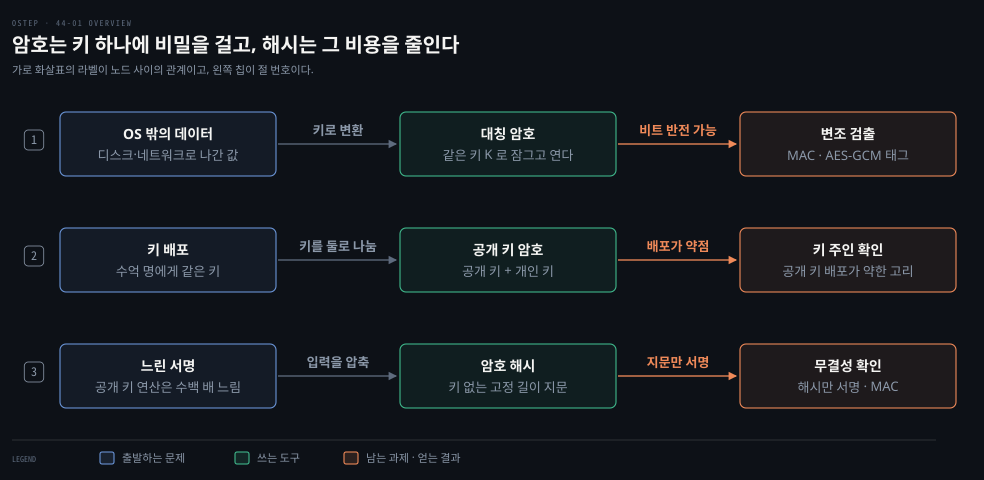
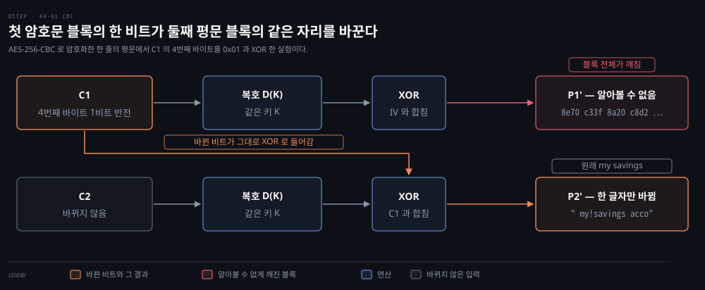
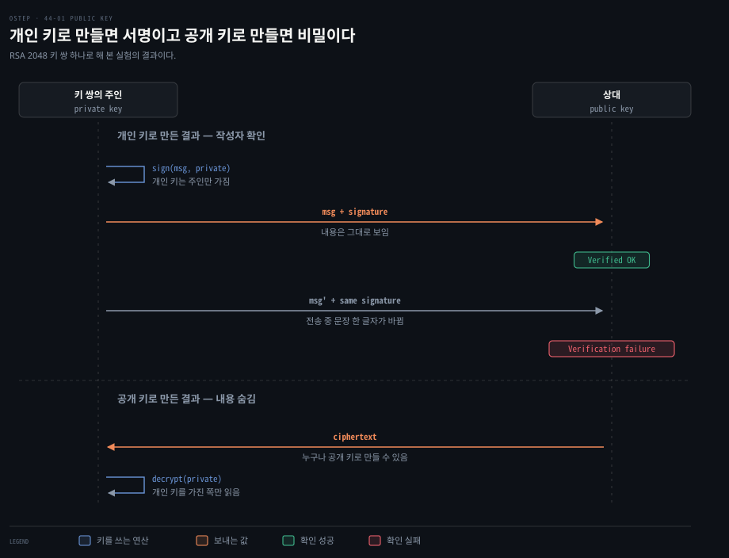
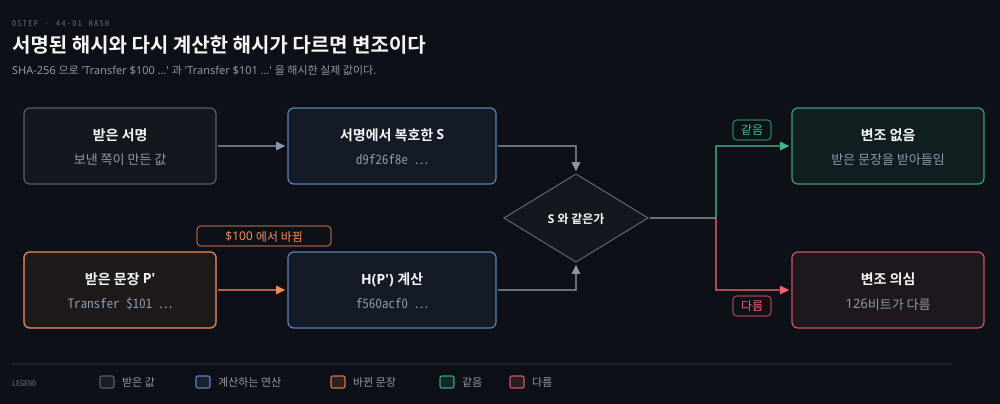

# OS 가 통제하지 못하는 데이터는 무엇으로 지키는가 — 대칭 암호·공개 키 암호·암호 해시

---

> 접근 통제는 OS 가 데이터를 쥐고 있는 동안만 지켜 줍니다. 이 편은 OS 의 손을 떠난 데이터를 지키는 세 도구, 곧 대칭 암호와 공개 키 암호와 암호 해시를 다룹니다.

## 핵심 요약

> 암호는 데이터를 남이 이해하지 못하는 모양으로 바꾸는 도구이고, 그 보호는 알고리즘이 아니라 키의 비밀에서 나옵니다.

알고리즘은 공개된 표준을 쓰고 비밀은 키 하나에만 둡니다. 같은 키로 잠그고 여는 대칭 암호는 빠르지만 키를 상대에게 건네는 일이 어렵습니다. 공개 키 암호는 키를 둘로 나눠 이 문제를 풀지만 훨씬 느리고, 공개 키가 정말 그 사람의 것인지 확인하는 일이 새 문제로 남습니다. 암호 해시는 키 없이 데이터의 지문을 만들어, 지문만 암호화하는 값싼 방법으로 변조를 알아챌 수 있게 합니다.


## 학습 목표

이 내용을 읽고 나면:

1. OS 가 통제하지 못하는 데이터를 암호로 지켜야 하는 이유와 암호가 주는 세 가지 보호를 설명할 수 있습니다.
2. 알고리즘을 공개하고 키만 비밀로 두는 이유와 직접 만든 암호를 쓰면 안 되는 이유를 말할 수 있습니다.
3. 암호화만으로는 변조를 걸러낼 수 없는 이유와 보완 수단을 설명할 수 있습니다.
4. 공개 키 암호에서 키를 쓰는 방향에 따라 인증과 비밀이 갈리는 것을 설명하고, 둘을 함께 얻는 방법과 그 비용을 말할 수 있습니다.
5. 암호 해시의 세 성질과, 해시를 암호화해 변조를 확인하는 흐름을 설명할 수 있습니다.

아래 개념도는 이 편의 세 절을 한 행씩 보여 줍니다. 각 행은 풀어야 할 문제에서 출발해 쓰는 도구를 거쳐 남는 과제나 얻는 결과로 이어지고, 화살표 라벨이 노드 사이의 관계입니다. 첫 행은 대칭 암호로 데이터를 감싸고 변조 검출을 덧붙이는 흐름입니다. 둘째 행은 키 배포 문제를 공개 키와 개인 키로 풀고 키 주인 확인이 남는 흐름입니다. 셋째 행은 느린 서명의 비용을 해시만 서명해서 줄이는 흐름입니다.




## 1. 알고리즘은 공개하고 키만 숨기는 대칭 암호

> OS 의 통제가 닿지 않는 데이터는 암호로 지킵니다. 알고리즘은 공개 표준을 쓰고 보호는 키의 비밀에 걸지만 암호화만으로는 변조를 막지 못합니다.

### OS 의 통제 밖 데이터를 지키는 암호

접근 통제는 OS 가 자기 하드웨어를 쥐고 있을 때만 작동합니다. 다른 기계로 넘어간 데이터나 OS 를 거치지 않고 읽히는 저장 장치에는 OS 의 통제가 닿지 않습니다. 이런 데이터는 잃어버릴 것을 전제하고 미리 준비해 둡니다. 상대가 얻은 모양을 이해하지 못하면 비밀이 지켜지고 무슨 뜻인지 모르는 데이터는 원하는 대로 바꾸기도 어렵기 때문입니다.

그 기술이 **암호**(cryptography)입니다. 암호 알고리즘은 평문 P 와 키 K 를 받아 암호문 C 를 만듭니다. 돌려놓는 쪽은 같은 키로 복호 알고리즘을 적용합니다.

```pseudocode
C = E(P, K)      암호화
P = D(C, K)      복호
```

암호가 주는 보호는 셋입니다. 내용을 숨기는 비밀, 내용이 바뀌지 않았음을 아는 무결성, 보낸 사람을 확인하는 인증입니다.

### 키 없이도 풀리는 시저 암호

평문 `Transfer $100 to my savings account` 를 글자마다 한 칸씩 앞으로 당겨 봅니다. 결과는 `Sqzmredq #099 sn lx rzuhmfr zbbntms` 입니다. 이것이 시저 암호입니다. 규칙만 알면 키 없이도 풀리므로 나쁜 알고리즘의 보기입니다.

쓸 만한 암호는 같은 평문과 키로 늘 같은 암호문을 만들고, 같은 키로 복호하면 늘 원래 평문을 돌려줍니다. 초기화 벡터(IV, initialization vector)처럼 암호화에 함께 넣는 값이 있으면 그 값까지 같아야 같은 암호문이 나옵니다. 여기에 더해 키 없이 P 를 알아내기가 계산상 불가능해야 합니다.

### 직접 만들지 않는 검증된 공개 표준

좋은 암호를 설계하기는 어렵습니다. 세계 최고의 암호학자도 결함 있는 암호를 자주 만듭니다. 만든 사람이 못 깼다는 것은 안전의 증거가 못 됩니다.

그래서 알고리즘은 널리 검증된 표준을 쓰고 직접 만들지 않습니다. 대표 표준이 AES(Advanced Encryption Standard)입니다. 미국 국립표준기술연구소(NIST)가 표준으로 정했습니다. 이 표준은 블록 크기 128비트와 키 길이 128·192·256비트 세 가지를 정의합니다.[^aes] 알고리즘이 공개되므로 보호는 키의 비밀에 전적으로 걸립니다. 알고리즘과 키를 둘 다 아는 사람은 누구든 복호할 수 있습니다.

### 같은 키로 잠그고 여는 대칭 암호

같은 키로 잠그고 여는 이 방식이 **대칭 암호**(symmetric cryptography)입니다. 키를 나눠 가진 상대만 제대로 복호되는 암호문을 만들 수 있으므로, 상대가 보낸 것이 맞는지 가려내는 데도 쓰입니다. 다만 복호가 오류 없이 끝났다고 해서 암호문이 바뀌지 않았다는 뜻은 아닙니다.

### 암호화만으로 막지 못하는 변조

암호문을 바꾸면 복호된 평문도 바뀌므로, 텍스트나 PDF 처럼 모양이 정해진 평문이 깨지면 변조를 의심할 수는 있습니다. 하지만 CBC(암호 블록 연쇄, cipher block chaining) 모드에서는 사정이 다릅니다. 암호문의 한 비트를 뒤집으면 복호 결과의 다음 블록에서 같은 위치의 비트가 뒤집힙니다. 복호가 앞 암호문 블록을 다음 블록의 복호 결과에 XOR 하는 구조이기 때문입니다. 비트를 뒤집은 블록은 통째로 깨지지만, 다음 블록에서는 공격자가 고른 비트만 정확히 뒤집힙니다.

아래 그림은 AES-256-CBC 로 한 줄을 암호화한 뒤 첫 암호문 블록의 한 비트를 뒤집어 복호한 결과입니다. 첫 평문 블록은 알아볼 수 없게 깨지고 둘째 블록의 `my savings` 는 `my!savings` 로 한 글자만 바뀝니다. 복호는 오류 없이 끝납니다.[^ver]



그래서 변조 검출은 암호화와 따로 붙입니다. 방법은 셋입니다. 평문의 해시를 암호화해 보냅니다. 비밀을 섞은 메시지 인증 코드(MAC, message authentication code)를 함께 보냅니다. 인증 태그를 암호화에 묶은 AES-GCM(Galois/Counter Mode) 같은 인증 암호화를 쓰는 방법도 있습니다.[^gcm] 해시로 변조를 가려내는 흐름은 해시를 다루는 절에서 봅니다.


## 2. 개인 키 서명과 공개 키 암호화 — 두 키의 방향

> 공개 키 암호는 키를 둘로 나눠 하나는 공개하고 하나는 소유자만 가집니다. 어느 키로 만들었느냐에 따라 인증이 되기도 하고 비밀이 되기도 합니다.

### 대칭 키로 나누기 어려운 인증

대칭 암호로 인증을 하려면 검증하는 쪽이 모두 같은 키를 알아야 합니다. 소프트웨어를 배포하는 쪽이 수억 사용자에게 같은 키를 나눠 주면 그 키를 받은 누구나 배포자를 흉내 낼 수 있습니다. 사용자마다 다른 키를 몰래 전달하고 관리하는 것도 현실적이지 않습니다. 이 문제를 암호학자들이 키를 둘로 나눠 풀었습니다.

### 쓰는 방향마다 갈리는 두 키의 성질

암호화 키와 복호 키를 서로 다른 것으로 둡니다.

```pseudocode
C = E(P, K_encrypt)
P = D(C, K_decrypt)
```

모두가 아는 키가 **공개 키**(public key)이고 소유자만 아는 키가 **개인 키**(private key)입니다.

이 방식 전체를 **공개 키 암호**(public key cryptography, PK)라 합니다.

개인 키는 만든 사람이 간직하고 누구에게도 나누지 않습니다. 공개 키는 퍼져도 상관없습니다. 소유자 한 사람이 지키면 되므로, 모든 상대에게 대칭 키를 몰래 건네는 일보다 관리가 훨씬 쉽습니다.

키를 쓰는 방향에 따라 얻는 성질이 갈립니다. 개인 키로 만든 결과는 공개 키를 가진 누구나 확인할 수 있어서 작성자를 증명합니다. 이것을 서명이라고 합니다. 공개 키로 만든 암호문은 개인 키를 가진 쪽만 풀 수 있어서 내용이 비밀로 남습니다. 개인 키로 만든 것은 내용을 숨기지 못합니다. 공개 키로 만든 것은 누구나 만들 수 있으므로 보낸 사람을 확인하지 못합니다.

아래 그림은 RSA(Rivest-Shamir-Adleman) 2048비트 키 쌍 하나로 두 방향을 해 본 결과이고 명령은 정답 5 에 있습니다. 서명은 `Verified OK` 로 확인되지만 문장을 한 글자만 바꾸면 `Verification failure` 가 됩니다. 서명이 실제로 어떤 연산인지는 [네트워크 책의 '서명은 개인키를 거꾸로 씁니다' 절](../cntd_computer-networking-top-down/08-02.%EC%97%B4%EC%87%A0%EB%A5%BC%20%EB%82%98%EB%88%A0%20%EA%B0%96%EC%A7%80%20%EC%95%8A%EA%B3%A0%20%EC%96%B4%EB%96%BB%EA%B2%8C%20%EB%B9%84%EB%B0%80%EC%9D%84%20%EB%A7%8C%EB%93%9C%EB%8A%94%EA%B0%80.md)이 설명합니다.



### 인증과 비밀을 함께 얻는 비용

보내는 쪽이 인증과 비밀을 모두 원하면 키 쌍이 둘 필요합니다. 먼저 자기 개인 키로 메시지에 서명합니다. 그 결과를 받는 쪽의 공개 키로 한 번 더 암호화합니다. 받는 쪽은 자기 개인 키로 암호문을 풀고, 보내는 쪽의 공개 키로 서명을 확인합니다. 두 번 암호화해야 하므로 비용이 늘어납니다.

공개 키 암호는 대칭 암호보다 수백 배 오래 걸릴 수 있어서 모든 데이터에 쓰기에는 비쌉니다. 잘하는 일에만 골라 씁니다. 큰 데이터는 대칭 암호로 처리합니다. 공개 키로 대칭 키를 만들어 넘기는 방식은 [네트워크 책의 '세션 키와 디피-헬먼' 절](../cntd_computer-networking-top-down/08-02.%EC%97%B4%EC%87%A0%EB%A5%BC%20%EB%82%98%EB%88%A0%20%EA%B0%96%EC%A7%80%20%EC%95%8A%EA%B3%A0%20%EC%96%B4%EB%96%BB%EA%B2%8C%20%EB%B9%84%EB%B0%80%EC%9D%84%20%EB%A7%8C%EB%93%9C%EB%8A%94%EA%B0%80.md)이 다룹니다.

### 공개 키 배포와 개인 키 유출이라는 약한 고리

공개 키 암호의 약한 고리는 공개 키를 퍼뜨리는 일입니다. 공격자가 받는 쪽에게 자기 공개 키가 상대의 것이라고 믿게 만들면 공격자가 서명한 메시지가 상대가 보낸 것으로 통과합니다. 공개 키가 정말 그 사람의 것인지 확인하는 구조가 필요합니다. 이 구조를 직접 짜려는 시도는 숙련자도 자주 실패합니다. 인증서가 그 역할을 하는 방식은 [패킷 분석 책의 '인증서와 두 서명' 편](../paw_packet-analysis-wireshark/04-02.%EC%9D%B8%EC%A6%9D%EC%84%9C%EC%99%80%20%EB%91%90%20%EC%84%9C%EB%AA%85.md)이 정리하고, 서명을 확인하는 흐름은 [인증서 편](./45-01.%EC%9B%90%EA%B2%A9%20%EA%B8%B0%EA%B3%84%EB%8A%94%20%EB%AC%B4%EC%97%87%EC%9C%BC%EB%A1%9C%20%EB%AF%BF%EB%8A%94%EA%B0%80%20%E2%80%94%20%EC%9D%B8%EC%A6%9D%EC%84%9C%EC%9D%98%20%EC%84%9C%EB%AA%85%EA%B3%BC%20%EB%B9%84%EB%B0%80%EB%B2%88%ED%98%B8%20%ED%95%B4%EC%8B%9C.md)이 다룹니다.

개인 키의 비밀이 깨지면 그 키로 한 모든 일이 위험해집니다. 키를 손에 넣은 사람은 소유자를 사칭하고 비밀 메시지도 읽습니다. 그래서 개인 키는 누구에게도 알리거나 나누지 않고 보관에 신경을 씁니다. 키가 어디서 새는지는 [짝 편](./44-02.%EC%95%94%ED%98%B8%EB%8A%94%20%EC%96%B4%EB%94%94%EC%84%9C%20%EA%B9%A8%EC%A7%80%EA%B3%A0%20OS%20%EB%8A%94%20%EC%96%B4%EB%94%94%EC%97%90%20%EC%95%94%ED%98%B8%EB%A5%BC%20%EC%93%B0%EB%8A%94%EA%B0%80%20%E2%80%94%20%ED%82%A4%20%EC%9C%A0%EC%B6%9C%C2%B7%EC%A0%80%EC%9E%A5%20%EB%8D%B0%EC%9D%B4%ED%84%B0%20%EC%95%94%ED%98%B8%ED%99%94%C2%B7%EC%95%94%ED%98%B8%ED%95%99%EC%A0%81%20capability.md)이 다룹니다.


## 3. 해시만 서명하는 값싼 무결성 확인

> 암호 해시는 긴 입력을 고정 길이의 지문으로 줄입니다. 서명은 비싸므로 지문만 서명해도 변조를 가려낼 수 있습니다.

### 키 없이 만드는 지문, 암호 해시

해시 함수는 임의 길이의 입력에서 고정 길이의 값 S = H(P) 를 키 없이 만듭니다. 입력이 출력보다 길어서 서로 다른 입력이 같은 값을 내는 충돌이 반드시 있습니다. 공격자가 보내려던 입력을 같은 해시를 내는 다른 입력으로 바꿀 수 있다면 무결성이 깨집니다. 그래서 무결성에는 일반 해시가 아니라 **암호 해시**(cryptographic hash)를 씁니다. 암호 해시는 세 성질을 갖습니다.

- 같은 해시를 내는 두 입력을 찾는 일이 계산상 불가능합니다.
- 입력이 조금만 바뀌어도 해시가 예측할 수 없게 바뀝니다.
- 해시값만 보고 입력의 성질을 추측할 수 없습니다.

두 문장 `Transfer $100 …` 과 `Transfer $101 …` 은 숫자 한 글자만 다릅니다. 그런데 SHA-256(Secure Hash Algorithm 256) 해시는 256비트 중 126비트가 다릅니다. 앞 8자리만 봐도 `d9f26f8e` 와 `f560acf0` 로 갈립니다. S 와 P 를 둘 다 알아도 같은 S 를 내는 다른 P' 를 찾기는 어렵습니다. 반면 바꾼 P' 의 해시를 계산하는 일 자체는 누구나 할 수 있습니다.

### 해시 서명으로 드러내는 변조

무결성만 필요하면 평문 전체가 아니라 해시만 암호화해도 됩니다. 해시는 짧아서 암호화 비용이 줄어듭니다. 보내는 쪽은 P 의 해시 S 를 암호화해 평문과 함께 보냅니다. 받는 쪽은 암호화된 해시를 복호해 S 를 얻습니다. 받은 P 로 해시를 다시 계산해 S 와 비교합니다. 값이 다르면 중간에서 바뀐 것입니다.



해시를 암호화하는 이유는 공격자도 해시를 계산할 수 있기 때문입니다. 해시를 평문으로 보내면 공격자가 메시지를 바꾸고 새 해시를 계산해 둘을 함께 바꿔치기합니다. 암호화한 해시는 바꾼 메시지에 맞는 값을 공격자가 만들지 못합니다. 개인 키로 처리하면 전자 서명이 되고, 해시에 공유 비밀을 섞으면 메시지 인증 코드(MAC)가 됩니다. 둘의 차이는 [네트워크 책 '서명은 개인키를 거꾸로 씁니다' 절의 'MAC 과 무엇이 다릅니까'](../cntd_computer-networking-top-down/08-02.%EC%97%B4%EC%87%A0%EB%A5%BC%20%EB%82%98%EB%88%A0%20%EA%B0%96%EC%A7%80%20%EC%95%8A%EA%B3%A0%20%EC%96%B4%EB%96%BB%EA%B2%8C%20%EB%B9%84%EB%B0%80%EC%9D%84%20%EB%A7%8C%EB%93%9C%EB%8A%94%EA%B0%80.md)가 표로 비교합니다.

### 솔트·파일 검사·작업 증명의 해시

암호 해시는 이 밖에도 쓰입니다. 비밀번호를 저장할 때는 사용자마다 다른 무작위 값(솔트, salt)을 섞어 해시합니다. 비밀번호 해시는 [인증서 편](./45-01.%EC%9B%90%EA%B2%A9%20%EA%B8%B0%EA%B3%84%EB%8A%94%20%EB%AC%B4%EC%97%87%EC%9C%BC%EB%A1%9C%20%EB%AF%BF%EB%8A%94%EA%B0%80%20%E2%80%94%20%EC%9D%B8%EC%A6%9D%EC%84%9C%EC%9D%98%20%EC%84%9C%EB%AA%85%EA%B3%BC%20%EB%B9%84%EB%B0%80%EB%B2%88%ED%98%B8%20%ED%95%B4%EC%8B%9C.md)이 이어서 다룹니다. 저장된 파일이 바뀌었는지 보는 파일 무결성 검사 도구도 해시를 씁니다.

요청이 특정 해시가 되도록 값을 계속 바꿔 보게 만들어 작업량을 강제하는 방식은 작업 증명(proof of work)입니다. 스팸 방지와 블록체인이 이 방식을 씁니다.

### 충돌 저항성이 깨진 SHA-1

해시도 시간이 지나면 낡으므로 표준 알고리즘의 현재 상태를 확인해야 합니다. SHA-1 은 2017 년에 같은 해시를 내는 두 입력의 실제 사례가 공개됐습니다.[^sha1] NIST 는 SHA-1 을 SHA-2·SHA-3 으로 바꾸라고 하며 2030-12-31 까지 퇴역시킬 계획입니다.[^nist1] 서명을 만드는 데는 NIST 프로토콜 지침이 따로 허용한 경우 말고는 SHA-1 을 쓰지 못합니다.[^131a] 미국 연방 기관에는 SHA-2 와 고정 길이 SHA-3 을 모든 보안 해시 용도에 허용합니다. SHA-2 에서 SHA-3 으로 옮길 필요는 없다고도 적습니다.[^nist2]


## 결정 치트시트

> 이 편의 판단 기준은 아래 표와 같습니다.

| 상황 | 판단 | 근거 |
|------|------|------|
| 내용을 숨겨야 할 때 | AES 같은 검증된 대칭 암호를 씁니다 | 빠르고 보호가 키의 비밀에 걸립니다 |
| 암호를 새로 만들고 싶을 때 | 만들지 않고 공개 표준을 씁니다 | 만든 사람이 못 깼다는 것은 안전의 증거가 못 됩니다 |
| 변조까지 막아야 할 때 | MAC 이나 AES-GCM 을 더합니다 | CBC 에서는 암호문 한 비트가 복호된 다음 평문 블록의 같은 자리 비트를 뒤집습니다 |
| 작성자를 증명할 때 | 개인 키로 서명합니다 | 공개 키를 가진 누구나 확인합니다 |
| 내용을 한 사람에게만 보일 때 | 받는 쪽의 공개 키로 암호화합니다 | 개인 키를 가진 쪽만 풉니다 |
| 인증과 비밀을 함께 원할 때 | 서명한 뒤 받는 쪽의 공개 키로 한 번 더 암호화합니다 | 키 쌍이 둘 필요하고 비용이 늘어납니다 |
| 큰 데이터를 보낼 때 | 대칭 암호로 처리합니다 | 공개 키 암호는 수백 배 오래 걸릴 수 있습니다 |
| 변조만 싸게 확인할 때 | 해시를 만들어 해시만 서명합니다 | 해시는 짧아 서명 비용이 줄고, 해시의 충돌 저항성이 지켜지는 한 공격자는 맞는 서명을 못 만듭니다 |
| 새로 해시를 고를 때 | SHA-256 같은 SHA-2 나 SHA-3 을 씁니다 | SHA-1 은 충돌 사례가 공개됐고 2030-12-31 까지 퇴역합니다 |


## 면접 대비

> 이 편에서 물어볼 만한 정의와 핵심 포인트, 질문입니다.

### 한 줄 정의

- 대칭 암호: 같은 키로 암호화하고 복호하는 방식입니다.
- 공개 키 암호: 공개 키와 개인 키 한 쌍을 쓰며, 어느 키로 만들었느냐에 따라 서명이나 비밀이 되는 방식입니다.
- 암호 해시: 임의 길이의 입력을 키 없이 고정 길이의 값으로 줄이고, 같은 값을 내는 다른 입력을 찾기 어렵게 만든 함수입니다.
- MAC: 공유 비밀 키로 만드는 짧은 인증 값으로, 변조와 보낸 사람을 함께 확인합니다. 해시로 만드는 표준 구성 중 가장 널리 쓰이는 것이 HMAC 입니다.

### 핵심 포인트 세 가지

1. 암호의 보호는 알고리즘이 아니라 키의 비밀에서 나옵니다. 알고리즘은 널리 검증된 표준을 쓰고 직접 만들지 않습니다.
2. 암호화는 변조 검출이 아닙니다. CBC 에서는 암호문의 한 비트가 복호된 다음 블록의 같은 자리 비트를 뒤집으므로 MAC 이나 AES-GCM 을 따로 붙입니다.
3. 공개 키 암호는 비싸고 공개 키 배포가 약한 고리입니다. 그래서 큰 데이터는 대칭 암호로 처리하고 서명은 해시에만 겁니다.

### 자주 묻는 질문

- *개인 키로 암호화하면 비밀이 지켜집니까?* 아닙니다. 공개 키를 가진 누구나 풀 수 있으므로 내용은 숨겨지지 않고 대신 작성자가 증명됩니다.
- *서명할 때 왜 메시지 전체가 아니라 해시에 서명합니까?* 공개 키 연산이 수백 배 오래 걸릴 수 있어서 짧은 해시에만 쓰는 편이 싸기 때문입니다. 같은 해시를 내는 다른 메시지를 찾을 수 없는 한, 공격자는 바꾼 메시지에 맞는 서명을 만들지 못합니다. 그래서 충돌 사례가 나온 SHA-1 은 서명에 쓰지 않습니다.
- *해시를 평문과 함께 그냥 보내면 왜 안 됩니까?* 해시는 누구나 계산할 수 있으므로 공격자가 메시지를 바꾸고 새 해시를 계산해 둘을 함께 바꿔치기합니다. 해시를 암호화하거나 비밀을 섞어야 합니다.
- *SHA-1 을 아직 써도 됩니까?* 새로 쓰지 않습니다. 충돌 사례가 공개됐고 NIST 가 2030-12-31 까지 퇴역시킬 계획이므로 SHA-256 같은 SHA-2 나 SHA-3 으로 옮깁니다.


## 연습 문제

> 1~3번은 본문을 떠올려 답하는 문제이고 4~6번은 직접 돌려 확인하는 문제입니다. 답을 적은 뒤 정답 절과 맞춰 봅니다.

1. `Sqzmredq #099 sn lx rzuhmfr zbbntms.` 는 평문의 글자를 한 칸씩 당긴 시저 암호문입니다. 이 암호에서 알고리즘과 키는 각각 무엇입니까? 왜 이 알고리즘은 쓸 수 없습니까?
2. 개인 키로 만든 결과와 공개 키로 만든 결과는 각각 어떤 보호를 줍니까? 둘을 함께 원하면 어떻게 합니까?
3. 파일 배포 서명에 SHA-1 을 쓰고 있다면 지금 기준으로 어떻게 해야 합니까? 근거는 무엇입니까?
4. CBC 모드 암호문의 첫 블록에서 한 비트를 뒤집어 복호하면 평문은 어떻게 됩니까? 암호화만으로 무결성을 믿으면 안 되는 이유와 보완 수단은 무엇입니까?
5. 서명한 문장을 한 글자 바꾸거나 다른 키 쌍의 공개 키로 검증하면 어떻게 됩니까? 이 결과가 공개 키 배포를 중요하게 만드는 이유는 무엇입니까? 같은 키 쌍으로 공개 키 암호화와 복호도 해 봅니다.
6. 숫자만 다른 두 문장 `$100` 과 `$101` 의 SHA-256 은 얼마나 다릅니까? 이 해시를 평문과 함께 그냥 보내면 왜 변조를 막지 못합니까?


## 정답 (자답 후 펼치기)

### 정답 1

글자마다 알파벳에서 한 칸 앞서 있으므로 한 칸씩 뒤로 밀면 `Transfer $100 to my savings account.` 가 됩니다. 알고리즘은 문자 이동이고 키는 이동 칸수 1 입니다. 규칙을 아는 순간 키 없이도 풀려서 알고리즘 자체가 약합니다. 약한 알고리즘은 키를 숨겨도 소용이 없습니다. 쓸 만한 암호는 알고리즘을 알아도 키 없이는 못 푸는 것이어야 합니다.

셸에서 확인하면 이렇습니다. `tr` 은 영문자와 숫자만 옮기므로 `#` 은 그대로 남고 사람이 `$` 로 읽습니다.

```bash
echo 'Sqzmredq #099 sn lx rzuhmfr zbbntms.' | tr 'A-Za-z0-9' 'B-ZAb-za1-90'
# Transfer #100 to my savings account.
```

### 정답 2

개인 키로 만든 결과는 공개 키를 가진 누구나 확인할 수 있어서 작성자를 증명하지만 내용은 숨기지 못합니다. 공개 키로 만든 암호문은 개인 키를 가진 쪽만 풀 수 있어서 내용을 숨기지만 보낸 사람은 확인하지 못합니다. 누구나 공개 키로 암호화할 수 있기 때문입니다. 둘을 함께 원하면 키 쌍이 둘 필요합니다. 보내는 쪽이 자기 개인 키로 서명한 뒤 받는 쪽의 공개 키로 한 번 더 암호화하고, 받는 쪽은 자기 개인 키와 보내는 쪽의 공개 키로 두 번 풉니다.

### 정답 3

SHA-256 같은 SHA-2 나 SHA-3 으로 옮겨야 합니다. SP 800-131A Rev. 2 는 NIST 의 프로토콜별 지침이 특별히 허용한 경우를 빼고 SHA-1 로 서명을 생성하는 것을 허용하지 않습니다.[^131a] SHA-1 은 같은 해시를 내는 두 입력의 실제 사례가 공개됐고, NIST 는 2030-12-31 까지 SHA-1 을 퇴역시킬 계획입니다.[^sha1][^nist1] 미국 연방 기관에는 SHA-2 와 고정 길이 SHA-3 을 보안 해시가 필요한 모든 용도에 쓰도록 허용합니다.[^nist2]

### 정답 4

CBC 모드에서 복호는 오류 없이 끝나고, 뒤집은 비트가 든 첫 블록 전체가 쓰레기가 됩니다.

그리고 둘째 블록에서 같은 위치의 비트가 정확히 하나 뒤집힙니다. CBC 복호가 앞 암호문 블록을 다음 블록의 복호 결과에 XOR 하는 구조이기 때문입니다. 아래 실험에서 첫 블록 16바이트는 알아볼 수 없는 값이 됐고, 둘째 블록의 `my savings` 는 `my!savings` 로 한 글자만 바뀌었습니다.[^ver]

```bash
K=$(openssl rand -hex 32); IV=$(openssl rand -hex 16)
printf 'Transfer $100 to my savings account. Do not change this line!!' > p.txt
openssl enc -aes-256-cbc -K $K -iv $IV -in p.txt -out c.bin
python3 -c "b=bytearray(open('c.bin','rb').read()); b[3]^=1; open('c_t.bin','wb').write(b)"
openssl enc -d -aes-256-cbc -K $K -iv $IV -in c_t.bin | xxd | head -2
# 00000000: 8e70 c33f 8a20 c8d2 6673 bbcf a429 0938  .p.?. ..fs...).8
# 00000010: 206d 7921 7361 7669 6e67 7320 6163 636f   my!savings acco
```

그래서 복호 결과가 정상으로 보이는지가 아니라, 평문에 대한 해시를 암호화해 보내거나 MAC 을 붙이거나, 암호화와 인증 태그가 묶인 AES-GCM 같은 인증 암호화로 변조를 검사합니다.[^gcm]

### 정답 5

서명은 `Verified OK` 이던 것이 문장을 바꾸자 `Verification failure` 로 바뀌었고, 다른 키 쌍의 공개 키로 검증해도 실패했습니다. 공개 키가 서명을 확인하는 기준이 되므로 공격자가 자기 공개 키를 상대의 것이라고 믿게 만들면 공격자의 서명이 상대의 서명으로 통과합니다. 그래서 공개 키가 누구의 것인지 확인하는 일이 공개 키 암호 전체의 약한 고리입니다.

아래 명령은 개인 키 파일 전체를 출력하지 않고 `head -1` 로 키 길이 줄만 확인합니다. 실패한 검증은 OpenSSL 이 오류 줄을 몇 개 더 찍으므로 `tail -1` 로 마지막 줄만 봅니다. 마지막 두 줄은 같은 키 쌍으로 공개 키 암호화 방향을 확인하는 명령입니다.

```bash
openssl genpkey -algorithm RSA -pkeyopt rsa_keygen_bits:2048 -out alice.key
openssl pkey -in alice.key -pubout -out alice.pub
openssl pkey -in alice.key -text -noout | head -1
# Private-Key: (2048 bit, 2 primes)
printf 'Transfer $100 to my savings account' > msg.txt
openssl dgst -sha256 -sign alice.key -out msg.sig msg.txt
openssl dgst -sha256 -verify alice.pub -signature msg.sig msg.txt
# Verified OK
printf 'Transfer $900 to my savings account' > msg2.txt
openssl dgst -sha256 -verify alice.pub -signature msg.sig msg2.txt 2>&1 | tail -1
# Verification failure
openssl genpkey -algorithm RSA -pkeyopt rsa_keygen_bits:2048 -out bob.key
openssl pkey -in bob.key -pubout -out bob.pub
openssl dgst -sha256 -verify bob.pub -signature msg.sig msg.txt 2>&1 | tail -1
# Verification failure
openssl pkeyutl -encrypt -pubin -inkey alice.pub -in msg.txt -out m.enc
openssl pkeyutl -decrypt -inkey alice.key -in m.enc
# Transfer $100 to my savings account
```

### 정답 6

두 문장은 숫자 한 글자만 다른데 SHA-256 은 256비트 중 126비트가 달랐습니다. 입력이 조금만 바뀌어도 해시가 예측할 수 없게 바뀌는 성질입니다. 이 해시를 평문과 함께 그냥 보내면 공격자가 메시지를 바꾸고 바꾼 메시지의 해시를 계산해 둘을 함께 바꿔치기합니다. 해시는 누구나 계산할 수 있으므로 암호화해서 보내야 합니다.

```bash
printf 'Transfer $100 to my savings account' | openssl dgst -sha256
# SHA2-256(stdin)= d9f26f8ef8b97c12cc7d7e23ba051e963e5e51808e1899b8b3cf05c4d7f75738
printf 'Transfer $101 to my savings account' | openssl dgst -sha256
# SHA2-256(stdin)= f560acf0ee15e698db11e909bb15eb7a942ae8949328f4fac6e0ec630e260dd6
python3 -c "a=int('d9f26f8ef8b97c12cc7d7e23ba051e963e5e51808e1899b8b3cf05c4d7f75738',16);b=int('f560acf0ee15e698db11e909bb15eb7a942ae8949328f4fac6e0ec630e260dd6',16);print(bin(a^b).count('1'))"
# 126
```


## 참고 자료

- 《Operating Systems: Three Easy Pieces》(Remzi H. Arpaci-Dusseau · Andrea C. Arpaci-Dusseau, Arpaci-Dusseau Books) 56장
- [56장 PDF](https://pages.cs.wisc.edu/~remzi/OSTEP/security-crypto.pdf)
- [FIPS 197 AES](https://csrc.nist.gov/pubs/fips/197/final)
- [SP 800-38D GCM](https://csrc.nist.gov/pubs/sp/800/38/d/final)
- [SP 800-131A Rev. 2](https://csrc.nist.gov/pubs/sp/800/131/a/r2/final)
- [NIST 해시 함수 정책](https://csrc.nist.gov/projects/hash-functions/nist-policy-on-hash-functions)
- [NIST, SHA-1 퇴역 발표](https://www.nist.gov/news-events/news/2022/12/nist-retires-sha-1-cryptographic-algorithm)
- [The first collision for full SHA-1](https://eprint.iacr.org/2017/190)


## 관련 문서

- [OSTEP 정독 노트 인덱스](./README.md)
- [키 유출과 저장 데이터 암호화를 다루는 짝 편](./44-02.%EC%95%94%ED%98%B8%EB%8A%94%20%EC%96%B4%EB%94%94%EC%84%9C%20%EA%B9%A8%EC%A7%80%EA%B3%A0%20OS%20%EB%8A%94%20%EC%96%B4%EB%94%94%EC%97%90%20%EC%95%94%ED%98%B8%EB%A5%BC%20%EC%93%B0%EB%8A%94%EA%B0%80%20%E2%80%94%20%ED%82%A4%20%EC%9C%A0%EC%B6%9C%C2%B7%EC%A0%80%EC%9E%A5%20%EB%8D%B0%EC%9D%B4%ED%84%B0%20%EC%95%94%ED%98%B8%ED%99%94%C2%B7%EC%95%94%ED%98%B8%ED%95%99%EC%A0%81%20capability.md)
- [인증서의 서명과 비밀번호 해시를 다루는 편](./45-01.%EC%9B%90%EA%B2%A9%20%EA%B8%B0%EA%B3%84%EB%8A%94%20%EB%AC%B4%EC%97%87%EC%9C%BC%EB%A1%9C%20%EB%AF%BF%EB%8A%94%EA%B0%80%20%E2%80%94%20%EC%9D%B8%EC%A6%9D%EC%84%9C%EC%9D%98%20%EC%84%9C%EB%AA%85%EA%B3%BC%20%EB%B9%84%EB%B0%80%EB%B2%88%ED%98%B8%20%ED%95%B4%EC%8B%9C.md)
- [네트워크 책의 공개 키·서명·해시 편](../cntd_computer-networking-top-down/08-02.%EC%97%B4%EC%87%A0%EB%A5%BC%20%EB%82%98%EB%88%A0%20%EA%B0%96%EC%A7%80%20%EC%95%8A%EA%B3%A0%20%EC%96%B4%EB%96%BB%EA%B2%8C%20%EB%B9%84%EB%B0%80%EC%9D%84%20%EB%A7%8C%EB%93%9C%EB%8A%94%EA%B0%80.md)
- [패킷 분석 책의 인증서와 두 서명 편](../paw_packet-analysis-wireshark/04-02.%EC%9D%B8%EC%A6%9D%EC%84%9C%EC%99%80%20%EB%91%90%20%EC%84%9C%EB%AA%85.md)

[^ver]: 실행은 macOS(Darwin 25.6.0)에서 Homebrew 의 OpenSSL 3.6.4(2026-08-25 빌드, `/opt/homebrew/bin/openssl`)로 했고, 2026-11-08 에 다시 돌려 같은 결과를 확인했습니다. macOS 기본 `/usr/bin/openssl` 은 LibreSSL 3.3.6 이라 `SHA2-256(stdin)=` 접두어, 키 길이 줄, `Verification failure` 의 대소문자가 다르게 찍힙니다. 모든 실험은 저장소 밖 임시 폴더에서 했습니다. 키는 `openssl rand` 가 낸 무작위 값이고 출력의 암호문 일부는 그 실행의 값이라 다시 돌리면 달라집니다.
[^aes]: FIPS 197 의 초록은 "Three members of the Rijndael family are specified in this Standard: AES-128, AES-192, and AES-256. Each of them transforms data in blocks of 128 bits, and the numerical suffix indicates the bit length of the associated cryptographic keys."라고 적습니다. SP 800-131A Rev. 2 의 승인 표도 AES-128·192·256 의 암호화·복호를 "Acceptable" 로 둡니다. <https://csrc.nist.gov/pubs/fips/197/final> · <https://nvlpubs.nist.gov/nistpubs/SpecialPublications/NIST.SP.800-131Ar2.pdf> (2026-11-08 조회)
[^gcm]: SP 800-38D 의 초록은 "This Recommendation specifies the Galois/Counter Mode (GCM), an algorithm for authenticated encryption with associated data, and its specialization, GMAC, for generating a message authentication code (MAC) on data that is not encrypted."입니다. <https://csrc.nist.gov/pubs/sp/800/38/d/final> (2026-11-08 조회)
[^sha1]: 2017 년 논문 "The first collision for full SHA-1" 은 "we demonstrate that SHA-1 collision attacks have finally become practical by providing the first known instance of a collision."이라고 적습니다. <https://eprint.iacr.org/2017/190> (2026-11-08 조회)
[^nist1]: NIST 발표는 "NIST is announcing that SHA-1 should be phased out by Dec. 31, 2030, in favor of the more secure SHA-2 and SHA-3 groups of algorithms."라고 적고, "We recommend that anyone relying on SHA-1 for security migrate to SHA-2 or SHA-3 as soon as possible"라는 권고를 인용합니다. <https://www.nist.gov/news-events/news/2022/12/nist-retires-sha-1-cryptographic-algorithm> (2026-11-08 조회)
[^nist2]: NIST 해시 함수 정책 페이지의 2015-08-05 항목은 SHA-2 에 대해 "Federal agencies may use these hash functions for all applications that employ secure hash algorithms."라고 적고, 고정 길이 SHA-3 에 대해서도 "for all applications that employ secure hash algorithms"라고 적은 뒤 "Currently there is no need to transition applications from SHA-2 to SHA-3."라고 덧붙입니다. 가장 최근인 2022-12-15 항목은 "NIST recommends that federal agencies transition away from SHA-1 for all applications as soon as possible."라고 적습니다. <https://csrc.nist.gov/projects/hash-functions/nist-policy-on-hash-functions> (2026-11-08 조회)
[^131a]: SP 800-131A Rev. 2 는 "SHA-1 may only be used for digital signature generation where specifically allowed by NIST protocol-specific guidance. For all other applications, SHA-1 is disallowed for digital signature generation."라고 적습니다. 이 페이지는 2026-11-08 현재 Rev. 2 를 대체한 판을 표시하지 않고, Rev. 3 은 2024-10-21 에 초안(initial public draft)으로만 게시돼 있습니다. <https://csrc.nist.gov/pubs/sp/800/131/a/r2/final> · <https://nvlpubs.nist.gov/nistpubs/SpecialPublications/NIST.SP.800-131Ar2.pdf> (2026-11-08 조회)
