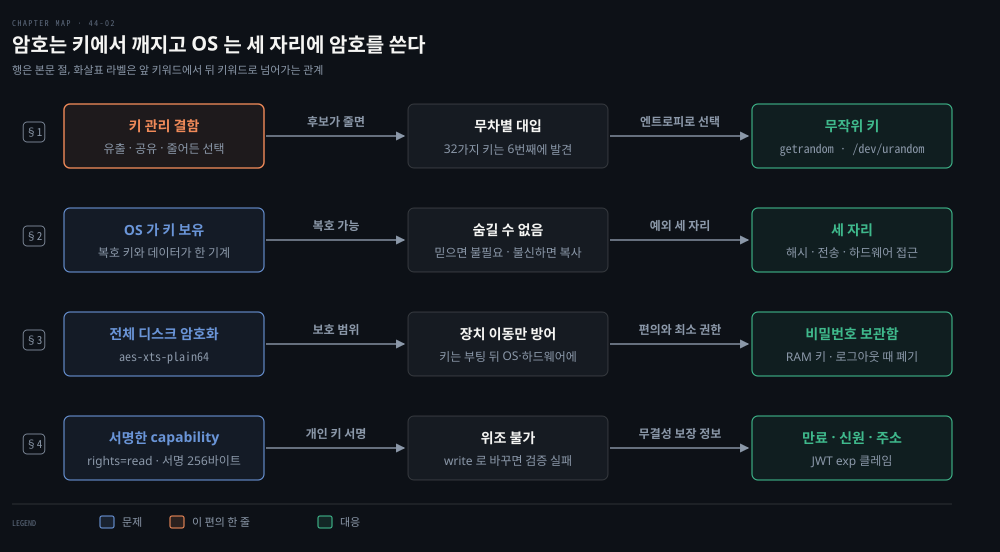
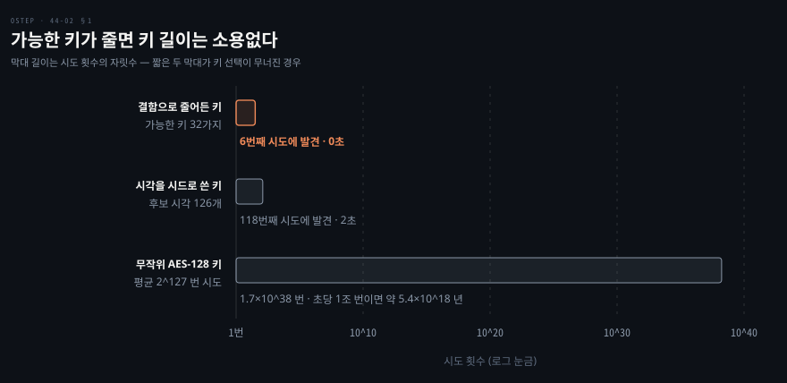
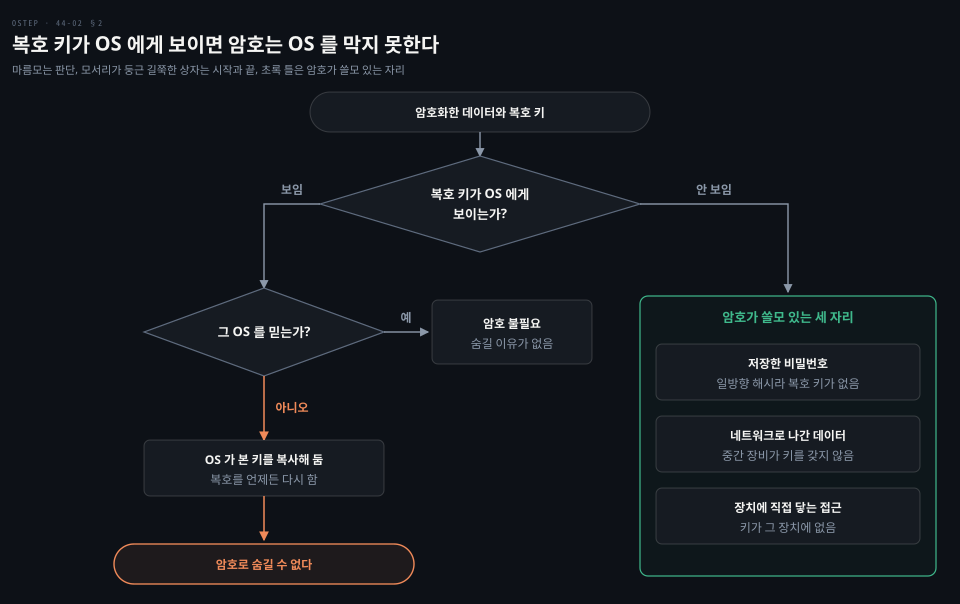
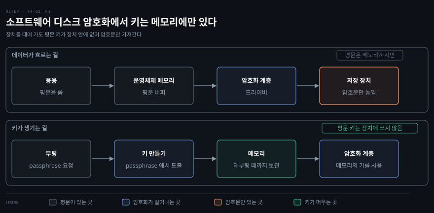
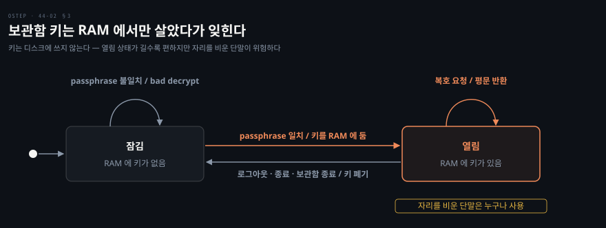
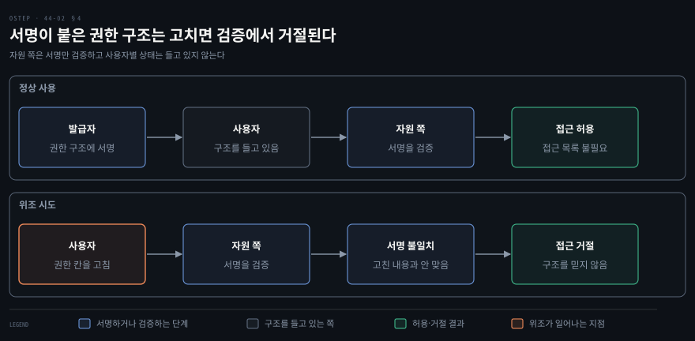

# 암호는 어디서 깨지고 OS 는 어디에 암호를 쓰는가 — 키 유출·저장 데이터 암호화·암호학적 capability

---

> 암호는 알고리즘이 아니라 키에서 깨집니다. 이 편은 키가 어디서 새고, OS 가 키를 쥔 기계에서 암호가 무엇을 못 숨기며, 그래도 OS 가 암호를 쓰는 자리가 어디인지를 따라갑니다.


## 핵심 요약

> 암호는 알고리즘이 아니라 키에서 깨지고, OS 가 키를 쥔 기계 안에서는 OS 로부터 데이터를 숨길 수 없습니다.

그래서 OS 가 암호를 쓰는 대표적인 자리는 세 곳입니다. 비밀번호를 일방향 해시로 저장하는 일, 네트워크로 나가는 데이터를 지키는 일, 장치에 직접 닿는 접근에 대비해 저장 데이터를 암호화하는 일입니다. 서명된 토큰은 위조할 수 없는 권한 증명(capability)이 되어 접근 목록 없이도 권한을 증명합니다. 어느 경우든 키는 가능한 한 적은 곳에, 짧은 시간만, 적은 상대에게 두는 것이 원칙입니다.[^ver]


## 학습 목표

> 이 편을 읽고 나면 아래 다섯 가지를 스스로 해낼 수 있습니다.

1. 암호 알고리즘이 아니라 키 관리가 공격 대상이 되는 이유를 실제 사례로 설명할 수 있습니다.
2. 무차별 대입에서 키 길이와 키 선택 방법이 하는 역할을 계산과 함께 설명할 수 있습니다.
3. OS 가 키를 가진 기계에서 암호가 소용없는 이유와, 그래도 암호가 쓸모 있는 세 자리를 말할 수 있습니다.
4. 전체 디스크 암호화가 막아 주는 것과 막지 못하는 것을 구분하고, 키가 어디에 있는지 설명할 수 있습니다.
5. 암호학적 capability 가 위조를 막는 방식과 만료·신원·주소 같은 정보를 담는 방식을 설명할 수 있습니다.

아래 개념도는 이 편의 네 절을 한 줄씩 보입니다. 각 줄이 한 절이고 노드가 그 절의 핵심 키워드입니다. 화살표 위 글자는 앞 키워드에서 뒤 키워드로 넘어가는 관계입니다. 붉은 노드가 그 절이 푸는 문제입니다.

1절은 키가 새거나 약해지는 경로와, 무작위 키로 막는 방법을 다룹니다. 2절은 OS 가 키를 쥐면 암호가 숨기지 못한다는 한계와 예외 세 자리를 다룹니다. 3절은 전체 디스크 암호화의 보호 범위와 비밀번호 보관함의 타협을, 4절은 서명한 capability 가 위조를 막으면서 만료와 신원을 담는 방식을 다룹니다.




## 1. 키 유출·약한 키와 무작위 난수

> 표준 알고리즘을 쓰면 공격자는 알고리즘이 아니라 키를 노리므로, 키를 만들고 나눠 주는 방법이 보안의 실제 경계입니다.

### 키 관리 허점의 세 예와 Heartbleed

현대 표준 알고리즘은 몇 가지 사소한 예외를 빼면 키 없이 암호문을 읽는 방법이 알려지지 않았습니다. 그래서 시스템이 뚫린다면 대개 암호와 무관한 소프트웨어 결함이 원인입니다. 키를 얻거나 키 관리의 허점을 파고드는 경우도 있습니다. 키 관리의 허점으로 흔한 예는 셋입니다.

- 많은 사람이 공유하는 소프트웨어에 비밀 키를 넣어 배포하는 일
- 키를 평문으로 네트워크에 전송하는 일
- 가능한 키 전체가 아니라 크게 줄어든 집합에서 키를 고르는 일

Heartbleed 는 암호 알고리즘과 그 알고리즘의 구현, 키 선택 절차에는 결함이 없었는데 키가 샌 사례입니다. OpenSSL 의 heartbeat 확장 구현에 있던 버그가 원격 기계의 메모리를 읽게 해 주었습니다. 그 메모리 안에 서비스가 신원을 증명하고 통신을 암호화하는 데 쓰는 비밀 키가 있었습니다.[^hb] 암호화 자체는 뚫리지 않았지만, 키를 얻은 공격자는 그 키로 보호된 통신을 복호할 수 있었습니다.

Heartbleed 를 패킷에서 가려내는 방법은 [훔쳐보고 끼어드는 공격](../paw_packet-analysis-wireshark/07-02.%ED%9B%94%EC%B3%90%EB%B3%B4%EA%B3%A0%20%EB%81%BC%EC%96%B4%EB%93%9C%EB%8A%94%20%EA%B3%B5%EA%B2%A9.md)이 다룹니다. TLS(Transport Layer Security) 설계의 결함과 구현의 결함이 어떻게 갈리는지는 [TLS 핸드셰이크 편](./45-02.TLS%20%EB%8A%94%20%ED%82%A4%EB%A5%BC%20%EC%96%B4%EB%96%BB%EA%B2%8C%20%EC%95%88%EC%A0%84%ED%95%98%EA%B2%8C%20%EB%82%98%EB%88%84%EB%8A%94%EA%B0%80%20%E2%80%94%20%ED%95%B8%EB%93%9C%EC%85%B0%EC%9D%B4%ED%81%AC%C2%B7%EC%84%B8%EC%85%98%20%EC%9D%B8%EC%A6%9D%C2%B7HTTPS%C2%B7SSH.md)이 다룹니다.

### 무차별 대입과 키 길이

가장 단순한 공격은 키를 하나씩 넣어 보는 무차별 대입(brute force)입니다. 막는 방법은 키를 길게 만드는 것입니다. AES(Advanced Encryption Standard) 키는 128비트 이상입니다.[^aes2] 무작위로 만든 키라면 평균 2^127 번을 시도해야 맞습니다. 1초에 1조 번을 시도해도 약 5.4×10^18 년이 걸립니다.

하지만 결함 때문에 가능한 키가 32가지로 줄면 이 계산이 무너집니다. 암호화한 시각을 2분 범위 안에서 안다고 가정하면 시각을 시드로 쓴 키도 후보가 126개뿐이어서, 정답 2의 실행에서는 2초 만에 찾아졌습니다. 이 두 경우는 연습 문제 1·2번의 정답에서 직접 돌려 봅니다. 시각과 프로세스 ID 를 시드로 쓴 초기 Netscape 브라우저의 키도 30초 안팎에 추측됐습니다.[^ns]



키 길이가 같아도 실제로 고를 수 있는 키의 수가 줄면 길이는 의미를 잃습니다. 공격자가 세는 것은 비트 수가 아니라 후보의 수입니다.

### 무작위 난수로 키 만들기

키는 무작위로 고르는 것이 원칙입니다. 어떤 결정적 방법으로 키를 정하면, 공격자의 문제가 키 찾기에서 방법 알아내기로 바뀌고 같은 방법으로 만든 다른 키도 모두 알려집니다. 무작위로 만들면 키 하나가 알려져도 다른 키는 알 수 없습니다.

키를 만드는 난수는 하드웨어의 예측하기 어려운 현상에서 모은 엔트로피(entropy)에서 얻습니다. Linux 에서는 커널이 이 일을 합니다. random(7) 은 `/dev/random` 대신 `/dev/urandom` 이나 `getrandom()` 을 쓰라고 안내합니다. 이때 `getrandom()` 에는 `GRND_RANDOM` 플래그를 붙이지 않습니다. 장기 키를 만드는 경우가 아니라면 그렇고, 장기 키를 만들 때도 아마 그렇다고 덧붙입니다.[^rand]

### 공유된 개인 키와 키 길이의 한계

공개 키 암호의 두 키는 수학적으로 이어져 있어서 아무 값이나 키가 될 수 없고, 공개 키만으로도 언젠가는 개인 키를 유도할 수 있습니다. 그 '언젠가'를 아주 멀리 밀어내려고 키를 훨씬 길게 씁니다. NIST SP 800-131A Rev. 2 는 RSA 서명에서 모듈러스 길이 2048비트 이상을 허용 기준으로 둡니다.[^131a2]

그러나 길이는 개인 키가 비밀로 남을 때만 의미가 있습니다. 같은 모델의 임베디드 기기에 같은 개인 키를 넣어 출하하면 그 키는 곧 공개 키나 마찬가지입니다. 2016 년 9월 조사는 알려진 개인 키로 HTTPS 서버 인증서를 쓰는 인터넷 접속 기기를 450만 대 찾았습니다.[^hok] 이 기기들의 암호는 장식에 불과했습니다.

무선 LAN 의 WEP(Wired Equivalent Privacy)는 키를 만들고 나누는 방식이 근본적으로 약했습니다. NIST SP 800-97 은 이를 "inherently flawed", 곧 근본적으로 결함이 있다고 적습니다.[^wep] WEP 공유 키 인증이 무선 연결 절차에서 어디에 있었는지는 [무선에서 잡기](../paw_packet-analysis-wireshark/06-01.%EB%AC%B4%EC%84%A0%EC%97%90%EC%84%9C%20%EC%9E%A1%EA%B8%B0.md)에 있습니다. 이 사례들의 결론은 한 문장입니다. 암호의 이점은 전적으로 키의 비밀에 달려 있습니다.


## 2. OS 가 키를 쥔 기계와 암호의 세 자리

> 암호는 키를 OS 가 볼 수 없는 곳에 둘 수 있을 때만 OS 에 맞서 쓸 수 있습니다.

### OS 를 믿는가에 따라 갈리는 암호

OS 는 기계의 모든 자원에 접근합니다. 암호화된 데이터와 그 복호 키가 같은 기계에 있으면, 그 기계의 OS 는 원하든 원하지 않든 데이터를 복호할 수 있습니다. OS 를 믿는다면 데이터를 숨길 필요가 없으니 암호가 필요 없습니다. 믿지 않는다면 한 번이라도 키를 본 OS 가 키를 복사해 두었다가 언제든 다시 쓸 수 있습니다.



같은 논리가 클라우드에도 적용됩니다. 클라우드 업체를 믿지 못해서 평문 데이터를 보내고 암호화를 맡기면, 업체는 평문을 이미 보았고 키도 복사해 둘 수 있습니다. 믿지 못하는 상대에게 건네기 전에, 믿는 쪽에서 암호화해야 합니다.

### 일시적 침해와 키의 노출 시간

OS 가 지금은 안전하다고 확신하지만 나중이 걱정된다면 지금 암호화하고 키를 그 기계에 두지 않는 방법이 있습니다. 하지만 OS 가 이미 오염됐거나, 오염된 뒤에 그 기계에서 한 번이라도 복호하면 키의 비밀이 깨져 보호도 사라집니다.

침해가 일시적이거나 일부 자원에 한정될 수도 있습니다. 이때 키가 공격자가 닿는 시간과 자리에 없다면 암호화가 여전히 도움이 됩니다.

문제는 어느 쪽인지 미리 알 수 없다는 점입니다. 그래서 복호는 드물게 하고 평문은 바로 정리하며, 평문 키는 암호 연산 때만 기계에 둡니다.

### 암호가 쓸모 있는 세 자리

그렇다면 OS 에서 암호가 쓸모 있는 대표적인 자리는 이렇습니다.

- 일방향 연산은 복호가 불가능하므로, OS 가 오염돼도 해시로 저장된 비밀번호는 복호되지 않습니다.
- 네트워크로 보낸 데이터는 중간 장비가 키를 갖지 않으므로 전송 중에 보호됩니다.
- OS 를 거치지 않고 하드웨어에 닿는 접근은 키가 그 하드웨어에 없으면 막힙니다.

비밀번호 해시에도 한계가 있습니다. 정당한 사용자가 오염된 OS 에 올바른 비밀번호를 입력하면, OS 는 해시하기 전에 비밀번호를 가로챌 수 있습니다. 해시가 저장된 비밀번호를 어떻게 확인하는지는 [원격 기계를 믿는 방법](./45-01.%EC%9B%90%EA%B2%A9%20%EA%B8%B0%EA%B3%84%EB%8A%94%20%EB%AC%B4%EC%97%87%EC%9C%BC%EB%A1%9C%20%EB%AF%BF%EB%8A%94%EA%B0%80%20%E2%80%94%20%EC%9D%B8%EC%A6%9D%EC%84%9C%EC%9D%98%20%EC%84%9C%EB%AA%85%EA%B3%BC%20%EB%B9%84%EB%B0%80%EB%B2%88%ED%98%B8%20%ED%95%B4%EC%8B%9C.md)이 다룹니다. 세 번째 자리가 3절의 주제입니다.


## 3. 저장 데이터 암호화의 보호 범위

> 저장 데이터 암호화는 OS 를 거치지 않고 장치에 닿는 접근을 막을 뿐이므로, 어떤 위협을 막는지 알고 써야 합니다.

### 전체 디스크 암호화와 키의 위치

디스크나 플래시 같은 매체에 놓인 데이터를 암호문으로 보관하는 방식을 **저장 데이터 암호화**(at-rest data encryption)라고 합니다. 암호문으로는 일반 연산을 할 수 없어서 쓸 때는 복호합니다.

가장 흔한 형태는 장치 내용 거의 전부를 암호화하는 **전체 디스크 암호화**(full disk encryption)입니다. 하드웨어나 소프트웨어가 맡습니다. 소프트웨어 방식은 장치 드라이버나 파일 시스템의 한 요소로 구현되고, BitLocker 와 FileVault 가 예입니다. 이 두 제품이 저장 암호화에서 맡는 몫은 [통신과 저장소 보호 편](../../../07_devops/book/fdsd_fundamentals-devops/08-01.How%20to%20Secure%20Communication%20and%20Storage.md)에도 있습니다.

Linux 에서는 dm-crypt 가 이 일을 합니다. 암호 지정 형식 `cipher[:keycount]-chainmode-ivmode` 에서 대표 예가 `aes-xts-plain64` 입니다.[^dmc] XTS-AES 는 NIST 가 저장 장치 데이터의 비밀을 지키는 방식으로 승인한 모드입니다. 같은 문서는 이 모드가 데이터나 출처의 인증을 제공하지 않는다고 적습니다.[^xts] 암호화가 변조 탐지까지 대신하지 않는다는 [대칭 암호 편의 원칙](./44-01.OS%20%EA%B0%80%20%ED%86%B5%EC%A0%9C%ED%95%98%EC%A7%80%20%EB%AA%BB%ED%95%98%EB%8A%94%20%EB%8D%B0%EC%9D%B4%ED%84%B0%EB%8A%94%20%EB%AC%B4%EC%97%87%EC%9C%BC%EB%A1%9C%20%EC%A7%80%ED%82%A4%EB%8A%94%EA%B0%80%20%E2%80%94%20%EB%8C%80%EC%B9%AD%20%EC%95%94%ED%98%B8%C2%B7%EA%B3%B5%EA%B0%9C%20%ED%82%A4%20%EC%95%94%ED%98%B8%C2%B7%EC%95%94%ED%98%B8%20%ED%95%B4%EC%8B%9C.md)이 여기서도 그대로 적용됩니다.



동작은 이렇습니다. 부팅 때 사용자에게 키나 키를 얻을 정보를 받습니다. 그 정보가 passphrase(여러 단어도 되는 비밀번호)이고, 맞으면 키가 하드웨어나 OS 에 올라옵니다.

데이터가 장치에 쓰일 때 암호화되고 장치에서 나올 때 복호됩니다. 평문은 공유 버퍼나 사용자 주소 공간을 포함해 메모리에 있는 동안만 존재하고, 장치에는 복호된 모양으로 놓이지 않습니다. 첫 요청 뒤에는 응용이 암호문을 볼 일도, 키를 다시 물을 일도 재부팅 전까지는 없습니다.

소프트웨어 방식은 연산 비용이 들지만, 디스크를 많이 쓰는 작업에서 지연이 몇 퍼센트 늘어나는 정도가 흔합니다. 디스크를 덜 쓰는 작업에서는 알아채기 어려울 수 있습니다.

### 막지 못하는 넷과 막는 하나

전체 디스크 암호화가 막지 못하는 것이 넷 있습니다. 키가 올라온 뒤에는 암호화 계층이 평문을 OS 에 넘겨주므로, 그 뒤의 보호는 다시 OS 의 접근 통제와 OS 자체의 안전에 달리기 때문입니다.

| 위협 | 막지 못하는 이유 |
|------|------------------|
| 허가 없는 사용자의 접근 | OS 접근 통제가 막거나 못 막는 문제여서 이 암호화가 보태는 것이 없음 |
| 데이터를 노출하는 응용 결함 | 버퍼 오버플로나 SQL 삽입을 이용하면 공격자가 사용자로 행세해 평문을 얻음 |
| 권한 있는 내부자 | 관리자가 사용자로 행세하거나 접근 수단을 설치해 평문을 얻음 |
| OS 자체의 결함 | 키가 OS 에게 열려 있으므로 그대로 노출됨 |

그래서 이 암호화가 지켜 주는 것은 하나입니다. 장치를 다른 기계로 옮기면 그 기계의 OS 는 장치에 저장된 접근 통제 정보를 따를 의무가 없고, 파일 시스템 없이 원시 블록으로 읽을 수도 있습니다. 암호화돼 있으면 새 기계는 키를 얻지 못해 암호문 블록만 읽습니다. 도난·분실이 잦은 모바일 기기와, 되팔린 디스크에서 이전 주인의 민감한 데이터가 발견되는 경우가 이 이점이 실제로 쓰이는 자리입니다.

### 다른 저장 데이터 암호화의 쓰임

다른 형태의 저장 데이터 암호화는 설계에서 세 가지를 정해야 합니다. 얼마나 암호화할지, 키를 어떻게 얻을지, 언제 암호화하고 복호할지입니다. 흔한 쓰임은 셋입니다.

- 보관만 하는 아카이브는 만들 때 암호화하고 평생 풀지 않을 수도 있습니다. 키를 잃으면 영영 못 풉니다.
- 믿기 어려운 클라우드에 올릴 데이터는 보내기 전에 암호화하고 받은 뒤 복호합니다. 클라우드 백업 제품이 흔히 이 기능을 갖췄습니다.
- 이메일처럼 응용이 직접 암호화하는 경우, 응용은 암호화 직후 평문과 키를 치워야 합니다. 그래도 키가 있는 동안 OS 가 응용 몰래 접근할 수 있습니다.

### 비밀번호 보관함의 타협

특별한 경우가 **비밀번호 보관함**(password vault)입니다. 사이트마다 다른 비밀번호를 쓰면 사용자가 다 못 기억하므로 비밀번호를 암호화해 저장해 두고 필요할 때 복호합니다.

이때 복호 키는 기계의 영구 저장소에 두지 않습니다. 필요할 때 사용자에게 키를 묻거나, passphrase 를 물어 키를 유도합니다. 최소 권한 원칙대로면 쓰자마자 키를 폐기해야 하지만 매번 입력하는 불편은 수용성 원칙에 어긋납니다.

그래서 한 번 입력한 키를 RAM 에만 두고, 로그아웃·종료·보관함 응용 종료 때 잊는 타협을 합니다.



이 방식은 단일 로그인(single sign-on)과 같은 약점이 있어서 자리를 비운 단말을 아무나 쓸 수 있습니다. 장점은 사용자가 보안 장치를 포기하지 않을 만큼만 불편하다는 점입니다.


## 4. 서명한 capability 로 권한 증명

> capability 는 사용자 손에 둘 수 없다는 문제가 있었는데, 신뢰하는 쪽이 암호로 보호한 자료 구조로 만들면 위조 없이 사용자에게 줄 수 있습니다.

### 대칭 키와 공개 키로 만드는 capability

신뢰하는 주체가 충분히 길고 안전하게 암호화한 자료 구조를 만들어, 소지자가 특정 자원에 접근할 수 있다고 표시할 수 있습니다. 사용자는 이것을 자원의 소유자에게 제시하고, 자원을 통제하는 시스템은 유효성만 확인하고 접근 통제 목록(ACL)을 따로 두지 않습니다.

대칭 암호로 만들면 만드는 쪽과 검증하는 쪽이 같은 키를 나눠 가져야 하므로, 둘이 같은 시스템일 때 현실적입니다. 같은 기계가 접근 상태를 기억하지 않고 이런 capability 를 만드는 이유는 이렇습니다. 사용자가 아주 많으면 접근을 통과한 상태를 각각 기억하는 일이 비싸고 복잡하고, 분산 환경에서 장애와 지연까지 고려하면 더 그렇습니다. 또 주체가 기계를 옮겨 다니며 쓸 수 있는 권한을 주고 싶을 때는 capability 가 주체와 함께 움직이는 쪽이 낫습니다.

공개 키 암호로 만들면 만드는 쪽과 자원 쪽이 한곳에 있지 않아도 되고 신뢰 관계도 약해도 됩니다. 만드는 쪽은 개인 키로 서명하고, 확인하는 쪽은 공개 키만 있으면 됩니다.



자원 관리자가 어떤 주체가 어떤 자원을 어떤 방식으로 어느 기간 쓸 수 있는지 담은 자격 증명을 개인 키로 서명하면, 누구든 관리자의 공개 키로 확인합니다. 관리자만 개인 키를 아는 한 아무도 위조할 수 없습니다. 서명을 어느 키가 확인하는지는 [인증서와 두 서명](../paw_packet-analysis-wireshark/04-02.%EC%9D%B8%EC%A6%9D%EC%84%9C%EC%99%80%20%EB%91%90%20%EC%84%9C%EB%AA%85.md)이 다룹니다.

서명은 내용을 숨기지 않습니다. 내용을 어느 정도 숨겨야 하면, 원래 공개할 확인용 키를 검증하는 쪽에만 나눠 줍니다. 다만 널리 배포되는 소프트웨어에 넣은 확인용 키는 결국 공개되므로, 그 키가 비밀로 남는다고 기대하면 안 됩니다.

### 담을 수 있는 정보와 JWT

capability 에는 많은 정보를 담을 수 있습니다. 만료 시각, 받은 주체의 신원, 그 밖의 것이 모두 무결성을 보장받으므로 믿을 수 있습니다. 그래서 만든 쪽은 임의의 복사와 공유를 어느 정도 막을 수 있습니다. 네트워크에서는 특정 IP 주소에 묶어 그 주소에서 온 메시지만 유효로 볼 수 있습니다.

서명된 토큰이 널리 쓰이는 예가 JWT(JSON Web Token)입니다. RFC 7519 는 JWT 의 클레임을 서명하거나 MAC(Message Authentication Code)으로 무결성을 보호할 수 있다고 합니다. 또 `exp` 클레임이 가리키는 시각 이후에는 JWT 를 받아들이면 안 된다고 정합니다.[^jwt] JWT 를 신원 문서로 쓰는 방식은 [신원을 문서로 만드는 네 규격](../../../08_cloud/book/istio-in-action/a0-03.%EB%B6%80%EB%A1%9D%20%E2%80%94%20%EC%8B%A0%EC%9B%90%EC%9D%84%20%EB%AC%B8%EC%84%9C%EB%A1%9C%20%EB%A7%8C%EB%93%9C%EB%8A%94%20%EB%84%A4%20%EA%B7%9C%EA%B2%A9.md)에 있습니다.

### 추측되지 않을 길이

capability 는 무차별 대입이나 임의 추측으로 유효한 값을 찾을 수 없을 만큼 길어야 합니다. 예를 들어 유효하지 않은 비트 패턴이 유효한 것보다 10^15 배쯤 많으면 추측으로 맞히기를 기대할 수 없습니다.

서명으로 위조를 막는 방향은 [공개 키 암호의 두 키 방향](./44-01.OS%20%EA%B0%80%20%ED%86%B5%EC%A0%9C%ED%95%98%EC%A7%80%20%EB%AA%BB%ED%95%98%EB%8A%94%20%EB%8D%B0%EC%9D%B4%ED%84%B0%EB%8A%94%20%EB%AC%B4%EC%97%87%EC%9C%BC%EB%A1%9C%20%EC%A7%80%ED%82%A4%EB%8A%94%EA%B0%80%20%E2%80%94%20%EB%8C%80%EC%B9%AD%20%EC%95%94%ED%98%B8%C2%B7%EA%B3%B5%EA%B0%9C%20%ED%82%A4%20%EC%95%94%ED%98%B8%C2%B7%EC%95%94%ED%98%B8%20%ED%95%B4%EC%8B%9C.md)과 같습니다. 알고리즘은 공개된 표준이어서 보호가 키의 비밀에 전적으로 달려 있습니다. 공격자가 키를 알아내거나 추측하면 모든 보호가 사라지므로, 키는 가능한 한 적은 곳에, 짧은 시간만, 적은 상대가 접근할 수 있게 둡니다.


## 결정 치트시트

> 키를 어디에 두고 무엇을 지키려는지에 따라 암호가 도움이 되는 자리와 되지 않는 자리가 갈립니다.

| 상황 | 선택 | 근거와 한계 |
|------|------|-------------|
| 키를 새로 만든다 | `getrandom()` 이나 `/dev/urandom` 의 난수 | 시각처럼 예측 가능한 시드는 공격자가 아는 범위만큼으로 후보가 줄어듦 |
| 같은 모델의 기기를 출하한다 | 기기마다 다른 개인 키를 생성 | 키를 공유하면 키 길이와 무관하게 암호가 장식이 됨 |
| 비밀번호를 저장한다 | 일방향 해시 | OS 가 오염돼도 복호되지 않으나 입력 순간의 가로채기는 못 막음 |
| 도난·분실 위험이 있는 기기 | 전체 디스크 암호화 | 장치 이동만 방어하고 부팅 뒤 OS 결함이나 내부자는 못 막음 |
| 믿기 어려운 클라우드에 올린다 | 올리기 전에 믿는 쪽에서 암호화 | 클라우드가 키를 보지 못해야 의미가 있음 |
| 사용자 수가 많아 접근 상태를 기억하기 어렵다 | 서명한 capability(JWT 등) | 위조는 막지만 만료 시각을 넣지 않으면 탈취된 토큰이 계속 통함 |


## 면접 대비

> 한 줄 정의와 핵심 세 가지를 입으로 말해 본 뒤, 자주 묻는 질문에 답해 봅니다.

한 줄 정의: 암호는 알고리즘이 아니라 키에서 깨지고, OS 가 키를 쥔 기계에서는 OS 로부터 데이터를 숨길 수 없습니다.

핵심 세 가지는 이렇습니다.

1. 공격은 알고리즘이 아니라 키를 노립니다. 키가 샌 사례(Heartbleed)와 키 공간이 줄어든 사례(공유 키, 시각 시드)가 모두 키 관리의 실패입니다.
2. 암호가 쓸모 있는 OS 의 자리는 일방향 해시, 네트워크 전송, 하드웨어 직접 접근의 세 곳입니다.
3. 서명한 capability 는 개인 키로 서명해 위조를 막고, 자원 쪽은 서명 검증만 하므로 접근 목록이 필요 없습니다.

자주 묻는 질문은 이렇습니다.

1. 전체 디스크 암호화를 켰는데 왜 서버가 해킹당합니까? 부팅 뒤에는 키가 OS 메모리나 암호화 하드웨어에 올라와 있고 암호화 계층이 평문을 OS 에 넘겨주므로, OS 접근 통제를 넘는 공격은 막지 못합니다.
2. RSA 키를 4096비트로 늘리면 안전합니까? 개인 키가 비밀로 남는다는 전제가 있을 때만 그렇습니다. 모델마다 같은 개인 키를 넣어 출하해, 알려진 개인 키를 쓰는 기기가 450만 대 발견된 사례가 있습니다.
3. JWT 에 서명만 있으면 충분합니까? 서명은 위조를 막을 뿐이어서 `exp` 같은 만료 시각을 넣어 탈취된 토큰의 수명을 제한해야 합니다.


## 연습 문제

> 3·4번은 본문을 떠올려 답하는 문제이고 1·2·5·6번은 직접 돌려 확인하는 문제입니다. 답을 적은 뒤 정답 절과 맞춰 봅니다.

1. 키 공간이 32가지로 줄어든 AES-256 키를 무차별 대입으로 찾아 보십시오. 이것이 AES-128 의 2^127 번 계산과 어떻게 대비됩니까?
2. 현재 시각(초)으로 만든 키로 암호화한 파일은 어떻게 됩니까? 안전한 키를 만드는 방법은 무엇입니까?
3. 데이터와 복호 키가 같은 기계에 있으면 OS 에 맞서 암호가 소용없는 이유는 무엇입니까? 그래도 OS 에서 암호가 쓸모 있는 자리 세 곳은 어디입니까?
4. 전체 디스크 암호화가 막지 못하는 것 넷과 막아 주는 것 하나를 말하십시오. 키는 부팅 뒤에 어디에 있습니까?
5. passphrase 로 암호화한 비밀번호 보관함에서 틀린 passphrase 를 넣으면 어떻게 됩니까? 키를 기계의 영구 저장소에 두지 않는 이유는 무엇입니까?
6. 서명한 capability 의 권한 칸을 `write` 로 바꾸면 검증은 어떻게 됩니까? 이 방식이 접근 목록 없이 동작하는 이유는 무엇입니까?


## 정답 (자답 후 펼치기)

> 위 연습 문제에 먼저 스스로 답한 뒤 읽으세요.

### 정답 1

32가지뿐이면 모두 시도해도 순식간입니다. 아래 실행에서는 6번째 시도에 맞았고 0초가 걸렸습니다. 128비트 키는 평균 2^127 번, 즉 약 1.7×10^38 번을 시도해야 하고, 1초에 1조 번을 시도해도 약 5.4×10^18 년이 걸립니다. 키 길이가 아니라 키 선택이 결함이면 길이는 소용이 없다는 뜻입니다.

```bash
# weakkey.sh — 키 공간이 32가지인 AES-256 키 (실습용 값, IV 는 0 상수): 0..31 을 모두 시도
printf 'PAY 100 TO ACCT-7\n' > plain32.txt
N=$(( RANDOM % 32 ))
KEY=$(printf '%064x' $N)
IV=00000000000000000000000000000000
openssl enc -aes-256-cbc -K $KEY -iv $IV -in plain32.txt -out c32.bin
start=$(date +%s)
for i in $(seq 0 31); do
  k=$(printf '%064x' $i)
  if out=$(openssl enc -d -aes-256-cbc -K $k -iv $IV -in c32.bin 2>/dev/null) && [ "$out" = "$(cat plain32.txt)" ]; then
    echo "found key index=$i (actual=$N) tried=$((i+1)) of 32 in $(( $(date +%s) - start )) s"
  fi
done
# found key index=5 (actual=5) tried=6 of 32 in 0 s
python3 -c "g=2**127; print(f'{g:.2e} guesses; {g/1e12/(3600*24*365):.2e} years at 1e12/s')"
# 1.70e+38 guesses; 5.40e+18 years at 1e12/s
```

### 정답 2

현재 시각을 SHA-256 으로 해시해 키로 쓴 파일을 암호화했습니다. 키를 만들고 3초 뒤를 공격 시각으로 잡아, 그 시각에서 2분 전부터 5초 뒤까지 126개 후보 시각을 차례로 시도하자 118번째에서 복호에 성공했습니다. 키를 만든 시각이 공격 시각의 3초 전이었기 때문입니다. 2초가 걸렸습니다. 결정적 방법으로 정한 키는 방법을 아는 순간 약해집니다. 키는 운영체제의 암호학적 난수 생성기에서 얻어야 합니다. Linux 에서는 `getrandom()` 이나 `/dev/urandom` 입니다.[^rand]

```bash
# seeded.sh — 현재 시각(초)의 SHA-256 을 키로 쓴 파일을 만들고, 3초 뒤 시각을 기준으로 2분 전부터 5초 뒤까지 126개 후보 시각을 시도
T=$(date +%s)
KEY=$(printf '%s' "$T" | openssl dgst -sha256 -r | cut -d' ' -f1)
IV=00000000000000000000000000000000
printf 'PAY 100 TO ACCT-7\n' | openssl enc -aes-256-cbc -K $KEY -iv $IV -out cs.bin
sleep 3
NOW=$(date +%s)
start=$(date +%s)
for off in $(seq -120 5); do
  t=$((NOW+off)); k=$(printf '%s' "$t" | openssl dgst -sha256 -r | cut -d' ' -f1)
  if out=$(openssl enc -d -aes-256-cbc -K $k -iv $IV -in cs.bin 2>/dev/null) && [ "$out" = "PAY 100 TO ACCT-7" ]; then
    echo "found: offset=$off s, candidates tried=$((off+121)), elapsed=$(( $(date +%s) - start )) s"
  fi
done
# found: offset=-3 s, candidates tried=118, elapsed=2 s
```

### 정답 3

OS 는 기계의 모든 자원에 접근하므로, 복호 키가 같은 기계에 있으면 OS 가 원하든 아니든 복호할 수 있습니다. OS 를 믿으면 숨길 필요가 없고 믿지 않으면 키를 복사해 둡니다. 암호가 쓸모 있는 세 자리는 이렇습니다. 일방향 해시로 저장한 비밀번호, 중간 장비가 키를 갖지 않는 네트워크 전송 데이터, 키가 하드웨어에 없는 상태에서 OS 를 거치지 않고 장치에 닿는 접근입니다.

### 정답 4

막지 못하는 것은 허가 없는 사용자의 접근, 데이터를 노출하는 응용 결함, 권한 있는 내부자, OS 자체의 결함입니다. 키가 올라온 뒤에는 암호화 계층이 평문을 OS 에 넘겨주므로, 그 뒤의 보호는 다시 OS 의 접근 통제와 OS 자체의 안전에 달리기 때문입니다.

막아 주는 것은 장치를 다른 기계로 옮기거나 되파는 경우입니다. 새 기계는 키가 없어 암호문 블록만 읽습니다. 키는 부팅 때 passphrase 로 얻은 뒤 OS 메모리(소프트웨어 방식)나 장치의 암호화 하드웨어(하드웨어 방식)에 올라오고, 재부팅하면 다시 물어야 합니다. 평문 키를 장치에 적어 두지 않으므로 떼어 간 장치에서는 대개 키를 얻지 못합니다.

### 정답 5

AES-256 으로 암호화한 보관함 파일을 올바른 passphrase 로 풀면 내용이 나오고, 틀린 passphrase 로 풀면 대개 `bad decrypt` 오류가 납니다. 이 오류는 CBC 끝 블록의 패딩이 안 맞아서 나는 것이라, 틀린 키로도 드물게 오류 없이 쓰레기가 나옵니다.

아래 출력에서는 틀린 passphrase 1000개 중 2개였습니다. 무작위 마지막 블록이 올바른 패딩이 될 확률은 약 1/256 이라 1000개면 평균 4개쯤이고, 솔트가 달라 다시 돌리면 0개부터 몇 개까지 달라집니다. 그래서 틀린 키를 확실히 걸러내려면 GCM 같은 인증 암호화나 MAC 을 함께 씁니다.

이 실험에서는 passphrase 에서 PBKDF2 로 키를 유도했고 키 자체는 파일로 저장하지 않았습니다. 키를 영구 저장소에 두면 장치를 떼어 간 공격자가 키도 함께 얻습니다. 그러면 암호가 지킬 이유가 사라집니다. 대신 사용자에게 물어 얻은 키를 RAM 에만 두고 로그아웃이나 종료 때 잊습니다.

```bash
PASS='demo passphrase'
printf 'site-a: pw-one\nsite-b: pw-two\n' > vault.txt
openssl enc -aes-256-cbc -pbkdf2 -iter 600000 -salt -pass pass:"$PASS" -in vault.txt -out vault.enc
openssl enc -d -aes-256-cbc -pbkdf2 -iter 600000 -pass pass:"$PASS" -in vault.enc
# site-a: pw-one
# site-b: pw-two
openssl enc -d -aes-256-cbc -pbkdf2 -iter 600000 -pass pass:"wrong guess" -in vault.enc >/dev/null
# bad decrypt
# 8061EFFA01000000:error:1C800064:Provider routines:ossl_cipher_unpadblock:bad decrypt:…  (앞의 16진 값은 기계와 실행에 따라 다를 수 있음)
openssl enc -aes-256-cbc -pbkdf2 -iter 1000 -salt -pass pass:"$PASS" -in vault.txt -out v.enc
for i in $(seq 1 1000); do
  openssl enc -d -aes-256-cbc -pbkdf2 -iter 1000 -pass pass:"wrong-$i" -in v.enc >/dev/null 2>&1 && ok=$((ok+1))
done; echo "no-error wrong passphrases: ${ok:-0} of 1000"
# no-error wrong passphrases: 2 of 1000
```

### 정답 6

원래 서명은 `Verified OK` 였는데, 권한 칸을 `write` 로 바꾼 뒤 같은 서명으로 검증하자 `Verification failure` 가 됐습니다. 서명이 내용 전체의 해시에 걸려 있으므로 한 글자만 바뀌어도 맞지 않습니다. 사용자 쪽에서는 개인 키가 없어 새 서명을 만들 수 없으므로 위조가 불가능합니다. 자원 쪽은 서명이 유효한지만 확인하면 되어서 사용자별 접근 상태나 접근 목록을 기억할 필요가 없습니다.

```bash
openssl genpkey -algorithm RSA -pkeyopt rsa_keygen_bits:2048 -out alice.key
openssl pkey -in alice.key -pubout -out alice.pub
printf 'user=alice;res=report.pdf;rights=read;exp=1893456000' > cap.txt
openssl dgst -sha256 -sign alice.key -out cap.sig cap.txt
openssl dgst -sha256 -verify alice.pub -signature cap.sig cap.txt
# Verified OK
printf 'user=alice;res=report.pdf;rights=write;exp=1893456000' > cap2.txt
openssl dgst -sha256 -verify alice.pub -signature cap.sig cap2.txt 2>/dev/null
# Verification failure
```


## 참고 자료

- 《Operating Systems: Three Easy Pieces》(Remzi H. Arpaci-Dusseau · Andrea C. Arpaci-Dusseau, Arpaci-Dusseau Books) 56장
- [56장 PDF](https://pages.cs.wisc.edu/~remzi/OSTEP/security-crypto.pdf)
- [FIPS 197 AES](https://csrc.nist.gov/pubs/fips/197/final)
- [SP 800-131A Rev. 2](https://csrc.nist.gov/pubs/sp/800/131/a/r2/final)
- [SP 800-38E XTS-AES](https://csrc.nist.gov/pubs/sp/800/38/e/final)
- [dm-crypt 문서](https://docs.kernel.org/admin-guide/device-mapper/dm-crypt.html)
- [random(7)](https://man7.org/linux/man-pages/man7/random.7.html), [getrandom(2)](https://man7.org/linux/man-pages/man2/getrandom.2.html)
- [Heartbleed](https://heartbleed.com/)
- [SP 800-97](https://csrc.nist.gov/pubs/sp/800/97/final)
- [House of Keys: 9 months later… 40% worse](https://blog.sec-consult.com/2016/09/house-of-keys-9-months-later-40-worse.html)
- [RFC 7519 JSON Web Token](https://www.rfc-editor.org/rfc/rfc7519)


## 관련 문서

- [이 책의 인덱스](./README.md)
- [44-01 대칭 암호·공개 키 암호·암호 해시](./44-01.OS%20%EA%B0%80%20%ED%86%B5%EC%A0%9C%ED%95%98%EC%A7%80%20%EB%AA%BB%ED%95%98%EB%8A%94%20%EB%8D%B0%EC%9D%B4%ED%84%B0%EB%8A%94%20%EB%AC%B4%EC%97%87%EC%9C%BC%EB%A1%9C%20%EC%A7%80%ED%82%A4%EB%8A%94%EA%B0%80%20%E2%80%94%20%EB%8C%80%EC%B9%AD%20%EC%95%94%ED%98%B8%C2%B7%EA%B3%B5%EA%B0%9C%20%ED%82%A4%20%EC%95%94%ED%98%B8%C2%B7%EC%95%94%ED%98%B8%20%ED%95%B4%EC%8B%9C.md): 이 편이 전제하는 암호 기본기
- [45-01 인증서의 서명과 비밀번호 해시](./45-01.%EC%9B%90%EA%B2%A9%20%EA%B8%B0%EA%B3%84%EB%8A%94%20%EB%AC%B4%EC%97%87%EC%9C%BC%EB%A1%9C%20%EB%AF%BF%EB%8A%94%EA%B0%80%20%E2%80%94%20%EC%9D%B8%EC%A6%9D%EC%84%9C%EC%9D%98%20%EC%84%9C%EB%AA%85%EA%B3%BC%20%EB%B9%84%EB%B0%80%EB%B2%88%ED%98%B8%20%ED%95%B4%EC%8B%9C.md): 해시로 저장한 비밀번호의 확인 방법
- [45-02 TLS 핸드셰이크·세션 인증·HTTPS·SSH](./45-02.TLS%20%EB%8A%94%20%ED%82%A4%EB%A5%BC%20%EC%96%B4%EB%96%BB%EA%B2%8C%20%EC%95%88%EC%A0%84%ED%95%98%EA%B2%8C%20%EB%82%98%EB%88%84%EB%8A%94%EA%B0%80%20%E2%80%94%20%ED%95%B8%EB%93%9C%EC%85%B0%EC%9D%B4%ED%81%AC%C2%B7%EC%84%B8%EC%85%98%20%EC%9D%B8%EC%A6%9D%C2%B7HTTPS%C2%B7SSH.md): 키를 안전하게 나누는 프로토콜
- [패킷 분석 04-02 인증서와 두 서명](../paw_packet-analysis-wireshark/04-02.%EC%9D%B8%EC%A6%9D%EC%84%9C%EC%99%80%20%EB%91%90%20%EC%84%9C%EB%AA%85.md)
- [패킷 분석 07-02 훔쳐보고 끼어드는 공격](../paw_packet-analysis-wireshark/07-02.%ED%9B%94%EC%B3%90%EB%B3%B4%EA%B3%A0%20%EB%81%BC%EC%96%B4%EB%93%9C%EB%8A%94%20%EA%B3%B5%EA%B2%A9.md): Heartbleed 를 패킷에서 가려내기
- [패킷 분석 06-01 무선에서 잡기](../paw_packet-analysis-wireshark/06-01.%EB%AC%B4%EC%84%A0%EC%97%90%EC%84%9C%20%EC%9E%A1%EA%B8%B0.md): WEP 공유 키 인증
- [DevOps 08-01 통신과 저장소 보호](../../../07_devops/book/fdsd_fundamentals-devops/08-01.How%20to%20Secure%20Communication%20and%20Storage.md): 전체 디스크 암호화의 실무 자리
- [Istio 부록 신원을 문서로 만드는 네 규격](../../../08_cloud/book/istio-in-action/a0-03.%EB%B6%80%EB%A1%9D%20%E2%80%94%20%EC%8B%A0%EC%9B%90%EC%9D%84%20%EB%AC%B8%EC%84%9C%EB%A1%9C%20%EB%A7%8C%EB%93%9C%EB%8A%94%20%EB%84%A4%20%EA%B7%9C%EA%B2%A9.md): JWT 를 신원 문서로 쓰는 방식

[^ver]: 실행 환경은 macOS(Darwin 25.6.0)·OpenSSL 3.6.4(2026-08-25 빌드)이고 실행일은 2026-11-08 입니다. `getrandom()` 은 Linux 시스템 호출이라 이 환경의 실행 결과는 없고 설명은 man page 기준입니다. 출력의 시도 횟수와 경과 시간은 실행마다 달라집니다.
[^hb]: Heartbleed 안내 페이지는 "The Heartbleed bug allows anyone on the Internet to read the memory of the systems protected by the vulnerable versions of the OpenSSL software. This compromises the secret keys used to identify the service providers and to encrypt the traffic"이라고 적고, 공식 식별자를 CVE-2014-0160 이라고 밝힙니다. 원인은 "Bug is in the OpenSSL's implementation of the TLS/DTLS ( transport layer security protocols ) heartbeat extension (RFC6520)."라고 적습니다. <https://heartbleed.com/> (2026-11-08 조회)
[^ns]: OSTEP 56장은 초기 Netscape 브라우저가 "the time of day and the ID of the process requesting the key" 같은 쉽게 추측되는 값을 난수 생성기의 시드로 써서, 연구자들이 약 30초 안에 키를 추측했다고 적고 Ian Goldberg·David Wagner 의 "Randomness and the Netscape Browser"(Dr. Dobb's Journal, 1996년 1월)를 근거로 듭니다. <https://pages.cs.wisc.edu/~remzi/OSTEP/security-crypto.pdf> (2026-11-08 조회)
[^aes2]: FIPS 197 은 AES-128·AES-192·AES-256 세 가지를 정의하며 "the numerical suffix indicates the bit length of the associated cryptographic keys"라고 적습니다. <https://csrc.nist.gov/pubs/fips/197/final> (2026-11-08 조회)
[^rand]: random(7) 은 "Unless you are doing long-term key generation (and most likely not even then), you probably shouldn't be reading from the /dev/random device or employing getrandom(2) with the GRND_RANDOM flag. Instead, either read from the /dev/urandom device or employ getrandom(2) without the GRND_RANDOM flag."라고 적습니다. getrandom(2) 는 "The getrandom() system call fills the buffer pointed to by buf with up to size random bytes. These bytes can be used to seed user-space random number generators or for cryptographic purposes."라고 설명합니다. 두 페이지 모두 Linux man-pages 6.19(2026-02-08)입니다. <https://man7.org/linux/man-pages/man7/random.7.html>, <https://man7.org/linux/man-pages/man2/getrandom.2.html> (2026-11-08 조회)
[^131a2]: SP 800-131A Rev. 2 의 승인 표는 디지털 서명 생성에서 "RSA: len(n) ≥ 2048"을 허용 쪽에, "RSA: len(n) < 2048"을 허용하지 않는 쪽에 둡니다. 2026-11-08 현재 Rev. 3 은 초안(2024-10-21 공개)만 게시돼 있습니다. <https://csrc.nist.gov/pubs/sp/800/131/a/r2/final> (2026-11-08 조회)
[^hok]: SEC Consult 의 2016년 9월 글은 "the number of devices on the web using known private keys for HTTPS server certificates has gone up by 40% in the last nine months (3.2 million in November 2015 vs. 4.5 million now)"라고 적습니다. <https://blog.sec-consult.com/2016/09/house-of-keys-9-months-later-40-worse.html> (2026-11-08 조회)
[^wep]: SP 800-97 의 초록은 "It describes the inherently flawed Wired Equivalent Privacy (WEP) and explains 802.11i's two-step approach (interim and long-term) to providing effective wireless security."라고 적습니다. <https://csrc.nist.gov/pubs/sp/800/97/final> (2026-11-08 조회)
[^dmc]: 커널 문서는 암호 지정 형식을 "cipher[:keycount]-chainmode-ivmode[:ivopts]"로 적고 예로 "aes-cbc-essiv:sha256", "aes-xts-plain64"를 듭니다. <https://docs.kernel.org/admin-guide/device-mapper/dm-crypt.html> (2026-11-08 조회)
[^xts]: SP 800-38E 의 초록은 "This publication approves the XTS-AES mode of the AES algorithm by reference to IEEE Std 1619-2007, subject to one additional requirement, as an option for protecting the confidentiality of data on storage devices. The mode does not provide authentication of the data or its source."입니다. <https://csrc.nist.gov/pubs/sp/800/38/e/final> (2026-11-08 조회)
[^jwt]: RFC 7519 는 JWT 를 "a compact, URL-safe means of representing claims to be transferred between two parties"라고 정의하고, 클레임을 "digitally signed or integrity protected with a Message Authentication Code (MAC)" 할 수 있다고 적습니다. `exp` 클레임은 "the expiration time on or after which the JWT MUST NOT be accepted for processing"을 가리킵니다. <https://www.rfc-editor.org/rfc/rfc7519> (2026-11-08 조회)
