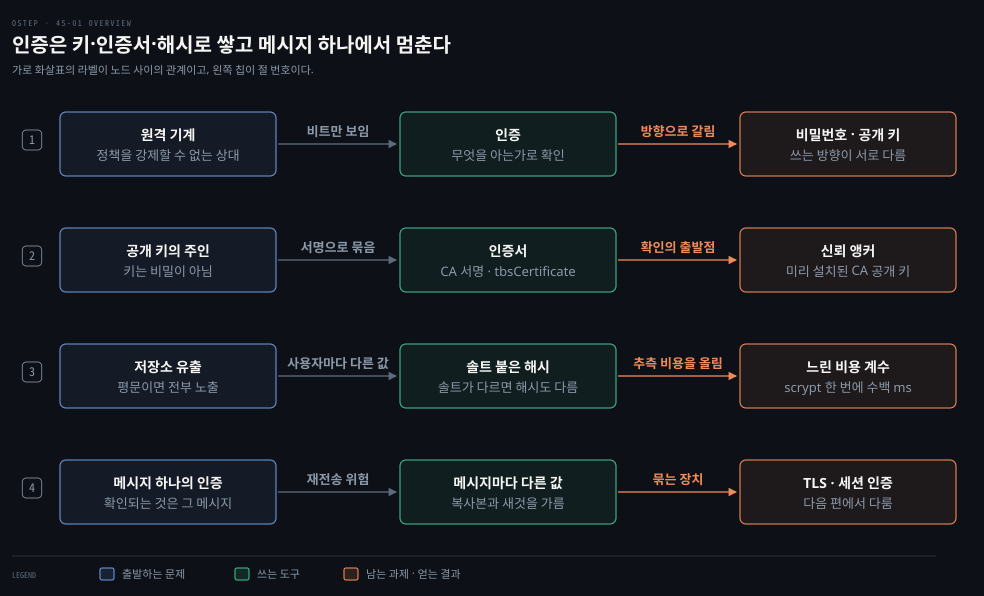
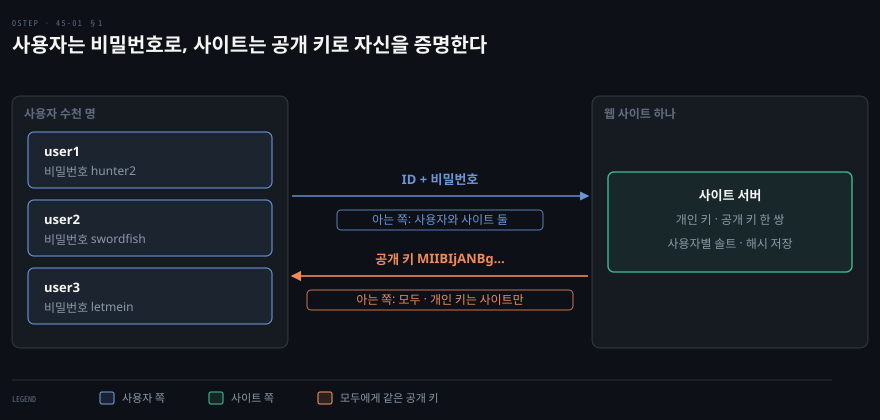
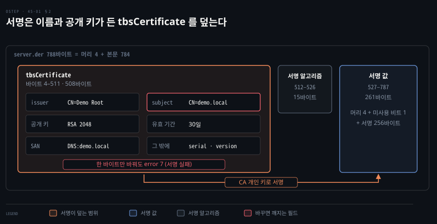
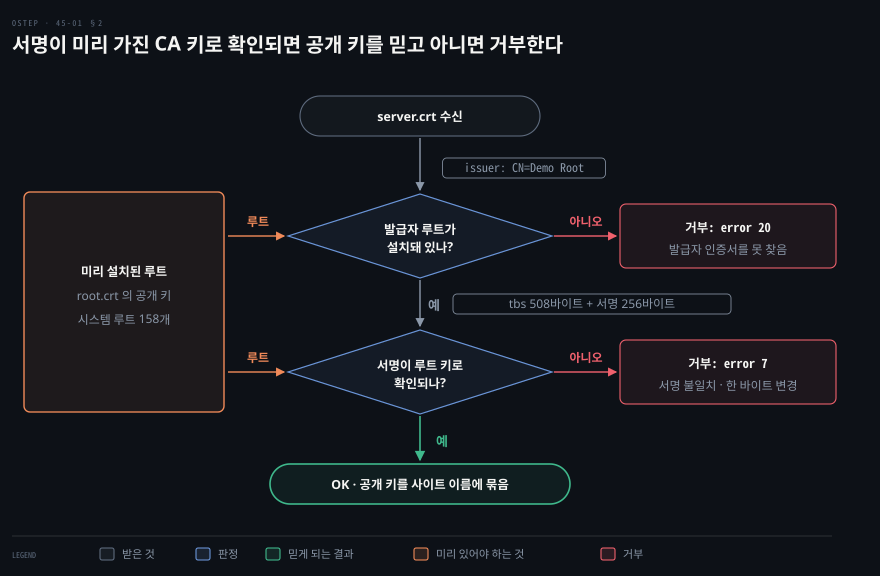
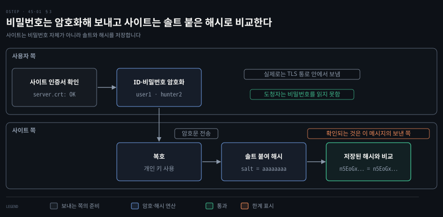
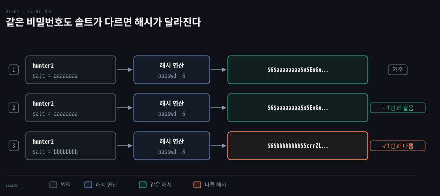
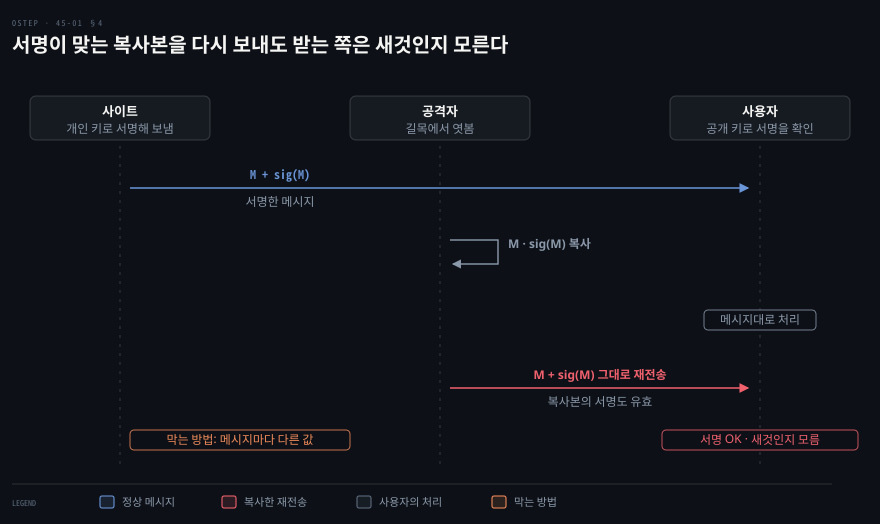

# 원격 기계는 무엇으로 믿는가 — 인증서의 서명과 비밀번호 해시

---

> 네트워크 너머의 기계는 비트로만 보입니다. 이 편은 그 비트의 주인을 비밀번호와 인증서의 서명으로 확인하는 방법과, 그 확인이 어디서 멈추는지를 다룹니다.

## 핵심 요약

> 운영체제는 자기 기계의 밖을 통제하지 못하므로, 분산 시스템에서는 상대가 누구인지를 비밀번호나 개인 키로 확인하고 믿을 범위를 그 확인이 닿는 곳까지만 잡습니다.

공개 키는 비밀이 아니어서 누구의 키인지가 문제가 됩니다. 인증서가 이름과 키를 인증 기관의 서명으로 묶어 줍니다. 그 서명은 미리 가진 인증 기관 공개 키로만 확인할 수 있으므로 신뢰는 소프트웨어에 들어 있던 키에서 출발합니다. 비밀번호는 암호화한 통로로 보내고 사이트는 솔트를 붙인 느린 해시만 저장합니다. 두 방법 모두 지금 받은 메시지 하나의 진위만 보여 주므로, 이후의 메시지를 묶는 장치가 따로 필요합니다.[^ver]


## 학습 목표

이 내용을 읽고 나면:

1. 원격 기계 보안의 두 가지 어려움을 짚고 인증이 풀어 주는 것과 풀어 주지 못하는 것을 나눌 수 있습니다.
2. 비밀번호와 공개 키가 각각 어느 쪽 인증에 맞는지 이유와 함께 설명할 수 있습니다.
3. 인증서의 서명을 확인하는 순서와, 신뢰의 출발점이 미리 설치된 키여야 하는 이유를 설명할 수 있습니다.
4. 인증서 확인이 통과해도 알 수 없는 것을 두 가지 짚을 수 있습니다.
5. 사이트가 비밀번호를 솔트 붙은 느린 해시로 저장하는 이유를 실험 수치로 설명할 수 있습니다.

아래 개념도는 이 편의 네 절을 한 행씩 보여 줍니다. 각 행은 풀어야 할 문제에서 출발해 쓰는 도구를 거쳐 남는 과제나 얻는 결과로 이어집니다. 화살표 라벨이 노드 사이의 관계입니다.

첫 행은 비트만 보이는 원격 기계의 인증이 비밀번호와 공개 키로 갈리는 흐름입니다. 둘째 행은 공개 키의 주인을 서명으로 묶은 인증서가 신뢰 앵커에서 출발하는 흐름입니다. 셋째 행은 저장소가 새도 비밀번호가 풀리지 않도록 솔트와 느린 비용 계수를 쓰는 흐름입니다. 넷째 행은 메시지 하나의 인증이 재전송 위험을 남기고 메시지마다 다른 값이 복사본과 새것을 가르는 흐름입니다. 그 뒤에 TLS 와 세션 인증이 처음의 인증을 이후 메시지에 묶습니다.




## 1. 비트만 보이는 원격 기계와 인증

> 원격 기계의 정책과 네트워크는 통제할 수 없습니다. 그래서 상대가 누구인지만 확인하고 믿는 범위를 그 확인이 닿는 곳까지로 잡습니다.

### 믿을 수 없는 상대와 열린 네트워크

운영체제는 자기 기계의 자원만 통제합니다. 원격 기계에는 정책을 강제할 수 없으므로 어려움이 두 가지 남습니다.

첫째는 상대 기계가 우리가 원하는 보안 정책을 지키지 않을 수 있다는 점입니다. 믿는 상대를 사칭한 공격자일 수도 있습니다. 둘째는 기계들이 주고받는 네트워크를 누구도 완전히 통제하지 못한다는 점입니다. 공격자도 같은 네트워크에 접근하므로 메시지를 위조하거나 복사할 수 있습니다. 다시 보내거나 바꾸거나 없애거나 늦추는 것도 가능합니다.

상대가 정책을 지키는지는 대개 확인할 방법이 없습니다. 상대가 디스크를 통째로 암호화했는지는 밖에서 알 수 없습니다. 다 쓴 암호 키를 정말 지웠는지도, 로컬 파일의 접근 권한을 제대로 걸었는지도 마찬가지입니다. 상대가 그렇다고 말해도 확인할 길이 없습니다.

집 열쇠를 맡기거나 차를 빌려줄 때도 같습니다. 어긋나지 않으리라고 믿되, 어긋난 것을 알아차리면 자물쇠를 바꾸거나 도난 신고를 합니다. 분산 시스템도 일부 상대를 믿기로 하고 어긋남을 알아차리면 그 상대에 대한 믿음을 조정합니다.

네트워크 위에서는 오가는 비트만 보입니다. 그래서 내가 보낸 비트를 상대가 나에게서 온 것으로 확인할 수 있어야 합니다. 받은 비트도 상대가 만든 것으로 확인할 수 있어야 합니다. 이 일을 하는 것이 **인증**입니다.

### 비밀번호와 공개 키가 맞는 방향

네트워크 너머의 인증은 대개 무엇을 아는가에 기댑니다. 원격 기계만 알 만한 것으로는 비밀번호와 개인 키가 있습니다. 확인하는 쪽도 무언가를 알고 있어야 합니다. 비밀번호라면 비밀번호 자체이거나 비밀번호와 솔트로 만든 해시이고, 공개 키라면 상대의 공개 키입니다.

비밀번호가 증명하는 것은 누군가가 그 비밀번호를 안다는 사실뿐입니다. 그 누군가가 정확히 누구인지를 알려면 비밀번호를 아는 쪽이 증명하는 쪽과 확인하는 쪽 둘뿐이어야 합니다. 공개 키는 많은 쪽이 알아도 됩니다. 짝이 되는 개인 키를 가진 한 쪽만 증명할 수 있습니다.

그래서 둘은 쓰임이 갈립니다. 비밀번호는 많은 사람이 한 사이트에 자신을 증명할 때 맞습니다. 공개 키는 한 쪽이 많은 상대에게 자신을 증명할 때 맞습니다.

웹 사이트가 사용자에게 자신을 증명할 때는 공개 키 하나를 모든 사용자에게 나눠 주면 됩니다. 사용자가 사이트에 자신을 증명할 때는 사용자마다 다른 정보가 필요합니다. 그래서 사람이 쓰기 쉬운 비밀번호를 씁니다. 공개 키를 만들어 나눠 주는 일은 어렵고 비밀번호를 정하는 일은 비교적 쉽다는 점도 이 분업을 뒷받침합니다.



### 인증이 풀지 못하는 문제

네트워크 구간을 완벽하게 지켜도 반대편 기계가 침해되어 있으면 그 기계가 보낸 공격은 인증되고 암호화된 채로 도착합니다. 인증은 보낸 쪽이 누구인지를 알려 줄 뿐, 그 쪽이 안전한지를 알려 주지 않기 때문입니다. 이 편은 네트워크 구간을 지키는 데까지만 다룹니다.


## 2. 공개 키를 이름에 묶는 인증서

> 공개 키는 비밀이 아니므로 어떤 키가 누구의 것인지를 따로 확인해야 합니다. 신뢰하는 제3자의 서명이 이름과 키를 묶고 그 서명은 미리 가진 키로만 확인할 수 있습니다.

### 서명으로 묶은 비트 묶음

만나서 키를 받을 수 있으면 가장 확실합니다. 하지만 사이트와 서비스는 대부분 얼굴을 볼 수 없는 상대입니다. 그래서 키 자체가 누구나 가져도 되는 비트 묶음이라는 점을 이용합니다.

모두가 신뢰하는 제3자가 그 비트 묶음이 특정 상대의 것이라고 자기 개인 키로 서명해 주면 됩니다. 서명을 확인할 수 있는 사람은 그 제3자를 믿는 만큼 그 키를 믿을 수 있습니다.

서명된 이 비트 묶음이 **인증서**입니다. 키를 가진 쪽의 정보와 공개 키와 만료일 같은 값이 들어 있습니다. 서명한 제3자의 신원과 서명 값도 붙습니다. 서명하는 제3자를 인증 기관(CA, Certificate Authority)이라 부릅니다. 가장 널리 쓰이는 인증서 표준은 X.509 입니다.

### 서명이 덮는 범위

서명은 인증서 전체가 아니라 본문인 `tbsCertificate` 에 대해 계산합니다. 이 본문을 DER(Distinguished Encoding Rules, 구조를 바이트로 바꾸는 한 가지 규칙)로 인코딩한 바이트가 서명 함수의 입력입니다.[^sig]

직접 만든 인증서로 보면 모양이 잡힙니다. 아래 인증서는 RSA 2048 키와 SHA-256 으로 서명한 788바이트 파일입니다.[^lab] 바깥 머리 4바이트 뒤에 `tbsCertificate` 508바이트가 옵니다. 서명 알고리즘 15바이트와 서명 값 261바이트가 그 뒤에 붙습니다.

서명 값 261바이트는 BIT STRING 머리 4바이트, DER 이 붙이는 미사용 비트 표시 1바이트, 실제 서명 256바이트로 이뤄집니다. 발급자 이름과 서버 이름과 공개 키가 모두 `tbsCertificate` 안에 있습니다. 그래서 서버 이름 한 글자만 바꿔도 서명 확인이 실패합니다.



### 서명 확인 순서와 루트 키

받는 쪽은 사이트에서 인증서를 받아 두 가지를 차례로 묻습니다. 서명한 기관을 따라 올라간 끝의 루트 인증서가 설치돼 있는지, 그 루트의 공개 키로 서명이 확인되는지입니다. 이 실험의 인증서는 루트가 직접 서명했으므로 판정이 이 두 가지로 끝납니다. 실제 검증은 유효 기간이 지금을 포함하는지와 폐기되지 않았는지도 함께 보고, 중간 인증 기관이 끼면 같은 확인을 루트까지 되풀이합니다.[^path]



실험에서는 루트가 없으면 오류 20, 한 바이트를 바꾸면 오류 7 이 나왔습니다.[^vfy] 두 번째 판정이 왜 한 바이트에도 실패하는지는 앞의 구조도가 설명합니다.

이 방식에는 좋은 성질이 세 가지 있습니다. 첫째로 확인할 때 인증 기관도 사이트도 대화에 끼지 않아도 되어, 인증서를 어디서 받아도 같은 수준의 보증을 얻습니다. 둘째로 확인은 사용자마다 한 번이면 됩니다. 키를 저장해 두고 쓰면 되기 때문입니다. 셋째로 확인이 끝나기 전에는 사이트를 믿지 않은 채 조심해서 진행할 수 있습니다.

여기서 닭과 달걀의 문제가 생깁니다. 사이트 키는 인증서로 알고 인증서의 서명은 인증 기관 공개 키로 확인합니다. 남는 문제는 인증 기관의 공개 키를 어디서 얻느냐입니다. 어디선가는 믿을 만한 누군가의 공개 키를 손에 넣고 시작해야 합니다.

그 출발점은 대개 설치한 소프트웨어에 들어 있습니다. 브라우저가 가장 흔한 예입니다. 실험한 macOS 의 시스템 루트 목록에는 인증서가 158개 들어 있었습니다. 어느 기관을 신뢰의 출발점으로 삼을지는 정책의 문제입니다. 상위 인증 기관일 수도 있고 확인하는 쪽 자신의 인증서를 발급한 기관일 수도 있습니다.[^anchor]

### 직접 만든 CA 와 인증서 없는 배포

인증서를 만들 수 있는 쪽이 공인 인증 기관뿐인 것은 아닙니다. 인증받는 쪽과 확인하는 쪽이 모두 인증서를 만든 쪽을 신뢰하기만 하면 누가 만든 인증서든 쓸 수 있습니다.

직접 분산 시스템을 만든다면 모두가 믿는 기계 한 대를 인증서 발급용으로 둡니다. 그 기계의 공개 키를 필요한 곳마다 직접 설치하면 닭과 달걀이 끊어집니다.

기계 수가 고정되어 있고 공개 키를 손으로 나눠 줄 수 있다면 인증서 없이 공개 키만 배포해도 됩니다. 인증서의 목적이 공개 키를 나르는 데 있으므로 키가 이미 있어야 할 곳에 있으면 인증서는 필요하지 않습니다.

### 통과해도 모르는 것

인증서가 보증하는 범위는 좁습니다. 확인이 통과하면 알게 되는 것은 이 공개 키가 그 이름의 키라는 사실입니다. 인증서를 보낸 쪽이 그 개인 키를 가졌다는 증거는 아닙니다. 인증서는 공개된 비트라서 누구나 복사해 보낼 수 있기 때문입니다. 지금 받은 메시지가 새것인지도 이 확인으로는 알 수 없습니다. 복사한 메시지를 다시 보내는 문제는 4절에서 다룹니다.

앞의 실험에서도 `openssl verify` 에 들어간 것은 루트 인증서와 서버 인증서뿐이었고 서버의 개인 키는 한 번도 들어가지 않았습니다. 상대가 정말 그 개인 키를 가졌는지를 어떻게 확인하는지는 패킷 분석 노트의 「[인증서를 받았는데 상대가 진짜인지 아직 모르는 이유](../paw_packet-analysis-wireshark/04-02.%EC%9D%B8%EC%A6%9D%EC%84%9C%EC%99%80%20%EB%91%90%20%EC%84%9C%EB%AA%85.md)」가 따로 풉니다.

공개 키 암호는 비싸므로 가능한 한 빨리 대칭 키 암호로 옮겨 가야 합니다. 그 방법은 다음 편의 TLS(Transport Layer Security)에서 다룹니다.


## 3. 암호화한 통로와 솔트 붙은 해시

> 비밀번호는 평문으로 실리면 누구나 가로챕니다. 그래서 암호화한 통로로만 보내고 사이트는 비밀번호 자체가 아니라 솔트를 붙인 느린 해시를 저장해 비교합니다.

### 평문 비밀번호는 암호화한 통로로

비밀번호 인증은 두 당사자만 그 비밀번호를 다루는 경우에 잘 맞습니다. 많은 사용자를 가진 사이트에 개인이 로그인할 때가 그렇습니다. 반대로 사이트가 사용자 한 명에게 자신을 증명할 때는 비밀번호가 맞지 않습니다. 그 방향은 공개 키 인증이 낫습니다.

사용자는 사용자 ID(식별자)와 비밀번호를 사이트에 보내야 합니다. 그런데 네트워크가 비밀을 지켜 준다는 보장은 없습니다. 비밀번호가 새면 공격자가 그 사용자를 사칭할 수 있습니다. 그래서 적어도 비밀번호는 암호화해서 보내야 하고 가능하면 오가는 모든 것을 암호화하는 편이 낫습니다.

그렇다면 어떤 키로 암호화하느냐가 남습니다. 사이트가 앞 절처럼 공개 키로 자신을 증명했다면 사용자는 그 공개 키로 ID 와 비밀번호를 암호화할 수 있습니다. 짝이 되는 개인 키를 가진 사이트만 읽을 수 있습니다.

실제로는 이것만으로 끝내지 않습니다. 사이트의 개인 키로 비밀번호를 지킬 암호 설정을 따로 만듭니다. 재전송 같은 문제도 그 과정에서 다룹니다. 자세한 순서는 다음 편에서 봅니다.



### 솔트가 같은 비밀번호를 다른 해시로

사이트가 받은 비밀번호를 확인하는 방법은 저장 방식에서 갈립니다. 비밀번호를 그대로 저장하면 저장소가 새는 순간 모든 비밀번호가 샙니다. 그래서 해시를 저장합니다.

그냥 해시만 저장하면 같은 비밀번호가 같은 해시가 되어 미리 계산한 표로 한꺼번에 풀립니다. 그래서 **솔트**를 붙입니다. 솔트는 사용자마다 다르게 정하는 값입니다. 같은 비밀번호라도 솔트가 다르면 해시가 달라집니다. 해시 자체의 성질은 [앞 편](./44-01.OS%20%EA%B0%80%20%ED%86%B5%EC%A0%9C%ED%95%98%EC%A7%80%20%EB%AA%BB%ED%95%98%EB%8A%94%20%EB%8D%B0%EC%9D%B4%ED%84%B0%EB%8A%94%20%EB%AC%B4%EC%97%87%EC%9C%BC%EB%A1%9C%20%EC%A7%80%ED%82%A4%EB%8A%94%EA%B0%80%20%E2%80%94%20%EB%8C%80%EC%B9%AD%20%EC%95%94%ED%98%B8%C2%B7%EA%B3%B5%EA%B0%9C%20%ED%82%A4%20%EC%95%94%ED%98%B8%C2%B7%EC%95%94%ED%98%B8%20%ED%95%B4%EC%8B%9C.md)이 다룹니다.



### 일부러 느린 해시

NIST(National Institute of Standards and Technology, 미국 국립표준기술연구소)는 솔트 붙은 해시로 저장하라고 적습니다. 이 해시 방식은 비밀번호와 솔트와 비용 계수를 입력으로 받습니다. 목적은 추측 한 번을 공격자에게 비싸게 만드는 것입니다.

솔트는 32비트 이상이어야 하고 저장된 계정들 사이에서 솔트 값끼리 겹치는 일이 최소가 되도록 골라야 합니다.[^nist]

보안 커뮤니티 OWASP 는 Argon2id 를 최소 19 MiB(메비바이트) 메모리와 반복 2회와 병렬도 1로 쓰라고 권합니다. 쓸 수 없으면 scrypt 를 쓰라고 합니다.[^owasp]

그래서 비밀번호 해시는 일부러 느립니다. 같은 기계에서 SHA-256(Secure Hash Algorithm, 256비트 해시)과 scrypt 를 한 번씩 계산하는 시간을 네 번 쟀습니다. 범위는 아래와 같습니다.[^lab]

| 해시 | 한 번 계산하는 시간 | 비용 계수 |
|------|------|------|
| SHA-256 | 0.36~0.43 마이크로초 | 없음 |
| scrypt | 284~292 밀리초 | N=2^17, r=8, p=1 |

정상 사용자가 로그인할 때 한 번 치르는 300 밀리초 안팎은 눈에 띄지 않습니다. 훔쳐 간 해시 파일을 대입으로 푸는 공격자에게는 추측마다 그만큼이 곱해집니다.


## 4. 메시지 하나에서 멈추는 인증

> 비밀번호나 서명이 맞다는 확인은 지금 받은 메시지 하나의 진위만 보여 줍니다. 이후의 메시지는 복사해서든 새로 만들어서든 누구나 보낼 수 있습니다.

### 복사해 다시 보내는 재전송 공격

사이트가 개인 키로 서명해 보낸 메시지는 사용자가 짝이 되는 공개 키로 서명을 확인할 수 있습니다. 그래도 공격자가 지난번 메시지를 복사해 두었다가 나중에 다시 보낼 수 있습니다. 이것이 재전송 공격입니다.

복사본의 서명도 원본과 같으므로 받는 쪽의 서명 확인은 통과합니다. 서명 확인은 서명이 맞는지만 보고 이 메시지가 새것인지는 보지 않기 때문입니다. 막으려면 메시지마다 다른 정보를 넣어야 합니다. 표준 암호 프로토콜에는 이 장치가 이미 들어 있습니다.



매번 새로 만든 값으로 상대가 살아 있음을 증명하게 하는 방법은 네트워킹 노트의 「[살아 있다는 것을 어떻게 증명합니까](../cntd_computer-networking-top-down/08-03.%EC%82%B4%EC%95%84%20%EC%9E%88%EB%8A%94%20%EC%83%81%EB%8C%80%EB%A5%BC%20%ED%99%95%EC%9D%B8%ED%95%98%EA%B3%A0%20%EB%A9%94%EC%9D%BC%EA%B3%BC%20TCP%20%EC%97%90%20%EB%B6%99%EC%9E%85%EB%8B%88%EB%8B%A4.md)」가 정리합니다.

### 처음의 인증을 이후 메시지에 묶는 장치

비밀번호가 맞으면 사이트는 그 메시지를 보낸 쪽이 비밀번호를 안다는 사실을 알게 됩니다. 그쪽이 주장하는 사람이라는 확신도 비밀번호의 강도만큼만 생깁니다.

이후에 같은 쪽에서 왔다고 주장하는 메시지는 누구나 만들 수 있습니다. 그렇다고 매 메시지에 비밀번호를 실어 보낼 수는 없습니다. 비밀번호와 공개 키로 처음의 진위를 확인한 뒤 그것을 이후의 상호작용에 묶어 주는 다른 장치가 필요합니다. 그 장치가 [다음 편](./45-02.TLS%20%EB%8A%94%20%ED%82%A4%EB%A5%BC%20%EC%96%B4%EB%96%BB%EA%B2%8C%20%EC%95%88%EC%A0%84%ED%95%98%EA%B2%8C%20%EB%82%98%EB%88%84%EB%8A%94%EA%B0%80%20%E2%80%94%20%ED%95%B8%EB%93%9C%EC%85%B0%EC%9D%B4%ED%81%AC%C2%B7%EC%84%B8%EC%85%98%20%EC%9D%B8%EC%A6%9D%C2%B7HTTPS%C2%B7SSH.md)의 TLS 입니다.


## 결정 치트시트

> 이 편의 판단 기준은 아래 표와 같습니다.

| 상황 | 판단 | 근거 |
|------|------|------|
| 사이트가 사용자에게 자신을 증명할 때 | 공개 키 하나를 모두에게 나눠 줍니다 | 개인 키를 가진 사이트만 증명할 수 있습니다 |
| 사용자가 사이트에 자신을 증명할 때 | 사용자마다 다른 비밀번호를 씁니다 | 아는 쪽이 사용자와 사이트 둘뿐이어야 누구인지 알 수 있습니다 |
| 공개 키가 누구 것인지 확인할 때 | 신뢰하는 인증 기관이 서명한 인증서를 씁니다 | 서명이 이름과 키를 묶습니다 |
| 인증서 서명을 확인할 때 | 발급자를 따라 미리 설치된 루트까지 올라가며 `tbsCertificate` 의 서명을 봅니다 | 신뢰는 소프트웨어에 든 키에서 출발합니다 |
| 기계 수가 고정되고 키를 손으로 나눌 수 있을 때 | 인증서 없이 공개 키만 배포합니다 | 키가 이미 있을 곳에 있으면 인증서가 필요하지 않습니다 |
| 인증서 확인이 통과했을 때 | 상대가 개인 키를 가졌다고 믿지 않습니다 | 확인에 개인 키가 들어가지 않았습니다 |
| 비밀번호를 보낼 때 | 암호화한 통로로만 보냅니다 | 평문은 누구나 가로챕니다 |
| 비밀번호를 저장할 때 | 솔트를 붙인 느린 해시로 저장합니다 | 솔트가 같은 비밀번호를 다른 해시로 만들고 비용 계수가 추측을 비싸게 합니다 |
| 새로 비밀번호 해시를 고를 때 | Argon2id 를 쓰고 안 되면 scrypt 를 씁니다 | OWASP 최소 설정이 있습니다 |
| 첫 인증 뒤 메시지를 이어 갈 때 | 메시지마다 다른 값으로 묶는 장치를 씁니다 | 복사본의 서명도 유효해 재전송을 못 막습니다 |


## 면접 대비

> 이 편에서 물어볼 만한 정의와 핵심 포인트, 질문입니다.

### 한 줄 정의

- 인증: 받은 비트를 보낸 쪽이 만들었음을 확인하는 일입니다.
- 인증서: 이름과 공개 키를 인증 기관의 서명으로 묶은 비트 묶음입니다.
- 신뢰 앵커: 서명 확인이 출발하는, 미리 설치된 인증 기관 공개 키입니다.
- 솔트: 사용자마다 다르게 정해 비밀번호에 섞는 값입니다.

### 핵심 포인트 세 가지

1. 비밀번호는 사용자가 사이트에 증명할 때, 공개 키는 사이트가 사용자에게 증명할 때 맞습니다.
2. 인증서 서명은 `tbsCertificate` 를 덮으며, 그 확인은 미리 가진 인증 기관 공개 키에서 출발합니다.
3. 비밀번호는 암호화한 통로로 보내고 솔트 붙은 느린 해시로 저장합니다. 두 방법 모두 메시지 하나의 진위만 보여 줍니다.

### 자주 묻는 질문

- *인증서 확인이 통과하면 상대가 진짜입니까?* 아닙니다. 공개 키가 그 이름의 키라는 사실만 알게 되고, 보낸 쪽이 개인 키를 가졌는지는 이 확인에 들어 있지 않습니다.
- *인증서를 직접 만들어 써도 됩니까?* 됩니다. 확인하는 쪽이 만든 쪽을 신뢰하고 그 공개 키를 직접 설치하면 닭과 달걀이 끊어집니다.
- *비밀번호를 SHA-256 으로 해시해 저장하면 안 됩니까?* 안전하지 않습니다. 너무 빨라서 훔쳐 간 해시를 대입으로 푸는 비용이 낮으므로 비용 계수가 있는 Argon2id 나 scrypt 를 씁니다.
- *서명이 맞는 메시지는 믿어도 됩니까?* 새것인지는 모릅니다. 공격자가 복사해 다시 보낸 메시지도 서명이 맞으므로 메시지마다 다른 값이 필요합니다.


## 연습 문제

> 1~3번은 본문을 떠올려 답하는 문제이고 4~6번은 직접 돌려 확인하는 문제입니다. 답을 적은 뒤 정답 절과 맞춰 봅니다.

1. 운영체제가 원격 기계에서 통제하지 못하는 두 가지는 무엇입니까? 그 가운데 인증이 풀어 주는 것과 풀어 주지 못하는 것은 무엇입니까?
2. 웹 사이트가 사용자에게 자신을 증명할 때는 공개 키를 쓰고 사용자가 사이트에 자신을 증명할 때는 비밀번호를 쓰는 이유는 무엇입니까?
3. 비밀번호가 맞는 것으로 확인된 뒤에도 사이트가 알지 못하는 것은 무엇입니까? 그래서 무엇이 더 필요합니까?
4. 루트와 서버 인증서를 직접 만들어 확인해 보십시오. 루트가 없으면 무엇이 나옵니까? 한 바이트를 바꾸면 어떻게 됩니까? 서명은 어느 부분에 대한 것입니까?
5. 인증서 확인이 통과했을 때 알게 되는 것과 아직 모르는 것은 무엇입니까? 4번의 확인 명령과 재전송 공격을 다룬 절을 근거로 답하십시오.
6. 사이트가 비밀번호를 솔트를 붙인 느린 해시로 저장하는 이유는 무엇입니까? 같은 비밀번호에 솔트만 바꾸면 해시는 어떻게 됩니까?


## 정답 (자답 후 펼치기)

### 정답 1

통제하지 못하는 것은 상대 기계가 정책을 지키는지와 네트워크입니다. 상대 기계는 우리 정책을 지키지 않거나 믿는 상대를 사칭할 수 있습니다. 네트워크는 공격자가 메시지를 위조하고 복사하고 다시 보내고 바꾸고 없애고 늦출 수 있는 곳입니다.

인증이 풀어 주는 것은 받은 비트가 정말 그 상대에게서 온 것인지입니다. 풀지 못하는 것은 그 상대가 정책을 실제로 지키는지입니다. 상대가 디스크를 암호화했는지 키를 지웠는지는 밖에서 알 수 없습니다. 침해된 상대가 보내는 공격은 인증되고 암호화된 채로 도착합니다.

### 정답 2

비밀번호는 증명하는 쪽과 확인하는 쪽 둘만 알아야 누가 증명하는지를 정확히 알 수 있습니다. 사이트에 가입한 사용자가 수없이 많은 경우에 맞는 이유입니다. 사이트가 모든 사용자에게 같은 비밀번호를 나눠 주면 사용자 누구나 다른 사용자인 척할 수 있습니다.

공개 키는 많은 사용자가 알아도 개인 키를 가진 사이트만 증명할 수 있습니다. 공개 키 하나를 모든 사용자에게 나눠 주면 사이트를 모두가 확인합니다. 사용자마다 키를 만들어 나눠 주는 일은 어렵고 비밀번호를 정하는 일은 쉽다는 사정도 이 분업을 뒷받침합니다.

### 정답 3

알지 못하는 것은 그다음 메시지가 같은 쪽에서 왔는지입니다. 비밀번호가 맞다는 확인은 비밀번호를 보낸 그 메시지 하나가 진짜라는 뜻입니다. 이후에 오는 메시지는 누구나 만들어 보낼 수 있습니다.

매 메시지에 비밀번호를 싣고 싶지도 않고 비싼 공개 키 암호로 매 메시지를 암호화하고 싶지도 않습니다. 그래서 처음의 인증을 이후의 상호작용에 묶어 줄 다른 장치가 더 필요합니다. 다음 편이 그 장치인 TLS 와 쿠키 같은 세션 인증을 다룹니다.

### 정답 4

루트 인증서가 서버 인증서에 서명하게 하고 `openssl verify` 로 그 서명을 확인합니다. 루트 인증서를 주면 `OK` 가 나옵니다. 주지 않으면 서명한 쪽을 찾지 못해 오류 20 이 나옵니다. 인증서를 DER 로 바꿔 서버 이름 한 글자를 바꾸면 오류 7(서명 실패)이 나옵니다.[^lab]

```bash
openssl req -x509 -newkey rsa:2048 -nodes -keyout root.key -out root.crt -subj "/CN=Demo Root" -days 30
openssl req -newkey rsa:2048 -nodes -keyout server.key -out server.csr -subj "/CN=demo.local"
printf 'subjectAltName=DNS:demo.local\n' > san.cnf
openssl x509 -req -in server.csr -CA root.crt -CAkey root.key -CAcreateserial -out server.crt -days 30 -extfile san.cnf
openssl verify -CAfile root.crt server.crt
# server.crt: OK
openssl verify server.crt
# CN=demo.local
# error 20 at 0 depth lookup: unable to get local issuer certificate
# error server.crt: verification failed
```

```bash
openssl x509 -in server.crt -outform DER -out server.der
python3 -c 'b=open("server.der","rb").read(); open("forged.der","wb").write(b.replace(b"demo.local",b"demo.locam",1))'
openssl x509 -inform DER -in forged.der -out forged.crt
openssl verify -CAfile root.crt forged.crt
# CN=demo.locam
# error 7 at 0 depth lookup: certificate signature failure
# error forged.crt: verification failed
```

서명이 무엇에 대한 것인지는 직접 꺼내 확인할 수 있습니다. 인증서의 첫 자식인 `tbsCertificate` 와 마지막 자식인 서명 값을 떼어 내, 루트의 공개 키로 서명을 확인합니다. 시작 위치 4 는 바깥 구조의 머리 4바이트 바로 뒤입니다.

```bash
SIG=$(openssl asn1parse -inform DER -in server.der | awk -F: '$2 ~ /d=1/ && /BIT STRING/{print $1+0}')
openssl asn1parse -inform DER -in server.der -strparse 4 -noout -out tbs.der
openssl asn1parse -inform DER -in server.der -strparse $SIG -noout -out sig.bin
openssl x509 -in root.crt -pubkey -noout > root.pub
openssl dgst -sha256 -verify root.pub -signature sig.bin tbs.der
# Verified OK
```

서명은 인증서 전체가 아니라 `tbsCertificate` 에 대한 것이고, 서명 값 자신은 그 바깥에 붙습니다. 이 실행에서 `tbs.der` 는 508바이트, `sig.bin` 은 256바이트였습니다.[^sig]

### 정답 5

알게 되는 것은 이 공개 키가 그 이름의 키라는 사실입니다. 4번에서 `openssl verify` 에 넣은 것은 `root.crt` 와 `server.crt` 뿐이고 `server.key` 는 한 번도 들어가지 않았습니다. 확인이 개인 키 없이 끝났다는 뜻입니다. 그래서 인증서를 보낸 쪽이 그 개인 키를 가졌는지는 이 확인으로 알 수 없습니다. 인증서는 공개된 비트여서 누구나 복사해 보낼 수 있기 때문입니다.

인증서 확인을 넘어 그 뒤 통신에서 모르는 것은 지금 받은 메시지가 새것인지입니다. 이것은 4번 명령이 아니라 재전송 공격에서 나옵니다. 개인 키로 서명한 과거 메시지를 공격자가 복사해 두었다가 다시 보낼 수 있습니다. 그래서 메시지마다 다른 정보를 넣는 표준 프로토콜이 필요합니다.

### 정답 6

비밀번호를 그대로 저장하면 저장소가 새는 순간 모두 새고, 솔트 없는 해시는 같은 비밀번호가 같은 해시가 되어 한꺼번에 풀립니다. 솔트를 붙이면 같은 비밀번호도 솔트마다 해시가 달라집니다. 같은 솔트로는 같은 해시가, 다른 솔트로는 다른 해시가 나왔습니다.[^lab]

```bash
openssl passwd -6 -salt aaaaaaaa hunter2
# $6$aaaaaaaa$n5EoGxOUiOpqF.NaoAr7vijY0cdUp7kCsOEW4XjuJ1NOfOte9MuYHzrEUkCfPs1xm9eiWcvSQevkZoGO.VhFZ1
openssl passwd -6 -salt aaaaaaaa hunter2
# $6$aaaaaaaa$n5EoGxOUiOpqF.NaoAr7vijY0cdUp7kCsOEW4XjuJ1NOfOte9MuYHzrEUkCfPs1xm9eiWcvSQevkZoGO.VhFZ1
openssl passwd -6 -salt bbbbbbbb hunter2
# $6$bbbbbbbb$5crrZLm9nFVREgN2nAVy649lIT4uUhwgG8kJI2STZ5cDEZOasNNKoq/.CuPEk657EQRmvUqU/9VipN3/uqXnZ/
```

`openssl passwd -6` 는 솔트의 효과를 보이려고 쓴 것이고 권장하는 방식이 아닙니다. 권장 방식은 비용 계수가 있는 Argon2id 나 scrypt 입니다. 해시가 느려야 하는 이유는 추측 한 번의 값을 올리기 위해서입니다.

아래 코드를 돌린 마지막 실행에서 한 번 계산하는 시간은 SHA-256 이 0.36 마이크로초이고 scrypt(N=2^17, r=8, p=1)는 292 밀리초였습니다. 약 80만 배 차이입니다.

```bash
python3 - <<'EOF'
import hashlib, time
t=time.perf_counter(); hashlib.scrypt(b"hunter2", salt=b"saltsalt", n=2**17, r=8, p=1, maxmem=2**28); a=time.perf_counter()-t
N=200000; t=time.perf_counter()
for _ in range(N): hashlib.sha256(b"hunter2").digest()
b=(time.perf_counter()-t)/N
print(f"scrypt {a*1000:.0f} ms / sha256 {b*1e6:.2f} us")
EOF
# scrypt 292 ms / sha256 0.36 us
```


## 참고 자료

- 《Operating Systems: Three Easy Pieces》(Remzi H. Arpaci-Dusseau · Andrea C. Arpaci-Dusseau, Arpaci-Dusseau Books) 57장
- [57장 PDF](https://pages.cs.wisc.edu/~remzi/OSTEP/security-distributed.pdf)
- [RFC 5280](https://www.rfc-editor.org/rfc/rfc5280)
- [NIST SP 800-63B-4](https://pages.nist.gov/800-63-4/sp800-63b.html)
- [OWASP Password Storage Cheat Sheet](https://cheatsheetseries.owasp.org/cheatsheets/Password_Storage_Cheat_Sheet.html)
- [OpenSSL x509_vfy.h.in (openssl-3.6.0)](https://github.com/openssl/openssl/blob/openssl-3.6.0/include/openssl/x509_vfy.h.in)


## 관련 문서

- [OSTEP 정독 노트 인덱스](./README.md)
- [암호 해시와 솔트의 기초를 다루는 앞 편](./44-01.OS%20%EA%B0%80%20%ED%86%B5%EC%A0%9C%ED%95%98%EC%A7%80%20%EB%AA%BB%ED%95%98%EB%8A%94%20%EB%8D%B0%EC%9D%B4%ED%84%B0%EB%8A%94%20%EB%AC%B4%EC%97%87%EC%9C%BC%EB%A1%9C%20%EC%A7%80%ED%82%A4%EB%8A%94%EA%B0%80%20%E2%80%94%20%EB%8C%80%EC%B9%AD%20%EC%95%94%ED%98%B8%C2%B7%EA%B3%B5%EA%B0%9C%20%ED%82%A4%20%EC%95%94%ED%98%B8%C2%B7%EC%95%94%ED%98%B8%20%ED%95%B4%EC%8B%9C.md)
- [TLS 와 세션 인증을 다루는 짝 편](./45-02.TLS%20%EB%8A%94%20%ED%82%A4%EB%A5%BC%20%EC%96%B4%EB%96%BB%EA%B2%8C%20%EC%95%88%EC%A0%84%ED%95%98%EA%B2%8C%20%EB%82%98%EB%88%84%EB%8A%94%EA%B0%80%20%E2%80%94%20%ED%95%B8%EB%93%9C%EC%85%B0%EC%9D%B4%ED%81%AC%C2%B7%EC%84%B8%EC%85%98%20%EC%9D%B8%EC%A6%9D%C2%B7HTTPS%C2%B7SSH.md)
- [패킷 분석 책의 인증서와 두 서명 편](../paw_packet-analysis-wireshark/04-02.%EC%9D%B8%EC%A6%9D%EC%84%9C%EC%99%80%20%EB%91%90%20%EC%84%9C%EB%AA%85.md)
- [네트워킹 책의 살아 있는 상대 확인 편](../cntd_computer-networking-top-down/08-03.%EC%82%B4%EC%95%84%20%EC%9E%88%EB%8A%94%20%EC%83%81%EB%8C%80%EB%A5%BC%20%ED%99%95%EC%9D%B8%ED%95%98%EA%B3%A0%20%EB%A9%94%EC%9D%BC%EA%B3%BC%20TCP%20%EC%97%90%20%EB%B6%99%EC%9E%85%EB%8B%88%EB%8B%A4.md)
- [시스템 설계 책의 API 인증과 솔트 해시 편](../../../03_architecture/book/bytebytego-system-design/03-02.API%20%EB%8A%94%20SOAP%C2%B7REST%C2%B7GraphQL%C2%B7RPC%20%EB%A1%9C%20%EA%B0%88%EB%A6%AC%EA%B3%A0%20%ED%86%A0%ED%81%B0%C2%B7HMAC%C2%B7SSO%C2%B7%EC%86%94%ED%8A%B8%20%ED%95%B4%EC%8B%9C%EA%B0%80%20%EC%A0%91%EA%B7%BC%EA%B3%BC%20%EB%B9%84%EB%B0%80%EB%B2%88%ED%98%B8%EB%A5%BC%20%EC%A7%80%ED%82%A8%EB%8B%A4.md)

[^ver]: 확인한 현재 값은 다음과 같습니다. 인증서 형식은 RFC 5280(2008년 5월, Proposed Standard)입니다. 폐기되지 않았고 RFC 6818, 8398, 8399, 9549, 9598, 9608, 9618, 9925, 10007 아홉 건이 갱신합니다. 비밀번호 저장은 NIST SP 800-63B-4 §3.1.1.2 와 OWASP Password Storage Cheat Sheet 로 확인했고, 두 문서의 구절은 아래 각주에 인용했습니다. 모두 2026-11-08 에 `rtk proxy curl -sL` 로 받은 원문입니다.
[^sig]: RFC 5280 §4.1.1.3 은 "The signatureValue field contains a digital signature computed upon the ASN.1 DER encoded tbsCertificate."라고 적고 "The ASN.1 DER encoded tbsCertificate is used as the input to the signature function."이라고 덧붙입니다. https://www.rfc-editor.org/rfc/rfc5280 (2026-11-08 조회)
[^path]: RFC 5280 §6.1.3 은 인증서마다 "The signature on the certificate can be verified using working_public_key_algorithm, the working_public_key, and the working_public_key_parameters."와 "The certificate validity period includes the current time."와 "At the current time, the certificate is not revoked."를 모두 요구합니다. 경로의 모든 인증서에 이 처리를 적용합니다. https://www.rfc-editor.org/rfc/rfc5280 (2026-11-08 조회)
[^anchor]: RFC 5280 §6 은 "The selection of a trust anchor is a matter of policy: it could be the top CA in a hierarchical PKI, the CA that issued the verifier's own certificate(s), or any other CA in a network PKI."라고 적습니다. https://www.rfc-editor.org/rfc/rfc5280 (2026-11-08 조회)
[^vfy]: 오류 번호는 OpenSSL 소스 태그 `openssl-3.6.0` 의 `include/openssl/x509_vfy.h.in` 에서 확인했습니다. 20 은 `X509_V_ERR_UNABLE_TO_GET_ISSUER_CERT_LOCALLY`(발급자 인증서를 찾지 못함)이고 7 은 `X509_V_ERR_CERT_SIGNATURE_FAILURE`(서명 불일치)입니다. https://github.com/openssl/openssl/blob/openssl-3.6.0/include/openssl/x509_vfy.h.in (2026-11-08 조회)
[^lab]: 실험은 2026-11-08 에 macOS(Darwin 25.6.0)에서 OpenSSL 3.6.4 와 Python 3.14.4 로 저장소 밖 임시 폴더에서 했습니다. macOS 기본 `/usr/bin/openssl` 은 LibreSSL 3.3.6 이라 정답 6 의 `passwd -6` 옵션이 없으므로, Homebrew 의 OpenSSL 3.x(`/opt/homebrew/bin/openssl`)로 실행합니다. 정답 4 는 LibreSSL 에서도 오류 번호가 같고 주체 줄과 마지막 줄의 모양이 조금 다릅니다. 위조본은 두 도구 모두 stderr 에 rsa 오류 줄이 더 찍히는데 블록에서는 뺐습니다. 키는 모두 그 자리에서 만든 일회용이고 노트에는 키 내용을 싣지 않았습니다. 인증서 바이트 수(788·508·256)는 RSA 2048 과 SHA-256 서명으로 만든 이 실행의 값이라 설정이 다르면 달라집니다. 시간은 네 번 잰 범위이며 scrypt 는 284~292 밀리초, SHA-256 은 0.36~0.43 마이크로초였고 두 값의 비율은 66만~82만 배였습니다. 기계와 부하에 따라 달라집니다. SHA-256 과 scrypt 는 알고리즘이 달라서 이 비교는 "느리게 만든 해시가 얼마나 비싼가"의 어림일 뿐이고, 같은 알고리즘의 비용 계수를 바꾼 비교가 아닙니다. 시스템 루트 목록 개수는 `security find-certificate -a /System/Library/Keychains/SystemRootCertificates.keychain | grep -c '"alis"'` 가 158 을 돌려준 값입니다. 재전송 도식의 M 과 sig(M) 은 기호이고 측정값이 아닙니다.
[^nist]: NIST SP 800-63B-4 §3.1.1.2 는 "Passwords SHALL be salted and hashed using a suitable password hashing scheme. Password hashing schemes take a password, a salt, and a cost factor as inputs and generate a password hash."라고 적고, "The salt SHALL be at least 32 bits in length and chosen to minimize salt value collisions among stored hashes"라고 적습니다. https://pages.nist.gov/800-63-4/sp800-63b.html (2026-11-08 조회)
[^owasp]: OWASP 는 "Use Argon2id with a minimum configuration of 19 MiB of memory, an iteration count of 2, and 1 degree of parallelism. If Argon2id is not available, use scrypt with a minimum CPU/memory cost parameter of (2^17), a minimum block size of 8 (1024 bytes), and a parallelization parameter of 1."이라고 요약합니다. https://cheatsheetseries.owasp.org/cheatsheets/Password_Storage_Cheat_Sheet.html (2026-11-08 조회)
