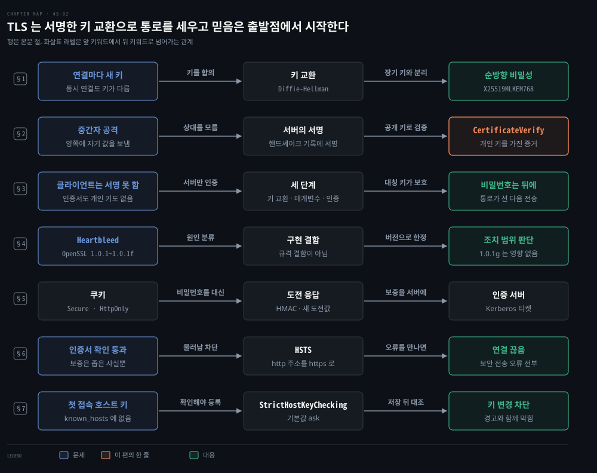
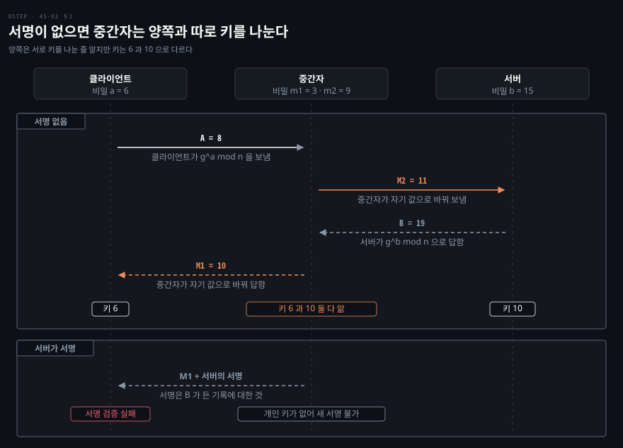
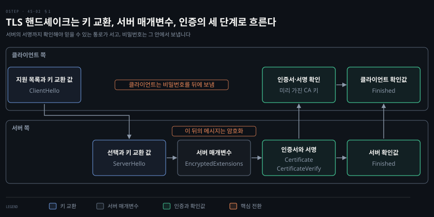
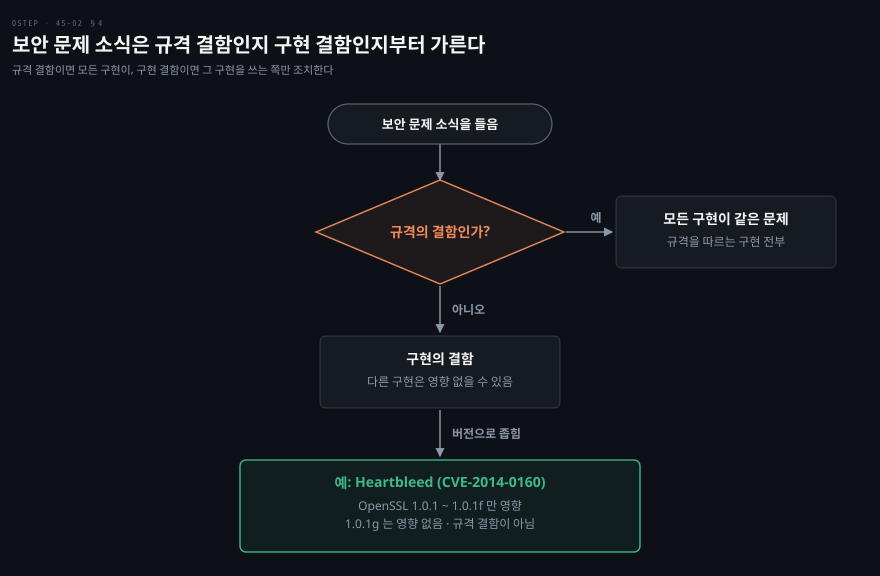
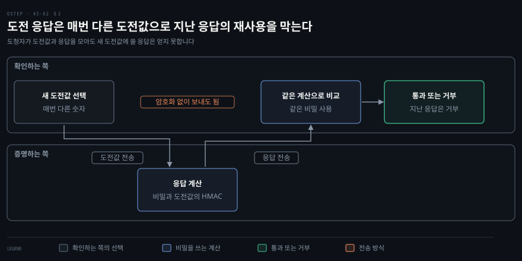
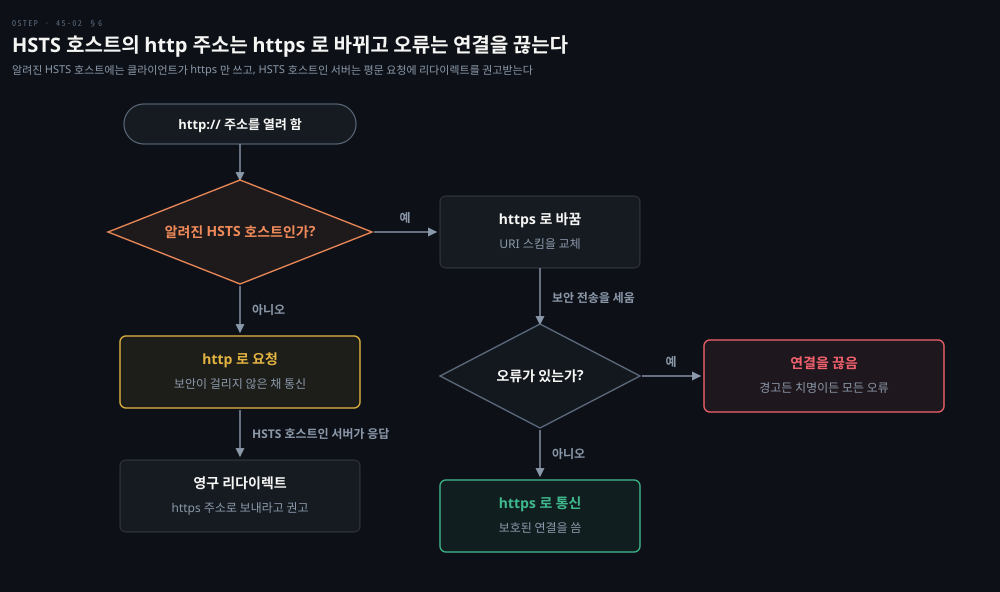
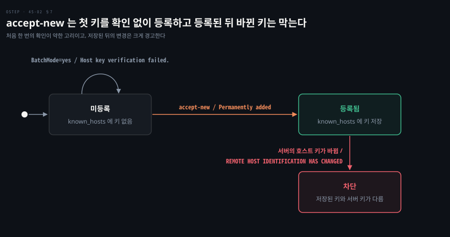

# TLS 는 키를 어떻게 안전하게 나누는가 — 핸드셰이크·세션 인증·HTTPS·SSH

---

> TLS(Transport Layer Security)는 인증서로 서버를 인증할 때 서버가 서명한 키 교환으로 연결마다 새 대칭 키를 만들어 암호화된 통로를 세웁니다. 이 편은 그 통로가 어디까지 믿을 만한지, 통로 뒤에서 사용자를 어떻게 인증하는지, HTTPS 와 SSH 가 믿음을 어디서 시작하는지를 따라갑니다.


## 핵심 요약

> 인증서로 서버를 인증하는 TLS 는 서버가 서명한 키 교환으로 연결마다 새 대칭 키를 만들어 암호화된 통로를 세우므로, 이 통로가 보증하는 범위는 서버의 인증서와 서명이 닿는 곳까지입니다.

통로가 서면 그 안에서 비밀번호를 보내 클라이언트를 인증하고, 이후에는 쿠키가 그 신원을 이어 가거나 도전 응답이나 인증 서버가 다른 방식으로 인증합니다. HTTPS 와 SSH 는 같은 문제를 이미 푼 상위 도구라서 새로 짜지 않고 씁니다. 다만 믿음의 출발점이 미리 설치된 인증 기관 키나 첫 접속의 호스트 키라는 한계를 그대로 지닙니다. 원격 기계에서 일어나는 일은 이 도구를 써도 운영체제가 자기 하드웨어에서 아는 만큼 확실해지지 않습니다.[^ver]


## 학습 목표

> 이 편을 읽고 나면 아래 다섯 가지를 스스로 해낼 수 있습니다.

1. 연결마다 새 대칭 키를 쓰는 이유와, 서버의 서명이 없는 Diffie-Hellman 키 교환이 중간자에게 뚫리는 이유를 설명할 수 있습니다.
2. TLS 핸드셰이크의 세 단계와, 클라이언트 인증이 대개 비밀번호로 뒤에 오는 이유를 설명할 수 있습니다.
3. 보안 문제를 들었을 때 프로토콜 결함인지 구현 결함인지 먼저 가르는 이유를 말할 수 있습니다.
4. 쿠키와 도전 응답과 인증 서버가 각각 무엇을 얻고 무엇을 내주는지 비교할 수 있습니다.
5. HTTPS 의 인증서와 SSH 의 호스트 키가 어디서 믿음을 시작하는지, 그 출발점이 무엇을 보증하지 못하는지 설명할 수 있습니다.

아래 개념도는 이 편의 일곱 절을 한 줄씩 보입니다. 각 줄이 한 절이고 노드가 그 절의 핵심 키워드입니다. 화살표 위 글자는 앞 키워드에서 뒤 키워드로 넘어가는 관계입니다. 파란 노드가 그 절이 푸는 문제이고 초록 노드가 대응입니다. 5행은 세 방법을 나란히 견주는 줄이라 세 노드를 모두 중립색으로 둡니다. 2행은 대응 자리에 코랄색 CertificateVerify 가 놓이는데, 서버의 서명이 개인 키를 가진 증거로 쓰이는 것이 이 편의 한 줄이기 때문입니다.

1절은 연결마다 새 키를 합의하는 방법을 다룹니다. 2절은 서명 없는 키 교환이 중간자에게 뚫리는 이유와 서버의 서명을 다룹니다. 3절은 핸드셰이크 세 단계와 비밀번호 인증을 다룹니다. 4절은 규격 결함과 구현 결함의 구분을 다룹니다. 5절은 쿠키와 도전 응답과 인증 서버의 비교를 다룹니다. 6절은 인증서의 좁은 보증과 HSTS 를 다룹니다. 7절은 SSH 호스트 키의 첫 접속 신뢰를 다룹니다.




## 1. 연결마다 새 대칭 키와 순방향 비밀성

> TLS 는 협상으로 암호 조합을 고르고 연결마다 새 대칭 키를 합의하므로, 한 연결의 키가 새도 다른 연결의 데이터는 풀리지 않습니다.

### 소켓에 암호를 붙이는 TLS

보호받지 못하는 네트워크를 건너는 통신을 어떻게 지킬까요? 소켓은 다른 기계에 있는 프로세스와 통신하는 표준 수단입니다. 그러니 소켓에 암호 기능을 붙이는 것이 자연스럽습니다. 이 일을 하는 것이 SSL(Secure Sockets Layer)과 그 뒤를 이은 TLS 입니다. 소켓을 열고 암호 처리를 맡는 구조를 세워 그 출력을 소켓의 입력에 잇습니다. 받는 쪽은 이 과정을 거꾸로 합니다.

현재 표준은 TLS 1.3 이고 RFC(Request for Comments, 인터넷 표준 문서) 9846 이 정의합니다.[^tls13] SSL 3.0 과 TLS 1.0·1.1 은 RFC 가 쓰지 못하게 막습니다.[^old]

쓸 수 있는 암호와 해시와 키 교환과 인증 방법은 여러 가지이고, 양쪽의 구현과 설정에 따라 가능한 조합이 다릅니다. 그래서 연결의 첫 단계는 협상입니다. 클라이언트가 자기가 쓸 수 있는 조합을 내밀면 서버가 그중에서 고릅니다. 대개는 어느 조합이든 쓸 만해서 협상을 눈에 띄지 않게 맡겨 둬도 됩니다. 응용 규약이 따로 정하지 않으면 TLS 1.3 구현은 정해진 서명 방식과 키 교환(secp256r1)을 반드시 지원해야 합니다. 그래서 양쪽이 합의할 조합이 최소 하나는 있습니다.[^tls13]

### 연결마다 새 키를 쓰는 이유

데이터를 암호화하는 일은 대칭 암호가 맡고 그 키는 연결마다 새로 정합니다. 같은 상대와 연결을 동시에 여러 개 열어도 연결마다 키가 다릅니다. 인증용 공개 키와 개인 키는 여러 번 써도 됩니다. 데이터용 대칭 키는 인증을 마친 뒤 그 연결만을 위해 새로 정합니다. 그래야 한 연결의 키가 드러나도 다른 연결의 데이터는 풀리지 않습니다.

TLS 1.3 은 정적 RSA 와 정적 Diffie-Hellman 암호 모음을 없애서, 모든 공개 키 기반 키 교환이 **순방향 비밀성**을 갖게 했습니다.[^tls13] 서버의 장기 개인 키가 나중에 새어도 지난 연결의 키가 복원되지 않는 성질입니다.

### Diffie-Hellman 이 키를 합의하는 방식

대칭 키를 만드는 데는 Diffie-Hellman 키 교환을 흔히 씁니다. 두 쪽이 큰 소수 n 과 정수 g 를 공개로 정합니다. 각자 비밀 정수를 골라 g 를 그만큼 거듭제곱한 값을 n 으로 나눈 나머지를 주고받습니다. 받은 쪽이 자기 비밀 정수로 한 번 더 거듭제곱하면 둘은 같은 값을 얻습니다. 도청자는 주고받은 값만으로 그 값을 구하지 못합니다. 소수는 충분히 커야 하고 600자리 정도면 충분하다고 봅니다. 2048비트 정수가 십진수로 617자리이니 그 정도 크기입니다.[^lab]

여기까지는 소수로 하는 고전적인 형태의 설명입니다. TLS 1.3 이 반드시 지원해야 하는 키 교환은 같은 원리를 타원 곡선 위에서 하는 secp256r1 입니다. 실험한 연결에서는 X25519 와 ML-KEM 계열을 묶은 X25519MLKEM768 그룹이 협상됐습니다.[^tls13][^grp]

계산 과정은 네트워킹 책의 [열쇠를 나눠 갖지 않고 어떻게 비밀을 만드는가](../cntd_computer-networking-top-down/08-02.%EC%97%B4%EC%87%A0%EB%A5%BC%20%EB%82%98%EB%88%A0%20%EA%B0%96%EC%A7%80%20%EC%95%8A%EA%B3%A0%20%EC%96%B4%EB%96%BB%EA%B2%8C%20%EB%B9%84%EB%B0%80%EC%9D%84%20%EB%A7%8C%EB%93%9C%EB%8A%94%EA%B0%80.md)가 풀고, 패킷에서 보이는 모습은 패킷 분석 책의 [열쇠와 실패](../paw_packet-analysis-wireshark/04-03.%EC%97%B4%EC%87%A0%EC%99%80%20%EC%8B%A4%ED%8C%A8.md)가 보여 줍니다.


## 2. 중간자를 막는 서버의 서명

> 키 교환만으로는 상대가 누구인지 알 수 없어 중간자가 낄 수 있으므로, 서버가 핸드셰이크 기록에 서명해 클라이언트가 그 상대를 확인합니다.

### 서명 없는 키 교환과 중간자

Diffie-Hellman 교환은 누구와 키를 나누는지는 알려 주지 않습니다. **중간자 공격**(man-in-the-middle attack)은 두 쪽이 직접 통신한다고 믿지만 실제로는 몰래 낀 제3자를 거치는 공격입니다. 제3자는 메시지를 보고 바꾸고 끼워 넣을 수 있습니다. 클라이언트와 서버 사이에 낀 중간자가 양쪽에 자기 값을 보내면 둘은 중간자와 따로 키를 나눕니다. 그래도 양쪽은 서로 키를 나눈 줄 압니다.

아래 그림은 작은 소수 n=23, g=5 로 계산한 예입니다. 클라이언트는 A=8 을 보냈는데 서버는 중간자의 M2=11 을 받습니다. 클라이언트도 서버의 B=19 가 아니라 중간자의 M1=10 을 받습니다. 그 결과 클라이언트의 키는 6, 서버의 키는 10 이고 중간자는 두 키를 모두 압니다.[^lab] 정답 4 에서 같은 구조를 직접 계산해 봅니다.



중간자가 네트워크에서 실제로 끼어드는 방법은 패킷 분석 책의 [훔쳐보고 끼어드는 공격](../paw_packet-analysis-wireshark/07-02.%ED%9B%94%EC%B3%90%EB%B3%B4%EA%B3%A0%20%EB%81%BC%EC%96%B4%EB%93%9C%EB%8A%94%20%EA%B3%B5%EA%B2%A9.md)이 ARP 중복 IP 로 보여 줍니다.

### 서버의 서명으로 하는 상대 확인

그래서 서버가 키 교환 값을 포함한 그때까지의 핸드셰이크 기록에 개인 키로 서명합니다. 클라이언트는 서버가 보낸 인증서의 공개 키로 그 서명을 확인해, 키를 나눈 상대가 인증서의 주인임을 알게 됩니다. 중간자는 서버의 개인 키가 없어서 자기 값이 든 기록에 올바른 서명을 붙이지 못합니다.

RFC 9846 은 이 서명 메시지(CertificateVerify)를 인증서에 대응하는 개인 키를 가졌다는 명시적 증거라고 적습니다.[^tls13] [앞 편](./45-01.%EC%9B%90%EA%B2%A9%20%EA%B8%B0%EA%B3%84%EB%8A%94%20%EB%AC%B4%EC%97%87%EC%9C%BC%EB%A1%9C%20%EB%AF%BF%EB%8A%94%EA%B0%80%20%E2%80%94%20%EC%9D%B8%EC%A6%9D%EC%84%9C%EC%9D%98%20%EC%84%9C%EB%AA%85%EA%B3%BC%20%EB%B9%84%EB%B0%80%EB%B2%88%ED%98%B8%20%ED%95%B4%EC%8B%9C.md)에서 인증서만으로는 알 수 없다고 한 바로 그 증거입니다.


## 3. 세 단계 핸드셰이크와 비밀번호 인증

> 핸드셰이크는 키 교환과 서버 매개변수와 인증의 세 단계이고 서버만 서명하므로, 클라이언트는 통로가 선 뒤에 비밀번호로 자신을 증명합니다.

### 세 단계로 나뉜 핸드셰이크

서명과 키 교환과 협상은 어떤 순서로 오갈까요? RFC 9846 은 핸드셰이크를 세 단계로 나눕니다. 키 교환 단계에서 공유 키 재료를 만들고 암호 매개변수를 고릅니다. 서버 매개변수 단계에서 클라이언트 인증 여부 같은 나머지 설정을 정합니다. 인증 단계에서 서버를 인증하고 키 확인과 핸드셰이크 무결성을 제공합니다. 키 교환 단계 뒤의 모든 것은 암호화됩니다.[^tls13]



직접 돌려 보면 이 순서가 그대로 보입니다. 로컬 서버에 `openssl s_client -msg` 로 붙어 핸드셰이크 메시지 이름만 뽑으면 그림과 같은 순서입니다. 원출력에는 호환용 ChangeCipherSpec 레코드도 양쪽에서 한 줄씩 섞여 보입니다. 서버의 Finished 다음에 클라이언트의 Finished 가 갑니다. 협상된 값은 TLS 1.3 과 `TLS_AES_256_GCM_SHA384` 였습니다. 명령과 출력은 정답 3 에 있습니다.[^lab]

같은 순서를 패킷으로 잡는 실습은 패킷 분석 책의 [TLS 핸드셰이크를 직접 잡기](../paw_packet-analysis-wireshark/04-04.%EC%8B%A4%EC%8A%B5%20%E2%80%94%20TLS%20%ED%95%B8%EB%93%9C%EC%85%B0%EC%9D%B4%ED%81%AC%EB%A5%BC%20%EC%A7%81%EC%A0%91%20%EC%9E%A1%EA%B8%B0.md)가 다룹니다.

### 비밀번호로 뒤에 증명하는 클라이언트

클라이언트는 대개 인증서도 개인 키도 없어서 자기 Diffie-Hellman 메시지에 서명하지 못합니다. 그러면 키 교환이 끝났을 때 클라이언트는 서버가 누구인지 확신하지만 서버는 클라이언트가 누구인지 모릅니다. 양쪽을 모두 인증하는 설정도 있으나 웹 브라우징에서 흔한 설정은 아닙니다.

이것은 대개 문제가 되지 않습니다. 클라이언트는 비밀번호로 자신을 증명하기 때문입니다. 서버는 비밀번호를 확인하기 전에는 신뢰가 필요한 일을 허용하지 않으면 됩니다. 공개 정보처럼 익명 클라이언트에게 내줘도 되는 서비스는 그동안 제공할 수 있습니다. ID 와 비밀번호는 연결이 선 뒤에 아무 때나 보내도 되고, 그때는 방금 정한 대칭 키가 지켜 줍니다.


## 4. 규격 결함과 구현 결함 가르기

> TLS 보안 문제는 규격의 결함인지 구현의 결함인지에 따라 영향받는 범위가 갈립니다.

SSL/TLS 보안 문제 소식을 들었을 때 고칠 범위는 결함이 어디에 있는지에 달려 있습니다. TLS 는 프로토콜이지 소프트웨어가 아닙니다. 같은 프로토콜을 여러 소프트웨어가 서로 다른 코드로 구현하므로, 한 구현의 결함이 다른 구현에는 없을 수 있습니다.

Heartbleed(CVE-2014-0160, CVE 는 Common Vulnerabilities and Exposures 의 약자)가 그 예입니다. 공식 페이지는 이것이 프로토콜 규격의 결함이 아니라 OpenSSL 라이브러리의 프로그래밍 실수라고 적습니다. OpenSSL 안에서도 1.0.1 부터 1.0.1f 까지만 영향을 받았습니다.[^hb] 패킷에서 Heartbleed 를 알아보는 방법은 패킷 분석 책의 [훔쳐보고 끼어드는 공격](../paw_packet-analysis-wireshark/07-02.%ED%9B%94%EC%B3%90%EB%B3%B4%EA%B3%A0%20%EB%81%BC%EC%96%B4%EB%93%9C%EB%8A%94%20%EA%B3%B5%EA%B2%A9.md) 첫 절이 다룹니다.



프로토콜 정의에 결함이 있으면 규격을 따르는 모든 구현이 같은 문제를 안습니다. 구현 결함이면 다른 구현을 쓰는 쪽은 조치가 필요 없을 수 있습니다. SSL/TLS 보안 문제를 들으면 어느 쪽인지부터 가려야 하는 이유입니다.


## 5. 비밀번호와 공개 키 밖의 인증 세 방법

> 쿠키는 비밀번호로 한 번 확인한 신원을 뒤로 이어 가고, 도전 응답과 인증 서버는 비밀번호를 대신하는 다른 인증 방법이며, 셋은 각각 편의와 안전을 맞바꿉니다.

### 쿠키가 얻는 편의와 내주는 안전

로그인한 사이트는 링크를 누를 때마다 비밀번호를 다시 묻지 않습니다. 브라우저를 닫았다 다시 열어도 인증된 사용자로 대하는 사이트도 있습니다. 이때는 새 세션이고 새 암호 키여서 앞의 암호 통로가 이미 없습니다. 새 키를 받는 쪽이 같은 사용자임을 비밀번호 말고 다른 방법으로 확인해야 합니다.

사이트가 과거에 비밀번호로 확인한 신원을 이후에는 다른 방법으로 이어 가는 것은 보안상의 선택입니다. 흔한 방법이 웹 **쿠키**입니다. 쿠키는 웹 사이트가 클라이언트에게 보내는 데이터로, 클라이언트가 저장해 두었다가 다음에 그 서버와 통신할 때 되돌려 보냅니다. 브라우저가 사용자의 개입 없이 처리합니다.

비밀번호를 확인한 서버가 암호 기술로 클라이언트의 신원을 담은 쿠키를 만듭니다. 이후 요청마다 쿠키가 실려 오므로 서버는 비밀번호 없이 신원을 확인합니다. 이 쿠키는 암호학적 capability 입니다. capability 는 그 값을 가진 쪽에 특정 권한을 주는 위조할 수 없는 표입니다. 서버만 아는 키로 만들기 때문에 다른 사람은 만들 수 없습니다. 같은 방식은 다른 분산 시스템에도 널리 쓰입니다. 서명으로 위조를 막는 원리는 [앞 장의 편](./44-02.%EC%95%94%ED%98%B8%EB%8A%94%20%EC%96%B4%EB%94%94%EC%84%9C%20%EA%B9%A8%EC%A7%80%EA%B3%A0%20OS%20%EB%8A%94%20%EC%96%B4%EB%94%94%EC%97%90%20%EC%95%94%ED%98%B8%EB%A5%BC%20%EC%93%B0%EB%8A%94%EA%B0%80%20%E2%80%94%20%ED%82%A4%20%EC%9C%A0%EC%B6%9C%C2%B7%EC%A0%80%EC%9E%A5%20%EB%8D%B0%EC%9D%B4%ED%84%B0%20%EC%95%94%ED%98%B8%ED%99%94%C2%B7%EC%95%94%ED%98%B8%ED%95%99%EC%A0%81%20capability.md)이 풉니다.

쿠키가 어떤 길로 갈지는 속성으로 제한합니다. RFC 6265 에서 Secure 속성이 붙은 쿠키는 HTTP 요청이 TLS 같은 보안 채널로 갈 때만 실립니다. HttpOnly 속성이 붙은 쿠키는 스크립트가 쓰는 비 HTTP 인터페이스에 노출되지 않습니다.[^cookie] Secure 가 지키는 것은 쿠키의 기밀성뿐이라고 같은 문서가 적습니다. 능동 공격자가 보안되지 않은 채널에서 Secure 쿠키를 덮어써 무결성을 깨는 일은 막지 못합니다.[^cookie]

쿠키로 풀리지 않는 문제도 있습니다. 합법적인 사용자의 브라우저를 다른 사람이 쓰면 저장된 쿠키 때문에 그 사람도 인증됩니다. 비밀번호를 매번 요구했다면 막았을 일입니다. 사용자를 편하게 둘지 자주 증명하게 해서 안전을 높일지에는 하나의 정답이 없고, 시스템을 만드는 쪽이 정합니다.

### 도전 응답과 재사용 방지

확인하는 쪽이 도전값, 흔히 숫자 하나를 보내고 증명하는 쪽이 그 값에 자기만 아는 비밀을 적용한 응답을 돌려주는 방식이 **도전 응답**입니다. 확인하는 쪽은 올바른 응답인지 검사할 수 있어야 합니다.

도전값은 매번 다르므로 도청자가 지난 도전값과 응답을 모아도 새 도전값에 쓸 응답은 얻지 못합니다. 그래서 도전값과 응답을 암호화하지 않아도 됩니다.



응답은 보통 도전값과 비밀에 어떤 암호 연산을 해서 구하고, 해시가 흔한 선택입니다. 해시에 키를 섞는 표준 방식이 HMAC(Hash-based Message Authentication Code)입니다.[^hmac] 사람이 하기 어려운 계산이라 컴퓨터나 전용 하드웨어 토큰이 대신합니다. 도전을 내기 전에 비밀이나 토큰을 미리 나눠 가져야 한다는 것이 조건입니다.

직접 해 보면 같은 비밀로도 도전값마다 응답이 다르고, 지난 응답은 새 도전값에서 거부됩니다. 코드는 정답 5 에 있습니다. 살아 있는 상대를 확인하는 논스의 계보는 네트워킹 책의 [살아 있는 상대를 확인하고 메일과 TCP 에 붙입니다](../cntd_computer-networking-top-down/08-03.%EC%82%B4%EC%95%84%20%EC%9E%88%EB%8A%94%20%EC%83%81%EB%8C%80%EB%A5%BC%20%ED%99%95%EC%9D%B8%ED%95%98%EA%B3%A0%20%EB%A9%94%EC%9D%BC%EA%B3%BC%20TCP%20%EC%97%90%20%EB%B6%99%EC%9E%85%EB%8B%88%EB%8B%A4.md)가 정리합니다.

### 인증 서버와 Kerberos

또 다른 방법은 인증 서버입니다. 사용자가 믿고 인증받을 상대도 믿는 서버가 사용자의 신원을 암호로 보증하고, 확인하는 쪽은 그 보증을 검사합니다. 인증서와 인증 기관은 이것의 오프라인 판으로 볼 수 있습니다. 온라인 판은 서버와 주고받으므로 보안 상황의 변화에 더 빨리 반응할 수 있습니다.

Kerberos 가 이런 인증 서버입니다. 도난 신고가 접수된 TGT(Ticket-Granting Ticket)나 갱신 가능 티켓으로는 추가 티켓을 받을 수 없습니다. 신고 전에 이미 받은 일반 티켓은 원래 만료 시각까지 유효합니다. 서버가 KDC(Key Distribution Center, 키 배포 센터)와 주고받지 않고 티켓을 확인하기 때문입니다.[^krb]

영역(realm) 간 인증용으로 발급된 TGT 는 신고 목록이 그 TGT 가 향하는 영역의 KDC 로 전파되지 않는 한 영향받지 않습니다. 온라인이어도 철회가 닿는 범위는 새 티켓의 발급 경로까지입니다.

리눅스 책의 [Kerberos 절](../learning-modern-linux/09-01.%EC%9D%B4%20%EC%9E%A5%EC%9D%84%20%EB%AC%B6%EB%8A%94%20%EA%B2%83%EC%9D%80%20%EC%A3%BC%EC%A0%9C%EA%B0%80%20%EC%95%84%EB%8B%88%EB%9D%BC%20%ED%95%84%EC%9A%94%ED%95%B4%EC%A7%80%EB%8A%94%20%EC%A1%B0%EA%B1%B4%EC%9D%B4%EB%8B%A4.md)이 티켓과 세션 키로 도는 네 걸음을 순서대로 보입니다.


## 6. 인증서의 좁은 보증과 HSTS

> HTTPS 는 HTTP 를 TLS 위에 얹어 개발 비용을 아끼지만 인증서가 보증하는 범위는 좁아서, 서버가 알리는 HSTS 로 클라이언트가 http 로 물러나지 않게 합니다.

### HTTP 를 TLS 위에 얹은 HTTPS

TLS 를 직접 부르지 않고 한 단계 위에서 같은 효과를 얻을 수 있습니다. HTTPS 는 HTTP 를 TLS 연결 위로 보내는 방식입니다. 웹 서버 인증과 새 대칭 키 합의는 TLS 가 맡고, 연결이 선 뒤의 모든 주고받음이 그 보호된 연결을 씁니다. 보안을 HTTP 에 새로 구현하지 않고 잘 다듬어진 전송 보안 도구에 이었기 때문에 개발 비용이 적고 같은 종류의 결함을 다시 겪을 가능성도 줄어듭니다.

HTTPS 는 HTTP 를 응용 규약으로 쓸 때만 고를 수 있습니다. HTTP 는 사람이 하는 웹 탐색을 돕도록 설계돼서 메시지가 대개 ASCII 로 인코딩되고 헤더도 큽니다. 그 밖의 응용에는 TLS 를 직접 쓰거나 SSH 를 쓰는 편이 효율적일 수 있습니다. Go 로 TLS 클라이언트와 서버를 짜는 방법은 네트워크 프로그래밍 책의 [TLS 절](../npg_network-programming-with-go/11-01.TLS%20%ED%81%B4%EB%9D%BC%EC%9D%B4%EC%96%B8%ED%8A%B8%EB%8A%94%20CA%20%EC%84%9C%EB%AA%85%EC%9C%BC%EB%A1%9C%20%EC%84%9C%EB%B2%84%EB%A5%BC%20%ED%99%95%EC%9D%B8%ED%95%98%EA%B3%A0%20%EC%84%9C%EB%B2%84%EB%8A%94%20%EB%A6%AC%EC%8A%A4%EB%84%88%EB%A5%BC%20%EA%B0%90%EC%8B%B8%EB%A9%B0%20%ED%94%BC%EB%8B%9D%EC%9D%80%20%EB%AF%BF%EC%9D%84%20%EC%9D%B8%EC%A6%9D%EC%84%9C%EB%A5%BC%20%EC%A2%81%ED%9E%8C%EB%8B%A4.md)이 정리합니다.

### 인증서가 보증하는 범위

HTTPS 의 인증서는 브라우저가 모아 관리하고, 브라우저에는 여러 인증 기관의 공개 키가 미리 들어 있습니다. 앞 편의 닭과 달걀 문제가 끊어지는 자리입니다. 그래도 인증서가 보증하는 것은 좁습니다. 어느 순간 인증 기관이 이 공개 키가 이 당사자의 것이라고 보증하기로 했다는 사실뿐입니다.

그 당사자가 선량하다는 뜻은 아니고, 개인 키가 아직 비밀이라는 뜻도 아닙니다. 인증 기관이 침해되지 않았다는 보장도 없습니다. 인증된 사이트가 클라이언트를 공격하는 일도 막지 못합니다.

### HSTS 가 막는 http 로의 물러남

서버가 HTTPS 를 받지 못하는 클라이언트에게 HTTP 로 물러나 주면 보안이 걸리지 않은 채 통신합니다. HSTS(HTTP Strict Transport Security)는 이 물러남을 막으려는 서버의 선택입니다. HSTS 를 고른 사이트는 HTTPS 를 받지 못하거나 받지 않으려는 클라이언트와 주고받지 않습니다. RFC 6797 에서 클라이언트는 HSTS 호스트로 알려진 도메인을 가리키는 http 주소를 불러오기 전에 https 로 바꿔야 합니다. 보안 전송을 세우다 어떤 오류든 만나면 연결도 끊어야 합니다.[^hsts]



HSTS 호스트인 서버는 평문으로 온 요청에 https 주소로 가는 영구 리다이렉트를 돌려주라고 권합니다(SHOULD).[^hsts] 알려진 HSTS 호스트에는 클라이언트가 이미 https 로 바꿔 요청합니다. 그래서 이 리다이렉트는 아직 HSTS 를 모르는 클라이언트를 위한 안전망입니다.


## 7. SSH 호스트 키와 첫 접속의 신뢰

> SSH 는 TLS 와 따로 구현된 도구라서 서버 인증도 따로 풀며, 믿음은 호스트 키를 처음 받는 순간에 가장 약합니다.

### SSH 의 구조와 쓰임

SSH(Secure Shell)는 원격 셸을 안전하게 쓰려는 목적에서 출발했지만 컴퓨터 사이의 안전한 상호작용 전반으로 넓어졌습니다. 대개 명령줄에 쓰지만 원격 X Window 세션도 지킬 수 있습니다. TCP(Transmission Control Protocol) 포트를 SSH 로 포워딩해 두 시스템 사이의 상호작용을 보호할 수도 있습니다.

SSH 는 SSL/TLS 위에 지은 것이 아니라 따로 구현한 것입니다. 그래서 한쪽에서 찾은 보안 결함이 다른 쪽에 꼭 영향을 주지는 않습니다. SSH 도 사용자를 인증하고 암호 키를 합의하고 무결성을 확인하며 암호 조합을 협상합니다.

### 서버 인증의 두 신뢰 모델

서버를 인증할 때 호스트 키를 무엇으로 믿는지가 문제입니다. RFC 4251 이 두 가지 신뢰 모델을 듭니다. 하나는 클라이언트가 호스트 이름과 공개 호스트 키의 짝을 담은 로컬 데이터베이스를 갖는 방식입니다. 중앙 인프라가 필요 없지만 데이터베이스를 유지하기가 부담입니다.

다른 하나는 호스트 이름과 키의 짝을 믿는 인증 기관이 인증하는 방식입니다. 클라이언트는 인증 기관의 루트 키만 알면 되고 대신 중앙 기관에 큰 신뢰를 둡니다.[^ssh]

### 첫 접속과 known_hosts

처음 가는 호스트의 키는 데이터베이스에 없습니다. 이때 서버가 보내 주는 공개 키를 그대로 받는 길이 있습니다. RFC 4251 은 이렇게 하면 연결이 수동적인 도청은 막아도 능동적인 중간자 공격에는 취약해진다고 적습니다. 구현이 이런 연결을 기본으로 허용하지 않기를 권합니다.[^ssh]

중간자가 올바른 키를 버리고 자기 키를 넣어 보내면 클라이언트는 중간자의 키를 서버의 키로 알게 됩니다. 같은 절은 처음 한 번만 확인 없이 받아 저장하고 이후에 비교하는 방식을 가능한 전략의 예로 듭니다.[^ssh] 이 방식을 TOFU(Trust On First Use)라고 부릅니다. 세부 동작과 인증 기관을 쓰는 대안은 리눅스 책의 [주고받는 일은 결국 몇 개의 명령으로 줄어든다](../learning-modern-linux/07-03.%EC%A3%BC%EA%B3%A0%EB%B0%9B%EB%8A%94%20%EC%9D%BC%EC%9D%80%20%EA%B2%B0%EA%B5%AD%20%EB%AA%87%20%EA%B0%9C%EC%9D%98%20%EB%AA%85%EB%A0%B9%EC%9C%BC%EB%A1%9C%20%EC%A4%84%EC%96%B4%EB%93%A0%EB%8B%A4.md) `## 4. SSH` 절이 다룹니다.

OpenSSH 의 StrictHostKeyChecking 기본값은 ask 입니다. 처음 보는 호스트의 키는 사용자가 확인해야 known_hosts 에 더해집니다. 키가 바뀐 호스트에는 연결하지 않습니다.[^ssh] 값을 accept-new 로 두면 처음 보는 키는 확인 없이 더하지만, 바뀐 키에는 역시 연결하지 않습니다. 직접 돌려 보면 확인 질문을 끈(`BatchMode=yes`) 첫 접속은 실패합니다. `accept-new` 로 키를 받아 둔 뒤 서버의 키가 바뀌면 경고와 함께 막힙니다. 명령은 정답 6 에 있습니다.



### 남는 문제는 사람과 원격 기계

확인 창이 떠도 사람이 습관적으로 넘기면 경고는 소용이 없습니다. 그래서 확인 창을 하나 더 두는 것만으로는 안전해지지 않고, 시스템을 설계할 때 그 승인에 기대지 않아야 합니다.

도구에는 넘지 못하는 선도 있습니다. 메시지를 암호화하고 인증해도 원격 기계가 하는 일은 운영체제가 자기 하드웨어에서 직접 하는 일만큼 확실하지 않습니다. 그래서 원격 사이트가 요청한 일을 수행하거나 민감한 정보를 보내기 전에 그 의미를 따져야 합니다. 기계 경계 밖에서 일어나는 일은 늘 불확실하고 위험합니다.

TLS 와 SSH 와 HTTPS 는 직접 암호를 짜다 겪는 함정을 이미 상당 부분 넘은 도구입니다. 새 시스템은 이것들 위에 짓는 편이 낫지만, 도구의 목적과 한계를 이해해야 제대로 쓸 수 있습니다.


## 결정 치트시트

> 같은 문제를 푸는 도구마다 얻는 것과 내주는 것이 달라서, 상황에 맞는 선택을 한눈에 봅니다.

| 상황 | 선택 | 근거와 한계 |
|------|------|-------------|
| 로그인 뒤 비밀번호를 매번 묻고 싶지 않다 | 쿠키 (Secure · HttpOnly) | 편의를 얻고, 브라우저를 다른 사람이 쓰면 그 사람도 인증됨 |
| 도청되는 길에서 비밀을 보이지 않고 신원을 증명한다 | 도전 응답 (HMAC) | 응답이 매번 달라 재사용이 거부됨, 비밀이나 토큰을 미리 나눠 가져야 함 |
| 신원 보증을 한 곳에 모아 변화에 빨리 반응한다 | 인증 서버 (Kerberos) | 철회가 새 티켓 발급까지만 닿고 이미 받은 일반 티켓은 만료까지 유효 |
| 웹 탐색용 통신을 지킨다 | HTTPS | 개발 비용이 적으나 인증서는 당사자가 선량한지까지는 보증하지 않음 |
| HTTP 가 아닌 응용을 지킨다 | TLS 를 직접 쓰거나 SSH | HTTP 의 ASCII 메시지와 큰 헤더를 피함 |
| 클라이언트가 http 로 물러나지 못하게 한다 | HSTS | 클라이언트가 http 주소를 https 로 바꾸고 보안 전송 오류에서 연결을 끊음, 서버는 평문 요청에 영구 리다이렉트를 돌려줌 |
| 새 호스트의 키를 받을 때 사람이 확인하게 한다 | StrictHostKeyChecking=ask (기본) | 확인해야 known_hosts 에 더해지고 바뀐 키는 거부, 사람이 습관적으로 yes 를 누를 수 있음 |
| 새 호스트의 키를 자동으로 받되 바뀐 키는 막는다 | StrictHostKeyChecking=accept-new | 첫 접속은 중간자에게 열려 있고 저장 뒤의 변경은 거부 |
| 호스트 키를 절대 자동으로 받지 않는다 | StrictHostKeyChecking=yes | 새 호스트를 수동으로 known_hosts 에 더해야 하나 최대 보호 |


## 면접 대비

> 한 줄 정의와 핵심 세 가지를 입으로 말해 본 뒤, 자주 묻는 질문에 답해 봅니다.

한 줄 정의: 인증서로 서버를 인증하는 TLS 는 서버가 서명한 키 교환으로 연결마다 새 대칭 키를 만들어 통로를 세우고, 그 통로가 보증하는 범위는 서버의 인증서와 서명이 닿는 곳까지입니다.

핵심 세 가지는 이렇습니다.

1. 연결마다 새 키를 쓰고 서버가 핸드셰이크 기록에 서명하므로, 한 연결의 키가 새도 다른 연결의 데이터는 풀리지 않고, 중간자는 서버의 서명을 위조하지 못해 걸러집니다.
2. 서버만 서명하므로 클라이언트는 통로가 선 뒤에 비밀번호로 증명하고, 이후에는 쿠키가 그 신원을 이어 가거나 도전 응답이나 인증 서버가 다른 방식으로 인증합니다.
3. HTTPS 와 SSH 의 믿음은 미리 설치된 인증 기관 키나 첫 접속의 호스트 키에서 시작하므로, 그 출발점이 보증하는 범위를 넘어 믿으면 안 됩니다.

자주 묻는 질문은 이렇습니다.

1. Diffie-Hellman 키 교환에 서명이 없으면 왜 위험합니까? 중간자가 양쪽에 자기 값을 보내면 양쪽이 중간자와 따로 키를 나누고도 서로 키를 나눈 줄 알기 때문입니다.
2. TLS 에서 클라이언트를 인증서 대신 비밀번호로 인증해도 됩니까? 서버는 비밀번호를 확인하기 전에 신뢰가 필요한 일을 허용하지 않으면 되고, 비밀번호는 방금 정한 대칭 키가 지키는 통로 안에서 보내므로 괜찮습니다.
3. HTTPS 인증서 확인이 통과하면 그 사이트는 안전합니까? 아닙니다. 보증하는 것은 어느 순간 인증 기관이 이 키를 이 당사자의 것이라고 했다는 사실뿐이고, 당사자가 선량한지와 개인 키가 비밀로 남았는지는 알 수 없습니다.


## 연습 문제

> 1·2번은 본문을 떠올려 답하는 문제이고 3·4번은 직접 돌려 확인하는 문제이며 5·6번은 둘을 섞었습니다. 답을 적은 뒤 정답 절과 맞춰 봅니다.

1. 연결마다 새 대칭 키를 쓰는 이유는 무엇입니까?
   - Diffie-Hellman 으로 키를 만들 때 서버의 서명이 없으면 무엇이 가능해집니까?
2. TLS 핸드셰이크가 끝났을 때 클라이언트와 서버는 각각 상대에 대해 무엇을 알게 됩니까?
   - 서버는 클라이언트를 언제 어떻게 확인합니까?
   - SSL/TLS 보안 문제 소식을 들으면 가장 먼저 무엇을 가립니까?
3. 로컬 서버를 띄우고 `openssl s_client` 로 여러 조건에서 붙어 보십시오.
   - 루트 없이, 루트와 올바른 이름으로, 루트와 틀린 이름으로 붙으면 각각 무엇이 나옵니까?
   - 협상된 버전과 메시지 순서는 어떻습니까?
   - SSL 3.0 과 TLS 1.0 은 어떻게 됩니까?
4. 작은 소수로 Diffie-Hellman 을 구현해 중간자가 있을 때와 없을 때 두 쪽의 키를 비교해 보십시오. 2048비트 정수의 십진수 자릿수도 구합니다.
5. 도전 응답을 HMAC 으로 구현해 지난 응답을 다시 보내면 어떻게 되는지 확인하십시오. 그런 다음 아래 비교 질문에 답합니다.
   - 쿠키와 도전 응답과 인증 서버는 각각 무엇을 얻고 무엇을 내줍니까?
6. 아래 두 질문은 HTTPS 인증서와 SSH 호스트 키가 보증하지 못하는 것을 묻습니다. SSH 쪽은 로컬 SSH 서버로 첫 접속과 키 교체를 확인한 뒤 답합니다.
   - HTTPS 인증서 확인이 통과해도 알 수 없는 것은 무엇입니까?
   - 처음 가는 SSH 호스트에서 확인 없이 키를 받는 것은 왜 위험합니까?


## 정답 (자답 후 펼치기)

### 정답 1

연결마다 새 키를 쓰면 한 연결의 키가 드러나도 다른 연결의 데이터가 함께 풀리지 않습니다. 인증용 공개 키와 개인 키는 여러 번 써도 되지만, 데이터용 대칭 키는 인증을 마친 뒤 그 연결을 위해 새로 만듭니다. 같은 상대와 연결을 동시에 여러 개 열어도 연결마다 다릅니다.

Diffie-Hellman 은 두 쪽이 공개 값만 주고받아 같은 키를 만들지만 상대가 누구인지는 알려 주지 않습니다. 서버가 서명하지 않으면 중간자가 양쪽에 자기 값을 보내 클라이언트와 서버 각각과 따로 키를 나눌 수 있고, 양쪽은 서로 키를 나눈 줄 압니다. 서버가 키 교환 값을 포함한 핸드셰이크 기록에 개인 키로 서명하면 클라이언트는 인증서의 공개 키로 확인해 상대가 인증서의 주인임을 압니다. 정답 4 의 실험이 이 차이를 보입니다.

### 정답 2

핸드셰이크가 끝나면 클라이언트는 서버가 누구인지 확신하지만 서버는 클라이언트가 누구인지 모릅니다. 클라이언트는 대개 인증서도 개인 키도 없어서 자기 메시지에 서명하지 못하기 때문입니다. 클라이언트는 비밀번호로 자신을 증명합니다. 서버는 비밀번호를 확인하기 전까지 신뢰가 필요한 일을 허용하지 않으면 되고, 공개 정보는 익명 클라이언트에게도 줄 수 있습니다. ID 와 비밀번호는 연결이 선 뒤에 보내며 방금 만든 대칭 키가 지켜 줍니다.

보안 문제 소식을 들으면 먼저 프로토콜 결함인지 구현 결함인지를 가립니다. 프로토콜 결함이면 규격을 따르는 모든 구현이 영향을 받습니다. 구현 결함이면 다른 구현을 쓰는 쪽은 조치가 필요 없을 수 있습니다. Heartbleed 는 OpenSSL 1.0.1 부터 1.0.1f 까지의 구현 결함이었고 1.0.1g 는 영향을 받지 않았습니다.[^hb]

### 정답 3

루트를 모르는 클라이언트는 서버 인증서의 서명을 어떤 신뢰 앵커로도 확인하지 못해 오류 21 이 나옵니다. 루트와 올바른 이름을 주면 오류 0(ok)이 나오고, 이름이 다르면 서명이 맞아도 오류 62(hostname mismatch)가 나옵니다. 서명 확인과 이름 확인이 따로 있다는 뜻입니다. `s_client` 는 확인에 실패해도 연결을 끝까지 맺고 결과만 알려 주므로, 실패 시 끊으려면 `-verify_return_error` 를 줍니다.

[45-01 의 정답 절](./45-01.%EC%9B%90%EA%B2%A9%20%EA%B8%B0%EA%B3%84%EB%8A%94%20%EB%AC%B4%EC%97%87%EC%9C%BC%EB%A1%9C%20%EB%AF%BF%EB%8A%94%EA%B0%80%20%E2%80%94%20%EC%9D%B8%EC%A6%9D%EC%84%9C%EC%9D%98%20%EC%84%9C%EB%AA%85%EA%B3%BC%20%EB%B9%84%EB%B0%80%EB%B2%88%ED%98%B8%20%ED%95%B4%EC%8B%9C.md)에서 루트와 서버 인증서를 직접 만드는 풀이의 첫 코드 블록을 같은 폴더에서 먼저 실행해 `root.crt` 와 `server.crt`, `server.key` 를 만들어 둡니다.[^lab]

```bash
openssl s_server -accept 127.0.0.1:4433 -cert server.crt -key server.key -www -quiet >/dev/null 2>&1 &
SERVER=$!
sleep 1
openssl s_client -connect 127.0.0.1:4433 </dev/null 2>&1 | grep 'Verify return code'
# Verify return code: 21 (unable to verify the first certificate)
openssl s_client -connect 127.0.0.1:4433 -CAfile root.crt -verify_hostname demo.local </dev/null 2>&1 | grep 'Verify return code'
# Verify return code: 0 (ok)
openssl s_client -connect 127.0.0.1:4433 -CAfile root.crt -verify_hostname other.local </dev/null 2>&1 | grep 'Verify return code'
# Verify return code: 62 (hostname mismatch)
openssl s_client -connect 127.0.0.1:4433 -CAfile root.crt -verify_hostname other.local -verify_return_error </dev/null 2>&1 | grep -o 'certificate verify failed'
# certificate verify failed
```

협상된 값은 TLS 1.3 이고 암호 모음은 `TLS_AES_256_GCM_SHA384` 였습니다. 메시지 이름을 순서대로 뽑으면 3절의 그림과 같습니다. 서버가 보낸 Finished 다음에 클라이언트의 Finished 가 갑니다.

```bash
openssl s_client -connect 127.0.0.1:4433 -CAfile root.crt </dev/null 2>&1 | grep -E 'Protocol|Cipher'
# New, TLSv1.3, Cipher is TLS_AES_256_GCM_SHA384
# Protocol: TLSv1.3
openssl s_client -connect 127.0.0.1:4433 -CAfile root.crt -msg </dev/null 2>&1 | grep -E '^(>>>|<<<)' | grep -oE '(ClientHello|ServerHello|EncryptedExtensions|Certificate|CertificateVerify|Finished)$'
# ClientHello
# ServerHello
# EncryptedExtensions
# Certificate
# CertificateVerify
# Finished
# Finished
```

옛 버전은 이 빌드의 클라이언트에서 시작조차 되지 않았습니다. `-ssl3` 은 옵션 자체를 받지 않았고 `-tls1` 은 핸드셰이크 준비 단계에서 `no protocols available` 로 멈췄습니다. `-tls1_2` 는 TLS 1.2 로 붙었습니다.[^old]

```bash
openssl s_client -connect 127.0.0.1:4433 -ssl3 </dev/null 2>&1 | head -1
# s_client: Unknown option: -ssl3
openssl s_client -connect 127.0.0.1:4433 -tls1 </dev/null 2>&1 | grep -o 'no protocols available'
# no protocols available
openssl s_client -connect 127.0.0.1:4433 -tls1_2 -CAfile root.crt </dev/null 2>&1 | grep '^New'
# New, TLSv1.2, Cipher is ECDHE-RSA-AES256-GCM-SHA384
kill $SERVER
```

### 정답 4

Diffie-Hellman 은 중간자가 없을 때 두 쪽이 같은 키를 얻습니다. 중간자가 양쪽에 자기 값을 보내면 클라이언트와 중간자, 서버와 중간자가 각각 같은 키를 나누고 클라이언트의 키와 서버의 키는 달라집니다. 2048비트 정수는 십진수로 617자리입니다. 아래 소수는 동작을 보이려고 고른 작은 값이라 실제로는 쓰면 안 됩니다.

```bash
python3 - <<'EOF'
import secrets
n, g = 2**127 - 1, 3   # 동작을 보이려는 작은 소수이고 안전한 크기가 아닙니다
a, b, m1, m2 = (secrets.randbelow(n - 3) + 2 for _ in range(4))
A, B, M1, M2 = (pow(g, v, n) for v in (a, b, m1, m2))
print("정상: 클라이언트 키 == 서버 키 :", pow(B, a, n) == pow(A, b, n))
print("중간자: 클라이언트와 중간자가 같은 키 :", pow(M1, a, n) == pow(A, m1, n))
print("중간자: 서버와 중간자가 같은 키 :", pow(M2, b, n) == pow(B, m2, n))
print("중간자: 클라이언트 키 == 서버 키 :", pow(M1, a, n) == pow(M2, b, n))
print("2048비트 정수의 십진 자리수:", len(str(2**2048 - 1)))
EOF
# 정상: 클라이언트 키 == 서버 키 : True
# 중간자: 클라이언트와 중간자가 같은 키 : True
# 중간자: 서버와 중간자가 같은 키 : True
# 중간자: 클라이언트 키 == 서버 키 : False
# 2048비트 정수의 십진 자리수: 617
```

### 정답 5

쿠키는 비밀번호를 매번 묻지 않는 편의를 얻고, 사용자의 브라우저를 다른 사람이 쓰면 그 사람도 인증되는 점을 내줍니다. 도전 응답은 도청해도 소용없고 암호화가 필요 없는 점을 얻고 비밀이나 토큰을 미리 나눠 가져야 하는 점을 내줍니다. 인증 서버는 신원 보증을 한 곳에 모아 변화에 빨리 반응하는 점을 얻고 서버와 주고받아야 하는 점을 내줍니다. 그래도 이미 받은 티켓은 만료까지 유효해서 철회가 닿는 범위는 제한됩니다.[^krb]

도전 응답은 HMAC 으로 구현해 볼 수 있습니다. 비밀은 파일에서 읽고 화면에 찍지 않습니다. 같은 비밀로도 도전값이 다르면 응답이 다르고, 지난 응답을 새 도전값에 다시 보내면 거부됩니다.

```bash
head -c 32 /dev/urandom > shared.key
python3 - <<'EOF'
import hmac, hashlib
key = open("shared.key", "rb").read()
def respond(challenge):
    return hmac.new(key, str(challenge).encode(), hashlib.sha256).hexdigest()[:16]
def verify(challenge, response):
    return hmac.compare_digest(respond(challenge), response)
old, new = respond(7731), respond(9042)
print("도전값이 다르면 응답도 다름:", old != new)
print("새 도전값에 옳은 응답:", "ACCEPT" if verify(9042, new) else "REJECT")
print("새 도전값에 지난 응답 재사용:", "ACCEPT" if verify(9042, old) else "REJECT")
EOF
# 도전값이 다르면 응답도 다름: True
# 새 도전값에 옳은 응답: ACCEPT
# 새 도전값에 지난 응답 재사용: REJECT
```

### 정답 6

인증서 확인이 통과해도 알 수 없는 것은 그 당사자가 선량한지, 개인 키가 아직 비밀인지, 인증 기관이 침해되지 않았는지입니다. 알게 되는 것은 어느 순간 인증 기관이 이 키를 이 당사자의 것이라고 보증했다는 사실뿐입니다. 인증된 사이트가 클라이언트를 공격하는 일도 막지 못합니다.

처음 가는 SSH 호스트의 키를 서버가 보내 주는 대로 받으면 능동적인 중간자가 자기 키를 끼워 넣을 수 있습니다. 그 뒤로 클라이언트는 중간자를 서버로 믿습니다.[^ssh] 로컬 서버로 확인하면 물어볼 수 없게 한(`BatchMode=yes`) 첫 접속은 `Host key verification failed.` 로 끝납니다. 사람이 쓰는 터미널이었다면 여기서 yes/no 를 묻습니다. `accept-new` 로 키를 받은 뒤 서버의 호스트 키를 바꾸면 경고와 함께 연결이 막힙니다.[^lab]

```bash
ssh-keygen -q -t ed25519 -N "" -f host_a
ssh-keygen -q -t ed25519 -N "" -f host_b
mkcfg() { printf 'ListenAddress 127.0.0.1\nPort 2222\nHostKey %s/%s\nPidFile %s/sshd.pid\nUsePAM no\nPasswordAuthentication no\nPubkeyAuthentication no\nLogLevel ERROR\n' "$PWD" "$1" "$PWD" > sshd_config; }
try() { ssh -F /dev/null -o BatchMode=yes -o UserKnownHostsFile=kh "$@" -p 2222 127.0.0.1 true 2>&1; }
mkcfg host_a; /usr/sbin/sshd -f "$PWD/sshd_config"; sleep 1
try | tail -1
# Host key verification failed.
try -o StrictHostKeyChecking=accept-new | grep -o 'Permanently added'
# Permanently added
kill $(cat sshd.pid); sleep 1
mkcfg host_b; /usr/sbin/sshd -f "$PWD/sshd_config"; sleep 1
try -o StrictHostKeyChecking=accept-new | grep -oE 'REMOTE HOST IDENTIFICATION HAS CHANGED|Host key verification failed'
# REMOTE HOST IDENTIFICATION HAS CHANGED
# Host key verification failed
kill $(cat sshd.pid); sleep 1
lsof -nP -iTCP:2222 -sTCP:LISTEN | wc -l | tr -d ' '
# 0
```

경고가 떠도 사람이 습관적으로 넘기면 소용이 없습니다. 확인 창을 더하는 것만으로는 안전해지지 않으므로 시스템을 설계할 때 그 승인에 기대지 않아야 합니다.


## 참고 자료

- 《Operating Systems: Three Easy Pieces》(Remzi H. Arpaci-Dusseau · Andrea C. Arpaci-Dusseau, Arpaci-Dusseau Books) 57장
- [57장 PDF](https://pages.cs.wisc.edu/~remzi/OSTEP/security-distributed.pdf)
- [RFC 9846 TLS 1.3](https://www.rfc-editor.org/rfc/rfc9846)
- [RFC 7568 SSL 3.0 사용 금지](https://www.rfc-editor.org/rfc/rfc7568)
- [RFC 8996 TLS 1.0·1.1 사용 금지](https://www.rfc-editor.org/rfc/rfc8996)
- [Heartbleed](https://heartbleed.com/)
- [RFC 6265 쿠키](https://www.rfc-editor.org/rfc/rfc6265)
- [RFC 2104 HMAC](https://www.rfc-editor.org/rfc/rfc2104)
- [RFC 4120 Kerberos](https://www.rfc-editor.org/rfc/rfc4120)
- [RFC 6797 HSTS](https://www.rfc-editor.org/rfc/rfc6797)
- [RFC 4251 SSH 구조](https://www.rfc-editor.org/rfc/rfc4251)
- [ssh_config(5)](https://man.openbsd.org/ssh_config)
- [OpenSSL 그룹 설정 문서](https://docs.openssl.org/3.5/man3/SSL_CTX_set1_curves/)


## 관련 문서

- [이 책의 인덱스](./README.md)
- [앞 편: 원격 기계는 무엇으로 믿는가](./45-01.%EC%9B%90%EA%B2%A9%20%EA%B8%B0%EA%B3%84%EB%8A%94%20%EB%AC%B4%EC%97%87%EC%9C%BC%EB%A1%9C%20%EB%AF%BF%EB%8A%94%EA%B0%80%20%E2%80%94%20%EC%9D%B8%EC%A6%9D%EC%84%9C%EC%9D%98%20%EC%84%9C%EB%AA%85%EA%B3%BC%20%EB%B9%84%EB%B0%80%EB%B2%88%ED%98%B8%20%ED%95%B4%EC%8B%9C.md) — 인증서의 서명과 비밀번호 해시
- [앞 장의 편: 암호는 어디서 깨지고 OS 는 어디에 암호를 쓰는가](./44-02.%EC%95%94%ED%98%B8%EB%8A%94%20%EC%96%B4%EB%94%94%EC%84%9C%20%EA%B9%A8%EC%A7%80%EA%B3%A0%20OS%20%EB%8A%94%20%EC%96%B4%EB%94%94%EC%97%90%20%EC%95%94%ED%98%B8%EB%A5%BC%20%EC%93%B0%EB%8A%94%EA%B0%80%20%E2%80%94%20%ED%82%A4%20%EC%9C%A0%EC%B6%9C%C2%B7%EC%A0%80%EC%9E%A5%20%EB%8D%B0%EC%9D%B4%ED%84%B0%20%EC%95%94%ED%98%B8%ED%99%94%C2%B7%EC%95%94%ED%98%B8%ED%95%99%EC%A0%81%20capability.md) — 키 유출과 서명한 capability
- [네트워킹 책: 열쇠를 나눠 갖지 않고 어떻게 비밀을 만드는가](../cntd_computer-networking-top-down/08-02.%EC%97%B4%EC%87%A0%EB%A5%BC%20%EB%82%98%EB%88%A0%20%EA%B0%96%EC%A7%80%20%EC%95%8A%EA%B3%A0%20%EC%96%B4%EB%96%BB%EA%B2%8C%20%EB%B9%84%EB%B0%80%EC%9D%84%20%EB%A7%8C%EB%93%9C%EB%8A%94%EA%B0%80.md) — Diffie-Hellman 계산
- [네트워킹 책: 살아 있는 상대를 확인하고 메일과 TCP 에 붙입니다](../cntd_computer-networking-top-down/08-03.%EC%82%B4%EC%95%84%20%EC%9E%88%EB%8A%94%20%EC%83%81%EB%8C%80%EB%A5%BC%20%ED%99%95%EC%9D%B8%ED%95%98%EA%B3%A0%20%EB%A9%94%EC%9D%BC%EA%B3%BC%20TCP%20%EC%97%90%20%EB%B6%99%EC%9E%85%EB%8B%88%EB%8B%A4.md) — 논스와 도전 응답
- [패킷 분석 책: 열쇠와 실패](../paw_packet-analysis-wireshark/04-03.%EC%97%B4%EC%87%A0%EC%99%80%20%EC%8B%A4%ED%8C%A8.md) — 키 교환이 패킷에서 보이는 모습
- [패킷 분석 책: 실습 — TLS 핸드셰이크를 직접 잡기](../paw_packet-analysis-wireshark/04-04.%EC%8B%A4%EC%8A%B5%20%E2%80%94%20TLS%20%ED%95%B8%EB%93%9C%EC%85%B0%EC%9D%B4%ED%81%AC%EB%A5%BC%20%EC%A7%81%EC%A0%91%20%EC%9E%A1%EA%B8%B0.md) — 핸드셰이크 메시지 순서를 패킷으로 확인
- [패킷 분석 책: 훔쳐보고 끼어드는 공격](../paw_packet-analysis-wireshark/07-02.%ED%9B%94%EC%B3%90%EB%B3%B4%EA%B3%A0%20%EB%81%BC%EC%96%B4%EB%93%9C%EB%8A%94%20%EA%B3%B5%EA%B2%A9.md) — Heartbleed 와 중간자 공격
- [네트워크 프로그래밍 책: TLS 절](../npg_network-programming-with-go/11-01.TLS%20%ED%81%B4%EB%9D%BC%EC%9D%B4%EC%96%B8%ED%8A%B8%EB%8A%94%20CA%20%EC%84%9C%EB%AA%85%EC%9C%BC%EB%A1%9C%20%EC%84%9C%EB%B2%84%EB%A5%BC%20%ED%99%95%EC%9D%B8%ED%95%98%EA%B3%A0%20%EC%84%9C%EB%B2%84%EB%8A%94%20%EB%A6%AC%EC%8A%A4%EB%84%88%EB%A5%BC%20%EA%B0%90%EC%8B%B8%EB%A9%B0%20%ED%94%BC%EB%8B%9D%EC%9D%80%20%EB%AF%BF%EC%9D%84%20%EC%9D%B8%EC%A6%9D%EC%84%9C%EB%A5%BC%20%EC%A2%81%ED%9E%8C%EB%8B%A4.md) — Go 의 TLS 클라이언트와 서버
- [리눅스 책: 주고받는 일은 결국 몇 개의 명령으로 줄어든다](../learning-modern-linux/07-03.%EC%A3%BC%EA%B3%A0%EB%B0%9B%EB%8A%94%20%EC%9D%BC%EC%9D%80%20%EA%B2%B0%EA%B5%AD%20%EB%AA%87%20%EA%B0%9C%EC%9D%98%20%EB%AA%85%EB%A0%B9%EC%9C%BC%EB%A1%9C%20%EC%A4%84%EC%96%B4%EB%93%A0%EB%8B%A4.md) — SSH 의 TOFU 와 known_hosts
- [리눅스 책: 이 장을 묶는 것은 주제가 아니라 필요해지는 조건이다](../learning-modern-linux/09-01.%EC%9D%B4%20%EC%9E%A5%EC%9D%84%20%EB%AC%B6%EB%8A%94%20%EA%B2%83%EC%9D%80%20%EC%A3%BC%EC%A0%9C%EA%B0%80%20%EC%95%84%EB%8B%88%EB%9D%BC%20%ED%95%84%EC%9A%94%ED%95%B4%EC%A7%80%EB%8A%94%20%EC%A1%B0%EA%B1%B4%EC%9D%B4%EB%8B%A4.md) — Kerberos 의 네 걸음

[^ver]: 확인한 현재 값은 다음과 같습니다. TLS 1.3 은 RFC 9846(2026년 7월, Standards Track)이 정의하며 RFC 8446 등을 폐기합니다. SSL 3.0 은 RFC 7568 이, TLS 1.0 과 1.1 은 RFC 8996 이 사용을 금지합니다. 쿠키(RFC 6265)와 HSTS(RFC 6797)와 HMAC(RFC 2104)와 Kerberos(RFC 4120)와 SSH 구조(RFC 4251)는 rfc-editor.org 목록에서 폐기되지 않았습니다. 모두 2026-11-08 에 `rtk proxy curl -sL` 로 다시 받아 대조한 페이지입니다.
[^tls13]: RFC 9846 §2 는 "The handshake can be thought of as having three phases"라고 적고 키 교환 단계를 "Establish shared keying material and select the cryptographic parameters.  Everything after this phase is encrypted."라고 설명합니다. §1.3 은 "Static RSA and Diffie-Hellman cipher suites have been removed; all public-key based key exchange mechanisms now provide forward secrecy."라고 적고, §4.5.2 는 CertificateVerify 를 "explicit proof that an endpoint possesses the private key corresponding to its certificate"를 주는 메시지라고 적습니다. §9.1 은 "A TLS-compliant application MUST support digital signatures with rsa_pkcs1_sha256 (for certificates), rsa_pss_rsae_sha256 (for CertificateVerify and certificates), and ecdsa_secp256r1_sha256."라고 적고 이어서 "A TLS-compliant application MUST support key exchange with secp256r1 (NIST P-256) and SHOULD support key exchange with X25519 [RFC7748]."라고 적습니다. §4.5.2 는 서명이 덮는 내용을 "Transcript-Hash(Handshake Context, Certificate)"라고 적습니다. https://www.rfc-editor.org/rfc/rfc9846 (2026-11-08 조회)
[^old]: RFC 7568 §3 은 "SSLv3 MUST NOT be used."라고 적고, RFC 8996 §4 와 §5 는 각각 "TLS 1.0 MUST NOT be used."와 "TLS 1.1 MUST NOT be used."라고 적습니다. https://www.rfc-editor.org/rfc/rfc7568 , https://www.rfc-editor.org/rfc/rfc8996 (2026-11-08 조회)
[^hb]: Heartbleed 공식 페이지는 "OpenSSL 1.0.1 through 1.0.1f (inclusive) are vulnerable"과 "OpenSSL 1.0.1g is NOT vulnerable"이라고 적고, "Is this a design flaw in SSL/TLS protocol specification? No. This is implementation problem, i.e. programming mistake in popular OpenSSL library"라고 답합니다. https://heartbleed.com/ (2026-11-08 조회)
[^cookie]: RFC 6265 §4.1.2.5 는 "When a cookie has the Secure attribute, the user agent will include the cookie in an HTTP request only if the request is transmitted over a secure channel"이라고 적고 "the Secure attribute protects only the cookie's confidentiality"라고 덧붙입니다. §4.1.2.6 은 HttpOnly 속성이 "non-HTTP" API 에 쿠키를 노출하지 않게 한다고 적습니다. https://www.rfc-editor.org/rfc/rfc6265 (2026-11-08 조회)
[^hmac]: RFC 2104 는 "This document describes HMAC, a mechanism for message authentication using cryptographic hash functions."라고 적습니다. https://www.rfc-editor.org/rfc/rfc2104 (2026-11-08 조회)
[^krb]: RFC 4120 §3.3.3.1 은 "a stolen TGT or renewable ticket cannot be used to gain additional tickets (renewals or otherwise) once the theft has been reported to the KDC"라고 적고, "Any normal ticket obtained before it was reported stolen will still be valid (because tickets require no interaction with the KDC), but only until its normal expiration time."이라고 적고, "use of the cross-realm TGT will not be affected unless the hot-list is propagated to the KDCs for the realms for which such cross-realm tickets were issued"라고 덧붙입니다. https://www.rfc-editor.org/rfc/rfc4120 (2026-11-08 조회)
[^hsts]: RFC 6797 §8.3 은 알려진 HSTS 호스트를 가리키는 http URI 에 대해 "The UA MUST replace the URI scheme with \"https\""라고 적고, §8.4 는 "the UA MUST terminate the connection ... if there are any errors, whether \"warning\" or \"fatal\" or any other error level, with the underlying secure transport"라고 적습니다. §7.2 는 "If an HSTS Host receives an HTTP request message over a non-secure transport, it SHOULD send an HTTP response message containing a status code indicating a permanent redirect"라고 적습니다. https://www.rfc-editor.org/rfc/rfc6797 (2026-11-08 조회)
[^ssh]: RFC 4251 §4.1 은 두 신뢰 모델을 들고, 첫 접속의 호스트 키를 확인하지 않는 선택지에 대해 "it becomes vulnerable to active man-in-the-middle attacks. Implementations SHOULD NOT normally allow such connections by default"라고 적습니다. 같은 절은 "An example of a possible strategy is to only accept a host key without checking the first time a host is connected, save the key in a local database, and compare against that key on all future connections to that host."라고도 적습니다. ssh_config(5)는 StrictHostKeyChecking 을 "If this flag is set to ask (the default), new host keys will be added to the user known host files only after the user has confirmed that is what they really want to do, and ssh will refuse to connect to hosts whose host key has changed."라고 설명합니다. yes 는 "ssh(1) will never automatically add host keys to the ~/.ssh/known_hosts file, and refuses to connect to hosts whose host key has changed", accept-new 는 "ssh will automatically add new host keys to the user's known_hosts file, but will not permit connections to hosts with changed host keys"라고 설명합니다. BatchMode 는 "If set to yes, user interaction such as password prompts and host key confirmation requests will be disabled."라고 설명합니다. https://www.rfc-editor.org/rfc/rfc4251 , https://man.openbsd.org/ssh_config (2026-11-08 조회)
[^grp]: OpenSSL 3.5 문서는 "The DEFAULT list selects X25519MLKEM768 as one of the predicted keyshares."라고 적습니다. 실험한 연결에서 `openssl s_client` 는 `Negotiated TLS1.3 group: X25519MLKEM768` 을 출력했습니다. https://docs.openssl.org/3.5/man3/SSL_CTX_set1_curves/ (2026-11-06 조회)
[^lab]: 실험은 macOS(Darwin 25.6.0)에서 OpenSSL 3.6.4 와 OpenSSH 10.3p1 과 Python 3.14.4 로 저장소 밖 임시 폴더에서 했습니다. 처음 2026-11-06 에 했고 2026-11-08 에 TLS, SSH, HMAC, Diffie-Hellman 실험을 다시 돌려 같은 출력을 확인했습니다. 서버는 127.0.0.1 의 4433 과 2222 포트에서만 띄웠고 실험 뒤에 모두 껐습니다. 키는 모두 그 자리에서 만든 일회용이고 노트에는 키 내용을 싣지 않았습니다. 출력은 `grep` 으로 필요한 줄만 뽑았습니다. `s_client` 는 기본 설정에서 확인에 실패해도 핸드셰이크를 끝까지 진행하고 결과 코드만 알려 주었고, `-verify_return_error` 를 주자 `certificate verify failed` 오류로 중단했습니다. SSH 실험의 `try` 함수는 `BatchMode=yes` 로 호스트 키 확인 질문을 끕니다. 인증서 준비는 45-01 의 정답 절에서 루트와 서버 인증서를 직접 만드는 풀이의 첫 블록과 같은 명령이고, 2048비트 정수의 십진 자리수 617 은 정답 4 의 마지막 줄이 계산한 값입니다. 2절 그림의 값은 같은 Python 으로 n=23, g=5, 비밀 a=6, b=15, m1=3, m2=9 를 계산한 결과이고(A=8, B=19, M1=10, M2=11, 클라이언트 키 6, 서버 키 10), 5절 그림의 응답은 고정 시연 비밀 `bytes(range(32))` 로 HMAC-SHA256 의 앞 16자리를 계산한 값입니다.
