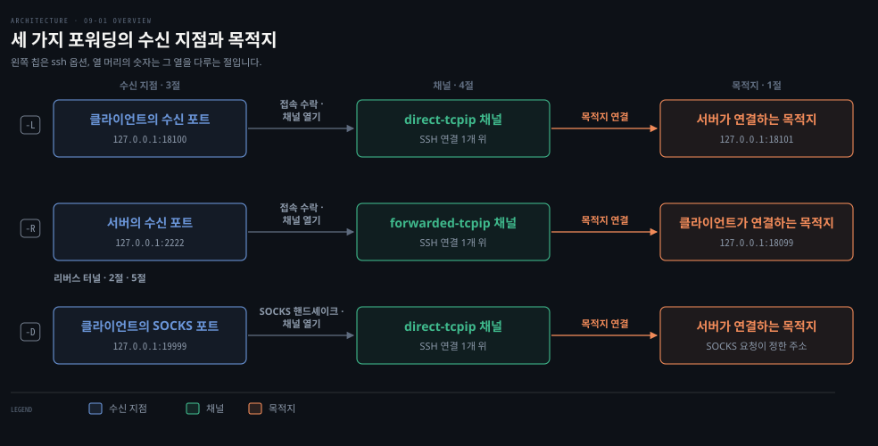
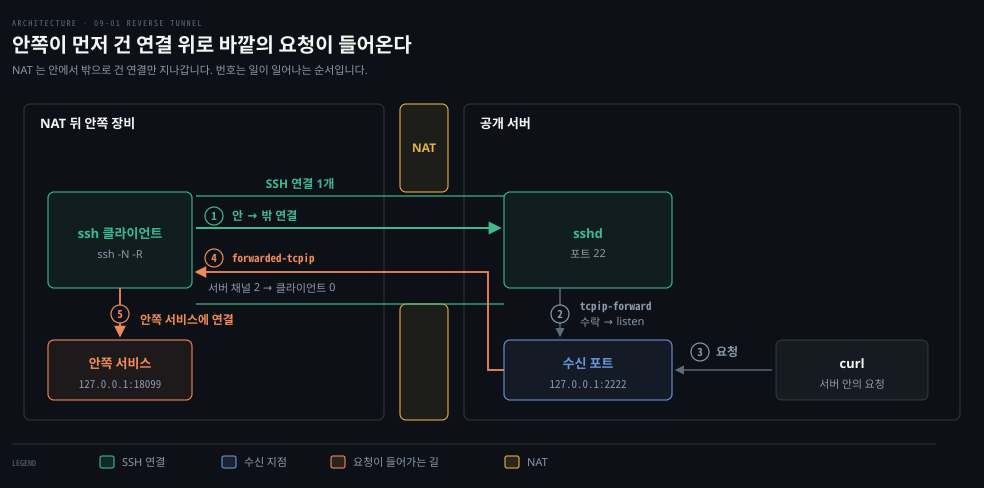
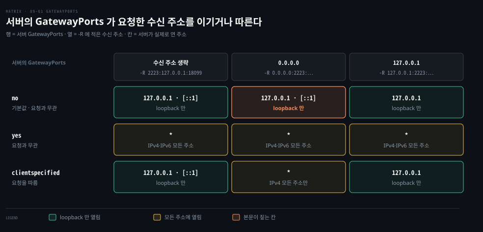
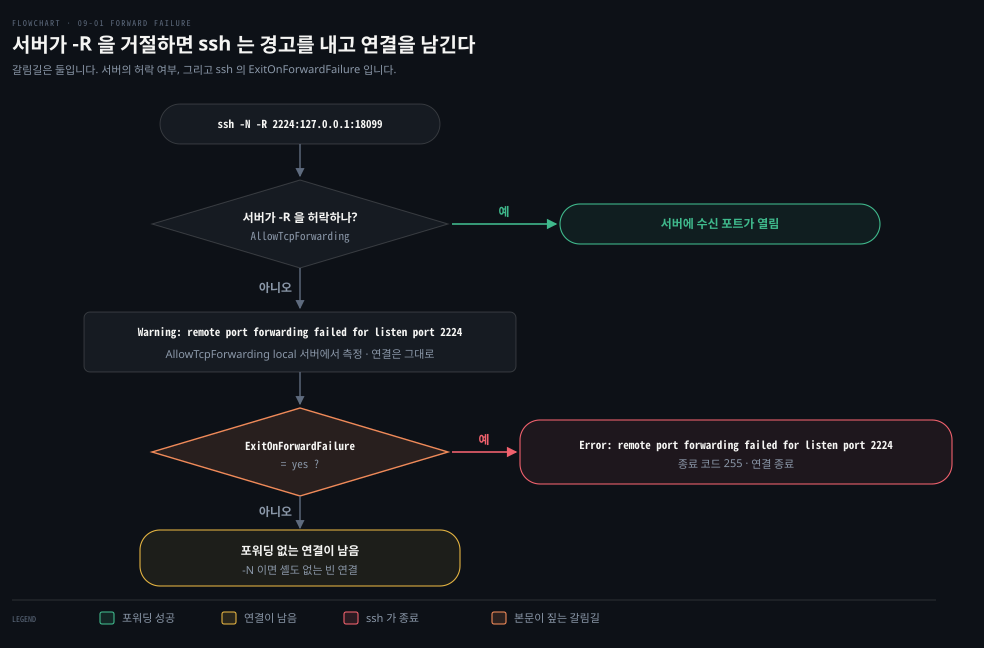
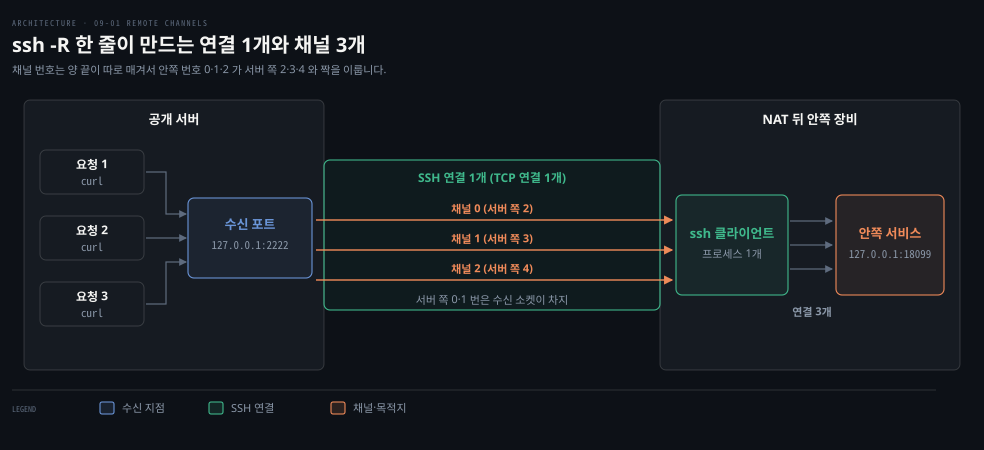

# 포트 포워딩 — local·remote·dynamic 과 리버스 터널의 최소 모형

---

> 포트 포워딩은 SSH 연결 하나 위에 채널을 얹어 TCP(Transmission Control Protocol) 연결을 local·remote·dynamic 세 방향으로 건넵니다. 그중 remote 방향이 NAT(network address translation, 주소 변환) 뒤 장비를 바깥에 여는 리버스 터널의 최소 모형입니다.


## 핵심 요약

> 포트 포워딩은 TCP 연결 하나를 SSH 연결 위의 채널로 바꿔 건네는 일이며, 세 종류는 어느 쪽이 포트를 열고 어느 쪽이 목적지에 연결하는가로만 갈립니다.

NAT 뒤의 장비에는 바깥에서 먼저 연결할 수 없습니다. 안쪽에서 바깥으로 거는 SSH 연결은 지나갑니다. remote 포워딩(`ssh -R`)은 그 연결 위에 서버의 포트를 열어 줍니다. 그러면 바깥의 요청이 이미 맺어진 연결을 타고 안쪽 장비로 들어갑니다. 이것이 리버스 터널의 최소 모형입니다.

요청이 몇 건이든 SSH 연결은 하나이고 요청마다 채널이 하나씩 열립니다. 수신 주소의 기본값은 loopback(자기 자신만 가리키는 주소)입니다. 서버에 계정이 있는 사용자는 누구나 그 포트로 안쪽 장비에 닿으므로 `-R` 은 믿을 수 있는 서버에만 겁니다. 바깥에 노출할지는 서버 설정이 정합니다. 연결 하나가 끊기면 포워딩이 모두 함께 멈춥니다. 리버스 터널 풀은 연결을 여러 개 미리 열어 이 약점을 메웁니다.


## 학습 목표

> 이 편을 읽고 나면 다음을 설명할 수 있습니다.

1. local·remote·dynamic 포워딩에서 수신 포트를 여는 쪽과 목적지에 연결하는 쪽을 각각 말할 수 있습니다.
2. remote 포워딩이 NAT 뒤 장비를 바깥에서 닿게 하는 이유를 연결을 거는 방향으로 설명할 수 있습니다.
3. 서버의 `GatewayPorts` 값과 요청한 수신 주소가 만드는 결과를 짝지을 수 있습니다. 거절된 포워딩에서 ssh 가 보이는 동작도 예측할 수 있습니다.
4. RFC(Request for Comments) 4254 의 채널 메시지 이름으로 세 종류가 SSH 연결 위에서 어떻게 나뉘는지 설명할 수 있습니다.
5. `ssh -R` 이 채널을 한 연결에 얹는 모양과 리버스 터널 풀이 연결을 여럿 미리 여는 모양의 차이를 설명할 수 있습니다.

이 편은 다섯 절입니다. 1절은 세 방향의 차이, 2절은 NAT 뒤 장비가 닿는 이유, 3절은 열리는 주소와 허용 범위를 다룹니다. 4절은 채널 메시지, 5절은 리버스 터널 풀과의 거리를 다룹니다.

개요도의 한 줄이 한 종류이고 왼쪽 칩은 ssh 옵션입니다. 가운데 칸은 셋 모두 SSH 연결 하나 위의 채널입니다. 갈리는 곳은 수신 지점과 목적지가 어느 쪽에 있느냐입니다. 열 머리의 숫자는 그 열을 다루는 절입니다.




## 1. 수신 쪽과 연결 쪽의 세 방향

> 포워딩의 세 종류는 어느 쪽이 수신 포트를 열고 어느 쪽이 목적지에 연결하는가로만 갈립니다.

### 세 방향의 명령 형식

포워딩 종류는 어느 쪽이 수신 포트를 열고 어느 쪽이 목적지에 연결하는가로 갈립니다. **local 포워딩**(`-L`)은 클라이언트가 수신 포트를 열고 서버가 목적지에 연결합니다. **remote 포워딩**(`-R`)은 서버가 수신 포트를 열고 클라이언트 쪽이 목적지에 연결합니다. **dynamic 포워딩**(`-D`)은 클라이언트가 SOCKS 프록시로 포트를 열고 서버가 요청이 정한 주소에 연결합니다.

SOCKS 는 목적지를 요청 안에 실어 보내는 범용 TCP 프록시 규약입니다. ssh 는 SOCKS 4 와 5 를 받습니다.[^man-ssh]

```bash
ssh -N -L 18100:127.0.0.1:18101 <server>
ssh -N -R 2222:127.0.0.1:18099 <server>
ssh -N -D 127.0.0.1:19999 <server>
```

`-L` 과 `-R` 의 형식은 `[수신 주소:]수신 포트:목적지 주소:목적지 포트` 로 같습니다. 다른 점은 수신하는 머신과 목적지에 연결하는 머신이 서로 반대라는 것입니다. `-L` 은 클라이언트가 수신하고 서버가 목적지에 연결하므로 목적지 주소 `127.0.0.1` 은 서버 자신입니다. `-R` 은 서버가 수신하고 클라이언트가 연결하므로 같은 `127.0.0.1` 이 클라이언트 자신입니다.

`-L` 의 수신 주소를 적지 않으면 클라이언트의 `GatewayPorts` 설정을 따릅니다. 기본값 `no` 에서는 클라이언트의 loopback 에만 포트를 엽니다.[^man-ssh]

`-N` 은 원격 명령을 생략하고 `-f` 는 ssh 를 백그라운드로 보냅니다. 포워딩만 쓸 때는 둘을 `-fN` 으로 묶습니다. 특권 포트는 수신 포트를 여는 머신에서 root 일 때만 포워딩할 수 있습니다.[^man-ssh]

### 두 머신에서 돌려 본 결과

같은 세 형태를 2026-11-07 에 두 머신에서 돌렸습니다. 서버는 맥북에서 사용자 프로세스로 띄운 sshd(OpenSSH 10.3)입니다. 클라이언트는 OrbStack 의 Ubuntu 머신(OpenSSH 10.2p1)입니다. `-L` 로 연 포트와 `-D` 로 연 SOCKS 포트는 서버 쪽 서비스의 응답을 받았습니다. `-R` 로 연 서버 포트에 맥북에서 `curl` 을 보내면 Ubuntu 쪽 서비스의 응답이 돌아왔습니다.

세 포워딩 모두 SSH 연결 하나가 맺어진 동안만 존재합니다. 그 바탕에는 클라이언트와 서버 사이의 TCP 연결 하나가 있습니다. 이 연결이 맺어지는 과정은 [TCP 세션은 핸드셰이크로 열고 창으로 속도를 맞추고 FIN·RST 로 끝난다](../npg_network-programming-with-go/03-01.TCP%20세션은%20핸드셰이크로%20열고%20창으로%20속도를%20맞추고%20FIN·RST%20로%20끝난다.md)가 설명합니다.

### dynamic 의 요청 속 목적지

`-L` 과 보통의 `-R` 은 목적지를 명령줄에 적지만 `-D` 는 적지 않습니다. 서버가 연결할 주소는 SOCKS 요청이 접속마다 정합니다. 그래서 `-D` 포트 하나로 여러 목적지에 닿을 수 있습니다. `-R` 도 목적지를 빼고 포트만 주면 서버 쪽 포트가 SOCKS 프록시가 되고, 이때는 클라이언트가 요청이 정한 목적지에 연결합니다.[^man-ssh]

SOCKS 클라이언트는 이름 풀이도 프록시에 맡겨야 목적지 이름이 서버 쪽에서 풀립니다. curl 은 `--socks5-hostname` 이 그 방식입니다. 이름 풀이를 프록시에 맡기지 못하는 클라이언트도 있습니다. SOCKS 요청이 채널 메시지로 바뀌는 모양은 4절에서 봅니다.


## 2. 안쪽 연결로 만드는 리버스 터널

> NAT 뒤 장비에는 바깥에서 먼저 연결할 수 없으므로 안쪽이 먼저 연결을 걸고, 그 연결 위로 바깥의 요청이 되돌아 들어옵니다.

### NAT 가 바깥 연결을 막는 이유

NAT 는 안쪽 장비가 먼저 건 연결의 응답만 안쪽으로 돌려보냅니다. 바깥에서 먼저 오는 연결은 들일 길이 없습니다. 그래서 터널은 늘 안쪽이 먼저 겁니다. NAT 와 연결 추적의 원리는 [NAT·conntrack·outbound connection](../../project/portal-tunnel/01-01.NAT·conntrack·outbound%20connection.md)이 설명합니다. NAT 가 깨뜨리는 것은 [IP — 데이터그램과 주소](../cntd_computer-networking-top-down/04-03.IP%20—%20데이터그램과%20주소.md)의 해당 절이 다룹니다.

### 요청 하나가 닿는 다섯 단계

`ssh -N -R 2222:127.0.0.1:18099 <server>` 한 줄이 리버스 터널의 최소 모형입니다. 1 번 화살표에서 안쪽 장비의 ssh 가 공개 서버의 sshd 로 연결을 먼저 겁니다. 2 번에서 서버는 그 연결로 `tcpip-forward` 요청을 받아 `127.0.0.1:2222` 를 엽니다.

3 번은 서버 안의 curl 이 그 포트로 보내는 요청입니다. 4 번에서 서버가 같은 SSH 연결 위에 `forwarded-tcpip` 채널을 열어 요청을 안쪽으로 되돌립니다. 5 번에서 안쪽 ssh 가 `127.0.0.1:18099` 의 서비스에 연결해 요청을 넘깁니다.



4 번은 새 연결이 아닙니다. 1 번에서 맺은 연결 위의 채널이므로 NAT 를 다시 지날 일이 없습니다. NAT 가 막는 것은 바깥이 먼저 거는 연결입니다. 이 터널은 그 연결을 만들지 않습니다. 이 그림에서 요청을 보낸 curl 은 서버 안에 있습니다. 다른 호스트에서 수신 포트에 닿게 하는 설정은 3절에서 봅니다.

### 연결 끊김과 포워딩 중단

포워딩은 SSH 연결이 살아 있는 동안만 존재합니다. 연결이 끊기면 그 위의 수신 포트와 채널이 함께 사라집니다. ssh 는 끊긴 연결을 스스로 되살리지 않습니다. 안쪽 장비에서 ssh 를 다시 띄우는 별도 감시 프로세스가 그 일을 맡아야 합니다. 조용히 죽은 연결은 ssh 의 `ServerAliveInterval` 같은 SSH 계층 탐침이나 [TCP keepalive](../tii_tcp-ip-illustrated/17-01.keepalive%20는%20조용한%20연결에%20탐침을%20보내%20상대가%20살아%20있는지%20묻는다.md)로 알아챕니다.[^man-ssh-config] 이 약점을 연결 수로 푸는 방법은 5절에서 봅니다.


## 3. 서버 설정이 정하는 수신 주소

> 수신 주소의 기본값은 loopback 이고, 그 주소를 넓히거나 포워딩 자체를 막는 것은 서버 설정입니다.

수신 주소의 기본값이 loopback 이므로 다른 호스트에서 닿게 하려면 `GatewayPorts` 부터 봐야 합니다. 아래 다섯 설정이 이 절의 중심입니다.

| 설정 | 위치 | 정하는 것 |
|---|---|---|
| `GatewayPorts` | sshd_config·ssh_config | 수신 주소를 loopback 밖으로 열 수 있는지. 서버는 remote, 클라이언트는 local·dynamic 을 다룹니다 |
| `AllowTcpForwarding` | sshd_config | 포워딩 요청을 받을지. 값은 `yes`(기본)·`all`·`no`·`local`·`remote` 이고, `all` 은 `yes` 와 같습니다 |
| `PermitOpen` | sshd_config | local·dynamic 포워딩이 넘길 수 있는 목적지 |
| `PermitListen` | sshd_config | remote 포워딩이 열 수 있는 수신 주소와 포트 |
| `ExitOnForwardFailure` | ssh_config | 요청한 포워딩을 못 세울 때 연결을 끊을지 |

### GatewayPorts 와 수신 주소

`ssh -R` 은 수신 주소를 적지 않으면 서버의 loopback 에만 포트를 엽니다. 주소를 비우거나 `*` 로 적으면 모든 인터페이스를 요청합니다. 서버의 `GatewayPorts` 가 허락하지 않으면 요청한 주소 대신 loopback 에 열립니다.[^man-ssh][^man-sshd]

서버의 `GatewayPorts` 는 `no`·`yes`·`clientspecified` 셋이고 기본은 `no` 입니다.[^man-sshd] `no` 는 요청과 무관하게 loopback 에만 엽니다. `yes` 는 요청과 무관하게 모든 주소에 엽니다. `clientspecified` 는 클라이언트가 적은 주소를 따릅니다.

세 값을 2026-11-08 에 맥북 한 대에서 확인했습니다. `GatewayPorts` 값마다 사용자 프로세스 sshd(OpenSSH 10.3p1)를 하나씩 띄웠습니다. 같은 맥북의 ssh 로 수신 주소를 생략·`0.0.0.0`·`127.0.0.1` 로 바꿔 가며 `-R` 을 걸었습니다. 열린 주소는 `lsof -nP -iTCP:<포트> -sTCP:LISTEN` 으로 읽었습니다. `*` 는 그 주소족의 모든 주소이고, IPv4 와 IPv6 는 따로 한 줄씩 나옵니다.



기본값 `no` 서버에 `-R 0.0.0.0:2223:…` 를 요청해도 포트는 `127.0.0.1` 과 `[::1]` 에만 열렸습니다. 2026-11-07 에 OrbStack Ubuntu 클라이언트로 돌렸을 때도 결과가 같았습니다.

`clientspecified` 로 바꾸면 같은 요청이 IPv4 `*:2223` 한 곳에만 열렸습니다. `0.0.0.0` 은 IPv4 전용 주소이기 때문입니다. 두 주소족을 다 열려면 `-R '*:2223:…'` 처럼 `*` 로 적거나 `-R :2223:…` 처럼 주소 칸을 비웁니다.[^rfc4254-7] 반대로 `yes` 는 `127.0.0.1` 을 요청해도 IPv4 와 IPv6 의 모든 주소에 엽니다. `clientspecified` 에서 주소를 생략하면 loopback 에 열립니다.

### loopback 포트의 신뢰 범위

서버에 계정이 있는 사용자는 누구나 그 loopback 포트로 안쪽 장비에 연결할 수 있습니다. 안쪽 서비스에는 그 연결이 `127.0.0.1` 에서 온 것으로 보입니다. 그래서 `-R` 은 계정 가진 사람을 모두 믿을 수 있는 서버에만 겁니다.

### 거절된 포워딩과 남는 연결

`AllowTcpForwarding` 의 기본은 `yes` 입니다. 포워딩을 막아도 셸을 쓸 수 있는 사용자는 자기 전달기를 올릴 수 있습니다. man page 는 셸 접근도 함께 막지 않으면 보안이 나아지지 않는다고 적습니다.[^man-sshd]

서버의 `AllowTcpForwarding` 을 `local` 로 두고 `-R 2224:127.0.0.1:18099` 를 요청했습니다. ssh 는 `Warning: remote port forwarding failed for listen port 2224` 를 내고 연결을 유지했습니다. `ExitOnForwardFailure=yes` 를 더하자 ssh 가 곧바로 끝났습니다. 출력은 `Error: remote port forwarding failed for listen port 2224` 였습니다. 종료 코드는 255 였습니다(2026-11-07).



터널 자체가 목적인 연결은 `ExitOnForwardFailure` 를 `yes` 로 두어야 포워딩 없이 살아 있는 연결이 남지 않습니다.[^man-ssh-config]

### PermitOpen·PermitListen 의 범위 제한

`PermitOpen` 과 `PermitListen` 은 기본이 모두 허용입니다. 수신 주소를 적지 않은 `-R` 은 서버에 `localhost` 를 요청합니다. `PermitListen` 은 이 이름을 명시한 `127.0.0.1`·`::1` 과 다르게 다룹니다. 그래서 `PermitListen 127.0.0.1:2225` 만 둔 서버는 `-R 2225:…` 를 거절합니다. `-R 127.0.0.1:2225:…` 는 받습니다(2026-11-07).[^man-sshd]

### 포워딩이 안 될 때의 점검 순서

애플리케이션을 붙이기 전에 netcat 이나 telnet 으로 수신 포트가 실제로 열렸는지 먼저 봅니다. 열린 포트는 포워딩하지 않은 포트와 같은 응답을 돌려줘야 합니다. 응답이 없으면 먼저 포워딩 명령줄을 다시 봅니다. 서버 설정이 포워딩을 거절했을 수도 있습니다.

한 포트는 한 프로세스만 열 수 있으므로 그 포트를 이미 쓰는 프로세스가 있는지도 확인합니다. 양쪽의 `-v` 로그는 어디서 막혔는지 보여 줍니다.


## 4. 방향별 채널 메시지

> RFC 4254 는 터미널 세션과 포워딩된 연결을 모두 채널로 다루고, 방향마다 채널을 여는 메시지의 이름이 다릅니다.

### 한 연결에 다중화된 채널

포워딩 연결 하나는 SSH 연결 위의 채널 하나가 됩니다. RFC 4254 의 채널 메커니즘은 터미널 세션과 포워딩된 연결을 모두 채널이라고 정합니다. 여러 채널은 연결 하나에 다중화됩니다.[^rfc4254-5] 채널 번호는 양 끝이 따로 매기고 채널마다 흐름 제어가 따로 걸립니다.

### remote 의 요청 하나와 채널 여럿

remote 포워딩은 요청 하나와 채널 여럿으로 이뤄집니다. 클라이언트가 `tcpip-forward` 전역 요청으로 수신 주소와 포트를 알리면 서버가 그 포트를 엽니다.[^rfc4254-7] 포트에 0 을 주면 서버가 포트를 골라 응답에 담습니다. `cancel-tcpip-forward` 가 포워딩을 거둡니다.

그 포트로 연결이 올 때마다 서버가 `forwarded-tcpip` 채널을 엽니다. 이 채널 열기에는 연결된 주소와 포트, 연결을 건 쪽의 주소와 포트가 실립니다. 받는 쪽은 자기가 요청하지 않은 포트의 채널 열기를 거절해야 합니다(MUST).

요청 세 건이 수신 포트에서 채널 세 개로 갈라지고, 안쪽 서비스에는 연결 세 개로 닿습니다.



`ssh -N -R 2222:127.0.0.1:18099` 하나를 띄우고 서버에서 `curl` 세 개를 동시에 걸었습니다(2026-11-07). 클라이언트 `-v` 로그에는 `forwarded-tcpip` 채널 0·1·2 가 열렸습니다. 서버 쪽 번호는 2·3·4 였습니다. 서버의 0·1 번은 `127.0.0.1` 과 `::1` 의 수신 소켓이 이미 쓰고 있었습니다. 그래서 서버 쪽 번호는 그 세션에 먼저 열린 채널 수에 달린 값입니다. 연결 상태를 보면 서버의 sshd 포트로 가는 ESTABLISHED 연결은 하나였고 안쪽 서비스로 가는 연결은 셋이었습니다.

### local·dynamic 의 direct-tcpip

local 과 dynamic 은 반대로 클라이언트가 `direct-tcpip` 채널을 엽니다. 이 열기에는 서버가 연결할 호스트와 포트, 연결을 건 쪽의 주소와 포트가 실립니다. RFC 에는 dynamic 전용 메시지가 없습니다.

OpenSSH 는 SOCKS 핸드셰이크가 끝날 때까지 채널을 내부에서 `dynamic-tcpip` 로 부릅니다. 목적지를 알면 서버에는 `direct-tcpip` 로 엽니다.[^channels-c] `-v` 로그에도 `new dynamic-tcpip` 다음에 `free: direct-tcpip` 가 남았습니다(2026-11-07).

### 세션과 독립인 포워딩 채널

세션과 연결은 다른 말입니다. RFC 의 세션은 셸이나 명령을 담는 세션 채널입니다. 포워딩 채널은 세션과 독립이라서 세션 채널을 닫아도 포워딩된 연결은 닫히지 않습니다. 포워딩이 모두 멈추는 때는 SSH 연결, 곧 TCP 연결이 끊길 때입니다.


## 5. 터널 풀과 다중 연결

> `ssh -R` 은 연결 하나에 채널을 얹고, 리버스 터널 풀은 연결을 여러 개 미리 열어 연결 하나가 죽어도 요청을 받습니다.

### ssh -R 의 연결 하나 의존

`ssh -R` 에서는 요청이 몇 건이든 TCP 연결이 하나입니다. 그 연결이 끊기면 수신 포트와 채널이 모두 사라집니다. 되살리는 일은 2절에서 본 것처럼 ssh 밖의 감시 프로세스가 맡습니다.

### 연결 수로 푸는 단일 연결 약점

풀은 이 약점을 연결 수로 풉니다. portal-tunnel 에서는 `defaultReadyTarget = 2` 가 대기 연결 수의 목표이고 연결 하나가 요청 하나를 맡습니다. 구조는 [reverse_pool·reverse_framing](../../project/portal-tunnel/01-04.reverse_pool·reverse_framing.md)에 있습니다.

Cloudflare 의 cloudflared 도 연결을 미리 여러 개 맺는다는 점에서 같습니다. 복제본마다 outbound 전용 연결 네 개를 맺습니다. 그 연결은 최소 두 데이터센터에 걸친 서로 다른 서버 네 곳으로 갑니다(2026-11-07 조회).[^cf-tunnel] 요청을 연결에 싣는 방식은 이 문서가 다루지 않습니다.

### 연결이 여럿일 때의 새 문제

죽은 연결을 알아채는 일은 [TCP keepalive](../tii_tcp-ip-illustrated/17-01.keepalive%20는%20조용한%20연결에%20탐침을%20보내%20상대가%20살아%20있는지%20묻는다.md)와 [데드라인·하트비트](../npg_network-programming-with-go/03-03.타임아웃은%20Dialer·context%20로,%20유휴%20감지는%20데드라인과%20하트비트로%20건다.md)가 맡습니다. 한꺼번에 끊긴 연결을 다시 걸 때의 폭주는 [백오프·동시성 제한](../../../04_messaging/05_ConsistencyPattern/06-02.Retry%20Storm%20방지%20—%20백오프%20jitter·동시성%20제한·서킷.md)이 다룹니다. 죽은 연결이 쥔 자리를 회수하는 장치는 [DDIA 의 lease](../../../05_data/book/designing-data-intensive-applications/09-03.진실·거짓·시스템%20모델.md)입니다.


## 결정 치트시트

> 이 편의 판단 기준을 한 표에 모았습니다.

| 상황 | 고를 것 | 근거 |
|------|---------|------|
| 내 장비의 포트로 서버 쪽 서비스에 접속할 때 | `-L` | 클라이언트가 수신하고 서버가 목적지에 연결합니다 |
| NAT 뒤 장비의 서비스를 서버에서 쓰게 할 때 | `-R` | 안쪽이 연결을 먼저 걸고 그 위로 요청이 들어옵니다 |
| 목적지가 접속마다 달라질 때 | `-D` | 목적지를 SOCKS 요청이 정합니다 |
| 다른 호스트에서도 `-R` 포트에 닿게 할 때 | `clientspecified` 와 `-R '*:…'` | 서버가 요청을 따라 IPv4·IPv6 모든 주소에 엽니다(`0.0.0.0` 은 IPv4 만) |
| 열린 `-R` 포트를 서버 안에만 두고 싶을 때 | `GatewayPorts` 기본값 `no` | 요청과 무관하게 loopback 에만 엽니다 |
| 포워딩이 실패하면 연결을 끊고 싶을 때 | `-o ExitOnForwardFailure=yes` | 기본값은 경고만 내고 연결을 남깁니다 |
| 서버에서 포워딩 범위를 좁힐 때 | `AllowTcpForwarding`·`PermitOpen`·`PermitListen` | 셸 접근을 함께 막아야 효과가 있습니다 |
| 연결 하나가 끊어도 터널이 유지돼야 할 때 | 연결을 여럿 미리 여는 풀 | 연결 하나가 죽어도 남은 연결이 요청을 받습니다 |


## 면접 대비

> 이 편에서 실제로 물어보기 좋은 것만 골랐습니다.

### 한 줄 정의

SSH 포트 포워딩은 TCP 연결 하나를 SSH 연결 위의 채널로 바꿔 건네는 기능이며, 수신 포트를 여는 쪽과 목적지에 연결하는 쪽에 따라 local·remote·dynamic 으로 갈립니다.

### 핵심 포인트 세 가지

1. 세 방향은 수신하는 쪽과 연결하는 쪽으로만 갈립니다. 같은 `127.0.0.1` 도 `-L` 에서는 서버를, `-R` 에서는 클라이언트를 가리킵니다.
2. 리버스 터널은 안쪽이 먼저 건 연결을 재사용합니다. NAT 는 바깥이 먼저 거는 연결만 막으므로, 연결 위에 채널을 얹는 방식은 NAT 를 다시 지나지 않습니다.
3. 클라이언트가 요청한 주소를 따를지는 서버의 `GatewayPorts` 가 정합니다. 기본값 `no` 에서는 `0.0.0.0` 을 요청해도 loopback 에만 열립니다. 거절된 포워딩은 경고만 남기며 연결을 유지합니다.

### 자주 묻는 질문

- *`ssh -R` 로 연 포트가 왜 다른 호스트에서는 안 닿습니까?* 서버의 `GatewayPorts` 기본값이 `no` 라서 요청한 주소와 무관하게 loopback 에만 열기 때문입니다. `clientspecified` 와 함께 `-R '*:…'` 로 모든 주소를 요청해야 IPv4·IPv6 의 다른 호스트가 닿습니다. `-R 0.0.0.0:…` 은 IPv4 쪽만 엽니다.
- *동시 요청 세 건이면 SSH 연결은 몇 개입니까?* 하나입니다. 요청마다 `forwarded-tcpip` 채널이 하나씩 열려 채널은 셋이 됩니다. 안쪽 서비스로 가는 연결도 셋입니다.
- *포워딩이 거절돼도 ssh 가 끝나지 않는 이유는 무엇입니까?* `ExitOnForwardFailure` 기본값이 `no` 라서 포워딩을 못 세워도 연결은 세우기 때문입니다. 셸을 함께 연 연결이라면 셸은 계속 쓸 수 있습니다. 터널 전용이면 `ExitOnForwardFailure=yes` 를 더해 종료 코드 255 로 끝나게 합니다.
- *`ssh -R` 과 리버스 터널 풀은 무엇이 다릅니까?* 연결 수입니다. `ssh -R` 은 연결 하나에 모든 요청이 얹혀 끊기면 전부 멈춥니다. 풀은 연결을 여러 개 미리 열어 하나가 죽어도 남은 연결이 받습니다.


## 연습 문제

> 1~3번은 본문을 떠올려 답하는 문제이고 4~6번은 직접 돌려 확인하는 문제입니다. 답을 적은 뒤 정답 절과 맞춰 봅니다.

1. local·remote·dynamic 포워딩에서 수신 포트를 여는 쪽과 목적지에 연결하는 쪽은 각각 어디입니까?
2. NAT 뒤 장비를 바깥 서버의 포트로 닿게 하는 연결은 어느 쪽이 어느 쪽으로 걸고, 왜 그 방향이어야 합니까?
3. `ssh -R` 과 리버스 터널 풀은 연결 수와 연결이 끊겼을 때의 동작에서 어떻게 다릅니까?
4. 서버를 `AllowTcpForwarding local` 로 두고 `-R 2224:127.0.0.1:18099` 를 요청합니다. 무엇이 출력되고 연결은 어떻게 됩니까? `ExitOnForwardFailure=yes` 를 더하면 무엇이 달라집니까?
5. `ssh -N -R 2222:127.0.0.1:18099` 하나를 띄웁니다. 서버에서 `curl` 세 개를 동시에 걸면 SSH 연결·채널·안쪽 서비스 연결은 각각 몇 개입니까? 채널 번호가 양 끝에서 다를 수 있는 이유는 무엇입니까?
6. `-R 0.0.0.0:2223:127.0.0.1:18099` 를 겁니다. 서버의 `GatewayPorts` 를 `no`·`yes`·`clientspecified` 로 바꿔 가며 걸면 수신 소켓은 어떤 주소에 열립니까?


## 정답 (자답 후 펼치기)

> 번호는 연습 문제와 같습니다. 값은 2026-11-07·2026-11-08 측정과 OpenSSH 10.6 man page 에서 온 것입니다.

### 정답 1 — 수신 쪽과 연결 쪽

local 은 클라이언트가 포트를 열고 서버가 목적지에 연결합니다. remote 는 서버가 포트를 열고 클라이언트 쪽이 목적지에 연결합니다. dynamic 은 클라이언트가 SOCKS 프록시로 포트를 열고, 서버가 프록시 요청이 정한 주소에 연결합니다.

### 정답 2 — 안쪽에서 바깥으로 거는 연결

안쪽 장비의 ssh 가 바깥 서버로 연결을 걸어야 합니다. NAT 는 안쪽에서 시작한 연결의 응답을 안쪽으로 돌려보냅니다. 바깥에서 먼저 오는 연결은 들일 길이 없습니다. 서버의 포트로 온 요청은 이미 맺어진 그 연결 위의 채널로 안쪽에 들어갑니다.

### 정답 3 — 연결 하나와 연결 여럿

`ssh -R` 은 요청이 몇 건이든 연결이 하나입니다. 그 연결이 끊기면 수신 포트와 채널이 모두 사라집니다. ssh 는 스스로 다시 걸지 않습니다. 풀은 연결을 여러 개 미리 열어 두고 연결 하나에 요청 하나를 맡깁니다. portal-tunnel 의 대기 목표는 2 입니다. 한 연결이 죽어도 남은 연결이 다음 요청을 받을 수 있습니다.

### 정답 4 — 경고 뒤 연결 유지

서버 설정 파일에 `AllowTcpForwarding local` 을 두고 다음 명령을 걸면 됩니다.

```bash
ssh -N -R 2224:127.0.0.1:18099 <server>
```

ssh 는 아래 경고만 내고 연결을 유지합니다. `ExitOnForwardFailure` 의 기본값 `no` 가 포워딩이 실패해도 연결을 세우라는 뜻이기 때문입니다. `-N` 으로 걸었으므로 남은 연결은 셸도 포워딩도 없는 빈 연결입니다.

```bash
Warning: remote port forwarding failed for listen port 2224
```

터널 전용이라면 `-o ExitOnForwardFailure=yes` 를 더해야 합니다. 그러면 `Error: remote port forwarding failed for listen port 2224` 를 내고 `echo $?` 가 255 로 끝납니다. 포워딩 없는 연결은 남지 않습니다.

### 정답 5 — 연결 1개와 채널 3개

SSH 연결은 하나이고 채널은 셋, 안쪽 서비스로 가는 연결도 셋입니다. `ssh -v` 로그에서 클라이언트 쪽 채널 번호를 읽고 서버 쪽 번호와 맞춰 봅니다. 양 끝이 각자 남는 번호를 매기므로, 서버 쪽에서는 수신 소켓이 앞 번호를 먼저 차지해 클라이언트 쪽 0·1·2 가 서버 쪽 2·3·4 와 짝을 이뤘습니다. RFC 4254 는 채널 번호가 양 끝에서 다를 수 있다고 정합니다.

### 정답 6 — loopback 과 모든 주소

수신 소켓은 `lsof -nP -iTCP:2223 -sTCP:LISTEN` 으로 읽습니다. 요청한 `0.0.0.0` 은 `no` 에서 무시되고 `clientspecified` 에서만 지켜집니다.

| 서버의 GatewayPorts | 열린 주소 |
|---|---|
| `no` | `127.0.0.1` 과 `[::1]` |
| `yes` | IPv4 `*` 와 IPv6 `*` |
| `clientspecified` | IPv4 `*` 하나 |

2026-11-08 에 같은 맥북에서 돌린 값입니다. `yes` 는 어떤 주소를 요청해도 모든 주소에 엽니다. `no` 는 `127.0.0.1` 을 요청하면 `127.0.0.1` 한 곳에만 엽니다. `0.0.0.0` 은 IPv4 전용이라 `clientspecified` 에서는 IPv6 소켓이 생기지 않습니다.


## 참고 자료

- Michael W. Lucas, 《SSH Mastery: OpenSSH, PuTTY, Tunnels and Keys》 2nd ed., Tilted Windmill Press, 2017, Chapter 9.
- [RFC 4254 §7 TCP/IP Port Forwarding](https://www.rfc-editor.org/rfc/rfc4254#section-7) — `tcpip-forward`·`forwarded-tcpip`·`direct-tcpip` 메시지.
- [RFC 4254 §5 Channel Mechanism](https://www.rfc-editor.org/rfc/rfc4254#section-5) — 채널 다중화와 채널 번호.
- [OpenSSH V_10_6_P1 ssh.1](https://github.com/openssh/openssh-portable/blob/V_10_6_P1/ssh.1) — `-L`·`-R`·`-D`·`-N`·`-f`.
- [OpenSSH V_10_6_P1 ssh_config.5](https://github.com/openssh/openssh-portable/blob/V_10_6_P1/ssh_config.5) — `GatewayPorts`·`ExitOnForwardFailure`·`ServerAliveInterval`.
- [OpenSSH V_10_6_P1 sshd_config.5](https://github.com/openssh/openssh-portable/blob/V_10_6_P1/sshd_config.5) — `GatewayPorts`·`AllowTcpForwarding`·`PermitOpen`·`PermitListen`.
- [OpenSSH V_10_6_P1 channels.c](https://github.com/openssh/openssh-portable/blob/V_10_6_P1/channels.c) — `dynamic-tcpip` 와 `direct-tcpip`.
- [Cloudflare Tunnel availability](https://developers.cloudflare.com/cloudflare-one/networks/connectors/cloudflare-tunnel/configure-tunnels/tunnel-availability/) — cloudflared 의 outbound 연결 수.


## 관련 문서

- [TCP 세션은 핸드셰이크로 열고 창으로 속도를 맞추고 FIN·RST 로 끝난다](../npg_network-programming-with-go/03-01.TCP%20세션은%20핸드셰이크로%20열고%20창으로%20속도를%20맞추고%20FIN·RST%20로%20끝난다.md) — SSH 연결의 바탕인 TCP 연결을 맺고 끝내는 과정.
- [io 의 Copy·MultiWriter·TeeReader 로 연결을 잇고 엿본다](../npg_network-programming-with-go/04-02.io%20의%20Copy·MultiWriter·TeeReader%20로%20연결을%20잇고%20엿본다.md) — 두 연결 사이로 바이트를 건네는 양방향 프록시를 Go 로 만드는 모양.
- [Caddy 는 JSON 설정을 관리 API 로 실시간 바꾸고 모듈과 어댑터로 넓힌다](../npg_network-programming-with-go/10-01.Caddy%20는%20JSON%20설정을%20관리%20API%20로%20실시간%20바꾸고%20모듈과%20어댑터로%20넓힌다.md) — 에지 리버스 프록시와 터널의 차이를 다룹니다.
- [IP — 데이터그램과 주소](../cntd_computer-networking-top-down/04-03.IP%20—%20데이터그램과%20주소.md) — NAT 가 깨뜨리는 것.
- [NAT·conntrack·outbound connection](../../project/portal-tunnel/01-01.NAT·conntrack·outbound%20connection.md), [reverse_pool·reverse_framing](../../project/portal-tunnel/01-04.reverse_pool·reverse_framing.md) — 리버스 터널 풀의 원리와 구조.
- [Control Plane Flow](../../project/portal-tunnel/01-03.Control%20Plane%20Flow.md), [lease·record](../../project/portal-tunnel/01-06.lease·record.md) — portal-tunnel 쪽의 흐름.
- [Stream multiplexing](../../project/portal-tunnel/01-02.Stream%20multiplexing·HTTP%20Upgrade·QUIC.md), [stream_mux·yamux](../../project/portal-tunnel/01-05.stream_mux·yamux.md) — 채널 다중화.
- [Client·Transport](../../../01_language/docs/go/net-http/02-01.Client·Transport.md) — Go 클라이언트의 연결 재사용.

[^man-ssh]: OpenSSH V_10_6_P1 `ssh.1` 의 `-D`·`-L`·`-R`·`-N`·`-f` 항목입니다.
[^man-ssh-config]: OpenSSH V_10_6_P1 `ssh_config.5` 의 `ExitOnForwardFailure`·`ServerAliveInterval` 항목입니다.
[^man-sshd]: OpenSSH V_10_6_P1 `sshd_config.5` 의 `GatewayPorts`·`AllowTcpForwarding`·`PermitOpen`·`PermitListen` 항목입니다.
[^rfc4254-5]: RFC 4254 §5 Channel Mechanism 입니다.
[^rfc4254-7]: RFC 4254 §7.1 Requesting Port Forwarding 과 §7.2 TCP/IP Forwarding Channels 입니다.
[^channels-c]: OpenSSH V_10_6_P1 `channels.c` 의 SOCKS 처리 뒤 `port_open_helper` 호출부입니다.
[^cf-tunnel]: Cloudflare Tunnel availability 문서(2026-11-07 조회)의 cloudflared 연결 수 설명입니다.
