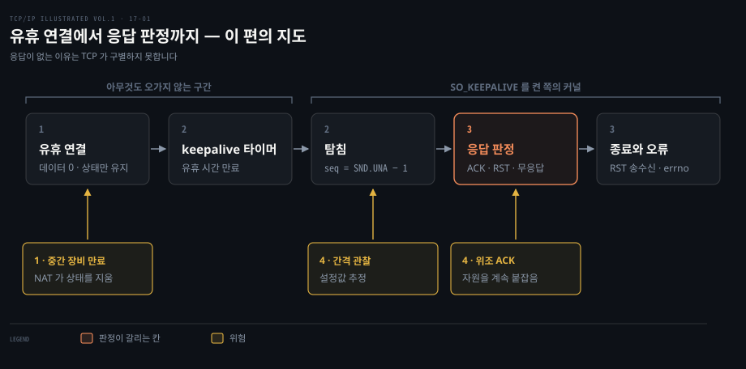
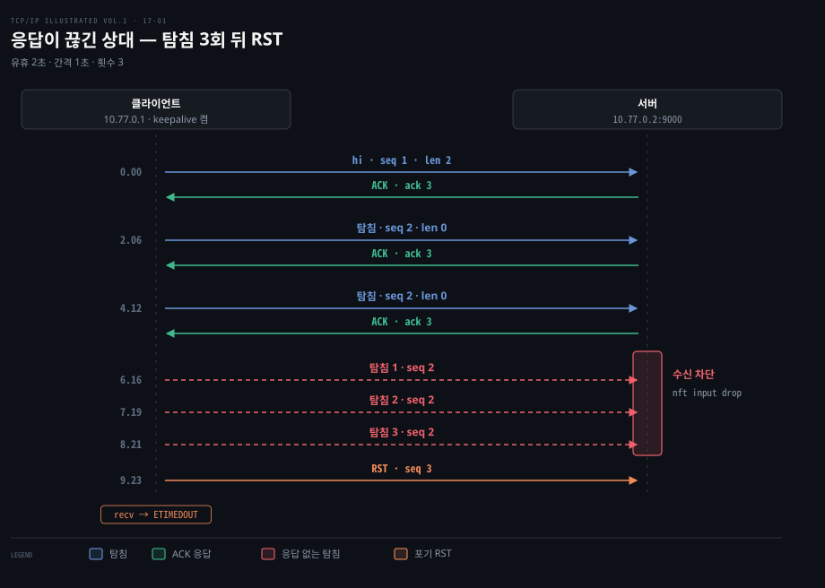

# keepalive 는 조용한 연결에 탐침을 보내 상대가 살아 있는지 묻는다

---

> 데이터가 오가지 않는 TCP 연결은 상대가 사라져도 알 길이 없습니다. keepalive 는 유휴 시간이 지나면 상대에게서 받은 가장 큰 확인 번호보다 하나 작은 순서 번호를 단 빈 확인 응답을 보내 상대의 생존을 묻고, 답이 끝내 없으면 연결을 오류로 닫습니다.


## 핵심 요약

> 유휴 연결은 침묵만으로는 죽은 상대와 조용한 상대를 가를 수 없으므로, keepalive 는 타이머가 만료될 때 탐침을 보내고 돌아오는 응답의 모양으로 연결의 운명을 정합니다.

열린 TCP 연결에 바이트가 하나도 오가지 않아도 연결은 양쪽 호스트의 메모리에 남아 있습니다. 한쪽 호스트의 전원이 나가면 반대쪽은 이 사실을 알려 줄 신호를 받지 못합니다. keepalive 는 이 침묵을 깨기 위해 소켓마다 켜는 선택 기능이고 기본은 꺼져 있습니다.

켜 두면 유휴 시간이 지난 뒤 커널이 길이 0 의 확인 응답(ACK) 세그먼트를 탐침으로 보냅니다. 상대가 살아 있으면 ACK 로 답하고 타이머가 처음부터 다시 돕니다. 답이 없으면 간격마다 탐침을 되풀이합니다. 정해진 횟수를 넘기면 연결을 재설정(RST)하고 ETIMEDOUT 오류를 올립니다. 상대가 재부팅을 마쳤다면 RST 가 곧바로 돌아와 ECONNRESET 이 됩니다.

탐침에는 사용자 데이터가 없어서 암호화가 가려 주지 못합니다. 그래서 위조 ACK 로 상대의 자원을 오래 붙잡거나 탐침 간격을 관찰해 설정값을 읽어 내는 일이 가능합니다.


## 학습 목표

> 이 편을 읽고 나면 다음을 설명할 수 있습니다.

1. keepalive 가 풀려는 문제와 소켓마다 켜야 동작하는 이유를 설명할 수 있습니다.
2. 유휴 시간·탐침 간격·탐침 횟수로 포기 시점을 계산하고 Linux 의 기본값과 소켓 옵션을 말할 수 있습니다.
3. 탐침의 순서 번호가 왜 확인된 번호보다 하나 작은지 설명할 수 있습니다.
4. 상대 상태 네 가지에서 돌아오는 응답과 요청한 쪽의 오류를 짝지을 수 있습니다.
5. 탐침이 암호화로 보호되지 않아 생기는 위조·관찰 위험과 응용 계층 keepalive 의 차이를 설명할 수 있습니다.

이 편은 유휴 연결에서 시작해 타이머, 탐침, 응답 판정, 종료로 이어지는 한 줄의 흐름을 따라갑니다. 흐름 위쪽에는 단계마다 걸리는 위험이 붙고, 숫자는 본문 정리의 절 번호입니다. 가운데 응답 판정 칸이 강조된 것은 같은 탐침이 응답에 따라 전혀 다른 결말로 갈리기 때문입니다.




## 본문 정리

> keepalive 는 유휴 시간, 탐침, 응답 판정의 순서로 움직입니다. 이 순서의 시간 값은 Linux 7.2 문서로, 응답 없음·재부팅·도달 불가의 결말은 OrbStack 실측으로 확인합니다.

### 1. 유휴 연결의 침묵과 keepalive 의 역할

유휴 연결에서는 상대가 사라져도 아무 일도 일어나지 않으므로, keepalive 는 이 침묵 위에서만 의미가 있는 선택 기능입니다. 데이터가 오가지 않으면 두 끝점 사이에 패킷이 하나도 흐르지 않습니다. 연결 상태는 양쪽 호스트의 메모리에만 있어서 한쪽이 말없이 사라지면 반대쪽은 그대로 열린 연결로 믿습니다. 정상 종료는 FIN(finish) 세그먼트로 EOF(end of file)를 전하기 때문에 keepalive 의 대상은 인사 없이 사라진 상대입니다. 이런 상태는 [13-03 의 half-open 절](./13-03.TCP%20상태는%20연결의%20과거를%20기억하고%20RST는%20그%20기억을%20끊는다.md)이 설명하는 한쪽만 옛 상태를 믿는 상황과 같은 뿌리입니다.

쓰임은 크게 둘입니다. 서버는 사라진 클라이언트가 붙들고 있는 소켓과 메모리를 되찾으려고 켭니다. 클라이언트는 중간의 NAT(network address translation, 주소 변환) 장비가 유휴 연결 상태를 지우지 못하게 하려고 켭니다. 두 번째 쓰임에서는 탐침 주기가 NAT 의 유휴 만료 시간보다 짧아야 합니다.

TCP 명세가 keepalive 를 넣지 않은 데는 이유가 있습니다. 표준 문서는 세 가지 반론을 듭니다. 일시적인 망 장애에서는 멀쩡한 연결이 끊길 수 있고 대역폭도 씁니다. 패킷마다 요금이 붙는 경로에서는 비용이 되기도 합니다.[^rfc1122-why]

그래서 구현은 선택입니다. 구현했다면 연결마다 켜고 끌 수 있어야 하며 기본은 꺼짐입니다.[^rfc9293-kal] 죽은 클라이언트를 찾는 쓰임은 비대화형 클라이언트와 짧게 주고받는 웹·메일 서버에서 가장 쓸모가 큽니다. 오래 이어지는 대화형 서비스는 피하는 편이 나을 수 있습니다.

keepalive 가 확인하는 것은 상대 호스트의 TCP 구현이 응답하는지까지입니다. 상대 응용 프로세스가 멈춰 있어도 커널은 ACK 를 돌려 보내므로 탐침은 통과합니다. 응용이 살아 있는지는 [03-03 의 하트비트 절](../npg_network-programming-with-go/03-03.타임아웃은%20Dialer·context%20로,%20유휴%20감지는%20데드라인과%20하트비트로%20건다.md)처럼 응용 계층 메시지로 확인합니다. Go 에서 keepalive 값을 건네는 방법은 [04-03 의 keepalive 절](../npg_network-programming-with-go/04-03.TCPConn%20손잡이와%20흔한%20버그%20—%20keepalive·linger·버퍼·zero%20window·CLOSE_WAIT.md)에 있어서 여기서는 풀지 않습니다.


### 2. 탐침 타이머와 시간 값

타이머는 마지막으로 받은 세그먼트 뒤 유휴 시간이 지나야 처음 움직입니다. 그 뒤로는 응답이 올 때까지 간격마다 탐침을 되풀이합니다. 세 값에는 이름이 따로 있습니다. **keepalive 시간**은 마지막 수신부터 첫 탐침까지의 유휴 시간입니다. **keepalive 간격**은 응답 없는 탐침 사이의 시간이고, **keepalive 횟수**는 포기하기 전까지 응답 없이 보낸 탐침의 수입니다.

Linux 7.2 의 기본값과 값을 바꾸는 방법은 다음과 같습니다. sysctl 은 커널 매개변수를 읽고 쓰는 인터페이스입니다.

| 값 | sysctl | 소켓 옵션 | 기본값 | 소켓 옵션의 범위 |
|---|---|---|---|---|
| keepalive 시간 | `net.ipv4.tcp_keepalive_time` | `TCP_KEEPIDLE` | 7200초 (2시간) | 1~32767초 |
| keepalive 간격 | `net.ipv4.tcp_keepalive_intvl` | `TCP_KEEPINTVL` | 75초 | 1~32767초 |
| keepalive 횟수 | `net.ipv4.tcp_keepalive_probes` | `TCP_KEEPCNT` | 9회 | 1~127회 |

sysctl 값은 모든 소켓의 기본값을 정합니다.[^sysctl] 소켓 옵션은 그 소켓 하나에만 적용되고 sysctl 값보다 우선합니다.[^sockopt] 두 방식 모두 `SO_KEEPALIVE` 를 켜야 비로소 타이머가 돕니다. 기본값으로 포기까지 걸리는 시간은 마지막 수신부터 7200 + 75 × 9 = 7875초, 약 2시간 11분입니다. 이 계산은 [04-03](../npg_network-programming-with-go/04-03.TCPConn%20손잡이와%20흔한%20버그%20—%20keepalive·linger·버퍼·zero%20window·CLOSE_WAIT.md)에도 있으므로 여기서는 결과만 적습니다.

탐침은 데이터가 없는 ACK 세그먼트입니다. 순서 번호는 송신했지만 아직 확인받지 못한 가장 오래된 바이트의 번호(SND.UNA, send unacknowledged)보다 하나 작습니다.[^probe-seq] 유휴 연결에서는 보낸 바이트가 모두 확인된 상태라서 이 번호는 마지막으로 보낸 바이트의 번호와 같습니다. 상대는 이미 받은 번호를 가진 세그먼트를 받으면 허용 범위 밖으로 보고 기대하는 다음 번호를 담은 ACK 를 즉시 돌려 보냅니다.[^unacceptable] 이 ACK 가 탐침에 대한 응답입니다. 새 바이트를 싣지 않으므로 상대의 수신 스트림도 어지럽히지 않습니다.

탐침이나 그 응답 하나가 사라졌다고 상대가 죽었다고 단정하면 안 됩니다. 데이터 없는 ACK 는 TCP 가 다시 보내 주지 않기 때문입니다.[^no-retx] 그래서 응답 없는 탐침을 여러 번 되풀이한 뒤에야 판정합니다. 응답 ACK 가 한 번이라도 도착하면 응답 없는 탐침 카운터는 0 으로 돌아갑니다.[^ack-reset] 다음 탐침은 간격 뒤가 아니라 다시 유휴 시간 뒤에 나갑니다.

아직 확인받지 못한 데이터가 있거나 보낼 데이터가 쓰기 큐에 남아 있으면 타이머는 탐침을 보내지 않고 다음 만료만 다시 겁니다. 그 구간의 생사는 재전송 타이머가, 창이 0 이라 쓰기 큐만 남은 경우는 [15-02 의 persist 타이머](./15-02.수신%20창은%20송신을%20붙잡고%200%20창은%20persist%20타이머가%20다시%20연다.md)가 맡기 때문입니다.[^timer]

응답 없는 탐침이 횟수만큼 쌓인 채 타이머가 한 번 더 만료되면 커널이 포기합니다. 상대에게 RST 를 보내고 소켓에 오류를 올립니다. 이 오류는 ETIMEDOUT 입니다.[^giveup] 그 사이 ICMP(Internet Control Message Protocol) 도달 불가가 돌아와도 결과는 같습니다. ICMP 가 인용한 탐침의 순서 번호가 SND.UNA 보다 작아 커널이 창 밖의 ICMP 로 보고 버리기 때문입니다.[^icmp-window]


### 3. 상대 상태 네 가지와 돌아오는 응답

탐침을 보내는 쪽은 상대의 상태를 직접 볼 수 없고, 돌아오는 응답이 무엇이냐에 따라 결말이 갈립니다. 상대가 놓일 수 있는 상태는 네 가지입니다.

| 상대의 상태 | 돌아오는 것 | 요청한 쪽의 결말 |
|---|---|---|
| 정상 동작 | ACK | 카운터 0, 타이머 재시작, 연결 유지 |
| 죽었거나 재부팅 중 | 없음 | 간격마다 재시도 뒤 RST 송신, ETIMEDOUT |
| 죽었다가 재부팅을 마침 | RST | 곧바로 ECONNRESET |
| 살아 있지만 도달 불가 | 없음 (ICMP 도달 불가가 올 수 있음) | 둘째와 같음. ICMP 가 와도 창 밖이라 버려져 ETIMEDOUT |

셋째 줄은 재부팅한 호스트에 그 연결을 아는 상태가 없기 때문에 나옵니다. 없는 연결의 세그먼트에 대해서는 RST 로 답하는 규칙이 있고, 자세한 조건은 [13-03 의 RST 절](./13-03.TCP%20상태는%20연결의%20과거를%20기억하고%20RST는%20그%20기억을%20끊는다.md)에 있습니다.

넷째 줄은 둘째 줄과 결말이 같습니다. 라우터가 고장 났든 케이블이 빠졌든 탐침은 허공으로 사라지거나 ICMP 로 되돌아올 뿐입니다. 뒤의 ICMP 실험에서 이를 확인합니다.

이 결말을 OrbStack Ubuntu(커널 7.2.12) 에서 직접 잡았습니다. 네트워크 네임스페이스 두 개를 가상 이더넷 쌍(veth)으로 잇고 클라이언트(`10.77.0.1`)가 서버(`10.77.0.2:9000`)에 연결합니다. 시간을 줄이려고 sysctl 이 아니라 클라이언트 소켓의 옵션으로 시간 2초, 간격 1초, 횟수 3을 잡았습니다.

```python
import socket

s = socket.socket(socket.AF_INET, socket.SOCK_STREAM)
s.setsockopt(socket.SOL_SOCKET, socket.SO_KEEPALIVE, 1)
s.setsockopt(socket.IPPROTO_TCP, socket.TCP_KEEPIDLE, 2)
s.setsockopt(socket.IPPROTO_TCP, socket.TCP_KEEPINTVL, 1)
s.setsockopt(socket.IPPROTO_TCP, socket.TCP_KEEPCNT, 3)
s.connect(("10.77.0.2", 9000))
s.sendall(b"hi")
```

서버는 첫 데이터를 받은 5초 뒤 방화벽 도구 nft 로 입력 규칙을 걸어 이후의 모든 수신을 버립니다. 서버 호스트가 죽은 것과 같은 효과이고, 이 실험을 이 노트에서는 응답 없음 실험이라 부릅니다.

```bash
ip netns add cli; ip netns add srv
ip link add vc type veth peer name vs
ip link set vc netns cli; ip link set vs netns srv
ip -n cli addr add 10.77.0.1/24 dev vc; ip -n srv addr add 10.77.0.2/24 dev vs
ip -n cli link set vc up; ip -n srv link set vs up
ip netns exec cli tcpdump -nn -U -i vc -w dump.pcap 'tcp port 9000' &
ip netns exec srv nft add table inet t
ip netns exec srv nft add chain inet t i '{ type filter hook input priority 0 ; }'
ip netns exec srv nft add rule inet t i drop
```

`tcpdump` 는 클라이언트 쪽 패킷을 파일로 저장했습니다. 그동안 `ss -tno state established dst 10.77.0.2` 로 타이머를 두 번 읽었습니다.

```bash
# 유휴 1.0초: keepalive 타이머가 돌고 응답 없는 탐침 0
timer:(keepalive,988ms,0)
# 7.0초: 탐침 1개가 응답 없이 나간 상태
timer:(keepalive,155ms,1)
```

`timer:` 의 세 필드는 타이머 이름, 남은 시간, 응답 없이 나간 탐침 수입니다.[^ss-timer] 이어서 캡처를 읽으면 다음과 같습니다. 순서 번호는 연결 시작을 0 으로 잡은 상대 번호입니다.

| 시각(초) | 방향 | 세그먼트 | 순서 번호 | 길이 | 뜻 |
|---|---|---|---|---|---|
| 0.00 | 클라이언트 → 서버 | 데이터 | 1 | 2 | `hi` 전송 |
| 0.00 | 서버 → 클라이언트 | ACK | 1 | 0 | 확인 번호 3, 이후 SND.UNA = 3 |
| 2.06 | 클라이언트 → 서버 | 탐침 | 2 | 0 | 유휴 2초 뒤 첫 탐침, 2 = 3 − 1 |
| 2.06 | 서버 → 클라이언트 | ACK | 1 | 0 | 응답, 확인 번호 3, 카운터 0 |
| 4.12 | 클라이언트 → 서버 | 탐침 | 2 | 0 | 응답 뒤 다시 유휴 시간 |
| 4.12 | 서버 → 클라이언트 | ACK | 1 | 0 | 응답 |
| 6.16 | 클라이언트 → 서버 | 탐침 | 2 | 0 | 서버가 버린 첫 탐침 (규칙은 약 5초에 걸림) |
| 7.19 | 클라이언트 → 서버 | 탐침 | 2 | 0 | 간격 1초 뒤 재시도 |
| 8.21 | 클라이언트 → 서버 | 탐침 | 2 | 0 | 세 번째 응답 없는 탐침 |
| 9.23 | 클라이언트 → 서버 | RST | 3 | 0 | 포기, 클라이언트의 `recv` 는 ETIMEDOUT |

마지막 응답이 온 4.12초부터 RST 가 나간 9.23초까지는 5.11초이고, 설정한 2 + 1 × 3 = 5초에 가깝습니다. 서버가 보낸 두 ACK 의 확인 번호는 모두 3 이어서 서버가 `hi` 뒤로 새 바이트를 받지 않았음을 알 수 있습니다.



재부팅을 흉내 낸 실험도 했습니다. 서버가 `SO_LINGER` 0 으로 연결을 닫을 때 출력 규칙이 RST 를 버립니다. 이어서 규칙을 모두 걷어 냅니다. 그러면 클라이언트는 서버가 연결을 잊은 줄 모르고 탐침을 보냅니다.

| 시각(초) | 방향 | 세그먼트 | 순서 번호 | 뜻 |
|---|---|---|---|---|
| 2.05 | 클라이언트 → 서버 | 탐침 | 2 | 첫 탐침, 서버는 아직 응답 |
| 2.05 | 서버 → 클라이언트 | ACK | 1 | 응답 |
| 4.10 | 클라이언트 → 서버 | 탐침 | 2 | 서버가 연결을 잊은 뒤의 탐침 |
| 4.10 | 서버 → 클라이언트 | RST | 1 | ACK 비트가 없는 RST, 클라이언트의 `recv` 는 ECONNRESET |

이 RST 는 응답 없음 실험과 달리 곧바로 도착해서 4.1초에 연결이 끝났습니다. 횟수 3을 다 쓰지 않고 서버가 연결을 잊은 뒤의 첫 탐침에 RST 가 돌아와 연결이 닫히는 것이 상대 재부팅 경우의 특징입니다.

도달 불가도 흉내 냈습니다. 이 실험을 ICMP 실험이라 부릅니다. 서버는 연결 5초 뒤부터 ICMP 도달 불가(type 3, code 1)로 답하게 했고, 드롭 규칙은 쓰지 않았습니다.

```bash
ip netns exec srv nft add table ip t
ip netns exec srv nft add chain ip t i '{ type filter hook input priority 0 ; }'
ip netns exec srv nft add rule ip t i tcp dport 9000 reject with icmp type host-unreachable
```

| 시각(초) | 방향 | 세그먼트 | 뜻 |
|---|---|---|---|
| 6.15 | 클라이언트 → 서버 | 탐침(순서 번호 2) | 응답 없는 탐침 1 |
| 6.16 | 서버 → 클라이언트 | ICMP 도달 불가 | 인용한 번호 2, 커널이 버림 |
| 7.18 | 클라이언트 → 서버 | 탐침(순서 번호 2) | 응답 없는 탐침 2 |
| 7.18 | 서버 → 클라이언트 | ICMP 도달 불가 | 인용한 번호 2, 커널이 버림 |
| 8.20 | 클라이언트 → 서버 | 탐침(순서 번호 2) | 응답 없는 탐침 3 |
| 8.20 | 서버 → 클라이언트 | ICMP 도달 불가 | 인용한 번호 2, 커널이 버림 |
| 9.23 | 클라이언트 → 서버 | RST(순서 번호 3) | 포기, `recv` 는 ETIMEDOUT |

커널 통계 도구 `nstat` 의 `TcpExtOutOfWindowIcmps` 가 3 으로 올라 ICMP 세 개가 모두 버려졌습니다. `recv` 는 EHOSTUNREACH(호스트에 닿을 수 없음 오류)가 아니라 ETIMEDOUT 으로 끝났습니다. 포기 시점도 응답 없음 실험과 같았습니다.


### 4. 탐침의 위조와 관찰 위험

탐침과 그 응답은 TCP 헤더만 가진 세그먼트라서 데이터 구간을 감싸는 암호화의 보호를 받지 못합니다. TLS(Transport Layer Security) 같은 암호화는 세그먼트의 데이터만 가리고 TCP 헤더는 그대로 두기 때문입니다. 그 결과 두 가지 일이 가능해집니다.

첫째는 위조입니다. 서버의 탐침에 번호가 맞는 위조 ACK 를 보내면 서버는 사라진 클라이언트를 아직 살아 있다고 믿습니다. 번호가 맞는 위조 ACK 는 진짜 응답과 구별되지 않아서 서버는 소켓과 메모리를 오래 붙잡습니다.

둘째는 관찰입니다. keepalive 타이머는 왕복 시간에 맞춰 변하는 재전송 타이머와 달리 설정된 값대로 돕니다. 앞의 캡처에서 응답 없는 탐침은 1.03초와 1.02초 간격으로 나갔고 설정한 간격 1초에 거의 겹칩니다. 경로 중간의 관찰자는 이 일정한 간격에서 탐침을 보내는 호스트의 설정값과 운영체제 종류를 추정합니다. 탐침에 응답이 오는지로는 그 너머 경로가 살아 있는지도 짐작합니다.

응용 계층 keepalive 는 위조 문제를 피합니다. 암호화된 채널 안에서 데이터를 담아 주고받으므로 공격자가 번호만 맞춰 응답을 꾸밀 수 없기 때문입니다. 다만 메시지가 일정한 간격으로 나가는 것은 경로에서 그대로 보입니다.

원격 로그인 도구 ssh(secure shell) 에서는 두 가지가 나뉩니다. `TCPKeepAlive` 는 TCP 수준 keepalive 이고 기본이 켜짐입니다. `ServerAliveInterval` 과 `ClientAliveInterval` 은 암호화된 채널 안에서 보내는 메시지이고 기본이 0 으로 꺼짐입니다.[^ssh]

NAT 만 견디면 되는 연결은 TCP keepalive 로 충분합니다. 위조까지 막아야 하는 연결은 응용 계층에서 확인합니다.


## 연습 문제

> 정답은 아래 정답 절에 있습니다. 먼저 스스로 답해 본 뒤 펼쳐 보십시오.

1. keepalive 를 켜지 않은 연결에서 상대 호스트의 전원이 나가면 수신만 기다리던 서버의 소켓은 어떻게 됩니까?
2. 시간 2초, 간격 1초, 횟수 3인 연결에서 상대가 마지막 ACK 직후 끊겼다면 클라이언트는 언제쯤 포기합니까? Linux 기본값에서는 얼마나 걸립니까?
3. 탐침의 순서 번호가 SND.UNA 보다 하나 작은 이유는 무엇입니까?
4. 서버가 재부팅을 마친 뒤 탐침이 도착하면 클라이언트 쪽에서 무엇이 보이고 왜 그렇습니까?
5. NAT 뒤 클라이언트가 keepalive 로 연결 상태를 유지하려면 시간 값을 어떻게 정해야 합니까?
6. 탐침이 암호화되지 않는 것은 어떤 위험을 만들고, ssh 의 두 keepalive 는 이 위험에서 어떻게 다릅니까?


## 정답 (자답 후 펼치기)

> 번호는 연습 문제와 같습니다. 답에 쓴 값은 이 노트의 실측과 Linux 7.2 기본값입니다.

### 정답 1 — ESTABLISHED 로 남는 소켓

수신만 기다리는 서버에서는 두 끝점 사이에 패킷이 흐르지 않으므로 TCP 가 상대의 부재를 알 방법이 없습니다. 소켓은 ESTABLISHED 상태로 남아 자원을 계속 붙잡습니다. 서버가 데이터를 보내면 재전송 타이머가 실패를 찾아내지만, 보낼 일이 없는 서버에는 keepalive 가 그 역할을 합니다.

### 정답 2 — 2초 뒤 첫 탐침, 5초쯤 뒤 포기

마지막 ACK 뒤 2초에 첫 탐침이 나가고 1초 간격으로 두 번 더 나가 응답 없는 탐침이 셋이 됩니다. 1초 뒤 타이머가 한 번 더 만료되면 RST 를 보냅니다. 합은 2 + 1 × 3 = 5초이고 실측은 5.11초였습니다. Linux 기본값에서는 7200 + 75 × 9 = 7875초, 약 2시간 11분이 걸립니다.

### 정답 3 — 이미 받은 번호의 ACK 유도

SND.UNA 보다 하나 작은 번호는 상대가 이미 받은 바이트의 번호입니다. 상대는 허용 범위 밖의 세그먼트로 보고 기대하는 다음 번호를 담은 ACK 로 즉시 답합니다. 새 바이트가 없어 상대의 수신 스트림은 그대로입니다. 유휴 연결에서는 모든 바이트가 확인된 상태여서 이 번호가 마지막으로 보낸 바이트의 번호와 같습니다.

### 정답 4 — RST 수신과 ECONNRESET

재부팅한 서버에는 그 연결의 상태가 없어서 탐침에 RST 로 답합니다. 클라이언트의 `recv` 는 ECONNRESET 오류로 끝납니다. 실측에서는 4.10초에 ACK 비트 없는 RST 가 와서 응답 없는 탐침을 세 번 기다리지 않고 바로 끝났습니다. 서버가 아직 죽어 있는 동안은 응답이 없으므로 ETIMEDOUT 쪽 결말이 됩니다.

### 정답 5 — NAT 유휴 만료보다 짧은 시간

NAT 장비가 유휴 연결의 상태를 지우기 전에 탐침이 지나가야 하므로 keepalive 시간을 그 만료 시간보다 짧게 잡습니다. NAT 의 만료가 2시간보다 짧으면 sysctl 기본값인 7200초로는 상태가 먼저 지워집니다. 그래서 소켓 옵션 `TCP_KEEPIDLE` 로 그 연결만 짧게 정합니다. 장비마다 만료 시간이 달라서 실제 값은 해당 장비의 설정을 확인해야 합니다.

### 정답 6 — 위조·관찰 위험과 ssh 의 두 계층

탐침과 ACK 는 사용자 데이터가 없어서 암호화가 가려 주지 못합니다. 번호가 맞는 위조 ACK 는 진짜 응답과 구별되지 않아 상대가 사라졌는데도 서버가 자원을 붙잡게 만들 수 있습니다. 또 고정된 설정값으로 도는 탐침 간격에서 관찰자가 보내는 호스트의 설정을 추정할 수 있습니다. ssh 의 `TCPKeepAlive` 는 TCP 수준이라 같은 위험을 지닙니다. `ServerAliveInterval` 과 `ClientAliveInterval` 은 암호화된 채널 안의 메시지이므로 위조할 수 없습니다. 간격이 보이는 것은 같습니다.


## 참고 자료

- Kevin R. Fall, W. Richard Stevens, 《TCP/IP Illustrated, Volume 1: The Protocols》 2nd ed., Addison-Wesley, 2011, Chapter 17, §17.1–17.4.
- [RFC 9293 §3.8.4 TCP Keep-Alives](https://www.rfc-editor.org/rfc/rfc9293#section-3.8.4) — keep-alive 의 선택성, 기본 꺼짐, 기본 시간 하한, 탐침 응답 실패 해석 금지.
- [RFC 1122 §4.2.3.6 TCP Keep-Alives](https://www.rfc-editor.org/rfc/rfc1122#section-4.2.3.6) — keep-alive 를 둘러싼 논란의 근거.
- [Linux v7.2 ip-sysctl.rst](https://github.com/torvalds/linux/blob/v7.2/Documentation/networking/ip-sysctl.rst) — `tcp_keepalive_time`·`tcp_keepalive_intvl`·`tcp_keepalive_probes` 기본값.
- [Linux v7.2 tcp_timer.c](https://github.com/torvalds/linux/blob/v7.2/net/ipv4/tcp_timer.c) — keepalive 타이머와 포기 시 오류 결정.
- [Linux v7.2 tcp_output.c](https://github.com/torvalds/linux/blob/v7.2/net/ipv4/tcp_output.c) — 탐침 세그먼트 생성.
- [Linux v7.2 tcp.h](https://github.com/torvalds/linux/blob/v7.2/include/net/tcp.h) — 기본값 상수와 소켓 옵션 상한.
- [Linux v7.2 tcp_ipv4.c](https://github.com/torvalds/linux/blob/v7.2/net/ipv4/tcp_ipv4.c) — 기본값 대입과 ICMP 오류 처리.
- [Linux v7.2 tcp.c](https://github.com/torvalds/linux/blob/v7.2/net/ipv4/tcp.c) — 소켓 옵션 범위 검사.
- [Linux v7.2 tcp_input.c](https://github.com/torvalds/linux/blob/v7.2/net/ipv4/tcp_input.c) — ACK 수신 시 탐침 카운터 초기화.
- [Linux v7.2 inet_diag.c](https://github.com/torvalds/linux/blob/v7.2/net/ipv4/inet_diag.c) — `ss -o` 타이머 필드.
- [tcp(7), man-pages 6.17](https://git.kernel.org/pub/scm/docs/man-pages/man-pages.git/tree/man/man7/tcp.7?h=man-pages-6.17) — keepalive 소켓 옵션 설명.
- [OpenSSH V_9_9_P1 ssh_config.5](https://github.com/openssh/openssh-portable/blob/V_9_9_P1/ssh_config.5) — `ServerAliveInterval`·`TCPKeepAlive`.
- [OpenSSH V_9_9_P1 sshd_config.5](https://github.com/openssh/openssh-portable/blob/V_9_9_P1/sshd_config.5) — `ClientAliveInterval`·`TCPKeepAlive`.
- [13-01. TCP 연결은 세 세그먼트로 열고 네 세그먼트로 닫는다](./13-01.TCP%20연결은%20세%20세그먼트로%20열고%20네%20세그먼트로%20닫는다.md) — 정상 종료의 FIN 교환.
- [13-03. TCP 상태는 연결의 과거를 기억하고 RST는 그 기억을 끊는다](./13-03.TCP%20상태는%20연결의%20과거를%20기억하고%20RST는%20그%20기억을%20끊는다.md) — RST 와 half-open 연결.
- [15-02. 수신 창은 송신을 붙잡고 0 창은 persist 타이머가 다시 연다](./15-02.수신%20창은%20송신을%20붙잡고%200%20창은%20persist%20타이머가%20다시%20연다.md) — 같은 방식의 창 탐침.
- [04-03. TCPConn 손잡이와 흔한 버그](../npg_network-programming-with-go/04-03.TCPConn%20손잡이와%20흔한%20버그%20—%20keepalive·linger·버퍼·zero%20window·CLOSE_WAIT.md) — Go 의 keepalive 설정과 7875초 계산.
- [03-03. 타임아웃은 Dialer·context 로, 유휴 감지는 데드라인과 하트비트로 건다](../npg_network-programming-with-go/03-03.타임아웃은%20Dialer·context%20로,%20유휴%20감지는%20데드라인과%20하트비트로%20건다.md) — 응용 계층 하트비트.

[^rfc1122-why]: RFC 1122 §4.2.3.6 의 논의 부분이 keep-alive 에 대한 세 가지 반론(일시적 장애에서 좋은 연결이 끊김, 대역폭 소모, 패킷당 요금 경로의 비용)을 듭니다.
[^rfc9293-kal]: RFC 9293 §3.8.4 는 keep-alive 를 구현해도 되고(MAY), 연결마다 켜고 끌 수 있어야 하며(MUST), 기본은 꺼짐이고(MUST), 첫 탐침 전의 기본 유휴 시간이 2시간 이상이어야 한다고(MUST) 정합니다.
[^sysctl]: Linux v7.2 `ip-sysctl.rst` 가 `tcp_keepalive_time` 기본값을 2시간, `tcp_keepalive_probes` 를 9, `tcp_keepalive_intvl` 을 75초로 적고, `tcp.h` 의 `TCP_KEEPALIVE_TIME` 120*60*HZ·`TCP_KEEPALIVE_PROBES` 9·`TCP_KEEPALIVE_INTVL` 75*HZ 가 `tcp_sk_init()` 에서 sysctl 값으로 대입됩니다.
[^sockopt]: `tcp.c` 가 `TCP_KEEPIDLE`·`TCP_KEEPINTVL` 은 1~32767, `TCP_KEEPCNT` 는 1~127 범위만 받습니다. 소켓에 값이 있으면 타이머가 sysctl 대신 그 값을 씁니다(`tcp.h` 의 `keepalive_time_when()` 등이 소켓 값이 0 일 때만 sysctl 을 읽음).
[^probe-seq]: Linux v7.2 `tcp_xmit_probe_skb()` 가 `tp->snd_una - !urgent` 로 순서 번호를 정합니다. RFC 9293 §3.8.4 는 같은 번호를 SEG.SEQ(세그먼트의 순서 번호) = SND.NXT(다음에 보낼 번호)-1 로 쓰고 데이터는 없어야 하며(SHOULD) 호환용으로 1바이트를 허용합니다(MAY).
[^unacceptable]: RFC 9293 §3.10.7.4 가 받아들일 수 없는 세그먼트에는 RST 비트가 없는 한 `<SEQ=SND.NXT><ACK=RCV.NXT><CTL=ACK>`(RCV.NXT 는 다음에 받을 번호) 로 답하라고 정합니다.
[^no-retx]: RFC 9293 §3.8.4 가 데이터 없는 ACK 는 신뢰성 있게 전송되지 않으므로 특정 탐침에 대한 응답 실패를 죽은 연결로 해석하면 안 된다고(MUST NOT) 적습니다.
[^ack-reset]: Linux v7.2 `tcp_ack()` 는 확인 번호가 SND.UNA 보다 작지 않은 ACK 를 처리할 때(번호를 앞당기지 않는 탐침 응답 포함) `icsk_probes_out` 을 0 으로 되돌리고 `rcv_tstamp` 를 갱신하며, 유휴 시간은 이 시각부터 잽니다(`tcp_input.c` 4394~4395줄).
[^timer]: Linux v7.2 `tcp_keepalive_timer()` 는 `packets_out` 이 있거나 송신 큐가 비어 있지 않으면 탐침 없이 타이머만 다시 겁니다. 응답 없는 탐침 수가 `keepalive_probes` 이상이면 `tcp_send_active_reset()` 으로 RST 를 보낸 뒤 `tcp_write_err()` 를 부릅니다.
[^giveup]: `tcp_write_err()` 는 소켓 오류를 `sk_err_soft` 가 있으면 그 값으로, 없으면 `ETIMEDOUT` 으로 정하고, `tcp_ack()` 는 ACK 를 받을 때 `sk_err_soft` 를 지웁니다(`tcp_input.c` 4390~4392줄).
[^icmp-window]: `tcp_v4_err()` 는 ICMP 가 인용한 순서 번호가 `[snd_una, snd_nxt]` 밖이면 `OutOfWindowIcmps` 로 세고 버리며(`tcp_ipv4.c` 556~560줄), 탐침은 `snd_una - 1` 을 쓰므로 탐침이 부른 ICMP 는 오류로 남지 않습니다.
[^ss-timer]: `inet_diag.c` 가 `ss -o` 의 타이머 정보에 타이머 종류, 남은 시간, `icsk_probes_out` 순서로 담습니다.
[^ssh]: OpenSSH V_9_9_P1 의 `ssh_config.5`·`sshd_config.5` 에서 `ServerAliveInterval`·`ClientAliveInterval` 은 암호화된 채널로 메시지를 보내며 기본값이 0 이고, `TCPKeepAlive` 는 기본이 yes 입니다.
