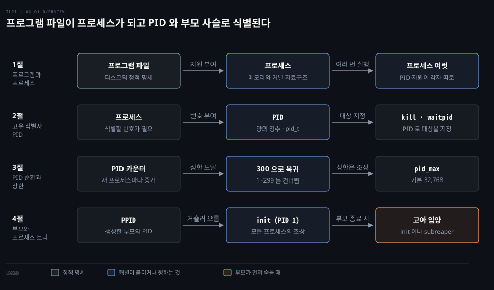
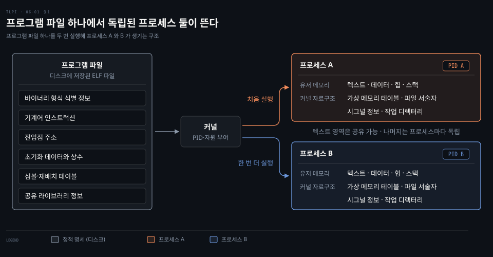
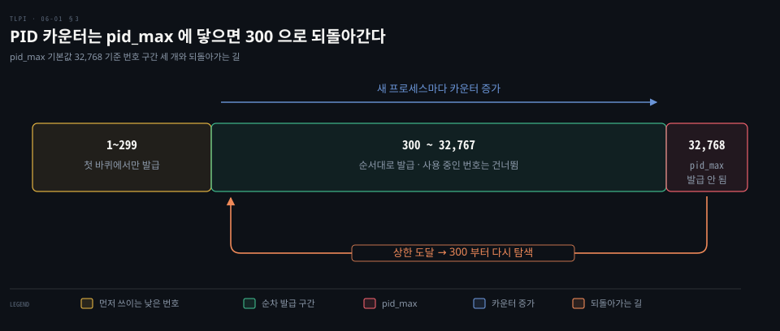
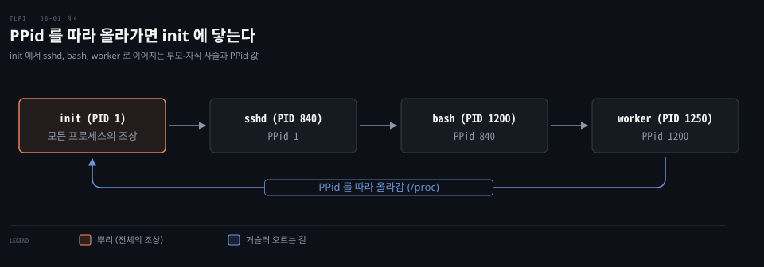
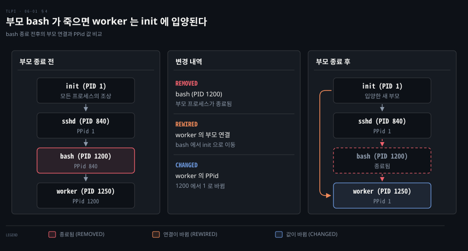

# 프로세스는 프로그램에 커널이 자원을 붙인 것이다

---

> 디스크의 실행 파일은 어떻게 독자적인 메모리와 권한을 가진 프로세스로 동작합니까? 《The Linux Programming Interface》 6장 앞부분은 프로그램과 프로세스가 무엇이 다른지, 그리고 커널이 프로세스를 식별하고 계층으로 묶는 기본 인터페이스를 다룹니다.

## 핵심 요약

> 프로그램은 디스크에 놓인 정적 파일이고 프로세스는 커널이 거기에 주소 공간과 시스템 자원을 할당해 실행 중인 것입니다.

디스크에 저장된 실행 파일은 실행 방법과 초기 데이터를 규정한 설계도입니다. 커널이 이 파일을 메모리에 적재하고 거기에 프로세스만의 메모리 배치와 열린 파일 목록, 고유 번호를 붙여 줄 때 비로소 실행 가능한 프로세스가 됩니다. 그래서 같은 프로그램 파일 하나에서 서로 다른 자원을 소유한 여러 프로세스가 동시에 실행될 수 있습니다.

커널은 모든 프로세스를 **PID**(Process ID)라는 양의 정수로 구별합니다. 같은 순간에 살아 있는 프로세스끼리는 PID 가 겹치지 않습니다. 발급 카운터가 상한에 닿으면 커널은 시스템 프로세스가 많이 쓰는 낮은 번호를 건너뛰고 300번부터 빈 번호를 다시 찾습니다.

모든 프로세스는 자신을 생성한 부모의 번호를 가집니다. 이 번호를 PPID 라고 부릅니다. 부모 사슬을 거슬러 올라가면 전체 프로세스의 조상인 `init` 에 도달합니다. `init` 의 PID 는 1 입니다. 부모가 먼저 종료되면 자식은 `init` 에 입양됩니다. 다만 고아가 된 자손을 대신 거두겠다고 표시한 조상이 살아 있으면 `init` 대신 그 조상이 새 부모가 됩니다. 이런 조상을 subreaper 라고 부릅니다.


## 학습 목표

> 이 구간을 읽고 나면 아래 다섯 가지를 스스로 해낼 수 있습니다.

1. 프로그램 파일에 담긴 구성요소와 커널이 정의하는 프로세스의 실체를 구분하여 설명할 수 있습니다.
2. `getpid()` 와 `pid_t` 가 제공하는 식별자 고유성의 의미와, 시스템 콜에서 프로세스를 지목하는 방식을 설명할 수 있습니다.
3. 커널이 PID 를 순환 발급할 때 1번이 아닌 300번부터 재탐색하는 이유와 `/proc/sys/kernel/pid_max` 의 한계값을 제시할 수 있습니다.
4. `getppid()` 를 통해 부모 사슬이 `init`(PID 1)에 도달하는 계층 구조와, 부모 종료 시 발생하는 고아 입양 동작을 설명할 수 있습니다.
5. `/proc/PID/status` 파일의 `PPid` 필드를 통해 실행 중인 프로세스의 부모 관계를 직접 확인할 수 있습니다.

아래 개념도는 이 편의 네 절을 한 줄씩 보입니다. 줄마다 왼쪽 글자는 그 줄을 다루는 절을 가리킵니다. 화살표 위 글자는 두 키워드가 어떻게 이어지는지를 나타냅니다.

1행은 프로그램 파일에 커널이 자원을 붙여 프로세스가 되는 과정입니다. 같은 파일에서 프로세스가 여럿 생기는 모습도 함께 보입니다. 2행은 그 프로세스를 번호로 지목하는 방식입니다. 3행은 번호가 상한에 닿으면 300으로 되돌아가는 순환입니다. 4행은 부모 번호를 따라 `init` 에 닿는 흐름과, 부모가 먼저 죽을 때 고아가 입양되는 흐름입니다.




## 프로그램에서 입양까지의 흐름

> 이 편의 뼈대는 다섯 단계입니다. 프로그램 파일이 프로세스가 된 뒤 번호와 부모 관계를 받고, 부모를 잃으면 입양됩니다.

이 편은 프로세스 하나가 디스크의 파일에서 출발해 부모를 잃기까지 어떤 번호와 관계를 받는지를 따라갑니다. 단계마다 일하는 쪽은 커널입니다. 프로그램 파일만 디스크에서 정적으로 기다릴 뿐입니다.

| 단계 | 주체 | 받치는 개념 | 맡는 절 |
|---|---|---|---|
| 1 프로그램 준비 | 디스크의 실행 파일 | ELF 형식, 진입점 | 1 |
| 2 프로세스 생성 | 커널 | 유저 공간 메모리, 커널 자료구조 | 1 |
| 3 번호 부여 | 커널 | PID, `pid_t`, 순환 발급, `pid_max` | 2, 3 |
| 4 계보 연결 | 커널 | PPID, 부모 사슬, `init` | 4 |
| 5 입양 | 커널 | 고아 프로세스, `init`, subreaper | 4 |

3단계는 2절이 번호의 쓰임을, 3절이 번호 공간의 한계를 맡습니다. 4단계와 5단계는 4절에서 함께 다룹니다. 적용 관점은 이 흐름 밖에서, 컨테이너에서 이 규칙이 어떻게 드러나는지를 다룹니다.


## 1. 프로그램과 프로세스의 구분

> 디스크의 실행 파일은 정적 명세입니다. 프로세스는 커널이 가상 메모리와 자원을 배정해 독립적으로 실행하는 단위입니다.

흐름 위치: 1 프로그램 준비 → 2 프로세스 생성 · 받치는 개념 — ELF 파일, 유저 공간 메모리와 커널 자료구조

같은 실행 파일을 터미널 두 개에서 동시에 띄우면 디스크의 파일은 하나뿐인데 실행은 둘로 갈라집니다. 한쪽에서 변수를 바꾸거나 파일을 열어도 다른 쪽은 영향을 받지 않습니다. 파일이 하나인데 두 실행은 어떻게 서로 섞이지 않을까요? 이 절은 실행 파일(프로그램)과 그 실행(프로세스)을 차례로 갈라 보며 답을 찾습니다.

### 디스크에 저장된 정적 명세

**프로그램**(Program)은 런타임에 프로세스를 어떻게 생성해야 하는지 서술하는 파일입니다. 리눅스를 비롯한 현대 유닉스 계열 시스템에서는 대부분 ELF(Executable and Linking Format) 형식의 실행 파일로 저장됩니다. 예전 유닉스에서는 `a.out` 과 `COFF` 형식이 널리 쓰였습니다. ELF 는 이 옛 형식들보다 나은 점이 많아 지금의 표준이 됐습니다.

프로그램 파일은 실행에 필요한 정보를 다음과 같이 나눠 보관합니다.

| 구성요소 | 역할과 보관 정보 |
|---|---|
| 바이너리 형식 식별 정보 | 파일 형식을 커널이 판별할 수 있도록 돕는 매직 넘버와 ELF 헤더 메타데이터입니다. |
| 기계어 인스트럭션 | 프로그램 알고리즘을 CPU 가 직접 읽고 실행할 기계어로 적은 코드(`.text`)입니다. |
| 프로그램 진입점 주소 | 프로세스가 실행을 시작하는 첫 기계어 인스트럭션의 가상 메모리 주소입니다. |
| 초기화 데이터와 상수 | 프로그램이 사용할 전역 변수의 초기값(`.data`)과 문자열 리터럴(`.rodata`)입니다. |
| 심볼 및 재배치 테이블 | 함수와 변수 위치를 이름으로 기록한 표로 디버깅과 동적 링킹 주소 해석에 쓰입니다. |
| 공유 라이브러리 정보 | 런타임에 동적으로 연결해야 할 공유 라이브러리 목록과 동적 링커 경로입니다. |
| 기타 정보 | 그 밖에 프로세스를 어떻게 구성할지 서술하는 여러 정보입니다. |

디스크의 프로그램 파일은 바이트의 정적 나열입니다. 스스로 연산을 수행하거나 자원을 소비하지 않습니다.

### 커널이 자원을 할당한 동적 실체

프로세스를 정식으로 정의하면 다음과 같습니다.

> "a process is an abstract entity, defined by the kernel, to which system resources are allocated in order to execute a program"[^tlpi61]

같은 프로그램 파일을 두 번 실행하면 이 정의대로 프로세스가 둘 생깁니다. 각 프로세스에 커널이 자원을 따로 붙입니다. 아래 도식은 프로그램 파일 하나에서 두 프로세스가 뜨는 모습을 보입니다. 이름과 PID 는 구별하려고 붙인 표기입니다.



왼쪽 카드는 앞 소절에서 본 프로그램 파일의 구성요소입니다. 가운데 커널이 파일을 실행할 때마다 오른쪽의 프로세스가 하나씩 생깁니다. 프로세스는 유저 공간 메모리와 커널 자료구조 두 가지를 각자 갖습니다.

커널 관점에서 **프로세스**(Process)는 다음 두 가지로 구성됩니다.

- 유저 공간 메모리: 프로그램 코드와 그 코드가 쓰는 변수가 놓입니다. 텍스트·데이터·힙·스택 세그먼트로 나뉘며 배치는 6장의 다음 편에서 다룹니다.
- 커널 자료구조: 프로세스의 상태를 추적하는 구조체로, 리눅스 커널 안에서는 [task_struct](../linux-kernel-programming/06-02.%ED%94%84%EB%A1%9C%EC%84%B8%EC%8A%A4%EC%99%80%20%EC%8A%A4%EB%A0%88%EB%93%9C%20%282%29%20%E2%80%94%20task%20%EA%B5%AC%EC%A1%B0%EC%99%80%20current.md#1-task-구조-task_struct)로 표현됩니다.

커널 자료구조에는 식별 번호(PID 포함)와 가상 메모리 테이블, 열린 파일 서술자 테이블이 들어갑니다. 가상 메모리 테이블은 프로세스가 쓰는 주소를 실제 메모리에 잇는 표입니다. 파일 서술자는 프로세스가 연 파일을 가리키는 작은 정수입니다. 시그널 전달·처리 정보, 자원 사용량과 한도, 현재 작업 디렉터리도 여기에 기록됩니다.

PID 는 `fork()` 로 프로세스가 생길 때 붙습니다. `execve()` 는 새 프로세스를 만들지 않습니다. 이미 있는 프로세스가 PID 를 그대로 둔 채 새 프로그램을 실행하게 할 뿐입니다[^fork]. 두 호출의 흐름은 24~27장에서 다룹니다.

앞의 프로세스 정의를 따르면 프로그램과 프로세스는 다대일(N:1)로 대응합니다. 디스크에 있는 프로그램 파일 하나로 여러 프로세스를 독립적으로 띄울 수 있습니다. 각 프로세스는 읽기 전용인 텍스트 영역을 공유할 수 있습니다. 반면 커널에게서 서로 다른 PID 와 독립된 데이터 세그먼트, 각자의 파일 서술자 테이블을 받으므로 서로 격리된 채 실행됩니다.

| 비교 항목 | 프로그램 | 프로세스 |
|---|---|---|
| 존재 형태 | 디스크에 저장된 정적 파일 | 메모리에 적재되어 실행 중인 동적 인스턴스 |
| 자원 점유 | 디스크 저장 공간만 점유 | CPU 시간, 물리 메모리, 파일 서술자 점유 |
| 생명주기 | 파일이 삭제될 때까지 영구 보관 | 시작 후 종료 상태를 반환할 때까지 유지 |
| 식별 방식 | 파일시스템 경로명 (`/usr/bin/python3`) | 커널이 부여한 고유 번호 (`PID`) |
| 인스턴스 관계 | 실행 파일 하나 (1) | 같은 파일에서 파생된 여러 프로세스 (N) |


## 2. 고유 식별자로서의 PID

> 커널은 모든 프로세스에 고유한 양의 정수 PID 를 부여하여 제어 대상과 자원 소유권을 구분합니다.

흐름 위치: 3 번호 부여 · 받치는 개념 — PID, `pid_t`, `getpid()`

서로 다른 두 프로세스가 같은 이름의 임시 파일을 만들면 한쪽이 다른 쪽의 내용을 덮어씁니다. 시그널을 보낼 때도 이름이 같은 프로세스가 둘이면 어느 쪽인지 정할 수 없습니다. 프로세스 이름이나 실행 파일 경로는 겹칠 수 있으므로, 커널은 이름 대신 겹치지 않는 양의 정수를 식별자로 부여합니다.

### 양의 정수 식별자와 pid_t

**PID**(Process ID)는 시스템 상에서 프로세스를 유일하게 식별하는 양의 정수입니다. POSIX 표준인 SUSv3 는 프로세스 식별자를 담는 데이터 타입으로 `pid_t` 를 규정합니다.

자신의 PID 를 확인하는 시스템 콜 인터페이스는 다음과 같습니다.

```c
#include <unistd.h>

pid_t getpid(void);
```

`getpid()` 시스템 콜은 호출한 프로세스의 PID 를 반환합니다. 이 함수는 실패하지 않으며 항상 유효한 양의 정수를 반환합니다. `init` 프로세스(PID 1)와 같은 특수 시스템 프로세스를 제외하면, 프로그램 파일과 프로세스 ID 사이에는 고정된 관계가 없습니다. 같은 프로그램이라도 실행할 때마다 어떤 PID 를 받을지는 정해져 있지 않습니다.

리눅스 커널 안에서는 스레드마다 고유한 스레드 ID(TID)가 있습니다. 반면 한 프로세스의 스레드들은 PID 하나를 함께 씁니다. 커널은 이 공유 PID 를 스레드 그룹 ID(TGID)라고도 부릅니다. 그래서 멀티스레드 프로그램의 어느 스레드에서 `getpid()` 를 호출해도 같은 값이 돌아옵니다[^gettid].

### getpid() 와 고유성 보장

커널이 PID 의 유일성을 보장해야 하는 이유는 두 가지입니다.

첫째, 커널의 프로세스 제어 인터페이스가 PID 를 기준으로 대상을 지정하기 때문입니다. 시그널은 프로세스에 보내는 비동기 알림입니다. 시스템 콜마다 PID 로 대상을 받습니다.

- `kill()`: 시그널을 받을 프로세스
- `waitpid()`: 종료를 기다릴 자식
- `setpriority()`: 우선순위를 바꿀 대상

만약 동시에 같은 PID 를 가진 프로세스가 둘 이상 존재한다면, 엉뚱한 프로세스에 시그널이 전달되어 원치 않는 작업이 중단될 수 있습니다.

둘째, 프로세스 고유 식별자를 응용 프로그램 수준에서 안전하게 활용하기 위해서입니다. 대표적인 예가 임시 파일명 생성입니다. 프로세스가 자기만의 임시 파일을 만들 때 PID 를 파일명에 넣으면, 같은 시점에 실행 중인 다른 프로세스와 파일명이 겹치지 않습니다[^getpid]. 데몬 프로세스가 중복 기동을 막으려고 자기 PID 를 적은 `.pid` 파일을 두는 관행에도 PID 가 쓰입니다.


## 3. PID 의 순환 할당과 상한선

> 커널은 PID 를 차례로 배정하다가 상한에 닿으면 1번이 아닌 300번으로 리셋한 뒤 해제된 번호를 재탐색합니다.

흐름 위치: 3 번호 부여 (번호 공간의 한계) · 받치는 개념 — 순환 발급, `pid_max`

프로세스가 끊임없이 생성되고 종료되는 시스템에서 식별자가 계속 증가하기만 하면 언젠가 번호 공간이 고갈됩니다. 커널은 한정된 번호 공간 안에서 식별자 충돌을 막으면서 발급 속도도 빠르게 유지해야 합니다. 번호를 순환해 할당하되 처음으로 되돌아갈 때는 낮은 번호 범위를 건너뜁니다.

### 순차 발급과 300번 재탐색

새 프로세스가 생성되면 커널은 다음 번호를 순서대로 배정합니다. 카운터가 상한에 닿으면 300에서 다시 찾기 시작합니다. 아래 도식은 번호 구간 셋과 되돌아가는 길을 보입니다. 막대 길이는 구간의 비례가 아닙니다.



첫 바퀴에서는 1번부터 발급하므로 `init` 이 1번을 받습니다. 카운터가 상한에 도달하면 커널은 카운터를 낮은 숫자로 리셋하고 비어 있는 번호를 재탐색합니다. 빈 번호는 이전에 쓰이다가 프로세스가 종료되어 풀린 번호입니다.

이때 커널은 카운터를 1이 아니라 300으로 되돌립니다. 낮은 번호 상당수는 부팅 때 뜬 시스템 프로세스와 데몬이 계속 쓰고 있기 때문입니다. 1번부터 다시 찾으면 이미 쓰이는 번호를 하나씩 건너뛰느라 시간을 버립니다. 그래서 300부터 찾기 시작해 종료된 프로세스가 돌려준 빈 번호를 더 빨리 만납니다. 리눅스 커널 소스는 이 경계를 `RESERVED_PIDS` 상수(300)로 정의합니다[^reserved].

### pid_max 와 64비트 상한

리눅스 커널의 PID 상한선은 고정되어 있지 않으며 시스템 관리자가 조정할 수 있습니다. 상한은 `/proc/sys/kernel/pid_max` 가상 파일이 정합니다. 시스템이 도는 중에도 바꿀 수 있습니다[^pidmax].

이 파일이 담고 있는 값은 발급 가능한 최대 PID 보다 1 큰 값입니다. 즉 카운터가 랩어라운드되는 기준점을 나타냅니다. 이보다 큰 PID 는 발급되지 않으므로, 이 값은 시스템 전체의 프로세스·스레드 수 상한이기도 합니다.

- 기본값: 32,768 입니다. 이때 가장 큰 PID 는 32,767 입니다. 다만 커널은 부팅 때 장착 가능한 CPU 수에 1,024 를 곱한 값이 더 크면 그 값을 기본값으로 씁니다. 64비트에서 CPU 가 32개를 넘는 서버는 기본값이 32,768 보다 큽니다[^cpus].
- 32비트 플랫폼: 32비트 아키텍처에서 `pid_max` 가 가질 수 있는 최댓값은 32,768 로 제한됩니다.
- 64비트 플랫폼: `pid_max` 를 최대 $2^{22}$, 곧 4,194,304(`PID_MAX_LIMIT`, 약 400만)까지 늘릴 수 있습니다. 컨테이너와 스레드가 몰리는 큰 서버는 이 값을 늘려 PID 고갈을 막습니다.

systemd 의 `sysctl.d/50-pid-max.conf` 는 `kernel.pid_max = 4194304` 를 설정합니다. 이 파일이 적용되는 시스템에서는 기본값 32,768 이 아니라 4,194,304 가 보이므로, 지금 값은 직접 읽어 확인합니다[^systemd].

```bash
cat /proc/sys/kernel/pid_max
```

시스템 관리자는 `sysctl` 명령으로 런타임에 PID 상한을 올릴 수 있습니다.

```bash
sysctl -w kernel.pid_max=4194304
```


## 4. 부모 프로세스와 프로세스 트리

> 모든 프로세스는 부모-자식 계층을 형성하여 init(PID 1)에 닿습니다. 부모가 먼저 죽은 고아는 init 에 자동 입양됩니다.

흐름 위치: 4 계보 연결 → 5 입양 · 받치는 개념 — PPID, `init`, subreaper

프로세스는 부모와 자식으로 이어진 계층 안에서 실행됩니다. 자신을 띄운 부모 프로세스가 예기치 않게 먼저 사라지면 자식 프로세스만 고립되어 남습니다. 이 자식을 방치하면 시스템 자원이 누수될 위험이 있습니다. 커널은 부모 사슬과 자동 입양으로 이 문제에 대응합니다.

### getppid() 와 init 으로 이어지는 족보

각 프로세스는 자신을 생성해 준 부모 프로세스를 가집니다. 부모 프로세스의 식별자는 **PPID**(Parent Process ID)라고 부르며 다음 시스템 콜로 조회합니다.

```c
#include <unistd.h>

pid_t getppid(void);
```

`getppid()` 는 호출한 프로세스를 생성한 부모의 PID 를 반환하며 항상 성공합니다. 아래 도식은 `init` 에서 `worker` 까지 이어지는 사슬 하나와 각 프로세스의 PPID 를 보입니다. 번호는 사슬을 보이려고 정한 예시입니다.



`worker` 의 PPid 1200 을 따라가면 `bash` 가 나옵니다. `bash` 의 PPid 840 은 `sshd` 를 가리키고, `sshd` 의 PPid 1 은 `init` 입니다. 이렇게 부모 프로세스 ID 속성이 시스템의 모든 프로세스를 거대한 트리 구조 하나로 묶습니다. 그 뿌리가 **init**(PID 1)입니다. 커널이 부팅 때 맨 처음 띄우는 사용자 공간 프로세스이자 전체 프로세스의 조상입니다. 리눅스에서는 `pstree(1)` 명령으로 이 족보 트리를 한눈에 확인할 수 있습니다[^pstree].

### 부모의 종료와 init 으로의 입양

프로세스의 생명주기에서 자식보다 부모가 먼저 종료되는 일은 흔합니다. 부모가 종료되면 자식 프로세스는 **고아 프로세스**(Orphan Process)가 됩니다. 커널은 고아를 방치하지 않고 `init`(PID 1)의 자식으로 옮깁니다. 아래 도식은 같은 사슬에서 `bash` 가 먼저 종료될 때 바뀌는 것을 앞뒤로 맞대 보입니다.



왼쪽은 `bash` 가 살아 있을 때의 한 줄 사슬입니다. 오른쪽은 `bash` 가 사라진 뒤입니다. `worker` 는 그대로 실행되지만 부모 연결이 `init` 으로 옮겨 가고 PPid 가 1200 에서 1 로 바뀝니다. 그 뒤 자식이 `getppid()` 를 호출하면 원래 부모의 PID 가 아니라 `1` 이 돌아옵니다.

입양된 고아가 나중에 종료되면 `init` 이 종료 상태를 거둬 가므로 좀비로 남지 않습니다. 종료 상태를 거두는 호출이 `wait()` 입니다. 좀비는 종료됐지만 부모가 종료 상태를 아직 읽지 않아 번호만 남은 프로세스입니다.

예외가 하나 있습니다. 리눅스 3.4 부터는 프로세스가 `prctl(PR_SET_CHILD_SUBREAPER)` 로 자신을 subreaper 로 표시할 수 있습니다. subreaper 는 자손 고아를 대신 거두는 프로세스입니다. 이런 조상이 살아 있으면 고아는 `init` 대신 가장 가까운 subreaper 에게 갑니다. 이때 `getppid()` 는 그 subreaper 의 PID 를 돌려줍니다[^subreaper]. systemd 같은 init 프레임워크도 이 기능을 쓰므로, 실제 시스템에서 확인하면 1 이 아닌 값이 나올 수 있습니다.

### /proc/PID/status 에서 확인하는 PPid

부모 프로세스의 정보는 시스템 콜뿐만 아니라 리눅스의 가상 파일시스템인 `/proc` 을 통해서도 실시간으로 관측할 수 있습니다.

`/proc/PID/status` 파일은 프로세스 상태를 사람이 읽기 쉬운 형식으로 보여 줍니다. 그 안의 `PPid` 필드가 부모의 PID 입니다[^pidstatus]. `$$` 는 지금 셸의 PID 로 바뀌므로, 아래 명령은 지금 셸의 이름·PID·부모 PID 를 보여 줍니다.

```bash
grep -E '^(Name|Pid|PPid):' /proc/$$/status
```

proc_pid_status(5) 의 예시 출력에서 이 세 줄은 다음과 같습니다. PID 값은 실행할 때마다 달라집니다.

```bash
Name:   bash
Pid:    17248
PPid:   17200
```

예시의 bash(PID 17248)를 띄운 부모는 PID 17200 프로세스입니다. 부모가 종료돼 입양이 일어나면 `PPid` 도 새 부모의 PID 로 바뀝니다. 보통 `1` 입니다. subreaper 가 있으면 그 PID 입니다.


## 결정 치트시트

> 자기 PID 는 `getpid()`, 부모는 `getppid()`·`pstree`·`/proc/<PID>/status`, PID 상한은 `pid_max` 로 확인합니다.

| 상황 | 추천 API 및 도구 | 확인 방법 및 기준 | 주의점 |
|---|---|---|---|
| 자신의 프로세스 식별 | `getpid()` | `pid_t` 반환값 확인 | 항상 성공하며 실패 반환이 없습니다. |
| 부모 프로세스 식별 | `getppid()` | `pid_t` 반환값 확인 | 부모가 먼저 종료되면 새 부모인 `init`(1)이나 subreaper 의 PID 를 반환합니다. |
| 프로세스 계층 족보 조회 | `pstree` | 터미널 트리 출력 | 부모-자식 입양 상태를 트리 모양으로 식별합니다. |
| 파일시스템 기반 부모 조회 | `/proc/<PID>/status` | `grep PPid /proc/<PID>/status` | 커널 내부 상태를 실시간 문자열로 조회합니다. |
| 대규모 동시 실행 환경 구성 | `/proc/sys/kernel/pid_max` | `cat /proc/sys/kernel/pid_max` | 64비트 시스템에서 최대 4,194,304까지 확장하며, systemd 가 이미 올려 두었을 수 있습니다. |


## 적용 관점

> 컨테이너 안에서는 PID 1 이 고아 입양을 책임집니다. 대규모 워크로드에서는 PID 가 고갈되지 않게 `pid_max` 를 올려 둡니다.

컨테이너 환경에서는 PID 1 이 고아 프로세스 문제를 떠안습니다. 도커나 쿠버네티스 컨테이너는 PID 네임스페이스를 따로 만듭니다. PID 네임스페이스는 프로세스 번호를 그 안에서만 새로 매기는 격리 단위입니다. 그래서 컨테이너의 진입점 프로세스가 그 네임스페이스 안에서 PID 1 을 받습니다.

애플리케이션이 PID 1 로 직접 돌고 있는데 컨테이너 안에서 어떤 프로세스의 부모가 먼저 죽는다고 해 봅시다. 그 고아는 호스트의 `init` 이 아니라 컨테이너의 PID 1 인 이 애플리케이션에 입양됩니다[^pidns]. 이 PID 1 프로세스가 `getppid()` 를 부르면 부모가 다른 PID 네임스페이스에 있으므로 0 이 돌아옵니다[^getppid0].

일반 애플리케이션은 전통적인 `init` 데몬과 달리 종료된 자식을 수거하는 `wait()` 루프를 돌리지 않는 경우가 많습니다. 그 결과 고아 프로세스가 종료된 뒤 좀비 프로세스가 계속 누적되어 컨테이너 내부의 PID 가 고갈될 수 있습니다. 이 때문에 컨테이너 환경에서는 `tini` 나 `dumb-init` 같은 경량 init 프로세스를 PID 1 로 앞세우는 운영 방식이 권장됩니다.

쿠버네티스 워커 노드처럼 대규모 워크로드가 도는 곳에서는 수많은 파드와 스레드가 기동됩니다. `pid_max` 가 기본값 32,768 그대로인 노드라면 PID 공간이 빠르게 소진될 수 있습니다. PID 가 고갈되면 커널은 새 프로세스를 생성하지 못하고 `fork()` 가 `EAGAIN` 으로 실패합니다[^forkeagain]. 다만 `EAGAIN` 은 프로세스 수 한도(`RLIMIT_NPROC`)나 cgroup 의 PID 제한에 걸려도 납니다. 그래서 원인은 실제 사용량과 이 한도들을 함께 확인해 가립니다.

셸에는 `fork: Resource temporarily unavailable` 오류가 찍힙니다. 그래서 64비트 리눅스 서버를 운영할 때는 `sysctl` 설정으로 `kernel.pid_max` 값을 충분히 크게 올려 둡니다.


## 면접 질문

> 질문 절에는 질문만 둡니다. 정답은 아래 정답 절에 모았으니 먼저 자답한 뒤 맞춰 봅니다.

1. 프로그램과 프로세스는 무엇이 다릅니까? 커널 관점에서 프로세스는 어떤 요소로 구성됩니까?
2. `getpid()` 와 `getppid()` 시스템 콜의 특성과 반환 타입인 `pid_t` 의 성격을 설명하십시오.
3. 리눅스에서 PID 발급 카운터가 상한에 도달했을 때 0번이나 1번이 아닌 300번부터 빈 번호를 재탐색하는 이유는 무엇입니까?
4. 부모 프로세스가 자식 프로세스보다 먼저 종료되면 자식 프로세스는 어떻게 처리됩니까? 이때 `getppid()` 의 반환값은 어떻게 변합니까?
5. `/proc/sys/kernel/pid_max` 파일의 의미와 기본값, 그리고 32비트와 64비트 시스템에서의 차이점을 설명하십시오.
6. 스레드가 둘인 프로세스에서 두 스레드가 각각 `getpid()` 를 부르면 값이 같습니까 다릅니까? 그 이유는 무엇입니까?
7. 쿠버네티스 노드에서 셸이 `fork: Resource temporarily unavailable` 오류를 낼 때, PID 와 관련해 무엇을 확인하고 어떻게 조치합니까?


## 핵심 개념 체크리스트

> 프로그램과 프로세스의 차이, PID 발급 규칙, 부모 사슬과 입양을 스스로 설명할 수 있는지 확인합니다.

- [ ] 프로그램(정적 실행 파일)과 프로세스(커널이 자원을 붙여 실행 중인 것)의 차이를 설명할 수 있는가?
- [ ] `getpid()` 와 `getppid()` 시스템 콜의 반환값과 PID 고유성이 필요한 이유를 아는가?
- [ ] PID 순환 할당 시 1번이 아닌 300번부터 재탐색하는 이유를 설명할 수 있는가?
- [ ] `/proc/sys/kernel/pid_max` 의 기본값(32,768)과 64비트 시스템 상한(4,194,304)을 기억하는가?
- [ ] 부모 프로세스 종료 시 고아 프로세스가 `init` 에 입양되는 메커니즘을 설명할 수 있는가?
- [ ] `/proc/PID/status` 에서 `PPid` 필드를 읽어 부모 프로세스를 확인하는 방법을 아는가?


## 정답 (자답 후 펼치기)

> 위 면접 질문 7개에 먼저 자답한 뒤 아래를 읽으세요.

### 정답 1 — 프로그램과 프로세스

프로그램은 디스크에 바이너리 파일 형태로 저장된 정적 명세서입니다. ELF 헤더, 기계어 코드(`.text`), 초기화 데이터(`.data`), 심볼 테이블 등으로 구성됩니다.

반면 프로세스는 커널이 프로그램을 실행하기 위해 가상 주소 공간과 시스템 자원을 할당한 동적 인스턴스입니다. 커널 관점에서 프로세스는 유저 공간 메모리(텍스트·데이터·힙·스택)와 커널 내부의 관리 자료구조(`task_struct` 에 담기는 식별 번호, 가상 메모리 테이블, 파일 서술자 테이블, 시그널 처리 정보, 자원 한도, CWD 등)로 구성됩니다. 프로그램 파일 하나로 자원을 독립적으로 소유하는 프로세스 여럿을 동시에 띄울 수 있습니다.

### 정답 2 — getpid() 와 getppid()

`getpid()` 는 호출한 프로세스 자신의 PID 를 반환합니다. `getppid()` 는 호출한 프로세스를 생성한 부모 프로세스의 PID 를 반환합니다.

두 시스템 콜 모두 항상 성공하며 실패 반환값을 갖지 않습니다. 반환 타입인 `pid_t` 는 POSIX(SUSv3)에서 프로세스 ID 를 저장하기 위해 규정한 정수형입니다.

### 정답 3 — 300번 재탐색 이유

부팅 때 뜬 `init`(1)과 시스템 프로세스·데몬이 낮은 번호 상당수를 계속 쓰고 있습니다.

카운터가 상한에서 1로 돌아가면 이미 쓰이는 낮은 번호를 하나씩 건너뛰느라 시간을 버립니다. 그래서 커널은 300부터 다시 찾아 빈 번호를 더 빨리 만납니다. 커널 소스의 `RESERVED_PIDS` 상수가 이 300 입니다.

### 정답 4 — 고아 프로세스와 init 입양

부모 프로세스가 먼저 종료되면 자식 프로세스는 고아 프로세스가 됩니다. 리눅스 커널은 고아 프로세스를 전체 프로세스의 조상인 `init`(PID 1)의 자식으로 옮깁니다. 가까운 조상 가운데 subreaper 로 표시된 프로세스가 있으면 그 프로세스가 새 부모가 됩니다.

따라서 부모 종료 뒤 자식 프로세스에서 `getppid()` 를 호출하면 원래 부모의 PID 가 아니라 새 부모의 PID, 보통 `1` 이 반환됩니다. 이렇게 새 부모를 붙여 두어야 부모가 사라진 프로세스가 종료될 때 시스템에서 수거되지 못하고 좀비로 계속 남는 일을 막을 수 있습니다.

### 정답 5 — pid_max 와 아키텍처 상한

`/proc/sys/kernel/pid_max` 는 커널이 프로세스에 할당할 수 있는 최대 PID 보다 1 큰 값으로, PID 랩어라운드가 발생하는 기준값입니다.

기본값은 32,768 이며 최대 할당 가능 PID 는 32,767 입니다. CPU 가 32개를 넘는 시스템에서는 커널이 기본값을 1,024×CPU 수로 키웁니다. 32비트 아키텍처에서는 이 파일의 최댓값이 32,768 로 고정됩니다. 64비트 아키텍처에서는 최대 $2^{22}$ 인 4,194,304(`PID_MAX_LIMIT`)까지 확장할 수 있습니다. 대규모 서버 환경에서는 동시 실행 프로세스와 스레드가 급증하면 PID 가 고갈될 수 있으므로 이 한계를 올립니다.

### 정답 6 — 스레드의 getpid()

두 스레드에서 `getpid()` 를 불러도 값이 같습니다. 커널은 스레드마다 고유한 스레드 ID(TID)를 따로 둡니다. 그러나 한 프로세스의 스레드들은 PID 하나를 함께 쓰기 때문입니다. 이 공유 PID 를 커널은 스레드 그룹 ID(TGID)라고도 부릅니다. 스레드를 구별하려면 `getpid()` 가 아니라 TID 를 돌려주는 `gettid()` 를 씁니다.

### 정답 7 — PID 고갈 점검

`fork()` 가 `EAGAIN` 으로 실패하는 원인 하나는 PID 의 최대 개수, 곧 `pid_max` 에 닿은 것입니다. 먼저 `cat /proc/sys/kernel/pid_max` 로 현재 상한을 읽습니다. 값이 기본값 32,768 그대로 노드에 파드와 스레드가 많다면 PID 공간이 바닥난 것일 수 있습니다. 현재 사용 중인 PID 수와 다른 한도도 함께 확인합니다.

이때 `sysctl -w kernel.pid_max=4194304` 로 상한을 올리고, 영구 적용은 `sysctl` 설정 파일에 남깁니다. 컨테이너 안에서 좀비가 쌓이고 있다면 `tini` 같은 init 프로세스를 PID 1 로 앞세워 고아를 거둡니다.


## 참고 자료

- Michael Kerrisk, 『The Linux Programming Interface』 (No Starch Press, 2010), Chapter 6 "Processes"
- getpid(2) — Linux man page, <https://man7.org/linux/man-pages/man2/getpid.2.html>
- proc_sys_kernel(5) — Linux man page, <https://man7.org/linux/man-pages/man5/proc_sys_kernel.5.html>
- proc_pid_status(5) — Linux man page, <https://man7.org/linux/man-pages/man5/proc_pid_status.5.html>
- pstree(1) — Linux man page, <https://man7.org/linux/man-pages/man1/pstree.1.html>
- fork(2)·execve(2)·gettid(2)·PR_SET_CHILD_SUBREAPER(2const)·pid_namespaces(7) — Linux man pages, <https://man7.org/linux/man-pages/> (2026-11 확인)
- Linux 커널 소스 v7.3 `include/linux/pid.h`·`include/linux/threads.h`·`kernel/pid.c`, <https://git.kernel.org/pub/scm/linux/kernel/git/torvalds/linux.git/tree/kernel/pid.c?h=v7.3>
- systemd `sysctl.d/50-pid-max.conf`, <https://raw.githubusercontent.com/systemd/systemd/main/sysctl.d/50-pid-max.conf>


## 관련 문서

> `ps` 로 보는 프로세스 속성, 세션과 제어 터미널, 커널의 `task_struct` 구현을 다룬 노트입니다.

- [Learning Modern Linux 정독 인덱스](../learning-modern-linux/README.md)
- [커널은 전부를 하지만 운영체제는 아니다](../learning-modern-linux/02-01.%EC%BB%A4%EB%84%90%EC%9D%80%20%EC%A0%84%EB%B6%80%EB%A5%BC%20%ED%95%98%EC%A7%80%EB%A7%8C%20%EC%9A%B4%EC%98%81%EC%B2%B4%EC%A0%9C%EB%8A%94%20%EC%95%84%EB%8B%88%EB%8B%A4.md#3-세션에서-태스크까지-이름-다섯이-한-구조체로-모인다) — `ps` 명령 사용법과 프로세스 속성
- [셸의 실체는 스트림과 변수와 종료 상태다](../learning-modern-linux/03-01.%EC%85%B8%EC%9D%98%20%EC%8B%A4%EC%B2%B4%EB%8A%94%20%EC%8A%A4%ED%8A%B8%EB%A6%BC%EA%B3%BC%20%EB%B3%80%EC%88%98%EC%99%80%20%EC%A2%85%EB%A3%8C%20%EC%83%81%ED%83%9C%EB%8B%A4.md#세션과-제어-터미널) — 세션과 제어 터미널
- [프로세스와 스레드 (2) — task 구조와 current](../linux-kernel-programming/06-02.%ED%94%84%EB%A1%9C%EC%84%B8%EC%8A%A4%EC%99%80%20%EC%8A%A4%EB%A0%88%EB%93%9C%20%282%29%20%E2%80%94%20task%20%EA%B5%AC%EC%A1%B0%EC%99%80%20current.md#1-task-구조-task_struct) — 커널 내부 `task_struct` 구현

[^tlpi61]: Michael Kerrisk, 『The Linux Programming Interface』, 6.1 "Processes and Programs".
[^pidmax]: proc_sys_kernel(5) — "/proc/sys/kernel/pid_max (since Linux 2.5.34) This file specifies the value at which PIDs wrap around (i.e., the value in this file is one greater than the maximum PID). PIDs greater than this value are not allocated; thus, the value in this file also acts as a system-wide limit on the total number of processes and threads. The default value for this file, 32768, results in the same range of PIDs as on earlier kernels. On 32-bit platforms, 32768 is the maximum value for pid_max. On 64-bit systems, pid_max can be set to any value up to 2^22 (PID_MAX_LIMIT, approximately 4 million)." <https://man7.org/linux/man-pages/man5/proc_sys_kernel.5.html> 이 파일이 생기기 전 커널(2.4 까지)은 상한 32,767 을 커널 상수 `PID_MAX` 로 고정했습니다.
[^pstree]: pstree(1) — "pstree shows running processes as a tree. The tree is rooted at either pid or init if pid is omitted." <https://man7.org/linux/man-pages/man1/pstree.1.html>
[^pidstatus]: proc_pid_status(5) — "Provides much of the information in /proc/pid/stat and /proc/pid/statm in a format that's easier for humans to parse." "PPid   PID of parent process." 본문의 예시 출력도 이 페이지의 `cat /proc/$$/status` 예시에서 세 줄을 뽑은 것입니다. <https://man7.org/linux/man-pages/man5/proc_pid_status.5.html>
[^fork]: fork(2) — "The child has its own unique process ID" <https://man7.org/linux/man-pages/man2/fork.2.html> · execve(2) — "there is no new process; many attributes of the calling process remain unchanged (in particular, its PID)." <https://man7.org/linux/man-pages/man2/execve.2.html>
[^getpid]: getpid(2) — "getpid() returns the process ID (PID) of the calling process. (This is often used by routines that generate unique temporary filenames.)" <https://man7.org/linux/man-pages/man2/getpid.2.html>
[^gettid]: gettid(2) — "In a multithreaded process, all threads have the same PID, but each one has a unique TID." <https://man7.org/linux/man-pages/man2/gettid.2.html> · getpid(2) NOTES — "the PID (which is shared by all of the threads in a multithreaded process) is sometimes also known as the thread group ID (TGID)."
[^reserved]: Linux 커널 소스 v7.3 `include/linux/pid.h` 의 `#define RESERVED_PIDS 300`, `kernel/pid.c` 의 주석 "init really needs pid 1, but after reaching the maximum wrap back to RESERVED_PIDS". <https://git.kernel.org/pub/scm/linux/kernel/git/torvalds/linux.git/tree/include/linux/pid.h?h=v7.3>
[^cpus]: Linux 커널 소스 v7.3 `kernel/pid.c` 의 `pid_idr_init()` — "bump default and minimum pid_max based on number of cpus", `init_pid_ns.pid_max = min(pid_max_max, max_t(int, init_pid_ns.pid_max, PIDS_PER_CPU_DEFAULT * num_possible_cpus()));`, `include/linux/threads.h` 의 `#define PIDS_PER_CPU_DEFAULT 1024`. <https://git.kernel.org/pub/scm/linux/kernel/git/torvalds/linux.git/tree/kernel/pid.c?h=v7.3>
[^systemd]: systemd 저장소 `sysctl.d/50-pid-max.conf` 는 "Bump the numeric PID range to make PID collisions less likely." 라는 주석 아래 `kernel.pid_max = 4194304` 를 설정합니다(main 브랜치, 2026-11-19 조회). <https://raw.githubusercontent.com/systemd/systemd/main/sysctl.d/50-pid-max.conf>
[^subreaper]: PR_SET_CHILD_SUBREAPER(2const) — "When a process becomes orphaned (i.e., its immediate parent terminates), then that process will be reparented to the nearest still living ancestor subreaper. Subsequently, calls to getppid(2) in the orphaned process will now return the PID of the subreaper process" · "Some init(1) frameworks (e.g., systemd(1)) employ a subreaper process" · HISTORY "Linux 3.4." <https://man7.org/linux/man-pages/man2/PR_SET_CHILD_SUBREAPER.2const.html>
[^pidns]: pid_namespaces(7) — "When a child process becomes orphaned, it is reparented to the "init" process in the PID namespace of its parent (unless one of the nearer ancestors of the parent employed the prctl(2) PR_SET_CHILD_SUBREAPER command to mark itself as the reaper of orphaned descendant processes)." <https://man7.org/linux/man-pages/man7/pid_namespaces.7.html>
[^getppid0]: getpid(2) NOTES — "If the caller's parent is in a different PID namespace (see pid_namespaces(7)), getppid() returns 0." <https://man7.org/linux/man-pages/man2/getpid.2.html>
[^forkeagain]: fork(2) ERRORS — "EAGAIN A system-imposed limit on the number of threads was encountered. ... the maximum number of PIDs, /proc/sys/kernel/pid_max, was reached" <https://man7.org/linux/man-pages/man2/fork.2.html>
