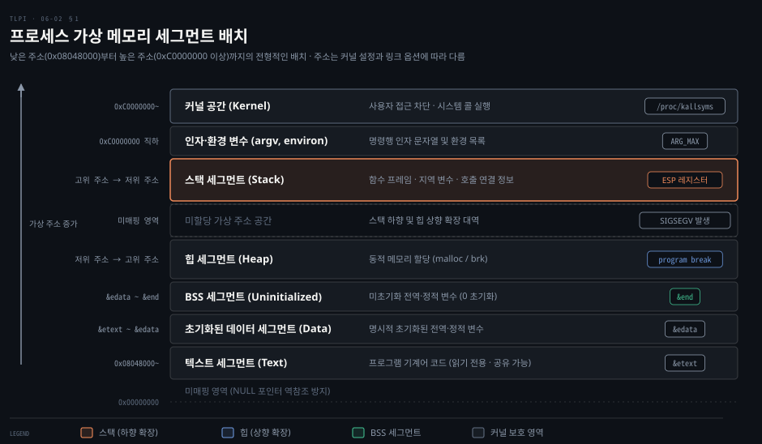
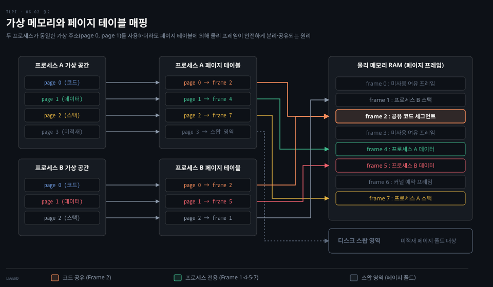
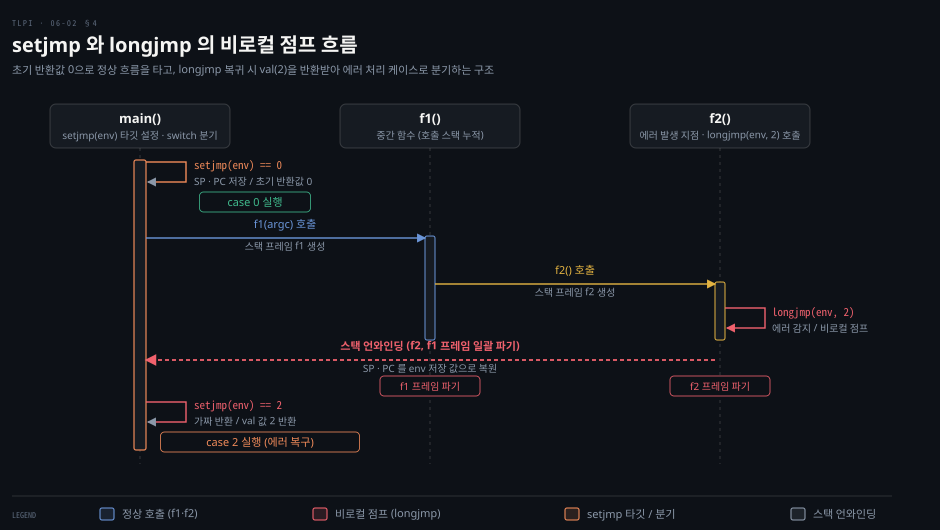

# 프로세스 메모리는 세그먼트와 페이지로 나뉜다

---

> 프로세스의 메모리는 논리적으로 세그먼트로 나뉘고 물리적으로 페이지 단위로 관리됩니다.
> 변수 선언 방식과 가상 주소 변환 규칙을 이해하면 메모리 안전성을 높일 수 있습니다.

## 핵심 요약

> 변수 수명과 초기화 여부가 세그먼트를 정하고, 커널의 페이지 테이블이 가상 메모리를 물리 프레임에 매핑합니다.

프로그램의 데이터는 다섯 세그먼트에 나뉩니다.
기계어 명령을 담는 **텍스트**와 초기화된 전역 변수를 담는 **데이터** 세그먼트가 있습니다.
여기에 0 으로 채워지는 **BSS**, 동적 할당을 맡는 **힙**, 함수 호출마다 쌓이는 **스택**이 더해집니다.
실행 파일은 BSS 에 실제 바이트를 할당하지 않고 크기 정보만 기록하여 디스크 공간을 절약합니다.

모든 프로세스는 동일한 가상 주소 체계를 보지만 물리 메모리에서는 충돌하지 않습니다.
커널이 프로세스마다 독립된 **페이지 테이블(page table)** 을 유지하며 가상 주소를 물리 주소로 변환하기 때문입니다.
이 변환 층이 프로세스 간 격리와 코드 공유를 보장합니다.
매핑이 없는 주소 공간에 접근하면 `SIGSEGV` 시그널이 발생합니다.

중첩된 함수 호출을 한 번에 벗어날 때는 `setjmp()` 와 `longjmp()` 로 비로컬 점프를 수행합니다.
스택 포인터와 프로그램 카운터를 복원하여 중간 프레임을 일괄 파기합니다.
`setjmp()` 를 부른 함수가 이미 반환한 뒤에 `longjmp()` 하면 정의되지 않은 동작이 일어납니다.
`setjmp()` 와 `longjmp()` 사이에 바꾼 지역 변수의 값을 점프 뒤에도 믿으려면 그 변수를 `volatile` 로 선언해야 합니다.


## 학습 목표

> 이 문서를 마치면 프로세스 메모리 배치부터 가상 메모리 변환과 비로컬 점프 제약까지 설명할 수 있습니다.

1. 프로세스 가상 메모리를 구성하는 다섯 세그먼트의 역할과 변수 배치 위치를 파악할 수 있습니다.
2. 실행 파일에서 BSS 세그먼트를 디스크에 저장하지 않는 이유와 경계 심볼의 의미를 설명할 수 있습니다.
3. 참조의 지역성 원리와 페이지 테이블을 통한 격리·공유·보호 메커니즘을 설명할 수 있습니다.
4. 함수 호출 시 스택 프레임에 저장되는 정보와 사용자·커널 스택의 역할 차이를 구분할 수 있습니다.
5. `setjmp()` 와 `longjmp()` 의 동작 메커니즘, `volatile` 의 필요성, 호출 문맥 제약을 파악할 수 있습니다.


## 이 문서가 다루지 않는 것

> 프로세스 메모리와 비로컬 제어 흐름에 집중하기 위해 상위 및 하위 계층 주제는 다른 문서로 분리합니다.

이 문서는 프로세스 메모리 세그먼트와 가상 메모리 기본 원리, 사용자 스택과 비로컬 점프를 다룹니다.
다음 주제는 다른 문서가 다룹니다.

- 프로세스 식별자(PID, PPID)와 프로세스 관계: 06-01 편
- 명령행 인자 목록(`argv`)과 환경 변수 목록(`environ`): 06-03 편
- `malloc()` 과 힙 확장: 7장(Memory Allocation) 편
- 사용자 스택과 커널 스택의 커널 수준 구조: [Linux Kernel Programming 06-01](../linux-kernel-programming/06-01.%ED%94%84%EB%A1%9C%EC%84%B8%EC%8A%A4%EC%99%80%20%EC%8A%A4%EB%A0%88%EB%93%9C%20%281%29%20%E2%80%94%20%EC%BB%A8%ED%85%8D%EC%8A%A4%ED%8A%B8%C2%B7VAS%C2%B7%EC%8A%A4%ED%83%9D.md)
- 커널 내부의 가상 주소 공간 분할(VM split)과 다단계 페이지 테이블 구현: [Linux Kernel Programming 07-01](../linux-kernel-programming/07-01.%EB%A9%94%EB%AA%A8%EB%A6%AC%20%EA%B4%80%EB%A6%AC%20%281%29%20%E2%80%94%20VM%20split%EA%B3%BC%20%EC%A3%BC%EC%86%8C%20%EB%B3%80%ED%99%98.md)
- 스레드별 스택과 스레드 저장소: 29장(Threads) 이후 편
- 시그널 처리기 안에서의 비로컬 복귀(`sigsetjmp`, `siglongjmp`): 21장(Signals: Signal Handlers) 편


## 1. 메모리 세그먼트와 변수 배치

> 프로세스의 가상 주소 공간은 기계어 코드와 변수의 성격에 따라 다섯 논리 세그먼트로 나뉩니다.

10MB 짜리 정적 배열을 선언한 C 프로그램을 컴파일하면 실행 파일은 16,280바이트에 그칩니다.
같은 배열에 초기값 하나(`= { 1 }`)만 주면 실행 파일이 10,256,296바이트로 불어납니다.
변수가 어느 세그먼트에 놓이는지 모르면 이 차이를 설명하지 못합니다.
두 수치는 Debian 13 의 GCC 14.2(x86-64)로 2026-11-11 에 잰 것입니다.



### 다섯 세그먼트의 역할과 특징

UNIX 시스템에서 세그먼트는 프로세스 가상 메모리를 논리적으로 분할한 영역입니다(6.3).
하드웨어 세그멘테이션과는 별개인 논리적 구분입니다.

- **텍스트 세그먼트(Text segment)**: 프로세스가 실행할 프로그램의 기계어 명령을 담습니다.
  잘못된 포인터 조작으로 코드가 오염되는 사고를 막기 위해 읽기 전용으로 설정됩니다.
  동일 프로그램을 여러 프로세스가 실행할 때 가상 주소 공간에 동일 물리 프레임을 매핑하여 코드를 공유합니다.
- **초기화된 데이터 세그먼트(Initialized data segment)**: 초기화된 전역·정적 변수를 담습니다.
  프로그램이 메모리에 적재될 때 실행 파일에서 초기값을 읽어 채웁니다.
- **미초기화 데이터 세그먼트(BSS)**: 초기화되지 않은 전역 변수와 정적 변수를 담습니다.
  시스템이 프로그램을 시작하기 전에 이 영역의 모든 메모리를 0 으로 자동 초기화합니다.
- **스택(Stack)**: 함수가 호출되고 반환됨에 따라 동적으로 자라고 줄어드는 세그먼트입니다.
  각 함수 호출마다 스택 프레임이 할당되어 지역 변수와 매개변수를 보관합니다.
- **힙(Heap)**: 런타임에 동적으로 메모리를 할당받는 영역입니다.
  힙의 최상단 경계를 프로그램 브레이크(program break)라고 부릅니다.

### C 변수 종류별 세그먼트 매핑

변수의 선언 위치와 스토리지 클래스가 저장될 세그먼트를 결정합니다.
아래는 `proc/mem_segments.c` 에서 발췌한 코드로, 변수마다 놓이는 세그먼트를 주석으로 적었습니다(6.3).
ABI(Application Binary Interface)는 실행 파일이 커널이나 라이브러리와 값을 주고받을 때 어느 레지스터와 스택 위치를 쓸지 정한 규칙입니다.
이 주석은 최적화하지 않는 컴파일러와, 인자를 모두 스택으로 넘기는 ABI 를 전제로 합니다.
최적화 컴파일러는 자주 쓰는 변수를 레지스터에 두거나 아예 없앨 수 있고 인자와 반환값을 레지스터로 넘기도록 정한 ABI 도 있습니다.

```c
char globBuf[65536];           /* BSS 세그먼트 (미초기화 전역 배열) */
int primes[] = { 2, 3, 5, 7 }; /* 초기화된 데이터 세그먼트 (전역 배열) */

static int square(int x)       /* x 는 square() 스택 프레임에 할당 */
{
    int result;                /* square() 스택 프레임에 할당 */
    result = x * x;
    return result;             /* 반환값은 레지스터로 전달 */
}

int main(int argc, char *argv[]) /* argc, argv 는 main() 스택 프레임 */
{
    static int key = 9973;       /* 초기화된 데이터 세그먼트 (정적 변수) */
    static char mbuf[10240000];  /* BSS 세그먼트 (미초기화 정적 배열) */
    char *p;                     /* main() 스택 프레임 (지역 포인터 변수) */

    p = malloc(1024);            /* 힙 세그먼트 메모리를 가리킴 */
    exit(EXIT_SUCCESS);
}
```

함수 내부의 지역 변수(`result`, `p`)는 스택 프레임에 위치합니다.
반면 정적 변수(`key`, `mbuf`)는 함수 안에 선언되더라도 초기화된 데이터 세그먼트나 BSS 에 놓입니다.
함수 반환과 무관하게 프로그램 수명 내내 값을 유지합니다.

라이브러리 함수가 정적으로 할당된 메모리의 포인터를 반환하면 그 메모리는 데이터 또는 BSS 세그먼트에 존재합니다.
후속 호출이 값을 덮어쓰므로 재진입성(reentrancy)을 잃습니다.

### BSS 세그먼트와 디스크 공간 절약

초기화된 변수와 미초기화 변수를 별도 세그먼트로 나누는 핵심 이유는 디스크 공간 절약입니다(6.3).

`mbuf` 변수는 10,240,000바이트(약 10MB) 크기입니다.
이 변수가 초기화된 데이터 세그먼트에 있다면 실행 파일 내부에 10MB 분량의 0 바이트를 저장해야 합니다.

BSS 세그먼트를 분리하면 실행 파일에는 시작 주소와 바이트 크기만 메타데이터로 기록합니다.
프로그램 실행 시 로더가 필요한 크기만큼 메모리를 할당하고 0 으로 채웁니다.
덕분에 실행 파일 크기를 크게 줄일 수 있습니다.
GCC 는 0 으로 명시해 초기화한 전역·정적 변수도 기본으로 BSS 에 둡니다[^gcc-bss].

BSS 라는 명칭은 과거 어셈블러 니모닉인 "Block Started by Symbol" 에서 유래했습니다.
의미를 분명히 하려고 zero-initialized data segment 라고 부르기도 합니다.

### 세그먼트 경계 심볼과 크기 확인

`size(1)` 명령은 실행 파일의 텍스트, 초기화된 데이터, BSS 세그먼트 크기를 표시합니다[^size-man].
첫머리의 두 실행 파일을 재 보면 차이가 어디서 왔는지 보입니다.
`ms` 는 위 `mem_segments.c` 를 컴파일한 것이고, `mi` 는 `mbuf` 에 `= { 1 }` 을 붙인 사본을 컴파일한 것입니다.
첫머리와 같은 환경에서 돌렸습니다.

```bash
size ms mi
ls -l ms mi
```

```bash
   text	   data	    bss	    dec	    hex	filename
   1720	    620	10305568	10307908	 9d4944	ms
   1720	10240648	  65568	10307936	 9d4960	mi
-rwxr-xr-x 1 root root    16280 Nov 11 06:32 ms
-rwxr-xr-x 1 root root 10256296 Nov 11 06:32 mi
```

`ms` 는 `bss` 가 10MB 를 넘는데도 파일이 16KB 입니다.
`mi` 에서는 `mbuf` 가 `data` 로 옮겨 가면서 그 10MB 가 그대로 파일에 들어갔습니다.

C 프로그램 환경은 세그먼트 경계를 나타내는 세 개의 전역 심볼을 제공합니다(6.3)[^end-man].

- `etext`: 텍스트 세그먼트의 끝 바로 다음 바이트 주소입니다.
- `edata`: 초기화된 데이터 세그먼트의 끝 바로 다음 바이트 주소입니다.
- `end`: 미초기화 데이터(BSS) 세그먼트의 끝 바로 다음 바이트 주소입니다.

이 심볼들을 프로그램 내부에서 사용하려면 명시적인 `extern` 선언이 필요합니다.

```c
extern char etext, edata, end;
/* &etext 는 텍스트 끝 주소, &edata 는 데이터 끝 주소, &end 는 BSS 끝 주소 */
```

이 심볼들은 POSIX 표준은 아니지만 리눅스를 포함한 대다수 UNIX 시스템이 지원합니다.


## 2. 가상 메모리와 페이지 테이블

> 가상 메모리 관리는 물리 메모리를 추상화하여 프로세스 격리와 메모리 공유를 동시에 달성합니다.



### 참조의 지역성과 요구 페이징

리눅스 커널은 CPU 와 물리 RAM 을 효율적으로 활용하기 위해 가상 메모리 기법을 씁니다(6.4).
이 기법은 대다수 프로그램이 보이는 **참조의 지역성(locality of reference)** 에 기댑니다.

- **공간 지역성(Spatial locality)**: 최근 접근한 메모리 주소 근처를 곧이어 참조하는 경향입니다.
  명령어의 순차 실행이나 배열의 연속 순회에서 발생합니다.
- **시간 지역성(Temporal locality)**: 최근 접근한 메모리 주소를 가까운 미래에 다시 참조하는 경향입니다.
  반복문에서 발생합니다.

참조의 지역성 덕분에 프로그램 주소 공간 전체를 물리 RAM 에 올릴 필요가 없습니다.
현재 쓰이는 일부분만 상주 집합(resident set)으로 올려도 정상 실행됩니다.

가상 메모리는 고정 크기 블록인 **페이지(page)** 단위로 나뉩니다.
물리 메모리 역시 같은 크기의 **페이지 프레임**으로 분할합니다.
x86-32 아키텍처의 기본 페이지 크기는 4,096바이트입니다.

프로세스가 아직 메모리에 없는 페이지를 참조하면 MMU 가 **페이지 폴트(page fault)** 를 냅니다.
커널은 프로세스 실행을 잠시 멈춥니다.
디스크나 스왑 영역에서 해당 페이지를 물리 RAM 프레임으로 읽어 들인 뒤 실행을 재개합니다.

### 페이지 테이블과 주소 공간 격리

커널은 프로세스마다 독립된 **페이지 테이블(page table)** 을 유지합니다(6.4).
페이지 테이블은 가상 주소 공간의 각 페이지가 어느 물리 프레임에 있는지, 또는 지금 디스크의 스왑 영역에 있는지 기록합니다.

잠재적 가상 공간 중 사용하지 않는 대역에는 페이지 테이블 엔트리를 할당하지 않습니다.
페이지 테이블 엔트리가 없는 미매핑 주소에 접근하면 커널이 `SIGSEGV` 시그널을 전달합니다.

프로세스의 유효 가상 주소 범위는 수명 주기 동안 동적으로 변합니다.

- 스택이 기존 한계를 넘어 아래 방향으로 자랄 때 커널이 새 페이지를 할당합니다.
- `malloc()` 이나 `brk()`, `sbrk()` 로 힙 상단의 프로그램 브레이크를 변경할 때 발생합니다.
- `shmat()`, `shmdt()` 로 공유 메모리 영역을 붙이거나 뗄 때 발생합니다.
- `mmap()`, `munmap()` 으로 메모리 매핑을 생성하거나 해제할 때 발생합니다.

### 가상 메모리 관리의 여섯 가지 이점

가상 메모리 관리가 주는 이점은 여섯 가지입니다(6.4).

1. **프로세스 격리**: 한 프로세스가 다른 프로세스나 커널의 메모리를 임의로 침범하지 못합니다.
   프로세스별 페이지 테이블이 서로 다른 물리 페이지 프레임을 가리키기 때문입니다.
2. **메모리 공유**: 둘 이상의 프로세스가 물리 RAM 프레임을 공유할 수 있습니다.
   동일 프로그램을 실행할 때 프로그램 코드의 단일 사본을 여러 프로세스가 읽기 전용으로 공유합니다.
   `shmget()` 이나 `mmap()` 을 통한 프로세스 간 통신(IPC)에서도 메모리를 공유합니다.
3. **세분화된 메모리 보호**: 페이지 테이블 엔트리마다 읽기·쓰기·실행 보호 비트를 지정할 수 있습니다.
   공유 프레임에 대해서도 프로세스마다 서로 다른 접근 권한을 부여할 수 있습니다.
4. **하드웨어 배치 추상화**: 프로그래머와 컴파일러·링커가 프로그램이 물리 RAM 에 어떻게 놓이는지 신경 쓰지 않아도 됩니다.
5. **빠른 적재와 대용량 공간**: 필요한 부분만 메모리에 올리므로 프로그램 시작이 빠릅니다.
   프로세스의 가상 메모리 크기가 물리 RAM 용량을 초과할 수 있습니다.
6. **CPU 활용률 증대**: 각 프로세스의 물리 RAM 사용량이 줄어들어 더 많은 프로세스를 상주시킵니다.
   실행 대기 프로세스가 늘어나 CPU 유휴 시간이 줄어듭니다.


## 3. 스택 조직과 스택 프레임

> 스택은 함수 호출과 반환에 맞춰 선형적으로 프레임을 할당하고 해제하며 호출 문맥을 유지합니다.

### 스택이 자라는 방향과 스택 포인터

스택은 함수가 호출될 때 프레임이 추가되고 함수가 반환될 때 프레임이 제거되는 선형 구조입니다(6.5).

x86-32 를 포함한 대다수 시스템에서 스택은 고위 주소에서 저위 주소 방향으로 아래로 자랍니다.
하드웨어 **스택 포인터(SP)** 레지스터가 현재 스택의 최상단을 가리킵니다.
스택이 저위 주소로 자라더라도 논리적으로 자라는 끝을 스택의 상단이라 부릅니다.

스택 세그먼트는 프레임이 할당되면서 크기가 증가합니다.
함수가 반환되어 프레임이 해제되더라도 가상 메모리 크기가 즉각 줄어들지는 않습니다.
해제된 공간은 이후 새로운 함수 호출 시 재사용됩니다.

### 스택 프레임에 담기는 정보

각 사용자 스택 프레임은 두 가지 정보를 보관합니다(6.5).

- **함수 인자와 지역 변수**: C 언어에서는 이를 자동 변수(automatic variables)라고 부릅니다.
  함수가 호출될 때 스택 프레임에 생성되고 함수가 반환되면 프레임과 함께 소멸합니다.
  영구히 존재하는 전역·정적 변수와 구분되는 핵심 차이점입니다.
- **호출 연결 정보(Call linkage information)**: 호출한 함수가 쓰던 CPU 레지스터 값의 사본입니다.
  다음에 실행할 기계어 명령을 가리키는 프로그램 카운터(PC)가 대표적입니다.
  함수를 부를 때 이 레지스터들의 사본을 불린 함수의 프레임에 저장해 두었다가, 반환할 때 호출한 함수 쪽 값으로 되돌립니다.

함수가 다른 함수를 연속 호출하거나 자기 자신을 재귀 호출하면 스택에 프레임이 순차적으로 누적됩니다.

### 사용자 스택과 커널 스택의 구분

프로세스 메모리를 다룰 때 사용자 스택과 **커널 스택(kernel stack)** 을 구분해야 합니다(6.5).

- **사용자 스택**: 사용자 모드에서 애플리케이션 코드가 실행될 때 함수 호출 프레임을 저장합니다.
  보호되지 않는 사용자 가상 메모리 대역에 위치합니다.
- **커널 스택**: 시스템 콜을 처리하는 동안 커널 내부 함수 실행에 쓰이는 스택입니다.
  커널 메모리 영역에 프로세스마다 별도로 유지됩니다.

사용자 스택은 보호되지 않아 임의 조작에 노출될 수 있습니다.
커널은 보안과 신뢰성을 위해 사용자 스택을 커널 함수 실행에 사용하지 않습니다.


## 4. 비로컬 점프 setjmp 와 longjmp

> setjmp 와 longjmp 는 중간 함수들의 반환 절차를 건너뛰고 상위 호출자로 즉시 복귀하는 비로컬 제어 전송을 수행합니다.

### 중첩 함수를 벗어나는 비로컬 점프

C 언어의 기본 `goto` 문은 동일한 함수 내부의 레이블로만 이동할 수 있습니다.
모든 함수는 동일한 스코프 레벨에 있으므로 컴파일러는 다른 함수의 프레임이 존재하는지 알 수 없습니다(6.8).

깊게 중첩된 함수 호출 체인에서 오류가 발생하면 즉시 최상위 함수로 복귀해야 할 때가 있습니다.
모든 중간 함수마다 반환 상태를 일일이 검사해 전달하면 코드가 복잡해집니다.
한 번에 상위 함수로 건너뛰는 도구가 `setjmp()` 와 `longjmp()` 입니다.

아래 그림은 6.8 의 `proc/longjmp.c` 가 도는 모습입니다.
`main()` 이 `setjmp()` 로 돌아올 자리를 잡은 뒤 `f1()`·`f2()` 를 차례로 부릅니다.
그러면 `f2()` 가 `longjmp(env, 2)` 로 단번에 `main()` 으로 돌아옵니다.



```c
#include <setjmp.h>

int setjmp(jmp_buf env);
void longjmp(jmp_buf env, int val);
```

### 두 번 반환하는 setjmp 의 동작 원리

`setjmp()` 는 추후 `longjmp()` 가 복귀할 점프 타깃을 설정합니다(6.8).

`setjmp()` 를 호출하면 다른 정보와 함께 현재의 프로그램 카운터(PC)와 스택 포인터(SP)를 `env` 버퍼에 저장합니다.
최초 호출 시 `setjmp()` 는 0 을 반환합니다.

나중에 하위 함수에서 동일한 `env` 로 `longjmp()` 를 호출하면 두 작업이 일어납니다.

1. **스택 언와인딩(Unwinding the stack)**: `env` 에 저장된 스택 포인터를 복원합니다.
   `longjmp()` 를 부른 함수와 `setjmp()` 를 불렀던 함수 사이의 모든 중간 스택 프레임을 일괄 파기합니다.
2. **프로그램 카운터 복원**: `env` 에 저장된 PC 값을 복원합니다.
   실행 위치를 최초 `setjmp()` 가 호출되었던 자리로 되돌립니다.

프로그래밍 관점에서 `longjmp()` 실행 후에는 마치 `setjmp()` 가 두 번째로 반환된 것처럼 보입니다.
최초 호출은 0 을 반환하지만 `longjmp()` 복귀는 넘겨받은 `val` 인자 값을 반환합니다.

`val` 인자에 0 을 넘기면 최초 반환과 구별할 수 없습니다.
따라서 `longjmp()` 는 0 이 전달되면 강제로 1 로 변환하여 전달합니다(6.8).

### 이미 반환된 함수로의 점프 금지

`setjmp()` 를 호출한 함수가 이미 반환한 이후에 해당 `env` 로 `longjmp()` 를 부르면 안 됩니다(6.8)[^setjmp-man].

`longjmp()` 는 이미 사라진 스택 프레임으로 스택을 언와인딩하려고 시도합니다.
그 결과는 정의되지 않은 동작(undefined behavior)입니다.
운이 좋으면 프로그램이 죽는 데서 끝나지만 스택 상태에 따라 호출과 반환이 끝없이 되풀이되거나 실행 중이 아닌 함수에서 반환한 것처럼 동작하기도 합니다.

다중 스레드 프로그램에서도 한 스레드에서 설정한 `env` 버퍼를 다른 스레드에서 점프하면 안 됩니다.

### 컴파일러 최적화와 volatile 한정자

최적화 컴파일러는 변수를 메모리가 아닌 CPU 레지스터에 배치하거나 순서를 바꿉니다(6.8).

비로컬 점프는 런타임에 동적으로 발생하므로 컴파일러 최적화기가 점프를 예측할 수 없습니다.
일부 ABI 규격은 `longjmp()` 가 `setjmp()` 당시 저장된 레지스터들을 복원하도록 요구합니다.

아래 `proc/setjmp_vars.c` 는 최적화와 `longjmp()` 가 부딪치는 모습을 보여 줍니다(6.8).

```c
#include <stdio.h>
#include <stdlib.h>
#include <setjmp.h>

static jmp_buf env;

static void doJump(int nvar, int rvar, int vvar)
{
    printf("Inside doJump(): nvar=%d rvar=%d vvar=%d\n", nvar, rvar, vvar);
    longjmp(env, 1);
}

int main(int argc, char *argv[])
{
    int nvar;
    register int rvar;
    volatile int vvar;

    nvar = 111; rvar = 222; vvar = 333;

    if (setjmp(env) == 0) {
        nvar = 777; rvar = 888; vvar = 999;
        doJump(nvar, rvar, vvar);
    } else {
        printf("After longjmp(): nvar=%d rvar=%d vvar=%d\n", nvar, rvar, vvar);
    }
    exit(EXIT_SUCCESS);
}
```

아래 출력은 Debian 13 의 GCC 14.2 로 2026-11-11 에 x86-64 와 aarch64 에서 돌린 결과이며, 두 아키텍처가 같았습니다.
먼저 최적화를 끄고 컴파일합니다.

```bash
cc -o setjmp_vars setjmp_vars.c
./setjmp_vars
```

```bash
Inside doJump(): nvar=777 rvar=888 vvar=999
After longjmp(): nvar=777 rvar=222 vvar=999
```

최적화를 껐는데도 `register` 로 선언한 `rvar` 는 `setjmp()` 시점의 값 `222` 로 돌아갔습니다.
`longjmp()` 는 스택 포인터와 프로그램 카운터 말고도 다른 레지스터를 `setjmp()` 때 값으로 되돌릴 수 있습니다[^setjmp-man].
그래서 레지스터에 놓인 변수는 옛 값을 되찾습니다.
`-O` 로 최적화를 켜면 `nvar` 까지 돌아갑니다.

```bash
cc -O -o setjmp_vars setjmp_vars.c
./setjmp_vars
```

```bash
Inside doJump(): nvar=777 rvar=888 vvar=999
After longjmp(): nvar=111 rvar=222 vvar=999
```

`nvar` 와 `rvar` 는 `setjmp()` 시점의 옛 값(`111, 222`)으로 되돌아갔습니다.
`volatile` 로 선언한 `vvar` 만 최신 값(`999`)을 지켰습니다.

`volatile` 한정자는 컴파일러에게 그 변수를 최적화하지 말고 매번 메모리에서 읽고 쓰라고 지시합니다.
`setjmp()` 를 부른 함수의 지역 변수 가운데 `setjmp()` 와 `longjmp()` 사이에 값을 바꾼 것을 생각해 봅시다.
이런 변수가 `volatile` 이 아니면 점프 뒤 값이 정해지지 않습니다(unspecified)[^setjmp-man].
그래서 이런 변수는 `volatile` 로 선언해야 합니다.

### 표준이 규정한 setjmp 호출 문맥

C99 및 SUSv3 표준은 `setjmp()` 호출이 위치할 수 있는 문맥을 엄격하게 제한합니다(6.8)[^setjmp-man].

1. 선택문이나 반복문(`if`, `switch`, `while`, `do-while`, `for`)의 전체 제어 조건식.
2. 단항 `!` 연산자의 피연산자이며, 그 결과식이 선택문이나 반복문의 전체 제어 조건식인 경우.
3. 비교 연산자의 피연산자이고 다른 피연산자가 정수 상수식이며, 그 결과식이 제어 조건식인 경우.
4. 어떤 식에도 포함되지 않는 독립된 함수 호출문.

`s = setjmp(env);` 같은 일반 대입문은 표준 위반입니다.
복잡한 수식 중간에 호출되면 임시 레지스터와 스택 값을 온전히 보존할 수 없기 때문입니다.


## 결정 치트시트

> 데이터의 저장 위치를 고르거나 에러 전파 방식을 결정할 때 고려할 기준입니다.

### 변수 스토리지 클래스와 세그먼트 선택 기준

| 데이터 종류 | 적합 세그먼트 | 수명 및 스코프 | 파일 크기 영향 | 선택 기준 |
|---|---|---|---|---|
| 기계어 명령 코드 | 텍스트 (Text) | 프로세스 전체 | 큼 | 컴파일러가 생성하는 읽기 전용 코드 |
| 초기값 있는 전역 변수 | 데이터 (Data) | 프로세스 전체 | 큼 | 0 이 아닌 명시적 초기값이 필수적인 전역 상태 |
| 0 초기화 전역 버퍼 | BSS | 프로세스 전체 | 없음 (크기만 기록) | 프로그램 시작 시 0 으로 채워질 대용량 버퍼 |
| 런타임 가변 크기 구조체 | 힙 (Heap) | 명시적 해제 전까지 | 없음 | 런타임에 동적으로 크기가 결정되는 메모리 블록 |
| 함수 지역 변수·인자 | 스택 (Stack) | 함수 호출 기간 | 없음 | 함수 종료 시 자동으로 정리되는 임시 문맥 |

### 에러 복구 전략 선택 기준

| 복구 방식 | 장점 | 단점 | 적합한 상황 |
|---|---|---|---|
| 반환값 검사 체인 | 제어 흐름이 명확하고 리소스 누수 방지 용이 | 깊은 호출 체인에서 반복적 보일러플레이트 코드 증가 | 일반적인 라이브러리 및 유지보수성이 중요한 시스템 코드 |
| setjmp / longjmp | 깊은 중첩에서 상위 제어로 즉각 탈출 가능 | 중간 함수의 자원 해제 누락 위험, 가독성 저하 | 파서 구문 에러 복구, 복구할 수 없는 오류 뒤 최상위 이벤트 루프 복귀 |


## 적용 관점

> 프로세스 메모리 특성과 비로컬 점프를 실제 엔지니어링에 적용할 때 주의할 점입니다.

### 라이브러리 함수 재진입성과 정적 메모리 회피

C 라이브러리의 일부 레거시 함수는 정적 메모리(데이터 또는 BSS 세그먼트)에 할당된 내부 버퍼의 포인터를 반환합니다.

예를 들어 날짜 문자열을 반환하는 `ctime()` 이나 문자열을 자르는 `strtok()` 은 내부 정적 버퍼를 씁니다.
두 번째 호출이 이전 결과를 덮어쓰므로 다중 스레드 환경에서 경쟁 상태(race condition)를 만듭니다[^ctime-man][^strtok-man].

문자열 자르기는 호출자가 상태를 넘기는 재진입 가능 함수 `strtok_r()` 을 씁니다[^strtok-man].
날짜 문자열은 호출자가 버퍼를 주는 `strftime()` 으로 만듭니다. `ctime_r()` 은 POSIX.1-2024 에서 빠졌고 그 자리에는 `strftime()` 이 권고됩니다[^ctime-man].

### 비로컬 점프와 리소스 누수 방지

C 언어는 스택 해제 시 자동 자원 정리 기능을 기본 제공하지 않습니다.

하위 함수에서 파일을 열거나 메모리를 할당한 상태에서 `longjmp()` 를 부르면 중간 함수의 정리 코드를 건너뜁니다.
그러면 파일 디스크립터 고갈과 메모리 누수가 발생합니다.

`setjmp()` 와 `longjmp()` 를 도입할 때는 점프 경로 사이에 해제해야 할 자원이 없도록 구조를 격리해야 합니다.
또는 최상위 핸들러에서 일괄 해제할 수 있는 자원 추적기를 별도로 구성해야 합니다.


## 면접에서 받을 만한 질문

> 운영체제 메모리 관리와 시스템 프로그래밍 면접에서 자주 나오는 질문입니다.

1. C 프로그램에서 BSS 세그먼트와 초기화된 데이터 세그먼트의 차이는 무엇이며, BSS 가 디스크 실행 파일 크기에 영향을 주지 않는 이유는 무엇입니까?
2. 서로 다른 두 프로세스가 가상 주소 공간에서 동일한 주소(예: `0x08048000`)를 사용함에도 불구하고 메모리 충돌이 발생하지 않는 원리를 설명하십시오.
3. `setjmp()` 와 `longjmp()` 를 사용할 때 컴파일러 최적화 옵션(`-O`)을 켜면 일부 지역 변수 값이 `setjmp()` 시점의 값으로 되돌아가는 현상이 발생하는 이유와 해결책은 무엇입니까?
4. 함수 호출 시 스택 프레임에 저장되는 정보 두 가지는 무엇이며, 이미 반환된 함수로 `longjmp()` 를 수행하면 안 되는 이유는 무엇입니까?


## 정답 (자답 후 펼치기)

> 면접 질문에 대한 핵심 모범 답안입니다.

### 정답 1 — BSS 와 데이터 세그먼트의 차이와 디스크 공간

초기화된 데이터 세그먼트는 0 이 아닌 명시적 초기값을 가진 전역·정적 변수를 저장합니다.
실행 파일 내부에 그 초기값이 그대로 저장됩니다.
반면 BSS 세그먼트는 초기화되지 않은 변수를 저장하고 GCC 는 0 으로 초기화한 변수도 기본으로 여기에 둡니다[^gcc-bss].

BSS 세그먼트는 모든 바이트가 0 으로 채워진다는 규칙이 정해져 있습니다.
디스크 실행 파일에 실제 0 바이트들을 저장할 필요가 없습니다.
실행 파일 메타데이터에는 BSS 세그먼트의 시작 주소와 바이트 크기만 기록합니다.
프로그램 적재 시 로더가 해당 크기만큼 가상 메모리를 할당하고 0 으로 채웁니다.
그래서 대용량 버퍼를 BSS 로 선언해도 실행 파일 크기는 늘어나지 않습니다.

### 정답 2 — 가상 주소 변환과 프로세스 간 메모리 격리

프로세스가 다루는 주소는 물리 하드웨어의 주소가 아니라 가상 메모리 주소이기 때문입니다.

운영체제 커널은 프로세스마다 독립적인 페이지 테이블을 관리합니다.
서로 다른 두 프로세스가 동일한 가상 주소에 접근하더라도 물리 RAM 의 완전히 다른 프레임 번호로 변환됩니다.
두 프로세스의 메모리는 물리적으로 완벽히 격리되므로 충돌이 발생하지 않습니다.
텍스트 세그먼트나 `shmget()`·`mmap()` 으로 만든 공유 영역처럼 공유하도록 정한 페이지만 동일한 물리 프레임을 가리킵니다.

### 정답 3 — 최적화 컴파일러와 volatile 한정자

컴파일러 최적화기(`-O`)는 접근 빈도가 높은 지역 변수를 CPU 레지스터에 캐싱하거나 코드 순서를 재배치합니다.
비로컬 점프는 런타임에 동적으로 발생하므로 정적 렉시컬 분석 기반의 최적화기가 이를 예측할 수 없습니다.

일부 ABI 규격에 따라 `longjmp()` 는 `setjmp()` 호출 시점에 저장해 두었던 CPU 레지스터 값들을 복원합니다.
이로 인해 `setjmp()` 이후 변경된 레지스터 변수 값이 `setjmp()` 당시의 옛 값으로 덮어써집니다.
이를 방지하려면 해당 지역 변수를 `volatile` 한정자로 선언해야 합니다.
`volatile` 은 변수를 레지스터에 캐싱하지 않고 항상 메모리에서 직접 읽고 쓰도록 강제합니다.

### 정답 4 — 스택 프레임 구성과 반환된 함수 점프 금지

스택 프레임에는 두 가지 정보가 저장됩니다.
1. 함수의 지역 변수와 매개변수(자동 변수).
2. 호출 연결 정보(프로그램 카운터처럼 반환할 때 호출한 함수 쪽으로 되돌릴 레지스터 값의 사본).

이미 반환된 함수로 `longjmp()` 를 수행하면 안 되는 이유는 스택 언와인딩 메커니즘 때문입니다.
함수가 반환되면 해당 함수의 스택 프레임은 이미 해제되어 스택에서 사라집니다.
그 상태에서 복귀를 시도하면 이미 존재하지 않는 프레임으로 스택 포인터를 되돌립니다.
호출 스택 구조가 깨져 프로그램이 죽거나 호출과 반환이 끝없이 되풀이되는 등 정의되지 않은 동작이 발생합니다[^setjmp-man].


## 핵심 개념 체크리스트

> 이 문서에서 다룬 핵심 용어와 동작 메커니즘을 점검합니다.

- [ ] 텍스트, 초기화된 데이터, BSS, 힙, 스택 세그먼트의 역할과 배치 순서를 설명할 수 있는가?
- [ ] BSS 세그먼트가 디스크 공간을 소모하지 않는 메커니즘을 설명할 수 있는가?
- [ ] `size(1)` 명령의 출력 결과와 `etext`, `edata`, `end` 심볼의 위치를 파악하고 있는가?
- [ ] 참조의 지역성(공간·시간)과 페이지 폴트 발생 시 커널의 처리 과정을 설명할 수 있는가?
- [ ] 프로세스별 페이지 테이블이 제공하는 메모리 격리, 공유, 보호 원리를 이해하고 있는가?
- [ ] 스택 프레임의 구성 요소와 사용자 스택 및 커널 스택의 분리 이유를 알고 있는가?
- [ ] `setjmp()` 와 `longjmp()` 의 실행 순서와 반환값 규칙(0 과 val)을 설명할 수 있는가?
- [ ] 이미 반환된 함수로 `longjmp()` 점프가 금지되는 구조적 이유를 설명할 수 있는가?
- [ ] 컴파일러 최적화 시 변수 값이 되돌아가는 현상과 `volatile` 한정자의 해결 원리를 이해하고 있는가?
- [ ] 표준(SUSv3, C99)에서 허용하는 `setjmp()` 호출 문맥 네 가지를 식별할 수 있는가?


## 관련 문서

- [TLPI 정독 인덱스](./README.md)
- [Learning Modern Linux 02-01 커널과 운영체제](../learning-modern-linux/02-01.%EC%BB%A4%EB%84%90%EC%9D%80%20%EC%A0%84%EB%B6%80%EB%A5%BC%20%ED%95%98%EC%A7%80%EB%A7%8C%20%EC%9A%B4%EC%98%81%EC%B2%B4%EC%A0%9C%EB%8A%94%20%EC%95%84%EB%8B%88%EB%8B%A4.md)
- [Linux Kernel Programming 06-01 프로세스와 스레드 컨텍스트](../linux-kernel-programming/06-01.%ED%94%84%EB%A1%9C%EC%84%B8%EC%8A%A4%EC%99%80%20%EC%8A%A4%EB%A0%88%EB%93%9C%20%281%29%20%E2%80%94%20%EC%BB%A8%ED%85%8D%EC%8A%A4%ED%8A%B8%C2%B7VAS%C2%B7%EC%8A%A4%ED%83%9D.md)
- [Linux Kernel Programming 07-01 VM split과 주소 변환](../linux-kernel-programming/07-01.%EB%A9%94%EB%AA%A8%EB%A6%AC%20%EA%B4%80%EB%A6%AC%20%281%29%20%E2%80%94%20VM%20split%EA%B3%BC%20%EC%A3%BC%EC%86%8C%20%EB%B3%80%ED%99%98.md)


## 참고 자료

- Michael Kerrisk, 『The Linux Programming Interface』, No Starch Press, 2010.
- [setjmp(3) — Linux manual page](https://man7.org/linux/man-pages/man3/setjmp.3.html)[^setjmp-man]
- [end(3) — Linux manual page](https://man7.org/linux/man-pages/man3/end.3.html)[^end-man]
- [size(1) — Linux manual page](https://man7.org/linux/man-pages/man1/size.1.html)[^size-man]
- [ctime(3) — Linux manual page](https://man7.org/linux/man-pages/man3/ctime.3.html)[^ctime-man]
- [strtok(3) — Linux manual page](https://man7.org/linux/man-pages/man3/strtok.3.html)[^strtok-man]
- [GCC Optimize Options — `-fno-zero-initialized-in-bss`](https://gcc.gnu.org/onlinedocs/gcc/Optimize-Options.html)[^gcc-bss]

[^size-man]: GNU binutils size(1) 매뉴얼 페이지 (man7.org, binutils 2.46.1 판, 2026-11-11 확인).
[^end-man]: Linux 프로그래머 매뉴얼 end(3) — etext, edata, end 심볼. 표준에 없는 심볼이라 STANDARDS 가 None 입니다 (man7.org, man-pages 6.19, 2026-11-11 확인).
[^setjmp-man]: Linux 프로그래머 매뉴얼 setjmp(3) — CAVEATS 의 volatile 조건과 Undefined behavior (man7.org, man-pages 6.19, 2026-11-11 확인).
[^ctime-man]: Linux 프로그래머 매뉴얼 ctime(3) — `ctime()` 은 정적 데이터를 돌려줘 스레드 안전하지 않고, `ctime_r()` 은 POSIX.1-2024 에서 빠졌으며 `strftime(3)` 을 권고합니다 (man7.org, man-pages 6.19, 2026-11-11 확인).
[^strtok-man]: Linux 프로그래머 매뉴얼 strtok(3) — `strtok()` 은 정적 버퍼를 써서 스레드 안전하지 않으니 `strtok_r(3)` 을 쓰라고 적습니다 (man7.org, man-pages 6.19, 2026-11-11 확인).
[^gcc-bss]: GCC 매뉴얼 Optimize Options — 기본값 `-fzero-initialized-in-bss` 는 0 으로 초기화한 변수를 BSS 에 둡니다 (gcc.gnu.org, 2026-11-11 확인).
