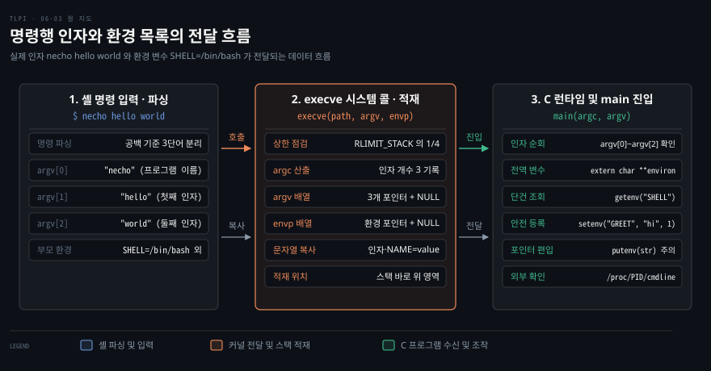
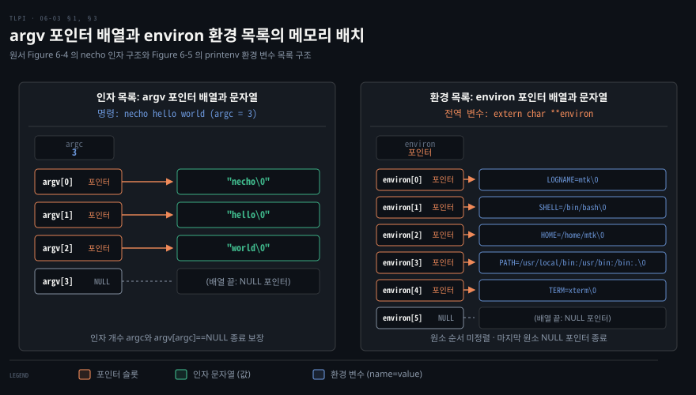
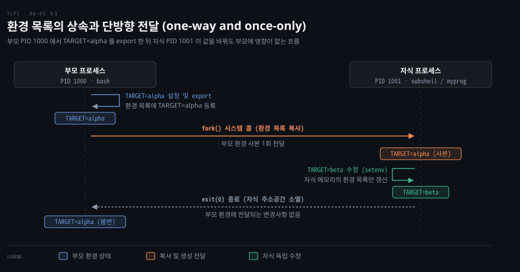

# 부모가 자식에게 건네는 것은 인자 목록과 환경 목록이다

---

> 부모 프로세스가 새 프로그램에 실행 정보를 넘기는 대표 통로는 명령행 인자와 환경 목록입니다. 커널과 C 런타임이 이 둘을 프로세스 스택에 어떻게 배치하고 프로그램에 건네는지를 짚습니다.

## 핵심 요약

> 프로그램 실행 시 커널이 넘기는 정보는 문자열 포인터 배열 두 벌과 정수 하나입니다.

셸에서 명령을 입력하면 셸이 명령 줄을 단어로 쪼개 `execve()` 에 넘기고, 커널은 그 문자열을 새 프로그램의 스택 바로 위 영역에 복사합니다. 프로그램은 인자 개수 `argc` 와 포인터 배열 `argv`, 환경 변수 포인터 배열 `environ` 으로 이 값을 받습니다.

환경 목록은 부모에서 자식으로 정보를 넘길 때 자주 쓰는 통로입니다. 자식은 생성될 때 부모 환경의 사본을 한 번만 물려받습니다. 생성 이후 어느 쪽이 값을 바꿔도 상대방에게는 전달되지 않습니다.

C 인터페이스에서는 메모리 소유권이 핵심입니다. `putenv()` 는 문자열 포인터를 환경 목록에 그대로 꽂아 스택 자동 변수를 넘기면 메모리가 오염됩니다. 반면 `setenv()` 는 동적 메모리를 스스로 할당해 값을 복사하므로 안전합니다.


## 학습 목표

> 인자와 환경 목록이 메모리에 올라가고 상속되는 원리를 이해하면 프로세스 간 데이터 전달과 환경 변수 API 를 안전하게 다룰 수 있습니다.

1. 셸 명령 줄이 C 프로그램의 `argc` 와 `argv` 로 변환되는 메모리 구조를 설명할 수 있습니다.
2. `main()` 외부에서 명령행 인자에 접근하는 방법과 인자 목록의 크기 상한을 설명할 수 있습니다.
3. 환경 목록이 부모에서 자식으로 상속되는 단방향 복사 원리를 설명할 수 있습니다.
4. C 프로그램에서 환경 변수를 조회·등록·삭제하는 API 동작과 메모리 관리 차이를 설명할 수 있습니다.
5. `putenv()` 와 `setenv()` 의 메모리 할당 차이에 따른 부작용을 비교하고 안전한 함수를 선택할 수 있습니다.

셸이 파싱한 인자가 커널 `execve()` 를 거쳐 프로그램 진입점 `main()` 에 도달하는 전체 데이터 흐름입니다.




## 이 문서가 다루지 않는 것

> 이 노트는 명령행 인자와 환경 목록이 C 인터페이스 층에서 어떻게 다뤄지는지에 집중합니다.

- PID 와 프로세스 관계의 기본 구조 → 6장 첫째 편(06-01)
- 메모리 세그먼트 배치와 스택의 기본 동작 → 6장 둘째 편(06-02)
- `fork()` 와 `execve()` 시스템 콜의 커널 내부 처리 과정 → 24장·27장
- 셸의 환경 변수 관리 명령과 스크립트 작성법 전반 → [03-01.셸의 실체는 스트림과 변수와 종료 상태다](../learning-modern-linux/03-01.%EC%85%B8%EC%9D%98%20%EC%8B%A4%EC%B2%B4%EB%8A%94%20%EC%8A%A4%ED%8A%B8%EB%A6%BC%EA%B3%BC%20%EB%B3%80%EC%88%98%EC%99%80%20%EC%A2%85%EB%A3%8C%20%EC%83%81%ED%83%9C%EB%8B%A4.md)


## 1. 명령행 인자의 전달과 argv 포인터 배열

> C 프로그램은 셸이 공백으로 쪼갠 명령행 인자를 `argc` 와 `argv` 매개변수로 받습니다.

터미널에 입력한 `necho hello world` 명령은 공백으로 구분된 여러 단어입니다. 셸이 이 입력을 단어로 쪼개지 않으면 프로그램은 인자의 경계를 알 수 없습니다.

리눅스 C 프로그램의 진입점인 `main()` 함수는 두 매개변수로 이 문제를 풉니다. 첫 매개변수 `int argc` 는 명령행 인자의 총 개수입니다. 둘째 매개변수 `char *argv[]` 는 각 인자 문자열을 가리키는 포인터 배열입니다.

### argv 포인터 배열의 종단 조건과 argv[0] 의 관례

배열의 첫 원소인 `argv[0]` 에는 관례상 프로그램 자신의 이름, 곧 프로그램을 부를 때 쓴 이름이 들어갑니다. 그리고 `argv` 배열의 끝은 항상 `NULL` 포인터로 끝납니다. 즉 `argv[argc]` 의 값은 `NULL` 임이 보장됩니다.

`argv[0]` 에 호출 이름이 담긴다는 관례는 유용한 소프트웨어 기법으로 쓰입니다. 하나의 실행 파일에 여러 하드 링크나 심볼릭 링크를 걸어 두고 프로그램 안에서 `argv[0]` 을 검사해 동작 방식을 바꿉니다.

예를 들어 일부 배포판에서는 `gzip`, `gunzip`, `zcat` 명령이 모두 같은 실행 파일의 링크입니다. 프로그램은 자신이 어떤 이름으로 불렸는지 확인해 압축할지 해제할지 화면에 출력할지를 결정합니다.

```c
int main(int argc, char *argv[])
{
    int j;

    for (j = 0; j < argc; j++)
        printf("argv[%d] = %s\n", j, argv[j]);

    exit(EXIT_SUCCESS);
}
```

위 코드는 예제 프로그램 `proc/necho.c`[^tlpi_code] 의 본문입니다. 컴파일한 `necho` 를 `PATH` 에 두고 인자 두 개를 넘겨 실행합니다.

```bash
necho hello world
```

macOS(Darwin 25.6)에서 컴파일해 실행한 출력입니다. 인자마다 한 줄씩, `argv` 의 몇 번째 원소인지와 함께 찍힙니다.

```bash
argv[0] = necho
argv[1] = hello
argv[2] = world
```

`argv` 목록의 끝이 `NULL` 로 끝나므로 인덱스 변수 `j` 없이 포인터 증가만으로 순회할 수도 있습니다.

```c
char **p;

for (p = argv; *p != NULL; p++)
    puts(*p);
```

`necho hello world` 실행 시의 `argc`·`argv` 배열과 `environ` 환경 목록의 메모리 배치입니다.




## 2. main 외부에서의 인자 접근과 크기 상한

> `argc` 와 `argv` 는 `main()` 의 지역 매개변수이므로 다른 함수에서 읽으려면 전역 변수에 저장하거나 리눅스·glibc 전용 방법을 써야 합니다.

이식성을 지키면서 명령행 인자를 다른 함수에 전달하는 방법은 둘뿐입니다. `argv` 를 하위 함수의 인자로 계속 넘겨주거나, `main()` 시작 시점에 전역 포인터 변수에 `argv` 를 복사해 두는 방식입니다.

### 비이식성 대안과 GNU 확장 전역 변수

리눅스는 프로세스 어디서든 명령행 인자 전체나 실행 이름을 조회하는 전용 경로를 지원합니다.

- `/proc/PID/cmdline` — 프로세스의 전체 명령행 인자가 널 바이트(`\0`)로 구분되어 기록된 가상 파일입니다. 현재 프로세스 자신은 `/proc/self/cmdline` 경로로 읽을 수 있습니다.
- `program_invocation_name` — glibc 가 제공하는 전역 변수로, 프로그램을 부를 때 쓴 이름을 담습니다. `main()` 의 `argv[0]` 과 같은 값이므로 경로를 붙여 불렀으면 경로까지 들어 있습니다[^invocation_man].
- `program_invocation_short_name` — 경로에서 디렉터리 부분을 떼어낸 순수 프로그램 이름(basename)을 담습니다.

두 전역 변수는 `_GNU_SOURCE` 매크로를 정의한 뒤 `<errno.h>` 헤더를 포함하면 사용할 수 있습니다.

### 인자와 환경 목록의 저장 위치와 ARG_MAX 상한

`argv` 배열과 `environ` 배열, 그리고 이 배열이 처음 가리키는 문자열들은 프로세스 스택 바로 위의 한 연속 영역에 함께 놓입니다.

POSIX.1 은 이 영역의 상한 크기를 `<limits.h>` 의 `ARG_MAX` 나 `sysconf(_SC_ARG_MAX)` 로 확인하도록 정했습니다. 최소 요구 상한은 `_POSIX_ARG_MAX`(4,096바이트)입니다.

리눅스는 이 상한을 `execve()` 를 호출하는 시점의 소프트 스택 자원 제한(`RLIMIT_STACK`)의 4분의 1로 계산합니다. 새 프로그램이 쓸 스택을 늘 남겨 두려는 장치입니다. 스택 제한이 8MB 인 시스템에서는 인자와 환경을 합쳐 2MB 까지 넘길 수 있습니다. 다만 스택 제한을 아무리 키워도 6MB 를 넘지 않습니다. 커널 상수 `_STK_LIM`(8MB)의 4분의 3이 상한이기 때문입니다. 반대로 아무리 낮춰도 32페이지 아래로는 내려가지 않습니다[^execve_man].

인자나 환경 문자열 하나의 크기도 `MAX_ARG_STRLEN`(32페이지, 4KB 페이지면 128KB)으로 제한됩니다. 전체 크기나 문자열 하나가 이 제한을 넘으면 `execve()` 는 `E2BIG` 에러로 실패합니다.


## 3. 환경 목록의 상속과 단방향 전달

> 환경 변수는 프로세스가 생성될 때 부모로부터 한 번만 복사받으며 이후 수정은 상대방 프로세스에 전혀 영향을 주지 않습니다.

부모 프로세스가 자식 프로세스에게 설정값을 건네려 할 때, 매번 명령행 인자로 모든 옵션을 나열하기는 어렵습니다. 그래서 프로세스마다 이런 값을 담는 문자열 목록이 하나씩 딸려 있습니다.

모든 프로세스는 **환경 목록**(environment list)이라는 문자열 배열을 가집니다. 각 문자열은 `NAME=value` 형태의 정의로 이루어집니다. `NAME` 을 **환경 변수**라 부릅니다.

새 프로세스가 생성될 때 자식은 부모 환경의 사본을 상속받습니다. 이 상속은 프로세스 간에 정보를 넘기는 원시적이면서도 널리 쓰이는 통신 방법입니다.

### 단방향성과 일회성의 원칙

환경 전달의 가장 중요한 속성은 **단방향이자 일회성**(one-way and once-only)이라는 점입니다.

자식 프로세스는 생성되는 시점에 부모 환경의 스냅샷 복사본을 받습니다. 자식이 생성된 이후에는 부모가 환경을 고쳐도 자식에게 전달되지 않고 반대로 자식이 값을 바꿔도 부모의 환경은 바뀌지 않습니다.

아래 시퀀스 도식은 부모 프로세스가 변수를 내보낸 뒤 자식을 띄우는 흐름을 나타냅니다. 자식이 내부에서 값을 바꿔도 그 값이 부모 환경에 전파되지 않는다는 점도 함께 나타냅니다.



### 셸에서의 환경 목록 제어

셸 변수와 환경 변수의 구분 원리는 [03-01.셸의 실체는 스트림과 변수와 종료 상태다](../learning-modern-linux/03-01.%EC%85%B8%EC%9D%98%20%EC%8B%A4%EC%B2%B4%EB%8A%94%20%EC%8A%A4%ED%8A%B8%EB%A6%BC%EA%B3%BC%20%EB%B3%80%EC%88%98%EC%99%80%20%EC%A2%85%EB%A3%8C%20%EC%83%81%ED%83%9C%EB%8B%A4.md#3-값을-담는-두-종류의-변수) 에서 자세히 다룹니다.

셸에서는 `export` 명령으로 셸 변수를 프로세스 환경 목록에 등록합니다. 등록된 변수는 셸이 실행하는 모든 자식 프로세스에 상속됩니다. 환경 변수 제거는 `unset` 명령을 사용합니다.

```bash
export SHELL=/bin/bash
```

특정 프로그램 하나에만 임시로 환경 변수를 전달하고 부모 셸의 환경은 건드리지 않으려면 명령 앞에 대입식을 붙입니다.

```bash
NAME=value program
```

셸은 명령을 실행하기 전에 [매개변수 확장](../learning-modern-linux/03-01.%EC%85%B8%EC%9D%98%20%EC%8B%A4%EC%B2%B4%EB%8A%94%20%EC%8A%A4%ED%8A%B8%EB%A6%BC%EA%B3%BC%20%EB%B3%80%EC%88%98%EC%99%80%20%EC%A2%85%EB%A3%8C%20%EC%83%81%ED%83%9C%EB%8B%A4.md#실행-전에-셸이-하는--확장) 을 먼저 끝낸 뒤 인자와 환경을 넘깁니다.

현재 환경 목록 전체를 확인하는 명령은 `printenv` 입니다.

```bash
printenv
```

사용자 이름이 `mtk` 인 시스템에서 나온 예시 출력입니다. 실행하는 환경마다 값과 개수가 다릅니다.

```bash
LOGNAME=mtk
SHELL=/bin/bash
HOME=/home/mtk
PATH=/usr/local/bin:/usr/bin:/bin:.
TERM=xterm
```

출력에서 알 수 있듯 환경 목록은 알파벳순으로 정렬되지 않습니다. 구현상 메모리에 넣기 편한 순서로 유지됩니다. 다른 프로세스의 환경은 `/proc/PID/environ` 파일에서 읽을 수 있고, 각 `NAME=value` 는 널 바이트로 구분됩니다. 이 파일은 그 프로그램이 `execve()` 로 시작될 때의 초기 환경입니다. 그래서 프로세스가 그 뒤 `putenv()` 등으로 바꾼 값은 보이지 않습니다[^environ_proc_man].


## 4. C 프로그램의 환경 조작 인터페이스

> C 프로그램은 전역 변수 `environ` 과 표준 라이브러리 함수로 환경 변수를 조회·수정·초기화합니다.

프로그램이 실행 중에 설정을 동적으로 확인하거나 수정하려면 환경 변수를 메모리에서 다룰 수 있어야 합니다. C 표준 라이브러리는 이를 위해 전역 포인터와 전용 API 를 제공합니다.

C 런타임 시작 코드는 프로그램이 시작될 때 환경 목록의 주소를 전역 변수 `char **environ` 에 대입합니다. 프로그램에서는 아래처럼 선언해 사용합니다.

```c
extern char **environ;
```

`argv` 와 마찬가지로 `environ` 은 `NULL` 포인터로 끝나는 포인터 배열입니다. 예제 프로그램 `proc/display_env.c`[^tlpi_code] 는 이 포인터를 순회해 현재 환경 전체를 출력하므로 `printenv` 와 같은 결과를 냅니다.

```c
#include "tlpi_hdr.h"

extern char **environ;

int main(int argc, char *argv[])
{
    char **ep;

    for (ep = environ; *ep != NULL; ep++)
        puts(*ep);

    exit(EXIT_SUCCESS);
}
```

많은 UNIX 시스템이 `main(int argc, char *argv[], char *envp[])` 처럼 셋째 인자도 지원합니다. 하지만 `envp` 는 `main()` 내부에서만 유효하고 POSIX.1/SUSv3 에 규정되지 않은 비표준 인터페이스이므로 사용을 피해야 합니다.

### 개별 환경 변수 조회: getenv()

개별 환경 변수의 값을 읽을 때는 `getenv()` 함수를 씁니다.

```c
#include <stdlib.h>

char *getenv(const char *name);
```

이름이 일치하는 변수가 있으면 값 부분(`value`)의 시작 주소를 가리키는 포인터를 반환하고 없으면 `NULL` 을 반환합니다. `getenv()` 를 쓸 때는 두 가지 주의점이 있습니다.

1. 반환된 문자열을 애플리케이션에서 직접 수정해서는 안 됩니다. 대부분의 구현에서 반환 포인터가 환경 목록의 `name=value` 문자열 안을 가리키므로, 고치면 환경 자체가 바뀝니다.
2. SUSv3 표준은 `getenv()` 가 결과를 정적 버퍼에 담아 반환하는 구현을 허용합니다[^getenv_man]. glibc 는 정적 버퍼를 쓰지 않으나, 이식성을 갖추려면 반환값을 별도 메모리에 복사해 두어야 합니다.

### 환경 변수 추가 및 수정: putenv() 와 setenv()

프로세스는 앞으로 띄울 자식 프로세스나, 같은 프로세스에 `execve()` 로 적재될 새 프로그램에 값을 넘기려고 환경을 바꿉니다. 뒤쪽 경우에는 환경이 프로세스 사이가 아니라 프로그램 사이의 통로가 되므로 **프로그램 간 통신**(interprogram communication)이라고도 부릅니다.

`putenv()` 는 `name=value` 형식의 문자열 포인터를 인자로 받습니다.

```c
#include <stdlib.h>

int putenv(char *string);
```

`putenv()` 는 넘겨받은 문자열을 복제하지 않습니다. 전달받은 포인터를 `environ` 배열의 원소가 직접 가리키게 만듭니다.

그래서 함수 스택 프레임에 할당된 자동 변수(지역 배열)를 `putenv()` 에 넘기면 메모리가 오염되는 버그가 발생합니다. 함수가 반환되어 스택이 덮어써지면 환경 목록이 깨집니다. 정적 메모리나 `malloc()` 으로 할당된 문자열을 넘겨야 합니다.

glibc 의 `putenv()` 는 비표준 확장을 제공합니다. 문자열에 등호(`=`)가 없으면 그 이름의 변수를 환경에서 삭제합니다[^putenv_man].

반면 `setenv()` 는 `name` 과 `value` 문자열을 분리해 받습니다.

```c
#include <stdlib.h>

int setenv(const char *name, const char *value, int overwrite);
```

`setenv()` 는 내부에서 새 메모리 버퍼를 할당하고 `name=value` 문자열을 복사해 넣습니다. 인자 문자열을 복사하므로 스택 자동 변수를 넘겨도 안전합니다. `overwrite` 가 0 이면 기존에 변수가 존재할 때 값을 변경하지 않고 0 을 반환합니다.

```c
#include <stdlib.h>

int unsetenv(const char *name);
int clearenv(void);
```

`unsetenv()` 는 지정한 이름의 변수를 환경 목록에서 삭제합니다. `name` 에 등호(`=`)를 넣어서는 안 됩니다.

`clearenv()` 는 `environ = NULL;` 을 대입해 환경 목록 전체를 비웁니다. set-user-ID 프로그램처럼 상속받은 불분명한 환경 변수를 전부 털어내고 안전한 기본값만 재구성할 때 쓰입니다. 다만 `setenv()` 로 할당된 버퍼는 해제되지 않으므로 반복 호출 시 메모리가 샐 수 있습니다.

예제 프로그램 `proc/modify_env.c`[^tlpi_code] 는 지금까지의 함수를 한 번씩 씁니다. 먼저 `clearenv()` 로 환경을 비우고 명령행 인자를 하나씩 `putenv()` 로 넣습니다. 그다음 `GREET` 가 없을 때만 `setenv("GREET", "Hello world", 0)` 으로 채웁니다. 마지막으로 `unsetenv("BYE")` 로 `BYE` 를 지우고 남은 환경을 출력합니다.

```bash
./modify_env "GREET=Guten Tag" SHELL=/bin/bash BYE=Ciao
./modify_env SHELL=/bin/sh BYE=byebye
```

두 명령의 출력입니다. 첫 실행은 `GREET` 를 직접 넘겼으므로 `setenv()` 가 값을 덮지 않았고, 둘째 실행은 `GREET` 가 없어서 기본값이 채워졌습니다. 두 번 모두 `BYE` 는 지워졌습니다.

```bash
GREET=Guten Tag
SHELL=/bin/bash
```

```bash
SHELL=/bin/sh
GREET=Hello world
```

아래 표는 `putenv()` 와 `setenv()` 의 핵심 차이를 요약합니다.

| 비교 항목 | putenv() | setenv() |
|---|---|---|
| 문자열 메모리 할당 | 복사하지 않고 인자 포인터를 직접 등록 | 새 버퍼를 동적 할당하여 복사 |
| 스택 자동 변수 전달 | 불가능 (함수 반환 후 메모리 오염) | 안전하게 전달 가능 |
| 인자 형식 | 단일 문자열 `"name=value"` | 이름, 값, overwrite 플래그 분리 |
| 기존 값 덮어쓰기 제어 | 항상 덮어씀 | overwrite 인자(0 이면 유지, 0 이 아니면 변경)로 제어 |
| 에러 시 반환값 | 0 이 아닌 정수 | -1 (`errno` 설정) |
| 표준 규격 | SVr2 기원, POSIX.1-2001 채택 | 4.3BSD 기원, POSIX.1-2001(SUSv3) 채택 |


## 결정 치트시트

> 작업 목적에 따라 인자 접근 방식과 환경 조작 함수를 고르는 기준입니다.

| 상황 | 권장 선택 | 이유와 주의점 |
|---|---|---|
| 프로그램 호출 이름에 따라 분기할 때 | `argv[0]` 확인 | 심볼릭 링크 이름 식별, 알 수 없는 링크명에 대비한 기본 분기 필요 |
| `main()` 외부에서 실행 파일 이름이 필요할 때 | `program_invocation_short_name` | glibc 확장 전역 변수, 비이식성 코드임을 명시 |
| 환경 변수 하나를 안전하게 등록·변경할 때 | `setenv(name, val, 1)` | 메모리를 직접 복사하므로 지역 버퍼 오염 위험 차단 |
| 환경 변수가 없을 때만 기본값을 채울 때 | `setenv(name, val, 0)` | `overwrite` 를 0 으로 지정해 기존 설정 보존 |
| 환경 변수 하나를 목록에서 제거할 때 | `unsetenv(name)` | 표준 POSIX 함수, 이름에 등호(`=`) 제외 |
| 정적 문자열 리터럴을 즉시 환경에 등록할 때 | `putenv("KEY=VAL")` | 추가 메모리 할당 없음, 스택 지역 변수 전달 절대 금지 |
| 특권 프로세스 시작 시 환경을 정화할 때 | `clearenv()` 후 필수 변수만 재설정 | 상속된 악의적 환경 변수 제거, SUSv3 미지정이므로 이식성 확인 |


## 적용 관점

> 환경 목록과 인자 목록을 실무 개발과 운영 관점에서 다룰 때 마주치는 세 가지 지점입니다.

### 1. 특권 프로그램과 라이브러리 로더 오염 방지

환경 변수는 사용자가 프로그램의 실행 흐름을 통제하는 강력한 수단이지만 set-user-ID 프로그램이나 루트 권한 데몬에서는 공격 벡터가 됩니다. 특권 프로그램이 `system()` 이나 `execlp()` 처럼 `PATH` 를 따라 다른 프로그램을 실행한다고 해 봅시다. 사용자가 `PATH` 를 바꿔 두었다면 공격자가 만든 프로그램이 특권으로 실행될 수 있습니다.

`LD_PRELOAD` 같은 동적 링커 변수는 사정이 다릅니다. set-user-ID 프로그램은 secure-execution 모드로 돕니다. 이 모드의 동적 링커는 그런 변수의 효과를 막거나 좁히고 환경에서도 지웁니다[^ldso_man]. 하지만 `PATH` 처럼 프로그램이 직접 쓰는 변수는 프로그램이 스스로 걸러야 합니다.

따라서 특권 프로그램은 시작 직후 `clearenv()` 로 환경을 초기화해야 합니다. 그 뒤 안전한 필수 변수(`PATH=/bin:/usr/bin` 등)만 `setenv()` 로 다시 채웁니다.

### 2. 컨테이너 12-Factor App 과 ARG_MAX 한계

클라우드 인프라와 쿠버네티스 환경에서는 12-Factor 원칙처럼 애플리케이션 설정을 환경 변수로 주입하는 방식을 널리 씁니다.

대규모 설정값이나 대용량 JSON 데이터를 환경 변수로 넘기면 커널 한계에 부딪힙니다. `ARG_MAX` 나 `MAX_ARG_STRLEN` 상한을 넘기면 `execve()` 가 `E2BIG` 에러로 실패합니다.

리눅스 커널은 스택 제한의 25%(최대 6MB)까지 인자와 환경 목록을 허용합니다. 다만 환경 변수 문자열 하나는 32페이지(4KB 페이지면 128KB)를 넘길 수 없습니다. 큰 설정 데이터는 환경 변수 대신 볼륨 파일 마운트로 넘기는 편이 안전합니다.

### 3. C 데몬과 다중 스레드에서의 환경 수정

C 기반 서버 데몬에서 환경 변수를 수정할 때 `putenv()` 를 오용하면 디버깅하기 어려운 메모리 오염 사고가 일어납니다.

스택 지역 배열에 문자열을 조합해 `putenv()` 에 넘기면 함수 반환 뒤 메모리가 재사용됩니다. 이후 다른 함수가 스택을 쓰면 환경 변수 값이 오염됩니다.

동적 환경 변수 생성에는 항상 `setenv()` 를 쓰는 것이 표준적인 안전 관례입니다.

스레드가 여럿이면 함수 선택만으로 끝나지 않습니다. `setenv()`·`putenv()`·`unsetenv()`·`clearenv()` 는 man page 에서 `MT-Unsafe const:env` 로 표시됩니다. 여러 스레드가 도는 동안에는 이 함수들을 부르지 않아야 한다는 뜻입니다[^mtunsafe_man]. 그래서 환경 수정은 스레드를 만들기 전에 끝내 둡니다.


## 면접에서 받을 만한 질문

> 인자 목록과 환경 목록의 커널 배치와 상속 원리에 대해 실무 면접에서 자주 나오는 질문입니다.

1. `putenv()` 와 `setenv()` 의 내부 메모리 처리 방식의 차이점은 무엇이며 왜 `putenv()` 에 지역 변수를 넘기면 위험합니까?
2. 셸에서 `NAME=value ./app` 형식으로 실행했을 때와 `export NAME=value; ./app` 으로 실행했을 때의 차이는 무엇입니까?
3. 자식 프로세스 안에서 환경 변수를 변경한 뒤 종료되었을 때 부모 프로세스의 환경 목록에는 어떤 변화가 생깁니까?
4. `getenv()` 가 반환한 문자열 포인터의 내용을 직접 수정하면 안 되는 이유는 무엇입니까?
5. `argv[0]` 을 이용해 프로그램의 실행 모드를 분기하는 기법의 장점과 주의해야 할 점은 무엇입니까?


## 정답 (자답 후 펼치기)

> 질문에 대한 핵심 원리 답변입니다.

### 정답 1 — putenv 와 setenv 의 메모리 차이

`putenv()` 는 인자로 전달된 문자열의 포인터를 프로세스의 `environ` 배열에 직접 등록합니다. 반면 `setenv()` 는 내부에서 `malloc()` 으로 새 메모리 공간을 할당해 `NAME=value` 문자열을 복사한 뒤 등록합니다.

스택 프레임에 있는 지역 배열을 `putenv()` 에 넘기면 그 함수가 반환된 직후 스택 메모리가 재사용됩니다. 그러면 환경 목록의 데이터가 오염됩니다. `setenv()` 는 내용을 복제하므로 지역 버퍼를 넘겨도 안전합니다.

### 정답 2 — 환경 변수 임시 전달과 export

`NAME=value ./app` 문법은 부모 셸의 환경 목록은 변경하지 않습니다. 이번에 실행되는 자식 프로세스 `./app` 의 `execve()` 인자에만 그 환경 변수를 넣어 전달합니다.

반면 `export NAME=value` 는 부모 셸 프로세스 자체의 환경 목록에 변수를 등록해, 그 셸이 끝날 때까지 남깁니다. 이후 부모 셸이 실행하는 모든 자식 프로세스가 이 환경 변수의 복사본을 물려받습니다.

### 정답 3 — 자식의 환경 변경과 부모 환경의 불변성

부모 프로세스의 환경 목록에는 아무런 변화도 생기지 않습니다.

환경 목록의 상속은 프로세스 생성 시점에 한 번만 일어나는 단방향 복사(one-way and once-only)입니다. 자식 프로세스는 부모 환경의 독립된 사본을 가상 메모리 공간에 둡니다. 그래서 자식 안에서 일어난 환경 목록 변경은 부모 프로세스의 주소 공간에 전파되지 않습니다.

### 정답 4 — getenv 반환값 직접 수정 금지

대부분의 구현에서 `getenv()` 가 반환하는 포인터는 프로세스 환경 목록 안의 `name=value` 문자열에서 `value` 부분이 시작하는 주소를 직접 가리킵니다.

따라서 이 문자열의 바이트를 직접 수정하면 환경 변수 데이터가 예기치 않게 훼손됩니다. 또한 POSIX/SUSv3 표준은 구현체가 정적 버퍼를 재사용해 결과를 반환하는 것을 허용합니다. 값을 안전하게 보존하려면 별도 버퍼로 복사해야 합니다.

### 정답 5 — argv[0] 분기 기법과 주의점

동일한 바이너리에 여러 링크(심볼릭 링크 또는 하드 링크)를 생성하고 `argv[0]` 에 전달된 호출 이름을 비교해 실행 파일 하나로 다양한 유틸리티 기능(`gzip`, `gunzip`, `zcat` 등)을 지원할 수 있습니다.

주의할 점은 사용자가 링크 이름을 임의로 바꾸거나 절대 경로, 상대 경로, 혹은 예상치 못한 이름으로 실행할 수 있다는 점입니다. 그래서 `argv[0]` 에서 디렉터리 경로를 제거하는 처리가 필요합니다. 알려지지 않은 이름으로 불렸을 때의 기본 동작(fallback)도 구현해야 합니다.


## 핵심 개념 체크리스트

> 이 편에서 다룬 핵심 개념을 스스로 확인하는 점검표입니다.

| 개념 | 핵심 확인 질문 | 점검 |
|---|---|---|
| `argc` 와 `argv` | `argv[argc]` 의 값이 항상 `NULL` 포인터임을 알고 있는가? | [ ] |
| `argv[0]` 활용 | 단일 실행 파일에 다중 링크를 걸고 호출 이름에 따라 분기하는 기법을 설명할 수 있는가? | [ ] |
| `ARG_MAX` | 리눅스에서 인자와 환경의 상한이 `RLIMIT_STACK` 의 1/4(최대 6MB)로 정해짐을 알고 있는가? | [ ] |
| 단방향 상속 | 환경 목록이 생성 시점에만 사본으로 복사되며 자식의 수정이 부모에 영향이 없음을 설명할 수 있는가? | [ ] |
| `getenv()` 주의점 | 반환된 문자열 포인터를 직접 수정해서는 안 되는 이유를 설명할 수 있는가? | [ ] |
| `putenv()` vs `setenv()` | 포인터 직접 편입과 메모리 복사 방식의 차이 및 지역 변수 전달 위험성을 설명할 수 있는가? | [ ] |
| `clearenv()` | 특권 프로그램 시작 시 환경 목록을 초기화하는 보안상의 이유를 설명할 수 있는가? | [ ] |


## 관련 문서

- [Learning Modern Linux 3장 — 셸의 실체는 스트림과 변수와 종료 상태다](../learning-modern-linux/03-01.%EC%85%B8%EC%9D%98%20%EC%8B%A4%EC%B2%B4%EB%8A%94%20%EC%8A%A4%ED%8A%B8%EB%A6%BC%EA%B3%BC%20%EB%B3%80%EC%88%98%EC%99%80%20%EC%A2%85%EB%A3%8C%20%EC%83%81%ED%83%9C%EB%8B%A4.md) — 셸 층의 변수 관리와 환경 상속
- [The Linux Programming Interface 정독 인덱스](./README.md) — 프로세스 및 시스템 콜 정독 인덱스


## 참고 자료

- Michael Kerrisk, 『The Linux Programming Interface』, No Starch Press, 2010.
- Linux man-pages `environ(7)` — https://man7.org/linux/man-pages/man7/environ.7.html
- Linux man-pages `getenv(3)` — https://man7.org/linux/man-pages/man3/getenv.3.html
- Linux man-pages `setenv(3)` — https://man7.org/linux/man-pages/man3/setenv.3.html
- Linux man-pages `putenv(3)` — https://man7.org/linux/man-pages/man3/putenv.3.html
- Linux man-pages `execve(2)` — https://man7.org/linux/man-pages/man2/execve.2.html
- Linux man-pages `program_invocation_name(3)` — https://man7.org/linux/man-pages/man3/program_invocation_name.3.html
- Linux man-pages `proc_pid_environ(5)` — https://man7.org/linux/man-pages/man5/proc_pid_environ.5.html
- Linux man-pages `ld.so(8)` — https://man7.org/linux/man-pages/man8/ld.so.8.html
- TLPI 예제 소스 `proc/` — https://man7.org/tlpi/code/online/dist/proc/

[^execve_man]: Linux 2.6.23 부터 `RLIMIT_STACK` 소프트 제한의 1/4 로 계산하며, 그 전에는 `MAX_ARG_PAGES`(32페이지)로 고정이었습니다. `_STK_LIM` 의 3/4 상한, 2.6.25 부터의 32페이지 하한, 문자열 하나당 `MAX_ARG_STRLEN`(32페이지) 제한은 [execve(2)](https://man7.org/linux/man-pages/man2/execve.2.html) 「Limits on size of arguments and environment」(man-pages 6.19, 2026-11 확인)에 있습니다. MMU 가 없는 아키텍처는 2.6.23 이전 방식을 유지합니다.
[^getenv_man]: POSIX.1-2001/SUSv3 명세는 `getenv()` 의 반환 버퍼가 정적으로 할당되어 이후의 `getenv()`, `putenv()`, `setenv()`, `unsetenv()` 호출에 의해 덮어써질 수 있음을 허용합니다. [getenv(3)](https://man7.org/linux/man-pages/man3/getenv.3.html) 참고.
[^putenv_man]: GNU C 라이브러리(glibc)의 비표준 확장으로, 인자 문자열에 등호(`=`)가 없으면 해당 이름의 변수를 환경 목록에서 삭제합니다. [putenv(3)](https://man7.org/linux/man-pages/man3/putenv.3.html) 참고.
[^tlpi_code]: 『The Linux Programming Interface』 예제 소스 배포본의 `proc/` 디렉터리입니다. [man7.org/tlpi/code](https://man7.org/tlpi/code/online/dist/proc/) 에서 전문을 볼 수 있습니다. 소스는 `tlpi_hdr.h` 를 포함하므로 배포본 전체를 받아 빌드합니다.
[^invocation_man]: [program_invocation_name(3)](https://man7.org/linux/man-pages/man3/program_invocation_name.3.html) 은 이 변수가 `argv[0]` 과 같은 값이고 glibc 런타임 시작 코드가 초기화한다고 적습니다.
[^environ_proc_man]: [proc_pid_environ(5)](https://man7.org/linux/man-pages/man5/proc_pid_environ.5.html) 참고. 읽기 권한은 `ptrace` 접근 검사(`PTRACE_MODE_READ_FSCREDS`)로 정해집니다.
[^ldso_man]: [ld.so(8)](https://man7.org/linux/man-pages/man8/ld.so.8.html) 「Secure-execution mode」. 실효 사용자 ID 와 실제 사용자 ID 가 다르게 실행된 프로그램 등이 이 모드로 돌며, `LD_PRELOAD`·`LD_LIBRARY_PATH` 등의 효과가 없어지거나 제한되고 환경에서도 제거됩니다.
[^mtunsafe_man]: [setenv(3)](https://man7.org/linux/man-pages/man3/setenv.3.html)·[putenv(3)](https://man7.org/linux/man-pages/man3/putenv.3.html)·[clearenv(3)](https://man7.org/linux/man-pages/man3/clearenv.3.html) 의 ATTRIBUTES 표. `const:env` 의 뜻은 [attributes(7)](https://man7.org/linux/man-pages/man7/attributes.7.html) 에 있으며, 환경을 바꾸는 함수를 이렇게 표시하는 대신 `getenv()` 는 `MT-Safe env` 로 둡니다.
