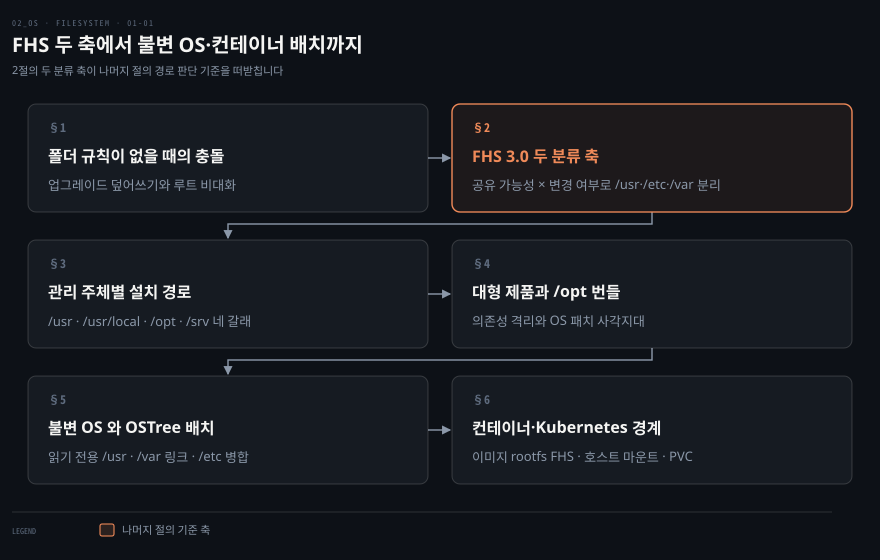
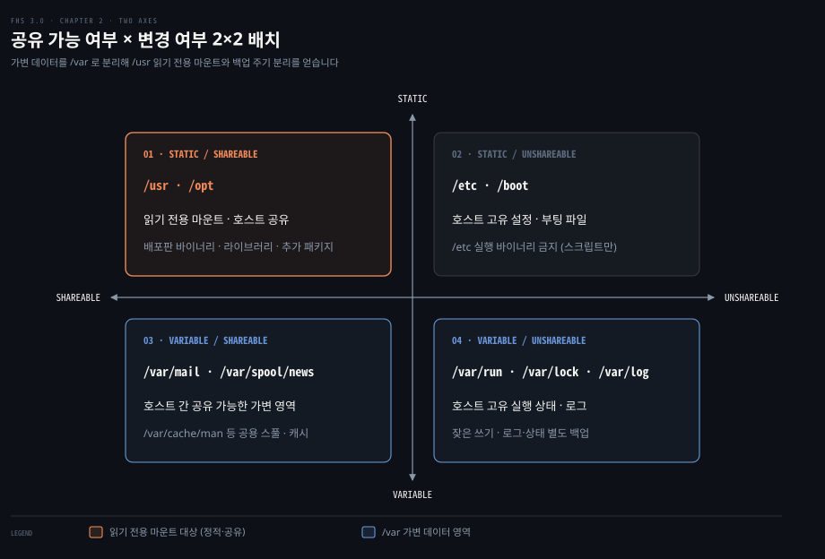
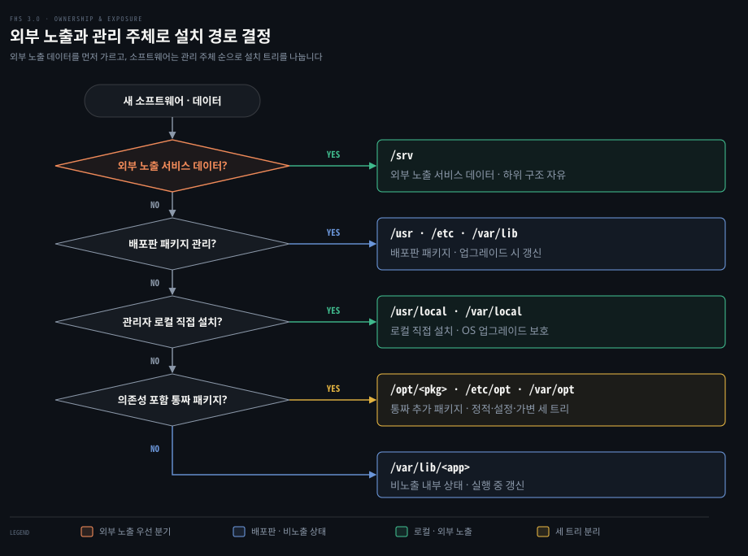
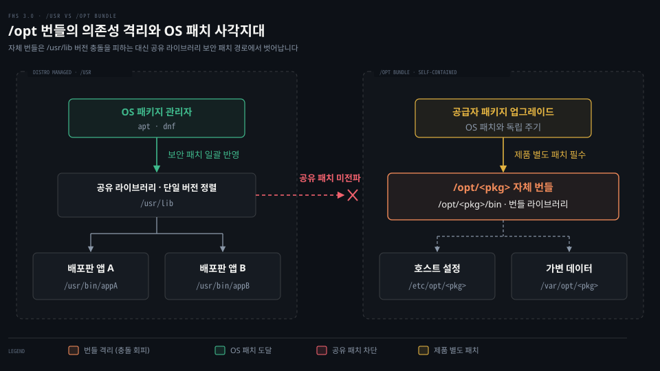
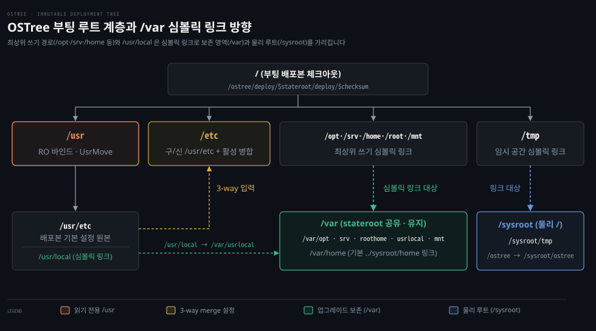
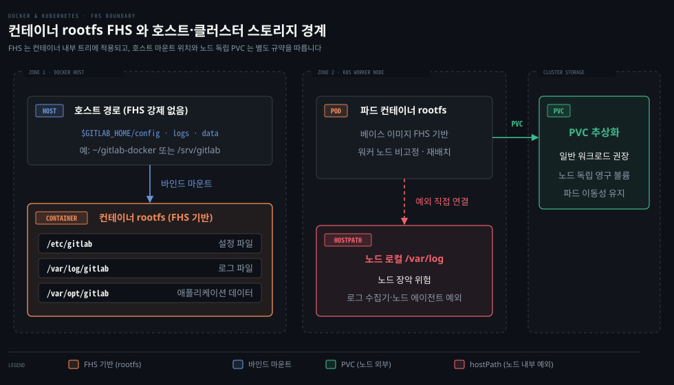

# FHS와 불변 OS — 파일을 어디에 두는가

---

> 파일시스템 계층 표준(FHS, Filesystem Hierarchy Standard)은 리눅스 파일을 공유 가능성과 변경 여부의 두 축으로 나누어 배치합니다. 
>
> 불변 OS 와 컨테이너는 이 경계 위에서 읽기 전용 트리와 지속 데이터 경로를 다시 나눕니다.

## 학습 목표와 범위

> 이 문서를 읽고 나면 일반 리눅스, OSTree 불변 OS, 컨테이너 환경에서 파일의 자리를 근거와 함께 판단할 수 있습니다. 주요 최상위 디렉터리 요약과 바인드 마운트 기초는 기존 정독 노트에 맡깁니다.

1. FHS 3.0 이 파일을 나누는 두 축으로 `/usr`·`/etc`·`/var` 이 갈리는 이유를 설명할 수 있습니다.
2. 배포판 패키지, 관리자 직접 빌드, 통짜 추가 패키지, 서비스 데이터의 설치 경로를 관리 주체 기준으로 비교할 수 있습니다.
3. 대형 제품이 `/opt` 에 통째로 들어가는 이유와 보안 패치 측면의 대가를 설명할 수 있습니다.
4. OSTree 계열 불변 OS 에서 `/usr` 읽기 전용 마운트와 `/var` 심볼릭 링크가 배치를 어떻게 바꾸는지 예측할 수 있습니다.
5. 컨테이너와 Kubernetes 의 FHS 경계를 구분하고 영구 볼륨 클레임(PVC)·`hostPath` 를 선택할 수 있습니다.

주요 최상위 디렉터리 요약 표와 바인드 마운트 기초는 [《Learning Modern Linux》(LML) 05-01 §6](../../book/learning-modern-linux/05-01.%EB%AA%A8%EB%93%A0%20%EA%B2%83%EC%9D%B4%20%ED%8C%8C%EC%9D%BC%EC%9D%B4%EB%9D%BC%EB%8A%94%20%EB%A7%90%EC%9D%80%20%EC%86%90%EC%9E%A1%EC%9D%B4%EA%B0%80%20%ED%95%98%EB%82%98%EB%9D%BC%EB%8A%94%20%EB%9C%BB%EC%9D%B4%EB%8B%A4.md#6-%EC%96%B4%EB%94%94%EC%97%90-%EB%AC%B4%EC%97%87%EC%9D%84-%EB%91%90%EB%8A%94%EA%B0%80)가 정본입니다. OverlayFS 와 마운트 전파(propagation) 메커니즘은 [docs/kernel/](../kernel/README.md)이 맡습니다.

아래 지도는 1절의 배치 충돌에서 출발해 2절의 FHS 두 축을 딛고 3~6절의 환경별 경로 판단으로 이어집니다.

## 1. 폴더 규칙이 없을 때의 충돌

> 디렉터리 규칙 없이 프로그램을 아무 경로에 깔면 OS 업그레이드 때 파일이 덮어쓰이고 루트 파티션이 손상 위험에 놓입니다. FHS 는 파티션 분리·백업·이식성을 지키려고 경로 책임을 미리 갈라 둡니다.

프로그램마다 바이너리와 호스트 설정과 로그를 제각각 두면 운영이 곧바로 막힙니다. 관리자가 직접 깐 실행 파일을 `/` 나 `/usr` 에 섞어 두면 OS 업그레이드 과정에서 덮어쓰입니다.[^fhs-usr-local]

루트 파티션(`/`)이 비대해지는 문제도 생깁니다. FHS 3.0 은 루트 파일시스템을 부팅·복구·수리에 필요한 최소 크기로 유지하도록 요구합니다.[^fhs-root] 루트가 커지면 시스템 충돌 때 손상 위험이 커집니다. 작은 루트 파티션을 쓰는 다른 호스트와의 호환성도 깨집니다.

그래서 애플리케이션은 루트 아래에 새 최상위 디렉터리를 임의로 만들어서는 안 됩니다.[^fhs-root] 관리자가 표준 트리를 여러 마운트 볼륨에 나누어 둔 계획을 우회하기 때문입니다.

주요 최상위 디렉터리의 역할은 [LML 05-01 §6 표](../../book/learning-modern-linux/05-01.%EB%AA%A8%EB%93%A0%20%EA%B2%83%EC%9D%B4%20%ED%8C%8C%EC%9D%BC%EC%9D%B4%EB%9D%BC%EB%8A%94%20%EB%A7%90%EC%9D%80%20%EC%86%90%EC%9E%A1%EC%9D%B4%EA%B0%80%20%ED%95%98%EB%82%98%EB%9D%BC%EB%8A%94%20%EB%9C%BB%EC%9D%B4%EB%8B%A4.md#6-%EC%96%B4%EB%94%94%EC%97%90-%EB%AC%B4%EC%97%87%EC%9D%84-%EB%91%90%EB%8A%94%EA%B0%80)에 정리되어 있습니다. 현대 배포판에서는 `/bin`·`/sbin`·`/lib` 이 `/usr/bin`·`/usr/sbin`·`/usr/lib` 으로 통합되었습니다. 기존 경로는 호환용 심볼릭 링크로 남습니다.[^tlcl-ch3] `/var/run` 역시 `/run` 으로 옮겨져 심볼릭 링크로 남습니다.[^hlw-219]

## 2. FHS 의 두 분류 축

> 프로그램과 데이터라는 단순 구분만으로는 읽기 전용 마운트와 백업 주기를 나눌 수 없습니다. FHS 3.0 은 공유 가능 여부와 변경 여부의 두 독립 축으로 `/usr`·`/etc`·`/var` 의 경계를 긋습니다.

위 사분면은 가로축에 공유 가능 여부, 세로축에 변경 여부를 놓아 대표 경로 네 묶음을 가릅니다. 강조된 왼쪽 위 칸(`/usr`·`/opt`)은 정적이면서 공유 가능하므로 읽기 전용 마운트 대상으로 분리됩니다.

실행 파일과 로그가 한 파티션에 섞여 있으면 읽기 전용으로 잠그지 못합니다. 백업 주기를 따로 잡기도 어렵습니다. 여러 서버가 같은 바이너리를 쓰면서 호스트별 설정만 다르게 유지하는 구성도 꼬입니다.

FHS 3.0 2장은 이 문제를 풀기 위해 파일 성격을 두 개의 독립된 질문으로 나눕니다.[^fhs-ch2]

- 공유 가능 여부(shareable vs. unshareable): 한 호스트에 둔 파일을 다른 호스트도 쓸 수 있는지입니다. 사용자 홈 디렉터리나 `/usr` 는 공유할 수 있지만 장치 잠금 파일은 공유할 수 없습니다.
- 변경 여부(static vs. variable): 관리자 개입 없이 실행 중에 바뀌는지입니다. 바이너리·라이브러리·문서는 정적(static)이고 로그·캐시·스풀은 가변(variable)입니다.

FHS 3.0 2장이 제시하는 대표 배치는 아래 2×2 표와 같습니다.[^fhs-ch2]

| 변경 여부 \ 공유 가능 여부 | shareable (호스트 간 공유 가능) | unshareable (호스트 고유) |
|---|---|---|
| static (정적) | `/usr`, `/opt` | `/etc`, `/boot` |
| variable (가변) | `/var/mail`, `/var/spool/news` | `/var/run`, `/var/lock` |

### 두 축이 가른 /usr·/etc·/var

초기 유닉스 계열 시스템은 `/usr` 와 `/etc` 안에 정적 파일과 가변 파일을 함께 두었습니다.[^fhs-ch2] 이 구조에서는 `/usr` 를 읽기 전용 매체나 별도 파티션으로 마운트할 수 없었습니다.

FHS 는 시스템 동작 중에 쓰기가 일어나는 가변 파일을 모두 `/var` 로 옮겼습니다.[^fhs-ch2][^fhs-var] `/etc` 에 있던 가변 파일도 시간이 지나며 `/var` 로 이동했습니다. FHS 2.1 시절 `/etc/adjtime` 이던 시계 보정 파일이 대표적입니다. `hwclock` 이 값을 갱신하므로 `/var/lib/hwclock/adjtime` 으로 옮겨졌습니다.[^fhs-varlib]

이 분리 덕분에 세 최상위 트리의 성격이 분명해졌습니다.

- `/usr`: 공유 가능하고 읽기 전용인 정적 데이터 영역입니다. 호스트에 종속되거나 시간에 따라 변하는 파일은 여기에 두지 않으므로 읽기 전용 마운트가 가능합니다.[^fhs-usr]
- `/etc`: 호스트 고유의 정적 설정 파일 영역입니다. 실행 바이너리는 둘 수 없습니다. 초기화 스크립트처럼 사람이 읽을 수 있는 실행 스크립트만 허용됩니다.[^fhs-etc]
- `/var`: 시스템이 동작하면서 변하는 데이터 영역입니다. `/var/log`·`/var/lock`·`/var/run` 은 호스트 고유입니다.[^fhs-varlog] 반면 `/var/mail`·`/var/cache/man`·`/var/spool/news` 등은 공유할 수 있습니다.[^fhs-var]

정적 파일은 변경 빈도가 낮아 가변 파일과 같은 주기로 백업할 필요가 없습니다.[^fhs-ch2] 과거에는 `/usr/share` 의 아키텍처 독립 데이터를 파일 서버로 공유하기도 했습니다. 오늘날은 디스크 여유가 커져 이런 네트워크 공유는 드물어졌습니다.[^hlw-219]

## 3. 관리 주체별 설치 경로 비교

> 소프트웨어를 설치할 때 파일 성격만 보면 `/usr` 와 `/opt` 와 `/usr/local` 이 겹칩니다. FHS 는 누가 그 파일을 관리하고 덮어쓸 권한을 갖는지에 따라 네 경로를 나눕니다.

파일 성격만 보면 `/usr`·`/opt`·`/usr/local` 경로가 겹쳐 충돌이 생깁니다. 위 흐름도는 먼저 외부 노출 데이터(`/srv`)를 가른 뒤 관리 주체 순으로 설치 트리를 분기합니다.

관리자가 소스에서 직접 빌드한 프로그램이나 외부 상용 패키지를 `/usr/bin` 에 넣으면 배포판 패키지 관리자와 충돌합니다. 배포판이 업그레이드할 때 파일이 덮어쓰이거나 같은 경로 이름을 놓고 부딪히기 때문입니다.[^fhs-usr-local][^fhs-opt]

FHS 3.0 은 관리 주체와 데이터 노출 여부에 따라 설치 자리를 아래 네 갈래로 구분합니다.

| 관리 주체·성격 | 정적 파일 | 설정 파일 | 가변 데이터 | 핵심 경계 규칙 |
|---|---|---|---|---|
| 배포판 패키지 | `/usr` (`bin`·`lib`·`share`) | `/etc` (`/usr/etc` 금지) | `/var/lib/<패키지>`, `/var/log` | 패키지 관리자가 갱신함. 대형 패키지의 `/usr` 직속 하위 폴더 금지[^fhs-usr] |
| 관리자 직접 빌드·설치 | `/usr/local` | `/usr/local/etc` (`/etc/local` 링크 가능) | `/var/local` | OS 업그레이드 때 덮어쓰기에서 보호됨[^fhs-usr-local][^fhs-var] |
| 추가 통짜 패키지 | `/opt/<패키지>` 또는 `/opt/<공급자>` | `/etc/opt/<하위경로>` | `/var/opt/<하위경로>` | 정적·설정·가변을 세 트리로 나누어 독립 관리[^fhs-opt] |
| 서비스 제공 데이터 | `/srv` | 서비스별 `/etc` | `/srv` (읽기·쓰기 공존 가능) | 하위 구조 비지정. 비노출 내부 상태는 `/var/lib` 로 분리[^fhs-srv] |

### 배포판 /usr 과 관리자 /usr/local

`/usr` 는 배포판이 제공하는 대부분의 사용자 공간 프로그램과 라이브러리를 담습니다.[^hlw-219][^tlcl-ch3] 배포판 업그레이드 때 이 트리 아래 파일은 언제든 교체될 수 있습니다.[^fhs-usr-local]

반면 `/usr/local` 은 시스템 관리자가 배포판 밖에서 직접 설치하는 소프트웨어 자리입니다. 초기 설치 직후에는 비어 있습니다. 소스 코드에서 빌드한 프로그램은 보통 `/usr/local/bin` 에 들어갑니다.[^tlcl-ch3]

FHS 3.0 은 `/usr/local` 아래에 `/`·`/usr` 와 짝을 이루는 구조를 둡니다. 하위 디렉터리로 `bin`·`etc`·`lib`·`sbin`·`share`·`src` 등이 들어갑니다.[^fhs-usr-local][^hlw-219] 이 트리는 OS 업그레이드 때 덮어쓰기에서 안전하게 보호되어야 합니다.[^fhs-usr-local]

`/usr/local/etc` 는 허용되지만 전통 FHS 에서 `/usr/etc` 는 금지됩니다. `/usr` 에 설치된 프로그램의 설정은 반드시 `/etc` 에 두어야 합니다.[^fhs-usr-local]

### 통짜 추가 패키지 /opt 와 세 트리

`/opt` 는 추가 애플리케이션 소프트웨어 패키지를 설치하는 공간입니다.[^fhs-opt] 한 제품이 자기 하위 트리(`/opt/<패키지>` 또는 LANANA 등록 `/opt/<공급자>`) 안에 정적 파일을 모아 둡니다. 여기서 LANANA 는 리눅스 이름·번호 할당 기구(Linux Assigned Names and Numbers Authority)입니다.

그렇다고 설정과 가변 데이터까지 `/opt/<패키지>` 안에 섞는 것은 아닙니다. FHS 3.0 은 `/opt` 패키지에도 두 축을 적용해 세 곳으로 가릅니다.

- 정적 파일: `/opt/<패키지>` 아래에 둡니다. 실행 프로그램은 `/opt/<패키지>/bin`, 매뉴얼은 `/opt/<패키지>/share/man` 에 둡니다.[^fhs-opt]
- 호스트별 설정 파일: `/etc/opt/<하위경로>` 에 둡니다. 패키지 동작상 다른 위치가 필수인 설정만 예외를 허용합니다.[^fhs-etc]
- 가변 데이터: `/var/opt/<하위경로>` 에 둡니다. 내부 디렉터리 구조는 표준이 강제하지 않습니다.[^fhs-varopt]

`/opt/bin`·`/opt/doc`·`/opt/include`·`/opt/info`·`/opt/lib`·`/opt/man` 은 로컬 관리자 예약 영역입니다. 패키지는 관리자가 링크할 프런트엔드 파일을 제공할 수 있지만 이 예약 폴더 없이도 정상 동작해야 합니다.[^fhs-opt]

### /srv 와 /var/lib 의 경계

`/srv` 는 이 호스트가 외부에 제공하는 서비스의 사이트별 데이터를 둡니다.[^fhs-srv] 읽기 전용 데이터와 쓰기 가능 데이터와 스크립트가 한 트리에 모여야 하는 서비스에 적합합니다.

하위 구조는 호스트마다 다릅니다. 프로토콜별(`/srv/www`, `/srv/ftp`)이나 조직별(`/srv/physics/www`) 방식을 쓸 수 있습니다. 따라서 프로그램이 `/srv` 아래 특정 하위 구조를 전제해서는 안 됩니다.[^fhs-srv]

반면 `/var/lib/<애플리케이션>` 은 실행 중 갱신되고 재부팅 뒤에도 남는 호스트 고유 상태 정보 자리입니다.[^fhs-varlib] 배포판 패키지 관리 도구 데이터베이스도 `/var/lib/<이름>` 을 씁니다.

둘을 가르는 기준은 파일 구조 노출 여부입니다. 사용자가 설정을 바꾸려고 `/var/lib` 파일을 손대거나 내부 구조를 소비자에게 노출해서는 안 됩니다. 파일 계층이 소비자에게 드러나는 서비스 데이터라면 `/var/lib` 가 아니라 `/srv` 에 둡니다.[^fhs-srv][^fhs-varlib]

## 4. 대형 제품과 /opt 번들 구조

> 대형 제품을 배포판 `/usr` 에 흩어 깔면 호스트의 라이브러리 버전과 부딪히고 업그레이드 충돌이 생깁니다. `/opt/<패키지>` 번들은 의존성을 독립시켜 충돌을 막는 대신 OS 패치 사각지대를 만듭니다.

배포판 패키지 저장소는 모든 패키지가 `/usr/lib` 의 공유 라이브러리 버전을 맞추는 전제로 움직입니다. FHS 3.0 도 대형 소프트웨어 패키지가 `/usr` 직속 하위 디렉터리를 쓰지 못하게 막습니다.[^fhs-usr] 대신 `/opt/<패키지>` 에 필요한 정적 지원 데이터를 모아 배포판 설치물과의 경로 충돌을 피하게 설계했습니다.[^fhs-opt]

위 도식은 왼쪽 배포판 영역과 오른쪽 `/opt` 번들 영역을 패치 도달 경로로 대조합니다. `apt`·`dnf` 보안 업데이트는 왼쪽 `/usr/lib` 에는 닿지만 오른쪽 번들 경계에서 차단되어 별도 제품 업그레이드가 필요합니다.

그래서 상용 제품은 `/opt/<패키지>` 에 두는 경우가 많습니다.[^tlcl-ch3] FHS 는 `/opt` 를 추가 애플리케이션 패키지의 자리로 정합니다. 패키지의 정적 파일은 `/opt/<패키지>` 또는 `/opt/<공급자>` 한 트리에 두어야 합니다.[^fhs-opt] 자기 바이너리와 라이브러리를 한 트리에 담아 OS 배포판 버전과 분리합니다.

GitLab Docker 설치 문서가 보여 주는 컨테이너 경로는 설정·로그·데이터를 나누는 점에서 FHS 의 세 트리 분리와 모양이 같습니다. 다만 문서는 `/opt` 디렉터리 규약을 언급하지 않습니다.[^gitlab-docker] 컨테이너 안에서는 `GITLAB_OMNIBUS_CONFIG` 로 GitLab 의 올인원 패키지인 Omnibus 를 설정합니다. 영구 데이터는 아래 세 FHS 경로로 분리합니다.

| 호스트 경로 예시 | 컨테이너 안 경로 | 역할 |
|---|---|---|
| `$GITLAB_HOME/data` | `/var/opt/gitlab` | 애플리케이션 가변 데이터 |
| `$GITLAB_HOME/logs` | `/var/log/gitlab` | 로그 파일 |
| `$GITLAB_HOME/config` | `/etc/gitlab` | GitLab 설정 파일 |

애플리케이션 데이터가 `/var/opt/gitlab` 에 놓인 모양은 FHS 의 `/opt`·`/var/opt` 짝과 같습니다. GitLab 문서는 이 배치의 이유를 밝히지 않으므로 제품이 `/opt` 패키지 규약을 따른다고 단정하지 않습니다. 설정 경로는 `/etc/opt/gitlab` 대신 `/etc/gitlab` 을 씁니다. 참고로 FHS §3.7.4.2 는 동작상 다른 위치가 필수인 설정에만 `/etc/opt` 밖 경로를 예외로 허용합니다.[^fhs-etc]

### 번들 구조가 치르는 운영 대가

`/opt/<패키지>` 안에 의존성을 자체 내장하면 OS 배포판 버전이 바뀌어도 제품이 깨지지 않습니다. 호스트의 `/usr/lib` 라이브러리가 바뀌어도 제품 내부 파일은 영향을 받지 않기 때문입니다.

대가도 같은 지점에서 발생합니다. 호스트 OS 의 패키지 관리자로 보안 업데이트를 적용해도 `/opt/<패키지>` 안의 자체 번들 구성 요소나 라이브러리는 갱신되지 않습니다. 번들 안에 취약한 웹 서버나 라이브러리가 들어 있다면 OS 패치와 별도로 제품 패키지 자체를 업그레이드해야 합니다.

## 5. 불변 OS 와 OSTree 배치 변화

> 패키지 관리자가 `/usr` 를 제자리에서 고치는 전통 리눅스는 호스트마다 상태가 벌어지고 롤백이 까다롭습니다. OSTree 계열 불변 OS 는 `/usr` 를 읽기 전용으로 잠그고, 업그레이드를 넘어 남는 상태는 `/var` 에 둡니다.

위 트리는 OSTree 부팅 뒤 루트(`/`) 아래에 놓이는 세 성격의 경로를 나눕니다. 읽기 전용 `/usr` 은 배포본마다 교체되고 `/etc` 는 3-way merge 로 이어집니다. 지속 쓰기 경로는 심볼릭 링크로 `/var` 아래에 모입니다.

전통 리눅스에서는 `apt` 나 `dnf` 가 실행 중인 시스템의 `/usr` 를 직접 덮어씁니다. 업그레이드 도중 실패하거나 수동 변경이 쌓이면 같은 OS 버전이라도 호스트마다 파일 상태가 달라집니다.

OSTree 는 운영체제 트리를 Git 커밋처럼 SHA256 해시로 버전 관리합니다.[^ostree-deploy] 각 배포본은 `/ostree/deploy/$stateroot/deploy/$checksum` 에 놓입니다. 여기서 `stateroot` 는 같은 `/var` 를 공유하는 OS 설치 묶음 단위입니다. 부팅 때 초기 램 파일시스템(`initramfs`)이 `ostree=` 인자로 배포본을 전환합니다.[^ostree-adapt][^ostree-deploy]

이 모델은 FHS 디렉터리의 실제 동작을 세 가지로 바꿉니다.

1. `/usr` 는 읽기 전용이 됩니다. OSTree 는 `/bin`·`/sbin`·`/lib` 을 `/usr` 로 합치는 `UsrMove` 를 권장합니다. 기본 통합인 `dracut` 훅으로 `/usr` 위에 읽기 전용 바인드 마운트를 겁니다.[^ostree-adapt] `/var` 와 `/etc` 외 트리는 `/ostree/repo` 로의 하드 링크로 체크아웃해 저장소를 공유합니다.[^ostree-deploy]
2. `/var` 만 업그레이드 사이에 그대로 유지됩니다. 같은 `stateroot` 의 배포본들은 `/ostree/deploy/$stateroot/var` 하나를 바인드 마운트로 공유합니다. OSTree 는 `/var` 안의 파일을 건드리지 않습니다.[^ostree-deploy]
3. `/etc` 는 3-way merge 로 이어집니다. 배포본 트리는 기본 설정을 `/usr/etc` 에 싣습니다. 새 배포본 생성 때 구 기본값·활성 `/etc`·신 기본값을 병합해 로컬 수정은 유지하고 미수정 기본 파일만 갱신합니다.[^ostree-deploy] `ostree admin upgrade --stage` 옵션은 이 병합과 부트로더 갱신을 재부팅이나 종료 시점으로 미룹니다. 실제 반영은 `ostree-finalize-staged.service` 가 맡습니다.[^ostree-deploy]

### /var 로 모이는 FHS 쓰기 경로

물리 루트 접근을 위해 빈 `/sysroot` 에 물리 `/` 를 바인드 마운트합니다. 그리고 `/ostree` 는 `/sysroot/ostree` 로 연결합니다.[^ostree-adapt] 업그레이드를 거치면 새 배포본으로 루트가 바뀌고 옛 배포본은 가비지 컬렉션으로 지워집니다. 따라서 `/var` 밖의 최상위 쓰기 디렉터리는 그대로 둘 수 없습니다. OSTree 문서는 아래 심볼릭 링크 구성을 권장합니다.[^ostree-adapt]

| FHS 경로 | OSTree 권장 연결 | 부팅·업그레이드 동작 |
|---|---|---|
| `/home` | `/var/home` (기본 `../sysroot/home` 링크) | 물리 루트 `/home` 공유, 필요 시 `/var/home` 실디렉터리로 분리 |
| `/opt` | `/var/opt` | 업그레이드 후에도 유지 |
| `/srv` | `/var/srv` | 업그레이드 후에도 유지 |
| `/root` | `/var/roothome` | 업그레이드 후에도 유지 |
| `/usr/local` | `/var/usrlocal` | 업그레이드 후에도 유지 |
| `/mnt` | `/var/mnt` | 업그레이드 후에도 유지 |
| `/tmp` | `/sysroot/tmp` | 물리 루트(`/sysroot`) 쪽 임시 공간 참조 |

`/var` 는 초기 상태가 비어 있습니다. 배포판이 `systemd-tmpfiles` 등으로 부팅 시 대상 디렉터리를 동적으로 만듭니다.[^ostree-adapt] OSTree 2023.9 부터는 재부팅 시 초기화되는 임시 쓰기 루트 오버레이(`root.transient`) 모델도 지원합니다.[^ostree-adapt]

### 패키지 설치 방식의 변화

많은 패키지 관리자는 패키지 데이터베이스를 `/var` 에 두고 `/usr` 에 파일을 씁니다.[^ostree-adapt] 그러나 OSTree 에서는 `/var` 가 서로 다른 OS 버전 사이에 공유됩니다. 그래서 패키지 DB 는 배포본별 읽기 전용 `/usr` 안에 있어야 합니다.[^ostree-adapt]

실행 중인 시스템의 `/usr` 에 패키지를 바로 얹을 수 없습니다. OS 패키지를 추가하려면 `rpm-ostree` 같은 도구로 기존 트리에 패키지 층을 합성해 다음 부팅에 배포합니다.[^ostree-adapt]

OS 이미지를 다시 굽지 않고 도구나 에이전트를 추가할 때는 방식이 달라집니다. 도구를 컨테이너로 띄우거나 tarball·정적 바이너리를 쓰기 경로에 둡니다. 이때 실제 경로인 `/opt`(`/var/opt`)나 `/usr/local`(`/var/usrlocal`)을 씁니다.

## 6. 컨테이너·Kubernetes 와 FHS 경계

> 컨테이너를 도입하면 호스트 경로와 이미지 경로가 섞여 어느 쪽에 FHS 를 적용해야 할지 헷갈립니다. 이미지 rootfs 는 베이스 이미지의 디렉터리 트리를 그대로 가져오고, 호스트 마운트 위치와 클러스터 스토리지는 별도 규약이 맡습니다.

호스트와 컨테이너 양쪽에 같은 FHS 규칙을 얹으려 하면 볼륨 배치가 꼬입니다. 위 배치도는 왼쪽 Docker 단일 호스트와 오른쪽 Kubernetes 클러스터의 FHS 경계를 대조합니다. FHS 는 컨테이너 내부 rootfs 에 적용되고 호스트 마운트 위치와 클러스터 PVC 는 별도 규약을 따릅니다.

### 컨테이너 rootfs 와 호스트 마운트

컨테이너 안 프로세스는 격리된 마운트 네임스페이스에서 자기 루트 파일시스템(rootfs)을 봅니다. 일반 배포판 기반 컨테이너 이미지는 기존 배포판 트리를 그대로 담습니다. 따라서 이미지 rootfs 는 베이스 이미지의 디렉터리 트리를 그대로 가져옵니다. [컨테이너 이미지 해부 — 두 부분과 층과 식별자](../../../08_cloud/book/container-security/06-01.%EC%BB%A8%ED%85%8C%EC%9D%B4%EB%84%88%20%EC%9D%B4%EB%AF%B8%EC%A7%80%20%ED%95%B4%EB%B6%80%20%E2%80%94%20%EB%91%90%20%EB%B6%80%EB%B6%84%EA%B3%BC%20%EC%B8%B5%EA%B3%BC%20%EC%8B%9D%EB%B3%84%EC%9E%90.md)

앞선 GitLab Docker 설치 문서가 이 경계를 명확히 보여 줍니다.[^gitlab-docker]

- 컨테이너 안: 베이스 이미지와 배포판 관례(FHS 기반)를 따릅니다. 설정은 `/etc/gitlab`, 로그는 `/var/log/gitlab`, 데이터는 `/var/opt/gitlab` 에 둡니다.
- 호스트 쪽 바인드 마운트 위치: FHS 표준이 정하지 않습니다. GitLab 문서도 `$GITLAB_HOME` 예시로 `~/gitlab-docker` 와 `/srv/gitlab` 을 함께 듭니다.[^gitlab-docker]

호스트 디렉터리를 컨테이너 내부 경로에 거울처럼 붙이는 바인드 마운트 동작은 [LML 05-01 「바인드 마운트의 정의」](../../book/learning-modern-linux/05-01.%EB%AA%A8%EB%93%A0%20%EA%B2%83%EC%9D%B4%20%ED%8C%8C%EC%9D%BC%EC%9D%B4%EB%9D%BC%EB%8A%94%20%EB%A7%90%EC%9D%80%20%EC%86%90%EC%9E%A1%EC%9D%B4%EA%B0%80%20%ED%95%98%EB%82%98%EB%9D%BC%EB%8A%94%20%EB%9C%BB%EC%9D%B4%EB%8B%A4.md#%EB%B0%94%EC%9D%B8%EB%93%9C-%EB%A7%88%EC%9A%B4%ED%8A%B8%EC%9D%98-%EC%A0%95%EC%9D%98)에 있습니다.

### Kubernetes PVC 와 hostPath 경계

Kubernetes 로 올라가면 파드가 어느 워커 노드에 배치될지 고정되지 않습니다. 그래서 애플리케이션의 지속 데이터는 노드의 로컬 FHS 경로가 아니라 PersistentVolumeClaim(PVC)으로 추상화해 붙입니다. PVC 와 동적 프로비저닝은 [PV·PVC·StorageClass 노트](../../../08_cloud/book/kubernetes-in-action/10-01.PV%C2%B7PVC%C2%B7StorageClass%EC%99%80%20%EB%8F%99%EC%A0%81%20%ED%94%84%EB%A1%9C%EB%B9%84%EC%A0%80%EB%8B%9D.md)가 다룹니다.

워커 노드의 로컬 경로를 파드에 직접 뚫는 `hostPath` 볼륨은 노드 전체를 장악당할 위험이 큽니다. 일반 워크로드에는 쓰지 않고 로그 수집기나 노드 에이전트처럼 노드 `/var/log` 등을 읽는 예외에만 제한합니다. 자세한 위험과 마운트 전파는 [image·hostPath 볼륨 노트](../../../08_cloud/book/kubernetes-in-action/09-02.image%C2%B7hostPath%20%EB%B3%BC%EB%A5%A8.md)와 [mount propagation 노트](../kernel/01-02.mount%20propagation.md)에서 이어집니다.

## 7. 실무 사례

> 실제 호스트의 `/opt` 배치와 번들 구성 요소 실측은 공개 저장소 밖의 비공개 분석 노트에 따로 둡니다.

## 결정 치트시트

> 파일을 어디에 둘지 고를 때 관리 주체와 환경별 규칙을 아래 표로 바로 가릅니다.

| 상황 | 둘 자리 | 이유 |
|---|---|---|
| 배포판 패키지 관리자로 설치되는 프로그램 | `/usr`, 설정 `/etc`, 상태 `/var/lib` | OS 업그레이드 체계와 읽기 전용 `/usr` 분리 유지 |
| 관리자가 소스에서 직접 빌드한 도구 | `/usr/local` (`bin`·`lib`·`etc`), 가변 `/var/local` | OS 업그레이드 때 덮어쓰기 방지 |
| 의존성을 묶은 서드파티 대형 제품 | `/opt/<패키지>`, 설정 `/etc/opt`(동작상 필수 시 예외), 가변 `/var/opt` | 배포판 `/usr` 충돌 방지(단, 보안 패치 별도 관리) |
| 소비자에게 디렉터리 구조를 노출하는 서비스 파일 | `/srv` | 호스트 제공 서비스 데이터와 내부 상태(`/var/lib`) 분리 |
| OSTree 불변 OS 에서 추가 바이너리·번들 배치 | `/opt`(= `/var/opt`), `/usr/local`(= `/var/usrlocal`) 또는 컨테이너 | `/usr` 는 읽기 전용이고 `/var` 만 업그레이드 뒤 유지 |
| Kubernetes 일반 워크로드의 영구 데이터 | PVC(PersistentVolumeClaim) | 파드 이동성과 노드 격리 유지(`hostPath` 는 노드 수집기 등 예외만) |

## 자가 점검 질문

> 아래 질문 5개는 학습 목표와 1:1로 맞춥니다. 먼저 스스로 답해 본 뒤 파일 끝의 정답 절과 비교하세요.

1. [개념 확인 · ★☆☆] FHS 3.0 이 `/usr`·`/etc`·`/var` 을 나눈 두 축을 설명하고 `/etc` 에 두면 안 되는 제약을 드세요.
2. [비교 분석 · ★★☆] 배포판 패키지·관리자 로컬 빌드·통짜 추가 패키지·외부 노출 서비스 데이터의 설치 경로를 비교하세요.
3. [개념 확인 · ★★☆] 대형 제품을 `/opt/<패키지>` 번들로 두면 피하는 충돌과 보안 패치 대가를 설명하세요.
4. [적용/예측 · ★★★] OSTree 에서 `/usr/bin` 에 직접 복사할 때와 `/opt` 에 둘 때의 업그레이드 결과를 예측하세요.
5. [적용/판단 · ★★★] Docker 바인드 마운트와 K8s 주문 DB·로그 수집기에서 FHS 경계와 PVC·`hostPath` 를 판단하세요.

## 정답 (자답 후 펼치기)

> 위 질문 5개에 먼저 자답한 뒤 아래를 읽으세요.

### 정답 1 — 두 분류 축과 /etc 제약

`/usr` 는 호스트 간 공유 가능하고 변하지 않는 정적 영역이고 `/etc` 는 호스트 고유 정적 설정 영역이며 `/var` 는 실행 중에 바뀌는 가변 영역입니다. 가변 파일을 `/var` 로 떼어 냈기 때문에 `/usr` 를 읽기 전용으로 마운트하고 백업 주기도 분리할 수 있습니다. 제약으로 `/etc` 에는 실행 바이너리를 둘 수 없고 사람이 읽을 수 있는 초기화 스크립트 등만 허용됩니다.

### 정답 2 — 관리 주체별 네 경로 비교

배포판 패키지는 패키지 관리자가 갱신하는 `/usr`(설정 `/etc`, 상태 `/var/lib`)에 둡니다. 관리자가 로컬에 직접 빌드·설치한 도구는 OS 업그레이드 덮어쓰기를 막으려고 `/usr/local`(가변 `/var/local`)에 둡니다. 추가 통짜 패키지는 `/opt/<패키지>`·`/etc/opt`·`/var/opt` 세 트리로 가릅니다. 외부 소비자에게 파일 구조가 드러나는 서비스 데이터는 `/srv` 에 두고 비노출 내부 상태는 `/var/lib` 로 분리합니다.

### 정답 3 — /opt 번들의 이점과 대가

`/opt/<패키지>` 아래에 정적 파일과 의존성을 독립시키면 배포판이 관리하는 `/usr/lib` 공유 라이브러리와 버전·경로가 충돌하지 않습니다. 그 대가로 번들 내부에 포함된 라이브러리나 구성 요소는 호스트 OS 의 `apt`·`dnf` 보안 업데이트로 갱신되지 않으므로 제품 패키지 자체를 따로 패치해야 합니다.

### 정답 4 — OSTree /usr·/opt 예측

`/usr` 은 읽기 전용 바인드 마운트로 잠겨 있어 실행 중 `/usr/bin` 에 에이전트를 직접 복사할 수 없습니다. 반면 `/opt` 는 같은 `stateroot` 가 공유하는 `/var/opt` 를 가리키는 심볼릭 링크이므로 새 배포본으로 전환해 부팅한 뒤에도 유지됩니다. 만약 `/var` 밖 배포본 루트 아래에 파일을 두면 업그레이드 후 새 배포본으로 부팅하는 즉시 보이지 않게 되며 옛 배포본 정리(GC) 때 물리 삭제됩니다.

### 정답 5 — 컨테이너·K8s 경계와 볼륨 선택

Docker 에서는 컨테이너 내부 rootfs 에 FHS 기반 경로를 두고 호스트 바인드 마운트 원본 위치는 운영자가 자유롭게 정합니다. Kubernetes 주문 DB 파드는 워커 노드 위치가 고정되지 않으므로 PVC 를 선택합니다. 호스트 `/var/log` 를 읽어야 하는 노드 로그 수집기 예외에만 `hostPath` 를 제한적으로 씁니다. 두 환경 모두 FHS 는 컨테이너 내부 트리에 적용되며 호스트 측 마운트 위치 선택과 클러스터 PVC 는 FHS 표준이 강제하지 않습니다.

## 참고 자료

- [LML 05-01. 모든 것이 파일이라는 말은 손잡이가 하나라는 뜻이다](../../book/learning-modern-linux/05-01.%EB%AA%A8%EB%93%A0%20%EA%B2%83%EC%9D%B4%20%ED%8C%8C%EC%9D%BC%EC%9D%B4%EB%9D%BC%EB%8A%94%20%EB%A7%90%EC%9D%80%20%EC%86%90%EC%9E%A1%EC%9D%B4%EA%B0%80%20%ED%95%98%EB%82%98%EB%9D%BC%EB%8A%94%20%EB%9C%BB%EC%9D%B4%EB%8B%A4.md#6-%EC%96%B4%EB%94%94%EC%97%90-%EB%AC%B4%EC%97%87%EC%9D%84-%EB%91%90%EB%8A%94%EA%B0%80) — 주요 최상위 디렉터리 요약 표와 바인드 마운트 정본
- [02_os/docs/kernel/README.md](../kernel/README.md) — OverlayFS 와 마운트 전파(propagation) 정본
- [08_cloud — PV·PVC·StorageClass와 동적 프로비저닝](../../../08_cloud/book/kubernetes-in-action/10-01.PV%C2%B7PVC%C2%B7StorageClass%EC%99%80%20%EB%8F%99%EC%A0%81%20%ED%94%84%EB%A1%9C%EB%B9%84%EC%A0%80%EB%8B%9D.md) — Kubernetes 지속 스토리지 추상화 상세
- [08_cloud — image·hostPath 볼륨](../../../08_cloud/book/kubernetes-in-action/09-02.image%C2%B7hostPath%20%EB%B3%BC%EB%A5%A8.md) — 노드 로컬 경로 마운트(`hostPath`)의 보안 위험과 제약
- [OS 학습 로드맵](../../os-keywords.md) — 1단계 Linux 사용에서 이 문서의 위치

[^fhs-ch2]: Filesystem Hierarchy Standard 3.0, Chapter 2 "The Filesystem". <https://refspecs.linuxfoundation.org/FHS_3.0/fhs/ch02.html>
[^fhs-root]: Filesystem Hierarchy Standard 3.0, Chapter 3 §3.1 "The Root Filesystem". <https://refspecs.linuxfoundation.org/FHS_3.0/fhs/ch03.html>
[^fhs-etc]: Filesystem Hierarchy Standard 3.0, Chapter 3 §3.7 `/etc` 및 §3.7.4 `/etc/opt`. <https://refspecs.linuxfoundation.org/FHS_3.0/fhs/ch03s07.html>
[^fhs-opt]: Filesystem Hierarchy Standard 3.0, Chapter 3 §3.13 `/opt`. <https://refspecs.linuxfoundation.org/FHS_3.0/fhs/ch03s13.html>
[^fhs-srv]: Filesystem Hierarchy Standard 3.0, Chapter 3 §3.17 `/srv`. <https://refspecs.linuxfoundation.org/FHS_3.0/fhs/ch03s17.html>
[^fhs-usr]: Filesystem Hierarchy Standard 3.0, Chapter 4 §4.1 "The /usr Hierarchy". <https://refspecs.linuxfoundation.org/FHS_3.0/fhs/ch04.html>
[^fhs-usr-local]: Filesystem Hierarchy Standard 3.0, Chapter 4 §4.9 `/usr/local`. <https://refspecs.linuxfoundation.org/FHS_3.0/fhs/ch04s09.html>
[^fhs-var]: Filesystem Hierarchy Standard 3.0, Chapter 5 §5.1~5.2 "The /var Hierarchy" 및 `/var/local`. <https://refspecs.linuxfoundation.org/FHS_3.0/fhs/ch05.html>
[^fhs-varlib]: Filesystem Hierarchy Standard 3.0, Chapter 5 §5.8 `/var/lib`. <https://refspecs.linuxfoundation.org/FHS_3.0/fhs/ch05s08.html>
[^fhs-varlog]: Filesystem Hierarchy Standard 3.0, Chapter 5 §5.10 `/var/log`. <https://refspecs.linuxfoundation.org/FHS_3.0/fhs/ch05s10.html>
[^fhs-varopt]: Filesystem Hierarchy Standard 3.0, Chapter 5 §5.12 `/var/opt`. <https://refspecs.linuxfoundation.org/FHS_3.0/fhs/ch05s12.html>
[^ostree-adapt]: OSTree Documentation, "Adapting existing mainstream distributions". <https://ostreedev.github.io/ostree/adapting-existing/>
[^ostree-deploy]: OSTree Documentation, "Deployments". <https://ostreedev.github.io/ostree/deployment/>
[^gitlab-docker]: GitLab Documentation, "Install GitLab in a Docker container". <https://docs.gitlab.com/install/docker/installation/>
[^hlw-219]: Brian Ward, 《How Linux Works, 3rd Edition》, Chapter 2 §2.19 "Linux Directory Hierarchy Essentials".
[^tlcl-ch3]: William Shotts, 《The Linux Command Line, 3rd Edition》, Chapter 3 "Taking a Guided Tour", Table 3-4.
