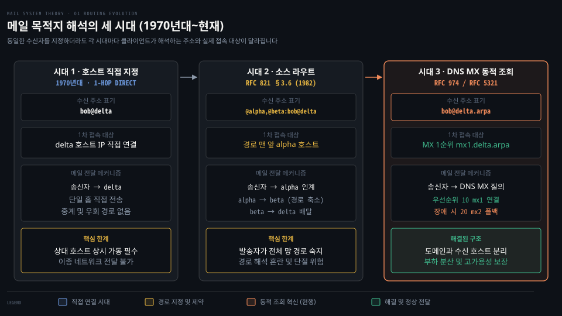
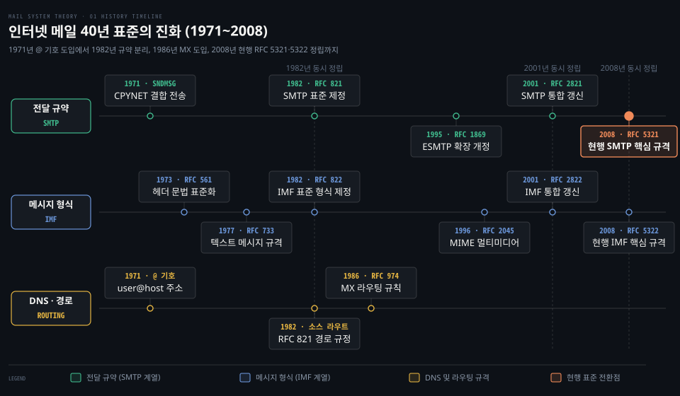

# RFC 821·RFC 822·MX·ESMTP

---

> 전자메일은 한 컴퓨터 안에서만 돌던 로컬 프로그램에서 출발해, 전송 규약인 SMTP와 편지 형식, DNS MX 라우팅으로 역할을 나누며 발전했습니다. 40여 년 동안 이어진 표준 개정의 인과관계를 이해하면 현대 메일 시스템이 왜 봉투와 헤더를 따로 다루고 DNS MX 레코드에 의존하는지 근본 원인을 파악할 수 있습니다.

백엔드 개발자가 메일 발송 기능을 구현할 때 처음 만나는 요소들은 익숙합니다. `user@example.com` 형태의 이메일 주소를 입력하고 25번이나 587번 포트로 SMTP 서버에 접속하며 `From:`, `To:`, `Subject:` 헤더를 갖춘 메시지를 조립해 전송합니다. 이 때문에 많은 개발자가 메일 발송을 웹 API 호출처럼 단순한 일대일 데이터 전송으로 생각하기 쉽습니다.

하지만 메일 프로토콜은 웹 API처럼 하나의 HTTP 요청과 JSON 페이로드로 완결되지 않습니다. 메일 시스템은 텍스트 명령을 주고받는 봉투 전송 규약(SMTP)과 사람이 읽는 편지 형식(IMF)이 엄격하게 분리되어 있으며, 목적지 서버를 찾는 과정에서도 웹과 전혀 다른 DNS MX 우선순위 메커니즘을 따릅니다.

이러한 독특한 구조는 임의로 만들어진 것이 아닙니다. 1960년대 단일 컴퓨터 내부의 파일 조작에서 시작해 ARPANET과 전 세계 상시 네트워크로 확장되는 과정에서 겪은 수많은 기술적 병목을 해결하며 한 겹씩 쌓아 올린 결과입니다. 이 역사적 배경을 파악하지 못하면 발송 지연이나 라우팅 장애, 인증 실패 문제를 근본부터 추적하기 어렵습니다.


## 학습 목표와 범위

> 메일 프로토콜과 메시지 형식이 분리된 배경부터 DNS 기반 라우팅과 ESMTP 확장까지 40년 표준의 핵심 설계 이유를 파악합니다.

1. 한 컴퓨터 안 메일에서 네트워크 메일로 넘어갈 때 `@` 가 왜 필요했는지 설명할 수 있습니다.
2. RFC 821(전달 규약)과 RFC 822(메시지 형식)가 따로 생긴 이유, 즉 봉투와 편지지가 분리된 이유를 설명할 수 있습니다.
3. DNS MX(RFC 974) 이전과 이후에 "어느 서버로 보낼지"를 정하던 방식이 어떻게 달라졌는지 말할 수 있습니다.
4. EHLO 로 시작하는 확장(ESMTP)이 HELO 와 호환을 지키면서 기능을 늘린 방식을 설명할 수 있습니다.
5. 821 → 2821 → 5321, 822 → 2822 → 5322 개정이 무엇을 정리했는지 큰 줄기로 말할 수 있습니다.

전송 계층 밑바닥의 패킷 분석이나 사내 메일 데몬 튜닝은 인프라 영역이므로 다루지 않습니다. 여기서는 메일 통신 체계를 지탱하는 표준 프로토콜의 진화와 설계 이유에 집중합니다.


## 1. 한 컴퓨터 안의 메일은 왜 주소가 필요 없었나 — 파일 덧붙이기와 `@` 의 등장

> 초기 전자메일은 한 컴퓨터 내부에서 사용자끼리 메시지를 남기는 로컬 프로그램이었으며, 네트워크 확장에 따라 호스트를 구분하기 위해 `@` 기호가 도입되었습니다.

초창기 메인프레임 컴퓨터 환경에서는 다른 사용자에게 메시지를 전달할 때 복잡한 네트워크 프로토콜이나 호스트 도메인이 필요하지 않았습니다. 당시 컴퓨터는 한 연구실에 거대한 기기 한 대만 존재했고 여러 사용자가 시분할 시스템을 통해 한 컴퓨터에 접속했기 때문입니다.

이 시절의 메일은 단지 한 컴퓨터 안에서 구동되는 로컬 프로그램이었습니다. 같은 시분할 컴퓨터에 접속한 사용자끼리 메시지를 주고받았으므로 수신자를 특정하는 정보는 운영체제 사용자 로그인 계정 이름 하나면 충분했습니다.

1960년대 말 ARPANET이 구축되면서 상황이 달라졌습니다. 전화선 통신망을 통해 서로 멀리 떨어진 컴퓨터들이 연결되자 다른 연구소 컴퓨터에 접속한 사용자에게도 메시지를 전달해야 하는 요구가 생겼습니다. 단순히 "bob"이라는 이름만 지정해서는 이 사용자가 BBN의 컴퓨터에 있는지 MIT 컴퓨터에 있는지 구별할 수 없었습니다.

1971년 BBN의 엔지니어 레이 톰린슨은 이 문제를 해결하기 위해 로컬 메시지 프로그램인 `SNDMSG`와 ARPANET 파일 전송 프로그램인 `CPYNET`을 결합했습니다.[^tomlinson] 네트워크 너머 다른 컴퓨터에 있는 사용자에게 메시지를 보낼 수 있는 통신 프로그램을 만든 것입니다.

이때 톰린슨은 메일 주소에서 로컬 메일과 네트워크 너머의 메일을 구분하기 위해 키보드에서 `@` 기호를 선택했습니다.[^tomlinson] 이로써 `user@host`라는 인터넷 전자메일 주소 표준이 탄생했으며 전자메일은 단일 기기의 로컬 메시지에서 컴퓨터 간 통신 서비스로 진화했습니다.


## 2. 보내는 규칙과 편지 모양은 왜 따로 정했나 — RFC 821 과 RFC 822

> 통신 채널을 맺고 메시지를 운반하는 전달 규약(SMTP)과 사람이 읽는 편지 내용 형식(IMF)을 분리하여 전송망의 독립성과 확장성을 확보했습니다.

네트워크로 메일을 전송할 수 있게 된 뒤에도 한동안 표준화된 전용 전송 규약이 없었습니다. 메시지 형식은 1973년 RFC 561이 `From:`, `Date:`, `Subject:` 헤더 문법을 제안했고,[^rfc561] 1977년 RFC 733이 텍스트 메시지 규격을 정의했습니다.[^rfc733] 하지만 실제 전송은 여전히 파일 전송 프로토콜(FTP 메일)의 부가 기능에 의존하고 있었습니다.

1982년 8월, 존 포스텔과 데이비드 크로커는 전송 규약과 메시지 형식을 각각 독립된 후속 표준으로 정립하여 두 개의 RFC로 발표했습니다.

첫 번째는 존 포스텔이 제정한 **RFC 821**(SMTP)입니다.[^rfc821] RFC 821은 TCP 스트림 채널 위에서 발송 시스템과 수신 시스템이 텍스트 명령어와 3자리 숫자 응답 코드를 주고받으며 메일을 목적지까지 운반하는 통신 절차만을 규정했습니다.[^rfc821-cmd]

두 번째는 데이비드 크로커가 제정한 **RFC 822**(IMF)입니다.[^rfc822] RFC 822는 RFC 733을 계승하여 전송 통로와 무관하게 사람이 읽는 편지 자체의 구조를 규정했습니다. 즉 필드 이름과 값으로 이루어진 헤더 필드 목록, 그리고 빈 줄로 구분되는 본문 텍스트 형식을 정의했습니다.[^rfc822-fmt]

이 분리는 물리적 우편 제도의 봉투와 편지지 관계와 일치합니다.

우편 배달부는 편지 봉투에 적힌 수신 주소와 발신 주소만 보고 목적지로 배달합니다. 우편 봉투를 뜯어 내부 편지지 머리말에 적힌 인사말이나 본문 내용을 들여다보지 않습니다.

마찬가지로 메일 전송 서버는 SMTP 대화 과정에서 전달되는 봉투 주소(`MAIL FROM`, `RCPT TO`)만 보고 다음 서버로 라우팅합니다. `DATA` 명령 뒤에 실려 오는 RFC 822 메시지는 단순한 바이트 스트림으로 취급해 수정 없이 그대로 전달합니다.

봉투와 편지지가 분리된 덕분에 메일 전송망은 편지 본문의 변화에 영향을 받지 않는 중립성을 얻었습니다. 훗날 편지 내용이 멀티미디어로 확장되거나 본문이 암호화되더라도 중간 메일 서버는 소프트웨어를 바꾸지 않고 메일을 전달할 수 있었습니다. 또한 숨은 참조(BCC)처럼 실제 수신자에게는 배달하되 편지 머리말에는 주소를 숨기는 기능도 이 분리 구조 덕분에 가능해졌습니다. 봉투와 헤더의 차이는 [메일과 이름은 어떻게 찾아가는가](../../book/cntd_computer-networking-top-down/02-03.메일과%20이름은%20어떻게%20찾아가는가.md#2-헤더는-명령이-아닙니다) 2절에서 설명합니다.

봉투와 편지지 헤더의 대응 관계를 정리하면 다음과 같습니다.

| 봉투(SMTP 명령) | 편지지(DATA 헤더) | 누가 보나 |
|---|---|---|
| `MAIL FROM` | `From:` | 메일 전송 서버(MTA)는 `MAIL FROM`을 보고 반송 주소를 판단하며, 메일 클라이언트(MUA)와 최종 사용자는 `From:`을 읽습니다. |
| `RCPT TO` | `To:`, `Cc:` | 메일 전송 서버(MTA)는 `RCPT TO`를 보고 배달 목적지를 찾으며, 메일 클라이언트(MUA)와 최종 사용자는 `To:`와 `Cc:`를 읽습니다. |

숨은 참조(BCC, Blind Carbon Copy)가 가능한 이유도 이 분리 구조에 있습니다. 발송 클라이언트는 받는 사람의 주소를 전송 봉투인 `RCPT TO`에는 정상적으로 포함하지만, 편지지 헤더인 `To:`나 `Cc:`에는 적지 않고 본문 데이터를 전송합니다. 메일 전송 서버는 편지 본문을 검사하거나 수정하지 않고 봉투 주소만 보고 배달하므로, 받는 사람은 헤더에 자신의 주소가 보이지 않더라도 메일을 정상적으로 수신하게 됩니다.

아울러 전송 봉투의 `MAIL FROM`은 전송 실패 시 반송 메일(DSN)을 돌려받는 주소로 동작합니다. 대량 메일 발송 환경에서 사용자에게 보여줄 대표 발신 주소(`From:`)와 실제 반송 오류를 수집하는 시스템 주소를 서로 나누어 운영하는 이유가 여기에 있습니다. 반송 메일의 발생 조건과 봉투 발신 주소의 처리 방식은 [02-01편 5절](./02-01.MX·Null%20MX·큐·DSN·그레이리스팅.md)에서 자세히 설명합니다.


## 3. 받는 서버를 어떻게 찾았나 — 호스트 직접 지정·소스 라우트에서 DNS MX 로

> 초기 호스트 직접 연결과 명시적 소스 라우팅의 제약을 극복하기 위해 DNS MX 레코드가 도입되었으며, 이는 들어오는 메일 수신 창구만을 가리킵니다.

발송 클라이언트가 `bob@example.com`이라는 주소로 편지를 보낼 때 목적지 서버의 IP 주소를 찾는 방식은 세 시대를 거쳐 발전했습니다.

초기 ARPANET 시절에는 주소의 도메인 이름이 곧 특정 물리 호스트 컴퓨터를 가리켰습니다. 발송 컴퓨터는 로컬 파일(`hosts.txt`)에서 목적지 호스트의 IP를 찾아 직접 TCP 연결을 시도했습니다. 하지만 상대 호스트가 꺼져 있으면 메일 전송이 즉시 실패했고 다른 네트워크 망으로는 설정 파일의 특례(릴레이 호스트 지정)를 두어 우회해야 했습니다.[^rfc974] 참고로 1983년 에릭 올먼이 개발한 Sendmail은 서로 주소 체계가 다른 UUCP망과 ARPANET망을 중계하기 위한 라우터로 설계되었습니다.[^sendmail]

RFC 821은 수신 주소와 전달 경로를 구분하기 위해 소스 라우트 형식을 규정했습니다.[^rfc821-36] 발송자가 메일이 거쳐 갈 중간 경유지 호스트 목록을 주소에 직접 나열하는 방식이었습니다. 예를 들어 `@relay1,@relay2:bob@delta`라는 주소를 사용했습니다.

발송자는 첫 번째 홉인 `relay1`에 접속해 메일을 건넸습니다. `relay1`은 경로 목록에서 자기 이름을 지운 뒤 `relay2`로 전달했습니다.[^rfc821-36] 하지만 이 방식은 발송자가 전체 네트워크 경로를 미리 알고 있어야 했습니다. 중간 경유지가 고장 나면 전송이 두절되고 호스트마다 경로 해석 방식이 달라 혼란이 발생하는 한계가 있었습니다.[^rfc5321-route]

1986년 1월 RFC 973이 MX 리소스 레코드를 정의하고,[^rfc973] 크레이그 파트리지가 제정한 RFC 974가 메일러의 MX 해석 및 라우팅 규칙을 정립하여 이러한 경로 문제를 해결했습니다.[^rfc974]



위 도식은 같은 수신자를 지정하더라도 각 시대마다 주소 표기와 접속 대상, 전달 방식이 어떻게 바뀌었는지 보여줍니다.

DNS MX 레코드가 도입되면서 수신 도메인은 외부 메일을 대신 받아줄 공용 수신 서버 목록과 우선순위 숫자를 DNS에 공개하게 되었습니다.[^rfc974] 번호가 작을수록 우선순위가 높습니다. 발송 서버는 수신 도메인의 MX 레코드를 질의하여 가장 작은 번호를 가진 호스트(`mx1`)에 접속하고 장애가 발생하면 차순위 호스트(`mx2`)로 자동 폴백합니다.[^rfc5321-target]

여기서 반드시 기억해야 할 원칙이 있습니다. MX 레코드는 **전적으로 외부에서 해당 도메인으로 들어오는(Inbound) 메일을 수신할 호스트만을 지정**합니다.[^rfc5598-mta]

어느 회사의 사내 메일 사용자가 외부로 메일을 보낼 때는 자기 도메인의 MX 서버를 통하지 않고 수신자 도메인의 DNS MX를 조회해 외부 서버로 접속합니다. 외부 발신 서버의 정당성을 증명하는 수단은 MX 레코드가 아니라 훗날 등장한 SPF, DKIM, DMARC 같은 발신 인증 레코드입니다. 또한 MX 레코드가 가리키는 서버는 사서함 저장소라기보다는 대개 인터넷 최전선에서 메일을 수신해 내부로 넘기는 인바운드 중계 서버입니다.[^rfc5321-relay-target][^rfc5598-mta]

이처럼 MX 레코드가 가리키는 대상이 최종 사서함 저장소가 아니라 인바운드 게이트웨이인 데에는 세 가지 이유가 있습니다. 첫째, 인터넷에서 쏟아지는 대량 유입 트래픽과 서비스 거부 공격(DDoS)을 최전선에서 완충하며 큐에 안전하게 적재하기 위함입니다. 둘째, 스팸과 악성코드를 내부망 진입 전에 1차로 검사하고 걸러내어 저장 공간과 내부 처리 자원을 보호합니다. 셋째, 사용자의 사서함 파일 디스크와 데이터베이스를 공용 인터넷에 직접 노출하지 않고 사설망 안쪽으로 격리해 보안을 유지할 수 있기 때문입니다.

실제 운영 환경에서는 외부 서버와의 수신 창구(전 세계에 열려 있고 인증이 없는 25번 포트)와 내부 사용자·애플리케이션의 발신 창구(사내 계정이나 애플리케이션에 한정하여 SMTP AUTH 인증을 요구하는 587번 포트)를 흔히 나눕니다. 만약 이 둘을 나누지 않고 누구나 외부로 메일을 중계하도록 허용하면 서버가 스패머의 오픈 릴레이 기지로 악용되어 발신 IP 평판이 오염되고 블랙리스트에 오르는 사고를 겪게 됩니다. 포트 분리와 오픈 릴레이 차단 원리는 [01-02편 4절과 5절](./01-02.MUA·MSA·MTA·MDA·RFC%205598.md)에서 자세히 설명합니다.

DNS MX 레코드가 전 세계에서 우리 도메인으로 들어오는 문을 안내하는 주소라면, SPF 레코드는 반대로 우리 도메인을 대표해 외부로 메일을 내보내는 합법적인 발송 서버의 공인 IP 대역을 선언하는 레코드입니다. 들어오는 문과 나가는 문의 분리 구조는 [02-01편 3절](./02-01.MX·Null%20MX·큐·DSN·그레이리스팅.md)에서, 발송 서버의 IP 자격을 증명하는 SPF 레코드의 동작 원리는 [03-02편 3절](./03-02.SPF·DKIM·DMARC·ARC.md)에서 구체적으로 다룹니다.


## 4. 오래된 규약에 기능을 어떻게 더했나 — EHLO 와 ESMTP 확장

> ESMTP는 EHLO 명령어 기반의 기능 광고 방식을 도입하여 구형 서버와의 호환성을 깨뜨리지 않고 암호화, 인증, 용량 제어 기능을 안전하게 확장했습니다.

1982년 제정된 RFC 821 SMTP는 7비트 ASCII 텍스트만 전송할 수 있는 단순한 규약이었습니다. 전 세계 수많은 메일 서버가 이미 운영 중인 상황에서, 구형 서버를 중단시키지 않고 첨부파일 전송이나 암호화, 인증 같은 신규 기능을 어떻게 추가할 수 있었을까요?

기존 RFC 821 규약에서 클라이언트가 세션을 열 때 건네는 첫 인사는 `HELO <도메인>`이었습니다.[^rfc821-cmd] 수신 서버는 단순히 `250 OK`로 응답할 뿐 자신이 어떤 부가 기능을 지원하는지 클라이언트에게 알려줄 방법이 없었습니다. 만약 클라이언트가 새로운 명령어를 무작정 전송하면 정상적인 구형 서버는 문법 오류(`500 Syntax error`)를 내고 세션을 유지해야 하지만,[^rfc1869-fallback] 비표준으로 구현된 일부 서버는 세션을 일방적으로 닫아버리기도 했습니다.

IETF는 1993년 RFC 1425로 하위 호환성을 유지하면서 기능을 점진적으로 확장할 수 있는 ESMTP 프레임워크를 도입했고, 이는 1995년 RFC 1869로 개정되었습니다.[^rfc1425][^rfc1869]

핵심 장치는 새로운 인사 명령어인 `EHLO`였습니다.[^rfc1869-ehlo] ESMTP를 지원하는 클라이언트는 세션을 시작할 때 기존 `HELO` 대신 `EHLO`를 서버에 전송합니다.

수신 서버가 ESMTP를 지원한다면 `250-` 다중 행 응답으로 자신이 지원하는 확장 기능 키워드 목록을 클라이언트에 알려줍니다.[^rfc1869-reply] 만약 수신 서버가 확장 기능을 모르는 구형 RFC 821 서버라면 `EHLO`를 알 수 없는 명령어로 판단해 `500` 오류로 응답합니다. 이때 클라이언트는 즉시 `HELO` 명령어로 폴백하여 기본 821 모드로 안전하게 통신을 이어갑니다.[^rfc1869-fallback]

이 다중 행 응답 규격은 RFC 5321 §4.2.1에 정의되어 있습니다.[^rfc5321-multiline] 응답이 여러 줄로 이어질 때 뒤에 줄이 더 남아 있으면 응답 코드 바로 뒤에 하이픈을 붙여 `250-`로 표기하고, 마지막 줄은 응답 코드 뒤에 공백 한 칸을 두어 `250 `로 전송합니다. 클라이언트는 이 마지막 줄의 공백을 확인하여 서버의 기능 목록 전송이 완료되었음을 감지합니다.

```smtp
C: EHLO client.example.com
S: 250-mx.example.com
S: 250-SIZE 35882577
S: 250-8BITMIME
S: 250-STARTTLS
S: 250 ENHANCEDSTATUSCODES
```

이 프레임워크를 통해 다음과 같은 핵심 확장 규격들이 도입되었습니다.

- **8BITMIME**(RFC 1652, 현행 RFC 6152): 7비트 전송 제한을 해제하여 8비트 다국어 텍스트를 전송할 수 있게 합니다(임의의 바이너리 데이터는 Base64 인코딩이나 별도 바이너리 확장이 필요합니다).
- **SIZE**(RFC 1870): `MAIL FROM` 단계에서 메일 크기를 서버에 미리 알려주어, 수신 한도를 초과하는 대용량 메일의 무의미한 전송과 네트워크 대역폭 낭비를 차단합니다. 클라이언트는 `MAIL FROM:<…> SIZE=n`과 같이 보낼 메일의 바이트 크기를 미리 알려 수신 허용 여부를 사전에 확인합니다.
- **STARTTLS**(RFC 3207): 평문 TCP 세션을 즉석에서 TLS 암호화 세션으로 승격시킵니다. 클라이언트는 초기 `EHLO` 이후 `STARTTLS` 명령으로 TLS 핸드셰이크를 수행하고 세션을 초기화한 뒤 다시 `EHLO`를 전송하여 암호화 세션을 확정하며, 구체적인 협상 절차는 [03-01편 2절](./03-01.STARTTLS·RFC%208314·MTA-STS.md)에서 자세히 다룹니다.
- **AUTH**(RFC 4954): 발송 클라이언트의 계정 인증을 수행하여 비인가 릴레이 악용을 방지합니다.

여기서 실무적으로 혼동하기 쉬운 지점이 있습니다. `EHLO` 응답에 `250-AUTH LOGIN PLAIN`이 나타났다고 해서 반드시 인증을 거쳐야만 메일을 보낼 수 있는 것은 아닙니다.

`EHLO` 응답의 기능 목록은 서버가 해당 명령어를 해석할 수 있다는 **기능 광고(Capability Advertisement)**일 뿐, 발송자에게 인증을 강제한다는 뜻이 아닙니다. 실제로 메일 제출용 587 포트에서는 클라이언트에게 로그인을 요구하지만 전 세계 서버끼리 메일을 주고받는 중계용 25 포트에서는 불특정 송신 서버의 메일을 접수해야 하므로 인증 없이 통과시키는 것이 표준 동작입니다.


## 5. 40년 동안 무엇이 정리됐나 — 2821·5321 개정과 지금의 표준 지도

> 산발적으로 흩어져 있던 메일 규격들은 2001년 RFC 2821·2822를 거쳐 2008년 RFC 5321·5322로 집대성되며 현대 인터넷 메일의 법전으로 완성되었습니다.

1982년 기본 규격이 나온 뒤 20여 년 동안 ESMTP 확장, DNS 라우팅, MIME 등 수십 개의 개별 RFC가 산발적으로 추가되면서 구현체마다 동작 해석이 어긋나는 문제가 생겼습니다. 이 혼란은 어떤 표준화 과정을 거쳐 정리되었을까요?

IETF는 2001년 RFC 2821과 RFC 2822를 통해 흩어진 문서들을 통합 갱신했습니다.[^rfc2821] RFC 2821은 기본 전송 규격인 RFC 821과 DNS 라우팅인 RFC 974, ESMTP 확장 프레임워크인 RFC 1869를 자립적인 단일 전송 규격으로 묶어냈습니다.[^rfc2821] 동시에 RFC 2822는 RFC 822의 비표준 구문들을 폐기 영역으로 격리하고 현대적 문법 규칙으로 재정리했습니다.[^rfc2822]

이 표준화 작업은 2008년 10월 현행 핵심 표준인 **RFC 5321**(SMTP)과 **RFC 5322**(IMF)로 완결되었습니다.

RFC 5321은 과거의 잔재를 정리하고 이전 규격의 운영 규칙들을 체계화했습니다. 특히 클라이언트는 명시적 소스 라우트를 생성하지 말아야 하며(SHOULD NOT), 서버는 경로 정보를 무시하거나 거부할 수 있다고 규정했습니다.[^rfc5321-route]

또한 RFC 1123과 RFC 2821에서 발전해 온 전송 원칙들을 온전히 계승했습니다. 일시적 전송 오류(4xx) 시 최소 30분 이상 재시도하고 4~5일 뒤 반송하는 정책을 정리했습니다.[^rfc5321-retry] 여기에 IPv6 주소 리터럴 표기와 동일 우선순위 MX 서버의 무작위 분산 규칙도 명확히 담았습니다.[^rfc5321-target]

RFC 5322 역시 RFC 2822부터 이어진 규칙을 계승하여 줄바꿈 문자를 제외하고 각 줄의 길이를 **최대 998자**로 엄격히 제한하고 78자 이하를 권장하는 제약을 유지했습니다.[^rfc5322-line] 이는 구형 메일 버퍼 오버플로우와 텍스트 줄바꿈 깨짐을 방지하기 위한 핵심 규약입니다.



위 도식은 1971년부터 2008년까지 전달 규약과 메시지 형식, DNS 라우팅이 세 갈래 트랙 위에서 병행 발전하면서 1982년, 2001년, 2008년에 세로로 맞물려 동시 정립된 흐름을 보여줍니다.

전달 규약과 메시지 형식이 처음부터 분리되어 있었기에 본문 형식이 MIME 멀티미디어를 수용하고 전송로가 암호화와 인증 기능을 확장하는 동안에도 인터넷 메일 생태계는 단절 없이 성장할 수 있었습니다.

이 진화 과정이 확립한 가장 중요한 시스템 원칙은 메일을 다음 홉으로 넘겨주는 **중계 서버(Relay MTA)**와 메일을 최종 사서함에 보관하는 **배달 서버(Delivery MTA / MDA)**의 책임 분리입니다.[^rfc5321-sys]

중계 서버는 IP 라우터처럼 메일을 목적지 방향으로 전달할 뿐 사서함에 영구 보관하지 않습니다. 또한 전송 경로 추적을 위한 `Received:` 헤더를 덧붙이는 것 외에 본문과 헤더를 변경해서는 안 됩니다.[^rfc5321-sys]

반면 최종 배달 서버는 스팸 검증을 마친 메시지를 디스크 저장소에 안전하게 기록하고 사용자 MUA가 IMAP이나 POP3로 읽어갈 수 있도록 책임을 인계합니다.[^rfc5598-mda]


## 스스로 확인할 질문

> 본문에서 다룬 역사적 배경과 표준 설계 이유를 질문으로 점검합니다.

1. 한 컴퓨터 안에서 구동되던 메일 시스템에 이미 사용자 계정이 존재했는데도, 네트워크 메일로 확장될 때 `@` 기호가 반드시 필요했던 이유는 무엇일까요?
2. RFC 821(전달 규약)과 RFC 822(메시지 형식)가 하나의 규격으로 합쳐지지 않고 봉투와 편지지로 분리된 덕분에 전송 인프라가 얻은 이점은 무엇일까요?
3. DNS MX 레코드(RFC 974)가 도입되기 전 사용되던 소스 라우트(`@relay1,@relay2:bob@delta`) 방식이 안고 있던 운영상 한계와 문제점은 무엇이었을까요?
4. 수신 도메인의 DNS MX 레코드를 보고 "우리 애플리케이션의 메일도 이 서버를 거쳐 밖으로 나간다"라고 판단하면 안 되는 이유는 무엇일까요?
5. ESMTP의 `EHLO` 응답 목록에 `250-AUTH LOGIN PLAIN`이 나타났을 때, 이것이 "발송 시 무조건 로그인을 거쳐야 한다"는 강제 요구가 아닌 이유는 무엇일까요?
6. RFC 821에서 시작해 RFC 2821을 거쳐 RFC 5321로 개정되면서 명시적 소스 라우팅 생성이 금지되고 DNS MX 조회가 표준으로 확립된 기술적 이유는 무엇일까요?
7. 도메인의 DNS MX 레코드가 가리키는 대상이 최종 사서함 저장소가 아니라 인바운드 게이트웨이인 경우가 많은 이유는 무엇일까요?
8. 숨은 참조(BCC) 수신자의 주소가 편지지 헤더(`To:`, `Cc:`)에 나타나지 않는데도 최종 사서함까지 메일이 배달되는 이유는 무엇일까요?


## 정답 (자답 후 펼치기)

> 각 질문에 대한 구조적 설계 이유와 정답 해설입니다.

1. 단일 컴퓨터 시분할 시스템에서는 로컬 운영체제의 사용자 계정 이름만으로 사용자를 식별할 수 있었습니다. 하지만 여러 컴퓨터가 네트워크로 연결되면서 로컬 메일과 네트워크 너머의 메일을 구분해야 했습니다. 따라서 로컬 사용자와 외부 호스트를 구분하기 위해 `@` 기호와 호스트 이름을 결합한 주소 체계가 필요했습니다.
2. 메일 전송 서버(MTA)가 편지 본문을 열어보지 않고 봉투 주소(`MAIL FROM`, `RCPT TO`)만으로 메일을 라우팅할 수 있게 되었습니다. 그 결과 편지 본문이 텍스트에서 멀티미디어나 암호화 데이터로 발전하더라도 중간 전송 인프라를 전면 교체하지 않고 하위 호환성을 유지할 수 있었습니다. 또한 숨은 참조(BCC)나 개발 환경의 발송 격리처럼 봉투 주소만 안전하게 변경하는 기법이 가능해졌습니다.
3. 소스 라우트는 발송자가 중간에 거쳐 갈 모든 중계 서버 목록을 주소에 직접 적어야 했습니다. 발송자가 전체 네트워크 경로를 꿰뚫고 있어야 했고, 중간 경유지 서버 하나만 고장 나도 경로 전체가 단절되었으며 서버마다 경로 문법을 해석하는 방식이 달라 배달 실패가 잦았습니다.
4. MX 레코드는 외부에서 해당 도메인으로 들어오는 메일을 대신 수신할 서버만을 지정하기 때문입니다. 애플리케이션이 외부 수신자에게 메일을 보낼 때는 자신의 MX가 아니라 수신자 도메인의 DNS MX를 조회해 그곳으로 접속합니다. 발송 서버의 신원 증명은 MX가 아니라 SPF, DKIM, DMARC 같은 발신 인증 레코드를 통해 이루어집니다.
5. `EHLO` 응답의 기능 목록은 서버가 해당 명령어를 이해하고 처리할 능력이 있음을 알리는 기능 광고이기 때문입니다. 계정 인증을 요구하는 규칙은 서버가 수신하는 포트와 정책에 따라 결정됩니다. 메일 제출 포트(587)에서는 인증이 강제되지만 전 세계 불특정 서버로부터 메일을 받아야 하는 중계 포트(25)에서는 인증 없이 메일을 수신하는 것이 표준 원칙입니다.
6. 소스 라우팅은 발송자에게 네트워크 경로 관리 부담을 지우고 호스트마다 경로 해석 문제가 빈발했습니다. 반면 DNS MX 레코드가 보편화되면서 명시적 소스 라우트를 유지할 필요성이 사라졌고, 수신 도메인이 자신의 공용 수신 창구와 우선순위를 통제하며 부하 분산과 장애 시 자동 대체를 유연하게 제공하게 되었습니다. 이에 따라 규격은 클라이언트가 소스 라우트를 생성하지 말도록 규정하고 DNS MX 조회를 표준으로 확립했습니다.
7. 외부 인터넷의 대량 유입 트래픽과 서비스 거부 공격(DDoS)을 최전선에서 완충해 큐에 적재하고, 스팸과 악성코드를 내부망 진입 전에 1차로 걸러내며, 사서함 디스크와 데이터베이스를 공용 인터넷에 직접 노출하지 않고 사설망 안쪽으로 격리하여 시스템을 보호하기 위함입니다.
8. 메일 전송 규약(SMTP)과 메시지 형식(IMF)이 엄격히 분리되어 있어, 메일 전송 서버(MTA)는 편지지 헤더를 열람하지 않고 전송 봉투의 `RCPT TO` 명령에 지정된 주소만 보고 메일을 라우팅하고 배달하기 때문입니다. 발송 클라이언트가 전송 봉투에는 수신 주소를 포함하고 편지지 헤더에서는 제외하여 전송함으로써, 수신자 화면에는 주소가 노출되지 않으면서도 실제 배달은 정상적으로 완결됩니다.


## 출처와 관련 문서

> 본문에서 인용한 표준 RFC 규격과 1차 역사 자료 목록입니다.

[^tomlinson]: Raymond Tomlinson Biography — Internet Hall of Fame (https://www.internethalloffame.org/official-biography-raymond-tomlinson/)
[^rfc561]: RFC 561 — Standardizing Network Mail Headers (https://www.rfc-editor.org/rfc/rfc561)
[^rfc733]: RFC 733 — Standard for the Format of ARPA Network Text Message (https://www.rfc-editor.org/rfc/rfc733)
[^rfc821]: RFC 821 §1 — Simple Mail Transfer Protocol, Introduction (https://www.rfc-editor.org/rfc/rfc821#section-1)
[^rfc821-cmd]: RFC 821 §4.1.1 — Command Semantics (https://www.rfc-editor.org/rfc/rfc821#section-4.1.1)
[^rfc821-36]: RFC 821 §3.6 — RELAYING (https://www.rfc-editor.org/rfc/rfc821#section-3.6)
[^rfc822]: RFC 822 §1.1 — Standard for the Format of ARPA Internet Text Messages (https://www.rfc-editor.org/rfc/rfc822#section-1.1)
[^rfc822-fmt]: RFC 822 §3.1 — General Description (https://www.rfc-editor.org/rfc/rfc822#section-3.1)
[^sendmail]: Sendmail — An Internetwork Mail Router (CSRG/FreeBSD Archive) (https://docs-archive.freebsd.org/44doc/smm/09.sendmail/paper.pdf)
[^rfc973]: RFC 973 — Domain System Changes and Observations (https://www.rfc-editor.org/rfc/rfc973)
[^rfc974]: RFC 974 — Mail Routing and the Domain System (https://www.rfc-editor.org/rfc/rfc974)
[^rfc1425]: RFC 1425 — SMTP Service Extensions, February 1993 (https://www.rfc-editor.org/rfc/rfc1425)
[^rfc1869]: RFC 1869 §1 — SMTP Service Extensions (https://www.rfc-editor.org/rfc/rfc1869#section-1)
[^rfc1869-ehlo]: RFC 1869 §4 — The EHLO Command (https://www.rfc-editor.org/rfc/rfc1869#section-4)
[^rfc1869-reply]: RFC 1869 §4.3 — Successful response (https://www.rfc-editor.org/rfc/rfc1869#section-4.3)
[^rfc1869-fallback]: RFC 1869 §4.6 — Responses from servers without extensions (https://www.rfc-editor.org/rfc/rfc1869#section-4.6)
[^rfc2821]: RFC 2821 Abstract — Simple Mail Transfer Protocol (https://www.rfc-editor.org/rfc/rfc2821)
[^rfc2822]: RFC 2822 §1.1 — Internet Message Format, Scope (https://www.rfc-editor.org/rfc/rfc2822#section-1.1)
[^rfc5321-sys]: RFC 5321 §2.3.10 — Originator, Delivery, Relay, and Gateway Systems (https://www.rfc-editor.org/rfc/rfc5321#section-2.3.10)
[^rfc5321-route]: RFC 5321 §3.6.1 — Source Routes (https://www.rfc-editor.org/rfc/rfc5321#section-3.6.1)
[^rfc5321-relay-target]: RFC 5321 §3.6.2 — Mail eXchange Records and Relaying (https://www.rfc-editor.org/rfc/rfc5321#section-3.6.2)
[^rfc5321-multiline]: RFC 5321 §4.2.1 — Reply Code Severities and Theory (https://www.rfc-editor.org/rfc/rfc5321#section-4.2.1)
[^rfc5321-retry]: RFC 5321 §4.5.4.1 — Sending Strategy and Retries (https://www.rfc-editor.org/rfc/rfc5321#section-4.5.4.1)
[^rfc5321-target]: RFC 5321 §5.1 — Locating the Target Host (https://www.rfc-editor.org/rfc/rfc5321#section-5.1)
[^rfc5322-line]: RFC 5322 §2.1.1 — Line Length Limits (https://www.rfc-editor.org/rfc/rfc5322#section-2.1.1)
[^rfc5598-mta]: RFC 5598 §4.3.2 — Message Transfer Agent (https://www.rfc-editor.org/rfc/rfc5598#section-4.3.2)
[^rfc5598-mda]: RFC 5598 §4.3.3 — Mail Delivery Agent (https://www.rfc-editor.org/rfc/rfc5598#section-4.3.3)
