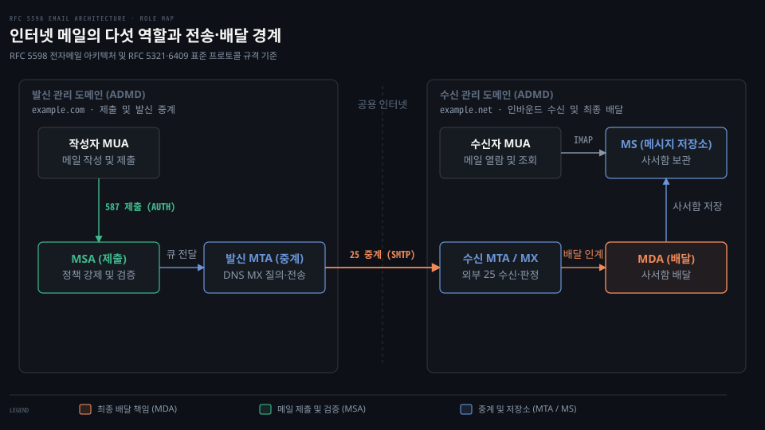
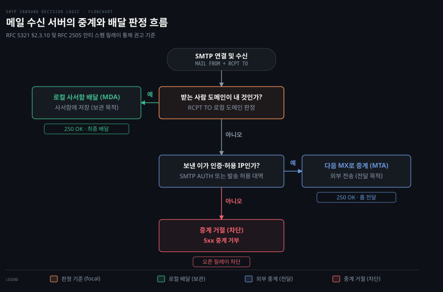

# MUA·MSA·MTA·MDA·RFC 5598

---

> 인터넷 메일은 작성·제출·중계·배달·보관으로 책임을 나눈 역할 분담 구조로 동작합니다. 서버가 메일을 수신했을 때 메일함에 보관할지 다음 서버로 넘겨줄지 가르는 판단 기준과 제출·중계 포트가 분리된 이유를 배웁니다.

백엔드 애플리케이션에서 메일 발송 기능을 구현할 때 개발자는 흔히 설정 파일에 메일 호스트 주소와 포트 번호 하나를 적어 넣고 작업을 마칩니다. 예를 들어 스프링 부트 환경이라면 `spring.mail.host`에 사내 메일 서버 주소를 입력하고 `JavaMailSender`를 호출하는 방식입니다. 이때 많은 개발자가 대상 서버를 단순히 "내 메일을 받아서 상대방에게 꽂아 주는 단일 메일 서버"로 인식하곤 합니다.

하지만 사내 서버에 연결해 외부로 메일을 보내려다 5xx 중계 거부 오류(예: Postfix의 `Relay access denied`)를 마주하면 원인을 찾기 어렵습니다. 같은 SMTP 서버인데 왜 25번이 아니라 587번 포트로 접속해야 하는지 명확히 답하기 어려운 이유도 마찬가지입니다. 메일 서버가 어떤 기준에서 내 발송 요청을 거절하는지 그리고 메일을 받는 행위와 밖으로 보내는 행위가 네트워크 관점에서 어떻게 다른지 구분하지 못하기 때문입니다.

인터넷 메일은 겉으로 보기에 하나의 서비스처럼 보이지만 내부적으로는 메시지 작성부터 제출, 네트워크 중계, 최종 배달, 사서함 보관까지 엄격히 역할이 나뉘어 있습니다.[^rfc5598-arch] 이 역할 분담의 지도를 이해하지 못하면 발송 인증 오류, 스팸 필터링 차단, 사내 중계 서버 구성 문제를 원인부터 추적하기 어렵습니다. 이 글에서는 RFC 5598이 정의한 메일 시스템의 다섯 가지 핵심 역할과 서버가 메일을 받았을 때 내리는 결정 논리를 차례로 살펴봅니다.


## 학습 목표와 범위

> 다 읽은 뒤 인터넷 메일 시스템의 다섯 가지 역할과 중계·배달을 가르는 판정 기준을 설명할 수 있습니다.

1. **MUA**, **MSA**, **MTA**, **MDA**, **MS** 다섯 역할을 "누가 무엇을 책임지나"로 설명할 수 있습니다.
2. 메일을 넘기려고 받는 서버(중계)와 보관하려고 받는 서버(최종 배달)를 판단 기준 하나로 가를 수 있습니다.
3. 한 프로그램이 여러 역할을 겸하는 경우(예: 회사 메일 서버가 MSA이면서 MX이자 MDA인 경우)를 역할 단위로 쪼개 읽을 수 있습니다.
4. 제출(587)과 중계(25)가 왜 포트와 규칙까지 갈라졌는지 설명할 수 있습니다.
5. 오픈 릴레이가 무엇이었고 왜 사라졌는지, 지금 중계 서버가 무엇으로 "누구 메일을 받아 줄지" 정하는지 말할 수 있습니다.


## 1. 메일 서버는 한 종류인가 — 다섯 역할로 나눠 보는 RFC 5598 의 지도

> 인터넷 메일은 사용자 클라이언트부터 최종 사서함까지 책임의 경계에 따라 다섯 가지 독립된 에이전트로 나뉩니다.

사내 시스템에 메일 기능을 붙이거나 운영 환경을 점검할 때 가장 먼저 마주치는 혼란은 일상에서 무심코 쓰는 "메일 서버"라는 단어의 모호함입니다. 메일 서버 주소 하나만 설정하면 모든 것이 동작할 것 같지만 실제로는 메일을 보내는 통로와 받는 통로가 서로 다른 규칙으로 움직입니다. 표준 규격인 RFC 5598은 메일 처리 환경을 사용자 수준과 전송망 수준으로 나누고, 핵심 주체로 §4.2~4.3의 다섯 구성 요소(MUA, MS, MSA, MTA, MDA)를 정의합니다.[^rfc5598-sec4]

첫 번째는 사용자를 대리하는 **MUA**(Message User Agent)입니다. 사람이 메일을 작성하고 편집하거나 도착한 메일을 화면에 띄워 읽을 때 사용하는 클라이언트 프로그램입니다.[^rfc5598-mua] 웹 브라우저에서 접속하는 웹메일 화면, 썬더버드나 아웃룩 같은 데스크톱 프로그램뿐 아니라 스프링 백엔드에서 메일을 조립해 발송하는 라이브러리(`JavaMailSender`) 역시 작성자 역할을 맡는 MUA에 해당합니다.

두 번째는 작성자 MUA로부터 메일을 처음으로 접수하는 **MSA**(Mail Submission Agent)입니다. 사용자가 작성한 메일이 인터넷 표준 형식에 맞는지 검증하고 필수 헤더가 빠졌다면 보완하며 발송자가 정당한 권한을 가졌는지 인증(SMTP AUTH)을 강제합니다.[^rfc5598-msa] 즉 작성자 개인의 환경과 공용 인터넷 전송망 사이에서 검문소 역할을 수행합니다.

세 번째는 네트워크 사이에서 메일을 전달하는 **MTA**(Message Transfer Agent)입니다. MTA는 인터넷 계층의 IP 라우터나 패킷 스위치와 같습니다.[^rfc5598-mta] 목적지 도메인을 향해 홉 단위로 메일을 전달하며 이 과정에서 메시지 본문 내용은 바꾸지 않고(전송 인코딩 변환 등 데이터 형태 변경은 예외) 자신이 처리했다는 흔적인 `Received:` 추적 헤더만 덧붙입니다.[^rfc5321-relay]

네 번째는 전송망의 종점에서 메일을 받아 수신자의 개인 사서함으로 밀어 넣는 **MDA**(Mail Delivery Agent)입니다. RFC 5598은 공용 전송망에서 수신자의 개인 영역으로 책임을 넘기는 행위를 **배달**(Delivery)이라 부르며 이 배달을 책임지는 주체가 바로 MDA입니다.[^rfc5598-mda] 실제 구현체에서는 배달 과정에서 스팸 및 바이러스 필터링을 함께 수행한 뒤 계정별 디렉터리에 파일을 안전하게 저장하는 것이 흔한 관행입니다.

다섯 번째는 배달된 메일을 안전하게 보관하는 사서함 저장소인 **MS**(Message Store)입니다.[^rfc5598-ms] 디스크 상의 Maildir이나 데이터베이스 형태로 존재하며 수신자의 MUA는 POP3나 IMAP 혹은 독자적인 웹 API를 통해 이 MS에 접근하여 메일 목록을 조회하고 읽어옵니다.



위 도식처럼 메일 한 통은 발신 조직의 경계 안에서 작성 에이전트와 제출 에이전트를 거칩니다. 이어서 공용 인터넷을 가로지르는 중계 구간을 지나 수신 조직의 인바운드 접점에 닿습니다. 마지막으로 최종 배달 에이전트를 거쳐 사서함에 안착해야 상대방 클라이언트가 열람할 수 있습니다.


## 2. 넘기려고 받나, 보관하려고 받나 — 중계와 최종 배달을 가르는 기준

> 서버가 SMTP로 메일을 수신했을 때 메일함에 저장할지 다른 호스트로 전달할지는 수신자 도메인이 로컬 관할인지에 따라 갈립니다.

백엔드 개발자가 흔히 품는 의문 중 하나는 "메일 서버가 메일을 수신할 때 모든 서버가 하드디스크 메일함에 저장하는가?"라는 점입니다. 결론부터 말하면 그렇지 않습니다. RFC 5321은 SMTP 시스템을 발송, 배달, 중계, 게이트웨이 네 가지로 구분합니다. 이 가운데 외부 메일을 받아들이는 수신 시스템의 책임을 크게 **중계**(Relay)와 **최종 배달**(Delivery)로 나누어 다룹니다.[^rfc5321-systems]

가상의 도메인 `alice@example.com` 사용자가 `bob@example.net` 사용자에게 메일을 보내는 과정을 따라가 보겠습니다. 앨리스가 사내 발신 서버로 메일을 넘길 때 이 사내 서버는 메일을 수신하지만 자신의 디스크 사서함에 보관할 목적으로 받는 것이 아닙니다. 수신자인 `example.net`의 메일 교환 서버(MX)를 DNS에서 찾아 인터넷 너머로 넘겨주려고 받는 것입니다.

반면 `example.net`의 인바운드 메일 서버가 같은 메일을 수신할 때는 목적이 전혀 다릅니다. 이 서버는 더 이상 다른 호스트로 넘기지 않고 자신이 관리하는 로컬 사용자 `bob`의 사서함에 메일을 저장하기 위해 받습니다.

| 구분 항목 | 중계 서버 (Relay MTA) | 최종 배달 서버 (Delivery MTA / MDA) |
|---|---|---|
| **수신 목적** | 다음 목적지 호스트로 메일을 넘겨주기 위함 | 수신자의 개인 사서함에 영구 보관하기 위함 |
| **보관 기간** | 전송 대기열(Queue)에 임시 보관 후 전송 즉시 삭제 | 메시지 저장소(Message Store)에 장기 보관 |
| **내용 수정** | `Received:` 추적 헤더 추가 외 본문 내용 수정 금지 (전송 인코딩 변환 예외) | 스팸 판정 헤더 추가, 바이러스 격리, 폴더 분류 |
| **사용자 접점** | 일반 사용자가 직접 로그인하거나 열람 불가 | MUA가 IMAP·POP3·웹메일로 직접 접속해 열람 |

서버가 메일 수신 트랜잭션(`RCPT TO`)을 만났을 때 이 둘을 가르는 핵심 기준은 "봉투에 적힌 수신자 도메인이 내 로컬 호스트 관할인가?"입니다.[^rfc2505-rules] 외부 도메인이라도 사전에 2차 수신 서버로 약정된 백업 MX를 대행하는 특수 중계는 별도 허용 정책으로 처리합니다.



수신자 도메인이 내가 관리하는 로컬 도메인(`example.net`)이라면 서버는 배달 에이전트(MDA)를 호출해 사서함에 메일을 넣습니다. 하지만 수신자 도메인이 외부 도메인이라면 서버는 보낸 이가 정당한 인증을 거쳤는지 확인한 뒤 다음 홉으로 넘겨주는 중계 동작을 취합니다. 둘 다 해당하지 않는 요청은 즉시 차단됩니다.

실제 메일 데몬이 `RCPT TO` 명령을 파싱할 때 수행하는 분기 판단을 구체적인 예시로 살펴보겠습니다. 도메인 `example.com`을 운영하는 사내 메일 서버 호스트가 네트워크 연결을 맺고 메일 트랜잭션을 수신하는 상황입니다.

클라이언트가 `RCPT TO: <alice@example.com>`을 전송하면 서버는 수신자 주소의 도메인을 자신의 로컬 관할 도메인 목록에서 확인합니다. 이 주소는 자신이 직접 사서함을 관리하는 로컬 도메인이므로 외부 네트워크를 조회하지 않고 로컬 배달 에이전트(MDA)를 호출해 사서함에 메시지를 저장합니다.

반대로 클라이언트가 `RCPT TO: <charlie@external.org>`를 전송하면 수신자 도메인은 로컬 관할 밖입니다. 이때 서버는 사서함에 보관하지 않고 인터넷의 다음 홉으로 메시지를 전달하는 중계(Relay) 경로를 선택합니다. 다만 외부 도메인을 향한 중계는 스팸 기지로 악용될 위험이 따릅니다. 따라서 클라이언트가 정당한 인증(SMTP AUTH)을 거쳤거나 사내 신뢰 IP에서 인입되었을 때만 전송 대기열에 메일을 적재합니다. 인가되지 않은 외부 중계 요청에는 `554 Relay access denied` 오류를 반환하며 즉시 연결을 차단합니다.

이처럼 동일한 메일 서버 호스트 1대가 `RCPT TO`에 적힌 도메인 판정에 따라 사내 직원 수신 메일은 배달(MDA)로 처리하고 외부로 나가는 메일은 중계(MTA)로 넘기는 이중 역할을 동시에 수행합니다.


## 3. 한 서버가 여러 역할을 맡을 때 — 회사 메일 서버를 역할로 쪼개 읽기

> 실제 운영 환경에서는 한 대의 호스트 프로그램이 접속 포트와 요청 흐름에 따라 여러 에이전트 역할을 동시에 수행합니다.

이론상으로는 MUA, MSA, MTA, MDA, MS가 완전히 분리된 별개 서버처럼 보이지만 실제 기업이나 중소 규모 서비스의 인프라를 들여다보면 단 한두 대의 서버 인스턴스만 운영되는 경우가 많습니다. "우리 회사는 `mail.example.com` 리눅스 서버 한 대뿐인데 앞서 본 다섯 역할이 다 어디에 있는가?"라는 의문이 생기는 이유입니다.

한 대의 호스트 안에서 대표적인 오픈소스 메일 데몬인 Postfix와 Dovecot을 운영하는 전형적인 회사 메일 서버 구조를 역할 단위로 쪼개어 읽어보겠습니다.[^postfix-overview]

사내 직원이 아웃룩이나 웹메일에서 메일을 보낼 때 직원의 클라이언트는 호스트의 587번 포트로 접속합니다. 이때 Postfix는 계정 비밀번호를 검증하고 사내 보안 정책을 강제하는 **MSA** 역할을 수행합니다.

검증을 통과한 메일이 외부 포털 주소로 향한다면 Postfix는 발송 대기열에 메시지를 넣고 DNS MX 레코드를 조회해 외부 서버로 메일을 쏴 보냅니다. 이때 Postfix는 인터넷을 향해 나가는 아웃바운드 **MTA** 역할을 맡습니다.

반대로 외부 세상에서 `user@example.com` 앞으로 메일이 들어올 때 외부 발송 서버는 25번 포트를 통해 이 서버로 연결해 옵니다. 이때 Postfix는 DNS MX 레코드가 가리키는 인바운드 수신 **MTA** 역할을 수행합니다.

인바운드로 들어온 메일이 사내 직원의 주소임이 확인되면 Postfix는 로컬 배달 프로세스(`local` 또는 `virtual`)나 연동된 Dovecot의 배달 프로그램을 호출합니다. 이 단계가 바로 파일시스템 사서함에 편지를 밀어 넣는 **MDA** 역할입니다.

마지막으로 디스크에 쌓인 사서함 파일 자체가 **MS**(Message Store)입니다. 사용자가 스마트폰이나 PC로 이 저장소에 접근해 메일을 동기화할 수 있도록 993번 IMAPS 포트를 열어 접근 통로를 제공하는 데몬이 Dovecot입니다.[^rfc5598-ms]

이처럼 프로그램 이름(Postfix, Dovecot, Exchange)이 곧 단일 역할을 뜻하지 않습니다. 네트워크 포트와 데이터 흐름에 따라 같은 데몬이 MSA도 되고 MTA도 되며 MDA로도 동작합니다. 이 사실을 이해해야 설정 파일의 수많은 옵션이 각기 어느 책임을 제어하는지 명확히 짚어낼 수 있습니다.

### 역할을 격리하지 않은 단일 서버에서 발생하는 두 가지 설정 사고

한 대의 호스트에서 25번(인바운드 수신 MTA)과 587번(사내 제출 MSA)의 책임 경계를 분리하지 않고 일괄 설정을 적용하면 심각한 운영 장애나 보안 사고로 이어집니다.

첫 번째 사고는 스팸 방지를 위해 25번 포트에 무리하게 인증을 강제하여 외부 메일 수신이 중단되는 장애입니다. 관리자가 사내 메일 서버의 무단 발송을 막겠다는 의도로 모든 수신 세션에 SMTP 인증(SMTP AUTH)을 요구하도록 데몬을 설정할 때 발생합니다.

25번 포트는 전 세계 임의의 외부 MTA가 사내 직원에게 메일을 건네주는 공개 수신 창구입니다. 외부 메일 서버는 우리 회사의 계정 자격 증명을 가지고 있지 않습니다. 따라서 25번에 인증을 강제하면 외부 포털이나 고객사가 보내오는 모든 정상 메일이 인증 실패 오류(`530 Authentication required`)와 함께 반송되어 회사 전체의 외부 수신망이 마비됩니다.

두 번째 사고는 반대로 사내 사용자의 편의를 위해 외부 중계를 제한 없이 열어 오픈 릴레이로 전락하는 보안 참사입니다. 사내 직원이나 배치 애플리케이션이 외부로 메일을 보낼 수 있도록 25번 포트에서 외부 도메인 중계를 무조건 허용할 때 발생합니다.

25번 포트는 인터넷 전체에 공개되어 있으므로 중계 통제가 없으면 외부 공격자가 이 포트로 접속해 임의의 제3자에게 대량 스팸을 발송할 수 있습니다. 그 결과 서버는 전 세계 스패머의 무료 중계 기지가 되며 서버 IP가 글로벌 DNSBL에 등재되어 사내 직원이 보내는 정상 업무 메일까지 상대방 서버에서 전부 거절당합니다.

이러한 두 가지 위험을 방지하려면 포트별 역할에 맞추어 최소 권한의 원칙을 적용해야 합니다. 25번 포트는 수신자가 사내 로컬 도메인인 경우에만 인증 없이 사서함 배달(MDA)을 수락하고 외부 중계는 원천적으로 금지합니다. 외부 도메인으로 메일을 발송하는 중계 책임은 오직 587번 제출 포트에서 정당한 SMTP 인증을 마친 사용자나 사전에 지정된 사내 신뢰 IP 대역에만 허용하도록 설정을 엄격히 분리해야 안전합니다.


## 4. 왜 제출 창구를 따로 뒀나 — 587 제출과 25 중계의 분리

> 정책 분리와 인증 제출을 위해 클라이언트의 제출(587)과 서버 간 중계(25)는 포트와 관리 규칙이 분리되었습니다.

초기 인터넷 메일 규약인 RFC 821 시절에는 사용자가 메일을 제출할 때나 서버끼리 메일을 중계할 때나 구분 없이 모두 25번 TCP 포트를 사용했습니다.[^rfc821-port] 누구나 25번 포트로 접속해 메일을 건네면 서버가 알아서 다음 목적지로 날라 주던 구조였습니다.

하지만 사용자가 처음 메시지를 넣는 단계와 서버 사이에서 메일을 넘기는 단계는 요구 조건이 전혀 달랐습니다. 사용자가 작성한 메시지는 `Date` 헤더가 빠져 있거나 도메인 표기가 불완전할 수 있어 첫 관문에서 보완이 필요했지만, 다운스트림 MTA가 이를 수정하면 전송 무결성을 해치는 부작용이 발생했습니다.[^rfc2476-sub]

또한 출장자나 이동 사용자의 정당한 인증 제출(SMTP AUTH)을 처리하고 비인가 중계나 스팸 유입을 방지하려면 제출 정책을 일반 전송 규약과 분리해야 했습니다. 이에 따라 인터넷 표준 기구는 1998년 587번 포트를 사용하는 메시지 제출 규격인 RFC 2476을 제정했고, 이 규격은 2011년 RFC 6409로 개정되었습니다.[^rfc6409-sub]

그 뒤 인터넷 상업화와 함께 악성코드에 감염된 가정용 PC(좀비 PC) 봇넷이 25번 포트로 대량 스팸을 무차별 발송하는 문제가 심각해졌습니다. 이에 일부 통신사(ISP)와 호스팅 사업자들은 일반 가정망이나 유동 IP에서 외부로 나가는 아웃바운드 25번 포트를 차단하는 관행을 도입했습니다.

이 차단 관행으로 출장이나 재택근무로 외부 인터넷망에 접속한 직원이 사내 서버로 메일을 보낼 때 25번 연결이 막히는 문제가 발생했습니다. 이에 운영 권고(BCP) 문서인 RFC 5068은 접속 제공자가 587번 제출 포트를 차단해서는 안 된다(MUST NOT block 587)고 명시하여, 통신사의 25번 차단 관행과 무관하게 인증된 정당한 제출 경로를 보호하도록 규정했습니다.[^rfc5068-block]

| 비교 항목 | 메시지 제출 (Submission) | 서버 간 중계 (Transfer / Relay) |
|---|---|---|
| **표준 포트** | **TCP 587** (암시적 TLS는 465)[^rfc8314-port] | **TCP 25** |
| **통신 주체** | 클라이언트(MUA) $\rightarrow$ 제출 에이전트(MSA) | 발신 MTA $\rightarrow$ 수신 MTA (MX) |
| **사용자 인증** | **SMTP AUTH 필수** (아이디/비밀번호 검증) | 비인증 기본 (도메인 MX 조회 기반 통신) |
| **접속 정책** | 접속 제공자의 차단 금지 규정 (RFC 5068 MUST NOT block)[^rfc5068-block] | 표준상 권고 없음 (일부 ISP·클라우드의 아웃바운드 25 차단 관행) |
| **헤더 보완** | 누락된 `Message-ID`, `Date` 자동 생성 및 보정 | 헤더 내용 보정 금지 (`Received:` 헤더만 추가) |

RFC 6409는 587번 포트를 메일 제출 전용으로 지정하고, 이 포트로 들어오는 세션에 대해 발신자 인증(SMTP AUTH)을 기본값으로 요구하도록 규정했습니다.[^rfc6409-auth] 보호된 사설망 내부 등 독립적인 인가가 확인된 환경이 아니라면 미인증 세션의 발송 시도(`MAIL`)에는 530 오류 응답을 반환해야 합니다.

그 결과 오늘날 스프링 백엔드 애플리케이션이나 메일 클라이언트가 외부 메일 서버를 통해 메일을 보낼 때는 원칙적으로 587번 포트와 인증 자격 증명을 사용해야 합니다. 반면 인터넷의 도메인 서버들이 서로 메일을 교환하는 통로는 여전히 25번 포트로 격리되어 남아 있습니다.

### 587번 STARTTLS와 465번 암시적 TLS의 차이와 최신 권고

클라이언트가 메시지 제출 에이전트(MSA)에 연결할 때 사용하는 암호화 통신 채널은 587번 포트와 465번 포트로 나뉩니다. 두 포트는 암호화 세션을 시작하는 시점과 보안 특성에서 차이를 보입니다.

587번 포트는 **명시적 TLS**(Explicit TLS) 방식을 사용합니다. 클라이언트는 먼저 평문 TCP 연결을 수립하고 `EHLO` 핸드셰이크를 주고받습니다. 그 뒤 서버가 보낸 확장 기능 목록에서 STARTTLS 지원을 확인하고, 클라이언트가 명시적으로 `STARTTLS` 명령을 전송해야 비로소 TLS 핸드셰이크로 전환됩니다.[^rfc6409-sub]

이 방식은 기존 평문 통신 규약과 단일 포트에서 호환된다는 장점이 있습니다. 그러나 네트워크 구간에서 악의적인 공격자가 서버의 STARTTLS 응답을 가로채거나 지워 버리는 STRIPTLS 다운그레이드 공격이나 명령어 삽입 취약점에 노출될 위험이 따릅니다. 이 위험은 클라이언트가 TLS 협상 실패를 그냥 넘기고 평문으로 계속 보낼 때 생깁니다.

반면 465번 포트는 **암시적 TLS**(Implicit TLS) 방식을 사용합니다. 클라이언트가 TCP 연결을 맺는 첫 바이트부터 즉시 TLS 핸드셰이크를 개시합니다.[^rfc8314-submissions] 핸드셰이크가 성공적으로 끝난 뒤에만 SMTP 프로토콜 데이터가 TLS 암호화 터널 안에서 교환됩니다. 평문 통신 단계 자체가 존재하지 않으므로 중간자 공격에 의한 프로토콜 다운그레이드 시도가 원천 차단됩니다.

| 비교 항목 | 587번 포트 (명시적 TLS) | 465번 포트 (암시적 TLS) |
|---|---|---|
| **암호화 개시** | 평문 세션 수립 후 `STARTTLS` 명령으로 협상 | TCP 연결 즉시 첫 바이트부터 TLS 핸드셰이크 개시 |
| **서비스 명칭** | submission (RFC 6409) | submissions (RFC 8314 §7.3) |
| **다운그레이드 방어** | 클라이언트가 TLS 를 필수로 요구하지 않으면 STRIPTLS 에 노출 | 평문 교환 단계가 없어 STRIPTLS 가 끼어들 자리가 없음 |
| **표준 권고 상태** | 전환기 호환성을 위한 구현 권고 (SHOULD)[^rfc8314-submissions] | MUA-서버 간 최우선 사용 권장 (In Preference)[^rfc8314-sec1] |

인터넷 표준화 기구는 2018년 제정한 RFC 8314를 통해 메일 제출과 사서함 조회 프로토콜에서 암시적 TLS 방식을 최우선으로 사용할 것을 권고했습니다.[^rfc8314-sec1] RFC 8314 §3.3은 이미 널리 보급된 587번 STARTTLS와의 호환성을 위해 클라이언트와 서버가 두 방식을 모두 구현하도록 권고했습니다.[^rfc8314-submissions] 동시에 장기적으로는 메일 제출 환경을 465번 암시적 TLS로 전환해 나갈 것을 제시했습니다.

다만 같은 절은 전환의 이유로 IMAP·POP 과 방식을 맞추는 일관성과 부록 A 의 사정을 듭니다. 그리고 구현이 올바르고 클라이언트와 서버가 모두 TLS 협상 성공을 요구하도록 설정돼 있으면 587번 STARTTLS 와 465번 암시적 TLS 의 보안 성질에 큰 차이가 없다고 덧붙입니다.[^rfc8314-submissions] 465번의 이점은 설정이 허술할 때도 평문으로 떨어질 길이 처음부터 없다는 데 있습니다.


## 5. 아무 메일이나 넘겨 주던 시절 — 오픈 릴레이와 그 종말, 지금의 중계 허용 기준

> 초기 학술망의 신뢰 기반 유산이었던 오픈 릴레이는 스팸 기지로 악용되며 종말을 맞았고, 현대 중계 서버는 세 가지 엄격한 기준으로 중계를 통제합니다.

초기 인터넷 환경에서는 메일 서버가 발신자나 목적지의 인가 여부를 엄격히 따지지 않고 제3자의 메일을 받아 다른 목적지로 넘겨주는 설정이 흔히 사용되었습니다. 누구의 요청이든 제한 없이 목적지를 향해 중계해 주는 이러한 서버 구성을 **오픈 릴레이**(Open Relay)라고 부릅니다. 인가되지 않은 메일 중계는 서버 자원을 무단 점유하고 서버 소유자의 평판을 심각한 위험에 빠뜨립니다.[^rfc2505-theft]

학술 연구자들 사이의 상호 신뢰 위에서 오픈 릴레이는 미덕이자 유용한 기능이었습니다. 하지만 인터넷이 대중화되자 스패머들이 이 취약점을 놓치지 않았습니다. 스패머들은 자신의 IP를 숨기기 위해 오픈 릴레이로 열려 있는 전 세계 대학과 기업의 메일 서버를 경유지로 삼았습니다. 남의 서버 연산 자원과 네트워크 대역폭을 훔쳐 수억 통의 광고 메일을 전 세계로 쏟아낸 것입니다.[^rfc2505-theft]

이로 인해 피해를 본 네트워크 관리자들은 1997년 스팸을 보낸 IP 목록을 수집해 처음에는 BGP 피드로 배포하기 시작했고, 곧이어 대중화된 DNS 조회 기반의 **DNSBL**(DNS Blacklist) 체계를 구축했습니다.[^rfc5782-dnsbl] 오픈 릴레이로 악용되어 IP가 블랙리스트에 등재된 서버는 정상적인 사내 업무 메일까지 상대방 포털에서 전부 수신 거부당하는 치명적인 고립을 겪었습니다.

이 참사를 겪으며 메일 서버의 보안 권고안인 RFC 2505가 제정되었습니다.[^rfc2505-rec] RFC 2505는 SMTP 세션에서 주고받는 정보의 신뢰도를 다음과 같이 냉정하게 평가했습니다.

1. `HELO`/`EHLO` 호스트 이름: 클라이언트가 마음대로 적을 수 있어 쉽게 위조됩니다.
2. `MAIL FROM` 발신자 주소: 역시 단순 텍스트일 뿐이므로 아무 도메인이나 사칭할 수 있어 신뢰할 수 없습니다.
3. `RCPT TO` 수신자 주소: 보낸 이가 실제로 편지를 보내려는 최종 목적지이므로 의도를 파악하는 기준이 됩니다.
4. 클라이언트의 접속 IP 주소: TCP 연결 수준에서 확인되므로 위조하기 어렵습니다.

따라서 RFC 2505는 메일 서버가 위조하기 쉬운 `MAIL FROM` 주소를 보고 중계를 허용해서는 안 된다고 명시했습니다. 중계 여부는 반드시 **수신자 도메인**(`RCPT TO`)과 **접속 호스트 IP**의 조합으로 검증해야 합니다.[^rfc2505-rules] 여기에 더해 사용자 수준의 인증으로 중계를 통제하는 **SMTP AUTH**는 이후 RFC 4954 등에서 별도 표준으로 확립되었습니다.[^rfc4954-auth]

오늘날 운영되는 모든 메일 서버는 외부에서 메일 전송 요청을 받았을 때 다음 세 가지 조건 중 하나를 충족해야만 중계를 허용합니다.

첫째, **수신자(`RCPT TO`)가 로컬 도메인인가?** 외부 인터넷에서 들어온 메일이라도 받는 사람이 우리 회사 직원(`example.com`)이라면 중계가 아니라 사내 사서함으로 넣는 배달(Delivery)이므로 인증 없이 수락합니다.

둘째, 수신자가 외부 도메인(`example.net`)이라면 **접속한 클라이언트가 SMTP AUTH 인증을 성공했는가?** 사내 직원이 아이디와 암호를 정상 제출했다면 외부로 나가는 아웃바운드 중계를 허락합니다.

셋째, 인증을 지원하지 못하는 사내 복합기나 내부 배치 서버라면 **접속 IP가 사전에 등록된 사내 신뢰 IP 대역에 속하는가?** 설정 파일(`mynetworks` 등)에 명시된 신뢰 IP라면 인증 없이도 외부 중계를 승인합니다.

이 세 가지 조건 중 어느 하나도 만족하지 못하는 요청에 대해 RFC 5321은 정책상 550 응답 반환을 권고(SHOULD)하지만, 구체적인 응답 코드와 텍스트 문구는 표준이 정하지 않으며 실제 서버 구현마다 다릅니다.[^rfc5321-reject] 예를 들어 Postfix의 기본 거절 코드는 554이며 다른 서버는 550을 반환하기도 합니다.

```bash
554 5.7.1 <recipient@example.net>: Relay access denied (Postfix 기본값 예시)
550 Relaying denied. Proper authentication required. (Sendmail 설정 파일 proto.m4 의 문구)
```

백엔드 개발자가 로컬 테스트 환경이나 개발 서버에서 사내 메일 서버로 외부 메일을 쏘았을 때 마주하는 5xx 중계 거절 오류의 정체가 바로 이것입니다. 서버가 고장 난 것이 아니라 내 애플리케이션이 인증 자격을 증명하지 못해 오픈 릴레이 방어 정책에 가로막힌 것입니다.


## 스스로 확인할 질문

> 각 절에서 다룬 핵심 원리와 설계 이유를 스스로 점검해 봅니다.

1. 메일 시스템을 MUA, MSA, MTA, MDA, MS의 다섯 가지 독립된 에이전트로 분리하여 설계한 본질적인 이유는 무엇입니까?
2. 메일을 수신한 서버가 이 메일을 다른 서버로 넘겨주어야 할 중계(Relay) 대상인지, 아니면 디스크 사서함에 보관해야 할 최종 배달(Delivery) 대상인지 판단하는 핵심 기준은 무엇입니까?
3. 사내 메일 서버를 한 대의 리눅스 호스트(Postfix + Dovecot)로만 운영하더라도 이를 MSA, MTA, MDA의 분리된 역할 단위로 쪼개어 읽어야 하는 이유는 무엇입니까?
4. 일반 클라이언트가 메일을 보낼 때 전통적인 25번 포트 대신 587번 제출(Submission) 전용 포트를 쓰도록 표준이 분리된 역사적 배경과 보안상의 이유는 무엇입니까?
5. 초기 인터넷의 기본 동작이었던 오픈 릴레이가 퇴출당한 이유와, 현대 메일 서버가 중계 허용 여부를 판단할 때 봉투 발신자(`MAIL FROM`) 주소를 믿지 않는 이유는 무엇입니까?
6. 단일 호스트 메일 서버에서 25번 포트와 587번 포트의 역할을 분리하지 않고 설정을 일괄 적용할 때 발생할 수 있는 두 가지 대표적인 운영·보안 사고는 무엇입니까?
7. 메시지 제출 규격에서 587번 포트(STARTTLS)와 465번 포트(암시적 TLS)가 암호화 통신을 시작하는 방식의 차이는 무엇이며, RFC 8314가 암시적 TLS를 우선 권장하는 이유는 무엇입니까?


## 정답 (자답 후 펼치기)

> 스스로 생각을 정리한 뒤 아래 해설과 대조해 봅니다.

1. **에이전트 분리의 본질적 이유**: 사용자 인터페이스(MUA), 제출 보안 및 정책 검증(MSA), 공용 인터넷 홉 라우팅(MTA), 계정별 사서함 파일 밀어넣기(MDA), 장기 보관 및 동기화 프로토콜(MS)의 책임 영역과 요구 규격이 완전히 다르기 때문입니다. 역할을 분리하지 않으면 클라이언트의 다양한 인터페이스 요구가 인터넷 라우팅 규약과 뒤섞여 네트워크 전체의 안정성과 표준 호환성이 깨지게 됩니다.
2. **중계와 최종 배달을 가르는 핵심 기준**: SMTP 트랜잭션의 봉투 수신자 주소(`RCPT TO`)에 명시된 도메인이 **내 서버의 로컬 관할 도메인인지 여부**입니다(사전에 합의된 백업 MX 대행 등 특수 예외 제외). 로컬 도메인이면 디스크 사서함에 보관하기 위한 최종 배달(Delivery) 절차를 밟고, 외부 도메인이면 다음 홉 MX를 찾아 넘겨주기 위한 중계(Relay) 절차를 밟습니다.
3. **단일 호스트를 역할 단위로 쪼개 읽어야 하는 이유**: 같은 프로그램이라도 접속 포트와 데이터 흐름에 따라 적용되는 보안 검증과 방화벽 정책이 완전히 다르기 때문입니다. 역할을 쪼개 보지 못하면 설정 파일의 파라미터가 어느 구간의 보안과 안정성에 영향을 주는지 판단하기 어렵습니다.
4. **587번 제출 포트 분리의 역사적·보안상 이유**: 1998년 제정된 RFC 2476은 제출(Submission)과 중계(Relay)의 정책을 분리하기 위해 587번 포트를 정의했습니다. 미완성 메시지 보정, 이동 사용자의 인증 제출(SMTP AUTH), 비인가 중계 방지가 핵심 목적이었습니다. 이후 일부 통신사가 봇넷 스팸을 막기 위해 25번 아웃바운드 포트를 차단하면서 외부 사용자의 접속 문제가 발생했습니다. 이에 RFC 5068은 접속 제공자가 587번 제출 포트를 결코 차단해서는 안 된다(MUST NOT block 587)고 명시하여 정당한 제출 경로를 보호했습니다.
5. **오픈 릴레이의 퇴출과 `MAIL FROM` 불신의 이유**: 오픈 릴레이는 스패머들이 남의 서버 자원과 IP를 도용해 대량 스팸을 쏘는 기지로 악용되어 해당 서버 IP가 전 세계 블랙리스트(DNSBL)에 등록되는 치명적 문제를 낳았습니다. 또한 `MAIL FROM`은 단순 텍스트일 뿐이어서 발송자가 임의로 위조하기 쉽기 때문에 현대 서버는 위조할 수 없는 네트워크 접속 IP와 암호 기반의 SMTP AUTH 인증 결과만을 근거로 중계를 허용합니다.
6. **포트별 역할 미격리로 인한 두 가지 사고**: 25번 포트에 모든 접속에 대한 SMTP 인증(AUTH)을 강제하면 계정 자격 증명이 없는 외부 정상 메일 서버의 인입 연결이 모두 차단되어 회사 전체의 외부 메일 수신이 마비됩니다. 반대로 25번 포트에서 외부 도메인 중계를 무제한 허용하면 공격자가 제3자에게 스팸을 살포하는 오픈 릴레이로 악용되어 서버 IP가 글로벌 DNSBL에 등재되고 정상 업무 메일까지 차단당합니다.
7. **STARTTLS와 암시적 TLS의 차이 및 권장 이유**: 587번 포트는 평문 세션을 수립한 뒤 `STARTTLS` 명령으로 암호화를 협상하는 명시적 TLS 방식이어서 중간자 공격에 의한 STRIPTLS(다운그레이드) 공격 위험이 따릅니다. 반면 465번 포트는 TCP 연결 즉시 첫 바이트부터 TLS 핸드셰이크를 시작하는 암시적 TLS 방식이므로 평문 교환 단계가 없어 다운그레이드 공격이 구조적으로 차단됩니다. RFC 8314 는 §1 에서 암시적 TLS 를 우선 쓰라고 권하고, §3.3 은 그 근거로 IMAP·POP 과의 일관성을 듭니다. 같은 절은 양쪽이 TLS 협상 성공을 필수로 요구하도록 설정돼 있으면 두 방식의 보안 성질에 큰 차이가 없다고도 적습니다.


## 출처와 관련 문서

> 본문에서 인용한 표준 규격과 1차 자료 목록입니다.

[^rfc5598-arch]: RFC 5598 §1 (Internet Mail Architecture — Purpose) — https://www.rfc-editor.org/rfc/rfc5598#section-1
[^rfc5598-sec4]: RFC 5598 §4 (Services and Standards) — https://www.rfc-editor.org/rfc/rfc5598#section-4
[^rfc5598-mua]: RFC 5598 §4.2.1 (Message User Agent) — https://www.rfc-editor.org/rfc/rfc5598#section-4.2.1
[^rfc5598-msa]: RFC 5598 §4.3.1 (Mail Submission Agent) — https://www.rfc-editor.org/rfc/rfc5598#section-4.3.1
[^rfc5598-mta]: RFC 5598 §4.3.2 (Message Transfer Agent) — https://www.rfc-editor.org/rfc/rfc5598#section-4.3.2
[^rfc5598-mda]: RFC 5598 §4.3.3 (Mail Delivery Agent) — https://www.rfc-editor.org/rfc/rfc5598#section-4.3.3
[^rfc5598-ms]: RFC 5598 §4.2.2 (Message Store) — https://www.rfc-editor.org/rfc/rfc5598#section-4.2.2
[^rfc5321-relay]: RFC 5321 §2.3.10 (Relay SMTP Systems) — https://www.rfc-editor.org/rfc/rfc5321#section-2.3.10
[^rfc5321-systems]: RFC 5321 §2.3.10 (Originator, Delivery, Relay, and Gateway Systems) — https://www.rfc-editor.org/rfc/rfc5321#section-2.3.10
[^postfix-overview]: Postfix Architecture Overview — https://www.postfix.org/OVERVIEW.html
[^rfc821-port]: RFC 821 Appendix A (TCP Port 25) — https://www.rfc-editor.org/rfc/rfc821#appendix-A
[^rfc2476-sub]: RFC 2476 §1 (Abstract) — https://www.rfc-editor.org/rfc/rfc2476#section-1
[^rfc6409-sub]: RFC 6409 §3.1 (Submission Identification) — https://www.rfc-editor.org/rfc/rfc6409#section-3.1
[^rfc8314-port]: RFC 8314 §7.3 (Port 465 Reallocation for Submissions) — https://www.rfc-editor.org/rfc/rfc8314#section-7.3
[^rfc8314-sec1]: RFC 8314 §1 (Introduction — Preference for Implicit TLS) — https://www.rfc-editor.org/rfc/rfc8314#section-1
[^rfc8314-submissions]: RFC 8314 §3.3 (Implicit TLS for SMTP Submission) — https://www.rfc-editor.org/rfc/rfc8314#section-3.3
[^rfc5068-block]: RFC 5068 §4.1 (Best Practices for Support of External Submissions) — https://www.rfc-editor.org/rfc/rfc5068#section-4.1
[^rfc6409-auth]: RFC 6409 §4.3 (Require Authentication) — https://www.rfc-editor.org/rfc/rfc6409#section-4.3
[^rfc2505-theft]: RFC 2505 §2.1 (Restricting Unauthorized Mail Relay Usage) — https://www.rfc-editor.org/rfc/rfc2505#section-2.1
[^rfc5782-dnsbl]: RFC 5782 §1 (DNS Blacklists and Whitelists — Introduction) — https://www.rfc-editor.org/rfc/rfc5782#section-1
[^rfc2505-rec]: RFC 2505 §1 (Anti-Spam Recommendations for SMTP MTAs) — https://www.rfc-editor.org/rfc/rfc2505#section-1
[^rfc2505-rules]: RFC 2505 §2.1 (Suggested Algorithm for Relay Checking) — https://www.rfc-editor.org/rfc/rfc2505#section-2.1
[^rfc4954-auth]: RFC 4954 (SMTP Service Extension for Authentication) — https://www.rfc-editor.org/rfc/rfc4954
[^rfc5321-reject]: RFC 5321 §3.6.2 (Mail eXchange Records and Relaying — 550 Response) — https://www.rfc-editor.org/rfc/rfc5321#section-3.6.2
