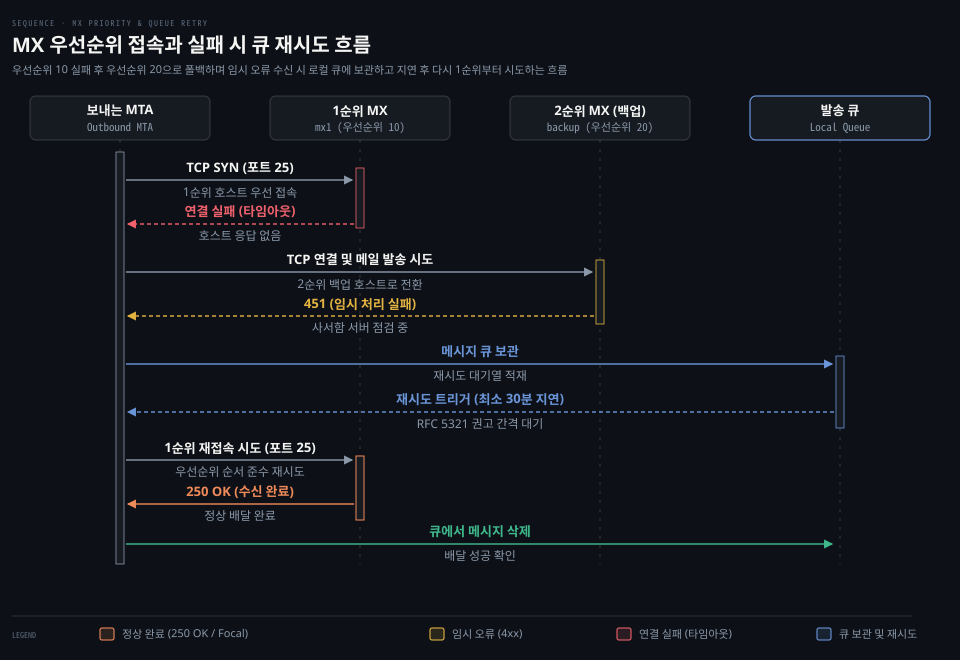
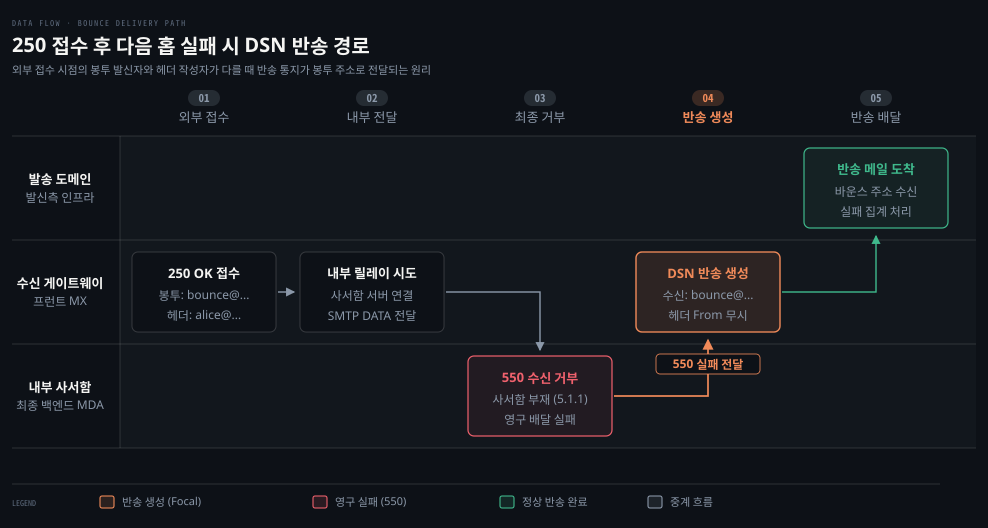

# MX·Null MX·큐·DSN·그레이리스팅

---

> 메일은 MX 조회로 수신 문을 찾고, 큐와 재시도로 일시 장애를 넘기며, 끝내 닿지 못하면 DSN 반송을 돌려보내는 경로로 배달됩니다. 들어오는 문과 나가는 문의 분리, 4xx 재시도 규약, DSN 생성 경로를 통해 메일 전달의 안정성 원리를 이해합니다.

백엔드 애플리케이션에서 회원가입 인증이나 주문 완료 메일을 발송하면 작업이 끝난 것처럼 보입니다. 애플리케이션 입장에서는 메일 발송 라이브러리가 성공을 반환했기 때문입니다.

하지만 실제 인터넷 너머에서는 수신 도메인을 찾고 장애에 대응하는 복잡한 여정이 비로소 시작됩니다. 메일 시스템은 웹 API 호출과 근본적으로 다릅니다.

웹 통신은 수신 서버가 꺼져 있으면 클라이언트에게 즉시 실패를 돌려줍니다. 반면 메일 시스템은 상대 서버가 점검 중이어도 며칠 동안 묵묵히 재시도를 이어갑니다.

때로는 스팸을 막기 위해 수신 서버가 정상적인 첫 접속을 일부러 거절하기도 합니다. 상대방 사서함에 끝내 닿지 못하면 별도의 반송 메일을 발신자에게 전송합니다.

고객 지원 센터로 "인증 메일이 오지 않는다"는 문의가 들어왔을 때, 웹 애플리케이션의 데이터베이스만 확인하고 "서버에서는 성공적으로 발송되었습니다"라고 답해서는 안 되는 이유가 여기에 있습니다. 애플리케이션의 성공은 단지 첫 번째 릴레이 큐에 들어갔음을 의미할 뿐입니다.

이 전달 과정을 지탱하는 기둥이 세 가지 있습니다. DNS의 **MX**(Mail Exchanger) 레코드, 발송 서버의 메시지 큐, 그리고 **DSN**(Delivery Status Notification) 반송 체계입니다.

신뢰할 수 없는 인터넷 환경에서 메일을 유실 없이 배달하는 세 기둥의 설계 원리를 차례로 살펴보겠습니다.


## 학습 목표와 범위

> DNS MX 조회 순서, 큐잉과 재시도 규약, DSN 반송 경로, 그레이리스팅의 원리를 학습합니다.

1. 보내는 MTA가 MX를 조회해 우선순위대로 접속하는 순서와, MX가 없을 때(암묵 MX)·메일을 안 받는 도메인(Null MX)의 처리를 설명할 수 있습니다.
2. MX는 들어오는 쪽만 가리키고, 그 도메인이 메일을 내보내는 서버는 알려 주지 않는 이유를 설명할 수 있습니다.
3. 4xx를 받은 MTA가 메일을 큐에 두고 재시도하다 포기하는 흐름과 RFC 5321이 권하는 간격을 말할 수 있습니다.
4. 받았다고 답한(250) 뒤에 실패하면 반송(DSN)이 봉투 발신 주소로 돌아오는 이유를 설명할 수 있습니다.
5. 그레이리스팅이 일부러 4xx를 돌려주는 이유와 그 때문에 첫 메일이 늦어지는 현상을 설명할 수 있습니다.


## 1. 받는 서버를 어떻게 찾나 — MX 조회와 우선순위, 백업 MX

> 발송 MTA는 수신 도메인의 DNS MX 레코드를 우선순위 숫자가 낮은 순서대로 조회하여 접속을 시도합니다.

외부 도메인으로 메일을 보낼 때, 발송 서버는 수신자의 메일 서버 IP 주소를 어디에서 알아낼까요?

수신자 주소가 `user@example.com`이라면 골뱅이 뒤의 `example.com`이 목적지 도메인입니다. 웹 브라우저라면 곧바로 A 레코드나 AAAA 레코드를 조회하여 웹 서버 IP를 찾았을 것입니다.

하지만 메일 시스템은 도메인 이름을 보고 가장 먼저 DNS **MX** 레코드를 질의합니다.[^rfc5321-sec51] 메일을 받는 서버와 웹 사이트를 제공하는 서버가 서로 다른 기계인 경우가 대부분이기 때문입니다.

MX 레코드는 도메인으로 들어오는 메일을 수신할 호스트 이름과 함께 **우선순위**(preference) 값을 돌려줍니다.[^rfc5321-sec51] 우선순위는 16비트 정수이며[^rfc974] 숫자가 작을수록 우선순위가 높습니다.[^rfc5321-sec51]

```pseudocode
example.com.   IN MX 10  mx1.example.com.
example.com.   IN MX 10  mx2.example.com.
example.com.   IN MX 20  backup.example.com.
```

발송 측 **MTA**(Mail Transfer Agent)는 우선순위 10을 가진 `mx1`과 `mx2`를 먼저 목적지로 선정합니다. 만약 동일한 우선순위 값을 가진 호스트가 여러 개 존재한다면 어떻게 처리해야 할까요?

RFC 5321 §5.1은 동일한 우선순위 호스트들이 있을 때 순서를 무작위로 섞도록 규정합니다.[^rfc5321-sec51] 부하를 고르게 분산하여 특정 호스트로 트래픽이 집중되는 현상을 막기 위함입니다.

우선순위 숫자가 더 큰 20을 가진 `backup.example.com`은 **백업 MX**(Backup MX) 역할을 수행합니다. 주 서버들이 모두 다운되었을 때 발송 MTA는 보조 서버로 접속을 시도합니다.[^rfc5321-sec51]

백업 MX는 메일을 대신 받아 자신의 디스크 큐에 보관합니다. 이후 주 서버가 복구되면 보관해 둔 메일을 다시 주 서버로 안전하게 넘겨줍니다.

과거에는 백업 MX의 보안 필터링이 주 서버보다 느슨한 허점을 노려 스팸을 보조 서버로 우회 전송하는 공격이 빈번했습니다. 현대 인프라에서는 이를 막기 위해 주 서버와 보조 서버가 동일한 수신자 검증 정책을 공유하도록 설정합니다.

MX 레코드에 등록되는 대상 호스트 이름은 반드시 실제 IP를 가리키는 A 또는 AAAA 레코드여야 합니다. RFC 2181 §10.3은 MX 레코드의 대상 값으로 CNAME 별칭(alias)을 사용하는 것을 명시적으로 금지합니다.[^rfc2181-sec103] RFC 5321 §5.1 역시 CNAME을 반환하는 설정은 표준 규격 범위 밖(outside the scope)으로 규정합니다.[^rfc5321-sec51]

MX 대상에 별칭을 사용하면 DNS 추가 섹션 처리(Additional Section Processing)를 통한 주소 조회가 제대로 동작하지 않아 불필요한 질의 지연이 발생하기 때문입니다.[^rfc2181-sec103]

따라서 도메인 관리자는 MX 레코드의 타깃에 반드시 실제 정방향 호스트 이름을 직접 지정해야 합니다. 발송 MTA는 질의 결과로 받은 A/AAAA IP 목록을 바탕으로 TCP 25번 포트 연결을 맺습니다.

실무에서는 DNS 캐시의 TTL(Time To Live) 관리도 중요합니다. 수신 서버를 교체하거나 IP를 변경할 때 기존 MX 레코드의 TTL이 길게 남아 있으면, 전 세계 발송 서버들이 만료 전까지 이전 서버로 계속 접속을 시도하기 때문입니다.


## 2. MX 가 없거나 메일을 안 받는 도메인 — 암묵 MX 와 Null MX

> MX 레코드가 없으면 도메인의 주소 레코드로 폴백하고, 메일을 수신하지 않는 도메인은 Null MX로 명시합니다.

인터넷에 존재하는 모든 도메인이 MX 레코드를 바르게 설정해 두었을까요?

특정 도메인을 조회했는데 MX 레코드가 아예 등록되어 있지 않은 경우가 있습니다. 그렇다면 발송 MTA는 수신 서버가 없다고 판단하고 발송을 즉시 중단해야 할까요?

RFC 5321은 초기 인터넷과의 하위 호환성을 위해 **암묵적 MX**(Implicit MX) 규칙을 정의합니다.[^rfc5321-sec51] 도메인에 MX 레코드가 없으면 우선순위 0인 암묵적 MX가 해당 도메인의 A 또는 AAAA 레코드를 가리키는 것으로 간주합니다.[^rfc5321-sec51]

즉 MX가 없더라도 도메인 자체의 IP 주소로 포트 25 접속을 폴백하여 시도합니다. 과거 호스트 기반 메일 전달 체계에서 동작하던 시스템을 수용하기 위한 설계입니다.

하지만 현대 웹 환경에서 도메인의 A 레코드는 보통 웹 서버나 로드 밸런서를 가리킵니다. 웹 서버는 메일 수신 데몬을 띄우지 않으므로 포트 25 접속 시 TCP RST 패킷을 돌려주거나 방화벽에 막혀 타임아웃이 발생합니다.

특히 웹 서버는 대개 80번과 443번 포트만 열어 둡니다. 25번 포트로 들어오는 패킷은 방화벽에서 응답 없이 폐기(DROP)하도록 설정합니다.

패킷이 버려지면 송신자에게 연결 거절(RST) 패킷조차 돌아가지 않습니다. 발송 MTA는 TCP SYN 패킷을 전송한 뒤 응답을 기다리다 연결 타임아웃을 맞이합니다.

이때 발송 MTA는 상대 호스트가 메일을 전혀 받지 않는 시스템인지 아니면 회선 장애로 잠시 응답하지 못하는 상태인지 구별하기 어렵습니다. 따라서 이 상황을 일시 장애(Soft Failure)로 판단하고 메일을 로컬 지연 큐에 넣습니다.

이후 상대 서버가 복구되기를 기대하며 며칠 동안 주기적으로 25번 포트 재접속을 시도합니다.[^rfc7505-sec1] 웹 서버 하나에 수신 도메인을 잘못 적었다는 이유만으로 네트워크 대역폭과 발송 서버의 큐 자원이 낭비되는 셈입니다.

한편 웹 사이트 전용 도메인처럼 메일을 전혀 보내지도 받지도 않는 도메인이 있습니다. 예를 들어 `www.example.com` 같은 호스트는 웹 서비스만 제공할 뿐 메일 사서함을 두지 않습니다.

이런 도메인에 아무런 메일 설정을 하지 않으면 큰 낭비가 생깁니다. 사용자가 주소를 잘못 입력하여 `alice@www.example.com` 앞으로 메일을 보냈을 때 암묵적 MX 규칙이 발동하기 때문입니다.[^rfc7505-sec41] 발송 서버는 웹 서버 IP로 메일 접속을 시도하다 타임아웃을 겪고 며칠간 무의미한 큐 재시도를 이어갑니다.

이 낭비를 차단하기 위해 제정된 표준이 RFC 7505의 **Null MX**입니다.[^rfc7505-sec3] 도메인 관리자는 DNS에 우선순위 0과 호스트 이름으로 마침표(`.`)를 가진 단 하나의 MX 레코드를 등록합니다.[^rfc7505-sec3]

```pseudocode
www.example.com.   IN MX 0 .
```

Null MX를 확인한 발송 MTA는 이 도메인이 메일을 전혀 받지 않는다는 사실을 즉시 파악하고, A 레코드 폴백이나 재시도 없이 배달 실패로 처리합니다. 접속할 서버가 없으므로 누구에게서 응답을 받는 것이 아닙니다. 제출·중계 서버가 이 사실을 확인하면 자기 클라이언트에게 556 응답(5.1.10 확장 상태 코드)으로 그 수신자를 거부합니다.[^rfc7505-sec41] Null MX를 선언한 도메인은 다른 어떠한 MX 레코드도 함께 게시해서는 안 됩니다.[^rfc7505-sec3]

발송 MTA가 DNS 질의 단계에서 Null MX를 확인하면 웹 서버 IP의 25번 포트로 TCP 연결을 시도하지 않습니다. 방화벽 DROP으로 인한 타임아웃과 며칠간 이어지는 재시도 루프가 원천 차단됩니다. 메일을 의뢰한 클라이언트에게는 556 거부 코드로 즉시 배달 실패를 확정하여 돌려줍니다.[^rfc7505-sec41][^rfc7504]

여기서 개발자가 특히 주의해야 할 원칙이 있습니다. 시스템 알림이나 인증 메일만 보내는 발송 전용 도메인(`noreply` 등)에 답장을 막겠다는 의도로 Null MX를 등록해서는 안 됩니다.[^rfc7505-sec42]

RFC 7505 §4.2는 봉투 발신자(`MAIL FROM`)나 헤더 `From` 주소로 사용하는 도메인에 Null MX를 게시하지 말아야 한다고 명시합니다(SHOULD NOT).[^rfc7505-sec42] 배달 실패 시 반송 메일(DSN)을 받아 처리할 수 있어야 하며, 수신 서버는 발신 도메인에 Null MX가 등록되어 있으면 스팸 신호로 보고 `550 5.7.27` 오류 코드로 메일을 즉시 거부할 수 있기 때문입니다.[^rfc7505-sec41]

따라서 Null MX는 메일을 보내지도 받지도 않는 순수 도메인에만 선언해야 합니다. 메일을 일절 보내지 않는 도메인 관리자는 Null MX와 함께 SPF `-all` 정책을 선언하여 도메인이 메일을 발송하지 않음을 외부에 명시합니다.[^rfc7505-sec42]


## 3. MX 는 왜 나가는 서버를 알려 주지 않나 — 들어오는 문과 나가는 문

> MX는 외부에서 도메인으로 들어오는 우편함만 공개할 뿐, 내부 사용자가 밖으로 메일을 보낼 때 쓰는 발송 서버와는 무관합니다.

많은 개발자가 MX 레코드를 보면서 자연스럽게 오해를 합니다. `example.com`의 MX 서버를 보면 그 도메인이 메일을 밖으로 보낼 때 사용하는 발송 서버도 알 수 있을 것이라 생각하는 점입니다.

하지만 MX는 외부에서 해당 도메인 앞으로 들어오는 인바운드 메일을 수신할 호스트만을 지정합니다.[^rfc5598] 나가는 쪽 아웃바운드 서버는 MX 레코드에 전혀 나타나지 않습니다.

이유는 메일 발송 시의 라우팅 구조에 있습니다. `alice@example.com`이 외부의 `bob@gmail.com`으로 편지를 보낸다고 가정해 보겠습니다.

발송 서버가 DNS에 질의하는 대상은 자기 도메인의 MX가 아닙니다. 편지를 받을 상대방 도메인인 `gmail.com`의 MX 레코드를 조회합니다.

그리고 조회된 구글의 수신 서버로 직접 TCP 소켓을 열어 메일을 전달합니다. 따라서 발송 과정에서는 자기 도메인의 MX 레코드를 참조할 이유가 전혀 없습니다.

MX 레코드는 대외적으로 공개된 우리 회사의 우편함 주소와 같습니다. 누구나 우리 회사 도메인 앞으로 우편물을 보낼 수 있도록 창구를 공개해 둔 것입니다.

반면 회사 내부 사용자가 밖으로 메일을 내보낼 때 쓰는 출구 서버는 수신 창구와 분리되어 운영되는 경우가 많습니다.[^rfc5598] 수신 서버는 스팸을 걸러내는 역할을 하고, 발송 서버는 내부 계정을 인증하여 릴레이하는 역할을 맡기 때문입니다.

네트워크 아키텍처 관점에서도 두 서버는 완전히 다른 역할을 합니다. 인바운드 서버는 25번 포트를 열어 전 세계 임의의 서버로부터 들어오는 접속을 받습니다.

반면 아웃바운드 서버는 외부로부터의 무단 접근을 차단하고 사내 애플리케이션의 인증 요청만 587번 포트로 접수합니다. 이렇게 역할과 보안 경계가 다르므로 두 서버를 분리합니다.

외부 수신 서버가 "지금 접속한 IP가 정말로 이 도메인을 대표하여 메일을 보낼 권한이 있는가"를 검증하는 수단은 MX가 아닙니다.

초기 SMTP 규격이 제정되었던 1980년대에는 인터넷 참여자 간의 상호 신뢰를 전제로 했기 때문에 발송 서버를 검증하는 규격이 아예 없었습니다. 누구나 `MAIL FROM`에 남의 도메인을 적어 메일을 위조할 수 있었던 구조적 취약점이 존재했습니다.

이 사칭 문제를 사후에 보완하기 위해 탄생한 기술이 바로 SPF, DKIM, DMARC입니다. 도메인 소유자가 DNS에 합법적인 발송 서버 IP 대역을 선언하거나 전자서명 공개키를 게시하는 방식입니다.

따라서 MX는 오직 들어오는 문만을 안내하는 우편함이며, 나가는 문의 자격 증명은 완전히 별개의 보안 레코드가 담당합니다. 이 발신 보안 인증의 구체적인 동작 원리는 [03-02편]에서 자세히 다룹니다.

01-01편 3절에서 정리했듯이 MX 레코드와 SPF 레코드는 메일이 오가는 문 자체가 정반대입니다. 두 레코드의 핵심 차이를 정리하면 다음과 같습니다.

| 구분 | DNS MX 레코드 | DNS SPF (TXT) 레코드 |
|---|---|---|
| 비유 | 들어오는 문 (인바운드 우편함) | 나가는 문 (아웃바운드 발송 서버 명부) |
| 선언 주체 | 수신 도메인 관리자 | 발신 도메인 관리자 |
| 공개 대상 | 외부 메일을 대신 수신할 호스트와 우선순위 | 우리 도메인을 대표해 메일을 발송할 합법적 IP 대역 |
| 조회 주체 | 메일을 전송하려는 외부 발송 MTA | 수신 메일의 발신처를 검증하려는 외부 수신 MTA |
| 주요 목적 | 목적지 수신 서버 호스트 탐색 | 발신 도메인 사칭 및 위조 방지 |
| 관련 표준 | RFC 5321 §5.1 | RFC 7208 |

수신 서버와 발신 서버의 분리 배경은 [01-01편 3절](./01-01.RFC%20821·RFC%20822·MX·ESMTP.md#3-받는-서버를-어떻게-찾았나--호스트-직접-지정소스-라우트에서-dns-mx-로)에서, 발송 서버의 IP 자격을 증명하는 SPF의 구체적인 문법과 동작 원리는 [03-02편 3절](./03-02.SPF·DKIM·DMARC·ARC.md#3-이-ip-가-보내도-되나--spf-그리고-발송-서버를-찾는-단서)에서 각각 자세히 다룹니다.[^rfc7208]


## 4. 지금 못 받는다는 답을 들으면 — 큐, 재시도 간격, 포기 시점

> 수신 측이 4xx 임시 오류를 반환하면 발송 MTA는 메일을 로컬 큐에 보관하고 RFC 권고에 따라 지연 후 재시도합니다.

발송 MTA가 상대방 MX 서버에 연결했으나 상대 서버가 점검 중이거나 일시적인 장애를 겪고 있을 수 있습니다. 이때 수신 서버는 영구 거부(5xx) 대신 4xx 임시 오류 코드를 반환합니다.[^rfc5321-sec4541]

4xx 응답을 받은 발송 MTA는 전송을 실패로 끝내지 않습니다. 메일을 디스크의 발송 **큐**(Queue)에 안전하게 적재하고 재시도 대기 상태로 전환합니다.

메일 릴레이 데몬은 일반적으로 메모리가 아닌 디스크 스풀 공간에 큐 파일을 기록합니다. 서버 프로세스가 예기치 않게 재부팅되더라도 발송 대기 중인 메일이 유실되지 않도록 보장하기 위함입니다.

대표적인 MTA인 Postfix의 경우 즉시 전송을 시도하는 활성 큐와 일시 실패로 대기하는 지연 큐를 분리하여 운용합니다. 지연 큐에 들어간 메시지는 큐 매니저의 주기적인 스캔 주기에 따라 백오프 간격을 두고 순차적으로 깨어납니다.

이때 수신 서버가 건네는 세부 오류 코드도 큐 상태 분석에 활용됩니다. 기본 3자리 코드 뒤에 따르는 `4.X.X` 형식의 확장 상태 코드는 DNS 해석 실패인지, 사서함 용량 초과인지 구체적인 원인을 알려줍니다.

RFC 5321 §4.5.4.1은 이 재시도 전략에 대해 규정과 권고를 명확히 나눕니다.[^rfc5321-sec4541] 발송자는 한 번 배달에 실패한 목적지에 대해 즉시 재시도해서는 안 되며(MUST delay), 일반적인 재시도 간격은 최소 30분 이상이어야 합니다(SHOULD).[^rfc5321-sec4541]

장애가 발생한 서버에 초 단위로 재접속을 시도하면 상대 서버에 과도한 부하를 주어 복구를 방해하기 때문입니다. RFC는 특정 고정 일정을 강제하지 않지만, 첫 1시간 동안에는 2회 접속을 시도하고 이후 2~3시간마다 한 번씩 시도하도록 점진적으로 간격을 늘리는(백오프) 경험적 일정을 권장합니다.[^rfc5321-sec4541]

또한 발송 MTA는 수신 서버가 복구될 때까지 재시도를 계속하되, 최종 전송 포기 시점은 일반적으로 최소 4~5일이 되어야 한다고 명시합니다.[^rfc5321-sec4541]

주말이나 연휴 동안 수신 서버에 장애가 생기더라도, 평일에 시스템이 복구되면 메일이 유실되지 않고 배달되도록 충분한 유예 기간을 두는 것입니다.



위 시퀀스 도식은 1순위 MX 접속 실패와 2순위 백업 서버의 4xx 응답을 마주한 발송 MTA의 처리 과정을 보여줍니다. 1순위 타임아웃과 2순위 451 응답을 받은 발송 MTA는 메시지를 로컬 큐에 보관합니다.

그리고 RFC 5321 권고에 따라 최소 30분 이상 지연한 뒤 다시 1순위 서버부터 차례대로 재시도합니다. 1순위 서버가 복구되어 250 응답을 주면 비로소 메일을 큐에서 삭제하고 작업을 마무리합니다.

스프링 백엔드 애플리케이션 개발자가 이 큐잉 메커니즘을 알아야 하는 이유는 분명합니다. 발송 메서드 호출이 성공했더라도 메일이 수신자에게 즉시 도착했다는 의미는 아니기 때문입니다.

발송 서버 큐에 들어간 메일은 상대방 서버 상태에 따라 수십 분에서 며칠 동안 지연될 수 있습니다. 메일 전송의 비동기적 특성을 이해해야 운영 환경에서 발생하는 지연 문의를 올바르게 분석할 수 있습니다.

소프트 바운스(Soft Bounce)라고 불리는 일시적 장애가 발생했을 때 데이터베이스의 발송 상태를 섣불리 실패로 바꾸어서는 안 됩니다. 릴레이 서버가 재시도를 진행 중일 수 있으므로 최종 처리 결과를 기다려야 합니다.


## 5. 이미 받았다고 한 메일이 실패하면 — DSN 반송과 봉투 발신 주소

> 250 응답으로 수신을 확정한 뒤 내부 배달에 실패하면, 서버는 DSN을 생성하여 헤더 From이 아닌 봉투 발신 주소로 보냅니다.

수신 게이트웨이가 발송 MTA에게 `250 OK` 응답을 건넸다면 인터넷 전송 트랜잭션은 성공적으로 종료됩니다. 발송 MTA는 전송 책임을 게이트웨이에 넘겼으므로 세션을 닫고 로컬 큐를 비웁니다.

이 250 응답은 프로토콜 상에서 중요한 의미를 가집니다. 수신 게이트웨이가 메일의 배달 책임을 공식적으로 인수했다는 기술적 확인이기 때문입니다.[^rfc5321-sec61]

그런데 게이트웨이가 사내 백엔드 사서함 서버로 메일을 전달하려다 문제가 생기면 어떻게 될까요? 해당 수신자 계정이 존재하지 않는다는 사실을 뒤늦게 발견할 수 있습니다.

이미 이전 발송 서버와의 SMTP 연결은 종료되었습니다. TCP 세션 상에서 실시간으로 550 오류 코드를 넘겨줄 방법이 사라진 상태입니다.

이때 수신 게이트웨이는 실패 원인을 알리는 새로운 메일을 직접 한 통 작성합니다. 이를 **DSN**(Delivery Status Notification), 통칭 **반송 메일**이라고 부릅니다.[^rfc3464]

RFC 3464는 배달 실패의 구체적인 진단 상태 코드를 기계와 사람이 모두 파악할 수 있는 표준 형식으로 규정합니다.[^rfc3464]

DSN 메시지는 사람이 읽을 수 있는 안내문 본문과 함께 기계가 판독할 수 있는 상태 필드를 포함합니다. 수신 시스템이나 반송 처리 모듈이 오류 코드를 자동으로 파악하여 데이터베이스에 반영할 수 있도록 돕습니다.

그렇다면 이 반송 메일은 누구에게 배달되어야 할까요? 메시지 본문 헤더에 적힌 `From: alice@example.com` 주소로 발송되지 않습니다.

반송 메일의 수신처는 SMTP 대화의 봉투 반송 주소(reverse-path, 즉 `MAIL FROM`)여야 한다고 RFC 5321 §3.6.3과 §6.1이 명시합니다.[^rfc5321-sec363][^rfc5321-sec61] 릴레이 서버는 본문 헤더나 내용을 검사하지 않고 전송 세션의 봉투 역경로만을 보고 반송을 구성합니다.[^rfc5321-sec363]



위 도식은 게이트웨이가 250으로 접수한 뒤 다음 홉에서 550 거부를 만났을 때의 반송 경로를 보여줍니다. 봉투 주소와 헤더 주소의 분리 구조는 [메일과 이름은 어떻게 찾아가는가](../../book/cntd_computer-networking-top-down/02-03.메일과%20이름은%20어떻게%20찾아가는가.md#2-헤더는-명령이-아닙니다) 2절에서 다룹니다.

그러나 봉투 발신 주소 역시 스팸 발송자에 의해 쉽게 위조될 수 있습니다.[^rfc2505] 공격자가 무고한 제3자의 주소를 봉투 `MAIL FROM`에 적어 스팸을 보내면, 메일을 일단 250으로 수락한 수신 서버가 뒤늦게 반송 메일을 생성하여 엉뚱한 피해자에게 쏟아붓는 **백스캐터**(Backscatter) 현상이 발생합니다.[^rfc7505-sec41]

따라서 백스캐터를 막는 근본적인 대책은 메일을 일단 접수한 뒤 DSN을 보내는 것이 아니라, SMTP 대화 중에(`RCPT TO` 시점에) 수신자 존재 여부를 검증하여 550으로 즉시 거부하는 것입니다.

여기서 한 가지 중요한 불변 조건이 더 있습니다. 반송 메일을 보낼 때, 그 반송 메일 자체의 봉투 발신자는 반드시 빈 주소(`<>`)로 지정해야 합니다.[^rfc5321-sec363][^rfc5321-sec61]

만약 반송 메일에 일반 발신 주소를 넣으면 어떻게 될까요? 반송 메일마저 배달에 실패했을 때 또 다른 반송 메일이 생성되어 두 서버 사이에 무한 루프가 발생합니다.

빈 역경로(`MAIL FROM:<>`)는 "이 메일은 실패 알림이므로 어떠한 경우에도 추가 반송을 생성하지 말라"는 프로토콜 신호입니다.[^rfc5321-sec455] RFC 5321 §3.6.3은 이것을 오류 보고 과정의 루프를 막는 한 방법으로 듭니다.[^rfc5321-sec363]

대규모 시스템에서는 이 반송 주소에 가변 토큰을 붙여 수신자를 식별하는 기법(VERP)을 사용합니다. 반송 메일이 돌아왔을 때 어느 사용자의 이메일이 유효하지 않은지 자동으로 감지하여 발송 대상에서 제외하기 위함입니다.

개발자가 흔히 시도하는 위험한 방법 중 하나는 회원가입 시 이메일 유효성을 검증하려고 수신 서버에 직접 접속하여 `RCPT TO`까지만 보내보는 방식입니다.

현대 메일 서버는 이러한 접속을 사서함 스캐닝 공격으로 간주하여 IP를 차단할 수 있습니다. 또한 내부 배달 단계에서 비동기로 DSN을 처리하는 서버가 많아 이 방식으로는 실제 계정 유무를 정확히 확인할 수도 없습니다.


## 6. 일부러 한 번 거절하는 서버 — 그레이리스팅

> 그레이리스팅은 미등록 발신자의 초기 연결에 일부러 4xx 오류를 돌려주어 재시도 능력이 없는 스팸봇을 걸러냅니다.

정상적인 주소로 메일을 보냈는데도 왜 수신 서버는 첫 번째 연결 시도에 임시 오류를 돌려줄까요?

이러한 방어 기법을 **그레이리스팅**(Greylisting)이라고 부릅니다.[^rfc6647-sec24] RFC 6647에 표준화된 스팸 방어 알고리즘입니다.[^rfc6647-sec24]

수신 서버는 접속한 클라이언트의 발신 IP, 봉투 발신자(`MAIL FROM`), 첫 번째 봉투 수신자(`RCPT TO`)의 세 가지 요소를 묶어 관리합니다.[^rfc6647-sec5] 이를 **삼중쌍**(Triplet)이라고 합니다.[^rfc6647-sec5]

데이터베이스에 기록이 없는 낯선 삼중쌍이 처음 연결해 오면, 수신 MTA는 해당 SMTP 세션의 나머지 명령에 대해 4xx 계열의 임시 오류 코드로 응답합니다.[^rfc6647-sec24]

이 방식이 스팸을 걸러내는 원리는 단순합니다. 대량의 스팸을 무작위로 살포하는 악성 스팸봇은 디스크 큐나 재시도 스케줄러를 정교하게 갖추지 않는 경우가 많습니다.

한 번 임시 거절을 당한 스팸봇은 재시도를 포기하고 다음 대상 IP로 넘어가 버립니다. 반면 표준을 준수하는 정상적인 메일 서버는 4xx 응답을 받으면 메일을 큐에 보관하고 지연 후 재시도합니다.

일정 시간이 흐른 뒤 동일한 삼중쌍으로 다시 발송 요청이 들어오면, 수신 서버는 정상 메일 서버로 판단하고 메일을 수신합니다. 동시에 해당 삼중쌍을 허용 목록에 등록하여 다음 메일부터는 지연 없이 통과시킵니다.

그레이리스팅은 구현이 간단하면서도 단순 스팸봇을 차단하는 데 탁월합니다. 하지만 처음 메일을 주고받는 사이에서는 송신 서버의 재시도 간격에 따라(수 분에서 1시간 이상) 첫 번째 메일이 늦어질 수 있다는 단점이 있습니다.[^rfc6647-sec3]

회원가입 본인 인증 번호처럼 수십 초 내에 도착해야 하는 메일이 그레이리스팅에 걸리면 사용자가 큰 불편을 겪을 수 있습니다. 서비스 운영 시 이 지연 메커니즘을 미리 이해하고 있어야 원인을 정확히 짚어낼 수 있습니다.

대규모 메일 발송 서비스를 운영할 때는 이러한 지연을 줄이기 위해 전용 IP 평판을 꾸준히 관리합니다. 대형 수신사와의 사전 협의를 통해 화이트리스트에 발송 IP를 등록하기도 합니다.

특히 본인 인증 번호(OTP)나 비밀번호 재설정 링크처럼 짧은 유효 시간 내에 처리해야 하는 트랜잭션 메일에서 지연은 치명적입니다. 최초 발송에서 15분에서 1시간 이상 지연되면 인증 세션이 만료되어 회원가입이나 결제가 중단되기 때문입니다.

현대 메일 수신 인프라에서는 이 지연 문제를 완화하기 위해 흔히 두 가지 방식을 씁니다.

첫째는 발신 IP 대역의 사전 화이트리스트 등록입니다. RFC 6647 §2.7 은 재시도 방식이 그레이리스팅과 맞지 않거나 너무 드물게 보내는 합법 발신자를 예외 후보로 들고, §5 의 6항은 반드시 재시도하는 이메일 서비스 사업자처럼 잘 알려진 발신자는 검사를 건너뛰게 하라고(SHOULD) 권합니다.[^rfc6647-sec27][^rfc6647-sec5] 주요 발송 대행사나 결제 대행사의 발신 IP를 수신 측 허용 목록에 사전에 등록하여 불필요한 지연을 막습니다.

둘째는 SPF와 DKIM 인증 및 발신자 평판 기반의 선별 면제입니다. 모든 미등록 발신자에게 무조건 4xx 오류를 돌려주지 않습니다.

RFC 6647 §2.6 은 처음 보는 발신자 전부가 아니라 DNSBL 에 오른 IP 나 동적 IP 처럼 보이는 PTR 이름 같은 의심 지표가 있는 쪽만 골라 그레이리스팅하는 방식을 듭니다.[^rfc6647-sec26] 이 생각을 넓혀, SPF·DKIM 을 통과하고 평판이 좋은 메일은 그레이리스팅에서 빼는 운영도 흔히 씁니다. SPF·DKIM 결과로 면제하라는 문장은 RFC 6647 에 없고, 수신 서버마다 정하는 정책입니다. 반대로 발신자 평판이 확정되지 않았거나 스팸 의심 지표가 있는 메일에만 그레이리스팅을 적용함으로써 정상 인증 메일의 신속한 도착과 스팸 차단을 함께 도모합니다.

사내 메일 인프라를 직접 구축할 때도 트랜잭션 메일 발송용 IP와 대량 마케팅용 IP를 분리합니다. 마케팅 메일로 인해 발송 IP 평판이 떨어지거나 그레이리스팅 지연이 걸려 중요 업무 메일이 지연되는 사고를 막기 위함입니다.

애플리케이션 계층에서의 설계 주의점도 있습니다. 릴레이 MTA가 자체적인 큐잉과 재시도를 수행하고 있는데 스프링 애플리케이션에서 무리하게 HTTP 스타일의 짧은 재시도를 돌리면 안 됩니다.

만약 애플리케이션이 1분 간격으로 발송 메서드를 다시 호출하면, MTA의 큐에 동일한 메일이 여러 건 쌓이게 됩니다. 이후 수신 서버의 그레이리스팅이 풀리는 순간 수신자에게 중복 메일 폭탄이 전달되는 사고로 이어집니다.

따라서 일시적 전송 실패에 대한 재시도는 표준을 준수하는 메일 인프라 계층에 온전히 위임하는 것이 안전한 아키텍처입니다. 백엔드 시스템은 비동기 이벤트나 웹훅을 통해 최종 성공 또는 DSN 반송 결과를 전달받아 처리하도록 설계해야 합니다.


## 스스로 확인할 질문

> 각 절의 설계 이유와 프로토콜 원리를 바탕으로 질문에 답해 봅니다.

1. 송신 MTA가 수신 도메인의 MX 레코드를 조회했을 때 우선순위 숫자가 동일한 복수의 호스트가 존재한다면 RFC 5321에 따라 어떻게 처리해야 합니까?
2. DNS에 MX 레코드가 없는 도메인과 Null MX가 선언된 도메인은 발송 MTA가 처리하는 방식에서 어떤 결정적인 차이가 있습니까?
3. 수신 도메인의 MX 레코드만 확인해서는 해당 도메인이 외부로 메일을 보낼 때 사용하는 발송 서버의 IP를 증명할 수 없는 이유는 무엇입니까?
4. 수신 서버로부터 4xx 임시 오류 응답을 받은 발송 MTA에 대해 RFC 5321 §4.5.4.1이 권고하는 최소 재시도 간격과 최종 전송 포기 시점은 각각 얼마입니까?
5. 수신 게이트웨이가 메일을 250으로 수락한 후 내부 MDA 배달에 실패했을 때, DSN 반송 메일이 헤더 `From:` 주소가 아닌 봉투 `MAIL FROM` 주소로 전송되어야 하는 이유는 무엇입니까?
6. 그레이리스팅 기술이 첫 연결 시도에 정상적인 메일까지 일부러 4xx 오류로 거절하는 이유와 이로 인해 발생하는 부작용은 무엇입니까?
7. 웹 사이트 전용 도메인처럼 메일을 받지 않는 서버의 방화벽이 25번 포트를 응답 없이 버릴(DROP) 때 발송 MTA에서 일어나는 네트워크 낭비 과정과, Null MX가 이를 원천 차단하는 원리는 무엇입니까?
8. 본인 인증 번호(OTP)처럼 실시간성이 중요한 메일이 그레이리스팅에 걸려 지연되는 문제를 줄이기 위해 실무와 RFC 6647에서 권고하는 대표적인 완화책 두 가지는 무엇입니까?


## 정답 (자답 후 펼치기)

> 스스로 작성한 답변과 아래 내용을 대조해 봅니다.

1. 동일한 우선순위 값을 가진 복수의 MX 호스트가 존재할 경우, 송신 MTA는 부하를 고르게 분산하기 위해 호스트 목록의 순서를 무작위로 섞어 접속을 시도해야 합니다(RFC 5321 §5.1).
2. MX 레코드가 없는 도메인은 하위 호환성을 위한 암묵적 MX 규칙에 따라 도메인의 A/AAAA 레코드를 우선순위 0의 MX로 간주하고 폴백 접속합니다(RFC 5321 §5.1). 반면 Null MX(`IN MX 0 .`)가 선언된 도메인은 수신 불가 도메인으로 판정되어 폴백이나 큐 재시도 없이 즉시 영구 실패로 처리됩니다. 이를 확인한 제출·중계 서버는 클라이언트에게 556 응답(5.1.10 확장 상태 코드)으로 수신자를 거부합니다(RFC 7505 §4.1).
3. MX 레코드는 외부에서 해당 도메인으로 들어오는 인바운드 메일을 수신할 대리인 호스트만을 지정하는 공개 우편함 주소이기 때문입니다(RFC 5598 §4.3.2). 발송 시에는 목적지 도메인의 MX를 조회하여 외부로 직접 나가며, 합법적인 발신 서버 여부는 MX가 아니라 SPF와 DKIM을 통해 검증합니다.
4. RFC 5321 §4.5.4.1은 배달 실패 후 즉시 재시도하는 것을 금지(MUST delay)하며, 일반적인 재시도 간격은 최소 30분 이상(SHOULD)이어야 한다고 규정합니다. 또한 첫 1시간 2회 시도 후 2~3시간마다 백오프하는 일정을 권장하며, 메시지 전송을 최종 포기하는 시점은 일반적으로 최소 4~5일이 되어야 합니다.
5. 250 응답으로 이전 SMTP 세션이 종료된 후 발생한 실패이므로 실시간 TCP 오류를 반환할 수 없어 비동기 DSN을 발송해야 합니다. 규격(RFC 5321 §3.6.3·§6.1)은 릴레이 서버가 본문 헤더를 검사하지 않고 전송 세션의 봉투 반송 주소(reverse-path, `MAIL FROM`)로 통지하도록 명시하기 때문입니다. 만약 위조된 봉투 주소로 인해 엉뚱한 제3자에게 반송이 쏟아지는 백스캐터를 막으려면, 메일을 접수한 뒤 DSN을 보내기보다 SMTP 대화 중에 즉시 550으로 거부해야 합니다.
6. 큐와 재시도 스케줄러가 없는 단순 스팸봇은 4xx 응답을 받으면 재시도하지 않고 포기하는 특성을 이용해 스팸을 걸러내기 위함입니다(RFC 6647 §2.4). 다만 표준 규약을 준수하는 정상 발송 서버도 지연 큐를 거쳐야 하므로 송신 서버의 재시도 간격에 따라(수 분에서 1시간 이상) 첫 메일 배달이 늦어지는 부작용이 있습니다(RFC 6647 §3).
7. 방화벽이 25번 포트 패킷을 DROP하면 연결 거절(RST)조차 오지 않아 발송 MTA는 타임아웃을 겪게 됩니다. 발송 MTA는 이를 일시 장애(Soft Failure)로 판단하여 로컬 지연 큐에 메시지를 넣고 며칠 동안 주기적으로 25번 포트 재접속을 반복하는 자원 낭비가 발생합니다(RFC 7505 §1). 반면 Null MX(`IN MX 0 .`)가 선언되어 있으면 발송 MTA가 DNS 질의 단계에서 메일 미수신 도메인임을 즉시 파악합니다. 따라서 웹 서버 IP 접속이나 큐잉 없이 배달을 즉시 영구 실패로 종결하고 클라이언트에게 556 응답을 반환합니다(RFC 7505 §4.1, RFC 7504).
8. 첫째, 신뢰할 수 있는 발송 서버의 IP나 네트워크 대역을 사전에 허용 목록(화이트리스트)으로 등록하여 그레이리스팅 검사를 즉시 우회(Bypass)시키는 방법입니다(RFC 6647 §2.7·§5). 둘째, DNSBL·동적 IP 같은 의심 지표가 있는 발신자에게만 그레이리스팅을 거는 선별 적용(RFC 6647 §2.6)입니다. 이를 넓혀 SPF·DKIM 을 통과하고 평판이 좋은 메일을 면제하는 것은 RFC 가 아니라 수신 서버의 운영 정책입니다.


## 출처와 관련 문서

> 본문에서 인용한 표준 규격과 1차 자료입니다.

[^rfc5321-sec51]: RFC 5321 §5.1 Locating the Target Host — https://www.rfc-editor.org/rfc/rfc5321#section-5.1
[^rfc5321-sec4541]: RFC 5321 §4.5.4.1 Sending Strategy — https://www.rfc-editor.org/rfc/rfc5321#section-4.5.4.1
[^rfc5321-sec363]: RFC 5321 §3.6.3 Message Submission Servers as Relays — https://www.rfc-editor.org/rfc/rfc5321#section-3.6.3
[^rfc5321-sec363]: RFC 5321 §3.6.3 Message Submission Servers as Relays — "One way to prevent loops in error reporting is to specify a null reverse-path" — https://www.rfc-editor.org/rfc/rfc5321#section-3.6.3
[^rfc5321-sec455]: RFC 5321 §4.5.5 Messages with a Null Reverse-Path — https://www.rfc-editor.org/rfc/rfc5321#section-4.5.5
[^rfc5321-sec61]: RFC 5321 §6.1 Reliable Delivery and Replies by Email — https://www.rfc-editor.org/rfc/rfc5321#section-6.1
[^rfc974]: RFC 974 Mail Routing and the Domain System — https://www.rfc-editor.org/rfc/rfc974
[^rfc2181-sec103]: RFC 2181 §10.3 MX and NS records — https://www.rfc-editor.org/rfc/rfc2181#section-10.3
[^rfc7505-sec3]: RFC 7505 §3 MX Resource Records Specifying Null MX — https://www.rfc-editor.org/rfc/rfc7505#section-3
[^rfc7505-sec41]: RFC 7505 §4.1 SMTP Server Benefits — https://www.rfc-editor.org/rfc/rfc7505#section-4.1
[^rfc7505-sec42]: RFC 7505 §4.2 Sending Mail from Domains That Publish Null MX — https://www.rfc-editor.org/rfc/rfc7505#section-4.2
[^rfc2505]: RFC 2505 §2.1 Restricting unauthorized Mail Relay usage — https://www.rfc-editor.org/rfc/rfc2505#section-2.1
[^rfc5598]: RFC 5598 §4.3.2 Message Transfer Agent — https://www.rfc-editor.org/rfc/rfc5598#section-4.3.2
[^rfc3464]: RFC 3464 §1.1 Purpose of Delivery Status Notifications — https://www.rfc-editor.org/rfc/rfc3464#section-1.1
[^rfc6647-sec24]: RFC 6647 §2.4 SMTP RCPT Greylisting — https://www.rfc-editor.org/rfc/rfc6647#section-2.4
[^rfc6647-sec3]: RFC 6647 §3 Benefits and Costs — https://www.rfc-editor.org/rfc/rfc6647#section-3
[^rfc6647-sec5]: RFC 6647 §5 Recommendations — https://www.rfc-editor.org/rfc/rfc6647#section-5
[^rfc7505-sec1]: RFC 7505 §1 Introduction — https://www.rfc-editor.org/rfc/rfc7505#section-1
[^rfc7504]: RFC 7504 SMTP 521 and 556 Reply Codes — https://www.rfc-editor.org/rfc/rfc7504
[^rfc7208]: RFC 7208 Sender Policy Framework (SPF) for Authorizing Use of Domains in Email, Version 1 — https://www.rfc-editor.org/rfc/rfc7208
[^rfc6647-sec26]: RFC 6647 §2.6 Additional Heuristics — https://www.rfc-editor.org/rfc/rfc6647#section-2.6
[^rfc6647-sec27]: RFC 6647 §2.7 Exceptions — https://www.rfc-editor.org/rfc/rfc6647#section-2.7
