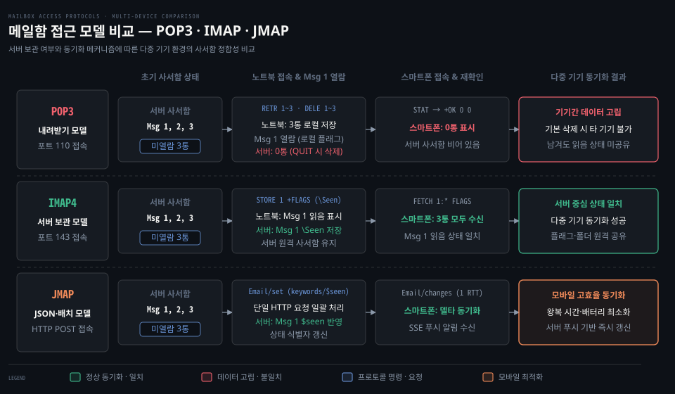

# POP3·IMAP·JMAP·Maildir

---

> 메일함 접근 프로토콜은 단말로 내려받는 POP3에서 서버에 두고 맞추는 IMAP으로, 다시 왕복을 줄이는 JMAP으로 이어졌습니다. 이 편에서는 사서함 보관과 동기화 문제를 해결해 온 각 방식과 웹메일 API의 구조를 다룹니다.

메일 발송 기능을 구현하는 백엔드 개발자는 보통 SMTP에 익숙합니다. 스프링의 메일 발송 컴포넌트에 호스트와 포트를 지정하고 전송 메서드를 호출하면 발송이 끝납니다.

그런데 수신처에서 튕겨 나온 반송 메일을 주기적으로 확인하거나, 사용자가 보낸 회신 메일을 읽어 티켓 시스템에 등록해야 하는 요구사항을 만나면 낯선 프로토콜들을 마주합니다. POP3, IMAP, 또는 서비스 전용 REST API 같은 사서함 접근 규약들입니다.

발송에 쓰던 SMTP로는 왜 사서함의 메일을 읽어올 수 없을까요?
도착한 메일은 서버에 어떻게 보관되며 수신 단말은 어떤 방식으로 메일함에 접근해 데이터를 맞출까요?
이 편에서는 메일이 수신 서버에 도달한 뒤 클라이언트가 메일을 가져가는 네 가지 접근 방식의 구조를 알아봅니다.


## 학습 목표와 범위

> 사서함 인출 프로토콜의 필요성을 이해하고, 다중 기기 환경에서 POP3 대신 IMAP과 JMAP이 표준으로 정착한 구조적 이유를 파악합니다.

1. SMTP는 밀어 넣는 프로토콜이라 수신자가 메일을 가져갈 다른 프로토콜이 필요한 이유를 설명할 수 있습니다.
2. POP3의 내려받기 모델과 IMAP의 서버 보관·동기화 모델을 비교하고, 여러 기기 시대에 IMAP이 이긴 이유를 말할 수 있습니다.
3. IMAP의 태그 붙은 명령과 IMAP4rev2(RFC 9051)가 정리한 것을 설명할 수 있습니다.
4. JMAP이 HTTP·JSON으로 왕복 횟수를 줄이려 한 문제를 설명할 수 있습니다.
5. Gmail API·Microsoft Graph 같은 서비스 전용 API가 표준 프로토콜과 어떻게 다른 선택인지 말할 수 있습니다.


## 1. 메일은 도착했는데 어떻게 읽나 — 미는 SMTP 와 당겨 오는 프로토콜

> SMTP는 상시 켜져 있는 서버끼리 메일을 밀어 넣는 전송 규약이므로, 간헐적으로 접속하는 단말이 사서함에서 메일을 가져가려면 별도의 인출 프로토콜이 필요합니다.

발송에 쓰는 SMTP로는 왜 메일을 읽어갈 수 없을까요?
그 이유는 SMTP(RFC 5321)가 발신자가 수신 호스트를 향해 연결을 맺고 데이터를 밀어 넣는 **푸시 프로토콜**이기 때문입니다[^rfc5321].

수신 메일 서버는 인터넷 공인 IP와 표준 25번 포트를 열어 두고 상시 대기해야 메일을 건네받을 수 있습니다. 그러나 일반 사용자의 노트북이나 스마트폰은 항상 켜져 있지 않습니다. 가정용 공유기나 사설망 뒤에 배치되어 외부 서버가 단말을 향해 직접 TCP 연결을 맺는 것도 불가능합니다.

따라서 인터넷 메일 시스템은 두 단계로 역할을 분리했습니다. 외부 발송 서버로부터 메일을 받는 일은 상시 가동되는 수신 메일 서버가 담당하여 사서함에 보관합니다. 최종 사용자 단말은 자신이 네트워크에 연결되었을 때 수신 서버에 접속해 사서함의 메일을 당겨 오는 풀 프로토콜을 사용합니다[^rfc1939].



위 도식은 메일 3통이 사서함에 도착한 상황에서 세 프로토콜이 서버와 단말 상태를 다루는 방식의 차이를 보여 줍니다. 메일을 가져간 뒤 서버에서 지우는 POP3와 달리, IMAP과 JMAP은 서버를 데이터의 정본으로 보존하며 여러 기기 간에 읽음 상태를 일치시킵니다.


## 2. 내려받고 지우기 — POP3 의 세 상태

> POP3는 원격 서버의 사서함에서 메일을 로컬 단말로 내려받은 뒤 서버 사서함을 비우는 단순한 3단계 상태 머신으로 동작합니다.

왜 메일 서버에 편지를 쌓아 두지 않고 단말로 내려받아 지우게 했을까요?
초기 인터넷 환경에서는 중앙 서버의 디스크 저장 용량이 넉넉하지 못했고 상시 접속 비용도 비쌌기 때문입니다.

1996년 RFC 1939로 표준화된 **POP3**(Post Office Protocol 3)는 이러한 제약을 반영해 설계되었습니다[^rfc1939]. POP3 서버는 기본적으로 TCP 110번 포트에서 대기합니다. 메일을 서버에 보관하지 않고, 클라이언트 로컬 디스크로 일괄 다운로드한 뒤 서버에서 삭제하는 것이 기본 동작 원칙입니다[^rfc1939].

POP3 세션은 단순한 3단계 상태 머신을 거칩니다(+OK 뒤의 응답 문구는 서버 구현마다 다릅니다)[^rfc1939].

```pseudocode
S: +OK POP3 server ready
C: USER alice
S: +OK
C: PASS secret
S: +OK maildrop locked and ready
C: STAT
S: +OK 3 12500
C: LIST
S: +OK 3 messages (12500 octets)
S: 1 4500
S: 2 3000
S: 3 5000
S: .
C: RETR 1
S: +OK 4500 octets
(메일 본문 전송)
C: DELE 1
S: +OK message 1 marked for deletion
C: QUIT
S: +OK POP3 server signing off
```

첫째는 인증 상태입니다. 클라이언트가 TCP 연결을 맺으면 서버는 `+OK` 인사말을 건넵니다. 클라이언트는 `USER`와 `PASS` 명령을 순서대로 전송하여 계정 자격을 증명합니다.

둘째는 트랜잭션 상태입니다. 인증에 성공하면 서버는 해당 사용자의 사서함을 잠근 뒤 엽니다. 클라이언트는 메일 조회를 위해 여러 명령을 실행합니다.

- `STAT`: 사서함의 총 메일 통수와 바이트 크기 확인
- `LIST`: 메시지 번호와 개별 바이트 크기 목록 조회
- `RETR`: 지정한 번호의 메일 전체 데이터 다운로드
- `DELE`: 메일에 삭제 표시 설정

셋째는 갱신 상태입니다. 클라이언트가 작업을 마치고 `QUIT` 명령을 전송하면 세션이 갱신 상태로 전환됩니다. 이때 비로소 삭제 표시해 둔 메일들이 서버 디스크에서 실제로 지워지고 사서함 잠금이 풀립니다. 만약 `QUIT`을 정상적으로 보내지 않고 연결이 끊기면 앞서 내린 삭제 요청은 모두 취소됩니다.

이 삭제 지연 메커니즘은 RFC 1939 §6에 명시된 원자적 보호 장치입니다[^rfc1939]. 트랜잭션 도중 내리는 `DELE` 명령은 메모리상에서 해당 메시지에 삭제 표시만 달아 둘 뿐 디스크에서 즉시 지우지 않습니다. 실제 파일 삭제는 오직 클라이언트가 명시적으로 `QUIT` 명령을 보내 갱신 상태로 정상 전환되었을 때만 일괄 수행되고, 서버는 이 단계에서 사서함 잠금도 풉니다. 네트워크 단절이나 클라이언트 강제 종료처럼 `QUIT` 없이 세션이 끊기면 갱신 상태를 거치지 않으며 서버는 사서함에서 어떤 메일도 삭제하지 않고 원본 그대로 보존해야 합니다.

명령 체계의 범위 관점에서도 POP3는 완전한 저장소 제어가 아닌 반쪽짜리 규약에 가깝습니다. 일반적인 데이터베이스 연산과 비교하면 조회(R)와 삭제(D)만 지원합니다. 클라이언트가 새 메일을 서버 사서함에 직접 업로드하는 생성이나 읽음 플래그를 달고 폴더를 이동시키는 메타데이터 갱신 기능은 프로토콜 규격에 정의되어 있지 않습니다. POP3는 사서함을 동기화하는 도구가 아니라 편지를 꺼내 확인하고 비우는 단방향 인출 창구로 설계되었기 때문입니다.

POP3는 단순해서 구현 비용이 낮았지만 치명적인 약점을 가졌습니다. 기본 동작대로 메일을 내려받아 서버에서 삭제하면 다른 단말에서는 해당 메일을 다시 볼 수 없습니다. 설령 UIDL(RFC 1939 §7) 등을 활용해 서버에 메일을 남겨 두더라도, 읽음 표시와 폴더 분류는 기기끼리 공유되지 않습니다[^rfc1939]. 여러 기기를 번갈아 사용하는 환경에서 데이터 고립과 상태 불일치 문제를 피하기 어렵습니다.


## 3. 서버에 두고 맞추기 — IMAP 의 폴더·플래그·태그

> IMAP은 원격 서버를 정본 저장소로 삼아 폴더 계층과 메시지 플래그를 양방향으로 동기화하여 다중 기기 열람을 지원합니다.

여러 기기에서 동일한 메일함을 볼 때 어떻게 읽음 상태와 분류 폴더를 일치시킬 수 있을까요?
**IMAP**(Internet Message Access Protocol)은 1988년 RFC 1064부터 시작된 사서함 접근 규약입니다[^rfc1064]. 오랫동안 현장에서 널리 쓰인 기준 규격은 2003년 개정된 RFC 3501(IMAP4rev1)입니다[^rfc3501]. IMAP은 원격 사서함을 로컬 폴더와 기능적으로 동일하게 다루도록 설계되었습니다.

IMAP의 핵심은 서버 중앙 보관입니다. 메일 본문과 메타데이터는 서버에 보존되며, 클라이언트는 필요한 정보만 조회하여 캐싱합니다.

```pseudocode
S: * OK IMAP4rev1 Service Ready
C: A001 LOGIN alice secret
S: A001 OK LOGIN completed
C: A002 SELECT INBOX
S: * 3 EXISTS
S: * FLAGS (\Answered \Flagged \Deleted \Seen \Draft)
S: A002 OK [READ-WRITE] SELECT completed
C: A003 FETCH 1 BODY.PEEK[HEADER.FIELDS (FROM SUBJECT DATE)]
C: A004 STORE 1 +FLAGS (\Seen)
S: * 1 FETCH (BODY[HEADER.FIELDS (FROM SUBJECT DATE)] {72}
From: bob@example.com
Subject: Meeting
Date: Thu, 15 Oct 2026 10:00:00 +0900
)
S: A003 OK FETCH completed
S: * 1 FETCH (FLAGS (\Seen))
S: A004 OK STORE completed
```

IMAP을 지탱하는 핵심 설계 특징은 세 가지입니다.

첫째는 메시지 플래그 관리입니다. 서버는 메시지마다 상태를 나타내는 시스템 플래그를 영구 기록합니다[^rfc3501].

- `\Seen`: 읽음 상태
- `\Answered`: 답장 완료
- `\Flagged`: 중요 표시
- `\Deleted`: 삭제 대상 표시

둘째는 원격 폴더 제어입니다. 사용자는 서버에 폴더를 생성하거나 이름을 바꾸고, 메시지를 다른 폴더로 이동시킬 수 있습니다. 또한 `FETCH` 명령을 통해 첨부파일을 뺀 본문 텍스트나 헤더 일부만 분할 인출하여 네트워크 대역폭을 아낍니다.

사서함 목록을 훑거나 본문 텍스트만 읽으려 할 때 수십 메가바이트의 첨부파일까지 통째로 내려받으면 네트워크 대역폭과 단말 메모리를 낭비하게 됩니다. 따라서 IMAP은 사서함 메일 통수(`EXISTS`)를 확인한 뒤 필요한 헤더 필드 목록과 본문 텍스트, 첨부파일을 순서대로 골라 분할 인출하도록 유도합니다. 다만 IMAP 문법에는 앞선 명령의 결과를 다음 명령의 인자로 넘겨주는 변수 체이닝 기능이 없어, 원하는 데이터를 완전히 갖추려면 클라이언트와 서버 사이에 여러 번의 왕복 통신이 불가피합니다.

셋째는 태그 기반의 비동기 명령 처리입니다. IMAP 서버는 TCP 143번 포트(암호화 연결은 993번)에서 대기합니다. 클라이언트는 명령을 보낼 때마다 앞머리에 `A001`, `A002` 같은 고유 식별 태그를 직접 부여합니다[^rfc3501]. 서버는 처리가 끝난 순서대로 해당 태그를 붙여 완료 응답을 알립니다. 따라서 클라이언트는 모호성을 일으키지 않는 범위(RFC 3501 §5.5의 모호성 규칙)에서 앞선 명령의 완료를 기다리지 않고 여러 명령을 연속해서 발행할 수 있습니다[^rfc3501].

IMAP 서버의 응답은 크게 클라이언트 명령에 대응하는 태그 응답과, 별표(`*`)로 시작하는 언태그 응답으로 나뉩니다[^rfc9051].

| 응답 종류 | 시작 토큰 | 주된 역할과 의미 | 대표 예시 |
|---|---|---|---|
| 태그 응답 (Tagged) | 클라이언트 지정 태그 (`A001`, `A002` 등) | 클라이언트가 발행한 특정 명령의 최종 성공·실패 완료 보고 | `A001 OK LOGIN completed`, `A002 NO SELECT failed` |
| 언태그 응답 (Untagged) | 별표 (`*`) | 명령 수행에 따른 데이터 스트림 반환, 서버 접속 상태 보고, 새 메일 도착 등 자발적 푸시 알림 | `* 1 FETCH (...)`, `* 3 EXISTS`, `* OK IMAP4rev2 Service Ready` |
| 지속 응답 (Continuation) | 더하기표 (`+`) | 추가 데이터 입력이 필요한 미완료 명령에 대한 서버의 후속 대기 | `+ Ready for additional command text` |

IMAP의 태그 방식은 웹 프로토콜의 파이프라이닝 발전 과정과 맞닿아 있습니다. HTTP/1.1 파이프라이닝은 클라이언트가 응답을 기다리지 않고 요청을 연이어 보낼 수 있었지만, 응답이 반드시 요청 순서대로 반환되어야 하므로 앞선 무거운 요청이 뒤의 빠른 처리를 가로막는 헤드오브라인(Head-of-Line) 블로킹을 겪었습니다. 반면 IMAP은 클라이언트가 고유 태그를 부여하고 서버가 완료 응답에 같은 태그를 돌려주므로 요청과 응답을 식별자로 짝지을 수 있습니다. 이는 단일 TCP 연결 안에서 스트림 식별자(Stream ID)를 이용해 비순차 다중화를 지원하는 HTTP/2의 처리 구조와 유사합니다.

RFC 9051 §5.5는 선행 명령 완료를 기다리지 않고 연속해서 명령을 보내는 파이프라이닝을 허용합니다[^rfc9051]. 서버 역시 모호성 규칙과 데이터 스트림 제어 조건이 허용하는 한, 이전 명령이 완전히 끝나기 전에 다음 명령의 처리를 시작할 수 있습니다.

다만 한 명령의 실행이 다른 명령의 결과에 영향을 미치는 모호성이 발생하면 서버는 반드시 클라이언트가 전송한 순서대로 명령을 완료해야 합니다. 예를 들어 `\Seen` 플래그를 바꾸는 `FETCH`와 안 읽은 메일을 검색하는 `SEARCH UNSEEN`이 연이어 전달되거나 메시지 순번을 바꾸는 `EXPUNGE` 가능 명령이 섞여 있을 때가 여기에 해당합니다.

2021년 제정된 RFC 9051(IMAP4rev2)은 RFC 3501을 공식 폐기하고 지난 20년간의 발전 사항을 집대성했습니다[^rfc9051]. 실시간 알림을 위한 `IDLE`, 메일 이동을 돕는 `MOVE`, 사서함 네임스페이스를 다루는 `NAMESPACE` 등 개별 RFC로 흩어져 있던 10여 개 확장 기능이 하나의 코어 규격으로 통합되었습니다[^rfc9051]. 다만 IMAP은 사서함 접근 규약이므로 작성한 메일을 발송하는 일은 여전히 SMTP 제출 규약이 담당합니다[^rfc9051].


## 4. 왕복이 너무 많다 — JMAP 과 HTTP·JSON

> JMAP은 복잡한 문자열 파싱과 잦은 네트워크 왕복 문제를 해결하기 위해 HTTP 상에서 JSON 배치 호출과 델타 동기화를 제공합니다.

다양한 기능을 갖춘 IMAP이지만 모바일 환경에서는 새로운 문제가 드러났습니다. 메일함 하나를 동기화하려면 폴더 선택, 플래그 조회, 헤더 페치 등 명령마다 수많은 네트워크 왕복을 거쳐야 합니다. 모바일 기기의 배터리와 무선 데이터가 빠르게 소모되는 원인이 되었습니다. 또한 IMAP 고유의 복잡한 문자열 문법과 MIME 본문 파싱은 클라이언트 개발자에게 큰 기술적 부담이었습니다.

이러한 문제를 해결하기 위해 2019년 IETF에서 표준화한 규약이 **JMAP**(JSON Meta Application Protocol, RFC 8620·RFC 8621)입니다[^rfc8620][^rfc8621].

```json
{
  "using": ["urn:ietf:params:jmap:core", "urn:ietf:params:jmap:mail"],
  "methodCalls": [
    ["Email/query", {"filter": {"inMailbox": "inbox-id"}}, "a"],
    ["Email/get", {"#ids": {"resultOf": "a", "name": "Email/query", "path": "/ids"}}, "b"]
  ]
}
```

JMAP의 대표적인 개선점은 다음과 같습니다.

첫째는 단일 HTTP POST 배치 호출입니다. 클라이언트는 JSON 배열 안에 여러 메서드 호출을 담아 한 번의 요청으로 전송합니다[^rfc8620]. 서버는 요청받은 순서대로 연쇄 처리하여 단 한 번의 왕복으로 필요한 화면 데이터를 모두 반환합니다.

둘째는 고효율 델타 동기화입니다. `Email/changes` 메서드를 호출하면 마지막 동기화 시점의 상태 식별자를 기준으로 추가·수정·삭제된 메시지 ID만 넘겨받습니다. 사서함 전체를 반복 조회할 필요가 없습니다.

셋째는 서버 전송 이벤트(SSE) 푸시입니다. 폴링 방식으로 주기적인 요청을 보내는 대신, 표준 Server-Sent Events 기반의 푸시 채널을 맺어 데이터 변경 통지를 실시간으로 받습니다[^rfc8620].

넷째는 메일 발송 기능의 통합입니다. IMAP과 달리 JMAP 메일 규약(RFC 8621)은 메일 조회뿐 아니라 발송 제출(`EmailSubmission/set`)까지 동일한 JSON 인터페이스 안에서 일관되게 지원합니다[^rfc8621].


## 5. 표준 대신 서비스 API — Gmail API 와 Microsoft Graph

> 대형 클라우드 메일 서비스들은 세분화된 보안 통제와 웹 애플리케이션 연동을 위해 전통적인 표준 프로토콜 대신 전용 REST API 사용을 권장합니다.

표준 규약인 IMAP이 있는데 대형 메일 서비스들은 왜 전용 REST API를 권장할까요?
Google 공식 가이드는 "대다수 웹 애플리케이션에서 사용자의 Gmail 데이터에 인가된 접근을 할 때 Gmail API가 최선의 선택(best choice)"[^gmailapi]이라고 밝힙니다. Microsoft Graph 메일 API는 앱이 사용자의 Outlook 메일 데이터에 인가된 접근을 하도록 해 줍니다[^msgraph].

서비스 전용 REST API가 선호되는 이유는 세 가지입니다.

첫째는 연결 모델의 차이입니다. 공식 문서가 권장 이유로 명시한 항목은 아니지만, 엔지니어링 관점에서는 IMAP의 상시 TCP 세션 유지에 비해 무상태 HTTP 요청이 수평 확장에 유리하다는 점이 실무 배경으로 분석됩니다.

IMAP은 상태 유지 연결입니다. 클라이언트가 사서함을 열어 두는 동안 서버는 TCP 소켓, 파일 디스크립터, 커널 버퍼, 세션 캐시를 메모리에 계속 유지해야 합니다. 또한 동일 세션의 후속 명령을 같은 백엔드 프로세스로 전달해야 하므로 스티키 세션이나 연결 라우팅 레이어가 필요해 수평 확장에 인프라 비용이 듭니다. 반면 REST API는 무상태 HTTP 모델로 동작합니다. 각 요청이 독립적이므로 L7 로드밸런서 뒤에서 API 서버를 유연하게 증설할 수 있으며 유휴 소켓을 오래 잡고 있을 필요가 없습니다.

둘째는 OAuth 2.0 기반의 최소 권한 인가입니다. 전통적인 POP3나 IMAP 기본 인증은 사용자 계정의 전체 권한을 앱에 넘겨야 했습니다. 반면 서비스 REST API는 스코프를 세분화하여 읽기 전용이나 라벨 수정처럼 애플리케이션에 필요한 최소 권한만 안전하게 부여할 수 있습니다.

전통적인 기본 인증에서는 애플리케이션에 사용자의 마스터 비밀번호를 전달해야 했습니다. 앱 자격 증명이 유출되면 사서함 열람뿐 아니라 계정 설정 변경과 발송 권한까지 전부 탈취되는 위험에 노출되었습니다. 반면 REST API는 OAuth 2.0의 세분화된 스코프를 통해 최소 권한 원칙을 적용할 수 있습니다. Google 공식 Gmail API 가이드[^gmailapi-scopes]를 보면 메일 열람만 필요한 시스템에는 읽기 전용 스코프인 `https://www.googleapis.com/auth/gmail.readonly`를 부여하고, 발송만 필요한 시스템에는 발송 전용 스코프인 `https://www.googleapis.com/auth/gmail.send`를 부여합니다. 메일 분류 관리 역시 라벨 관리 스코프인 `https://www.googleapis.com/auth/gmail.labels`처럼 필요한 작업 범위만 정밀하게 격리해 권한을 위임합니다.

셋째는 플랫폼 고유의 데이터 구조 활용입니다. Gmail의 대화형 스레드나 라벨 기반 다중 분류, Microsoft 365의 일정·연락처 통합 모델은 폴더 중심의 전통적인 IMAP 규격에 매끄럽게 맞아떨어지지 않습니다. 전용 API를 사용하면 서비스가 제공하는 스레드와 라벨 모델을 변환 없이 직접 다룰 수 있습니다.

IMAP 규격은 하나의 메시지가 물리적으로 단 하나의 폴더에 속하는 단일 계층 디렉터리 트리를 전제로 합니다. 반면 Gmail과 같은 클라우드 사서함은 메일 한 통에 여러 꼬리표를 붙이는 다중 라벨과, 주고받은 답장들을 묶어 보여 주는 대화형 스레드를 기본 데이터 모델로 채택했습니다. 이를 전통적인 IMAP 폴더 트리에 억지로 맞추려면 같은 메일을 여러 폴더에 복제하거나 가상 폴더를 만들어야 하므로 두 모델 사이에 어긋남이 생깁니다. 전용 REST API를 활용하면 이러한 변환 계층 없이 플랫폼 본래의 스레드와 라벨 엔티티를 직접 제어할 수 있습니다.


## 6. 메일함은 디스크에 어떻게 쌓이나 — mbox 와 Maildir

> 수신 메일 서버의 디스크 저장소는 단일 파일에 메시지를 덧붙이는 mbox와 개별 파일로 원자적 이동을 보장하는 Maildir 구현 관례로 나뉩니다.

수신 메일 서버 디스크에는 메일이 어떤 형태로 저장될까요?
이는 IETF 표준 트랙 규격이 아니라 운영체제 파일시스템 환경에서 발전해 온 구현 관례입니다(다만 mbox는 2005년 RFC 4155에서 정보 제공용[Informational]으로 미디어 타입 등이 정리되었습니다)[^rfc4155][^maildir].

가장 오래된 방식은 단일 파일 기반의 mbox입니다. 한 사용자의 사서함 전체를 하나의 텍스트 파일(예: `/var/mail/user`)에 이어 붙여 보관합니다. 각 메시지는 맨 앞의 `From ` 구분 행으로 식별합니다.

mbox는 파일 하나만 열면 사서함을 조회할 수 있어 단순하지만 심각한 병목을 만듭니다. 여러 프로세스가 동시에 새 메일을 쓰거나 읽으려 하면 파일 잠금 경쟁이 일어납니다. 메일 한 통을 삭제하거나 읽음 표시를 바꿀 때도 파일 전체를 읽고 다시 써야 하므로 대용량 사서함에서 입출력 성능이 떨어집니다. 잠금 처리가 어긋나면 사서함 파일 전체가 손상되는 위험도 안고 있습니다.

mbox의 동시성 제어는 `fcntl`, `flock`, dotlock 파일 생성과 같은 배타적 잠금 메커니즘에 의존합니다. 메일 배달 프로세스와 사서함 인출 데몬이 동일한 파일 잠금을 두고 지속적으로 경합하며 네트워크 파일시스템 환경에서는 파일 잠금 구현의 불안정성으로 잠금 자체가 깨지기 쉽습니다. 특히 수백 메가바이트 크기의 mbox 파일에서 중간 메시지 하나를 삭제하거나 읽음 상태 헤더를 수정하려면 파일 전체를 메모리로 읽어 들인 뒤 디스크에 다시 쓰는 전체 재작성 작업이 발생합니다. 이 과정에서 프로세스가 비정상 종료되거나 디스크 공간이 부족해지면 사서함 파일 전체가 파손될 수 있습니다.

이러한 문제를 해결하기 위해 qmail의 개발자 대니얼 번스타인이 고안한 사서함 구조가 **Maildir**입니다[^maildir].

```pseudocode
/var/mail/vhosts/example.com/alice/
├── tmp/
│   └── 1760486400.P1234Q1.mailhost
├── new/
│   └── 1760486401.P1234Q2.mailhost
└── cur/
    ├── 1760486000.P1111Q1.mailhost:2,S
    └── 1760486100.P1112Q1.mailhost:2,FS
```

Maildir은 파일 하나가 아니라 디렉터리 기반 구조를 사용합니다. 사용자 사서함 디렉터리 아래에 세 개의 하위 디렉터리(`tmp`, `new`, `cur`)를 둡니다[^maildir].

1. 배달 에이전트는 고유한 파일명을 생성해 먼저 `tmp/` 디렉터리에 메일을 씁니다.
2. 쓰기가 끝나면 POSIX 파일시스템의 `rename()` 시스템 콜을 이용해 파일을 `new/` 디렉터리로 원자적으로 이동시킵니다.
3. POP3나 IMAP 데몬이 메일을 읽으면 파일을 `cur/` 디렉터리로 옮기고, 파일명 뒤에 `:2,S`(Seen)나 `:2,F`(Flagged) 같은 플래그 접미사를 붙여 읽음 상태를 기록합니다.

Maildir 규격의 핵심 철학은 잠금 없는 원자적 동시성입니다[^maildir]. 메시지 배달 과정에서 배달 에이전트는 시간과 프로세스 ID, 호스트명을 조합한 고유 파일명을 만들어 먼저 `tmp/` 디렉터리에 메일 본문을 완전히 기록합니다. 기록 도중 전원이 꺼지더라도 불완전한 파일은 `tmp/`에만 격리됩니다. 기록이 정상 완료된 뒤에야 동일 파일시스템 내에서 POSIX `rename()` 시스템 콜을 호출하여 `new/` 디렉터리로 원자적으로 이동시킵니다. 따라서 읽기 데몬은 작성 중인 불완전한 메일을 절대 읽지 않으며 파일 잠금을 걸지 않고도 안전하게 새 메일을 감지할 수 있습니다.

또한 읽음 상태나 중요 표시 같은 플래그 수정 역시 파일 본문 재작성을 요구하지 않습니다. 클라이언트가 메일을 확인하면 파일을 `cur/` 디렉터리로 옮기고 파일명 뒤에 콜론과 정보 접미사를 붙입니다[^maildir]. Maildir 표준 규격에 따르면 `:2,` 뒤에 플래그 알파벳을 ASCII 오름차순으로 정렬하여 덧붙입니다. 예를 들어 메일을 읽었으면 `:2,S`, 중요 표시를 추가하면 `:2,FS`, 답장을 보냈으면 `:2,R` 형태로 파일명을 변경합니다.

이처럼 플래그 갱신은 디렉터리 내 파일명 변경(rename)만으로 끝나며 메일 삭제 또한 개별 파일의 `unlink()` 시스템 콜 하나로 처리됩니다. mbox처럼 수백 메가바이트 크기의 사서함 파일 전체를 다시 쓰는 디스크 입출력 병목이 발생하지 않습니다.

Maildir은 메시지마다 독립된 파일로 존재하므로 복잡한 파일 잠금이 전혀 필요 없습니다. 여러 배달 프로세스와 클라이언트 데몬이 동시에 접근해도 파일이 깨지지 않습니다. Postfix의 기본 배달 방식은 mbox이며 Maildir은 `home_mailbox = Maildir/` 설정으로 활성화합니다[^postfix-mailbox]. Dovecot은 사서함 위치와 형식을 자동 탐지할 뿐 특정 형식을 기본값으로 강제하지 않습니다[^dovecot-location]. 그러나 동시성 안전성과 입출력 성능 이점 때문에 오늘날 많은 메일 운영 환경이 저장 형식으로 Maildir을 선택합니다.

백엔드 애플리케이션이 반송 메일을 감지하거나 수신함을 직접 읽어야 할 때 어떤 방식을 골라야 할까요?
Google Workspace나 Microsoft 365 환경이라면 서비스 전용 REST API인 Gmail API나 Microsoft Graph를 연동하는 편이 유지보수에 가장 유리합니다. 연결 유지 부담이 없고 토큰 스코프로 권한을 좁힐 수 있기 때문입니다.

반면 사내 구축형 메일 서버나 독자 인프라와 연동해야 한다면 POP3 대신 IMAP을 선택해야 합니다. 메일을 처리한 뒤 읽은 플래그를 달거나 전용 보관 폴더로 이동시켜 중복 조회를 방지할 수 있기 때문입니다.


## 스스로 확인할 질문

> 사서함 접근 모델의 설계 이유와 프로토콜 간의 트레이드오프를 점검합니다.

1. SMTP는 사서함 인출 기능을 두지 않고 왜 수신 서버까지만 메일을 밀어 넣도록 설계되었을까요?
2. 한 사용자가 여러 대의 단말을 사용할 때, POP3 환경에서는 왜 기기 간에 메일 상태가 어긋날까요?
3. IMAP 프로토콜에서 클라이언트가 발행하는 각 명령 앞머리에 고유한 태그를 붙이는 설계 이유는 무엇일까요?
4. JMAP은 모바일 네트워크 환경에서 배터리와 데이터 소모를 줄이기 위해 어떤 메커니즘을 도입했을까요?
5. 여러 프로세스가 동시에 메일을 디스크에 쓰고 읽는 환경에서, mbox 대신 Maildir을 사용할 때 얻는 이점은 무엇일까요?
6. POP3 세션에서 `DELE` 명령을 전송한 뒤 `QUIT` 명령 없이 연결이 비정상 종료되면, 삭제 표시된 메일들은 서버에서 어떻게 처리될까요?
7. 대형 클라우드 메일 서비스 연동 시 IMAP 대신 Gmail API 같은 서비스 전용 REST API를 권장하는 인프라 및 보안상의 이유는 무엇일까요?


## 정답 (자답 후 펼치기)

> 스스로 질문에 답해 본 뒤 확인하며 학습 내용을 점검합니다.

1. 수신자 단말은 상시 가동되지 않거나 사설망 뒤에 있어 외부 발송 서버의 인바운드 TCP 연결을 직접 수락할 수 없기 때문입니다. 따라서 상시 가동되는 수신 메일 서버가 메일을 먼저 받아 사서함에 보관하고, 단말이 켜졌을 때 능동적으로 접속해 메일을 당겨 가는 전용 프로토콜이 분리되어 발전했습니다.
2. POP3는 서버의 메일을 로컬 단말로 다운로드한 뒤 서버 사서함에서 삭제하는 것을 기본 전제로 설계되었기 때문입니다. 최초 접속한 기기가 메일을 내려받아 서버에서 지워 버리면, 나중에 접속한 다른 기기는 사서함이 비어 있어 메일을 읽을 수 없게 됩니다. 설령 메일을 서버에 남겨 두도록 설정하더라도 읽음 표시나 폴더 상태는 기기 간에 공유되지 않습니다.
3. 서버의 작업 완료를 기다리지 않고 여러 명령을 연속해서 비동기로 발행하기 위함입니다. 서버는 처리가 끝난 순서대로 해당 명령의 태그를 붙여 완료 응답을 반환하므로, 클라이언트는 어떤 응답이 어느 요청에 대한 결과인지 명확히 매칭할 수 있습니다.
4. 단일 HTTP POST 요청 안에 복수의 API 호출을 묶어 보내는 배치 처리와, 변경된 메시지 식별자만 받아오는 델타 동기화, 그리고 SSE 기반의 서버 푸시 통지를 결합하여 불필요한 네트워크 왕복을 최소화했습니다.
5. Maildir은 디렉터리와 고유 파일명을 사용하며 시스템 콜을 통해 원자적으로 파일을 이동시키므로 복잡한 파일 잠금이 필요 없습니다. 따라서 동시성 접근 시 잠금 경쟁이나 파일 손상 위험이 사라지고, 개별 메시지 조작 시 전체 파일을 재작성하지 않아도 됩니다.
6. RFC 1939 규약에 따라 삭제가 취소되고 메일이 원본 그대로 보존됩니다. POP3의 `DELE` 명령은 트랜잭션 상태에서 메모리상에 삭제 표시만 해 둘 뿐이며, 실제 디스크 파일 삭제는 정상적인 `QUIT` 명령을 통해 갱신 상태로 진입했을 때만 일괄 처리되기 때문입니다. `QUIT` 없이 비정상 종료되면 갱신 상태를 거치지 않으므로 삭제 요청은 모두 취소됩니다.
7. 인프라 측면에서는 상시 TCP 소켓과 세션 상태 유지 부담이 없는 무상태 HTTP 모델이라 로드밸런서를 통한 수평 확장에 유리하기 때문입니다. 보안 측면에서는 마스터 비밀번호를 넘겨 전체 권한을 위임하는 기본 인증 대신, OAuth 2.0 스코프를 통해 읽기 전용이나 발송 전용처럼 필요한 최소 권한만 안전하게 분리해 부여할 수 있기 때문입니다.


## 출처와 관련 문서

> 본문에서 인용한 표준 규격과 공식 기술 문서 목록입니다.

[^rfc5321]: Simple Mail Transfer Protocol — https://www.rfc-editor.org/rfc/rfc5321#section-3.1
[^rfc1939]: Post Office Protocol - Version 3 — https://www.rfc-editor.org/rfc/rfc1939#section-1
[^rfc1064]: Interactive Mail Access Protocol - Version 2 — https://www.rfc-editor.org/rfc/rfc1064
[^rfc3501]: Internet Message Access Protocol - Version 4rev1 — https://www.rfc-editor.org/rfc/rfc3501#section-1
[^rfc9051]: Internet Message Access Protocol (IMAP) - Version 4rev2 — https://www.rfc-editor.org/rfc/rfc9051#section-1
[^rfc8620]: The JSON Meta Application Protocol (JMAP) — https://www.rfc-editor.org/rfc/rfc8620#section-1
[^rfc8621]: The JSON Meta Application Protocol (JMAP) for Mail — https://www.rfc-editor.org/rfc/rfc8621#section-1
[^gmailapi]: Gmail API Guides — https://developers.google.com/gmail/api/guides
[^msgraph]: Microsoft Graph Mail API Overview — https://learn.microsoft.com/en-us/graph/api/resources/mail-api-overview
[^rfc4155]: The application/mbox Media Type — https://www.rfc-editor.org/rfc/rfc4155
[^maildir]: Using Maildir Format — https://cr.yp.to/proto/maildir.html
[^postfix-mailbox]: Postfix Configuration Parameters: home_mailbox — https://www.postfix.org/postconf.5.html#home_mailbox
[^dovecot-location]: Dovecot Mail Location Settings — https://doc.dovecot.org/2.3/configuration_manual/mail_location/
[^gmailapi-scopes]: Choose Gmail API scopes — https://developers.google.com/workspace/gmail/api/auth/scopes
