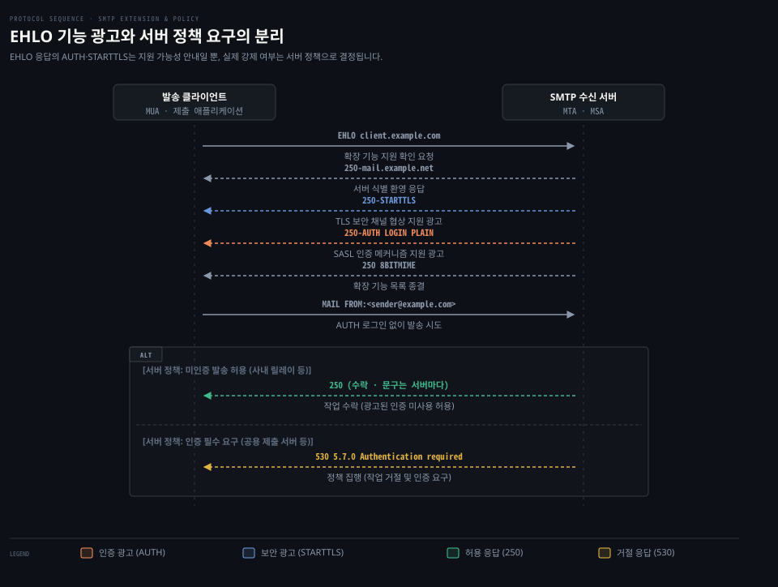
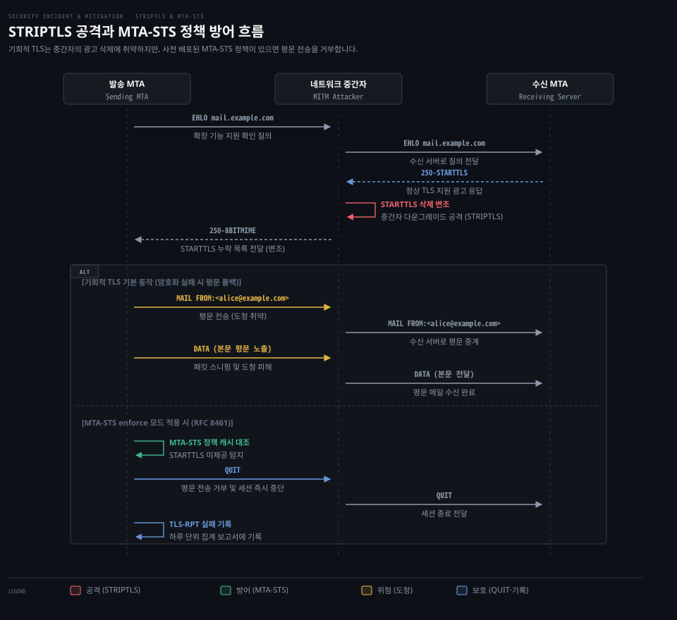

# STARTTLS·RFC 8314·MTA-STS

---

> 평문으로 태어난 SMTP 는 STARTTLS 와 465번 포트의 복권, MTA-STS 를 차례로 덧대며 암호화됐고, 그 과정의 타협과 표준 번복이 지금의 포트와 설정 혼란으로 이어졌습니다. 이 글에서는 대화 도중 암호화로 전환하는 방식과 암시적 TLS, 중간자 다운그레이드 방어까지 각 장치가 등장한 기술적 인과를 살펴봅니다.

백엔드 애플리케이션에서 메일 발송 설정을 다룰 때 포트 번호와 암호화 속성은 큰 혼란을 줍니다. 메일 제출 포트로 587번과 `starttls.enable=true`를 써야 하는지, 아니면 465번 포트와 `ssl.enable=true`를 써야 하는지 판단하기 쉽지 않습니다. 둘 다 암호화 발송이라는 목적은 같아 보이는데 왜 포트와 설정 이름이 갈라지는 것일까요?

더 혼란스러운 순간은 터미널에서 메일 서버에 직접 접속해 `EHLO` 명령을 보낼 때 나타납니다. 서버 응답에 `250-AUTH LOGIN PLAIN`이 보이면 로그인이 필수 절차인 것처럼 느껴집니다. 하지만 실제로는 계정 인증 명령 없이도 메일이 정상 수락되거나, 반대로 정책 거절 오류를 마주하기도 합니다.

이러한 차이는 SMTP가 걸어온 보안의 역사에서 비롯되었습니다. 1982년 신뢰 네트워크를 전제로 태어난 평문 규약에 암호화와 인증을 덧대는 과정에서 수많은 타협과 표준 번복이 이어졌기 때문입니다. 이 글에서는 평문 통신의 취약점에서 출발해 오늘날의 전송 계층 보안 체계까지 이어지는 발전 과정을 살펴봅니다.


## 학습 목표와 범위

> 평문 SMTP에 암호화와 인증이 덧붙여진 기술적 배경을 이해하고, 제출 구간과 중계 구간의 최신 전송 보안 방식을 설명할 수 있습니다.

1. 평문으로 설계된 SMTP에 암호화를 붙인 두 방식(STARTTLS와 처음부터 TLS)을 구분할 수 있습니다.
2. 465번이 등록됐다 폐기되고 RFC 8314로 되살아난 경위와, 지금 제출 구간에서 권하는 방식을 설명할 수 있습니다.
3. EHLO 응답의 `STARTTLS`·`AUTH`는 "할 수 있다"는 광고이고, 요구는 서버 정책(거절 응답)으로 드러난다는 것을 설명할 수 있습니다.
4. 평문 연결에서 AUTH LOGIN을 하면 막히는 게 아니라 엿보인다는 것을 근거로 설명할 수 있습니다.
5. 기회적 암호화가 STRIPTLS에 약한 이유와 MTA-STS·DANE·TLS-RPT가 그 빈틈을 어떻게 메우는지 말할 수 있습니다.


## 1. 처음 SMTP 는 왜 평문이었나 — 그리고 무엇이 위험해졌나

> 1982년 제정된 초기 SMTP는 상호 신뢰 기반의 학술망 규약이었기에 패킷 도청과 발송자 위조에 취약했습니다.

초기 프로토콜 설계자들은 왜 전송 데이터 암호화나 사용자 인증을 기본 규격에 넣지 않았을까요?

1982년 RFC 821로 제정된 SMTP는 대학과 연구 기관 중심의 폐쇄적인 ARPANET 환경을 배경으로 탄생했습니다.[^rfc821] 당시 네트워크 참여자들은 상호 신뢰가 전제된 소수 학술 연구자들이었습니다. 시스템 엔지니어들의 최우선 과제는 기종이 서로 다른 컴퓨터끼리 영문 텍스트 메시지를 안정적으로 교환하는 상호 운용성이었습니다.

하지만 인터넷이 공용 상업망으로 급팽창하면서 평문 통신의 구조적 결함은 심각한 보안 사고를 낳았습니다. TCP 25번 포트로 오가는 모든 트래픽은 사람이 직접 읽을 수 있는 7비트 ASCII 텍스트였습니다. 발송 클라이언트가 보내는 송신자 주소, 수신자 주소, 편지 본문이 패킷이 경유하는 중간 라우터와 네트워크 도청자에게 고스란히 노출되었습니다.

```pseudocode
C: MAIL FROM:<ceo@example.com>
S: 250 2.1.0 Ok
C: RCPT TO:<finance@example.com>
S: 250 2.1.5 Ok
C: DATA
S: 354 Start mail input; end with <CRLF>.<CRLF>
C: Subject: 기밀 자금 이체 요청
C: 계좌 123-456으로 5천만 원을 송금해 주십시오.
C: .
S: 250 2.0.0 Ok: queued as 4SKz12
```

초기 메일 서버들이 누구에게서 온 요청이든 인터넷 너머로 중계해 주는 **오픈 릴레이**(Open Relay)로 동작했던 점도 큰 문제였습니다. 발송 클라이언트의 신원을 확인하는 인증 절차가 없었기에 임의의 발신자 주소를 사칭한 스팸과 피싱이 급증했습니다.

공격자는 패킷 스니핑 도구를 이용해 주고받는 비밀번호와 본문을 손쉽게 가로챘습니다. 통신 내용의 비밀성을 보장하는 전송 암호화와 발신자의 신원을 보장하는 인증 계층이 인터넷 메일의 생존을 가르는 필수 요건으로 떠올랐습니다.


## 2. 대화 중간에 암호화로 바꾸기 — STARTTLS

> 기존 25번 포트의 호환성을 깨지 않고 평문 통신 중에 암호화 세션으로 전환하기 위해 STARTTLS 서비스 확장이 도입되었습니다.

이미 전 세계 수많은 메일 서버가 25번 포트로 통신하는 상황에서, 구형 서버와의 연결을 끊지 않고 어떻게 암호화를 도입할 수 있었을까요?

새로운 보안 전용 포트를 강제하면 암호화를 지원하지 못하는 서버들과의 메일 교환이 전면 중단되는 문제가 발생합니다. 이 호환성 문제를 풀기 위해 1999년 표준 트랙(Standards Track)으로 제정된 RFC 2487과 이를 개정한 2002년의 RFC 3207 **STARTTLS** 확장이 도입되었습니다.[^rfc3207] 이는 기존 평문 포트로 접속한 뒤, 대화 도중 명령어 한 줄로 즉시 TLS 암호화 터널을 수립하는 메커니즘입니다.

STARTTLS 전환 절차는 다음 순서로 엄격하게 진행됩니다.

1. 클라이언트가 평문으로 접속해 `EHLO` 명령을 전송하면, 서버는 응답 목록에 `250-STARTTLS`를 포함해 TLS 협상 능력을 알립니다.[^rfc3207-sec3]
2. 클라이언트가 암호화 통신을 원할 때 `STARTTLS` 명령을 서버로 보냅니다.
3. 서버가 `220 Ready to start TLS` 응답을 내리면(응답 문구는 서버 구현에 따라 다를 수 있습니다), 양측은 해당 TCP 소켓 위에서 즉시 TLS 핸드셰이크를 시작합니다.[^rfc3207-sec4]
4. TLS 핸드셰이크가 완료되면 SMTP 세션은 220 서비스 준비 직후의 깨끗한 초기 상태로 리셋됩니다.[^rfc3207-sec42]
5. 암호화 채널이 수립된 후 클라이언트는 세션을 다시 시작하기 위해 `EHLO`를 전송합니다.

여기서 핵심적인 보안 원칙이 있습니다. TLS 핸드셰이크가 끝나는 즉시 서버는 핸드셰이크 이전에 얻은 모든 클라이언트 정보(이전 EHLO 인자 등)를 반드시 폐기해야 합니다.[^rfc3207-sec42] 평문 구간에서 발생했을지 모를 세션 하이재킹이나 파라미터 변조 공격을 차단하기 위함입니다.

```pseudocode
C: EHLO client.example.com
S: 250-mail.example.net
S: 250-STARTTLS
S: 250 8BITMIME
C: STARTTLS
S: 220 Ready to start TLS
=== [TLS 핸드셰이크 진행 및 암호화 터널 수립] ===
=== [SMTP 세션 초기화: 이전 세션 정보 전부 폐기] ===
C: EHLO client.example.com
S: 250-mail.example.net
S: 250-AUTH LOGIN PLAIN
S: 250 8BITMIME
```

암호화가 완료된 후 다시 보낸 `EHLO` 응답에는 `STARTTLS` 확장이 포함되지 않습니다. 서버는 이미 보안 채널이 확보된 상태에서 STARTTLS를 다시 광고해서는 안 되기 때문입니다.[^rfc3207-sec42]

이 방식은 상대 서버가 TLS를 지원하면 암호화 통신을 맺고, 지원하지 않으면 평문으로 메일을 전달하는 **기회적 TLS**(Opportunistic TLS)의 토대가 되었습니다.


## 3. 465번의 엇갈린 운명 — 폐기와 RFC 8314 의 복권

> 과거 smtps 용도로 잠시 등록되었다가 취소되었던 465번 포트는 암시적 TLS 권고를 담은 RFC 8314를 통해 공식 복권되었습니다.

개발 환경 설정에서 흔히 접하는 465번 포트는 왜 한동안 공식 표준 문서에서 배제되었을까요?

과거 465번 포트는 암호화 메일 전송을 위해 `smtps` 포트로 잠시 등록된 적이 있었습니다.[^rfc8314-sec73] 그러나 SMTP 전송을 위한 MX 인프라는 특정 포트를 지정할 방법이 없었기에, 별도 포트 등록은 의미가 없었습니다. 이에 따라 해당 등록은 취소되었고 다른 서비스에 재할당되었습니다.[^rfc8314-sec73]

하지만 널리 쓰이던 일부 메일 소프트웨어들이 `smtps`를 메일 제출(submissions) 용도로 해석하여 기본값으로 사용했습니다.[^rfc8314-sec73] 그 결과 표준에서 등록이 취소된 뒤에도 수많은 메일 클라이언트와 서비스 제공자 사이에서 465번 포트가 사실상 계속 사용되었습니다.

이러한 현실을 반영해 2018년 1월 RFC 8314가 제정되었습니다.[^rfc8314] RFC 8314는 메일 제출 및 접근 시 평문 프로토콜 사용을 말리고, 가능한 한 빨리 폐기할 것을 권고했습니다.[^rfc8314-sec1] 아울러 평문 포트로 접속해 STARTTLS를 협상하는 것보다 **암시적 TLS**(Implicit TLS)를 우선 사용할 것을 권고했습니다.[^rfc8314-sec1]

> "Connections to Mail Submission Servers and Mail Access Servers be made using "Implicit TLS" (as defined below), in preference to connecting to the "cleartext" port and negotiating TLS using the STARTTLS command or a similar command."
> — RFC 8314 Section 1

이 표준 권고에 따라 IANA는 TCP 465번 포트의 기존 배정(urd)에 더해 `submissions` 용도를 추가 등록했습니다.[^rfc8314-sec73] 465번 포트에 접속하면 평문 통신 단계 없이 즉시 TLS 핸드셰이크가 시작됩니다.

클라이언트와 서버가 올바르게 구현되어 양쪽 모두 TLS 협상을 필수로 요구한다면 587번의 STARTTLS와 465번의 암시적 TLS 사이에 보안 속성의 유의미한 차이는 없습니다.[^rfc8314-sec33] RFC 8314가 암시적 TLS를 우선 권고한 까닭은 명령 주입(command injection) 같은 구현 오류를 낳기 쉬운 STARTTLS의 복잡성을 피하고 다른 프로토콜과의 일관성을 유지하기 위함이었습니다.[^rfc8314-appA]

주의할 점이 있습니다. RFC 8314의 암시적 TLS 우선 권고는 클라이언트와 서버 간의 메일 제출과 IMAP·POP 접근 구간에 적용되며, 서버 간 메일 중계인 릴레이 구간은 다루지 않습니다.[^rfc8314-sec1] 25번 중계와 587·465번 제출의 역할 구분은 [01-02편 4절](./01-02.MUA·MSA·MTA·MDA·RFC%205598.md#4-왜-제출-창구를-따로-뒀나--587-제출과-25-중계의-분리)에서 다룹니다.


## 4. 광고와 요구는 다르다 — EHLO 목록의 AUTH·STARTTLS 읽기

> EHLO 응답에 나타나는 기능 키워드는 서버의 지원 능력을 알리는 광고일 뿐이며, 작업 강제 여부는 서버의 독립적인 정책으로 결정됩니다.

초보 개발자들은 `EHLO` 응답에 `250-AUTH LOGIN PLAIN`이 찍힌 것을 보고 "반드시 로그인을 거쳐야 메일을 보낼 수 있다"고 오해하곤 합니다. 왜 광고와 요구를 명확히 구분해야 할까요?

RFC 5321 2.2.1절은 서비스 확장 메커니즘을 "서버가 자신이 지원하는 서비스 확장 목록을 클라이언트에게 알려주는(inform) 수단"으로 규정합니다.[^rfc5321-sec221] RFC 4954 3절 역시 `AUTH` 키워드는 서버가 SASL 인증 확장을 지원하며 이용 가능한 메커니즘 목록을 매개변수로 열거한다고 규정합니다.[^rfc4954-sec3] 즉 EHLO 응답은 지원 가능한 기능을 알리는 '광고(Advertising)'에 해당하며, 서버는 "나는 이 기능들을 제공할 능력이 있다"고 안내할 뿐 이 응답 자체로 클라이언트에게 인증을 강제하는 것은 아닙니다.

실제 인증의 강제 여부는 클라이언트가 인증 없이 메일 발송(`MAIL FROM`)을 시도할 때 서버 내부의 정책으로 결정됩니다.



위 도식처럼 동일한 `250-AUTH` 광고를 받았더라도 클라이언트가 인증 없이 발송을 요청했을 때의 결과는 서버 정책에 따라 갈립니다. 내부 사내망 릴레이 서버처럼 발송 IP가 신뢰 목록에 있다면 인증이 없어도 250 코드(응답 문구는 서버 구현에 따라 다르며 흔히 `250 2.1.0 Sender ok` 등)로 요청을 수락합니다.

반면 외부 공용 제출 서버처럼 인증이 필수인 서버라면 `530 5.7.0 Authentication required` 코드를 반환하며 작업을 거절합니다.[^rfc4954-sec6]

```pseudocode
[상황 A: 사내 릴레이 서버 (IP 신뢰 정책)]
C: EHLO app.internal.example
S: 250-relay.internal.example
S: 250-AUTH LOGIN PLAIN
S: 250 8BITMIME
C: MAIL FROM:<notify@example.com>
S: 250 2.1.0 Sender ok (인증 없이도 허용, 응답 문구는 서버마다 다름)

[상황 B: 공용 메일 제출 서버 (인증 필수 정책)]
C: EHLO client.example.net
S: 250-smtp.example.org
S: 250-AUTH LOGIN PLAIN
S: 250 8BITMIME
C: MAIL FROM:<user@example.org>
S: 530 5.7.0 Authentication required (정책에 따른 거절)
```

이처럼 광고는 서버의 능력 안내이며 요구는 거절 응답으로 집행되는 정책입니다. 따라서 EHLO 응답만 보고 인증 필수 여부를 단정할 수 없으며 서버의 운영 목적과 거절 코드를 함께 살펴보아야 합니다.


## 5. 평문 위의 AUTH LOGIN — 막히는가, 엿보이는가

> 평문 연결에서 AUTH LOGIN을 시도하면 시스템이 전송을 막아주는 것이 아니라 네트워크 도청자에게 비밀번호가 그대로 노출됩니다.

암호화되지 않은 25번 포트에서 `AUTH LOGIN`을 실행하면 프로토콜 수준에서 오류가 발생해 접속이 자동으로 차단될까요?

실제 동작은 그렇지 않습니다. `AUTH LOGIN`과 `AUTH PLAIN` 방식은 사용자 아이디와 비밀번호를 Base64 문자열로 인코딩하여 전송합니다. Base64는 8비트 이진 데이터를 7비트 텍스트 환경에서 전송하기 위한 부호화일 뿐 암호화 알고리즘이 아닙니다. 네트워크 패킷을 엿듣는 스니퍼 도구는 Base64 문자열을 마주하는 즉시 단번에 원래의 평문 비밀번호로 복원할 수 있습니다.

```pseudocode
C: AUTH LOGIN
S: 334 VXNlcm5hbWU6      <-- "Username:" 의 Base64 인코딩
C: dXNlckBleGFtcGxlLmNvbQ== <-- "user@example.com"
S: 334 UGFzc3dvcmQ6      <-- "Password:" 의 Base64 인코딩
C: bXlwYXNzd29yZDEyMw==   <-- "mypassword123" (평문 비밀번호 노출)
S: 235 2.7.0 Authentication successful
```

위 대화처럼 평문 채널에서의 인증 시도는 통신이 막히는 것이 아니라 패스워드가 도청자에게 훤히 노출되는 위험을 초래합니다.

표준 규격은 이 문제를 방어하기 위해 서버 구현체와 사이트 운영자에게 엄격한 규칙을 둡니다. RFC 4954 4절에 따르면 서버 구현은 STARTTLS 등으로 세션을 보호하지 않는 한 평문 패스워드 메커니즘을 허용하지 않는 설정을 반드시 제공해야 합니다(MUST). 아울러 서버 사이트 운영자는 이러한 보호 없이 평문 패스워드를 허용하는 설정을 사용하지 말아야 합니다(SHOULD NOT).[^rfc4954-sec4]

> "A server implementation MUST implement a configuration in which it does NOT permit any plaintext password mechanisms, unless either the STARTTLS [SMTP-TLS] command has been negotiated or some other mechanism that protects the session from password snooping has been provided."
> — RFC 4954 Section 4

또한 RFC 4954 3절에 따르면 서버는 STARTTLS 협상 전에는 평문 인증 메커니즘을 사용 가능한 목록에 광고하지 않다가 성공적인 STARTTLS 이후에 목록을 변경할 수 있습니다(MAY).[^rfc4954-sec3] 평문 포트 위에서 계정 비밀번호를 전송하는 애플리케이션 구성은 운영 환경에서 피해야 합니다.


## 6. 암호화를 빼앗는 공격 — STRIPTLS 와 MTA-STS·DANE·TLS-RPT

> 기회적 TLS의 빈틈을 악용하는 STRIPTLS 공격을 차단하기 위해 수신 도메인이 암호화를 사전 선언하는 MTA-STS와 DANE 표준이 도입되었습니다.

상대방이 암호화를 지원하면 TLS를 맺고 지원하지 않으면 평문으로 보내는 기회적 TLS 방식에는 어떤 취약점이 숨어 있을까요?

기회적 TLS는 보안보다 편지의 배달 성공률을 우선하는 설계입니다.[^rfc8689-sec1] 이 빈틈을 노리는 대표적인 중간자(MITM) 공격이 RFC 3207 6절이 설명한 중간자 공격(흔히 **STRIPTLS**라 부릅니다)입니다.[^rfc3207-sec6]

발송 MTA와 수신 MTA 사이의 네트워크를 장악한 능동적 공격자가 수신 서버의 응답 중 `250-STARTTLS` 라인을 삭제하여 발송자에게 전달합니다. 발송 MTA는 수신 서버가 암호화를 지원하지 않는 구형 시스템이라고 착각하고, 평문으로 발신자 주소와 본문 `DATA`를 전송합니다. 그 결과 중간자는 메일 전체를 손쉽게 도청할 수 있게 됩니다.



위 도식의 상단처럼 기회적 TLS 환경에서는 중간자의 응답 변조 한 줄로 통신 전체가 평문으로 강등됩니다. 이러한 다운그레이드 공격을 막기 위해 등장한 표준 기술들은 다음과 같습니다.

- **MTA-STS**(RFC 8461, Mail Transfer Agent Strict Transport Security): 수신 도메인이 HTTPS 웹 경로와 DNS TXT로 TLS 수신 정책을 공표합니다.[^rfc8461-sec1] 발송 MTA가 이 정책을 캐시하고 있으면 `mode: enforce` 정책에 따라 유효한 인증서와 STARTTLS를 갖추지 못한 호스트로의 메일 배달을 반드시 중단합니다.[^rfc8461-sec5] 다만 수신 도메인과 처음 통신하여 아직 캐시가 없는 최초 접촉 시점에는 정책 발견이 방해받을 수 있는 약점(TOFU)이 존재하므로, 정책의 `max_age`를 길게 두어 방어 창을 유지합니다.[^rfc8461-sec102]
- **DANE for SMTP**(RFC 7672): DNSSEC으로 위변조를 막은 TLSA 레코드를 조회하여 수신 메일 서버의 인증서와 공개키를 직접 검증합니다.[^rfc7672-sec1] 외부 공인 CA 체계에만 의존하지 않고 DNSSEC 신뢰 사슬을 기반으로 STRIPTLS 공격을 무력화합니다.
- **TLS-RPT**(RFC 8460, SMTP TLS Reporting): 발송 MTA가 협상 실패나 정책 위반 등의 오류 통계를 하루 단위 집계(aggregate) JSON 보고서로 수신 도메인에 전송하는 프로토콜입니다.[^rfc8460-sec1][^rfc8460-sec4] 도메인 관리자는 공격 시도나 정책 실수를 체계적으로 파악할 수 있습니다.
- **REQUIRETLS**(RFC 8689): 발신자가 메시지 전달 경로 전체에서 TLS 암호화를 강제하도록 지정하는 확장입니다.[^rfc8689-sec1] 중간 홉 중 단 한 곳이라도 TLS를 지원하지 못하면 메일 전달을 거부합니다. 다만 이는 경로의 모든 홉에 TLS를 요구하는 홉 단위 전송 보안일 뿐 본문 자체가 암호화되는 종단 간 암호화는 아닙니다. 따라서 중간 MTA로부터 본문을 보호하려면 S/MIME이나 OpenPGP가 필요합니다.[^rfc8689-sec83]

```yaml
# MTA-STS 정책 파일 예시: https://mta-sts.example.com/.well-known/mta-sts.txt
version: STSv1
mode: enforce
mx: mail.example.com
mx: backup.example.com
max_age: 604800
```

수신 도메인이 위와 같이 HTTPS 웹 서버에 정책을 게시하고 DNS에 `_mta-sts.example.com` TXT 레코드를 선언하면, 발송 서버는 중간자가 `STARTTLS` 라인을 삭제하더라도 정책 캐시를 근거로 공격을 감지해 냅니다.


## 스스로 확인할 질문

> 본문에서 다룬 전송 보안의 역사와 메커니즘을 바탕으로 각 질문의 핵심 원인을 점검해 봅니다.

1. 초기 SMTP는 왜 평문 통신으로 설계되었으며, 이로 인해 발생한 보안 취약점은 무엇입니까?
2. STARTTLS 방식과 암시적 TLS(포트 465) 방식의 통신 연결 절차상 차이점은 무엇입니까?
3. RFC 8314가 메일 제출 구간에서 587번 STARTTLS보다 465번 암시적 TLS를 1순위로 권고한 기술적 이유는 무엇입니까?
4. 서버의 EHLO 응답에 `250-AUTH LOGIN PLAIN`이 광고되었을 때, 이를 로그인이 필수라는 뜻으로 해석해서는 안 되는 이유는 무엇입니까?
5. 기회적 TLS 환경에서 발생하는 STRIPTLS 공격의 메커니즘과, MTA-STS가 이를 방어하는 원리는 무엇입니까?


## 정답 (자답 후 펼치기)

> 각 질문의 모범 답안을 확인하고 부족한 개념을 점검합니다.

1. 1982년 RFC 821 제정 당시에는 상호 신뢰가 전제된 소수 학술 연구망이었고 영문 텍스트의 상호 운용성이 최우선 목표였기 때문입니다. 이로 인해 통신 내용이 네트워크 경로 상에서 그대로 도청되었고, 발신자 신원을 검증하지 않아 스팸과 주소 사칭에 무방비로 노출되었습니다.
2. STARTTLS 방식은 기존 평문 포트(25, 587)로 연결을 맺고 평문 `EHLO` 대화 도중 `STARTTLS` 명령을 통해 소켓을 TLS 암호화 세션으로 전환합니다. 반면 암시적 TLS(포트 465) 방식은 평문 대화 단계 없이 TCP 연결이 수립되는 즉시 TLS 핸드셰이크를 시작합니다.
3. 양측이 TLS를 필수로 요구하고 올바르게 구현하면 587번 STARTTLS와 465번 암시적 TLS의 보안 속성에는 유의미한 차이가 없습니다. 다만 STARTTLS는 명령 주입(command injection) 같은 구현 오류를 낳기 쉬운 복잡한 구조를 지녔기에, 구현 복잡성을 줄이고 다른 프로토콜과의 일관성을 유지하기 위해 암시적 TLS를 우선하도록 권고했습니다.
4. EHLO 응답의 `AUTH` 키워드는 서버가 SASL 인증 확장을 지원하며 어떤 메커니즘을 제공할 수 있는지 알리는 '광고(Advertising)'일 뿐이기 때문입니다. 실제 인증 요구 여부는 클라이언트가 인증 없이 발송을 시도할 때 서버의 보안 정책(`250 허용` 또는 `530 거절`)에 의해 결정됩니다.
5. STRIPTLS는 중간자(MITM)가 서버의 `250-STARTTLS` 광고 응답을 몰래 지워 클라이언트가 평문으로 메일을 보내도록 속이는 공격입니다. MTA-STS는 수신 도메인이 사전에 HTTPS와 DNS TXT로 TLS 수신 정책을 공표하고 발송 서버가 이를 캐시하도록 유도합니다. 중간자가 STARTTLS를 삭제하더라도 정책 캐시를 근거로 배달을 거부하고 연결을 중단합니다. 다만 최초 접촉 시점에는 캐시가 없어 발견이 방해받을 수 있으므로 max_age를 길게 둡니다.


## 출처와 관련 문서

> 본문에서 인용한 표준 RFC 규격과 참고 자료 목록입니다.

[^rfc821]: J. Postel, "Simple Mail Transfer Protocol", RFC 821, August 1982 — https://www.rfc-editor.org/rfc/rfc821
[^rfc3207]: P. Hoffman, "SMTP Service Extension for Secure SMTP over Transport Layer Security", RFC 3207, February 2002 — https://www.rfc-editor.org/rfc/rfc3207
[^rfc3207-sec3]: RFC 3207 Section 3: The STARTTLS Keyword — https://www.rfc-editor.org/rfc/rfc3207#section-3
[^rfc3207-sec4]: RFC 3207 Section 4: The STARTTLS Command — https://www.rfc-editor.org/rfc/rfc3207#section-4
[^rfc3207-sec42]: RFC 3207 Section 4.2: Result of the STARTTLS Command — https://www.rfc-editor.org/rfc/rfc3207#section-4.2
[^rfc3207-sec6]: RFC 3207 Section 6: Security Considerations — https://www.rfc-editor.org/rfc/rfc3207#section-6
[^rfc4954]: R. Siemborski, A. Melnikov, "SMTP Service Extension for Authentication", RFC 4954, July 2007 — https://www.rfc-editor.org/rfc/rfc4954
[^rfc4954-sec3]: RFC 4954 Section 3: The Authentication Service Extension — https://www.rfc-editor.org/rfc/rfc4954#section-3
[^rfc4954-sec4]: RFC 4954 Section 4: The AUTH Command — https://www.rfc-editor.org/rfc/rfc4954#section-4
[^rfc4954-sec6]: RFC 4954 Section 6: Status Codes — https://www.rfc-editor.org/rfc/rfc4954#section-6
[^rfc5321]: J. Klensin, "Simple Mail Transfer Protocol", RFC 5321, October 2008 — https://www.rfc-editor.org/rfc/rfc5321
[^rfc5321-sec221]: RFC 5321 Section 2.2.1: Background — https://www.rfc-editor.org/rfc/rfc5321#section-2.2.1
[^rfc7672]: V. Dukhovni, W. Hardaker, "SMTP Security via Opportunistic DNS-Based Authentication of Named Entities (DANE) Transport Layer Security (TLS)", RFC 7672, October 2015 — https://www.rfc-editor.org/rfc/rfc7672
[^rfc7672-sec1]: RFC 7672 Section 1: Introduction — https://www.rfc-editor.org/rfc/rfc7672#section-1
[^rfc8314]: K. Moore, C. Newman, "Cleartext Considered Obsolete: Use of Transport Layer Security (TLS) for Email Submission and Access", RFC 8314, January 2018 — https://www.rfc-editor.org/rfc/rfc8314
[^rfc8314-sec1]: RFC 8314 Section 1: Introduction — https://www.rfc-editor.org/rfc/rfc8314#section-1
[^rfc8314-sec33]: RFC 8314 Section 3.3: Implicit TLS for Submission — https://www.rfc-editor.org/rfc/rfc8314#section-3.3
[^rfc8314-sec73]: RFC 8314 Section 7.3: Submissions Port Registration — https://www.rfc-editor.org/rfc/rfc8314#section-7.3
[^rfc8314-appA]: RFC 8314 Appendix A: Design Considerations — https://www.rfc-editor.org/rfc/rfc8314#appendix-A
[^rfc8460]: D. Margolis et al., "SMTP TLS Reporting", RFC 8460, September 2018 — https://www.rfc-editor.org/rfc/rfc8460#section-1
[^rfc8460-sec1]: RFC 8460 Section 1: Introduction — https://www.rfc-editor.org/rfc/rfc8460#section-1
[^rfc8460-sec4]: RFC 8460 Section 4: Reporting Schema — https://www.rfc-editor.org/rfc/rfc8460#section-4
[^rfc8461]: D. Margolis et al., "SMTP MTA Strict Transport Security (MTA-STS)", RFC 8461, September 2018 — https://www.rfc-editor.org/rfc/rfc8461#section-1
[^rfc8461-sec1]: RFC 8461 Section 1: Introduction — https://www.rfc-editor.org/rfc/rfc8461#section-1
[^rfc8461-sec5]: RFC 8461 Section 5: Policy Application — https://www.rfc-editor.org/rfc/rfc8461#section-5
[^rfc8461-sec102]: RFC 8461 Section 10.2: Preventing Policy Discovery — https://www.rfc-editor.org/rfc/rfc8461#section-10.2
[^rfc8689]: J. Fenton, "SMTP Require TLS Option", RFC 8689, November 2019 — https://www.rfc-editor.org/rfc/rfc8689
[^rfc8689-sec1]: RFC 8689 Section 1: Introduction — https://www.rfc-editor.org/rfc/rfc8689#section-1
[^rfc8689-sec83]: RFC 8689 Section 8.3: Bad-Actor MTAs — https://www.rfc-editor.org/rfc/rfc8689#section-8.3
