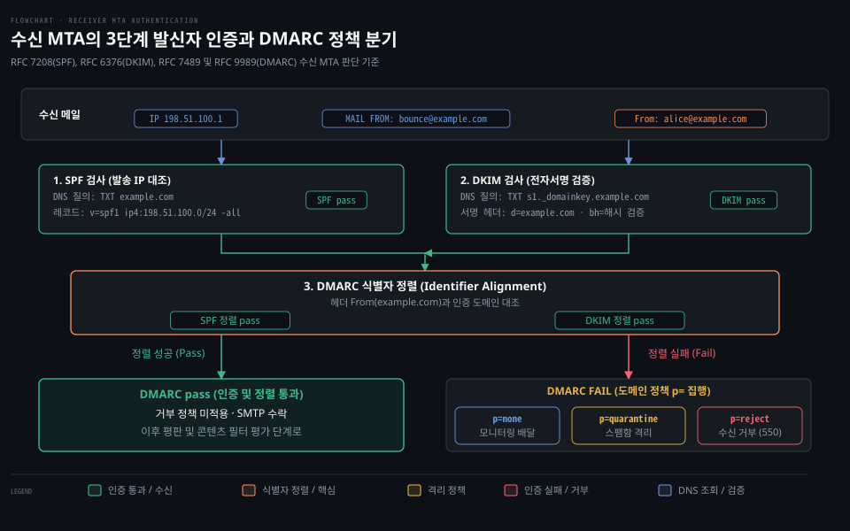
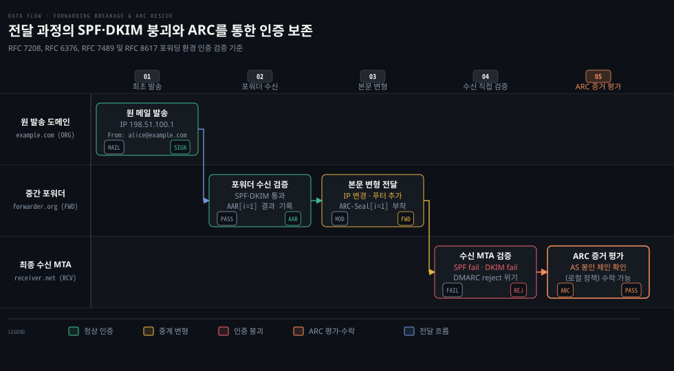

# SPF·DKIM·DMARC·ARC

---

> 보낸 사람을 증명할 장치가 없던 메일은 발송 IP 를 확인하는 SPF, 서명을 붙이는 DKIM, 헤더 From 도메인을 SPF·DKIM 인증 도메인과 정렬하는 DMARC 순으로 신뢰를 세웠습니다. 이 편에서는 각 장치가 증명하는 범위의 한계와, 전달 과정에서 깨진 인증을 이어 주는 ARC 의 역할까지 배웁니다.

백엔드 애플리케이션에서 메일 발송 라이브러리로 수신자에게 안내 메일을 보냈는데 스팸함에 들어가거나 아예 수신 거부(550 Reject)를 당하는 일이 흔히 일어납니다. 보낸 사람 주소를 정상적으로 적었고 발송 상태 코드도 250 OK 를 받았는데 상대 메일함은 왜 우리 메일을 가짜로 의심할까요?

그 이유는 우리가 메일 본문에 적은 발신자 주소(`From:`)를 수신 메일 서버가 그대로 믿지 않기 때문입니다. 우편 편지지에 적힌 서명이 우체통에 편지를 넣은 사람과 다를 수 있듯이, SMTP 역시 임의의 주소를 적어 보내는 위조에 활짝 열려 있었습니다.

수신 서버가 발송 서버의 IP, 도메인의 전자서명, 그리고 화면에 보이는 발신자 표기를 대조하여 신뢰를 확인하는 3단계 방어선이 마련된 배경을 살펴보겠습니다.

## 학습 목표와 범위

> SMTP의 태생적 취약점부터 현대 수신 서버의 다층 인증 및 정렬 체계까지 전체 신뢰 검증 흐름을 이해합니다.

1. SMTP 에는 보낸 사람을 확인하는 장치가 없어서 생긴 위조·스팸 문제와 초기 대응(오픈 릴레이 차단, DNSBL, PTR)을 설명할 수 있습니다.
2. SPF, DKIM, DMARC 가 각각 무엇을 증명하고 무엇을 증명하지 못하는지 봉투 주소, 헤더 From, 정렬을 기준으로 설명할 수 있습니다.
3. 전달(forwarding)과 메일링 리스트에서 SPF 와 DKIM 이 깨지는 이유와 ARC 가 인증 증거를 넘겨받아 로컬 정책으로 평가하는 원리를 설명할 수 있습니다.
4. SPF 레코드가 도메인의 정당한 발송 IP 를 선언하므로 발송 서버를 찾는 단서가 된다는 점을 설명할 수 있습니다.
5. 2024년 Google 과 Yahoo 대량 발송자 요건이 애플리케이션 발송에 요구하는 인프라 조건을 설명할 수 있습니다.

## 1. SMTP 는 왜 보낸 사람을 믿을 수 없나 — 위조가 쉬운 구조와 스팸의 역사

> 초기 인터넷 메일은 참여자 간의 상호 신뢰를 전제하여 발신자 검증 장치가 전혀 없었습니다.

1982년 제정된 원초 SMTP 규격(RFC 821)은 대학과 연구소 중심의 닫힌 네트워크 환경에서 설계되었습니다[^rfc821]. 당시에는 전송 연결을 맺은 상대방이 악의를 품고 발신자 신원을 사칭할 것이라고는 예상하지 않았습니다. 서로 아는 호스트끼리 데이터를 주고받았기 때문입니다.

이로 인해 프로토콜 차원에서 송신 호스트가 SMTP 대화의 `MAIL FROM` 명령이나 본문 헤더 `From:`에 어떤 주소를 기재하더라도 아무런 제약이 없었습니다[^rfc7208-s1]. 공격자는 금융기관이나 공공기관의 이메일 주소를 발신인으로 표기해 피싱이나 악성 메일을 자유롭게 발송할 수 있었습니다. 수신 서버는 그 주소가 진짜인지 확인할 방법이 없었습니다.

메일 시스템에서는 우편 편지 봉투에 적힌 반송 주소인 **봉투 발신자**(`RFC5321.MailFrom`)와 편지지 안쪽에 적혀 사용자 화면에 표시되는 **헤더 발신자**(`RFC5322.From`)가 기술적으로 완전히 분리되어 동작합니다[^rfc7489-s3]. 봉투 주소는 서버 간 반송 메일을 처리하기 위한 주소이고, 헤더 주소는 메일 클라이언트 화면에 띄우기 위한 텍스트에 불과합니다.

1990년대 후반 인터넷이 상업화되면서 이 구조적 틈을 악용한 대량 스팸이 인터넷 대역폭과 사서함을 마비시키는 심각한 사회 문제로 번졌습니다. 누구라도 원하는 도메인 이름을 사칭할 수 있는 취약점은 피싱과 금융 사기의 온상이 되었습니다. 신뢰를 확인하기 위한 기술적 장치가 시급해졌습니다.

## 2. 첫 방어선 — 오픈 릴레이 차단, DNSBL, PTR 확인

> 스팸 발송자들은 남의 서버를 마음대로 경유해 정체를 숨기는 문제를 일으켰습니다.

스팸 문제를 해결하기 위해 가장 먼저 취해진 조치는 **오픈 릴레이**(Open Relay)의 차단이었습니다. 초기 메일 서버는 송신자와 수신자가 모두 외부인이더라도 무조건 메일을 받아 다음 홉으로 넘겨주는 중계가 기본 설정이었습니다. 스팸 발송자들은 이 허점을 이용해 전 세계의 무방비한 서버들을 발송 경유지로 악용했습니다.

경유지를 거치면 발송자의 원래 IP 가 가려지고 무고한 서버가 스팸 발송지로 지목되었습니다. 이에 RFC 5321은 메일 서버가 중계를 거절해도 된다(MAY)고 명시하였습니다[^rfc5321-s36]. 또한 BCP 30인 RFC 2505는 MTA 가 무단 중계 사용을 통제하고 거부할 수 있어야 한다(MUST be able to)고 권고하였습니다[^rfc2505]. 외부인이 외부 수신자에게 보내는 중계 요청을 닫는 조치가 표준 실무로 정착되었습니다.

두 번째 방어선은 실시간 차단 목록인 **DNSBL**(DNS Blacklist)이었습니다. 1997년 데이브 랜드와 폴 빅시가 스팸 발송 IP 목록을 수집하여 라우터 차단용 BGP 피드로 배포한 RBL 이 그 시초입니다[^rfc5782-s1]. 이후 이 체계는 DNS 질의 구조를 활용하여 실시간으로 조회하는 기술로 발전하였습니다.

수신 MTA 는 접속해 온 클라이언트 IP 주소를 역순으로 표기하여 특정 블랙리스트 도메인에 A 레코드를 질의합니다[^rfc5782-s2]. 예를 들어 `198.51.100.1`이 접속해 오면 `1.100.51.198.zen.spamhaus.org`를 조회합니다. 이 질의에 대해 `127.0.0.x` 형태의 응답이 돌아오면 스팸 발송 이력이 있는 호스트로 판단하고 수신을 거부합니다. 이때 반환하는 거부 응답 코드는 구현마다 다르지만 흔히 554나 550 오류가 사용됩니다.

세 번째 방어선은 **FCrDNS**(Forward-Confirmed reverse DNS)입니다. RFC 1912는 인터넷 호스트 설정의 기본 원칙으로 역방향 PTR 레코드와 정방향 A 레코드의 상호 일치를 권고하였습니다[^rfc1912-s21]. 수신 MTA 는 접속해 온 클라이언트 IP 에 대해 PTR 조회를 수행하여 호스트명을 얻습니다. 그리고 그 호스트명으로 다시 정방향 A 조회를 수행하여 원래 IP 와 일치하는지 대조합니다.

FCrDNS 검증을 통과하지 못하면 공인 도메인 이름과 고정 IP 를 갖추지 못한 임의의 유동 IP 나 악성 봇넷으로 의심받습니다. 현대 대형 메일 서비스들은 올바른 FCrDNS 설정을 필수 요건으로 요구하며, 이를 충족하지 않은 발송 호스트의 메일은 거부되거나 스팸으로 분류될 수 있습니다[^google-bulk].

## 3. 이 IP 가 보내도 되나 — SPF, 그리고 발송 서버를 찾는 단서

> IP 차단만으로는 특정 도메인 이름을 사칭하는 메일을 가려내지 못하는 문제가 남았습니다.

정상적인 서버를 구축한 공격자가 다른 도메인 명의를 도용해 메일을 보내면 IP 평판이나 PTR 조회만으로는 사칭을 막을 수 없었습니다. 이에 2006년 실험 규격을 거쳐 표준으로 정립된 기술이 **SPF**(Sender Policy Framework, RFC 7208)입니다[^rfc7208-s1]. 과거 RFC 4408에서 시도되었던 전용 RRTYPE 99 레코드는 상호운용성 한계로 폐기되었으며 SPF 버전 1은 오직 DNS TXT 레코드만을 사용합니다[^rfc7208-s31].

도메인 소유자는 자기 DNS 에 정당한 발송 서버의 IP 대역과 승인된 위탁 발송 서비스를 명시합니다. 예를 들어 `v=spf1 ip4:198.51.100.0/24 include:_spf.google.com ~all` 형태로 선언합니다. 수신 MTA 는 연결해 온 클라이언트 IP 가 해당 도메인의 SPF 레코드에 포함되어 있는지 대조하여 pass, fail, softfail 등의 판정을 내립니다.

SPF 메커니즘에서 기억해야 할 핵심은 검증 대상이 사용자 눈에 보이는 본문 헤더 `From:`이 아니라는 점입니다. SPF 는 SMTP 트랜잭션의 봉투 상에 적힌 `MAIL FROM` 주소(또는 반송 메일 등에서 `HELO` 신원)를 기준으로 발송 호스트를 검증합니다[^rfc7208-s1][^rfc7208-s113]. 따라서 공격자가 봉투 주소에는 자신이 관리하는 도메인을 적어 SPF 를 통과시키고 본문 헤더에는 위조된 주소를 적는 공격을 막아내지 못합니다. (SMTP 대화의 기초는 [메일과 이름은 어떻게 찾아가는가](../../book/cntd_computer-networking-top-down/02-03.메일과%20이름은%20어떻게%20찾아가는가.md#1-메일의-세-부품과-미는-프로토콜) 1절을 참고할 수 있습니다).

한편 SPF 레코드는 역으로 **발송 서버를 찾는 단서**가 됩니다. 메일 수신 호스트를 찾는 DNS MX 레코드는 외부에서 해당 도메인으로 들어오는 입구만 가리킬 뿐 외부로 나가는 발송 서버는 알려주지 않습니다. 그러나 도메인의 SPF 레코드를 조회하면 조직이 어떤 공인 IP 와 클라우드 서비스를 통해 메일을 내보내는지 공표되어 있습니다. 따라서 발송 인프라의 실체를 파악하는 결정적인 기준점이 됩니다.

SPF 를 구성할 때는 DNS 조회 횟수 제한도 주의해야 합니다. RFC 7208 Section 4.6.4는 DoS 공격을 막기 위해 SPF 평가 과정에서 발생하는 DNS 질의 횟수를 최대 10회로 엄격히 제한하고 있습니다. `include`, `a`, `mx`, `redirect` 등의 지시자가 누적되어 10회를 초과하면 수신 서버는 `permerror`를 반환하며 메일을 거부할 수 있습니다.

## 4. 이 내용을 이 도메인이 보냈나 — DKIM 서명

> IP 주소만 확인하는 방식은 메일이 여러 서버를 거쳐 전달될 때 신뢰를 유지하지 못하는 문제를 겪습니다.

포워더나 메일링 리스트처럼 다른 도메인의 중재자(Mediator)가 메일을 받아 다시 보내면 발송 IP 가 중재자의 IP 로 바뀌어 원 발신자의 SPF 검증이 실패합니다[^rfc7208-sd2]. 발송 IP 주소에만 의존하는 방식으로는 다른 시스템을 경유하는 전달 경로의 신뢰를 유지하지 못하기 때문입니다. 이를 해결하기 위해 발신 도메인이 메일 내용에 직접 디지털 서명을 부착하는 **DKIM**(DomainKeys Identified Mail, RFC 6376)이 도입되었습니다[^rfc6376-s1].

발신 도메인은 비밀키(Private Key)를 사용하여 메일의 주요 헤더와 본문 해시값(`bh=`)에 대해 디지털 서명을 생성하고 `DKIM-Signature` 헤더에 첨부합니다[^rfc6376-s33]. 그리고 서명 검증에 필요한 공개키(Public Key)를 `selector._domainkey.domain.com` 형태의 DNS TXT 레코드에 게시합니다. 수신 서버는 DNS 에서 공개키를 가져와 서명을 검증하고 해시값을 비교합니다.

DKIM 헤더에서 메시지에 대한 책임을 지는 주체는 `d=` 태그에 명시된 **서명 도메인 식별자**(SDID)입니다[^rfc6376-s35]. 수신 MTA 는 발신자가 선언한 선택자(`s=`)와 도메인(`d=`)으로 공개키를 조회해 전자서명을 수학적으로 검증합니다. 서명이 유효하다면 서명된 이후 헤더와 본문이 전송 중에 변경되지 않았음을 입증합니다[^rfc6376-s15].

서명할 때 공백이나 줄바꿈 처리 방식을 정하는 규격화(Canonicalization) 옵션(`c=`)도 지정됩니다. `simple` 모드는 공백과 개행의 미세한 변경도 서명 실패로 처리합니다. 반면 `relaxed` 모드는 연속된 공백이나 공백 문자열의 사소한 변경을 허용하여 전송 중 서명 파손을 방지합니다.

그러나 DKIM 역시 단독으로는 사칭을 완전히 막지 못합니다. DKIM 은 `d=` 도메인이 해당 메시지에 서명했음을 증명할 뿐입니다. 정작 사용자가 메일 앱 화면에서 보게 되는 `From:` 헤더의 도메인과 `d=` 도메인이 서로 일치하는지는 검사하지 않습니다[^rfc6376-s12]. 공격자가 자기 소유 도메인으로 정상 서명한 뒤 본문 헤더에는 다른 신뢰 도메인을 적더라도 DKIM 서명 자체는 유효하게 통과됩니다.

## 5. 화면에 보이는 From 을 지키려면 — DMARC 와 정렬

> 사용자가 화면에서 보는 발신자 주소와 백엔드 인증 도메인이 어긋나면 사칭을 막을 수 없습니다.

SPF 와 DKIM 은 사용자 화면에 표시되는 본문 헤더 `From:`의 위조를 직접 막지 못하는 공통 맹점을 안고 있었습니다. 이를 해결하기 위해 등장한 상위 프레임워크가 **DMARC**(Domain-based Message Authentication, Reporting, and Conformance)입니다[^rfc7489-s1].

IETF 에서는 Informational 규격이던 RFC 7489를 표준 트랙으로 정립하는 작업을 거쳐 정식 표준인 **RFC 9989**(2026년 5월)를 제정하였습니다[^rfc9989]. RFC 9989는 RFC 7489와 RFC 9091을 대체합니다. 현행 정본인 RFC 9989에서는 공공 접미사 목록 대신 DNS 트리 워크(Section 4.10)로 조직 도메인을 탐색하고 `pct` 태그를 폐지하였습니다. 다만 식별자 정렬과 정책 프레임워크의 근간은 RFC 7489 설계를 그대로 계승합니다.

DMARC 의 핵심 메커니즘은 **식별자 정렬**(Identifier Alignment)입니다[^rfc7489-s31]. DMARC 는 사용자가 눈으로 확인하는 본문 헤더 `From:` 도메인이 인증 통과 도메인과 일치하는지 대조합니다. 다음 둘 중 적어도 하나와 정렬되어야 통과 판정을 받습니다.
- SPF 인증을 통과한 봉투 발신자(`MAIL FROM`) 도메인과의 일치
- DKIM 서명 검증을 통과한 서명 도메인(`d=`)과의 일치

정렬 모드는 조직 도메인 수준의 일치를 인정하는 완화 모드(`relaxed`, 기본값)와 완전 일치를 요구하는 엄격 모드(`strict`)로 나뉩니다. 완화 모드에서는 `mail.example.com`과 `example.com`이 서로 일치하는 것으로 인정됩니다.

또한 DMARC 는 도메인 소유자가 DNS `_dmarc.domain.com` 레코드의 `p=` 태그를 통해 인증과 정렬에 실패한 메일의 처리 방식을 수신자에게 요청할 수 있게 합니다[^rfc7489-s63]. 다만 수신 MTA 는 로컬 정책이나 평판 판단에 따라 도메인 소유자가 게시한 정책을 따르지 않고 벗어날 수 있습니다(MAY deviate)[^rfc7489-s67].
- `p=none`: 별도 조치 없이 정상 처리하되 인증 결과 보고서만 수집하도록 요청합니다(모니터링 모드).
- `p=quarantine`: 스팸함이나 격리 저장소로 분류하도록 수신 서버에 요청합니다.
- `p=reject`: 수신 MTA 가 SMTP 대화 도중 영구 거부하도록 요청합니다(RFC 7489 Section 10.3 예시의 550 거부 응답)[^rfc7489-s103].

수신 MTA 는 접속 세션의 IP 와 봉투 정보로 SPF 를 검사하고 공개키로 DKIM 서명을 검증한 뒤, 헤더 From 과의 일치 여부를 대조하여 DMARC 정책에 따라 최종 수신, 격리, 거부를 결정합니다. 도메인 관리자는 `rua=mailto:...` 태그를 설정해 전 세계 수신 서버로부터 매일 인증 성공과 실패 통계가 담긴 XML 보고서를 받아 사칭 시도를 모니터링할 수 있습니다.

## 6. 전달하면 깨진다 — 포워딩과 ARC

> 메일이 중간 중계 서버를 거칠 때마다 기존 인증이 깨지는 기술적 한계가 발생합니다.

SPF 와 DKIM 은 발신 서버에서 수신 서버로 한 번에 직접 전달되는 환경을 전제로 설계되었습니다. 그러나 메일이 대학이나 직장의 포워더를 거쳐 외부 상용 메일함으로 자동 전달되거나 메일링 리스트를 통과할 때 심각한 장애가 일어납니다.

포워딩 서버가 메일을 전달하면 수신자 입장에서는 접속 IP 가 포워더의 IP 로 바뀝니다. 그 결과 원래 발신 도메인의 **SPF 검증이 실패**합니다[^rfc7208-sd2]. 이를 해결하기 위해 포워더가 봉투 주소를 자기 주소로 바꾸는 SRS(Sender Rewriting Scheme)를 쓰기도 하지만 설정이 복잡합니다.

더 큰 문제는 메일링 리스트입니다. 목록 관리 소프트웨어가 제목에 말머리를 붙이거나 본문 하단에 탈퇴 안내 푸터를 덧붙이면 본문 내용이 변경됩니다. 이로 인해 원 발신자가 서명한 본문 해시(`bh=`)가 어긋납니다. 그 결과 원 발신자의 **DKIM 서명이 깨집니다**[^rfc6376-s15]. 결국 두 인증이 모두 무너지면서 최종 수신지에서 DMARC 검증이 실패하고, 도메인의 `p=reject` 정책에 의해 정상 메일이 차단되는 사고가 일어납니다.

이 딜레마를 완화하기 위해 고안된 실험 규격(Experimental)이 **ARC**(Authenticated Received Chain, RFC 8617)입니다[^rfc8617-s1]. ARC 는 메시지를 중계하는 각 호스트가 수신 시점에 확인한 인증 결과와 상태를 암호학적으로 봉인하여 다음 홉에 넘겨주는 관리 연속성을 제공합니다.

유효한 ARC 세트는 인스턴스 순번(`i=`)마다 세 가지 필수 헤더 필드를 포함합니다[^rfc8617-s41].
- `ARC-Authentication-Results` (AAR): 중계 서버가 메일을 받았을 때 판정한 SPF, DKIM, DMARC 결과 기록.
- `ARC-Message-Signature` (AMS): 해당 중계 서버가 내보내는 시점의 헤더와 본문에 대해 수행한 전자서명.
- `ARC-Seal` (AS): 이전 인스턴스들의 ARC 헤더 전체 체인을 결속하여 무결성을 보증하는 최종 봉인 서명.

ARC 는 깨진 인증을 자동으로 복원하거나 배달을 보장하는 규격이 아닙니다[^rfc8617-s72]. 중간 중계자들이 확인한 인증 평가 기록을 변조 없이 수신자에게 넘겨줄 뿐입니다[^rfc8617-s24]. 최종 수신 MTA 는 직접 검사한 SPF 와 DKIM 이 실패하더라도, ARC 체인의 무결성을 검증한 뒤 해당 중계자를 신뢰할 수 있다는 자체 로컬 정책(local policy)에 따라 이전 인증 증거를 참작하여 메일을 정상 수락할 수 있습니다.

## 7. 큰 메일함들의 요구 — 2024 대량 발송자 요건

> 개별 서버가 인증을 마쳐도 대형 서비스가 요구하는 엄격한 기준에 맞추지 못하면 메일이 차단되는 문제가 생깁니다.

도메인에 인증을 설정했더라도 대형 메일 서비스의 수신 기준을 만족하지 못하면 메일이 스팸함에 갇히는 문제가 생깁니다. Google 은 2024년 2월 1일부터 적용을 시작하였고 Yahoo 는 2024년 2월부터 단계적 시행에 들어간 강화된 대량 발송자 요건을 통해 스팸 방지와 사용자 보호 기준을 높였습니다[^google-bulk][^yahoo-bulk]. 하루 5,000건 이상의 메시지를 Gmail 계정으로 전송하는 도메인은 대량 발송자(Bulk Senders)로 규정되어 엄격한 인증을 통과해야 합니다.

대형 메일함들이 요구하는 핵심 인프라 요건은 다음과 같습니다.
1. **SPF 와 DKIM 동시 구축**: 둘 중 하나만 선택하는 것으로는 부족하며, 발송 도메인은 SPF 와 DKIM 인증을 둘 다 반드시 설정해야 합니다[^google-bulk].
2. **DMARC 정책 게시 및 From 도메인 정렬**: 발송 도메인에 유효한 DMARC 정책(최소 `p=none`)을 게시해야 합니다[^google-bulk][^yahoo-bulk]. 또한 본문 `From:` 헤더의 도메인이 SPF 도메인 또는 DKIM 도메인과 정렬되어 DMARC 정렬(DMARC pass)을 충족해야 합니다.
3. **원클릭 수신 거부 (RFC 8058) 지원**: 마케팅 및 구독 메일은 본문에 명확한 구독 취소 링크를 포함해야 합니다. 이와 함께 이메일 헤더에 `List-Unsubscribe-Post: List-Unsubscribe=One-Click` 및 `List-Unsubscribe: <https://...>` 헤더를 반드시 제공해야 합니다[^rfc8058-s1][^rfc8058-s31]. 사용자가 링크를 클릭했을 때 별도의 로그인이나 추가 질문 없이 원클릭으로 구독 해지가 처리되어야 합니다.
4. **엄격한 스팸 신고율 관리**: 발송자는 Google Postmaster Tools 등에서 집계되는 스팸 신고율을 반드시 **0.30% 미만**으로 유지해야 하며, 0.10% 미만을 유지할 것을 권장받습니다[^google-bulk]. 스팸 신고율이 기준을 초과하면 의도한 대로 배달되지 않거나 스팸으로 분류될 수 있습니다.
5. **FCrDNS 및 전송 암호화**: 발송 IP 의 역방향 PTR 레코드와 정방향 A 레코드가 일치해야 하며, 전송 구간의 TLS 암호화 연결이 필수적입니다.

국내 네이버 메일 역시 한국인터넷진흥원(KISA)과 국내 포털 업체들이 함께 추진한 메일서버등록제에 따라 2005년 11월 22일부터 SPF 를 도입하였습니다[^naver-spf].

백엔드 개발자가 구축하는 서비스 메일 발송 시스템은 이제 단순한 SMTP 전송 코드를 넘어, DNS 레코드와 헤더 스펙이 유기적으로 결합된 인프라 신뢰 요건을 완벽히 갖추어야 합니다.

## 스스로 확인할 질문

> 각 절의 설계 이유와 인증 실패 시나리오를 바탕으로 핵심 개념을 점검합니다.

1. SMTP 프로토콜은 왜 사용자 화면에 보이는 `From:` 주소를 발신자 인증의 근거로 삼지 못하며, SPF 역시 이를 증명하지 못하는 이유는 무엇입니까?
2. 공격자가 자신의 도메인 `attacker.com`을 정상적으로 제어하고 있다면, DKIM 서명을 유효하게 생성하더라도 DMARC 정렬 검사를 통과할 수 없는 이유는 무엇입니까?
3. 자동 전달(Forwarding)이나 메일링 리스트를 통과할 때 SPF 와 DKIM 이 각각 어떤 이유로 실패하게 됩니까?
4. DNS MX 레코드와 비교했을 때, SPF 레코드가 해당 도메인의 "발송 서버"를 찾는 단서가 되는 이유는 무엇입니까?
5. 2024년 Google 대량 발송자 요건에서 마케팅 메일에 일반 본문 링크 외에 RFC 8058 기반 원클릭 수신 거부 헤더를 필수화한 기술적 이유는 무엇입니까?

## 정답 (자답 후 펼치기)

> 질문에 대해 스스로 답을 정리한 뒤 확인합니다.

1. SMTP 는 메시지를 전송하는 봉투(`MAIL FROM`)와 내용 헤더(`From:`)가 완전히 독립되어 설계되었으며, 프로토콜 차원에서 두 필드에 임의의 텍스트를 적는 것을 제한하지 않았기 때문입니다. 또한 SPF 는 접속한 클라이언트의 IP 주소가 봉투 상의 `MAIL FROM` 도메인 관리자가 승인한 IP 인지만 대조하므로, 본문 헤더 `From:`에 적힌 주소의 위조 여부는 구조적으로 검사하지 못합니다.
2. DMARC 는 단순한 서명의 유효성만을 보지 않고 식별자 정렬(Identifier Alignment)을 검증하기 때문입니다. DKIM 서명이 `d=attacker.com`으로 수학적으로 완벽하더라도, 메일 본문 헤더 `From:`에 적힌 도메인이 `victim.com`이라면 서명 도메인과 헤더 From 도메인이 일치하지 않으므로 DMARC 정렬 검사에서 탈락합니다.
3. 전달 서버가 메일을 다음 홉으로 넘길 때 연결을 맺는 클라이언트 IP 가 전달 서버의 IP 로 변경되므로 원 발신 도메인의 SPF 검증이 실패합니다. 또한 메일링 리스트 서버가 제목에 말머리를 삽입하거나 본문 하단에 안내 푸터를 덧붙이면 본문 데이터가 수정되어 원 발신자가 서명한 본문 해시(`bh=`)와 일치하지 않으므로 DKIM 서명 검증이 깨집니다.
4. MX 레코드는 외부에서 해당 도메인으로 들어오는 수신(Inbound) 호스트만을 가리키지만, SPF 레코드는 도메인 관리자가 "이 도메인의 메일을 보낼 수 있는 공인 발송 IP 와 위탁 중계 서비스"를 외부에 공표한 목록이기 때문입니다. 따라서 SPF 레코드를 조회하면 발송 인프라의 IP 대역과 발송 경로를 역으로 추적할 수 있습니다.
5. 본문 내 단순 웹 링크는 스팸 필터링 봇이나 백신 엔진이 메일을 사전 검사하면서 링크를 자동으로 크롤링하여 의도치 않은 탈퇴 처리를 유발할 위험이 있기 때문입니다. RFC 8058은 MUA 가 자동화 봇의 GET 요청과 구별되는 명시적 HTTP POST 요청을 발송자의 엔드포인트로 전송하도록 표준화하여, 안전하고 신뢰할 수 있는 원클릭 해지를 보장합니다.

## 출처와 관련 문서

> 표준 RFC 규격과 주요 메일 서비스 제공업체의 공식 정책 문서입니다.

[^rfc821]: J. Postel, "Simple Mail Transfer Protocol", RFC 821, 1982년 8월, https://www.rfc-editor.org/rfc/rfc821
[^rfc1912-s21]: D. Barr, "Common DNS Operational and Configuration Errors", RFC 1912 Section 2.1, 1996년 2월, https://www.rfc-editor.org/rfc/rfc1912#section-2.1
[^rfc2505]: G. Lindberg, "Anti-Spam Recommendations for SMTP MTAs", RFC 2505 Section 2.1, 1999년 2월, https://www.rfc-editor.org/rfc/rfc2505#section-2.1
[^rfc5321-s36]: J. Klensin, "Simple Mail Transfer Protocol", RFC 5321 Section 3.6.1, 2008년 10월, https://www.rfc-editor.org/rfc/rfc5321#section-3.6.1
[^rfc5782-s1]: J. Levine, "DNS Blacklists and Whitelists", RFC 5782 Section 1, 2010년 2월, https://www.rfc-editor.org/rfc/rfc5782#section-1
[^rfc5782-s2]: J. Levine, "DNS Blacklists and Whitelists", RFC 5782 Section 2.1, 2010년 2월, https://www.rfc-editor.org/rfc/rfc5782#section-2.1
[^rfc6376-s1]: D. Crocker et al., "DomainKeys Identified Mail (DKIM) Signatures", RFC 6376 Section 1, 2011년 9월, https://www.rfc-editor.org/rfc/rfc6376#section-1
[^rfc6376-s12]: D. Crocker et al., "DomainKeys Identified Mail (DKIM) Signatures", RFC 6376 Section 1.2, 2011년 9월, https://www.rfc-editor.org/rfc/rfc6376#section-1.2
[^rfc6376-s15]: D. Crocker et al., "DomainKeys Identified Mail (DKIM) Signatures", RFC 6376 Section 1.5, 2011년 9월, https://www.rfc-editor.org/rfc/rfc6376#section-1.5
[^rfc6376-s33]: D. Crocker et al., "DomainKeys Identified Mail (DKIM) Signatures", RFC 6376 Section 3.3, 2011년 9월, https://www.rfc-editor.org/rfc/rfc6376#section-3.3
[^rfc6376-s35]: D. Crocker et al., "DomainKeys Identified Mail (DKIM) Signatures", RFC 6376 Section 3.5, 2011년 9월, https://www.rfc-editor.org/rfc/rfc6376#section-3.5
[^rfc7208-s1]: S. Kitterman, "Sender Policy Framework (SPF)", RFC 7208 Section 1, 2014년 4월, https://www.rfc-editor.org/rfc/rfc7208#section-1
[^rfc7208-s113]: S. Kitterman, "Sender Policy Framework (SPF)", RFC 7208 Section 1.1.3, 2014년 4월, https://www.rfc-editor.org/rfc/rfc7208#section-1.1.3
[^rfc7208-s31]: S. Kitterman, "Sender Policy Framework (SPF)", RFC 7208 Section 3.1, 2014년 4월, https://www.rfc-editor.org/rfc/rfc7208#section-3.1
[^rfc7208-sd2]: S. Kitterman, "Sender Policy Framework (SPF)", RFC 7208 Section D.2, 2014년 4월, https://www.rfc-editor.org/rfc/rfc7208#section-D.2
[^rfc7489-s1]: M. Kucherawy et al., "Domain-based Message Authentication, Reporting, and Conformance (DMARC)", RFC 7489 Section 1, 2015년 3월, https://www.rfc-editor.org/rfc/rfc7489#section-1
[^rfc7489-s3]: M. Kucherawy et al., "Domain-based Message Authentication, Reporting, and Conformance (DMARC)", RFC 7489 Section 3, 2015년 3월, https://www.rfc-editor.org/rfc/rfc7489#section-3
[^rfc7489-s31]: M. Kucherawy et al., "Domain-based Message Authentication, Reporting, and Conformance (DMARC)", RFC 7489 Section 3.1, 2015년 3월, https://www.rfc-editor.org/rfc/rfc7489#section-3.1
[^rfc7489-s63]: M. Kucherawy et al., "Domain-based Message Authentication, Reporting, and Conformance (DMARC)", RFC 7489 Section 6.3, 2015년 3월, https://www.rfc-editor.org/rfc/rfc7489#section-6.3
[^rfc7489-s67]: M. Kucherawy et al., "Domain-based Message Authentication, Reporting, and Conformance (DMARC)", RFC 7489 Section 6.7, 2015년 3월, https://www.rfc-editor.org/rfc/rfc7489#section-6.7
[^rfc7489-s103]: M. Kucherawy et al., "Domain-based Message Authentication, Reporting, and Conformance (DMARC)", RFC 7489 Section 10.3, 2015년 3월, https://www.rfc-editor.org/rfc/rfc7489#section-10.3
[^rfc8058-s1]: J. Levine et al., "Signaling One-Click Functionality for List-Unsubscribe Email Header Fields", RFC 8058 Section 1, 2017년 1월, https://www.rfc-editor.org/rfc/rfc8058#section-1
[^rfc8058-s31]: J. Levine et al., "Signaling One-Click Functionality for List-Unsubscribe Email Header Fields", RFC 8058 Section 3.1, 2017년 1월, https://www.rfc-editor.org/rfc/rfc8058#section-3.1
[^rfc8617-s1]: K. Andersen et al., "The Authenticated Received Chain (ARC) Protocol", RFC 8617 Section 1, 2019년 7월, https://www.rfc-editor.org/rfc/rfc8617#section-1
[^rfc8617-s24]: K. Andersen et al., "The Authenticated Received Chain (ARC) Protocol", RFC 8617 Section 2.4, 2019년 7월, https://www.rfc-editor.org/rfc/rfc8617#section-2.4
[^rfc8617-s41]: K. Andersen et al., "The Authenticated Received Chain (ARC) Protocol", RFC 8617 Section 4.1, 2019년 7월, https://www.rfc-editor.org/rfc/rfc8617#section-4.1
[^rfc8617-s72]: K. Andersen et al., "The Authenticated Received Chain (ARC) Protocol", RFC 8617 Section 7.2.1, 2019년 7월, https://www.rfc-editor.org/rfc/rfc8617#section-7.2.1
[^rfc9989]: T. Herr, J. Levine, "Domain-Based Message Authentication, Reporting, and Conformance (DMARC)", RFC 9989, 2026년 5월, https://www.rfc-editor.org/info/rfc9989
[^google-bulk]: Google Workspace Support, "Email sender guidelines", 2024년 2월 시행, https://support.google.com/mail/answer/81126#spam-rate ("Keep spam rates reported in Postmaster Tools below 0.10% and avoid ever reaching a spam rate of 0.30% or higher.")
[^yahoo-bulk]: Yahoo Sender Hub, "Sender Requirements & Recommendations", 2024년 2월 시행, https://senders.yahooinc.com/best-practices/
[^naver-spf]: 네이버 정책, "메일서버등록제(SPF) 안내", 2005년 11월 22일 도입, https://policy.naver.com/policy/spamcheck.html
