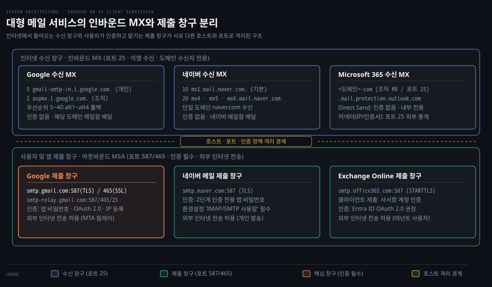
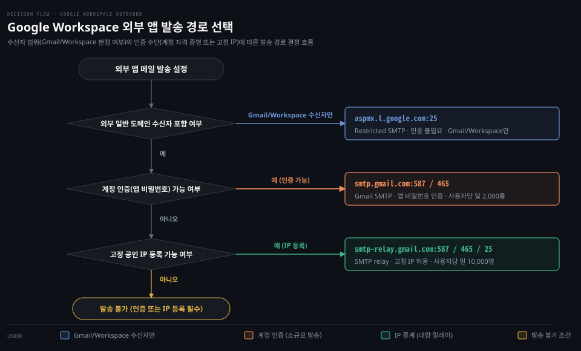

# Gmail·네이버·Microsoft 365

---

> Gmail·네이버·Microsoft 365 같은 대형 메일 서비스는 받는 MX 와 보내는 제출 창구를 호스트부터 분리하고, 외부 앱 연계를 인증·중계 경로별로 통제합니다. 외부 애플리케이션이 이들 서비스와 연계할 때 선택하는 인증 및 전송 경로의 원리를 살펴봅니다.

사내 알림이나 회원가입 인증 메일을 구현하려는 백엔드 개발자는 흔히 포털이나 클라우드 메일 연계를 먼저 떠올립니다. "회사 도메인으로 가입한 Google Workspace 계정 정보를 넣으면 바로 발송되지 않을까?", "네이버 계정의 SMTP 정보를 설정 파일에 적으면 간단히 끝나지 않을까?"라는 생각으로 접근하기 쉽습니다.

하지만 대형 포털과 엔터프라이즈 클라우드 메일 서비스는 일반적인 사설 메일 서버와 전혀 다른 보안 경계와 접근 제약을 둡니다. 웹 로그인 비밀번호를 애플리케이션 설정 파일에 그대로 넣으면 인증 오류가 발생합니다. 사내 배치 작업에서 수백 통의 메일을 연속 발송하면 순식간에 계정이 차단되기도 합니다.

이 편에서는 공개 DNS 레코드와 공식 관리자 문서를 바탕으로 Gmail, 네이버 메일, Microsoft 365가 수신 창구와 발송 창구를 어떻게 분리하고 외부 애플리케이션에 어떤 연계 경로를 허용하는지 비교합니다. 공개된 사실과 내부 추측을 명확히 가르는 관점도 함께 정리합니다.


## 학습 목표와 범위

> 대형 메일 서비스의 수신·제출 분리 구조와 외부 앱 연계 경로 네 가지의 차이를 이해하고 설계 한계를 구분합니다.

1. 대형 메일 서비스가 받는 창구(MX)와 사용자가 보내는 창구(제출 서버)를 다른 호스트로 나누는 이유를 공개 DNS와 도움말로 설명할 수 있습니다.
2. Gmail, 네이버, Microsoft 365의 제출 창구, 인증 방식(앱 비밀번호, OAuth), 공개 발송 한도를 비교할 수 있습니다.
3. 외부 앱이 Google Workspace나 Microsoft 365로 메일을 보낼 때 고를 수 있는 경로(계정 인증 제출, IP 허용 중계, 내부 수신자 전용 직접 전달)의 차이를 설명할 수 있습니다.
4. 공개된 사실과 추측을 구분해, 서비스 내부 구조에 대해 말할 수 있는 범위를 지킬 수 있습니다.


## 1. 큰 메일 서비스도 같은 규약을 쓰나 — 공개 DNS 로 보는 받는 창구

> 수십억 사용자를 보유한 대형 메일 서비스도 인터넷 메일 표준 규약인 RFC 5321 SMTP를 기반으로 수신 창구를 운영합니다.

전 세계 수십억 명이 사용하는 Gmail이나 네이버 메일은 독자적인 사설 프로토콜로 통신할까요? 만약 각 서비스가 자기들만의 비표준 규약을 쓴다면 서로 다른 도메인 사이에 메일을 주고받는 일 자체가 불가능해집니다.

인터넷 메일 생태계의 모든 수신 메일 서버는 표준 규약인 RFC 5321을 준수해야만 상호 운용성을 유지할 수 있습니다[^rfc5321]. 도메인의 DNS MX 레코드를 조회하면 누구나 공용 인터넷에 노출된 수신 창구를 직접 확인할 수 있습니다.

실제 공개 DNS 질의 결과(2026-10-15 조회 기준)는 다음과 같습니다. DNS 레코드는 각 서비스의 인프라 운영 정책에 따라 향후 변경될 수 있습니다[^C-dns].

```bash
# gmail.com MX 조회 결과
5 gmail-smtp-in.l.google.com.
10 alt1.gmail-smtp-in.l.google.com.
20 alt2.gmail-smtp-in.l.google.com.
30 alt3.gmail-smtp-in.l.google.com.
40 alt4.gmail-smtp-in.l.google.com.

# naver.com MX 조회 결과
10 mx1.mail.naver.com.
20 mx4.mail.naver.com.
20 mx5.mail.naver.com.
20 mx6.mail.naver.com.

# outlook.com MX 조회 결과
5 outlook-com.olc.protection.outlook.com.
```

호스트 이름 앞에 붙은 숫자는 **MX 우선순위**(Preference 또는 Priority)를 나타냅니다[^rfc5321]. RFC 5321 §5에 따라 발신 MTA는 우선순위 숫자가 가장 낮은 1차 수신 호스트에 먼저 접속을 시도합니다. 해당 서버에 장애가 생기면 상위 번호 호스트로 순차 폴백합니다. 동일한 숫자를 가진 호스트가 여럿이면 송신 MTA가 부하 분산을 위해 순서를 무작위로 분산합니다.

외부의 어떤 메일 서버든 gmail.com이나 naver.com으로 메일을 보낼 때는 이 MX 호스트들의 25번 포트로 TCP 연결을 맺고 표준 SMTP 대화를 진행합니다. 수신 창구의 규약과 포트는 대형 서비스라 하더라도 인터넷 표준을 그대로 따릅니다.


## 2. 받는 문과 보내는 문은 왜 다른 호스트인가 — MX 와 제출 서버

> 인터넷 수신 창구인 MX와 사용자가 메일을 맡기는 제출 서버는 접속 주체와 인증 요구가 완전히 달라 별도 호스트로 분리됩니다.

Spring 앱에서 `smtp.gmail.com` 대신 DNS에서 찾은 `gmail-smtp-in.l.google.com` 25번 포트로 연결해 외부 도메인으로 메일을 보내면 왜 실패할까요?
수신 서버는 `gmail.com` 수신자에게 보내는 메일은 정상적으로 배달하지만 외부 도메인 수신자로 향하는 메일은 중계를 거부(5xx 오류)하기 때문입니다.

대형 서비스가 받는 문(Inbound MX)과 보내는 문(**제출 창구**, Mail Submission Agent)을 엄격히 다른 호스트로 분리하는 이유는 세 가지입니다.

첫째는 접속 주체와 역할의 차이입니다. MX는 전 세계 인터넷의 알 수 없는 임의 MTA가 찾아오는 공용 수신 창구입니다. 반면 제출 창구는 신원이 확인된 가입자나 인가된 애플리케이션만 찾아옵니다.

둘째는 인증 요구와 릴레이 범위의 차이입니다. MX는 누구에게나 열려 있어야 하므로 연결 시 로그인 인증을 요구하지 않습니다. 대신 오직 자기 도메인 계정으로 들어오는 편지만 수신함에 저장합니다. 반면 제출 창구는 외부 인터넷 전체로 편지를 중계(Relay)해 주어야 하므로 반드시 사용자 신원을 엄격히 인증합니다.

셋째는 통신 포트의 분리입니다. 인터넷 서버 간 수신은 25번 포트를 유지하지만, 사용자 제출은 스팸 방지와 암호화를 위해 RFC 6409가 정의한 587번(STARTTLS)[^rfc6409] 또는 RFC 8314가 정의한 465번(암묵적 TLS)[^rfc8314] 포트로 완전히 분리되었습니다.



위 도식에서 보듯 세 서비스 모두 MX 레코드 호스트와 클라이언트 제출 엔드포인트를 완전히 분리하고 있습니다. 포트 25로 들어온 연결은 자기 도메인 내부 사서함으로만 향하고, 외부 인터넷 릴레이는 인증을 통과한 제출 포트에서만 허용됩니다.

대형 메일 서비스의 발송 및 수신 전체 흐름에 대한 거시적 구조는 [ByteByteGo 대규모 메일 시스템 아키텍처](../../../03_architecture/book/bytebytego-system-design/08-02.Gmail%20%EC%9D%80%20SMTP%20%EB%A1%9C%20%EB%B3%B4%EB%82%B4%EA%B3%A0%20IMAP%C2%B7POP%20%EC%9C%BC%EB%A1%9C%20%EB%B0%9B%EC%9C%BC%EB%A9%B0%20Google%20Maps%20%EB%8A%94%20%ED%83%80%EC%9D%BC%EC%9D%84%20%EC%A4%8C%20%EB%A0%88%EB%B2%A8%EB%B3%84%EB%A1%9C%20%EB%AF%B8%EB%A6%AC%20%EA%B7%B8%EB%A0%A4%20%EB%82%B4%EB%A0%A4%EC%A4%80%EB%8B%A4.md)에서도 확인할 수 있습니다.


## 3. 사용자는 어떻게 증명하나 — 비밀번호에서 앱 비밀번호·OAuth 로

> 계정 보안 강화로 기본 비밀번호를 통한 SMTP 인증은 차단되었으며 전용 앱 비밀번호나 OAuth 2.0 토큰이 필수가 되었습니다.

Spring Boot 설정에 계정 웹 비밀번호를 적어 넣고 실행하면 왜 `535 Authentication Failed` 오류로 막힐까요?
계정에 2단계 인증이 활성화되어 기본 비밀번호 단독 로그인이 전면 차단되었기 때문입니다.

과거에는 RFC 4954에 정의된 SMTP AUTH 확장을 통해 계정 아이디와 일반 비밀번호로 손쉽게 인증할 수 있었습니다[^rfc4954]. 하지만 웹 로그인 계정이 탈취되었을 때의 피해가 커지면서 대형 서비스들은 기본 비밀번호 단독 사용을 단계적으로 폐지했습니다.

대신 외부 애플리케이션 연동을 위해 **앱 비밀번호**(App Password) 체계를 도입했습니다. 앱 비밀번호는 계정의 기본 비밀번호를 노출하지 않고 외부 클라이언트 전용으로 발급하는 고정 문자열 암호입니다.

Google은 2단계 인증을 켠 계정의 경우 전용 앱 비밀번호가 필요하며 2025년 5월 1일부터 Google Workspace는 사용자명과 비밀번호를 통한 로그인을 지원하지 않고 OAuth 사용을 요구합니다[^google-relay].

네이버 메일 역시 일반 비밀번호로는 외부 SMTP 연동이 불가능합니다. 웹 메일 환경설정의 'POP3/IMAP 설정' 메뉴에서 'IMAP/SMTP 사용'을 '사용함'으로 켜야 합니다. 동시에 2단계 인증 설정 후 발급받은 전용 애플리케이션 비밀번호를 입력해야 합니다[^naver-smtp]. 네이버 고객센터에 따르면 90일간 비정상적인 로그인 시도가 지속되거나 연동 상태가 정상이 아니면 '사용 안 함'으로 자동 전환될 수 있습니다[^naver-smtp].

Microsoft 365 또한 기본 인증(Basic Auth) SMTP를 비활성화하고 있으며, Microsoft Entra ID를 통한 OAuth 2.0 토큰 인증을 표준으로 안내합니다[^ms-smtp].


## 4. 외부 앱이 보낼 때 고르는 길 — Google Workspace 의 세 경로

> Google Workspace는 수신자 범위와 인증 가능 여부에 따라 SMTP Relay, Gmail SMTP, 제한된 SMTP의 세 가지 경로를 제공합니다.

사내 웹 서비스나 프린터 복합기에서 Google Workspace 도메인을 통해 알림 메일을 보내야 할 때, 모든 서버에 개별 구글 계정을 발급해야 할까요? 대량 안내 메일이 필요할 때는 어떤 방식을 택해야 할까요?

Google Workspace는 외부 애플리케이션의 발송 요구에 맞추어 세 가지 공식 경로를 제공합니다[^google-relay]. 관리자 문서는 가장 안전한 경로로 SMTP relay 서비스를 권장합니다.

첫째는 SMTP relay 서비스(`smtp-relay.gmail.com`)입니다. Google이 권장하는 가장 안전한 옵션으로 포트 587, 465 또는 25를 지원합니다. 관리 콘솔에 발송 서버의 고정 공인 IP를 등록하거나 계정 인증을 통해 사용합니다. 사용자당 하루 최대 10,000명의 수신자에게 중계할 수 있으며 단일 SMTP 트랜잭션당 최대 수신자 수는 100명으로 제한됩니다[^google-postfix].

사내 Postfix에서 `relayhost = smtp-relay.gmail.com:25`로 설정해 연계하는 방식이 대표적입니다[^google-postfix]. 다만 주요 클라우드 환경에서는 외부 25번 포트가 기본 차단되므로 포트 587(TLS)을 지정해야 합니다.

둘째는 Gmail SMTP 서버(`smtp.gmail.com`)입니다. 포트 587(TLS) 또는 465(SSL)를 사용하며 전체 계정 이메일 주소와 앱 비밀번호 인증을 요구합니다. 외부 인터넷과 조직 내부 수신자 모두에게 발송할 수 있으며 발송 한도는 사용자당 하루 2,000통입니다. 소규모 트랜잭션 메일에 적합합니다.

셋째는 제한된 Gmail SMTP 서버(`aspmx.l.google.com`)입니다. 포트 25를 사용하며 별도의 로그인 인증을 요구하지 않습니다. 하지만 Google이 호스팅하는 수신자(Gmail 또는 Google Workspace 사용자)에게만 메일을 보낼 수 있습니다. Google 외부 도메인 수신자로는 전송할 수 없습니다. 관리 콘솔에 발송 장비의 IP를 허용 목록으로 등록하고 도메인 SPF 설정을 반드시 마쳐야 합니다.



위 흐름도와 같이 Gmail이나 Google Workspace 이외의 외부 수신자가 포함되어 있다면 `aspmx.l.google.com`은 선택할 수 없습니다. Google 공식 문서가 권장하는 기본 경로는 보안성이 가장 높은 `smtp-relay.gmail.com`이며, 소규모 서비스에서 계정 인증이 가능할 때는 `smtp.gmail.com`을 선택합니다.


## 5. Microsoft 365 의 네 경로 — 제출, 직접 전달, 중계 커넥터, 대량 발송

> Microsoft 365는 사서함 제출, Direct Send, SMTP 릴레이, HVE의 네 가지 전송 옵션을 지원합니다.

Microsoft 365 환경에서 외부 장치 연동 시 Direct Send와 SMTP relay는 어떤 점이 다르고 왜 혼동하기 쉬울까요?
두 방식 모두 조직의 MX 엔드포인트를 스마트 호스트로 지정하지만 허용 범위가 전혀 다릅니다.

Microsoft 365 공식 기술 문서가 안내하는 네 가지 경로는 다음과 같습니다[^ms-smtp].

첫째는 클라이언트 제출(Client SMTP submission)입니다. 엔드포인트는 `smtp.office365.com`이며 STARTTLS 권장 포트인 587번 또는 25번을 사용합니다. 라이선스가 부여된 클라우드 사서함 자격 증명으로 인증하며 OAuth 2.0 사용을 권장합니다. 내부 및 외부 수신자 모두에게 보낼 수 있으며 발송 한도는 사서함당 하루 10,000명의 수신자 및 분당 30통입니다.

둘째는 직접 전달(**Direct Send**)입니다. 엔드포인트는 조직의 MX 주소인 `<도메인>-com.mail.protection.outlook.com`이며 포트 25를 사용합니다. 별도의 로그인 인증이 없습니다. 핵심 제약은 해당 조직 테넌트 내부 수신자에게만 전달할 수 있다는 점입니다. 외부 수신자로 보내려 하면 릴레이 거부 오류가 발생합니다.

셋째는 Microsoft 365 **인바운드 커넥터**(Inbound Connector) 기반의 SMTP relay입니다. 엔드포인트는 Direct Send와 동일한 `<도메인>-com.mail.protection.outlook.com:25`를 사용합니다. 하지만 Exchange 관리 센터에서 커넥터를 생성해 발송 서버의 고정 공인 IP나 도메인 TLS 인증서를 검증받습니다. 인증된 커넥터를 통하면 조직 내부뿐 아니라 외부 인터넷 수신자에게도 중계할 수 있습니다.

넷째는 대량 이메일(High Volume Email, HVE)입니다. 포트 587과 HVE 계정 인증을 사용하며 일반 사서함의 분당 30통 스로틀링을 넘어 내부 수신자에게 대규모로 발송할 때 사용하는 서비스입니다. 외부 인터넷으로의 릴레이는 지원하지 않습니다. Microsoft는 외부 대량 발송의 대안으로 Azure Communication Services Email 사용을 안내합니다.

Direct Send는 Microsoft 365의 고유 기능 이름입니다. 인터넷의 일반적인 수신 MX 직접 전달과 달리 특정 테넌트 내부 수신자만을 대상으로 제한된다는 점을 주의해야 합니다.


## 6. 한도는 왜 있나 — 공개 발송 한도와 비공개 한도

> 메일 서비스는 발신 IP 평판 보호와 계정 탈취 피해 방지를 위해 엄격한 발송 한도를 집행합니다.

사내 웹 서비스의 공지 메일을 포털 계정으로 수천 명에게 발송하면 왜 곧바로 발송이 중단되고 계정이 잠길까요? 메일 서비스가 발송 통수와 수신자 수에 엄격한 상한을 두기 때문입니다.

대형 서비스가 발송 한도를 두는 가장 중요한 이유는 발신 IP 대역의 평판(Reputation) 보호입니다. 공용 발신 서버에서 대량의 스팸이나 반송 메일이 나가면, 상대방 수신 서버들이 해당 IP를 RBL(Real-time Blackhole List)에 등록합니다. 한 계정의 무분별한 발송 때문에 같은 서버를 이용하는 다른 무고한 사용자들의 메일까지 스팸함으로 격리되는 사태가 벌어집니다.

각 서비스가 공식적으로 밝힌 발송 한도는 다음과 같습니다.

| 서비스 및 경로 | 1회 수신자 상한 | 일일 발송 상한 | 스로틀링 기준 |
|---|---|---|---|
| 개인 Gmail | 500명 | 500통 | 초과 시 발송 차단[^google-limit] |
| Workspace Gmail SMTP | 100명 (SMTP 경로)[^google-smtp-limit] | 2,000통 | 사용자당 일일 기준[^google-relay] |
| Workspace SMTP Relay | 100명 (트랜잭션당) | 10,000명 수신자 | 사용자당 일일 기준[^google-postfix] |
| 네이버 개인 메일 | 100명 (참조 포함) | 비공개 | 초과 시 최대 24시간 제한[^naver-limit] |
| Microsoft 365 사서함 | 최대 1,000명(관리자 설정, 1~1000)[^ms-limits] | 10,000명 수신자 | 분당 30통 제한[^ms-smtp] |

네이버 메일은 스팸 대응을 위해 구체적인 일일 발송 제한 통수를 대외적으로 공개하지 않는다고 고객센터에 명시하고 있습니다[^naver-limit]. 한도를 넘으면 정상 발송까지 최대 24시간 동안 계정이 제한될 수 있습니다.

시스템을 설계할 때는 공개된 사실과 추측을 엄격히 구분해야 합니다. 대형 서비스의 데이터센터 내부 저장 구조나 분산 큐잉 엔진, 동적 스팸 필터링 알고리즘은 공개되지 않은 대외비 영역입니다. 네이버 D2 기술 블로그에서 사용자 데이터 격리 검색 엔진 Noir를 메일 검색에 사용한다고 밝힌 사례처럼[^naver-noir], 공식 기술 발표로 확인된 사실만을 바탕으로 논의를 전개해야 합니다.


## 스스로 확인할 질문

> 대형 메일 서비스의 구조적 분리와 외부 애플리케이션 연계 제약을 점검하는 질문입니다.

1. 대형 포털 메일 서비스는 왜 인터넷 수신 창구(MX 호스트의 25번 포트)와 사용자 발송 창구(제출 호스트의 587/465번 포트)를 서로 다른 호스트와 포트로 분리해 둘까요?
2. Google Workspace 환경에서 사내 웹 앱이 외부 고객 메일 주소로 알림을 보내려 할 때 `aspmx.l.google.com:25`를 쓰면 왜 실패하며, 어떤 경로를 선택해야 할까요?
3. 네이버 메일의 SMTP를 Spring 백엔드 애플리케이션의 발송 엔진으로 연동할 때 필요한 사전 설정 두 가지와 발송 수신자 한도는 무엇일까요?
4. Microsoft 365의 'Direct Send'와 'SMTP relay'는 모두 조직의 MX 엔드포인트(25번 포트)로 연결하지만, 통신 가능 대상과 인증 방식에서 어떤 핵심 차이가 있을까요?
5. 메일 서비스 내부 아키텍처를 분석할 때 공식 도움말과 공개 DNS 결과 외에 비공개 영역을 추측하지 말아야 하는 이유는 무엇일까요?


## 정답 (자답 후 펼치기)

> 각 질문의 설계 이유와 기술적 근거를 정리한 정답입니다.

1. 수신 창구인 MX는 전 세계 임의의 MTA로부터 로그인 인증 없이 자기 도메인 수신자 편지만을 받아야 합니다. 반면 발송 창구인 제출 서버는 인가된 사용자만을 인증하여 외부 인터넷 전체로 메일을 중계(Relay)해야 하므로 접근 주체, 인증 정책, 사용 포트(25번 대 587/465번)가 완전히 다르기 때문입니다.
2. `aspmx.l.google.com:25`(제한된 Gmail SMTP)는 별도 인증을 요구하지 않는 대신 Google이 호스팅하는 수신자(Gmail 또는 Google Workspace 사용자)에게만 발송할 수 있는 창구입니다. Google 외부 도메인 수신자에게 보내려면 계정 앱 비밀번호로 인증하는 `smtp.gmail.com:587`을 쓰거나, 고정 공인 IP를 등록한 `smtp-relay.gmail.com:587`을 선택해야 합니다.
3. 네이버 웹 메일 환경설정에서 'IMAP/SMTP 사용'을 '사용함'으로 설정해야 하며, 2단계 인증 후 발급받은 전용 애플리케이션 비밀번호를 사용해야 합니다. 발송 한도는 1회 발송 시 받는 이, 참조, 숨은 참조를 합산하여 최대 100명까지입니다(일일 한도는 스팸 방지를 위해 비공개 정책).
4. Direct Send는 별도 로그인 인증 없이 조직 내부 테넌트 수신자에게만 메일을 직접 전달합니다. 반면 SMTP relay는 Exchange 관리 센터에서 인바운드 커넥터를 설정하여 발송 서버의 공인 IP나 TLS 인증서를 검증받음으로써 조직 내부뿐 아니라 외부 인터넷 수신자에게도 메일을 중계할 수 있습니다.
5. 대형 서비스의 세부 큐 관리, 분산 스토리지, 스팸 필터링 인공지능 알고리즘은 서비스 안정성과 보안을 위해 비공개로 운영되기 때문입니다. 근거 없는 추측에 기반해 연계 아키텍처를 설계하면 서비스 정책 변경이나 비공개 차단 기준에 의해 시스템 장애가 발생할 위험이 있습니다.


## 출처와 관련 문서

> 본문에서 인용한 RFC 표준과 대형 메일 서비스의 공식 기술 문서입니다.

[^rfc5321]: RFC 5321 — Simple Mail Transfer Protocol (Section 5 Domains and MX records) https://www.rfc-editor.org/rfc/rfc5321#section-5
[^C-dns]: 2026-10-15 `dig +short MX` 조회
[^rfc6409]: RFC 6409 — Message Submission for Mail (Section 3.1 Submission Identification) https://www.rfc-editor.org/rfc/rfc6409#section-3.1
[^rfc8314]: RFC 8314 — Cleartext Considered Obsolete: Use of Transport Layer Security (TLS) for Email Submission and Access https://www.rfc-editor.org/rfc/rfc8314
[^rfc4954]: RFC 4954 — SMTP Service Extension for Authentication https://www.rfc-editor.org/rfc/rfc4954
[^google-relay]: Google Workspace 관리자 고객센터 — 이메일을 보내도록 프린터 또는 앱 설정 https://support.google.com/a/answer/176600
[^google-postfix]: Google Workspace 관리자 고객센터 — Postfix와 SMTP 릴레이 서비스 통합 https://support.google.com/a/answer/2956491
[^google-limit]: Gmail 고객센터 — Gmail 발송 한도 https://support.google.com/mail/answer/22839
[^google-smtp-limit]: Google Workspace 관리자 고객센터 — Google Workspace의 이메일 전송 한도 https://support.google.com/a/answer/166852
[^ms-smtp]: Microsoft Learn — Microsoft 365 또는 Office 365를 사용하여 이메일을 보내도록 다기능 장치 또는 애플리케이션을 설정하는 방법 https://learn.microsoft.com/en-us/exchange/mail-flow-best-practices/how-to-set-up-a-multifunction-device-or-application-to-send-email-using-microsoft-365-or-office-365
[^ms-limits]: Microsoft Learn — Exchange Online 제한 (수신자 한도) https://learn.microsoft.com/en-us/office365/servicedescriptions/exchange-online-service-description/exchange-online-limits
[^naver-smtp]: 네이버 고객센터 — IMAP/SMTP 설정 및 해제 방법 https://help.naver.com/service/30029/bookmark/21344
[^naver-limit]: 네이버 고객센터 — 메일 발송 제한 및 한 번에 보낼 수 있는 수신인 수 https://help.naver.com/service/30029/bookmark/21159
[^naver-noir]: 네이버 D2 — Go GC를 너무 믿지 마세요 - 메모리 누수 탐지와 GC 주기 조절 https://d2.naver.com/helloworld/5316262
