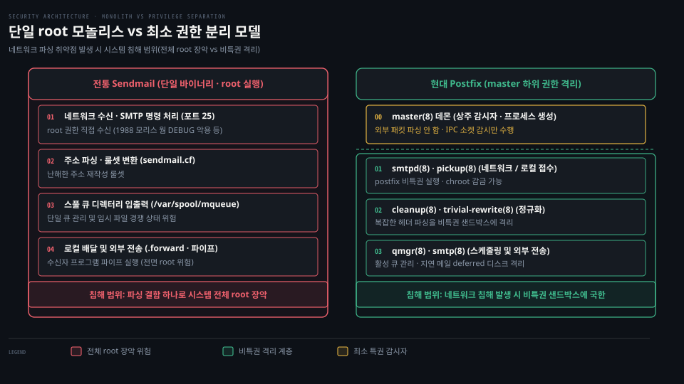
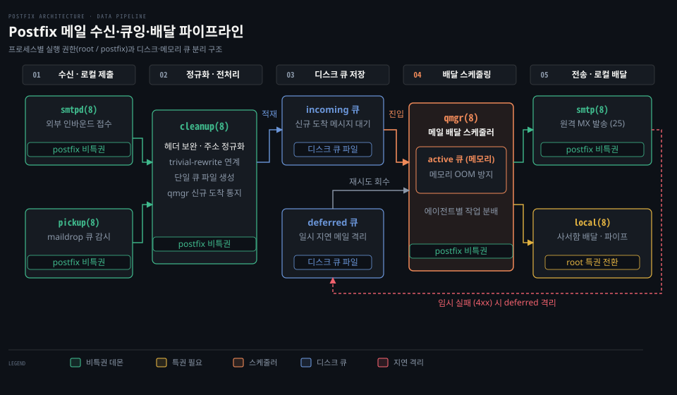

# Sendmail·Postfix·Exim·qmail

---

> MTA 소프트웨어는 받기·줄 세우기·재시도·배달을 처리하는 파이프라인으로, Sendmail 에서 Postfix 로 오며 보안과 안정성 구조를 바꿨습니다. Sendmail의 전면 root 단일 구조가 치른 보안 대가를 살펴보고, Postfix가 프로세스와 권한을 쪼개어 메모리와 시스템을 보호한 설계를 배웁니다.

백엔드 애플리케이션 개발자가 사내 메일 인프라와 연동할 때 작성하는 코드는 대개 단순합니다. 설정 파일에 사내 메일 서버의 호스트 이름과 포트 번호를 적고 메일 발송 라이브러리를 호출하면 전송 작업이 끝납니다. 이 때문에 개발자는 메일 서버를 단순한 프록시나 웹 서버처럼 요청 하나를 받아 곧바로 상대에게 넘겨주는 블랙박스로 여기기 쉽습니다.

하지만 메일 서버 내부에서는 웹 서버와 전혀 다른 차원의 작업이 진행됩니다. 수만 통의 대량 메일이 밀려들 때 서버 메모리가 고갈되지 않도록 제어해야 하고, 상대방 메일 서버가 일시적인 점검에 들어가면 수신 거부된 메일을 안전하게 스풀에 격리한 뒤 수 시간에 걸쳐 재시도해야 합니다.

더욱 까다로운 문제는 보안입니다. 메일 서버는 인터넷의 불특정 다수가 보내오는 임의의 패킷을 받아 복잡한 주소와 헤더를 파싱해야 하는 동시에, 시스템 내부의 로컬 사서함 파일에 접근하거나 프로세스를 띄울 수 있는 특권도 함께 다루어야 합니다. 이 두 가지 상반된 요구를 풀기 위해 메일 서버 소프트웨어가 발전해 온 과정을 이해하면, 사내 메일 서버가 장애 상황에서 어떻게 메일을 보호하는지 명확히 파악할 수 있습니다.

## 학습 목표와 범위

> 메일 전송 에이전트의 내부 책무와 Sendmail에서 Postfix로 이어진 모듈화 및 권한 격리 원리를 이해합니다.

1. MTA가 받기, 줄 세우기, 다시 보내기, 넣기라는 네 가지 책무를 한 프로그램 안에서 어떻게 나누어 맡는지 설명할 수 있습니다.
2. 1988년 모리스 웜이 악용한 Sendmail의 비표준 debug 명령과, 단일 root 구조가 왜 위험한 설계로 여겨지는지 설명할 수 있습니다.
3. Postfix가 작은 프로세스와 권한 분리로 같은 일을 안전하게 나눈 방식과 그 설계 이유를 설명할 수 있습니다.
4. Postfix의 큐 구조(incoming, active, deferred)가 재시도와 메모리 보호를 어떻게 달성하는지 설명할 수 있습니다.
5. 앱 개발자가 사내 메일 서버라고 부르는 인프라 안에서 각 내부 구성요소가 어디에 해당하는지 짚을 수 있습니다.

이 문서는 특정 운영체제에서의 설치 방법이나 `sendmail.cf` 설정 언어의 세부 문법, Postfix 파라미터 튜닝 레시피는 다루지 않습니다. 소프트웨어 아키텍처 관점에서 문제를 어떻게 정의했고 어떤 구조로 풀어냈는지에 집중합니다.

## 1. 메일 서버 프로그램 하나가 하는 일 — 받기, 줄 세우기, 다시 보내기, 넣기

> MTA는 네트워크와 로컬에서 메일을 받아 디스크에 줄 세우고, 외부 전송과 로컬 편지함 배달을 나눠 수행하는 상태 저장 시스템입니다.

스프링 애플리케이션에서 SMTP 연결을 맺고 메일 데이터를 전송하면 서버로부터 `250 OK` 응답을 받습니다. 많은 개발자가 이 순간 상대방 편지함에 메일이 즉시 꽂혔을 것이라 기대하지만, 현실의 인터넷 환경은 그렇게 단순하지 않습니다. 수신 도메인의 서버가 네트워크 점검 중이거나 일시적인 트래픽 폭주로 응답하지 못할 수도 있습니다.

만약 메일 서버가 상대방 서버와 실시간으로 통신하는 동안에만 메일을 메모리에 쥐고 있는다면, 일시적인 네트워크 순단에도 발송 요청 전체가 유실될 위험이 큽니다. 따라서 메일 전송 에이전트인 **MTA**(Mail Transfer Agent)는 단순한 중계 프록시가 아니라 디스크 기반의 견고한 큐를 운영하는 상태 저장 시스템으로 동작합니다.

MTA 소프트웨어 하나가 담당하는 핵심 작업은 크게 네 가지 단계로 구분할 수 있습니다.

첫째는 **받기**(Ingestion)입니다. 외부 인터넷이나 내부 사내망으로부터 TCP 25번 포트 또는 587번 제출 포트로 들어오는 SMTP 연결을 수락합니다. 네트워크를 통한 인바운드 접수뿐만 아니라, 같은 호스트의 로컬 프로세스가 명령줄 도구를 통해 표준 입력으로 밀어 넣는 로컬 제출 메일도 함께 받아들입니다.

둘째는 **줄 세우기**(Queueing)입니다. 접수한 메일의 무결성을 검사하고 RFC 규격에 맞게 누락된 헤더를 보강하거나 주소를 표준 형식으로 정규화합니다. 이렇게 전처리를 마친 메시지는 휘발성 메모리가 아니라 디스크 스풀 영역에 고유 식별자를 가진 단일 파일 형태로 기록되어 안전한 대기열을 형성합니다.

셋째는 **다시 보내기**(Relay 및 Outbound Transfer)입니다. 큐에 적재된 메일의 수신자 도메인을 분석하고 DNS 질의를 통해 목적지 MX 레코드를 조회합니다. 찾아낸 원격 메일 서버로 아웃바운드 SMTP 연결을 맺어 데이터를 전송하며 상대 서버가 일시적인 오류(4xx 응답)를 반환하면 백오프 주기에 따라 다음 재시도를 예약합니다.

넷째는 **넣기**(Local Delivery)입니다. 수신자의 최종 목적지가 원격 인터넷이 아니라 바로 이 서버 자신인 경우 외부로 릴레이하지 않고 로컬 저장소로 전달합니다. 시스템 계정의 사서함 파일에 메일을 덧붙이거나 가상 도메인 디렉터리에 파일을 생성하고, 필요하다면 외부 스크립트 파이프로 메시지를 전달합니다.

초기 메일 시스템은 이 네 가지 이질적인 작업을 단일 바이너리 프로그램 안에서 한꺼번에 처리하도록 구현했습니다. 그리고 바로 그 구조적 선택이 심각한 보안 재앙을 불러일으켰습니다.

## 2. 모든 일을 한 프로세스가 하던 시절 — Sendmail 과 그 대가

> 단일 바이너리가 root 권한으로 수신부터 파싱과 배달까지 모두 처리하던 Sendmail의 구조에서는 사소한 버그 하나가 곧 root 권한 실행으로 이어질 수 있었습니다.

1980년대 초 에릭 올먼(Eric Allman)이 개발한 **Sendmail**은 서로 다른 주소 체계와 네트워크 규격을 중계하며 인터넷 전자메일의 초기 표준을 세운 선구적인 소프트웨어였습니다. 하지만 Sendmail은 시스템의 모든 작업을 단일 바이너리가 직접 수행하는 거대한 모놀리식 구조를 택했습니다.

Sendmail이 전체 작업을 한 덩어리로 묶고 최고 관리자 권한으로 실행되어야 했던 데에는 유닉스 운영체제의 구조적 제약이 있었습니다. 1024번 미만의 특권 포트인 25번 포트를 열어 네트워크 연결을 기다리려면 `root` 권한이 필수적이었습니다. 또한 로컬 사용자의 사서함 파일에 메일을 쓰거나 사용자의 `.forward` 파일에 정의된 외부 프로그램을 해당 사용자의 권한으로 실행하려면 다른 사용자의 UID로 자유롭게 전환할 수 있는 권한이 필요했습니다.

로컬 사용자가 터미널에서 메일을 보낼 때도 마찬가지였습니다. 일반 사용자가 시스템 큐 디렉터리에 파일을 안전하게 생성하도록 만들기 위해 명령줄 바이너리 자체에 `setuid root` 권한을 부여했습니다. 결국 외부 네트워크 패킷 수신, 난해한 주소 재작성 룰셋 해석, 로컬 디스크 입출력, 임의 프로그램 실행에 이르는 전 과정이 `root` 권한이라는 단일 실행 문맥 안에서 일어났습니다.

이러한 전면 특권 모놀리스 구조는 치명적인 약점을 낳았습니다. 수십만 줄의 복잡한 C 코드 중 단 한 곳에서라도 버퍼 오버플로나 검증 누락이 발생하면, 침입자가 즉각 호스트 시스템 전체의 최고 관리자 권한을 손에 넣을 수 있었기 때문입니다.

대표적인 사례가 1988년 발생한 모리스 웜(Morris Worm) 사건입니다. 모리스 웜은 `fingerd`의 버퍼 오버플로와 함께 Sendmail 바이너리에 활성화된 채 배포되어 있던 비표준 `DEBUG` 명령을 침투 경로로 삼았습니다.[^rfc1135] 공격자는 메일을 보내는 과정에서 시스템 셸 명령을 실행해 악성코드를 전파했습니다.

RFC 1135는 이 웜이 슈퍼유저 권한을 얻으려 하지 않았고 기존 파일을 고치지도 않았다고 적습니다. 피해는 자기 복제가 만든 자원 고갈이었습니다. 단일 root 프로세스 구조의 위험은 이 사건과 별개로, 파싱 코드 한 곳의 결함이 곧 root 권한 실행으로 이어질 수 있다는 데 있습니다.

Sendmail 8.12부터 sendmail 바이너리가 set-user-ID root가 아니게 되었고, 외부 입력을 처리할 때 root 권한을 피하는 `RunAsUser` 옵션 설정을 권고하는 등 보안 개선을 시도했습니다.[^sm812] 그러나 거대한 단일 코드베이스에 뿌리내린 구조적 한계를 완전히 극복하기는 어려웠습니다.

위 도식의 왼쪽이 보여주듯이 Sendmail에서는 네트워크 수신과 주소 변환부터 큐 저장과 로컬 프로그램 실행까지 모든 계층이 단일 바이너리의 `root` 권한 경계 안에 갇혀 있었습니다. 파싱 계층에서 발생한 사소한 취약점이 시스템 장악으로 직결되던 이 문제를 해결하기 위해 메일 소프트웨어는 완전히 새로운 아키텍처를 요구하게 되었습니다.

## 3. 일을 쪼개고 권한을 나누다 — Postfix 의 프로세스 구조

> Postfix는 최소 권한 분리 원칙에 따라 master만 root로 상주시키고, 네트워크와 파싱을 맡는 모든 작업자를 비특권 사용자로 격리했습니다.

보안 연구자 위체 베네마(Wietse Venema)는 Sendmail의 모놀리식 취약성을 근본적으로 해결하기 위해 **Postfix**를 설계했습니다. Postfix 설계의 핵심 철학은 **최소 권한 분리 원칙**(Privilege Separation)과 모듈화였습니다. 하나의 거대한 프로그램이 모든 일을 도맡는 대신 잘게 쪼개진 작은 데몬들이 각각 독립된 프로세스로 동작하며 유닉스 도메인 소켓이나 파이프로 협력하는 구조를 채택했습니다.

이 구조의 정점에는 상주 감시자인 `master(8)` 데몬이 있습니다.[^postfix-overview] `master`는 부팅 시 `root` 권한으로 기동되어 메일 시스템의 시작과 종료를 주관하고 하위 작업자 데몬들을 실행하며 비정상 종료된 프로세스를 자동으로 재시작합니다. 또한 설정 파일(`master.cf`)에 지정된 규칙에 따라 동시 실행 프로세스 수 상한을 통제합니다.

중요한 점은 최고 권한을 가진 `master` 프로세스가 외부 네트워크 입력을 전혀 직접 읽지 않는다는 사실입니다. `master`는 단지 자식 프로세스를 띄우고 내부 시그널을 전달하는 감시자 역할만 수행하므로 외부 공격에 노출될 경로가 원천 차단됩니다.

외부 인터넷과 직접 대면하는 작업은 비특권 작업자 데몬들이 전담합니다. 25번이나 587번 포트로 들어오는 인바운드 SMTP 연결은 `smtpd(8)`가 맞이합니다. `smtpd`는 기본적으로 root가 아닌 전용 비특권 계정인 `postfix` 권한으로 실행되며 필요한 경우 자신의 파일시스템 접근을 스풀 디렉터리로 한정하는 `chroot` 감금 환경에서 안전하게 동작합니다.[^postfix-master5]

로컬 사용자가 명령줄로 메일을 보낼 때도 마찬가지입니다. 일반 사용자가 `sendmail` 명령을 실행하면 `setgid postdrop` 권한을 가진 보조 도구가 메일을 `maildrop` 큐에 안전하게 떨어뜨립니다.[^postfix-overview] 이 메일은 비특권 데몬인 `pickup(8)`이 주기적으로 감시하여 건져 올립니다. 이 분리 덕분에 Postfix 메일 시스템 전체가 중지되어 있는 상태에서도 로컬 프로세스는 안전하게 메일을 제출할 수 있습니다.

수신된 메일의 복잡한 헤더를 검사하고 주소를 재작성하는 위험한 작업은 `cleanup(8)`과 `trivial-rewrite(8)` 데몬이 맡습니다. 이들 역시 외부 공격에 취약할 수 있으므로 철저히 비특권 `postfix` 사용자로 격리된 상태에서 수행됩니다.

Postfix 작업자 데몬 중에서 root 수준의 특권을 요구하는 곳은 로컬 사서함 배달과 외부 명령 실행 등을 맡는 `local(8)`·`pipe(8)`·`spawn(8)`·`virtual(8)` 배달 계열입니다.[^postfix-master5] `local`은 유닉스 시스템 사서함 파일에 메일을 쓰거나 사용자의 `.forward` 파이프 프로그램을 실행하기 위해 수신자 본인의 UID로 전환해야 하므로 특권을 유지합니다.

위 도식은 Postfix 내부에서 메일이 흘러가는 전체 데이터 파이프라인을 보여줍니다. 네트워크의 `smtpd`나 로컬의 `pickup`이 접수한 메시지는 `cleanup`을 거쳐 디스크의 `incoming` 큐에 안전하게 적재됩니다. 그리고 배달의 심장인 `qmgr`이 이를 감지하여 배달 에이전트에 작업을 분배합니다. 외부 네트워크를 다루는 대부분의 상자가 녹색의 비특권 영역 안에 머물러 있음을 알 수 있습니다.

## 4. 큐는 왜 여러 개인가 — incoming, active, deferred

> Postfix는 디스크의 incoming·deferred 큐와 메모리의 active 큐를 분리하여 대량 적체 상황에서도 메모리 고갈 없이 신규 메일을 배달합니다.

대규모 메일 서버를 운영하다 보면 특정 외부 도메인의 메일 서버가 다운되거나 네트워크 경로가 끊겨 수만 통의 발송 실패가 쌓이는 상황을 피할 수 없습니다. 만약 메일 큐가 단 하나의 디렉터리로만 이루어져 있다면 어떤 일이 벌어질까요?

지연된 수만 건의 메일과 방금 막 들어온 정상 메일이 하나의 목록 안에서 뒤섞이게 됩니다. 메일 서버는 방금 들어온 메일 한 통을 찾기 위해 수만 개의 파일을 뒤져야 하고, 지연된 대량의 메일을 재시도하느라 시스템 자원을 전부 소모하여 정상적인 신규 메일까지 덩달아 지연됩니다. 더 나아가 이 모든 메타데이터를 메모리에 올려두려 하다가 프로세스가 메모리 고갈(OOM)로 강제 종료될 수도 있습니다.

Postfix는 이 병목과 자원 고갈을 방지하기 위해 큐를 디스크와 메모리, 그리고 상태별로 철저히 다단계 분리했습니다. 핵심은 세 가지 큐의 분업에 있습니다.

첫째는 **incoming 큐**입니다. `cleanup` 데몬이 전처리를 완료한 신규 메시지가 디스크 스풀에 단일 파일로 기록되어 머무는 곳입니다.[^postfix-overview] 아직 배달 시도를 시작하지 않은 깨끗한 대기열이며 메모리를 점유하지 않고 디스크에 안전하게 보관됩니다.[^postfix-qshape]

둘째는 **active 큐**입니다. Postfix 배달 스케줄러인 `qmgr(8)` 데몬의 메모리 안에서 관리되는 실질적인 작업 큐입니다.[^postfix-qshape] 디스크에 쌓여 있는 방대한 메시지들 중에서 현재 가용한 배달 에이전트(`smtp`, `local` 등)가 즉시 처리할 수 있는 소량의 메시지만을 선별하여 봉투(Envelope) 정보를 메모리에 상주시킵니다.

`active` 큐에는 엄격한 크기 상한이 설정되어 있습니다. 따라서 디스크에 수십만 통의 메일이 밀려들어와도 `active` 큐의 메모리 창구 크기는 일정하게 유지되므로 메일 폭주 상황에서도 `qmgr` 프로세스가 메모리 고갈로 쓰러지지 않습니다.[^postfix-overview]

셋째는 **deferred 큐**입니다. `smtp(8)` 클라이언트가 원격 서버로 메일을 전송하려 했으나 일시적인 4xx 응답을 받거나 타임아웃이 발생하여 배달에 실패한 메시지들이 격리되는 디스크 큐입니다.[^postfix-overview]

배달이 지연된 메일이 `active` 큐에서 빠져나와 `deferred` 큐 디스크 파일로 옮겨짐으로써 대량의 지연 적체 메일이 정상적인 신규 메일의 흐름을 방해하지 못하도록 완벽히 격리됩니다.

`qmgr`은 각 지연 메시지마다 체류 시간의 2배(최소·최대 백오프 시간 사이)를 기준으로 다음 재시도 시각을 정하고, `queue_run_delay` 주기마다 `deferred` 큐를 스캔합니다.[^postfix-qshape] 재시도 시점이 도래한 지연 메시지는 다시 `active` 큐의 빈자리로 승격되어 배달 에이전트에게 할당됩니다.

스프링 애플리케이션 개발자 관점에서 보면 사내 메일 서버로 발송을 요청한 뒤 `250 OK`를 받았다는 것은 메일이 Postfix의 `cleanup`을 거쳐 `incoming` 큐에 안전하게 파일로 적재되었음을 뜻합니다. 이후 인터넷 전송 중 상대 서버의 장애로 발생하는 일시 지연은 애플리케이션이 일일이 재시도 루프를 돌릴 필요 없이 Postfix 내부의 `deferred` 큐와 `qmgr`이 시스템 차원에서 책임지고 관리합니다.

## 5. 그 밖의 선택 — Exim 과 qmail 이 고른 길

> Exim은 단일 메시지 풀과 분리 파일 스풀을, qmail은 잠금 경쟁을 원천 제거한 Maildir 포맷을 제시하며 각자의 해법을 발전시켰습니다.

모든 메일 서버가 Postfix처럼 복잡한 다중 데몬과 3단계 큐 구조를 갖추어야만 할까요? 인터넷 환경과 파일시스템 특성에 따라 다른 MTA들은 어떤 구조적 선택을 내렸을까요?

케임브리지 대학의 필립 헤이즐(Philip Hazel)이 개발한 **Exim**은 상시 연결 환경을 전제로 설계되었습니다.[^exim-spec] Exim은 도메인이나 호스트별 독립 큐를 유지하지 않고 단일 메시지 풀로 다루며, 메시지가 도착하는 즉시 배달 프로세스를 띄워 대부분 곧바로 배달을 시도합니다.

Exim의 독특한 구조적 특징 중 하나는 스풀 파일의 분리입니다. 메일을 접수하면 스풀 디렉터리에 하나의 메시지당 두 개의 파일을 나누어 기록합니다. 봉투 정보(발송자·수신자 주소)와 메시지 상태, 헤더 줄들을 담은 `-H` 파일과 실제 메시지 본문 데이터를 담은 `-D` 파일입니다.[^exim-spec] 헤더와 봉투 정보만 빠르게 읽어야 할 때 무거운 본문 파일 전체를 열지 않아도 되므로 디스크 I/O 효율을 높일 수 있습니다.

한편 댄 번스타인(Dan J. Bernstein)이 설계한 **qmail**은 파일시스템 수준에서 동시성 문제를 해결하는 새로운 사서함 규격인 **Maildir**을 세상에 내놓았습니다.[^maildir-spec]

전통적인 유닉스 사서함인 `mbox`는 한 사용자의 모든 편지를 단 하나의 거대한 텍스트 파일에 차례로 이어 붙이는 방식이었습니다. 이 방식은 메일 서버가 새 편지를 쓰는 동안 사용자의 메일 프로그램이 편지를 읽거나 지우지 못하도록 파일 잠금을 걸어야 했습니다. 만약 NFS 네트워크 파일시스템 환경에서 락이 비정상적으로 걸리거나 프로세스가 비정상 종료되면 파일이 통째로 깨지는 사고가 잦았습니다.

qmail은 파일 잠금을 없앤다는 단 하나의 목표를 위해 사서함을 세 개의 디렉터리(`tmp`, `new`, `cur`)로 나누고 모든 메시지를 고유한 파일명으로 저장하는 Maildir 규격을 창안했습니다.[^maildir-spec] 배달 에이전트는 먼저 메시지를 `tmp` 디렉터리에 완전히 쓴 뒤 운영체제의 원자적 파일 이동 연산인 `rename()`을 이용해 `new` 디렉터리로 단숨에 옮깁니다.

이 원자적 이동 메커니즘 덕분에 메일 앱이 편지를 읽는 도중에도 배달 에이전트는 파일 락 경쟁 없이 자유롭게 새 메일을 전달할 수 있게 되었습니다. qmail이 도입한 이 무잠금 사서함 구조는 안정성을 인정받아 오늘날 Postfix와 Dovecot 등이 지원하는 널리 쓰이는 사서함 형식으로 자리 잡았습니다.

## 스스로 확인할 질문

> 각 장에서 살펴본 MTA 소프트웨어의 설계 이유와 동작 원리를 스스로 확인해 봅니다.

1. 메일 서버 프로그램이 외부로부터 메일을 접수한 즉시 상대방에게 전달하지 않고 디스크 큐에 먼저 기록하는 이유는 무엇입니까?
2. 전통 Sendmail에서 사소한 주소 파싱 버그나 비표준 명령 취약점이 곧바로 시스템 전체의 root 권한 탈취로 이어진 아키텍처적 원인은 무엇입니까?
3. Postfix는 25번 포트 바인딩과 로컬 사용자 사서함 배달에 필요한 특권을 유지하면서도 외부 네트워크 수신과 주소 변환 과정에서 시스템 장악 위험을 어떻게 차단했습니까?
4. Postfix가 active 큐의 크기를 제한하고 deferred 큐를 디스크에 별도로 분리해 둔 이유는 무엇입니까?
5. 스프링 백엔드 애플리케이션이 사내 메일 서버로 메일을 전송할 때 Postfix의 어느 데몬이 처음 요청을 맞이하며 상대 서버의 일시 장애로 인한 4xx 실패는 어디서 어떻게 관리됩니까?

## 정답 (자답 후 펼치기)

> 스스로 생각한 뒤 실제 동작 원리와 대조해 봅니다.

1. 인터넷 메일 환경은 수신 서버의 일시 점검이나 네트워크 장애가 빈번히 발생합니다. 메일을 메모리에만 둔 채 즉시 전송을 시도하면 장애 시 데이터가 유실되므로 디스크 스풀에 단일 파일로 먼저 안전하게 저장하여 상태를 보존하고 비동기 재시도를 수행하기 위함입니다.
2. Sendmail은 25번 특권 포트 바인딩과 사용자 사서함 접근 권한 때문에 바이너리 전체가 최고 관리자(`root`) 권한으로 실행되는 단일 모놀리스 구조였습니다. 외부 네트워크 패킷 수신부터 취약점이 잦은 복잡한 주소 재작성 룰셋 해석까지 모든 작업이 root 권한 문맥 안에서 이루어졌기 때문에 사소한 파싱 결함 하나만으로도 침입자가 호스트 전체의 root 권한을 얻을 수 있었습니다.
3. 최소 권한 분리 원칙에 따라 감시자인 `master(8)`가 전체 데몬을 통제합니다. 특권이 필요한 배달 계열(`local`·`pipe` 등)을 제외한 외부 네트워크(`smtpd`)와 파싱(`cleanup`) 등 대다수 작업자는 비특권 계정인 `postfix` 권한으로 실행했습니다. 필요하다면 이들 비특권 데몬을 `chroot` 환경에 가두어 취약점이 터져도 시스템 파일에 접근할 수 없도록 격리했습니다.
4. 디스크에 수만 통의 메일이 적체되더라도 `qmgr` 메모리에 상주하는 `active` 큐의 크기 상한을 고정하여 메일 폭주 시 프로세스가 OOM으로 쓰러지는 현상을 방지합니다. 또한 일시 전송에 실패한 지연 메일을 `deferred` 큐 디스크 파일로 격리하여 대량의 지연 메일 재시도 작업이 방금 들어온 정상 메일의 큐 접근과 배달을 방해하지 못하게 막기 위함입니다.
5. 스프링 애플리케이션의 발송 요청은 Postfix의 비특권 네트워크 수신 데몬인 `smtpd(8)`가 처음 맞이합니다. 상대 서버 장애로 4xx 응답을 받으면 `qmgr(8)`이 해당 메시지를 디스크의 `deferred` 큐로 안전하게 격리합니다. 이후 `qmgr`은 메시지 체류 시간의 2배를 기준으로 재시도 시각을 두고 `queue_run_delay` 주기마다 지연 큐를 스캔하여 자동으로 재시도합니다.

## 출처와 관련 문서

> 본문에서 인용한 표준 규격과 공식 기술 문서입니다.

[^rfc1135]: RFC 1135 The Helminthiasis of the Internet (Section 1.1 Sendmail debug vulnerability) — https://www.rfc-editor.org/rfc/rfc1135#section-1.1
[^sm812]: Sendmail 8.12 Security Enhancements (RunAsUser option and privilege reduction) — https://www.sendmail.org/~ca/email/sm-812.html
[^postfix-overview]: Postfix Architecture Overview (Supervisor master, queue manager, and delivery pipeline) — https://www.postfix.org/OVERVIEW.html
[^postfix-master5]: Postfix master.5 Configuration File Manual (Unprivileged and chroot attributes) — https://www.postfix.org/master.5.html
[^postfix-qshape]: Postfix Bottleneck Analysis QSHAPE_README (Queue structures and memory management) — https://www.postfix.org/QSHAPE_README.html
[^exim-spec]: Exim Specification Chapter 3: How Exim receives and delivers mail (Single pool and -H / -D spool files) — https://www.exim.org/exim-html-current/doc/html/spec_html/ch-how_exim_receives_and_delivers_mail.html
[^maildir-spec]: Using maildir format (D. J. Bernstein, lock-free tmp/new/cur atomic delivery) — https://cr.yp.to/proto/maildir.html
