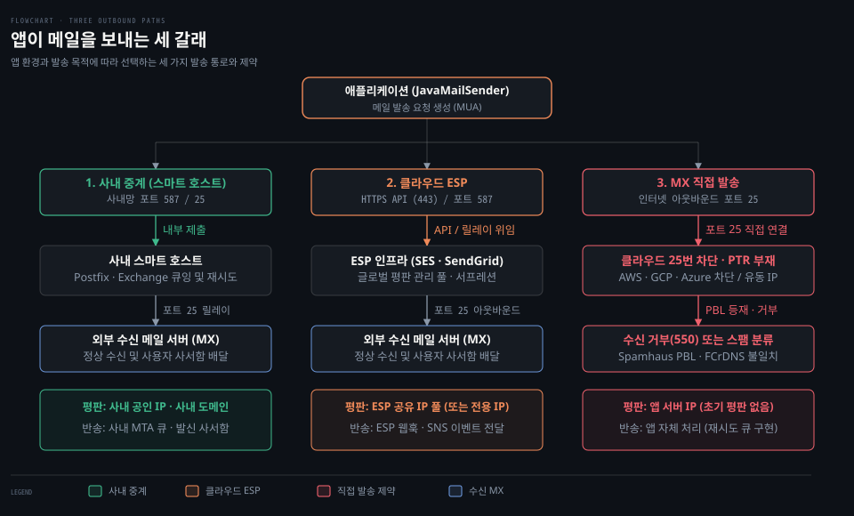
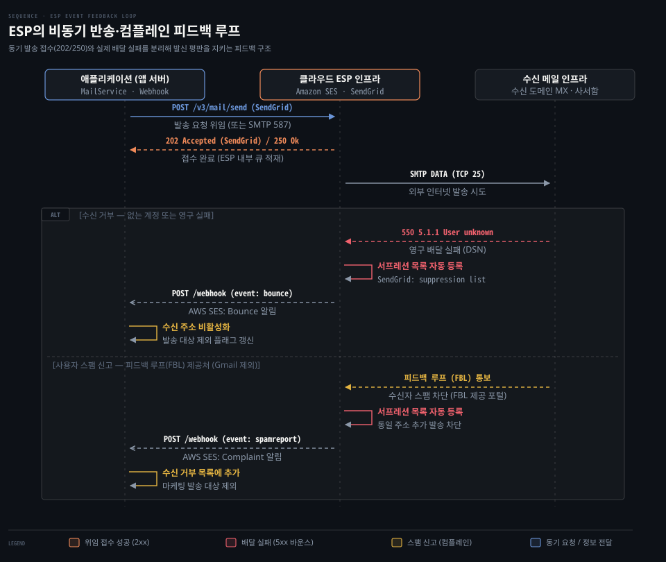

# 스마트 호스트·ESP·MX 직접 발송

---

> 앱이 메일을 보내는 길은 사내 중계·ESP·MX 직접 발송 세 갈래입니다. 어느 갈래를 고르느냐에 따라 발신 평판 관리와 재시도 책임이 달라집니다.

웹 애플리케이션에서 회원가입 인증이나 비밀번호 재설정 메일을 발송할 때, 많은 개발자가 `JavaMailSender` 설정에 호스트와 포트만 입력하고 넘어갑니다. 로컬 개발 환경에서는 테스트 메일이 잘 전송되는 것처럼 보여도, 실제 클라우드 환경에 배포하는 순간 연결이 시간 초과되거나 스팸함으로 직행하는 문제를 마주하게 됩니다.

이러한 현상이 발생하는 이유는 인터넷 메일 생태계가 오랜 스팸 공격을 겪으며 발신 서버의 IP와 도메인 평판을 엄격하게 검증하도록 진화했기 때문입니다. 애플리케이션이 공용 인터넷의 수신 메일 서버와 직접 통신하는 방식은 발송 평판이나 PTR, 도메인 인증이 없는 상태에서는 거부되거나 스팸으로 분류되기 쉽습니다.

앱이 메일을 세상 밖으로 내보내는 길은 크게 세 가지로 나뉩니다. 사내 메일 인프라에 위임하는 사내 중계, 전문 클라우드 서비스에 맡기는 ESP, 그리고 수신 서버로 직접 쏘는 MX 직접 발송입니다. 각 갈래가 요구하는 책임과 제약을 이해해야 안정적인 발송 시스템을 구축할 수 있습니다.

## 학습 목표와 범위

> 앱 발송의 세 가지 경로를 인프라 제약과 평판 관리 책임 관점에서 비교하고 적절한 아키텍처를 선택할 수 있습니다.

1. 앱이 메일을 내보내는 세 갈래(사내 중계 서버에 넘기기, ESP에 맡기기, 받는 MX에 직접 보내기)를 평판·반송·DNS 설정·재시도 책임으로 비교할 수 있습니다.
2. 클라우드·가정 IP에서 25번 직접 발송이 막히거나 스팸 처리되는 이유를 설명할 수 있습니다.
3. 트랜잭션 메일과 대량(마케팅) 메일을 섞으면 생기는 평판 문제를 설명할 수 있습니다.
4. Spring 앱의 `JavaMailSender`가 세 갈래 중 어디에 붙는지, 그리고 "보냈다(250)"가 어디까지의 성공인지 말할 수 있습니다.

## 1. 앱이 메일을 직접 배달하지 않는 이유 — 세 갈래의 지도

> 애플리케이션은 메일 배달의 모든 책임을 직접 지는 대신 신뢰된 대행 경로를 선택합니다.

HTTP API를 호출할 때는 목적지 서버의 IP를 찾아 직접 TCP 연결을 맺는 방식이 자연스럽습니다. 그렇다면 메일도 수신 도메인의 MX 레코드를 질의한 뒤 25번 포트로 직접 전송하면 충분하지 않을까요?

메일 시스템에서는 이 직관이 통하지 않습니다. 전 세계 수신 메일 서버는 발신 평판이나 PTR, 도메인 인증이 확인되지 않은 임의의 IP로부터 들어오는 25번 포트 접속을 거부하거나 스팸으로 분류하기 쉽습니다. 따라서 애플리케이션은 검증된 발송 경로를 거치는 것이 안전합니다.

위 도식은 앱이 선택할 수 있는 세 가지 발송 통로를 보여 줍니다. 각 갈래는 메일을 넘겨받는 첫 번째 접점, 인터넷으로 나가는 포트, 그리고 발송 실패 시 책임을 지는 주체가 완전히 다릅니다.

세 경로의 핵심 차이를 비교하면 다음과 같습니다.

| 비교 항목 | 1. 사내 중계 (스마트 호스트) | 2. 클라우드 ESP | 3. MX 직접 발송 |
|---|---|---|---|
| **평판 주체** | 사내 고정 공인 IP 및 도메인 | ESP 공유 IP 풀(또는 전용 IP) | 앱 서버의 개별 공인 IP |
| **반송 수신처** | 사내 MTA 큐 및 발신 사서함 | ESP 인프라 (웹훅·SNS 알림) | 앱 자체 큐 또는 로컬 MTA |
| **필수 DNS 설정** | 사내 SPF·DKIM·DMARC·PTR | ESP CNAME(DKIM)·SPF·DMARC | 발송 IP의 FCrDNS(PTR)·SPF |
| **재시도 책임** | 사내 MTA(Postfix 지수 백오프) | ESP 내부 큐 인프라 | **애플리케이션 자체 재시도 구현** |
| **포트 및 클라우드 제약** | 사내망 587/25 (차단 영향 없음) | HTTPS API(443) 또는 포트 587 | **클라우드 25번 포트 기본 차단** |
| **발송 성격 분리** | 트랜잭션 위주 (대량 발송 위험) | 서브계정·IP 풀 분리 최적화 | 분리 불가 (단일 IP 평판 연동) |

사내 중계와 ESP는 발송 큐잉과 평판 관리를 대행해 주지만, MX 직접 발송은 애플리케이션이 모든 네트워크 제약과 반송 처리를 홀로 짊어져야 합니다.

## 2. 회사가 대신 내보낸다 — 사내 중계(스마트 호스트)

> 사내 전용 메일 서버가 모든 아웃바운드 트래픽을 넘겨받아 큐잉과 전달을 전담합니다.

사내 네트워크 환경에서 구동되는 업무 시스템은 대개 인터넷으로 직접 포트 25를 열지 못하도록 방화벽 통제를 받습니다. 애플리케이션이 외부 메일 서버의 위치를 일일이 찾아다니지 않고 안전하게 발송을 끝내려면 어떻게 해야 할까요?

이 문제를 해결하기 위해 도입하는 구성이 **스마트 호스트(Smart Host)**입니다. 스마트 호스트는 사내 모든 시스템으로부터 나가는 메일을 무조건 넘겨받아 큐에 적재하고 외부 전달을 전담하는 상위 중계 메일 서버입니다. Postfix 환경에서는 `relayhost` 지시어로 스마트 호스트를 지정합니다[^google-smarthost].

애플리케이션은 스마트 호스트를 활용할 때 다음과 같은 이점을 얻습니다.

첫째, 앱 프로세스가 발송 지연에서 즉각 해방됩니다. 스마트 호스트와의 통신은 신뢰할 수 있는 사내망(포트 587 또는 25) 안에서 이루어지므로 몇 밀리초 만에 접수가 끝납니다. 앱은 외부 수신 서버의 응답 속도에 묶이지 않고 즉시 본래 비즈니스 로직으로 복귀합니다.

둘째, 재시도 처리를 사내 MTA가 전담합니다. 수신 도메인의 메일 서버가 일시적으로 다운되었거나 네트워크 장애가 발생하더라도, Postfix의 큐 관리자(`qmgr`)가 지연 큐(`deferred`)에 메일을 보관하며 지수 백오프 방식으로 재전송을 시도합니다[^postfix-overview].

셋째, 고정된 공인 IP를 통해 평판을 통제합니다. 회사의 공인 IP 대역에 대해 정방향과 역방향 DNS(PTR)를 미리 등록하고 사내 도메인의 SPF 레코드에 해당 IP를 명시해 두면, 사내 모든 서비스가 일관된 발신 신뢰도를 공유할 수 있습니다.

## 3. 전문 업체에 맡긴다 — ESP의 API·SMTP, 반송과 수신 거부 이벤트

> 전문 메일 서비스는 전송 인프라 추상화와 함께 비동기 이벤트 피드백 루프를 제공합니다.

클라우드 환경으로 인프라가 이전되면서 사내에 직접 메일 서버를 두고 24시간 IP 평판을 관리하는 일은 큰 운영 부담이 되었습니다. 대규모 메일 배달 인프라와 평판 관리를 전담해 주는 전문 서비스를 **이메일 서비스 제공업체(ESP, Email Service Provider)**라고 부릅니다[^aws-ses-guide].

대표적인 ESP로는 Amazon SES와 Twilio SendGrid가 있습니다. 이들은 표준 SMTP 인터페이스뿐만 아니라 클라우드에 최적화된 HTTPS REST API를 함께 제공합니다.

- **Amazon SES**: STARTTLS를 사용하는 25, 587, 2587 포트와 TLS 래퍼를 사용하는 465, 2465 포트를 지원하며, AWS SDK를 통한 HTTPS API 호출 방식도 함께 제공합니다[^aws-ses-smtp].
- **Twilio SendGrid**: `smtp.sendgrid.net` 호스트의 포트 587(STARTTLS)을 제공하며, 사용자명으로 고정 문자열 `apikey`를 넣고 비밀번호에 API 키를 전달합니다[^sendgrid-smtp].

ESP를 이용할 때 가장 중요한 개념은 발송 성공과 배달 성공의 분리입니다. 앱이 ESP에 메일을 전달하고 `202 Accepted`(SendGrid API 기준)나 `250 Ok`(SMTP 기준) 응답을 받았다고 해서 수신자가 메일을 읽을 수 있는 상태가 된 것은 아닙니다.

위 시퀀스 도식은 ESP가 메일을 접수한 뒤 실제 배달 과정에서 생기는 예외를 앱에 어떻게 피드백하는지 보여 줍니다.

수신 메일 서버가 존재하지 않는 계정이라며 거부(`550 5.1.1 User unknown`)하면 하드 바운스가 발생합니다[^sendgrid-events]. 또한 수신자가 스팸 신고 버튼을 누르면 피드백 루프(FBL, Feedback Loop)를 제공하는 수신 포털에 한해 ESP에 컴플레인 통보가 접수됩니다[^aws-ses-notifications]. 단, Gmail처럼 ESP에 FBL 컴플레인 데이터를 제공하지 않는 수신 서비스에서는 사용자가 웹에서 스팸 버튼을 눌러도 이 통보가 계정 서프레션 목록으로 자동 유입되지 않습니다[^aws-ses-suppression].

ESP는 이러한 문제가 발생한 주소를 즉시 **서프레션 목록(Suppression List)**에 등록합니다[^sendgrid-events]. 서프레션 목록은 배달 실패나 스팸 신고가 접수된 수신자 주소로 메일이 다시 발송되지 않도록 차단하는 보호 장치입니다. 이를 무시하고 실패 주소로 계속 발송을 시도하면 반송률과 컴플레인 비율이 올라 ESP 계정 평판과 발송 권한이 떨어지고, 장기적으로는 발신 IP와 도메인이 글로벌 블록리스트에 등재될 위험이 커집니다.

동시에 ESP는 웹훅이나 SNS 알림으로 앱 서버에 이벤트를 전달합니다[^sendgrid-events][^aws-ses-notifications]. SendGrid는 `bounce`와 `spamreport`, Amazon SES는 `Bounce`와 `Complaint` 이벤트를 발행합니다. 애플리케이션은 이 이벤트를 받아 데이터베이스 내 발송 대상 주소를 비활성화해야 합니다.

## 4. 직접 MX에 보낼 때 생기는 문제 — 25번 차단, PTR, 평판

> 퍼블릭 클라우드 인스턴스에서 외부 25번 포트로 직접 발송하는 시도는 거의 예외 없이 실패합니다.

외부 중계 서버나 유료 ESP 없이 앱 서버 소켓으로 수신 도메인의 MX 서버에 직접 연결하면 왜 안 될까요? 비용을 아끼려는 의도로 직접 발송을 시도할 수 있지만 현대 클라우드 인프라에서는 이 시도가 원천 차단됩니다.

주요 퍼블릭 클라우드 벤더는 스팸 발송 어뷰징을 방지하기 위해 아웃바운드 25번 포트를 엄격하게 차단하고 있습니다.

- **Google Cloud Platform (Compute Engine)**: 스팸 및 어뷰징 위험을 방지하기 위해 외부 대상 TCP 25번 포트 아웃바운드 연결을 기본적으로 전면 차단합니다[^gcp-port25].
- **Amazon Web Services (EC2 · Lambda)**: 스팸 방지를 위해 모든 EC2 인스턴스와 Lambda 함수에서 아웃바운드 25번 포트 트래픽을 기본 제한 및 차단합니다[^aws-ec2-port25].
- **Microsoft Azure**: 대다수 구독 유형에서 플랫폼 보호를 위해 25번 포트 아웃바운드를 기본 차단하며, 인증된 587 중계 서비스 사용을 강력히 권고합니다[^azure-port25].

클라우드 방화벽을 예외 신청하여 뚫거나 온프레미스 서버를 쓴다고 해도 수신 서버의 신뢰성 검증 장벽이 기다립니다.

가장 대표적인 검증이 **정방향 확인 역방향 DNS(FCrDNS)**입니다[^rfc1912]. 수신 메일 서버는 연결을 맺은 발송 IP를 역방향(PTR)으로 조회하여 호스트 이름을 확인합니다. 이어 그 이름을 다시 정방향 A 레코드로 조회해 원래 발송 IP와 일치하는지 대조합니다[^rfc1912]. 동적 IP나 사전 설정이 없는 클라우드 인스턴스 IP는 기본 상태에서 범용 이름이 지정되어 있거나 PTR 레코드가 없어 이 검증을 통과하기 어렵습니다. 클라우드에서도 고정 IP에 별도 PTR을 등록할 수 있지만, 기본 상태에서는 발송 평판을 얻기 어렵습니다.

또한 가정용 인터넷이나 유동 IP 대역은 스팸하우스의 정책 블록리스트인 **Spamhaus PBL(Policy Blocklist)**에 사전에 등재되어 있습니다[^spamhaus-pbl]. PBL은 인증되지 않은 SMTP 메일을 직접 발송해서는 안 되는 최종 사용자 IP 대역 목록이며, 많은 수신 메일 서버가 이 목록을 대조해 비인증 직접 발송 연결을 거부합니다.

## 5. 한 IP 로 다 보내면 생기는 문제 — 트랜잭션 메일과 대량 메일의 분리

> 마케팅 메일의 낮은 평판이 서비스 운영에 필수적인 인증 메일의 배달 성공률을 파괴합니다.

비밀번호 재설정 메일과 대량 프로모션 메일을 동일한 발신 IP에서 함께 발송하면 어떤 문제가 발생할까요? 하나의 메일 서버나 동일한 발신 IP에서 두 종류의 메일을 모두 쏘아 올리면 치명적인 발송 장애로 이어질 수 있습니다.

사용자의 특정 행동에 의해 즉각 1:1로 유발되는 메일을 **트랜잭션 메일(Transactional Email)**이라고 부르며, 다수 수신자에게 동시에 보내는 홍보성 메일을 **대량 메일(Bulk / Marketing Email)**이라고 부릅니다.

대량 마케팅 메일은 아무리 정당한 회원이라도 사용자가 관심이 없으면 스팸으로 신고할 확률이 높습니다. 만약 동일한 IP를 사용하고 있다면, 마케팅 메일로 인해 발송 IP의 평판 점수가 깎이고 수신 메일 서비스의 임시 차단(스로틀링)이 걸리는 순간, 신규 가입자의 본인 인증 메일까지 함께 지연되거나 스팸함으로 격리됩니다.

Google의 발송자 지침(Email Sender Guidelines)은 한 IP에서 모든 메시지를 보내는 구성을 이상으로 봅니다. 다만 여러 IP를 쓴다면 메시지 유형별로 IP를 나누고 유형별 From 주소를 분리하며, 한 메시지에 서로 다른 내용을 섞지 않기를 권합니다[^google-sender-guidelines]. ESP 들은 메일 종류별로 IP 풀이나 계정을 나눠 쓸 수 있는 기능을 제공합니다.

2024년부터 Google과 Yahoo는 대량 발송자 요건을 대폭 강화했습니다[^google-sender-guidelines][^yahoo-sender-requirements]. Google은 Gmail 계정 대상으로 하루 5,000통을 초과 발송하는 도메인에 대해 SPF와 DKIM 및 DMARC 구축을 필수로 요구합니다. 또한 스팸 신고율을 0.10% 미만으로 유지할 것을 권장하며, 0.30% 이상에 도달해서는 안 된다고 명시합니다.

아울러 마케팅 메일에는 클릭 한 번으로 구독을 해지하는 `List-Unsubscribe` 및 `List-Unsubscribe-Post: List-Unsubscribe=One-Click` 헤더(RFC 8058)가 필수입니다[^rfc8058].

신규 전용 IP를 도입할 때도 주의가 필요합니다. 과거 발송 이력이 없는 깨끗한 IP는 평판이 좋은 것이 아니라 평판이 존재하지 않는 상태입니다. 대형 수신 서버는 이력 없는 IP에서 갑자기 수만 건의 메일이 쏟아지면 스팸 공격으로 판단해 연결을 차단합니다. 따라서 마케팅용 전용 IP를 운영할 때는 발송량을 단계적으로 늘려 나가는 **IP 웜업(IP Warmup)** 절차를 거칩니다(SendGrid 자동 웜업 기준 41일 소요)[^sendgrid-ip-warmup].

단, 트랜잭션 메일은 발송 시점을 앱이 통제할 수 없으므로 SendGrid는 엄격한 웜업 일정에 맞추지 말라고 안내합니다[^sendgrid-ip-warmup].

## 6. 앱은 어디에 붙나 — JavaMailSender 와 250 의 의미

> JavaMailSender 가 반환한 250 코드는 전달 완료가 아니라 첫 번째 릴레이 적재를 뜻합니다.

Spring Boot 환경에서 메일 발송 기능을 구현할 때 주로 사용하는 컴포넌트는 `JavaMailSender`입니다. 이 컴포넌트는 메일 규약상 사용자를 대신해 메일을 작성하고 송신 서버에 넘기는 **MUA(Mail User Agent)** 역할을 합니다.

`JavaMailSender`는 인터넷의 최종 수신 서버(MX)에 직접 붙는 도구가 아닙니다. 설정 파일(`application.yml`)의 `spring.mail.host`와 `port`에는 앞서 살펴본 세 갈래 중 "사내 스마트 호스트"나 "ESP의 SMTP 릴레이 엔드포인트"가 들어갑니다.

여기서 백엔드 개발자가 가장 흔하게 저지르는 실수가 SMTP 응답 코드의 해석입니다. `mailSender.send(mimeMessage)` 메서드가 예외 없이 실행되고 메일 서버가 `250 2.0.0 Ok: queued` 응답을 돌려주면, 개발자는 해당 메일이 고객의 받은편지함에 무사히 배달되었다고 확신합니다.

하지만 표준 규약(RFC 5321 §6.1)에서 DATA 명령에 대한 250 응답이 보장하는 경계는 접속한 첫 번째 중계 서버가 메시지를 최종 배달하거나 다른 서버로 중계할 책임을 넘겨받았다는 사실뿐입니다[^rfc5321].

중계 서버에 메일이 안착한 뒤의 여정은 완전히 비동기로 진행됩니다. 외부 수신 도메인의 MX를 찾아 접속하고 그레이리스팅 지연을 거칩니다. 이어 SPF와 DKIM 서명을 대조받은 뒤에야 최종 사용자 메일함에 도달합니다. 상대방 메일함이 꽉 찼거나 계정이 삭제되어 반송되는 사건은 한참 뒤에 별도의 반송 메일(DSN)이나 웹훅 이벤트로 돌아옵니다.

따라서 안정적인 메일 발송 서비스를 만들려면 애플리케이션 계층에서 자체적인 발송 보장 장치를 갖추어야 합니다. 발송 요청을 먼저 데이터베이스에 기록하는 트랜잭셔널 아웃박스 패턴이 그런 장치입니다. 실패 유형에 따라 어디까지 다시 보낼지 정하는 재시도 기준도 함께 있어야 합니다.

## 스스로 확인할 질문

> 세 갈래의 발송 구조와 평판 관리 원리를 스스로 점검해 봅니다.

1. 애플리케이션 서버가 수신 도메인의 MX 레코드를 직접 조회하여 포트 25로 메일을 배달하지 않고, 사내 스마트 호스트나 클라우드 ESP에 위임하는 구조적 이유는 무엇입니까?
2. AWS EC2나 Google Cloud Compute Engine 인스턴스에서 외부 메일 서버의 포트 25로 직접 TCP 연결을 시도할 때 연결이 맺어지지 않는 근본적인 이유는 무엇입니까?
3. 회원가입 본인 인증 메일과 프로모션 마케팅 메일을 동일한 발신 IP 주소에서 발송하면 어떤 장애 위험이 발생할 수 있습니까?
4. Spring 애플리케이션에서 `JavaMailSender.send()`가 예외 없이 성공하고 SMTP 서버로부터 250 응답을 받았다면, 메일 배달의 라이프사이클 중 어느 단계까지 성공한 것입니까?
5. 클라우드 ESP를 통해 메일을 발송할 때, 메일 발송 API 응답(202/250)과 웹훅으로 수신되는 바운스(Bounce)·컴플레인(Complaint) 이벤트를 왜 분리하여 처리해야 합니까?

## 정답 (자답 후 펼치기)

> 각 질문의 핵심 원리와 설계 근거를 대조해 봅니다.

1. **전송 지연 해소와 평판 관리 위임 때문입니다.** 수신 MX에 직접 보내면 네트워크 지연과 재시도 큐잉을 앱이 모두 떠안아야 합니다. 또한 전 세계 수신 서버는 사전에 FCrDNS(PTR)와 도메인 인증(SPF·DKIM), 발송 이력 평판이 검증되지 않은 임의의 IP에서 들어오는 연결을 거부하거나 스팸으로 분류하기 쉽습니다. 스마트 호스트나 ESP에 위임하면 앱은 지연 없이 즉시 제어권을 회복하고, 검증된 고정 IP 풀과 재시도 큐를 활용할 수 있습니다.
2. **클라우드 벤더의 아웃바운드 포트 25 기본 차단 정책 때문입니다.** Google Cloud, AWS, Azure 등 주요 클라우드는 인스턴스가 스팸 봇으로 악용되는 것을 막기 위해 외부 25번 포트를 대부분 기본 차단합니다(Azure EA·MCA-E, AWS 해제 신청 등 예외 존재). 따라서 클라우드 환경에서는 587(STARTTLS) 포트나 443(HTTPS API) 포트를 사용하는 중계 방식을 주로 사용해야 합니다.
3. **발신 IP 평판 오염으로 인한 핵심 트랜잭션 메일의 동반 수신 차단 위험 때문입니다.** 대량 마케팅 메일에서 수신 거부, 하드 바운스, 스팸 신고가 누적되면 해당 IP의 신뢰도 점수가 떨어지고 수신 포털의 스팸 차단이나 블록리스트 등재 위험이 커집니다. 동일 IP를 공유하는 트랜잭션 메일(비밀번호 재설정, 결제 내역 등) 역시 동일한 스팸 차단 처리를 받아 수신자 편지함에 도달하지 못하게 됩니다.
4. **첫 번째 릴레이 메일 서버(스마트 호스트 또는 ESP)가 메시지를 접수하여 배달 또는 중계할 책임을 넘겨받은 단계까지 성공한 것입니다.** 이는 최종 수신자의 메일함 배달 성공을 의미하지 않습니다. 수신자 메일 서버와의 실제 통신, 그레이리스팅 지연, 스팸 필터 검사, 계정 유효성 검증은 이후 비동기로 진행되며, 최종 배달 실패는 사후 반송 메일(DSN)이나 웹훅 이벤트를 통해서만 확인할 수 있습니다.
5. **동기식 전송 접수와 비동기식 최종 배달 결과의 시차가 존재하기 때문입니다.** ESP의 발송 접수 시점에는 수신 메일함의 존재 여부나 사용자의 스팸 신고 여부를 알 수 없습니다. 이후 수신 서버의 5xx 거부나 사용자의 스팸 차단(FBL 제공 포털에 한함)이 발생했을 때 웹훅 이벤트를 받아 앱 데이터베이스의 주소를 비활성화(서프레션 연동)해야만 발신 도메인과 IP의 글로벌 평판 손상을 지속적으로 방지할 수 있습니다.

## 출처와 관련 문서

> 본문에 인용한 RFC 표준과 공식 기술 문서입니다.

[^google-smarthost]: Google Workspace Admin Help — Route outgoing SMTP relay messages through Google — `https://support.google.com/a/answer/2956491`
[^postfix-overview]: Wietse Venema — Postfix Architecture Overview (Queue Manager & Deferred Queue) — `https://www.postfix.org/OVERVIEW.html`
[^aws-ses-guide]: Amazon Web Services — Amazon Simple Email Service 개발자 안내서 — `https://docs.aws.amazon.com/ses/latest/dg/Welcome.html`
[^aws-ses-smtp]: Amazon Web Services — Amazon SES SMTP 엔드포인트에 연결 — `https://docs.aws.amazon.com/ses/latest/dg/smtp-connect.html`
[^aws-ses-notifications]: Amazon Web Services — Amazon SNS를 사용한 발송 활동 모니터링 — `https://docs.aws.amazon.com/ses/latest/dg/monitor-sending-activity-using-notifications.html`
[^aws-ses-suppression]: Amazon Web Services — Using the Amazon SES account-level suppression list — `https://docs.aws.amazon.com/ses/latest/dg/sending-email-suppression-list.html`
[^sendgrid-smtp]: Twilio SendGrid Documentation — Getting Started with the SendGrid SMTP API — `https://www.twilio.com/docs/sendgrid/for-developers/sending-email/getting-started-smtp`
[^sendgrid-events]: Twilio SendGrid Documentation — Event Webhook Reference (Bounce & Spam Report) — `https://www.twilio.com/docs/sendgrid/for-developers/tracking-events/event`
[^sendgrid-ip-warmup]: Twilio SendGrid Documentation — Warming Up an IP Address — `https://www.twilio.com/docs/sendgrid/ui/sending-email/warming-up-an-ip-address`
[^gcp-port25]: Google Cloud Documentation — Compute Engine 인스턴스에서 이메일 전송 (포트 25 제한) — `https://docs.cloud.google.com/compute/docs/tutorials/sending-mail`
[^aws-ec2-port25]: AWS re:Post — How do I remove the throttle on port 25 from my EC2 instance or Lambda function? — `https://repost.aws/knowledge-center/ec2-port-25-throttle`
[^azure-port25]: Microsoft Learn — Troubleshoot outbound SMTP connectivity issues in Azure — `https://learn.microsoft.com/en-us/troubleshoot/azure/virtual-network/troubleshoot-outbound-smtp-connectivity`
[^spamhaus-pbl]: The Spamhaus Project — Policy Blocklist (PBL) — `https://www.spamhaus.org/blocklists/policy-blocklist/`
[^rfc1912]: D. Barr — Common DNS Operational and Configuration Errors (Section 2.1: Inconsistent, Missing, or Extraneous PTR Records) — `https://www.rfc-editor.org/rfc/rfc1912#section-2.1`
[^google-sender-guidelines]: Google Gmail Help — Email sender guidelines (대량 발송자 요건 및 발송 분리) — `https://support.google.com/mail/answer/81126`
[^yahoo-sender-requirements]: Yahoo Postmaster — Sender Requirements & Recommendations — `https://senders.yahooinc.com/best-practices`
[^rfc8058]: J. Levine, T. Herf — Signaling One-Click Functionality for List-Unsubscribe Header Fields (Section 3.1) — `https://www.rfc-editor.org/rfc/rfc8058#section-3.1`
[^rfc5321]: J. Klensin — Simple Mail Transfer Protocol (Section 6.1: Reliable Delivery and Replies by Email) — `https://www.rfc-editor.org/rfc/rfc5321#section-6.1`
