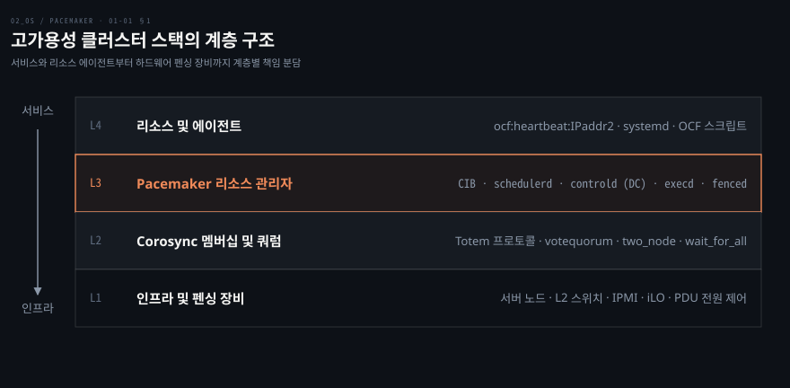

# Cluster Architecture·Quorum·Fencing
---
> 2노드 고가용성(HA) 클러스터는 통신 단절 시 발생하는 스플릿 브레인(split-brain)과 데이터 손상을 방지하기 위해 Corosync 의 멤버십·쿼럼 계층과 Pacemaker 의 상태 제어·STONITH 펜싱 계층을 엄격히 분리해 운영합니다.

## 학습 목표

> 이 문서를 읽고 나면 2노드 클러스터의 스택 분리 원리와 쿼럼 투표, STONITH 펜싱 및 가상 IP 이동 메커니즘을 설명하고 검증할 수 있습니다.

1. Corosync 와 Pacemaker 및 리소스 에이전트의 책임 경계를 설명할 수 있습니다.
2. 2노드 환경에서 쿼럼 과반이 성립하지 않는 한계와 `two_node: 1` 및 `wait_for_all` 의 동작을 비교할 수 있습니다.
3. `no-quorum-policy` 설정값에 따른 클러스터 동작 변화와 `stonith-enabled=false` 의 위험성을 판단할 수 있습니다.
4. 리소스 인계 시 STONITH 펜싱 순서와 `ocf:heartbeat:IPaddr2` 의 gratuitous ARP 전송 원리를 설명할 수 있습니다.

다루지 않는 범위가 있습니다.

클러스터 리소스 제약 조건과 장애 복구 임계치 설정은 이어지는 01-02 편에서 다룹니다.


## 1. 클러스터 계층 구조와 역할 분담

> 클러스터는 멤버십과 메시징을 담당하는 Corosync 와 리소스 상태 전이를 통제하는 Pacemaker 로 책임을 분리해 노드 장애에 대응합니다.

단일 서버에서 서비스를 운영하면 프로세스 충돌이나 하드웨어 고장이 났을 때 서비스가 완전히 중단됩니다.
이 다운타임을 없애려면 여러 서버를 묶어 장애 시 다른 노드가 서비스를 이어받는 고가용성 클러스터가 필요합니다.
서버 상태를 감지하고 서비스를 안전하게 넘기려면 계층별로 명확한 역할 분담이 이루어져야 합니다.



도식의 맨 아래는 서버 하드웨어와 전원 제어 장비입니다.
가운데에는 클러스터 통신과 멤버십을 판정하는 Corosync 와 리소스 배치를 스케줄링하는 Pacemaker 가 위치합니다.
맨 위에서는 리소스 에이전트가 실제 서비스 데몬과 가상 IP 를 제어합니다.

### Corosync 와 Pacemaker 의 책임 경계

Corosync 는 클러스터 인프라의 통신 계층입니다.[^pcmk-intro]
토템 링 프로토콜을 사용해 노드 사이에 심장박동 신호와 상태 메시지를 신뢰성 있게 전달합니다.
어떤 노드가 살아 있고 죽었는지를 멤버십 데이터베이스에 유지하고 쿼럼을 계산합니다.
Corosync 는 클러스터 내부에서 어떤 서비스나 프로세스가 동작하는지 전혀 알지 못합니다.

Pacemaker 는 클러스터의 두뇌에 해당하는 리소스 관리자입니다.[^pcmk-intro]
Corosync 가 보고하는 노드 생존 정보와 멤버십 변화를 입력으로 받습니다.
CIB 설정 파일과 현재 상태를 비교해 리소스를 어디서 켜고 끌지 결정합니다.
Pacemaker 는 독자적인 통신 채널을 파지 않고 Corosync 의 메시징에 전적으로 의존합니다.

### Pacemaker 핵심 데몬과 DC 선출

Pacemaker 내부에서는 여러 서브 데몬이 역할을 나누어 동작합니다.[^pcmk-daemons]
최상위 프로세스인 `pacemakerd` 는 다른 데몬들을 기동하고 비정상 종료 시 다시 살려냅니다.
`pacemaker-based` 는 클러스터 정보 베이스인 CIB 를 동기화하고 변경 요청을 반영합니다.
`pacemaker-attrd` 는 노드별 속성 상태를 관리합니다.

`pacemaker-schedulerd` 는 CIB 스냅샷을 읽어 목표 상태로 가기 위한 최적의 전이 경로를 계산합니다.
`pacemaker-execd` 는 로컬 노드에서 리소스 에이전트 스크립트를 실제로 실행하고 결과를 받습니다.
`pacemaker-fenced` 는 비정상 노드를 하드웨어 수준에서 차단하는 펜싱 요청을 관리합니다.
`pacemaker-controld` 는 이 모든 컴포넌트의 동작을 조율하는 컨트롤러입니다.

클러스터가 가동되면 컨트롤러 인스턴스 중 하나가 지정 컨트롤러인 DC 로 선출됩니다.[^pcmk-daemons]
클러스터의 모든 상태 변경 결정은 오직 DC 가 내립니다.
DC 가 죽으면 남아 있는 노드들 사이에서 즉시 새로운 DC 를 선출해 의사결정을 이어갑니다.

### 리소스 에이전트와 OCF 규약

Pacemaker 가 데이터베이스나 웹 서버의 바이너리 내부 동작을 직접 제어하지는 않습니다.
대신 표준화된 인터페이스인 리소스 에이전트를 통해 간접 제어합니다.[^pcmk-ra]
가장 널리 쓰이는 표준은 Open Cluster Framework 규약입니다.

에이전트는 셸 스크립트나 파이썬 실행 파일 형태로 제공됩니다.
Pacemaker 는 환경 변수로 설정을 넘기고 `start`, `stop`, `monitor` 같은 명령 인자를 줍니다.
에이전트는 동작 결과를 표준 OCF 반환 코드로 응답합니다.
성공은 `0`(`OCF_SUCCESS`), 정상 정지는 `7`(`OCF_NOT_RUNNING`), 일반 오류는 `1`(`OCF_ERR_GENERIC`)입니다.


## 2. 쿼럼 연산과 2노드 클러스터

> 분산 노드는 과반 투표로 정상 분할을 판정하지만 2노드 환경에서는 과반이 성립하지 않으므로 corosync 의 특수 모드를 적용해야 합니다.

네트워크 단절로 노드 사이가 갈라졌을 때 어느 쪽 분할이 서비스를 유지할 자격이 있는지 판단해야 합니다.
이 자격을 부여하는 투표 메커니즘이 쿼럼입니다.

### 과반 투표 원리와 2노드의 분할 문제

Corosync 의 투표 모듈인 `votequorum` 은 각 노드에 기본 1표의 투표권을 부여합니다.[^man-votequorum]
클러스터가 정상 동작하려면 전체 투표권의 50% 를 넘는 과반수를 확보해야 합니다.
예를 들어 3노드 클러스터에서는 2표 이상, 5노드 클러스터에서는 3표 이상을 얻은 분할만 쿼럼을 갖습니다.

2노드 클러스터에서는 과반수가 성립하지 않는 구조적 한계가 발생합니다.
전체 투표권이 2표이므로 과반수는 `(2 / 2) + 1 = 2` 표입니다.
즉 두 노드가 모두 살아 있고 서로 통신할 때만 쿼럼이 성립합니다.
노드 하나가 죽거나 하트비트 링크가 끊어지면 양쪽 모두 1표씩만 남아 쿼럼을 잃습니다.
아무 조치도 취하지 않으면 두 노드 모두 모든 서비스를 내려 버려 고가용성을 달성할 수 없습니다.

### two_node 와 wait_for_all 설정

Corosync 는 2노드 구성을 지원하기 위해 `corosync.conf` 에 `two_node: 1` 옵션을 제공합니다.[^man-votequorum]
이 옵션을 켜면 Corosync 는 쿼럼 성립 기준을 인위적으로 1표로 낮춥니다.
따라서 한 노드가 다운되어 혼자 남아도 쿼럼을 유지하고 서비스를 지속할 수 있습니다.

`two_node: 1` 을 활성화하면 Corosync 는 `wait_for_all` 기능을 자동으로 함께 켭니다.[^man-votequorum]
`wait_for_all` 은 부팅 시 모든 노드가 최소 한 번은 동시에 보여야만 쿼럼을 부여하는 기능입니다.
이 기능이 없으면 두 노드가 부팅될 때 먼저 켜진 노드가 1표로 쿼럼을 선언합니다.
그 결과 늦게 켜지는 상대 노드를 장애로 오인해 강제 격리하는 부팅 경합이 발생합니다.
클러스터 관리자는 `wait_for_all: 0` 으로 강제 해제하지 않는 한 이 안전장치의 보호를 받습니다.

### no-quorum-policy 설정값과 동작

노드가 통신 단절로 쿼럼을 잃었을 때 Pacemaker 가 취할 행동은 `no-quorum-policy` 가 결정합니다.[^pcmk-cluster-options]
Pacemaker 가 지원하는 설정값과 동작은 다음과 같습니다.

| 정책 값 | 동작 메커니즘 | 특징 및 위험성 |
|---|---|---|
| `stop` | 해당 분할의 모든 리소스를 즉시 정지합니다 | 기본값이며 데이터 보호에 가장 안전합니다 |
| `freeze` | 실행 중인 리소스를 유지하되 장애 복구를 멈춥니다 | 신규 기동은 차단하지만 비정상 노드 방치는 위험합니다 |
| `ignore` | 쿼럼 상실을 무시하고 리소스 관리를 계속합니다 | 2노드에서 펜싱 장비 없이 쓸 때 스플릿 브레인을 유발합니다 |
| `demote` | 승격된 리소스를 강등하고 나머지는 정지합니다 | Pacemaker 2.0.5 부터 지원하며 읽기 전용 전환에 씁니다 |
| `fence` | 쿼럼을 잃은 분할에 속한 노드를 강제 펜싱합니다 | Pacemaker 2.1.9 부터 지원합니다. 같은 동작의 옛 이름 `suicide` 는 2.1.9 부터 사용 중단(deprecated) 예고 상태이며 3.0 문서에도 남아 있습니다[^pcmk-nqp-suicide] |

`two_node: 1` 설정을 쓰는 2노드 클러스터에서는 노드 하나가 쿼럼을 유지하므로 양쪽 모두 살아남을 위험이 있습니다.
따라서 쿼럼 완화 설정만으로는 안전할 수 없으며 하드웨어 펜싱이 반드시 결합되어야 합니다.


## 3. 스플릿 브레인과 STONITH 펜싱

> 통신이 단절된 노드를 단순히 죽었다고 가정하면 두 노드가 리소스를 동시에 기동해 데이터가 파괴되므로 STONITH 펜싱으로 상대를 강제 격리해야 합니다.

두 서버 사이의 통신망이 끊기면 각 노드는 상대방의 상태를 알 수 없어 스스로 서비스를 띄우려 합니다.
이처럼 통신이 단절된 상황에서 양쪽 노드가 동일한 리소스를 동시에 기동하면 데이터가 파괴되는 문제가 발생합니다.

### 통신 두절과 죽었다는 가정의 오류

노드 1 과 노드 2 사이의 네트워크 스위치 장애나 링크 단절이 발생했다고 가정합니다.
노드 1 의 관점에서는 노드 2 에서 날아오던 하트비트 패킷이 끊어집니다.
이때 노드 1 은 노드 2 의 실제 상태를 알 방법이 없습니다.

노드 2 의 전원이 꺼진 것인지, 커널 패닉으로 멈춘 것인지 로컬 노드는 알 수 없습니다.
단순히 네트워크 케이블만 빠진 것인지도 구분할 수 없습니다.

만약 클러스터가 응답이 없다는 이유로 상대가 죽었다고 가정하면 데이터 오염이 발생합니다.[^pcmk-fencing-why]
노드 2 도 하트비트를 받지 못하므로 노드 1 이 죽었다고 똑같이 가정합니다.
결과적으로 두 노드가 동시에 활성 상태를 선언하고 같은 가상 IP 와 공유 디스크를 잡습니다.
이 현상을 스플릿 브레인이라고 부릅니다.
두 노드가 공유 스토리지 블록에 서로 다른 데이터를 덮어쓰면 복구할 수 없는 영구 손상이 발생합니다.

### STONITH 펜싱 순서와 전원 차단

Pacemaker 는 스플릿 브레인을 막기 위해 STONITH 메커니즘을 사용합니다.[^pcmk-fencing-why]
상대방이 죽었다고 가정하지 않고, 물리적 수단을 동원해 상대를 확실하게 끄고 확인하는 방식입니다.

펜싱 장치는 서버 본체와 독립된 관리 채널을 가집니다.[^pcmk-fence-devices]
지능형 PDU 나 IPMI, iLO 같은 원격 관리 컨트롤러를 전원 차단 장비로 사용합니다.
장애 발생 시 리소스 인계는 엄격한 순서로 진행됩니다.

1. 노드 1 의 Corosync 가 노드 2 와의 통신 두절을 감지하고 Pacemaker 에 보고합니다.
2. Pacemaker 의 DC 는 노드 2 의 격리를 결정하고 `pacemaker-fenced` 에 펜싱을 명령합니다.
3. 펜스 에이전트가 관리망을 통해 노드 2 의 전원 제어 장비에 접속해 전원을 물리적으로 차단합니다.
4. 장비로부터 전원 차단 완료 응답을 수신한 뒤에야 `pacemaker-fenced` 는 성공을 DC 에 보고합니다.
5. DC 는 상대가 완전히 격리되었음을 확인한 직후 비로소 노드 1 에서 리소스를 기동합니다.

상대 노드가 완전히 꺼졌음을 외부 장비로 입증하기 전까지는 절대로 리소스를 넘겨받지 않는다는 점이 핵심 규칙입니다.

### stonith-enabled 비활성화의 위험

테스트 환경을 구축할 때 설정이 번거롭다는 이유로 `stonith-enabled=false` 로 설정하는 경우가 흔합니다.
공식 문서는 이 설정의 위험성을 강력하게 경고합니다.[^pcmk-cluster-options]

`stonith-enabled=false` 로 지정하면 Pacemaker 는 펜싱을 수행할 수 없습니다.
응답하지 않는 노드가 생기면 클러스터는 그 노드의 리소스가 모두 꺼졌다고 가정합니다.
그리고 살아 있는 노드에서 즉시 리소스 복구를 시작합니다.

상대 노드가 살아 있는 상태에서 일시적 지연을 겪은 것이라면 양쪽 노드가 동시에 디스크를 씁니다.
그 결과 파일시스템 블록이 깨져 즉각 데이터 손실이 발생합니다.
따라서 상용 프로덕션 클러스터에서 `stonith-enabled=false` 설정은 절대로 허용되지 않습니다.


## 4. 가상 IP 인계와 Gratuitous ARP

> 노드 장애 시 가상 IP 가 이동해도 네트워크 스위치와 이웃 장비가 옛 MAC 주소를 기억하면 트래픽이 끊기므로 IPaddr2 가 GARP 를 연속 브로드캐스트합니다.

클러스터 리소스가 안전하게 인계되어도 외부 클라이언트가 새 활성 노드로 패킷을 보내지 못하면 무중단 서비스가 성립하지 않습니다.
이 네트워크 계층의 전환을 담당하는 것이 가상 IP 리소스와 Gratuitous ARP 입니다.

### ARP 캐시와 IP 이동 시의 통신 단절

동일한 이더넷 로컬 네트워크에서 호스트가 통신할 때는 IP 주소가 아닌 물리 MAC 주소를 씁니다.
클라이언트와 게이트웨이 라우터, 네트워크 스위치는 IP 와 MAC 의 매핑을 ARP 캐시 테이블에 보관합니다.

클러스터의 가상 IP 인 `192.0.2.100` 이 원래 노드 1 에서 서비스되고 있었다고 가정합니다.
노드 1 에 장애가 발생해 Pacemaker 가 가상 IP 를 노드 2 로 넘겼습니다.

노드 2 의 네트워크 인터페이스에 가상 IP 가 바인딩되어도 외부 네트워크는 이 사실을 모릅니다.
클라이언트와 라우터의 ARP 캐시에는 여전히 노드 1 의 옛 MAC 주소가 남아 있기 때문입니다.
일반적인 리눅스 커널의 ARP 캐시 만료 시간은 수십 초에서 수 분에 이릅니다.
이 시간 동안 외부 패킷은 죽은 노드로 향해 패킷 블랙홀이 발생합니다.

### IPaddr2 의 GARP 브로드캐스트

Pacemaker 의 표준 가상 IP 에이전트인 `ocf:heartbeat:IPaddr2` 는 Gratuitous ARP 패킷을 보냅니다.[^ra-ipaddr2]
Gratuitous ARP 는 요청이 없어도 호스트가 자신의 IP 와 MAC 주소를 알리기 위해 쏘는 브로드캐스트 패킷입니다.

`IPaddr2` 의 `run_arp_sender` 함수는 주소를 올린 직후 ARP 전송 명령을 만듭니다.[^ra-ipaddr2]
전송 프로그램은 `arp_sender` 매개변수로 고르며 기본값은 `send_arp` 바이너리입니다.
IPv4 에서는 기본으로 백그라운드(`arp_bg`)에서 실행합니다.

```bash
# arp_sender=iputils_arping 으로 바꿨을 때 IPaddr2 가 만드는 명령 형식
# (기본값 send_arp 일 때는 send_arp 바이너리를 부른다)
arping -U -c 5 -I eth0 192.0.2.100
```

`IPaddr2` 에는 전송과 관련된 매개변수가 두 개 있습니다.
전송 횟수인 `arp_count` 의 기본값은 `5` 회입니다.
전송 간격인 `arp_interval` 의 기본값은 `200` 밀리초입니다.
다만 `arp_interval` 은 사용 중단 예고(deprecated) 상태이고, libnet 으로 빌드한 `send_arp` 에서만 효과가 있습니다.[^ra-ipaddr2-interval]
libnet 없이 빌드한 리눅스용 `send_arp` 는 간격 옵션을 무시하고 iputils `arping` 처럼 약 1초에 한 번씩 보냅니다.[^ra-sendarp-linux]

새 노드는 이렇게 GARP 패킷 5개를 네트워크에 보냅니다.
이웃 스위치와 호스트는 이 패킷을 받으면 ARP 테이블을 새 노드의 MAC 주소로 갱신합니다.
L2 스위치의 포트 학습 테이블도 함께 갱신되어 패킷 전달 경로가 새 노드로 바뀝니다.

### 네트워크 스위치 설정과 갱신 지연

`IPaddr2` 가 정상적으로 GARP 를 송출해도 네트워크 스위치 보안 정책 때문에 지연이 생길 수 있습니다.
기업 네트워크 환경에서 자주 마주치는 병목 요인은 다음과 같습니다.

- 동적 ARP 검사(DAI): 스위치가 바인딩 테이블에 없는 ARP 패킷을 공격으로 간주해 차단하면 새 주소가 등록되지 않습니다.
- 포트 보안: 스위치 포트당 허용되는 MAC 주소 개수가 제한되어 있으면 새 MAC 학습이 거부됩니다.
- GARP 무시 정책: 일부 네트워크 장비는 기본값으로 Gratuitous ARP 를 무시하고 표준 ARP 요청만 수용합니다.

따라서 HA 클러스터를 구성할 때는 물리 스위치가 GARP 패킷을 허용하고 포트 보안에 걸리지 않는지 확인해야 합니다.


## 5. 관련 실습

> 아래는 실습 계획이며, 이 문서를 쓰는 시점에는 실측하지 않았습니다.

- **실습 환경(계획)**: AlmaLinux 9 기반 2노드 가상 머신(`node1: 192.0.2.11`, `node2: 192.0.2.12`)
- **실행 명령**: `corosync-quorumtool -s` 및 `pcs cluster status` 로 쿼럼과 펜싱 상태 확인
- **검증 기준**: `two_node: 1` 적용 시 `Flags:` 줄에 `2Node Quorate WaitForAll` 이 찍히는지 확인합니다.[^corosync-quorumtool]
- **확인할 것**: 한 노드를 정지했을 때 남은 노드가 단독으로 쿼럼을 유지하는지 봅니다. 실측하지 않음.


## 6. 검증과 복습

> 2노드 고가용성 구조 설계와 펜싱 순서에 대한 핵심 개념 점검입니다.

- **Phase 4 결과**: 아직 없음
- **다음 보완점**: 01-02 편에서 다룰 리소스 위치 및 순서 제약 조건과 장애 임계치 설정으로 연결합니다.


## 결정 치트시트

> 2노드 고가용성 환경의 핵심 클러스터 설정 항목과 권장 구성 기준입니다.

| 상황 및 요구조건 | 권장 설정값 | 결정 이유 |
|---|---|---|
| 노드가 정확히 2대인 구성 | Corosync `two_node: 1`, `wait_for_all: 1` | 1개 노드 다운 시에도 쿼럼을 유지하며 부팅 경합을 방지합니다 |
| 쿼럼을 잃은 파티션 발생 시 | Pacemaker `no-quorum-policy=stop` | 양쪽 동시 가동을 차단하고 공유 자원 손상을 막는 가장 안전한 기본값입니다 |
| 프로덕션 환경의 데이터 보호 | Pacemaker `stonith-enabled=true` | 상대 노드 전원 차단 검증 없이 리소스를 넘기면 스플릿 브레인이 발생합니다 |
| VIP 전환 시 ARP 캐시 갱신 | `IPaddr2` `arp_count=5`(기본값) | GARP 5개를 보내 이웃 장비의 ARP 캐시를 새 MAC 으로 바꿉니다. `arp_interval` 은 libnet 빌드 `send_arp` 에서만 효과가 있습니다 |


## 핵심 개념 체크리스트

> 클러스터 아키텍처와 쿼럼 및 펜싱 원리를 설명할 수 있는지 스스로 점검합니다.

- [ ] Corosync 가 담당하는 영역과 Pacemaker 가 담당하는 영역의 차이를 설명할 수 있는가?
- [ ] 2노드 클러스터에서 쿼럼 과반 계산이 실패하는 원인과 `two_node: 1` 의 역할을 설명할 수 있는가?
- [ ] `wait_for_all` 기능이 부팅 시에 필요한 이유를 설명할 수 있는가?
- [ ] 스플릿 브레인 상황에서 상대를 "죽었다고 가정"하면 안 되는 구체적인 이유를 알고 있는가?
- [ ] STONITH 펜싱이 완료된 후에야 리소스를 기동해야 하는 순서적 필연성을 이해하고 있는가?
- [ ] `stonith-enabled=false` 설정이 왜 데이터 손실로 이어지는지 설명할 수 있는가?
- [ ] `ocf:heartbeat:IPaddr2` 가 Gratuitous ARP 를 연속 전송해야 하는 네트워크 배경을 설명할 수 있는가?


## 참고 자료

[^pcmk-intro]: ClusterLabs. "Pacemaker Explained (2.1) — 1.2. What Is Pacemaker?". <https://clusterlabs.org/projects/pacemaker/doc/2.1/Pacemaker_Explained/html/intro.html> (조회일: 2026-11-17)

[^pcmk-daemons]: ClusterLabs. "Pacemaker Explained (2.1) — 1.2.2. Pacemaker Architecture". <https://clusterlabs.org/projects/pacemaker/doc/2.1/Pacemaker_Explained/html/intro.html#pacemaker-architecture> (조회일: 2026-11-17)

[^pcmk-ra]: ClusterLabs. "Pacemaker Explained (2.1) — 5.2. Resource Standards". <https://clusterlabs.org/projects/pacemaker/doc/2.1/Pacemaker_Explained/html/resources.html#resource-standards> (조회일: 2026-11-17)

[^man-votequorum]: Corosync Project. "votequorum(5) — Corosync Votequorum Library Configuration". Debian Manpages. <https://manpages.debian.org/testing/corosync/votequorum.5.en.html> (조회일: 2026-11-17)

[^pcmk-cluster-options]: ClusterLabs. "Pacemaker Explained (2.1) — 3.3. Cluster Options". <https://clusterlabs.org/projects/pacemaker/doc/2.1/Pacemaker_Explained/html/cluster-options.html#cluster-options> (조회일: 2026-11-17)

[^pcmk-fencing-why]: ClusterLabs. "Pacemaker Explained (2.1) — 8.2. Why Is Fencing Necessary?". <https://clusterlabs.org/projects/pacemaker/doc/2.1/Pacemaker_Explained/html/fencing.html#why-is-fencing-necessary> (조회일: 2026-11-17)

[^pcmk-fence-devices]: ClusterLabs. "Pacemaker Explained (2.1) — 8.3. Fence Devices". <https://clusterlabs.org/projects/pacemaker/doc/2.1/Pacemaker_Explained/html/fencing.html#fence-devices> (조회일: 2026-11-17)

[^ra-ipaddr2]: ClusterLabs resource-agents. "heartbeat/IPaddr2 — Open Cluster Framework IPaddr2 resource agent". GitHub. <https://github.com/ClusterLabs/resource-agents/blob/main/heartbeat/IPaddr2> (조회일: 2026-11-17)

[^ra-ipaddr2-interval]: ClusterLabs resource-agents. "heartbeat/IPaddr2" — `arp_interval` 매개변수 설명. "This parameter is deprecated and used for the backward compatibility only. It is effective only for the send_arp binary which is built with libnet". <https://github.com/ClusterLabs/resource-agents/blob/main/heartbeat/IPaddr2> (조회일: 2026-11-17)

[^ra-sendarp-linux]: ClusterLabs resource-agents. "tools/send_arp.linux.c" — 사용법 문구 "repeatinterval-ms: ignored", 전송은 `alarm(1)` 주기. <https://github.com/ClusterLabs/resource-agents/blob/main/tools/send_arp.linux.c> (조회일: 2026-11-17)

[^pcmk-nqp-suicide]: ClusterLabs. "Pacemaker Explained (2.1) — 3.3. Cluster Options", `no-quorum-policy` 항목. "suicide: same as fence (deprecated since 2.1.9)". 3.0 판도 같은 문장. <https://clusterlabs.org/projects/pacemaker/doc/3.0/Pacemaker_Explained/html/cluster-options.html> (조회일: 2026-11-17)

[^corosync-quorumtool]: Corosync Project. "tools/corosync-quorumtool.c" — `Flags:` 줄에 `2Node`, `Quorate`, `WaitForAll` 을 찍는 코드. <https://github.com/corosync/corosync/blob/main/tools/corosync-quorumtool.c> (조회일: 2026-11-17)

- [02_os/docs/pacemaker README](./README.md) — Pacemaker 공식 문서 정독 연재와 아키텍처 개요
- [02_os/ MOC](../../README.md) — 리눅스 OS 공통 기반 및 네트워크
- [OS 학습 로드맵](../../os-keywords.md) — 고가용성 클러스터 및 네트워크 L2/L3 계층 키워드
