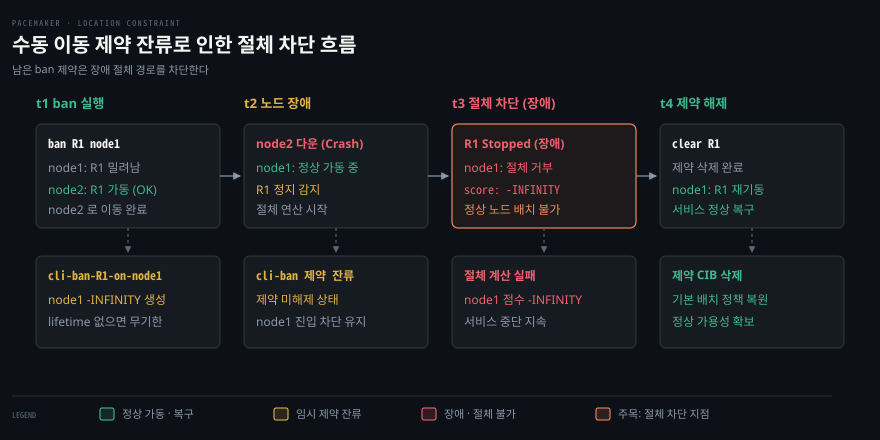

# Cluster Status·Resource Constraints·Failure Handling

---

> Pacemaker 클러스터의 상태 출력(pcs status)을 해석하고, 실패 계수와 제약 조건(constraints)이 장애 절체(failover)를 방해하지 않도록 안전하게 운영·조작하는 방법을 다룹니다.

## 학습 목표와 범위

> pcs status 의 각 블록을 읽어 장애 징후를 식별하고, 수동 이동(move)과 실패 누적이 유발하는 절체 불능 상태를 제약 조건 및 정리(cleanup) 명령으로 해결하는 방법을 배웁니다.

1. `pcs status` 의 주요 블록을 읽고 장애 지점을 진단할 수 있습니다.
2. `migration-threshold` 와 `failure-timeout` 의 동작 원리를 설명할 수 있습니다.
3. `pcs resource ban`(과 pcs 0.10 이하의 `move`)이 남기는 제약을 파악하고 `clear` 로 절체 차단을 예방할 수 있습니다.
4. `pcs node standby` 와 `maintenance-mode`, `unmanage` 의 차이를 비교할 수 있습니다.


## 1. pcs status 출력과 장애 신호 식별

> pcs status 의 네 가지 핵심 블록과 Failed Resource Actions 이 남기는 오류 흔적을 읽어 장애 위치를 판별합니다.

클러스터에 장애가 발생했거나 서비스가 예기치 않게 멈췄을 때, 원인을 찾지 못하면 복구 작업이 지체됩니다. 전체 시스템 로그를 무작정 뒤지기 전에 클러스터의 현재 멤버십과 리소스 배치 상태를 먼저 파악해야 합니다. 상태 출력이 의미하는 바를 모르면 어떤 노드가 통신 두절이고 어느 서비스가 중단되었는지 빠르게 식별하기 어렵습니다.

ClusterLabs 「Clusters from Scratch」(2.1) §7.5 에 실린 정상 상태의 `pcs status` 출력은 다음과 같습니다[^cfs-status].

```bash
[root@pcmk-1 ~]# pcs status
Cluster name: mycluster
Cluster Summary:
  * Stack: corosync
  * Current DC: pcmk-1 (version 2.1.2-4.el9-ada5c3b36e2) - partition with quorum
  * Last updated: Wed Jul 27 00:49:33 2022
  * Last change:  Wed Jul 27 00:49:16 2022 by root via cibadmin on pcmk-1
  * 2 nodes configured
  * 3 resource instances configured

Node List:
  * Online: [ pcmk-1 pcmk-2 ]

Full List of Resources:
  * fence_dev       (stonith:some_fence_agent):      Started pcmk-1
  * ClusterIP       (ocf:heartbeat:IPaddr2):         Started pcmk-1
  * WebSite (ocf:heartbeat:apache):  Started pcmk-1

Daemon Status:
  corosync: active/disabled
  pacemaker: active/disabled
  pcsd: active/enabled
```

### 상태 블록별 의미와 판별 기준

출력은 네 가지 영역으로 나뉘며 줄마다 다른 계층의 건강 상태를 나타냅니다.

- **Cluster Summary**: 클러스터 기본 정보입니다.
  - `Stack: corosync`: 하부 통신 엔진으로 Corosync 가 정상 작동 중임을 알립니다.
  - `Current DC`: 클러스터 의사결정을 총괄하는 지정 컨트롤러(Designated Controller)가 떠 있는 노드입니다[^pcmk-dc].
  - `partition with quorum`: 과반 정족수를 확보했음을 나타냅니다. 이 표시가 `WITHOUT quorum` 으로 바뀌면 리소스 기동이 전면 중단됩니다.
  - `Last updated`, `Last change`: 상태 갱신 시각과 마지막 CIB(Cluster Information Base) 수정 주체입니다.
  - `2 nodes configured`, `3 resource instances configured`: 등록된 총 노드 수와 리소스 인스턴스 개수입니다.
- **Node List**: 클러스터 참여 노드의 상태입니다.
  - `online`: 통신이 정상이고 리소스를 호스팅할 수 있는 활성 상태입니다.
  - `standby`: 노드가 살아 있으나 리소스 배치가 금지된 대기 상태입니다.
  - `OFFLINE`: 데몬이 멈췄거나 네트워크가 단절되어 클러스터에서 이탈한 상태입니다.
- **Full List of Resources**: 서비스 가동 상태입니다.
  - `Started <node>`: 지정된 노드에서 리소스가 정상 가동 중입니다.
  - `Stopped`: 어떤 노드에서도 리소스가 실행되지 않는 정지 상태입니다.
  - `FAILED`: 기동 또는 감시(monitor) 작업이 실패한 상태입니다.
  - 리소스 그룹(`Resource Group`)에 속한 자원들은 목록 순서대로 순차 시작되고 역순으로 정지됩니다.
- **Daemon Status**: 로컬 노드의 핵심 서비스 상태입니다.
  - 앞쪽 `active` 는 데몬이 지금 돌고 있다는 뜻이고, 뒤쪽 `enabled`/`disabled` 는 부팅 때 자동으로 시작하는지입니다. 위 출력처럼 `corosync`·`pacemaker` 가 `active/disabled` 여도 클러스터는 정상 동작합니다[^cfs-status].

### 실패 액션 기록과 오류 잔류

리소스 기동이나 감시 도중 오류가 발생하면 `Failed Resource Actions` 블록이 출력에 추가됩니다. RHEL 9 공식 문서 §2.1 에 수록된 장애 출력 예시는 다음과 같습니다[^rhel9-ha-failed].

```bash
Failed Resource Actions:
* WebSite_monitor_60000 on z1.example.com 'not running' (7): call=13, status=complete, exitreason='none',
    last-rc-change='Thu Oct 11 23:45:50 2016', queued=0ms, exec=0ms
```

항목별 의미는 다음과 같습니다.

- `WebSite_monitor_60000 on z1.example.com`: 대상 리소스(`WebSite`)와 실패한 동작(60000ms 주기의 `monitor`), 그리고 실패가 발생한 노드 이름입니다.
- `'not running' (7)`: 종료 코드(rc)와 OCF 표준 설명입니다. 감시 결과 서비스가 돌고 있지 않았다는 뜻입니다.
- `call=13`: 로컬 실행기(executor)가 매긴 작업 호출 번호입니다.
- `status=complete`: 해당 작업의 실행 시도가 완료되었음을 의미합니다. 타임아웃 발생 시 `Timed Out` 으로 표기됩니다.
- `last-rc-change`: 반환 코드가 마지막으로 바뀐 시각, 곧 오류가 발생한 시각입니다.
- `exec=0ms`: 작업 실행에 소요된 밀리초 단위 시간입니다.

여기서 주의할 점이 있습니다. 리소스가 다른 노드로 정상 절체되어 현재 서비스가 돌아가고 있더라도, Pacemaker 는 이 실패 기록을 CIB 에 영구 보존합니다. 관리자가 원인을 점검하고 수동으로 정리하지 않으면 오래된 오류 메시지가 계속 화면에 남아 장애 상태로 오인하게 만듭니다.


## 2. 실패 누적과 복구 조작 원리

> 실패 계수(failcount)와 migration-threshold 가 노드를 후보에서 배제하는 과정과, 단일 노드 고착을 방지하기 위한 failure-timeout 및 cleanup 조작 순서를 설명합니다.

프로세스 충돌이나 일시적인 장애가 반복될 때, 시스템이 무한정 재시작만 시도하면 서비스 장애가 장기화됩니다. 반대로 일시적인 오류가 누적되었다고 해서 노드를 영구 격리해 버리면 여분의 자원이 있어도 활용하지 못합니다. 실패 카운터의 축적 원리를 이해하지 못하면 고가용성 클러스터가 사실상 단일 노드 시스템으로 전락합니다.

### 실패 임계치와 단일 노드 고착 위험

Pacemaker 는 리소스 작업 실패 시 노드별로 `failcount` 를 증가시킵니다. 이 카운터와 함께 `migration-threshold`, `failure-timeout` 속성이 작동합니다[^pacemaker-explained-fail].

- **migration-threshold**: 실패 횟수가 이 값에 도달하면 해당 노드 점수가 `-INFINITY` 가 됩니다. 리소스는 즉시 다른 정상 노드로 강제 절체됩니다. 기본값은 `INFINITY` 이며, 클러스터는 이 값을 무한이 아니라 아주 큰 유한 수로 다룹니다. `0` 이면 이 기능이 꺼집니다[^pacemaker-explained-fail].
- **failure-timeout**: 실패 카운터의 유효 기간입니다. 예를 들어 `failure-timeout=60s` 로 두면 마지막 실패 60초 뒤 카운터가 0으로 초기화됩니다. 설정하지 않으면 카운터는 수동 정리 전까지 영구 유지됩니다.

여기서 2노드 클러스터의 전형적인 함정이 발생합니다. 2노드 환경에서 `migration-threshold=3` 이 설정되어 있고 `failure-timeout` 이 없다고 가정합니다. node1 에서 세 번의 오류가 발생해 임계치를 채우면 리소스는 node2 로 넘어갑니다.

이후 관리자가 node1 의 시스템을 점검하고 소프트웨어를 정상 상태로 고쳤더라도, CIB 안의 failcount 는 여전히 3으로 남아 있습니다. 즉 node1 의 배치 점수는 계속 `-INFINITY` 입니다.

겉으로는 node1 이 `online` 으로 보여 정상이지만, 리소스를 받을 수 없으므로 사실상 node2 만 남은 불완전한 상태입니다. 이 상황에서 node2 에 장애가 발생하면 Pacemaker 는 node1 으로 서비스를 넘기지 못합니다. 그 리소스는 어느 노드에서도 돌지 못한 채 멈춥니다.

### 실패 확인과 복구 순서

실패 기록을 정리할 때는 반드시 원인 확인과 기록이 선행되어야 합니다.

```bash
# 리소스별 현재 실패 카운터 확인
pcs resource failcount show VirtualIP

# VirtualIP 리소스의 실패 기록을 지우고 현재 상태를 다시 확인
pcs resource cleanup VirtualIP
```

복구 조작은 다음 순서로 수행합니다.

1. **원인 조사와 로그 보존**: `pcs status` 와 시스템 저널(`journalctl -u pacemaker`)에서 실패 시각과 코드를 기록합니다.
2. **근본 원인 해결**: 설정 파일 결함, 네트워크 단절, 마운트 실패 등 서비스가 실패한 하부 원인을 먼저 물리적으로 조치합니다.
3. **cleanup 실행**: 조치가 끝난 뒤 `pcs resource cleanup <리소스명>` 을 실행합니다. 이 명령은 실패 카운터를 0으로 재설정하고 `Failed Resource Actions` 내역을 CIB 에서 지웁니다.
4. **상태 재평가 확인**: Pacemaker 는 즉시 리소스 상태를 재조회(re-probe)하고 정상 노드를 다시 후보군으로 편입합니다.


## 3. 수동 이동 제약과 절체 차단 메커니즘

> pcs resource ban 과 옛 move 명령이 남기는 위치 제약이 후속 장애 시 자동 절체(failover)를 가로막는 원리와 해결 절차를 다룹니다.

운영자가 ban 으로 리소스를 다른 노드로 밀어낸 뒤 제약을 방치하면 문제가 생깁니다. 대상 노드가 죽었을 때 리소스가 원래 노드로 가지 못하고 멈춥니다. 수동 조작 명령이 시스템 내부에서 어떤 제약을 생성하는지 모르면 고가용성이 무력화됩니다.



위 도식은 수동 조작이 장애 절체를 가로막는 4단계 과정을 보여줍니다. t1 에서 생성된 `cli-ban` 제약이 CIB 에 남으면 위험합니다. t2 에서 노드가 다운되었을 때 t3 처럼 정상 노드로의 이동이 거부됩니다. t4 에서 제약을 삭제해야만 서비스가 복구됩니다.

### 위치 제약의 자동 생성과 부작용

Pacemaker 의 제약 조건(Constraints)은 크게 세 종류입니다[^rhel9-ha-constraints].

- **Location(위치)**: 특정 노드에 리소스를 배치하거나 배제하는 점수 규칙입니다(`pcs constraint location`).
- **Colocation(동시 배치)**: 두 리소스가 같은 노드에 함께 머물거나 분리되는 관계입니다(`pcs constraint colocation`).
- **Order(순서)**: 리소스 간 기동 및 정지 선후 관계를 규정합니다(`pcs constraint order`).

관리자가 편의를 위해 실행하는 `move` 와 `ban` 명령은 사실 Location 제약을 등록하는 명령어입니다[^pcs-man-011].

- `pcs resource move R1 node2`: node2 에 `INFINITY` 선호 점수를 부여하는 `cli-prefer-R1` 제약을 생성합니다. 노드를 지정하지 않고 실행하면 현재 노드에 `-INFINITY` 점수를 부여하는 `cli-ban-R1-on-<노드>` 제약을 생성합니다[^pcmk-cli-ids].
- `pcs resource ban R1 node1`: node1 에 `-INFINITY` 점수를 부여하는 `cli-ban-R1-on-node1` 제약을 만듭니다.

두 명령이 남기는 제약의 수명은 다릅니다. pcs 0.11 부터 `move` 는 리소스가 새 위치에서 돌기 시작하면 방금 만든 제약을 스스로 지웁니다[^pcs-man-011]. 반면 `ban` 은 `lifetime` 을 주지 않으면 제약을 무기한 남깁니다. 옛 동작을 그대로 둔 `move-with-constraint` 와 pcs 0.10 이하의 `move` 도 마찬가지입니다.

남은 제약 가운데 절체를 막는 것은 `-INFINITY` 인 `cli-ban` 입니다. Pacemaker 에서 양수 점수는 선호일 뿐이고, `-INFINITY` 만 "피해야 한다"를 "반드시 피한다"로 바꿉니다[^pcmk-location-score].

예를 들어 `ban R1 node1` 로 R1 을 node2 로 보낸 뒤 제약을 그대로 두었다고 가정합니다. 리소스가 머물고 있는 node2 에 전원 차단이나 커널 패닉이 발생하면, Pacemaker 는 node1 으로 failover 를 시도합니다. 그러나 node1 에는 `-INFINITY` 제약이 걸려 있어 점수 계산 결과 배치가 거부됩니다. 그 결과 살아 있는 정상 노드가 있음에도 리소스는 `Stopped` 상태에 빠집니다.

`cli-prefer` 가 남은 경우는 다릅니다. node2 가 죽으면 리소스는 node1 으로 정상 절체되지만, node2 가 돌아오면 `INFINITY` 선호 때문에 리소스가 node2 로 되돌아갑니다.

### 제약 확인과 해제 명령

남아 있는 임시 제약을 확인하고 정리하려면 다음 명령을 사용합니다.

```bash
# 전체 제약 조건 상세 조회 (ID 포함)
pcs constraint config --full

# move·ban 으로 생성된 제약 조건 해제
pcs resource clear VirtualIP
```

`pcs constraint config --full` 을 실행하면 제약 ID 가 함께 나타납니다. move·ban 이 만든 제약은 `cli-ban-VirtualIP-on-<노드>` 나 `cli-prefer-VirtualIP` 입니다. 옛 이름 `pcs constraint list` 는 pcs 0.10.9 부터 사용 중단 예고 상태였고 pcs 0.12 에서 지워졌습니다[^pcs-man-main]. 확인 후 `pcs resource clear VirtualIP` 를 실행하면 move·ban 이 만든 제약이 삭제됩니다[^pcs-man-011]. 클러스터 기본 정책에 따른 정상 절체가 복원됩니다.

### pcs 버전별 move 동작과 자동 만료

`move` 의 동작은 pcs 버전에 따라 다릅니다[^pcs-man-011].

```bash
# pcs 0.11 이상 (RHEL 9): 이동이 끝나면 제약을 스스로 지운다
pcs resource move VirtualIP node2

# pcs 0.11 이상에서 옛 동작(제약 유지)을 원할 때, 1시간 뒤 만료
pcs resource move-with-constraint VirtualIP node2 lifetime=PT1H

# ban 도 lifetime 으로 만료 시간을 줄 수 있다
pcs resource ban VirtualIP node1 lifetime=PT1H
```

- pcs 0.10.9 에는 `move --autodelete` 옵션이 있었습니다. pcs 0.11 의 `move` 가 이 동작을 기본으로 삼았고, pcs 0.12 에서 `--autodelete` 플래그 자체가 지워졌습니다[^pcs-man-main].
- `lifetime=<기간>`: `PT1H`(1시간)이나 `PT30M`(30분)처럼 ISO 8601 기간을 정해 제약이 자동 만료되도록 지정합니다. pcs 0.11 이상에서는 `move-with-constraint` 와 `ban` 이 이 인자를 받습니다.
- 「Clusters from Scratch」 2.1 의 실습 출력에도 이 동작이 보입니다. `move` 직후 제약을 지웠다는 "has been removed" 줄이 찍힙니다[^cfs-move].


## 4. 계획 작업 방식의 비교와 선택

> 유지보수 목적과 작업 대상 단위에 따라 노드 대기(standby), 전체 유지보수(maintenance-mode), 리소스 비관리(unmanage)를 비교하고 선택 기준을 제시합니다.

계획된 유지보수 시 상황에 맞지 않는 격리를 택하면 안 됩니다. 멀쩡한 노드가 STONITH 로 강제 재부팅되거나 서비스 순단이 일어납니다. 단일 노드 패치인지, 전체 스토리지 점검인지, 개별 서비스 설정 변경인지에 따라 격리 수준을 명확히 구분해야 합니다.

### 격리 수준별 비교

세 가지 작업 방식의 핵심 특성과 차이는 다음과 같습니다.

| 격리 방식 | 실행 명령 | 제어 단위 | 리소스 상태 변화 | 적합한 작업 대상 |
|---|---|---|---|---|
| 노드 대기 (Standby) | `pcs node standby <노드>` | 단일 노드 | 다른 정상 노드로 자동 이동 (Drain) | 단일 노드 커널 패치, 하드웨어 점검, 재부팅 |
| 전체 유지보수 (Maintenance) | `pcs property set maintenance-mode=true` | 클러스터 전체 | 모든 감시와 상태 변경 동결 (Freeze) | 공유 스토리지 점검, 네트워크 스위치 교체 |
| 리소스 비관리 (Unmanage) | `pcs resource unmanage <리소스>` | 단일 리소스 | 해당 리소스만 클러스터 제어 제외 | 개별 데몬 설정 변경, 수동 기동 테스트 |

각 방식의 결정적인 차이는 리소스의 이동 여부와 클러스터 감시 데몬의 개입 여부입니다.

- `standby` 는 작업 대상 노드에 떠 있는 모든 리소스를 정상 가용 노드로 안전하게 밀어낸 뒤(drain) 노드를 비웁니다. 다른 노드에서 서비스가 계속 유지되므로 단일 노드 점검에 표준으로 쓰입니다.
- `maintenance-mode` 는 리소스를 이동시키지 않고 제자리에 둡니다. 클러스터는 어떤 리소스도 시작·정지하지 않고 반복 감시(monitor)도 멈춥니다. 공식 문서의 이 옵션 설명은 펜싱을 언급하지 않으므로, 노드가 클러스터에서 빠졌을 때 펜싱까지 꺼진다고 기대하지 않습니다.
- `unmanage` 는 노드 전체를 건드리지 않고 특정 리소스 하나만 Pacemaker 관리 대상에서 임시로 분리합니다. 관리자가 셸에서 직접 서비스를 재시작하거나 설정을 바꿀 때 유용합니다.

### 노드 정기 패치 작업 절차

단일 노드의 OS 패치 및 재부팅을 수행할 때는 `standby` 를 활용합니다.

```bash
# 1. 대상 노드를 standby 로 전환하여 리소스 배출
pcs node standby clusternode1

# 2. 리소스가 다른 노드로 정상 이동했는지 확인
pcs status

# 3. 유지보수 작업 수행 (OS 패치, 커널 업데이트, 시스템 리부트)
# reboot

# 4. 부팅 완료 후 노드 대기 상태 해제
pcs node unstandby clusternode1
```

노드가 복귀할 때 `resource-stickiness` 가 설정되어 있으면 유리합니다. 리소스가 원래 노드로 불필요하게 흔들려(failback) 생기는 서비스 끊김을 막습니다.


## 5. 한계와 다루지 않은 것

> 이 문서에서 다루지 않는 복합 리소스 의존 관계와 펜싱(STONITH)의 세부 격리 메커니즘을 짚습니다.

이 문서는 2노드 중심의 기본적인 서비스 상태 판별과 단일 리소스의 제약 및 실패 복구 조작을 기준으로 설명했습니다. 따라서 다음 항목은 본 문서의 설명 범위에 포함되지 않습니다.

- **복합 리소스 세트와 복제본 제약**: 다중 마스터 구조나 복제본 세트 간의 Colocation 계산식은 다루지 않았습니다.
- **클러스터 쿼럼 상실과 펜싱**: 쿼럼 상실 시의 분할 뇌 방어와 STONITH 전원 차단은 다루지 않았습니다. 이 내용은 인접 문서인 [01-01.Cluster Architecture·Quorum·Fencing](./01-01.Cluster%20Architecture·Quorum·Fencing.md) 에서 다룹니다.


## 6. 관련 실습

> 고가용성 클러스터의 실제 장애 절체와 펜싱 동작은 물리 또는 가상화된 다중 노드 인프라가 필수적이므로 로컬 단독 실습 코드를 포함하지 않습니다.

Pacemaker 와 Corosync 는 커널 레벨 통신과 독립된 전원 차단 장치를 전제로 동작합니다. 단일 머신 위의 컨테이너 환경에서는 실제 노드 전원 차단이나 네트워크 분할 격리 상황을 온전히 재현하기 어렵습니다. 따라서 본 저장소에는 별도의 단일 머신 실습 코드를 배치하지 않습니다.

본 문서의 `pcs status` 출력 판별과 제약 조작 결과는 KVM 기반 2노드 가상 머신 환경에서 검증할 수 있습니다. 각 조작 직후 `pcs constraint config --full` 과 `pcs cluster cib` 조회를 통해 내부 XML 변경을 확인합니다.


## 7. 검증과 복습

> Phase 4 자답과 회차별 복습은 본문에 누적하지 않고 _review/ 에 남깁니다.

- **Phase 4 결과**: 아직 없음
- **다음 보완점**: 리소스 그룹 내 부분 실패 시의 상속 규칙과 Stonith 레벨 연동 검증.


## 참고 자료

[^cfs-status]: ClusterLabs. "Clusters from Scratch (2.1) — 7.5. Ensure Resources Run on the Same Host", `pcs status` 출력. <https://clusterlabs.org/projects/pacemaker/doc/2.1/Clusters_from_Scratch/html/apache.html#ensure-resources-run-on-the-same-host> (조회일: 2026-11-17)
[^pcmk-dc]: ClusterLabs. "Pacemaker Explained (2.1) — 1.2.2. Pacemaker Architecture". "electing one of the controller instances as the Designated Controller (DC)". <https://clusterlabs.org/projects/pacemaker/doc/2.1/Pacemaker_Explained/html/intro.html#pacemaker-architecture> (조회일: 2026-11-17)
[^rhel9-ha-failed]: Red Hat Enterprise Linux 9 Configuring and managing high availability clusters. 2.1. Learning to use Pacemaker. <https://docs.redhat.com/en/documentation/red_hat_enterprise_linux/9/html-single/configuring_and_managing_high_availability_clusters/index#proc_learning-to-use-pacemaker-getting-started-with-pacemaker> (조회일: 2026-11-17)
[^pacemaker-explained-fail]: ClusterLabs. "Pacemaker Explained (2.1) — 5.4.1. Resource Meta-Attributes", `migration-threshold`·`failure-timeout` 항목. "the cluster treats INFINITY (the default) as a very large but finite number". <https://clusterlabs.org/projects/pacemaker/doc/2.1/Pacemaker_Explained/html/resources.html#resource-meta-attributes> (조회일: 2026-11-17)
[^rhel9-ha-constraints]: Red Hat Enterprise Linux 9 Configuring and managing high availability clusters. Chapter 7. Configuring resource constraints. <https://docs.redhat.com/en/documentation/red_hat_enterprise_linux/9/html/configuring_and_managing_high_availability_clusters/assembly_configuring-resource-constraints-configuring-and-managing-high-availability-clusters>
[^pcs-man-011]: ClusterLabs pcs. "pcs(8)" (pcs-0.11 브랜치) — `resource move`: "The constraint needed for moving the resource will be automatically removed once the resource is running on its new location", "NOTE: This command has been changed in pcs-0.11"; `move-with-constraint`·`ban` 의 `lifetime`; `clear`: "Remove constraints created by move and/or ban". <https://github.com/ClusterLabs/pcs/blob/pcs-0.11/pcs/pcs.8.in> (조회일: 2026-11-17)
[^pcs-man-main]: ClusterLabs pcs. "pcs(8)" (main 브랜치) — CHANGES IN PCS-0.12: `move` "its deprecated flag --autodelete has been removed", `constraint list` "has been removed. Use 'pcs constraint [location | colocation | order | ticket] config' instead". <https://github.com/ClusterLabs/pcs/blob/main/pcs/pcs.8.in> (조회일: 2026-11-17)
[^pcmk-cli-ids]: ClusterLabs Pacemaker. "tools/crm_resource_ban.c" (Pacemaker-2.1.9) — 제약 ID 를 `cli-ban-%s-on-%s`, `cli-prefer-%s` 로 만드는 코드. <https://github.com/ClusterLabs/pacemaker/blob/Pacemaker-2.1.9/tools/crm_resource_ban.c> (조회일: 2026-11-17)
[^pcmk-location-score]: ClusterLabs. "Pacemaker Explained (2.1) — 7.1. Deciding Which Nodes a Resource Can Run On", `score` 속성. "Positive values indicate a preference ... (a value of -INFINITY changes “should” to “must”)". <https://clusterlabs.org/projects/pacemaker/doc/2.1/Pacemaker_Explained/html/constraints.html#location-properties> (조회일: 2026-11-17)
[^cfs-move]: ClusterLabs. "Clusters from Scratch (2.1) — 7.8. Move Resources Manually". "using move allows pcs to get rid of the temporary constraint automatically after the resource has moved to its destination". <https://clusterlabs.org/projects/pacemaker/doc/2.1/Clusters_from_Scratch/html/apache.html#move-resources-manually> (조회일: 2026-11-17)

- [01-01.Cluster Architecture·Quorum·Fencing](./01-01.Cluster%20Architecture·Quorum·Fencing.md) — Pacemaker 와 Corosync 의 아키텍처 및 쿼럼과 펜싱(STONITH) 원리를 다룹니다.
