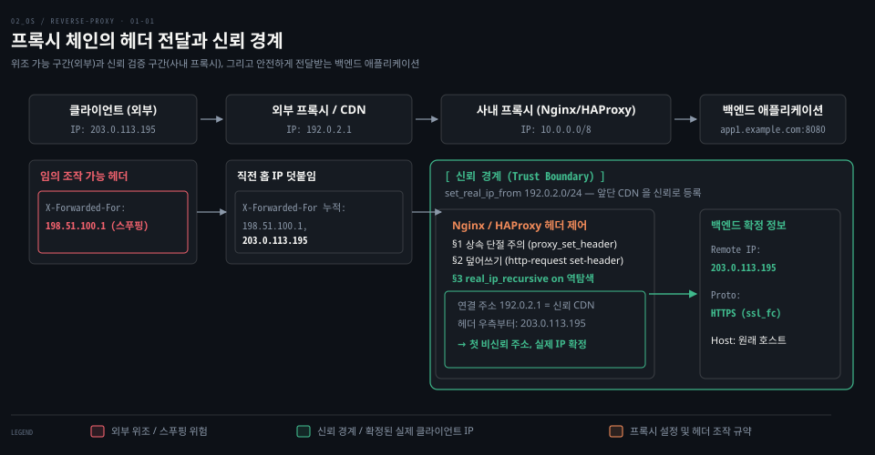

# proxy_set_header·option forwardfor
---
> 리버스 프록시가 업스트림에 클라이언트 정보를 전달할 때는 Nginx 의 proxy_set_header 상속 단절과 HAProxy 의 option forwardfor 동작 규칙을 알아야 하며, 앞단 프록시가 여럿일 때는 set_real_ip_from 과 real_ip_recursive 로 신뢰 경계를 세워야 위조 헤더를 막을 수 있습니다.

## 학습 목표

> 이 문서를 읽고 나면 아래 네 가지를 설명하고 설정할 수 있습니다.

1. Nginx `proxy_set_header` 의 상속 단절 조건과 `$proxy_add_x_forwarded_for` 동작을 설명할 수 있습니다.
2. HAProxy `option forwardfor` 와 `http-request set-header` 로 `X-Forwarded-*` 위조를 방어할 수 있습니다.
3. 중첩 프록시 환경에서 `ngx_http_realip_module` 의 `set_real_ip_from` 과 `real_ip_recursive` 로 신뢰 경계를 확정할 수 있습니다.
4. RFC 7239 `Forwarded` 표준 헤더의 필드 구조와 비표준 헤더 대비 장점을 비교할 수 있습니다.

다루지 않는 범위가 있습니다.

업스트림 기한 초과와 504 오류는 이어지는 01-02 편에서 다룹니다.

프록시의 백엔드 능동·수동 건강 검사는 01-03 편이 다룹니다.

TLS 인증서 체인 결합 순서와 파일 구성은 01-04 편에서 정리합니다.

아래 도식은 외부 클라이언트 요청이 CDN 과 사내 리버스 프록시를 거쳐 백엔드에 도달할 때까지 헤더가 쌓이는 경로를 보여 줍니다.
클라이언트가 조작한 헤더가 누적되는 과정과, 사내 프록시가 신뢰 경계로 실제 클라이언트 주소를 가려내는 과정을 살펴봅니다.



도식의 왼쪽은 외부 네트워크이고 오른쪽은 사내 신뢰 경계입니다. 클라이언트가 헤더를 조작해 보내더라도, 프록시가 자신의 직전 홉 주소를 뒤에 덧붙이고 신뢰 대역을 역탐색하면 실제 출발지 주소를 안전하게 복원할 수 있습니다.


## 1. Nginx 헤더 설정과 상속 단절

> Nginx 는 하위 블록에 proxy_set_header 지시어가 하나라도 선언되면 상위 블록의 모든 헤더 설정을 물려받지 않으므로 단계마다 필요한 헤더를 전부 다시 정의해야 합니다.

리버스 프록시를 도입한 뒤 백엔드 로그를 확인하면 모든 요청의 출발지 IP 와 Host 헤더가 프록시 자신의 주소로 바뀌어 있는 문제를 마주합니다. 클라이언트가 프록시로 HTTP 요청을 보내면, 프록시는 백엔드 서버와 완전히 새로운 TCP 연결을 맺고 요청을 다시 만듭니다. 이때 `proxy_pass` 만 적으면 Nginx 는 기본적으로 두 헤더만 재정의합니다.[^nginx-proxy] 백엔드로 가는 `Host` 헤더는 `$proxy_host`, 즉 `proxy_pass` 에 적은 대상 호스트 이름과 포트로 바뀝니다. `Connection` 헤더는 `close` 로 바뀝니다.

백엔드가 원래 가상 호스트 이름을 알아야 한다면 `proxy_set_header Host $host;` 를 직접 명시해야 합니다.[^nginx-proxy] `$host` 변수는 요청 라인의 호스트 이름, 클라이언트 요청의 `Host` 헤더 값, 일치하는 서버 이름을 차례로 찾아서 반환합니다.[^nginx-core]

### 지시어 상속 단절의 조건

`proxy_set_header` 를 쓸 때 가장 자주 겪는 장애는 상위 레벨에서 정의한 헤더가 하위 레벨에서 전부 사라지는 현상입니다. 공식 문서는 이 상속 규칙을 엄격하게 규정합니다.[^nginx-proxy] 현재 설정 레벨에 `proxy_set_header` 지시어가 하나도 없을 때만 직전 상위 레벨의 정의를 물려받습니다.

```nginx
http {
    # http 단계 공통 설정
    proxy_set_header X-Real-IP $remote_addr;
    proxy_set_header X-Forwarded-Proto $scheme;

    server {
        listen 80;
        server_name example.com;

        location / {
            # proxy_set_header 가 없으므로 상위 설정을 그대로 물려받습니다.
            proxy_pass http://backend1;
        }

        location /api/ {
            # Host 하나를 추가하는 순간 상위의 X-Real-IP 와 X-Forwarded-Proto 는 사라집니다.
            proxy_set_header Host $host;
            proxy_pass http://backend2;
        }
    }
}
```

위 설정에서 `/` 경로로 들어온 요청은 상위 `http` 블록의 헤더 설정을 정상적으로 백엔드로 넘깁니다. 반면 `/api/` 블록은 `Host` 헤더를 재정의하는 순간 상속 체인이 완전히 끊어집니다. 백엔드 `backend2` 는 `Host` 헤더만 받고 `X-Real-IP` 와 `X-Forwarded-Proto` 헤더는 받지 못합니다. 이 문제를 피하려면 헤더를 추가하는 하위 블록마다 필요한 전달 헤더를 전부 다시 적어야 합니다. 공통 헤더 묶음을 별도 설정 파일로 분리해 `include` 하는 방법도 씁니다.

### 전달 헤더 덧붙임 변수의 동작

클라이언트 IP 주소를 전달할 때는 `$remote_addr` 대신 `$proxy_add_x_forwarded_for` 내장 변수를 널리 사용합니다.[^nginx-proxy] 이 변수는 클라이언트 요청 헤더에 이미 들어 있는 `X-Forwarded-For` 값 뒤에 쉼표를 두고 현재 연결의 `$remote_addr` 주소를 덧붙입니다. 공식 문서는 쉼표만 적지만, 소스는 쉼표 뒤에 공백 하나를 더 넣어 `, ` 로 잇습니다.[^nginx-src]

클라이언트가 처음부터 `X-Forwarded-For` 헤더를 보내지 않았다면, 이 변수의 값은 `$remote_addr` 와 같습니다. 반대로 클라이언트가 이미 `X-Forwarded-For: 203.0.113.10` 헤더를 보냈고 클라이언트 실제 IP 가 `198.51.100.20` 인 상황을 가정해 봅니다. 이때 `$proxy_add_x_forwarded_for` 값은 `203.0.113.10, 198.51.100.20` 이 됩니다.

이 변수는 기존 헤더를 덮어쓰지 않고 뒤에 덧붙여 이전 프록시들이 기록한 주소 체인을 보존합니다. 하지만 클라이언트가 임의로 조작해 넣은 첫머리 주소까지 그대로 남습니다. 백엔드가 이 헤더의 첫 번째 주소를 무조건 실제 클라이언트로 신뢰하면 보안 취약점이 생깁니다.


## 2. HAProxy 헤더 설정과 위조 방어

> HAProxy 는 option forwardfor 로 수신한 헤더 끝에 클라이언트 주소를 덧붙이며 외부 위조를 차단하려면 http-request set-header 로 기존 헤더를 덮어써야 합니다.

프록시가 클라이언트 IP 를 전달하려고 단순히 헤더를 덧붙이기만 하면 악의적인 사용자가 보낸 위조 헤더가 그대로 백엔드에 흘러 들어가는 보안 사고가 발생합니다. HAProxy 는 역방향 프록시 모드로 동작할 때 백엔드에 자신의 IP 주소를 클라이언트 주소로 노출합니다.[^haproxy-manual] 백엔드가 원래 클라이언트 주소를 식별할 수 있도록 HAProxy 는 `option forwardfor` 설정을 제공합니다.

```bash
# haproxy.cfg
frontend fe_web
    bind :80
    bind :443 ssl crt /etc/haproxy/certs/site.pem
    mode http
    option forwardfor
    default_backend be_app

backend be_app
    mode http
    http-request set-header X-Forwarded-Proto https if { ssl_fc }
    http-request set-header X-Forwarded-Proto http unless { ssl_fc }
    server app1 app1.example.com:8080 check
```

`option forwardfor` 는 요청이 백엔드로 나갈 때 `X-Forwarded-For` 헤더를 삽입합니다.[^haproxy-manual] 기본 문법은 `option forwardfor [ except <network> ] [ header <name> ] [ if-none ]` 형태입니다.

- `except <network>`: 특정 네트워크 대역에서 들어온 요청에는 헤더를 추가하지 않습니다. 같은 HAProxy 가 클라이언트의 직접 접속과 다른 리버스 프록시를 거친 접속을 함께 받을 때 씁니다. 매뉴얼의 예는 같은 장비의 stunnel 이 이미 헤더를 붙여 보내는 경우라, 루프백(`127.0.0.1`)에서 온 요청에는 다시 붙이지 않습니다.
- `header <name>`: 기본 헤더 이름인 `X-Forwarded-For` 대신 다른 이름을 지정합니다. 백엔드가 고유한 헤더를 요구할 때 유용합니다.
- `if-none`: 클라이언트 요청에 해당 헤더가 아직 존재하지 않을 때만 헤더를 추가합니다. 매뉴얼은 이 키워드를 완전히 신뢰하는 환경에서만 쓰라고 경고합니다. 클라이언트가 헤더를 미리 넣어 보내면 HAProxy 가 아무것도 붙이지 않아, 백엔드가 위조 값만 받기 때문입니다.

### 덧붙임과 덮어쓰기의 보안 차이

`option forwardfor` 의 중요한 특징은 요청 헤더 목록의 맨 끝에 값을 항상 추가한다는 점입니다.[^haproxy-manual] 클라이언트가 이미 조작된 `X-Forwarded-For` 헤더를 달고 들어왔을 때, HAProxy 는 이를 지우지 않습니다. 실제 클라이언트 IP 를 담은 `X-Forwarded-For` 헤더를 헤더 목록 맨 끝에 하나 더 붙입니다. 그래서 공식 매뉴얼은 백엔드 서버가 이 헤더를 해석할 때 반드시 목록의 마지막 값만 사용하도록 설정하라고 강조합니다.[^haproxy-manual]

반면 클라이언트가 보낸 헤더를 신뢰할 수 없는 환경에서는 덧붙이는 동작만으로 부족합니다. 이때는 `http-request set-header` 지시어를 씁니다.[^haproxy-manual]

`http-request add-header` 는 헤더가 이미 있어도 새 헤더를 끝에 하나 더 붙입니다. 반면 `http-request set-header` 는 동일한 이름의 헤더가 이미 존재하면 그것을 전부 먼저 삭제한 뒤 새 값을 기록합니다.[^haproxy-manual] 외부 사용자가 요청에 임의로 끼워 넣은 보안 헤더를 강제로 무효화하고 프록시가 검증한 값만 남길 때 필수적인 지시어입니다.

### TLS 종료 상태와 프로토콜 확정

클라이언트가 프록시와는 HTTPS 로 통신하고 프록시와 백엔드 사이는 HTTP 로 통신하는 구조가 흔합니다. 이때 백엔드는 요청이 안전한 프로토콜로 들어왔는지 확인하기 위해 `X-Forwarded-Proto` 헤더를 읽습니다.

HAProxy 는 앞단 연결의 TLS 종료 여부를 판별하는 `ssl_fc` 샘플 페치(sample fetch)를 제공합니다.[^haproxy-manual] 프런트엔드 연결이 SSL/TLS 로 들어와 HAProxy 가 직접 복호화했다면 `ssl_fc` 는 참이 됩니다.

`http-request set-header X-Forwarded-Proto https if { ssl_fc }` 규칙은 조건이 참일 때만 실행됩니다.[^haproxy-manual] 이 규칙 하나만 두면 평문 HTTP 로 들어온 요청에서는 아무 일도 일어나지 않습니다. 그래서 클라이언트가 위조해 보낸 `X-Forwarded-Proto: https` 가 그대로 백엔드에 닿습니다. 위 설정이 `unless { ssl_fc }` 규칙을 짝으로 두는 이유입니다. 두 규칙이 함께 있어야 어느 경로로 들어오든 클라이언트 값이 지워지고, 프록시가 직접 TLS 를 풀었을 때만 `https` 가 기록됩니다.


## 3. 다중 프록시와 realip 신뢰 경계

> 여러 프록시를 거치는 환경에서는 클라이언트 위조 헤더가 누적되므로 set_real_ip_from 과 real_ip_recursive 로 신뢰할 프록시 대역만 건너뛰고 첫 비신뢰 IP 를 골라내야 합니다.

프록시 서버가 여러 대 중첩된 다중 홉 인프라에서는 클라이언트가 조작한 가짜 주소와 정상적인 프록시 IP 가 하나의 헤더에 뒤섞여 어느 IP 를 믿어야 할지 분간하기 어렵습니다. 외부 클라우드 CDN 이나 WAF, L4/L7 로드밸런서가 앞단에 서고, 그 뒤에 내부 Nginx 가 선 뒤 백엔드로 전달되는 구조가 대표적입니다.

클라이언트 실제 IP 가 `203.0.113.195` 인 공격자가 악의적으로 `X-Forwarded-For: 198.51.100.1` 헤더를 실어 요청을 보냈다고 가정해 보겠습니다.
주소가 `192.0.2.1` 인 CDN 은 직전 홉 주소인 `203.0.113.195` 를 덧붙입니다. 헤더 값은 `198.51.100.1, 203.0.113.195` 로 누적됩니다.
그 뒤 사내 Nginx 가 요청을 받으면 소켓 레벨의 `$remote_addr` 는 바로 앞 CDN 주소인 `192.0.2.1` 로 잡힙니다.

이때 백엔드가 헤더의 첫 번째 주소를 클라이언트로 믿으면 공격자가 조작한 `198.51.100.1` 에 속아 넘어가 권한 검증이나 속도 제한이 무력화됩니다. 이 예처럼 신뢰하는 프록시가 CDN 하나뿐이면 마지막 주소가 실제 클라이언트입니다. 하지만 CDN 과 사내 Nginx 사이에 프록시가 한 단 더 서면, 마지막 주소는 클라이언트가 아니라 CDN 주소가 됩니다.

### realip 모듈의 역방향 신뢰 탐색

Nginx 는 이 문제를 해결하기 위해 `ngx_http_realip_module` 을 제공합니다.[^nginx-realip] 이 모듈은 신뢰할 수 있는 프록시 주소 대역을 지정하고 헤더를 파싱해 실제 클라이언트 주소로 `$remote_addr` 를 덮어씁니다. 기본 빌드에는 들어 있지 않아 `--with-http_realip_module` 옵션으로 빌드해야 합니다.[^nginx-realip]

```nginx
# 신뢰할 수 있는 외부 CDN 및 내부 프록시 IP 대역 선언
set_real_ip_from  192.0.2.0/24;
set_real_ip_from  10.0.0.0/8;

# 클라이언트 IP 를 추출할 헤더 지정
real_ip_header    X-Forwarded-For;

# 신뢰할 수 있는 프록시를 거슬러 올라가는 재귀 탐색 활성화
real_ip_recursive on;
```

`set_real_ip_from` 은 올바른 대체 주소를 보낸다고 신뢰할 수 있는 프록시 주소를 등록합니다.[^nginx-realip] 단일 IP, CIDR 대역, 유닉스 도메인 소켓(`unix:`)을 지정할 수 있습니다.

`real_ip_header` 의 기본값은 `X-Real-IP` 입니다.[^nginx-realip] 그래서 `X-Forwarded-For` 를 읽으려면 위 예처럼 직접 적어야 합니다.

`real_ip_recursive` 옵션은 탐색 알고리즘을 결정합니다.[^nginx-realip] 기본값은 `off` 입니다.

- `real_ip_recursive off`: 연결을 맺은 `$remote_addr` 가 신뢰 주소 목록에 부합할 때, `real_ip_header` 에 명시된 헤더의 맨 마지막(우측) 주소를 새 클라이언트 주소로 취하고 탐색을 끝냅니다.
- `real_ip_recursive on`: 헤더의 맨 마지막 주소부터 오른쪽에서 왼쪽으로 역방향 탐색을 수행합니다. 탐색 중 만난 주소가 `set_real_ip_from` 에 등록된 신뢰 프록시 주소라면 건너뛰고 계속 왼쪽으로 이동합니다. 그러다 **처음으로 신뢰 목록에 없는 주소**를 마주치는 순간 탐색을 멈추고 그 주소를 실제 클라이언트 주소로 확정합니다.

위 예시 시나리오에서 헤더 값이 `198.51.100.1, 203.0.113.195` 로 들어왔다면, Nginx 는 연결 소켓인 `192.0.2.1` 이 신뢰 대역임을 확인합니다. `real_ip_recursive on` 은 헤더의 가장 오른쪽 주소인 `203.0.113.195` 를 검사합니다. 이 주소는 `set_real_ip_from` 에 없는 외부 공인 IP 입니다. 따라서 탐색을 멈추고 `203.0.113.195` 를 실제 클라이언트 주소로 확정합니다. 클라이언트가 맨 왼쪽에 조작해 넣은 `198.51.100.1` 은 평가조차 받지 않고 버려집니다.

이 예에서는 `off` 로 두어도 결과가 같습니다. 헤더의 마지막 주소가 이미 비신뢰 주소이기 때문입니다. `on` 이 필요해지는 것은 신뢰하는 프록시가 둘 이상 겹칠 때입니다.

CDN 뒤에 `10.0.0.0/8` 대역의 사내 로드밸런서가 한 단 더 있다고 해 봅니다. 로드밸런서도 직전 홉을 덧붙이므로 Nginx 가 받는 헤더는 `198.51.100.1, 203.0.113.195, 192.0.2.1` 이 됩니다. 이때 연결 주소는 로드밸런서 주소입니다. `off` 면 마지막 주소인 CDN 주소 `192.0.2.1` 을 클라이언트로 잡습니다. `on` 이면 신뢰 대역인 `192.0.2.1` 을 건너뛰고 `203.0.113.195` 에서 멈춥니다.

교체되기 전 원래 연결 주소가 필요할 때를 대비해, 이 모듈은 `$realip_remote_addr` 와 `$realip_remote_port` 변수에 원래 소켓 주소를 남겨 둡니다.[^nginx-realip]

### RFC 7239 표준 규약과 이점

`X-Forwarded-For`, `X-Forwarded-Proto`, `X-Forwarded-Host` 처럼 `X-` 접두사로 시작하는 헤더들은 사실상의 표준으로 쓰였지만 정식 표준이 아니었습니다. 정보가 헤더 여러 개에 흩어져 있어서, 어느 주소와 어느 프로토콜이 같은 홉의 정보인지 묶어 볼 수도 없었습니다. IETF 는 이 정보를 한 헤더로 모은 RFC 7239(Forwarded HTTP Extension)를 표준 트랙(Standards Track) 문서로 냈습니다.[^rfc7239]

RFC 7239 는 네 가지 정보를 하나의 표준 `Forwarded` 헤더 필드에 세미콜론(`;`)과 파라미터 쌍으로 묶어 표현합니다.[^rfc7239]

```http
Forwarded: for=203.0.113.195;proto=https;host=example.com;by=192.0.2.1
```

- `for`: 요청을 보낸 클라이언트나 이전 프록시의 식별자입니다. IPv6 주소는 대괄호로 감싸고 큰따옴표를 붙입니다(`for="[2001:db8:cafe::17]:4711"`).
- `proto`: 클라이언트가 접속할 때 사용한 프로토콜(`http` 또는 `https`)입니다.
- `host`: 클라이언트가 요청한 원래의 `Host` 헤더 값입니다.
- `by`: 요청을 수신해 전달한 프록시 인터페이스의 식별자입니다.

프록시를 여러 단계 거치면 각 프록시는 기존 `Forwarded` 헤더 끝에 쉼표(`,`)로 새 요소를 이어 붙이거나, 헤더 블록 끝에 `Forwarded` 필드를 새로 하나 더합니다.[^rfc7239] 첫 번째 요소는 첫 번째 프록시가 추가한 정보이고, 마지막 요소는 가장 최근 프록시가 추가한 정보가 됩니다.

헤더가 표준이 되었다고 값을 믿어도 되는 것은 아닙니다. RFC 7239 의 보안 고려사항(§8.1)은 `Forwarded` 헤더가 정확하다고 기대할 수 없다고 적습니다.[^rfc7239] 요청하는 클라이언트를 포함해 경로 상의 모든 노드가 값을 바꿀 수 있기 때문입니다.

이 절은 프록시를 검증해 신뢰 목록에 올리는 방법을 하나의 접근으로 소개하며 약점 두 가지를 함께 밝힙니다. 첫째로 요청이 신뢰 프록시에 닿기 전까지 쌓인 주소 체인은 믿을 수 없습니다. 둘째로 프록시와 서버 사이 통신이 보호되지 않으면 네트워크에 접근한 공격자가 값을 바꿀 수 있습니다. 앞에서 본 `set_real_ip_from` 이 바로 이 신뢰 목록이고, 첫 번째 약점 때문에 첫 비신뢰 주소 왼쪽은 버립니다.


## 질문 (자답 후 펼치기)

> 본문에서 다룬 Nginx 와 HAProxy 의 헤더 전달 및 신뢰 경계 핵심 원리를 스스로 점검합니다.

1. Nginx `server` 블록에 선언한 `proxy_set_header X-Forwarded-Proto` 가 특정 `location` 블록에서 백엔드로 전송되지 않는 이유는 무엇인가요?
2. HAProxy 에서 외부 클라이언트의 헤더 위조를 방어할 때 `option forwardfor` 만으로 부족하고 `http-request set-header` 가 필요한 이유는 무엇인가요?
3. 앞단에 신뢰할 수 있는 CDN 과 사내 프록시가 연이어 있을 때 `real_ip_recursive on` 은 위조된 `X-Forwarded-For` 헤더에서 어떻게 실제 클라이언트 IP 를 골라내나요?
4. RFC 7239 `Forwarded` 헤더는 기존 비표준 `X-Forwarded-*` 헤더와 비교해 어떤 구조적 차이와 표준화 이점을 갖나요?


## 정답 (자답 후 펼치기)

> 위 질문 4개에 먼저 자답한 뒤 아래를 읽으세요.

### 정답 1 — Nginx 헤더 상속 단절

Nginx 의 `proxy_set_header` 지시어는 현재 컨텍스트에 지시어가 하나도 없을 때만 상위 컨텍스트의 정의를 물려받기 때문입니다. 특정 `location` 블록 안에 `proxy_set_header Host $host;` 처럼 단 하나의 헤더 설정이라도 추가되면, 상위 `server` 나 `http` 블록에서 정의했던 모든 `proxy_set_header` 설정의 상속이 완전히 차단됩니다. 따라서 하위 블록에서 헤더를 수정할 때는 필요한 모든 전달 헤더를 빠짐없이 다시 정의해야 합니다.

### 정답 2 — HAProxy 덧붙임과 덮어쓰기 차이

`option forwardfor` 는 요청 헤더의 끝에 클라이언트 IP 를 덧붙이는(append) 방식으로 동작하므로, 클라이언트가 이미 조작해 보낸 헤더가 있다면 그 내용이 지워지지 않고 앞에 그대로 남기 때문입니다. 반면 `http-request set-header` 는 동일한 이름의 기존 헤더를 모두 먼저 삭제한 뒤 새 값을 쓰기 때문에, 외부 클라이언트가 임의로 끼워 넣은 위조 헤더를 완벽히 무효화하고 프록시가 신뢰하는 값만 남길 수 있습니다.

### 정답 3 — 역방향 신뢰 체인 검증 원리

헤더의 맨 오른쪽부터 왼쪽으로 거슬러 올라가며, `set_real_ip_from` 에 등록된 신뢰 프록시 주소를 차례로 건너뛰다가 처음으로 신뢰 목록에 없는 비신뢰 주소를 마주치는 순간 그 값을 실제 클라이언트 주소로 확정하기 때문입니다. 공격자가 헤더 맨 앞쪽에 임의로 조작해 넣은 가짜 IP 는 신뢰 프록시 체인을 거친 첫 비신뢰 IP 의 왼쪽에 위치하므로 탐색 대상에서 제외되어 위조 공격이 차단됩니다.

### 정답 4 — RFC 7239 표준 헤더의 이점

기존 비표준 방식은 IP, 프로토콜, 호스트를 서로 다른 세 헤더로 나누어 전송했습니다. 그래서 어느 값이 같은 홉의 정보인지 묶어 볼 수 없었고, 표준이 없어 구현체 사이의 상호 운용도 보장되지 않았습니다. 반면 RFC 7239 는 `Forwarded` 단일 헤더 안에 `for`, `proto`, `host`, `by` 파라미터 쌍으로 홉마다 정보를 한 요소로 묶습니다. 또한 프록시 인터페이스 식별자와 포트 번호, 따옴표로 감싼 IPv6 대괄호 표기, 실제 주소를 감추는 난독화 식별자를 표준 문법으로 정합니다. 다만 값 자체는 여전히 경로 상의 노드가 바꿀 수 있으므로, 신뢰 경계를 세우는 일은 그대로 남습니다.


## 참고 자료

### 1차 자료 공식 문서
- [Nginx Module ngx_http_proxy_module](https://nginx.org/en/docs/http/ngx_http_proxy_module.html): `proxy_set_header`, `$proxy_add_x_forwarded_for`, `proxy_pass` 동작 규약
- [Nginx Module ngx_http_realip_module](https://nginx.org/en/docs/http/ngx_http_realip_module.html): `set_real_ip_from`, `real_ip_header`, `real_ip_recursive`
- [HAProxy 2.8 Configuration Manual](https://docs.haproxy.org/2.8/configuration.html): `option forwardfor`, `http-request set-header`, `ssl_fc`
- [RFC 7239: Forwarded HTTP Extension](https://www.rfc-editor.org/rfc/rfc7239): 프록시 전달 헤더 표준 문법 및 신뢰 모델 규약

### 관련 문서
- [02_os/docs/reverse-proxy/README.md](./README.md): Nginx 와 HAProxy 리버스 프록시 연재 목차 및 읽기 순서
- [02_os/README.md](../../README.md): OS 공통 기반 및 네트워크 핵심 개념
- [Ingress와 Service Mesh — L7의 두 층](../../../08_cloud/book/networking-and-kubernetes/05-03.Ingress와%20Service%20Mesh%20—%20L7의%20두%20층.md): Kubernetes L7 인그레스 아키텍처와 헤더 제어
- [Spring Security X-Forwarded-For 신뢰 조건](../../../09_spring/docs/spring-security/03-01.userNotFoundEncodedPassword·RemoteIpValve·X-Forwarded-For.md): 프록시 헤더를 받는 Tomcat·Spring 앱 쪽의 RemoteIpValve 신뢰 경계와 IP 위조 차단

[^nginx-proxy]: Nginx 공식 문서, Module ngx_http_proxy_module. https://nginx.org/en/docs/http/ngx_http_proxy_module.html
[^nginx-core]: Nginx 공식 문서, Module ngx_http_core_module, Embedded Variables 의 `$host`. https://nginx.org/en/docs/http/ngx_http_core_module.html
[^nginx-src]: nginx 소스 release-1.31.8, `src/http/modules/ngx_http_proxy_module.c` 의 `ngx_http_proxy_add_x_forwarded_for_variable`. https://github.com/nginx/nginx/blob/release-1.31.8/src/http/modules/ngx_http_proxy_module.c#L2822
[^nginx-realip]: Nginx 공식 문서, Module ngx_http_realip_module. https://nginx.org/en/docs/http/ngx_http_realip_module.html
[^haproxy-manual]: HAProxy 2.8 Configuration Manual. https://docs.haproxy.org/2.8/configuration.html
[^rfc7239]: IETF RFC 7239, Forwarded HTTP Extension. https://www.rfc-editor.org/rfc/rfc7239
