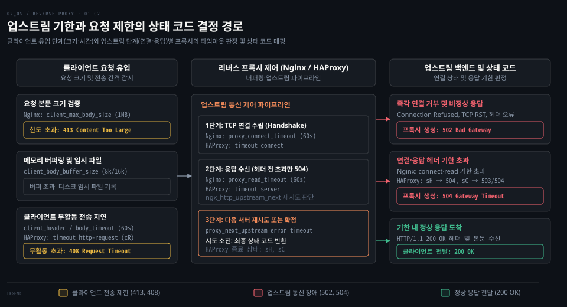

# proxy_read_timeout·client_max_body_size·timeout server
---
> 리버스 프록시에서 502 는 업스트림의 즉각적인 연결 거부나 비정상 응답을 뜻하고 504 는 프록시가 설정한 연결·응답 대기 기한 초과를 뜻하며, 클라이언트 유입 단계의 본문 크기와 전송 간격 한도는 413 과 408 로 차단됩니다.

## 학습 목표

> 이 문서를 읽고 나면 아래 네 가지를 설명하고 설정할 수 있습니다.

1. RFC 9110 에 정의된 502 Bad Gateway 와 504 Gateway Timeout 의 발생 조건과 책임 주체를 구분할 수 있습니다.
2. Nginx `proxy_read_timeout` 과 HAProxy `timeout server` 의 504 반환 경로를 설명할 수 있습니다.
3. Nginx 의 `proxy_next_upstream` 과 HAProxy 종료 상태 코드 `sH` 로 장애를 진단할 수 있습니다.
4. 클라이언트 전송 제한과 버퍼 크기의 차이를 이해하고, 413 및 408 오류 발생 원인과 방어 설정을 설명할 수 있습니다.

다루지 않는 범위가 있습니다.

클라이언트 원래 IP 와 프로토콜 전달 및 신뢰 경계는 앞선 [01-01 편](./01-01.proxy_set_header·option%20forwardfor.md)에서 다루었습니다.

백엔드 서버의 주기적 능동·수동 건강 검사와 풀 제외는 이어지는 01-03 편에서 다룹니다.

TLS 핸드셰이크 종료와 인증서 체인 순서 규약은 01-04 편에서 정리합니다.

아래 도식은 클라이언트 요청 유입 단계의 제약과 업스트림 통신 단계의 기한 초과가 어떤 상태 코드로 분기되는지 보여 줍니다.
본문 크기 초과, 전송 지연, 연결 실패, 응답 기한 초과가 413·408·502·504 상태 코드로 분기되는 결정 지점을 살펴봅니다.



도식의 왼쪽은 클라이언트 요청 유입 단계의 크기 검증과 시간 제약입니다. 가운데는 리버스 프록시 내부의 버퍼링 및 업스트림 파이프라인입니다. 오른쪽은 업스트림 연결 실패와 응답 지연에 따라 프록시가 스스로 생성하는 HTTP 상태 코드입니다.


## 1. 502 와 504 의 발생 경계

> 502 는 업스트림과의 TCP 연결 거부나 프로토콜 위반 시 프록시가 즉시 반환하고, 504 는 연결 수립이나 응답 헤더가 정해진 기한 안에 오지 않을 때 프록시가 대기를 중단하며 반환합니다.

백엔드 서버에 장애가 생기면 클라이언트는 502 Bad Gateway 나 504 Gateway Timeout 오류를 마주합니다. 두 오류는 모두 5xx 서버 오류에 속하지만, 장애의 성격과 프록시가 겪은 실패 조건은 완전히 다릅니다.

### 즉각 실패와 비정상 응답이 만드는 502

RFC 9110 은 502 상태 코드를 게이트웨이나 프록시가 인바운드 서버로부터 유효하지 않은 응답을 받았음을 알리는 신호로 정의합니다.[^rfc9110] Nginx 는 백엔드 서버로 TCP 연결을 시도했다가 즉시 거부(`Connection Refused`)당하면 502 를 냅니다. 연결 직후 RST 패킷을 받는 경우도 같습니다.[^nginx-src] 백엔드 프로세스가 완전히 종료되어 해당 포트에서 수신 대기하는 소켓이 없을 때가 대표적입니다. HAProxy 는 같은 거부를 종료 상태 `SC` 로 남기며, 이때 상태 코드는 502 나 503 이 될 수 있다고 매뉴얼이 적습니다.[^haproxy-manual]

업스트림이 HTTP 프로토콜 규약을 위반한 데이터를 돌려주어도 502 로 처리됩니다. 백엔드가 응답 헤더를 아예 보내지 않고 TCP 소켓을 닫는 경우가 이에 해당합니다. 헤더 문법이 깨져 프록시가 파싱에 실패해도 유효하지 않은 응답(`invalid response`)으로 판정합니다.[^nginx-proxy] 즉 502 는 업스트림이 살아 있지 않거나 통신 규약을 지키지 못해 즉각 실패한 상태를 뜻합니다.

### 대기 기한 초과가 만드는 504

RFC 9110 은 504 상태 코드를 프록시가 요청을 완료하는 데 필요한 업스트림 서버로부터 제때 응답을 받지 못했음을 알리는 신호로 정의합니다.[^rfc9110] 가장 흔한 경우는 연결과 요청 전달까지 끝났는데 백엔드가 정해진 시간 안에 응답 헤더를 보내오지 않는 경우입니다. Nginx 는 TCP 연결 수립 자체가 기한을 넘겨도 같은 타임아웃으로 분류해 504 를 냅니다.[^nginx-src] 거부는 502, 무응답은 504 로 갈린다고 기억하면 됩니다.

응답 헤더가 늦는 504 는 업스트림의 처리 지연에서 비롯됩니다. HAProxy 매뉴얼은 이 경우를 가장 흔한 이상으로 꼽고 원인으로 서버나 데이터베이스 포화를 듭니다.[^haproxy-manual] 긴 트랜잭션 락 대기나 긴 가비지 컬렉션 멈춤도 같은 모양으로 나타날 수 있습니다.

백엔드는 작업을 계속 수행하고 있습니다. 중간에 선 프록시가 정해둔 기한을 넘겨 대기를 포기할 뿐입니다.

### 프록시가 스스로 생성하는 상태 코드의 의미

502 와 504 의 가장 본질적인 공통점은 백엔드 애플리케이션이 보낸 응답이 아니라는 사실입니다. 두 상태 코드는 업스트림의 침묵이나 실패를 감지한 프록시가 스스로 만들어 클라이언트에 내려줍니다.

따라서 백엔드 애플리케이션의 웹 로그에서는 그 502 나 504 를 찾을 수 없습니다. 504 의 경우 백엔드는 프록시가 포기한 뒤에도 처리를 이어가 자기 로그에 200 을 남길 수도 있습니다. 장애 원인을 파악하려면 프록시 서버의 접근 로그와 에러 로그를 먼저 확인해야 합니다. 프록시 로그의 에러 메시지와 소요 시간 및 종료 상태 코드를 확인해야 병목 지점을 찾을 수 있습니다.


## 2. 업스트림 기한 초과와 504 생성

> 프록시는 연결 수립과 응답 수신 단계마다 독립된 타임아웃을 두고, 무활동 간격이 기한을 넘기면 요청을 다음 서버로 재시도하거나 504 상태 코드로 종료합니다.

업스트림 서버의 연산 병목이나 정체 현상으로 응답이 지연되면 프록시 쪽 연결도 그만큼 오래 붙잡혀 있게 됩니다. 이를 끊어 내기 위해 프록시는 연결 수립 단계와 응답 수신 단계에 서로 다른 타임아웃 지시어를 배치합니다.

### Nginx 읽기 기한과 연속 간격 측정

Nginx 는 업스트림 통신을 세 단계의 기한으로 통제합니다.[^nginx-proxy] `proxy_connect_timeout` 은 백엔드 서버와 TCP 핸드셰이크를 맺는 기한이며 기본값은 60초입니다. 문서는 이 값이 보통 75초를 넘을 수 없다고 덧붙입니다.

이 시간 안에 연결을 맺지 못하면 Nginx 는 연결 시도를 중단합니다. 넘길 다음 서버가 없으면 504 를 냅니다.[^nginx-src]

연결이 맺어지고 요청이 전달되면 `proxy_read_timeout` 이 작동합니다.[^nginx-proxy] 이 설정의 기본값은 60초입니다. 공식 문서는 이 지시어가 응답 전체를 내려받는 총 전송 시간 한도가 아님을 명시합니다.[^nginx-proxy] 백엔드에서 두 번의 연속적인 읽기 작업 사이에 허용되는 최대 시간 간격입니다.

```nginx
http {
    upstream backend_cluster {
        server app1.example.com:8080 max_fails=3 fail_timeout=10s;
        server app2.example.com:8080 max_fails=3 fail_timeout=10s;
    }

    server {
        listen 80;

        location /api/ {
            proxy_pass http://backend_cluster;

            # 업스트림 TCP 연결 수립 기한 (기본값 60초)
            proxy_connect_timeout 5s;

            # 두 번의 연속 읽기 사이의 무활동 기한 (기본값 60초)
            proxy_read_timeout 60s;

            # 두 번의 연속 쓰기 사이의 무활동 기한 (기본값 60초)
            proxy_send_timeout 60s;

            # 오류 및 타임아웃 발생 시 다음 업스트림 서버로 재시도
            proxy_next_upstream error timeout http_502 http_504;
            proxy_next_upstream_tries 3;
            proxy_next_upstream_timeout 30s;
        }
    }
}
```

백엔드가 59초마다 1바이트씩 데이터를 계속 보낸다면, 총 전송 시간이 수십 분에 달해도 `proxy_read_timeout` 은 초과되지 않습니다. 반면 백엔드가 60초 동안 아무것도 보내지 않으면 Nginx 는 연결을 닫습니다.[^nginx-proxy]

클라이언트가 504 를 받는 것은 응답 헤더를 받기 전에 기한이 지난 경우뿐입니다. 헤더를 이미 클라이언트에 보낸 뒤라면 Nginx 는 상태 코드를 바꿀 수 없습니다. 연결만 끊기므로 클라이언트는 잘린 응답을 받습니다.[^nginx-src] `proxy_send_timeout` 역시 업스트림으로 요청을 보낼 때 두 번의 연속 쓰기 사이의 간격을 잽니다.[^nginx-proxy]

### 소스 코드 레벨의 다음 서버 재시도

업스트림과의 통신 중 타임아웃이나 오류가 발생하면 Nginx 소스 코드의 `ngx_http_upstream_next` 함수가 호출됩니다.[^nginx-src] 이 함수는 `proxy_next_upstream` 설정에 따라 다음 업스트림 서버로 요청을 재시도할지 결정합니다.[^nginx-proxy]

기본값은 `error timeout` 입니다.[^nginx-proxy] 문서의 `error`·`timeout` 은 연결 수립, 요청 전달, 응답 헤더 읽기 중 어느 단계에서 난 오류·타임아웃이든 포함합니다. 이 경우 Nginx 는 다른 백엔드로 요청을 넘깁니다. 다만 클라이언트에 아직 아무것도 보내지 않았을 때만 넘길 수 있습니다.[^nginx-proxy] 시도할 서버가 더 없으면 Nginx 는 최종 응답을 확정합니다. `proxy_next_upstream_tries`·`proxy_next_upstream_timeout` 한도에 닿아도 같습니다.

```c
/* nginx release-1.30.6 src/http/ngx_http_upstream.c, ngx_http_upstream_next 발췌 (4628~4683행, 중간 생략) */
    switch (ft_type) {

    case NGX_HTTP_UPSTREAM_FT_TIMEOUT:
    case NGX_HTTP_UPSTREAM_FT_HTTP_504:
        status = NGX_HTTP_GATEWAY_TIME_OUT;
        break;

    case NGX_HTTP_UPSTREAM_FT_HTTP_500:
        status = NGX_HTTP_INTERNAL_SERVER_ERROR;
        break;

    /* ... 503·403·404·429 도 각자의 코드로 ... */

    default:
        status = NGX_HTTP_BAD_GATEWAY;
    }

    /* ... */

    if (u->request_sent
        && (r->method & (NGX_HTTP_POST|NGX_HTTP_LOCK|NGX_HTTP_PATCH)))
    {
        ft_type |= NGX_HTTP_UPSTREAM_FT_NON_IDEMPOTENT;
    }

    if (u->peer.tries == 0
        || ((u->conf->next_upstream & ft_type) != ft_type)
        || (u->request_sent && r->request_body_no_buffering)
        || (timeout && ngx_current_msec - u->peer.start_time >= timeout))
    {
        /* ... */
        ngx_http_upstream_finalize_request(r, u, status);
        return;
    }
```

`switch` 가 실패 종류(`ft_type`)를 상태 코드로 바꿉니다.[^nginx-src] 타임아웃은 504 입니다. 연결 거부 같은 `error` 와 잘못된 헤더(`invalid_header`)는 `default` 로 떨어져 502 가 됩니다. 이어지는 `if` 는 남은 시도 횟수, `proxy_next_upstream` 설정, 시간 한도를 보고 재시도를 멈출지 정합니다. 멈추면 앞에서 정한 상태 코드로 요청을 끝냅니다.

멱등성 제약도 주의해야 합니다. 공식 문서는 비멱등 메서드(POST, LOCK, PATCH) 요청을 이미 업스트림에 보냈다면 기본적으로 다음 서버로 넘기지 않는다고 밝힙니다(1.9.13 부터).[^nginx-proxy] 위 발췌의 `NGX_HTTP_UPSTREAM_FT_NON_IDEMPOTENT` 가 그 장치입니다. 첫 서버가 이미 처리했을 수 있는 요청을 두 번 실행하지 않으려는 기본값입니다. 재시도를 허용하려면 `proxy_next_upstream` 에 `non_idempotent` 를 추가합니다.

### HAProxy 서버 타임아웃과 종료 상태 sH

HAProxy 에서는 `timeout connect` 와 `timeout server` 가 업스트림 시간 관리를 담당합니다.[^haproxy-manual] `timeout connect` 는 서버와 TCP 연결을 수립하기까지의 최대 대기 시간입니다. `timeout server` 는 서버가 데이터를 보내거나 확인 응답을 해야 할 때 허용되는 서버 쪽 최대 무활동 시간입니다.

매뉴얼은 HTTP 모드에서 이 기한이 응답의 첫 단계, 곧 서버가 헤더를 보내야 하는 구간에서 특히 중요하다고 설명합니다. 그 구간이 서버의 요청 처리 시간을 그대로 나타내기 때문입니다.[^haproxy-manual] 응답 헤더가 오기 전에 이 기한이 지나면 HAProxy 는 504 Gateway Timeout 을 반환합니다.[^haproxy-manual]

`timeout connect` 가 지나는 경우는 Nginx 와 다릅니다. 매뉴얼은 이때 종료 상태가 `sC` 이고 상태 코드는 503 이나 504 가 될 가능성이 높다고 적습니다.[^haproxy-manual] 연결 기한 초과가 HAProxy 에서는 503 으로 보일 수 있다는 점을 로그를 읽을 때 기억해 둡니다.

```bash
# haproxy.cfg
defaults
    mode http
    timeout connect 5s
    timeout server 30s
    timeout client 30s
    timeout queue 10s

backend app_servers
    balance roundrobin
    server app1 app1.example.com:8080 check
    server app2 app2.example.com:8080 check
```

HAProxy 는 로그에 세션 종료 상태(Termination State)를 남깁니다. TCP 모드에서는 두 글자, HTTP 모드에서는 네 글자이고, 원인과 단계는 앞 두 글자가 말해 줍니다.[^haproxy-manual] `timeout server` 초과로 504 가 발생했을 때 찍히는 대표적인 코드는 `sH` 입니다.

첫 글자 소문자 `s` 는 서버 쪽 타임아웃이 만료되어 세션이 끝났음을 뜻합니다. 대문자 `S` 는 서버가 연결을 끊거나 거부한 경우라 구별해야 합니다.[^haproxy-manual] 두 번째 글자 `H` 는 프록시가 서버의 완전한 응답 헤더를 기다리던 단계였음을 나타냅니다.[^haproxy-manual] 로그에 `sH` 가 찍혔다면 백엔드가 정해진 기한 안에 첫 헤더를 내보내지 못한 상태로 진단할 수 있습니다. 매뉴얼은 `timeout server` 를 늘리는 것은 당장의 우회일 뿐이라고 경고합니다. 사용자는 그만큼 오래 기다리게 되므로 장기적인 해결은 애플리케이션을 고치는 것입니다.[^haproxy-manual]


## 3. 요청 크기와 전송 시간 제한

> 프록시는 클라이언트 유입 단계에서 본문 크기를 검사해 413 으로 차단하고, 헤더 수신과 본문 읽기 간격이 기한을 넘기면 408 로 연결을 닫습니다.

외부 클라이언트가 과도하게 큰 파일을 올리거나 전송을 멈추면 프록시의 메모리와 소켓 자원이 고갈될 위험이 있습니다. 아주 느린 속도로 데이터를 전송해 연결을 오래 점유하는 슬로로리스(Slowloris) 공격이 그 예입니다. HAProxy 매뉴얼도 이 공격을 이름으로 들어 대비를 권합니다.[^haproxy-manual] 프록시는 크기와 시간 한도로 이를 방어합니다.

### 요청 본문 크기 제한과 413 오류

Nginx 는 클라이언트 요청 본문의 최대 크기를 `client_max_body_size` 로 제한합니다.[^nginx-core] 기본값은 1MB(`1m`)입니다. 요청 본문 크기가 설정값을 넘으면 Nginx 는 413 오류를 반환합니다.[^rfc9110][^nginx-core] 소스를 보면 `Content-Length` 헤더 값이 한도를 넘는 요청은 본문을 읽기 전에 거절합니다. 청크 전송 인코딩은 읽은 크기가 한도를 넘는 순간 거절합니다.[^nginx-core-src] 값을 `0` 으로 지정하면 본문 크기 검사를 비활성화합니다.[^nginx-core]

```nginx
http {
    # 전체 서버 기본값 10MB 설정
    client_max_body_size 10m;

    server {
        listen 80;

        location /upload/ {
            # 대용량 파일 업로드 전용 경로에 100MB 허용
            client_max_body_size 100m;
            proxy_pass http://storage_backend;
        }

        location /api/ {
            # 일반 API 경로는 2MB 로 제한
            client_max_body_size 2m;
            proxy_pass http://api_backend;
        }
    }
}
```

공식 문서는 브라우저가 이 413 오류를 제대로 표시하지 못한다고 경고합니다.[^nginx-core] 사용자 화면만으로는 원인을 알기 어렵습니다. 업로드가 끊겼다는 신고가 오면 Nginx 에러 로그에서 `client intended to send too large body` 메시지를 먼저 찾습니다.[^nginx-core-src]

### 메모리 버퍼와 디스크 임시 파일의 차이

요청 본문을 다룰 때 가장 흔한 오해는 `client_body_buffer_size` 와 `client_max_body_size` 를 혼동하는 일입니다. `client_body_buffer_size` 는 본문을 읽어 들일 메모리 버퍼의 크기를 지정합니다.[^nginx-core] 기본값은 메모리 페이지 두 장 크기로, x86·32비트 플랫폼·x86-64 에서는 8KB, 그 밖의 64비트 플랫폼에서는 보통 16KB 입니다.[^nginx-core]

요청 본문 크기가 이 버퍼보다 크면, Nginx 는 요청을 거부하지 않고 본문의 일부나 전체를 디스크 임시 파일에 씁니다.[^nginx-core] 디스크 I/O 가 발생해 처리 속도는 느려질 수 있지만 요청 자체는 정상적으로 백엔드에 전달됩니다.

따라서 413 오류를 해결하려고 `client_body_buffer_size` 를 아무리 늘려도 소용이 없습니다. Nginx 가 본문 크기를 보고 413 을 낼지 정하는 기준은 `client_max_body_size` 입니다. 버퍼 크기는 디스크 임시 파일의 생성 여부만 결정합니다.

### 전송 간격 측정과 408 요청 시간 초과

Nginx 는 클라이언트가 요청을 보내오는 과정에도 두 가지 시간 제약을 둡니다.[^nginx-core] `client_header_timeout` 은 클라이언트가 완전한 HTTP 요청 헤더를 모두 전송하기까지 허용되는 최대 시간입니다. 기본값은 60초입니다. 이 시간 안에 전체 헤더가 도착하지 않으면 Nginx 는 `408 Request Timeout` 오류를 반환하고 연결을 닫습니다.[^rfc9110][^nginx-core]

```nginx
http {
    # 클라이언트 요청 헤더 수신 완료 기한
    client_header_timeout 60s;

    # 클라이언트 본문 연속 읽기 간격 기한
    client_body_timeout 60s;

    # 본문 메모리 버퍼 크기
    client_body_buffer_size 16k;
}
```

`client_body_timeout` 역시 기본값이 60초입니다. 이 설정도 본문 전체를 전송받는 총시간 한도가 아닙니다.[^nginx-core] 클라이언트로부터 두 번의 연속적인 읽기 작업 사이에 데이터가 들어오지 않는 무활동 간격을 측정합니다.

대용량 파일을 올리더라도 느린 속도로 패킷을 끊김 없이 전송하고 있다면 `client_body_timeout` 에 걸리지 않습니다. 반대로 모바일 네트워크 음영 지역에 진입하거나 클라이언트 앱이 멈추어 60초 동안 아무런 패킷도 보내지 않을 때만 408 오류가 발생합니다.

### HAProxy 클라이언트 타임아웃 제어

HAProxy 에서는 `timeout http-request` 와 `timeout client` 로 동일한 문제를 해결합니다.[^haproxy-manual] `timeout http-request` 는 클라이언트가 완전한 HTTP 요청 헤더를 보낼 때까지 기다리는 최대 시간입니다. 기한을 넘기면 HAProxy 는 408 Request Timeout 을 반환하고 로그의 종료 상태 코드에 `cR` 을 남깁니다.[^haproxy-manual] 클라이언트가 요청 헤더를 제시간에 끝내지 못했다는 뜻입니다.

이 기한은 기본으로 헤더 부분에만 적용됩니다. `option http-buffer-request` 를 켜면 본문까지 덮습니다.[^haproxy-manual]

`timeout client` 는 클라이언트 측의 최대 무활동 시간을 제한합니다.[^haproxy-manual] 클라이언트가 이 시간 동안 데이터를 보내지도, 받은 데이터를 확인하지도 않으면 연결이 끊깁니다. 데이터 단계에서 끊겼다면 로그에는 `cD` 코드가 기록됩니다.[^haproxy-manual]

매뉴얼은 무활동 기한만으로는 가끔씩 한 글자씩 보내는 공격을 막지 못한다고 봅니다. 그래서 요청 단계에는 `timeout http-request` 를 함께 두라고 권합니다.[^haproxy-manual] 이러한 타임아웃 지시어들은 정상 사용자의 전송을 보장하면서도 느린 연결 공격으로부터 프록시의 연결 자원을 지켜냅니다.


## 질문 (자답 후 펼치기)

> 본문에서 다룬 502·504·413·408 상태 코드의 생성 조건과 타임아웃 동작 원리를 스스로 점검합니다.

1. 502 Bad Gateway 와 504 Gateway Timeout 의 차이를 RFC 9110 정의와 프록시 관점에서 설명할 수 있나요?
2. Nginx 가 전체 전송 시간이 아닌 두 작업 사이의 연속 무활동 간격을 측정하는 이유는 무엇인가요?
3. HAProxy 로그에서 종료 상태 코드가 `sH` 로 찍히며 504 오류가 발생했을 때 백엔드 애플리케이션의 어떤 문제를 의심해야 하나요?
4. 파일 업로드 시 발생하는 413 오류를 해결하기 위해 `client_body_buffer_size` 를 늘려도 문제가 해결되지 않는 이유는 무엇인가요?


## 정답 (자답 후 펼치기)

> 위 질문 4개에 먼저 자답한 뒤 아래를 읽으세요.

### 정답 1 — 502 와 504 판정 기준

502 Bad Gateway 는 프록시가 백엔드 서버와 TCP 연결 수립에 즉각 실패하거나 백엔드가 프로토콜 규약에 맞지 않는 잘못된 헤더를 보냈을 때 프록시가 생성하는 오류입니다.

반면 504 Gateway Timeout 은 백엔드가 정해진 기한 안에 응답 헤더를 보내지 못했을 때 프록시가 대기를 중단하며 생성하는 오류입니다. Nginx 에서는 TCP 연결 수립이 기한을 넘긴 경우도 504 입니다. 두 상태 코드 모두 백엔드가 직접 보낸 것이 아니라 프록시가 업스트림 상태를 판단해 클라이언트에 내려줍니다.

### 정답 2 — 연속 작업 간격 측정의 이유

대용량 파일 전송이나 스트리밍 환경에서 정상적으로 데이터를 주고받는 느린 클라이언트와 백엔드의 연결을 일방적으로 끊지 않기 위함입니다. 전체 전송 시간을 기준으로 제한하면 파일 크기가 커질수록 정상적인 전송도 타임아웃으로 실패하게 됩니다.

두 번의 연속 읽기 작업 사이의 무활동 시간만 측정함으로써, 전송이 실제로 중단되거나 멈춘 비정상 세션만 정확히 골라내어 프록시 리소스를 회수할 수 있습니다.

### 정답 3 — HAProxy 종료 상태 sH 진단

HAProxy 세션 종료 코드에서 소문자 `s` 는 서버 쪽 타임아웃 만료를 뜻하고 `H` 는 프록시가 서버의 응답 헤더를 기다리던 단계였음을 뜻합니다.

따라서 `sH` 와 504 오류는 백엔드 서버가 요청을 받은 뒤 처리하는 과정에서 병목이 생겨 `timeout server` 기한 내에 응답 헤더조차 내보내지 못했음을 의미합니다. 매뉴얼은 원인으로 서버나 데이터베이스 포화를 먼저 듭니다. 긴 DB 트랜잭션 락 대기, CPU 포화, 스레드 풀 고갈, 긴 Full GC 를 차례로 확인합니다.

### 정답 4 — 요청 본문 크기 한도와 버퍼의 차이

413 오류는 요청 본문 크기 허용 한도인 `client_max_body_size` 에 의해서만 결정되기 때문입니다.

`client_body_buffer_size` 는 본문을 읽어 들일 메모리 버퍼의 크기일 뿐이며, 요청 본문이 이 버퍼 크기를 초과하면 Nginx 는 오류를 내지 않고 본문을 디스크의 임시 파일에 기록하며 정상 처리합니다. 따라서 413 오류를 해결하려면 메모리 버퍼가 아니라 허용 한도를 관장하는 `client_max_body_size` 값을 업로드할 파일 크기에 맞추어 늘려주어야 합니다.


## 참고 자료

### 1차 자료 공식 문서
- [Nginx Module ngx_http_proxy_module](https://nginx.org/en/docs/http/ngx_http_proxy_module.html): `proxy_read_timeout`, `proxy_connect_timeout`, `proxy_send_timeout`, `proxy_next_upstream` 규약
- [Nginx Module ngx_http_core_module](https://nginx.org/en/docs/http/ngx_http_core_module.html): `client_max_body_size`, `client_body_buffer_size`, `client_body_timeout`, `client_header_timeout` 규약
- [HAProxy 2.8 Configuration Manual](https://docs.haproxy.org/2.8/configuration.html): `timeout connect`, `timeout server`, `timeout client`, `timeout http-request`, 세션 종료 상태 코드
- [RFC 9110: HTTP Semantics](https://www.rfc-editor.org/rfc/rfc9110): §15.5.9(408), §15.5.14(413), §15.6.3(502), §15.6.5(504)
- [Nginx 소스 코드 src/http/ngx_http_upstream.c (release-1.30.6)](https://github.com/nginx/nginx/blob/release-1.30.6/src/http/ngx_http_upstream.c): `ngx_http_upstream_next` 타임아웃 및 재시도 제어 로직
- [Nginx 소스 코드 src/http/ngx_http_core_module.c (release-1.30.6)](https://github.com/nginx/nginx/blob/release-1.30.6/src/http/ngx_http_core_module.c): `Content-Length` 와 `client_max_body_size` 비교, 413 반환

### 관련 문서
- [02_os/docs/reverse-proxy/README.md](./README.md): Nginx 와 HAProxy 리버스 프록시 연재 목차 및 읽기 순서
- [01-01.proxy_set_header·option forwardfor.md](./01-01.proxy_set_header·option%20forwardfor.md): 리버스 프록시 전달 헤더 설정과 신뢰 경계
- [02_os/README.md](../../README.md): OS 공통 기반 및 네트워크 핵심 개념

[^rfc9110]: IETF RFC 9110, HTTP Semantics. https://www.rfc-editor.org/rfc/rfc9110
[^nginx-proxy]: Nginx 공식 문서, Module ngx_http_proxy_module. https://nginx.org/en/docs/http/ngx_http_proxy_module.html
[^nginx-core]: Nginx 공식 문서, Module ngx_http_core_module. https://nginx.org/en/docs/http/ngx_http_core_module.html
[^nginx-src]: Nginx 소스 코드 release-1.30.6, src/http/ngx_http_upstream.c 의 `ngx_http_upstream_next`(타임아웃 → 504, 그 밖 → 502), 연결 기한 타이머(1717행)와 `ngx_http_upstream_send_request_handler`(2394행), 헤더 송신 뒤 종료 처리(4891행). https://github.com/nginx/nginx/blob/release-1.30.6/src/http/ngx_http_upstream.c
[^nginx-core-src]: Nginx 소스 코드 release-1.30.6, src/http/ngx_http_core_module.c 1009~1018행(`Content-Length` 비교)과 src/http/ngx_http_request_body.c 1144~1154행(청크 본문). https://github.com/nginx/nginx/blob/release-1.30.6/src/http/ngx_http_core_module.c
[^haproxy-manual]: HAProxy 2.8 Configuration Manual. https://docs.haproxy.org/2.8/configuration.html
