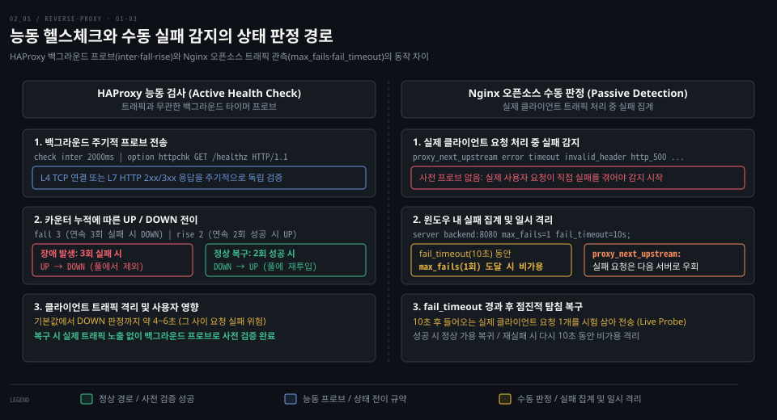

# Health Checks·max_fails
---
> HAProxy 는 백그라운드 능동 프로브의 연속 성공·실패 횟수로 백엔드의 UP·DOWN 을 선제 판정하고, Nginx 오픈소스는 실제 클라이언트 트래픽의 실패 횟수와 시간 윈도우로 수동 판정합니다.

## 학습 목표

> 이 문서를 읽고 나면 아래 세 가지를 설명하고 설정할 수 있습니다.

1. HAProxy 의 `check`·`inter`·`fall`·`rise` 와 `option httpchk` 로 가용성을 능동 검증할 수 있습니다.
2. Nginx 오픈소스의 `max_fails` 와 `fail_timeout` 이 실제 요청 실패를 집계하고 격리하는 방식을 설명할 수 있습니다.
3. 능동 프로브와 수동 관측 방식이 장애를 감지하고 복구하는 시점의 차이와 트레이드오프를 비교할 수 있습니다.

다루지 않는 범위가 있습니다.

클라이언트 원래 IP 와 프로토콜 전달 및 신뢰 경계는 앞선 [01-01 편](./01-01.proxy_set_header·option%20forwardfor.md)에서 다루었습니다.

업스트림 기한 초과와 502·504 오류 처리 경로는 [01-02 편](./01-02.proxy_read_timeout·client_max_body_size·timeout%20server.md)에서 다루었습니다.

TLS 핸드셰이크 종료와 인증서 체인 순서 규약은 이어지는 01-04 편에서 정리합니다.

아래 도식은 HAProxy 능동 검사와 Nginx 수동 판정이 백엔드 서버의 장애와 복구를 인지하는 경로를 보여 줍니다.
백그라운드 독립 프로브 기반의 선제적 상태 전이와, 실제 클라이언트 트래픽 처리 중 실패 집계 및 탐침 복구 메커니즘을 비교해 봅니다.



도식의 왼쪽은 HAProxy 의 주기적 백그라운드 프로브와 연속 카운터 기반 상태 전이입니다. 오른쪽은 Nginx 오픈소스가 실제 요청 실패를 집계해 일시 격리하고 다시 라이브 트래픽으로 탐침 복구하는 과정입니다.


## 1. HAProxy 능동 검사와 상태 전이 판정

> HAProxy 는 클라이언트 트래픽과 독립된 백그라운드 프로브를 주기적으로 보내 연속 실패 횟수가 기준에 도달하면 서버를 가용 풀에서 즉시 제외합니다.

백엔드 서버 중 한 대가 비정상 종료하거나 응답 불능에 빠졌을 때, 프록시가 이를 모른 채 트래픽을 계속 보내면 사용자 요청이 실패합니다. HAProxy 는 백엔드에 검사용 프로브를 주기적으로 쏘아 응답을 확인하는 능동 헬스체크를 씁니다.[^haproxy-cfg]

### check 매개변수와 주기 설정

HAProxy 설정 파일의 `server` 지시어 뒤에 `check` 키워드를 붙이면 능동 건강 검사가 활성화됩니다.[^haproxy-cfg] 별도의 부가 옵션이 없으면 프록시는 백엔드의 해당 IP 와 포트로 TCP 연결 수립(3-way handshake)을 시도합니다.

```bash
# haproxy.cfg
backend web_pool
    mode http
    balance roundrobin
    default-server inter 2000ms fastinter 1000ms downinter 5000ms
    server s1 app1.example.com:8080 check
    server s2 app2.example.com:8080 check
```

건강 검사의 실행 빈도는 세 가지 타이머 매개변수로 정밀하게 조절합니다.[^haproxy-cfg]

- `inter`: 서버가 정상 가용(UP) 상태일 때 보내는 연속 검사 사이의 기본 간격입니다. 명시하지 않으면 기본값은 2000ms(2초)입니다.
- `fastinter`: 서버가 상태 전이 중(transition state)일 때 적용되는 검사 간격입니다. 정상 상태에서 한 번 실패하여 다운으로 향하고 있거나, 반대로 다운 상태에서 복구 신호가 감지되었을 때 더 짧은 주기로 빠르게 검증합니다.
- `downinter`: 서버가 완전히 다운(DOWN)으로 확정된 뒤에 적용되는 검사 간격입니다. 이미 죽어 있는 서버에 불필요하게 잦은 프로브를 보내 시스템 리소스를 낭비하지 않도록 간격을 5초나 10초로 늘려 잡을 수 있습니다.

### fall 과 rise 가 만드는 임계치

검사 한 번의 실패로 백엔드를 바로 격리하면, 순간적인 패킷 유실에도 서버가 풀을 들락날락하는 플래핑(flapping)이 생깁니다. HAProxy 는 상태를 연속 실패 횟수와 연속 성공 횟수로 바꾸므로 한 번의 실패로는 상태가 바뀌지 않습니다.[^haproxy-cfg]

```bash
# fall 3: 연속 3회 실패 시 DOWN 판정
# rise 2: 연속 2회 성공 시 UP 판정
server s1 app1.example.com:8080 check inter 2000ms fall 3 rise 2
```

`fall` 매개변수는 서버를 비가용(DOWN) 상태로 간주하기 위해 필요한 연속 검사 실패 횟수입니다. 기본값은 3 입니다.[^haproxy-cfg] 검사가 한 번 실패하더라도 카운터만 1 로 올라갈 뿐 서버는 여전히 UP 상태를 유지하며 트래픽을 받습니다. 연속으로 3 번 실패해야 비로소 서버가 풀에서 완전히 격리됩니다.

이 판정에는 시간이 걸립니다. 기본값(`inter 2000ms`, `fall 3`)에서 프로세스가 죽어 연결이 곧바로 거절되면, 다운 확정까지 4초에서 6초가 걸립니다. 첫 실패 검사가 죽은 뒤 0~2초 안에 오고, 이어서 2초 간격 검사 두 번이 더 실패해야 하기 때문입니다(`fastinter` 를 정하지 않은 경우).

서버가 연결 요청에 응답조차 하지 않으면 판정은 이보다 늦어질 수 있습니다. 검사 하나가 시간 초과로 끝날 때까지 기다리기 때문입니다. `timeout check` 를 정하지 않으면 `inter` 가 검사 하나의 제한 시간(연결과 응답 읽기 합계)을 겸합니다.[^haproxy-cfg]

`rise` 매개변수는 다운된 서버를 다시 정상 가용(UP) 상태로 되돌리기 위해 필요한 연속 검사 성공 횟수입니다. 기본값은 2 입니다.[^haproxy-cfg]

프로세스가 막 재시작된 직후에는 소켓만 열려 있고 내부 DB 커넥션 풀이나 캐시 초기화가 덜 끝났을 수 있습니다. 검사 한 번의 성공만으로 풀에 되돌리면 준비가 덜 된 서버가 요청을 받다가 다시 쓰러질 수 있습니다. 그래서 HAProxy 는 연속 2 회 성공을 확인한 뒤에야 풀에 재투입합니다.

재투입 직후 몰리는 부하까지 줄이려면 `slowstart` 를 씁니다. 다시 UP 이 된 서버의 연결 수 한도와 가중치를 정한 시간에 걸쳐 직선으로 100% 까지 올립니다.[^haproxy-cfg]

### option httpchk 와 L7 검증

스레드가 멈추거나 DB 가 끊겨 500 오류를 내도 TCP 소켓이 살아 있으면 프록시는 UP 으로 오판합니다.

애플리케이션의 실제 건강 상태를 확인하려면 HTTP 계층 검사인 `option httpchk` 를 설정해야 합니다.[^haproxy-cfg]

```bash
# haproxy.cfg
backend api_pool
    mode http
    balance roundrobin
    option httpchk GET /healthz HTTP/1.1
    http-check send hdr Host api.example.com
    http-check expect status 200
    default-server inter 3000ms fall 3 rise 2
    server app1 app1.example.com:8080 check
    server app2 app2.example.com:8080 check
```

`option httpchk` 는 프로브 요청 라인을 정의합니다.[^haproxy-cfg]
HTTP/1.1 은 가상 호스트 구분을 위해 `Host` 헤더가 필수입니다. 그래서 `http-check send hdr Host <도메인>` 을 함께 씁니다.

응답 판정에는 `http-check expect` 를 씁니다. 별도의 검증 조건을 지정하지 않으면 HAProxy 는 HTTP 2xx 및 3xx 상태 코드를 정상 성공으로 취급합니다.[^haproxy-cfg] 반면 4xx 나 5xx 오류 코드, 응답이 없거나 시간 초과가 나면 검사 실패로 셉니다.[^haproxy-cfg] 검사가 보는 것은 `/healthz` 가 돌려준 상태 코드뿐입니다. 그래서 이 엔드포인트가 DB 연결처럼 요청 처리에 꼭 필요한 의존성까지 확인하고 200 을 돌려줘야 판정이 실제 처리 능력에 가까워집니다.


## 2. Nginx 오픈소스의 수동 판정과 임계치

> Nginx 오픈소스는 별도 프로브 없이 실제 클라이언트 요청의 실패를 집계해 임계치를 넘으면 일정 시간 동안 해당 서버를 비가용으로 격리합니다.

상용 버전인 Nginx Plus 와 달리 오픈소스 Nginx 에는 백그라운드 능동 프로브 엔진이 없습니다.[^nginx-upstream] 대신 실제 클라이언트 트래픽을 중계하며 실패를 집계하는 수동 감지 방식을 씁니다.[^nginx-upstream]

### max_fails 와 fail_timeout 동작

Nginx 백엔드 가용성은 `upstream` 의 `max_fails` 와 `fail_timeout` 으로 제어합니다.[^nginx-upstream]

```nginx
upstream api_servers {
    server app1.example.com:8080 max_fails=2 fail_timeout=10s;
    server app2.example.com:8080 max_fails=2 fail_timeout=10s;
    server app3.example.com:8080 backup;
}

server {
    listen 80;
    server_name example.com;

    location / {
        proxy_pass http://api_servers;
    }
}
```

`fail_timeout` 매개변수는 하나의 설정으로 두 가지 독립된 역할을 수행합니다.[^nginx-upstream]

- 실패 집계 윈도우: 지정된 시간 동안 발생한 통신 실패 횟수를 누적하여 감시합니다. 기본값은 10초입니다.
- 비가용 격리 기간: 실패 횟수가 한도에 도달했을 때 해당 서버를 비가용(다운) 상태로 유지하는 격리 시간입니다. 역시 기본값인 10초 동안 유지됩니다.

`max_fails` 는 허용 실패 횟수이며 기본값은 1 입니다.[^nginx-upstream] 기본 설정에서는 1 번만 실패해도 10초 동안 비가용 상태로 제외됩니다.

만약 `max_fails=0` 으로 설정하면 실패 횟수 집계 자체가 비활성화됩니다.[^nginx-upstream] Nginx 는 해당 서버가 통신에 실패하더라도 비가용으로 표시하지 않고 계속해서 클라이언트 트래픽을 전달합니다.

`upstream` 에 서버가 한 대뿐이면 `max_fails` 와 `fail_timeout` 은 무시됩니다.[^nginx-upstream] 그 서버는 실패를 몇 번 겪어도 비가용으로 처리되지 않습니다.

### 실패 인정 조건과 proxy_next_upstream

어떤 사건을 통신 실패(unsuccessful attempt)로 누적할지는 프록시 모듈의 `proxy_next_upstream` 설정이 결정합니다.[^nginx-upstream][^nginx-proxy]

`proxy_next_upstream` 기본값은 `error timeout` 입니다.[^nginx-proxy] `error` 와 `timeout` 은 연결 수립, 요청 전달, 응답 헤더 읽기 중 어느 단계에서 난 오류·시간 초과든 포함합니다. 이 둘과 빈 응답·잘못된 응답(`invalid_header`)은 지시어에 적지 않아도 늘 실패로 셉니다.[^nginx-proxy] 그래서 기본 설정에서 실패 카운터를 올리는 것은 연결·전송 오류, 시간 초과, 깨진 응답입니다.

```nginx
location /api/ {
    proxy_pass http://api_servers;
    # 500, 502, 503 오류까지 실패로 인정하고 다른 서버로 우회합니다
    proxy_next_upstream error timeout http_500 http_502 http_503;
    proxy_next_upstream_tries 3;
    proxy_next_upstream_timeout 10s;
}
```

백엔드가 500 이나 503 오류를 반환해도 `proxy_next_upstream` 에 없으면 실패로 치지 않습니다. 500·502·503·504·429 는 지시어에 적었을 때만 실패로 셉니다.[^nginx-proxy] 적지 않았으면 Nginx 는 실패 카운터를 올리지 않고 그 응답을 그대로 클라이언트에 전달하며, 서버는 계속 요청을 받습니다.

403 과 404 는 지시어에 `http_403`·`http_404` 를 적어도 실패로 세지 않습니다.[^nginx-proxy] 이때 두 값은 다음 서버로 요청을 넘길지만 정합니다.

### 격리 기간 만료와 점진적 탐침 복구

격리 시간이 만료되어도 Nginx 는 별도의 백그라운드 핑을 보내지 않습니다.

격리 시간(예: 10초)이 지나면 Nginx 는 새로 들어오는 실제 클라이언트 요청 하나를 해당 서버로 보내 봅니다. 이 요청이 일종의 탐침(Probe) 구실을 합니다. 공식 문서는 이 과정을 적지 않으므로 아래는 라운드 로빈 소스 코드로 확인한 동작입니다.[^nginx-src]

```c
/* nginx release-1.30.6 src/http/ngx_http_upstream_round_robin.c 발췌 (873~878, 924~926, 1047~1049, 1070~1074행, 중간 생략) */
        if (peer->max_fails
            && peer->fails >= peer->max_fails
            && now - peer->checked <= peer->fail_timeout)
        {
            continue;
        }

    /* ... */

    if (now - best->checked > best->fail_timeout) {
        best->checked = now;
    }

    /* ... */

        peer->fails++;
        peer->accessed = now;
        peer->checked = now;

    /* ... */

        /* mark peer live if check passed */

        if (peer->accessed < peer->checked) {
            peer->fails = 0;
        }
```

첫 `if` 는 요청마다 서버를 고르는 함수(`ngx_http_upstream_get_peer`) 안에 있습니다. 실패가 한도에 닿았고 마지막 확인 시각(`checked`)에서 `fail_timeout` 이 지나지 않은 서버를 건너뜁니다. 둘째 `if` 는 고른 서버의 격리 시간이 이미 지났으면 `checked` 를 지금으로 당깁니다. 나머지 두 덩어리는 요청이 끝난 뒤 실행됩니다. 서버를 돌려주는 함수(`ngx_http_upstream_free_round_robin_peer`)에서 실패했을 때와 성공했을 때의 처리입니다.

격리 시간이 지난 서버를 고르는 순간 `checked` 가 현재 시각으로 바뀝니다. 실패 횟수는 아직 한도 그대로이므로, 이 서버는 다음 `fail_timeout` 동안 다시 건너뛰어집니다. 그래서 격리 기간 한 번에 시험 요청은 하나만 갑니다.

- 요청 성공 시: 마지막 실패 시각(`accessed`)이 시험 시각(`checked`)보다 앞이므로 실패 카운터를 0 으로 되돌리고 서버를 풀에 복귀시킵니다. 실패 때 깎인 가중치는 Nginx 가 요청마다 서버를 고를 때 1 씩 올라 원래 값으로 돌아옵니다.[^nginx-src]
- 요청 실패 시: 실패 횟수가 늘고 `checked` 가 다시 현재 시각이 됩니다. 그 시점부터 새로운 `fail_timeout`(10초) 동안 서버를 다시 건너뜁니다.


## 3. 능동 검사와 수동 판정의 장애 인지 경로 비교

> 능동 검사는 사전 감지로 사용자 오류 노출을 줄이지만 주기적 부하를 남기고, 수동 판정은 추가 부하가 없지만 실제 요청이 실패를 겪어야만 장애를 격리합니다.

새벽 시간 장애나 일시적 순단처럼 장애 상황마다 감지 방식이 달라 처리 실패 위험이 갈립니다.

### 장애 인지 시점과 클라이언트 요청 영향

HAProxy 의 능동 검사는 클라이언트 트래픽 유무와 완전히 독립되어 있습니다. 사용자가 한 명도 접속하지 않는 새벽 시간대에도 프로브를 계속 보내므로, 백엔드가 다운되면 첫 사용자 요청이 오기 전에 풀에서 걷어낼 수 있습니다.

그러나 능동 검사도 장애 발생 순간과 감지 완료 시점 사이에 지연이 있습니다. `inter 2000ms`·`fall 3` 에서 연결이 곧바로 거절되면 DOWN 확정까지 4~6초가 걸립니다(검사가 시간 초과로 끝나면 더 깁니다). 이 사이에 도착한 실제 사용자 요청은 다운된 서버로 전달되어 오류를 맞닥뜨릴 수 있습니다.

반면 Nginx 오픈소스의 수동 판정은 트래픽이 들어오기 전까지는 백엔드의 정지 여부를 전혀 알 수 없습니다. 서버가 다운된 뒤 도착한 첫 번째(또는 `max_fails` 번째) 실제 사용자 요청이 직접 연결 실패나 타임아웃을 겪어야만 비가용 판정이 시작됩니다.

다만 Nginx 는 실패한 요청을 `proxy_next_upstream` 에 따라 다른 업스트림으로 넘길(failover) 수 있습니다.[^nginx-proxy] 넘긴 요청이 성공하면 클라이언트는 502 를 보지 않고 응답이 늦어지는 것만 겪습니다. 늦어지는 길이는 장애 모양에 달렸습니다. 연결이 곧바로 거절되면 짧지만, 패킷이 응답 없이 사라지면 `proxy_connect_timeout`(기본 60초)이 끝날 때까지 기다린 뒤에야 넘깁니다.[^nginx-proxy]

넘길 수 없는 경우도 있습니다. 클라이언트에 응답을 이미 보내기 시작했으면 넘기지 못하고, POST 처럼 멱등하지 않은 요청은 업스트림에 이미 보냈다면 기본 설정에서 넘기지 않습니다.[^nginx-proxy] 이 조건과 상태 코드가 정해지는 소스 경로는 [01-02 편의 「소스 코드 레벨의 다음 서버 재시도」](./01-02.proxy_read_timeout·client_max_body_size·timeout%20server.md)에서 다루었습니다.

### 복구 검증 주체와 복구 시 충격

백엔드가 다시 살아났을 때의 검증 주체도 완전히 다릅니다.

HAProxy 는 다운 상태의 서버에 백그라운드 프로브를 계속 보내며 `rise` 횟수(기본 2회)만큼 완벽히 성공하는지 확인합니다. 프록시가 검사로 먼저 확인한 뒤에야 실제 사용자 트래픽을 투입하므로, 검사가 확인하는 범위 안에서는 복구 과정의 오류를 사용자가 겪지 않습니다. 검사 엔드포인트가 얕으면 그 범위도 좁아집니다.

Nginx 는 격리 시간이 끝나면 실제 사용자의 라이브 요청을 탐침으로 씁니다.[^nginx-src] 백엔드가 아직 복구 중이면 그 요청을 보낸 사용자는 또다시 실패나 타임아웃을 겪습니다.

### 인프라 오버헤드와 비교 요약

능동 검사는 프록시 인스턴스 수와 백엔드 서버 수의 곱에 비례하여 주기적인 네트워크 트래픽과 소켓 리소스를 소모합니다. 프록시 10 대가 백엔드 20 대를 2초마다 검사하면 백엔드 전체에 초당 100 회(10 × 20 ÷ 2)의 검사 요청이 들어갑니다. 한 대당 초당 5 회입니다.

Nginx 오픈소스의 수동 판정은 별도 프로브가 없으므로 판정 때문에 늘어나는 요청이 없습니다. 트래픽 규모와 가용성 요구 수준에 따라 두 방식의 속성을 비교해 선택해야 합니다.

| 비교 항목 | HAProxy 능동 검사 (`check`) | Nginx 오픈소스 수동 판정 (`max_fails`) |
|---|---|---|
| **판정 주체** | 프록시 백그라운드 프로브 엔진 | 실제 유입되는 클라이언트 트래픽 |
| **트리거 방식** | 타이머 주기 기반 (`inter`, `fastinter`) | 클라이언트 요청 처리 실패 시점 |
| **장애 사전 감지** | 트래픽 없이도 사전 감지 및 격리 가능 | 불가능 (실제 요청이 들어와야 감지) |
| **DOWN 판정 소요** | `inter × fall` (기본 약 4~6초 소요) | `fail_timeout` 내 `max_fails` 회 실패 즉시 |
| **복구 검증 주체** | 백그라운드 프로브 (`rise` 회 연속 성공) | 격리 만료 후 첫 실제 클라이언트 요청 |
| **장애 시 사용자 영향** | 감지 지연 윈도우(수 초) 내 요청만 영향 | 첫 실패 요청이 직접 영향 (`failover` 로 완화) |
| **백엔드 추가 부하** | 프로브 요청에 따른 지속적 리소스 소모 | 추가 부하 전혀 없음 (0 오버헤드) |


## 질문 (자답 후 펼치기)

> 본문에서 다룬 능동 검사와 수동 판정의 임계치 설정 및 상태 전이 규칙을 스스로 점검합니다.

1. HAProxy 에서 `option httpchk` 없이 `check` 만 켜면 내부 장애를 감지하지 못하는 이유는 무엇인가요?
2. HAProxy 의 `fall` 과 `rise` 임계치가 1 이 아닌 3 과 2 처럼 2 이상의 연속 횟수로 설정되는 이유는 무엇인가요?
3. Nginx 오픈소스에서 백엔드가 500 오류를 지속적으로 반환하는데도 `max_fails` 에 걸려 격리되지 않는다면 어떤 설정을 확인해야 하나요?
4. Nginx 수동 판정에서 `fail_timeout` 이 만료되었을 때, 프록시가 백엔드의 복구 여부를 판정하는 구체적인 동작 과정은 어떻게 되나요?


## 정답 (자답 후 펼치기)

> 위 질문 4개에 먼저 자답한 뒤 아래를 읽으세요.

### 정답 1 — L4 와 L7 건강 검사의 검증 계층 차이

기본 `check` 는 L4 계층의 TCP 연결 수립(3-way handshake) 성공 여부만 확인하기 때문입니다.

애플리케이션 프로세스가 실행 중이고 운영체제의 TCP 리슨 소켓이 살아 있다면, 프로세스 내부의 스레드가 락에 걸려 있거나 DB 풀이 고갈되어 HTTP 500 오류를 내뿜더라도 TCP 연결 자체는 정상적으로 맺어집니다. 따라서 HTTP 계층의 실제 처리 능력을 검증하려면 `option httpchk` 로 `/healthz` 같은 엔드포인트의 HTTP 응답 코드를 확인해야 합니다.

### 정답 2 — 상태 진동 방지와 시작 폭풍 방어

일시적인 네트워크 지연이나 순간적인 패킷 유실로 인해 멀쩡한 백엔드가 풀에서 즉시 퇴출당했다 복귀하는 상태 진동(flapping)을 방지하기 위함입니다.

또한 서버가 막 재시작되었을 때는 소켓만 열려 있고 내부 캐시나 커넥션 풀 초기화가 덜 끝났을 수 있습니다. 검사 한 번의 성공으로 바로 풀에 되돌리면 준비가 덜 된 서버가 요청을 받다가 다시 쓰러질 수 있으므로, `rise 2` 처럼 연속 성공을 확인한 뒤 트래픽을 투입합니다. 투입 뒤 부하를 천천히 올리는 일은 `slowstart` 가 맡습니다.

### 정답 3 — proxy_next_upstream 조건

`proxy_next_upstream` 지시어에 `http_500` 조건이 포함되어 있는지 확인해야 합니다.

Nginx 오픈소스에서 `max_fails` 카운트에 집계되는 실패는 `proxy_next_upstream` 이 정합니다. 연결·전송 오류, 시간 초과, 깨진 응답은 늘 실패로 세지만 500 같은 상태 코드는 지시어에 적었을 때만 셉니다. 기본값은 `error timeout` 뿐이므로, 백엔드가 500 오류를 내더라도 Nginx 는 실패 카운트를 올리지 않고 그 응답을 그대로 전달합니다. 500 오류를 실패로 세어 격리하려면 `proxy_next_upstream error timeout http_500;` 과 같이 명시해야 합니다.

### 정답 4 — 격리 만료 후 라이브 탐침 복구

Nginx 는 백그라운드 프로브가 없으므로 격리 시간이 만료된 직후 유입되는 실제 클라이언트의 라이브 요청 1 개를 해당 서버로 전달하여 탐침(Probe)으로 사용합니다.

이 라이브 요청이 성공적으로 처리되면 누적 실패 카운터를 0 으로 되돌리고 서버를 풀에 복귀시킵니다. 깎였던 가중치는 그 뒤 요청을 고를 때마다 조금씩 회복됩니다. 반대로 이 요청이 다시 연결 실패나 타임아웃을 겪으면, Nginx 는 해당 시점부터 다시 새로운 `fail_timeout` 기간 동안 서버를 비가용 상태로 즉시 재격리합니다.


## 참고 자료

### 1차 자료 공식 문서
- [HAProxy 2.8 Configuration Manual — Health checks](https://docs.haproxy.org/2.8/configuration.html#5.2-check): `check`, `inter`, `fastinter`, `downinter`, `fall`, `rise`, `option httpchk`, `http-check` 규약
- [Nginx Module ngx_http_upstream_module](https://nginx.org/en/docs/http/ngx_http_upstream_module.html): `server` 지시어 매개변수 `max_fails`, `fail_timeout` 동작 규약
- [Nginx Module ngx_http_proxy_module](https://nginx.org/en/docs/http/ngx_http_proxy_module.html): `proxy_next_upstream`, `proxy_next_upstream_tries`, `proxy_next_upstream_timeout` 규약
- [Nginx 소스 release-1.30.6 ngx_http_upstream_round_robin.c](https://github.com/nginx/nginx/blob/release-1.30.6/src/http/ngx_http_upstream_round_robin.c): 격리 만료 뒤 시험 요청 하나로 복구를 판정하는 코드

### 관련 문서
- [02_os/docs/reverse-proxy/README.md](./README.md): Nginx 와 HAProxy 리버스 프록시 연재 목차 및 읽기 순서
- [01-01.proxy_set_header·option forwardfor.md](./01-01.proxy_set_header·option%20forwardfor.md): 리버스 프록시 전달 헤더 설정과 신뢰 경계
- [01-02.proxy_read_timeout·client_max_body_size·timeout server.md](./01-02.proxy_read_timeout·client_max_body_size·timeout%20server.md): 업스트림 기한 초과와 상태 코드 결정 경로
- [02_os/README.md](../../README.md): OS 공통 기반 및 네트워크 핵심 개념

[^haproxy-cfg]: HAProxy 공식 문서, HAProxy 2.8 Configuration Manual §5.2 Server and default-server options. https://docs.haproxy.org/2.8/configuration.html
[^nginx-upstream]: Nginx 공식 문서, Module ngx_http_upstream_module. https://nginx.org/en/docs/http/ngx_http_upstream_module.html
[^nginx-proxy]: Nginx 공식 문서, Module ngx_http_proxy_module. https://nginx.org/en/docs/http/ngx_http_proxy_module.html
[^nginx-src]: Nginx 소스 코드 release-1.30.6, src/http/ngx_http_upstream_round_robin.c 의 `ngx_http_upstream_get_peer`(873~878행 격리 중 건너뛰기, 887~888행 가중치 회복, 924~926행 시험 시각 갱신)와 `ngx_http_upstream_free_round_robin_peer`(1047~1049행 실패, 1072~1074행 성공). https://github.com/nginx/nginx/blob/release-1.30.6/src/http/ngx_http_upstream_round_robin.c
