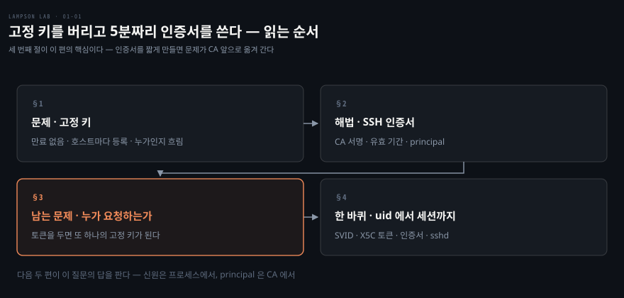
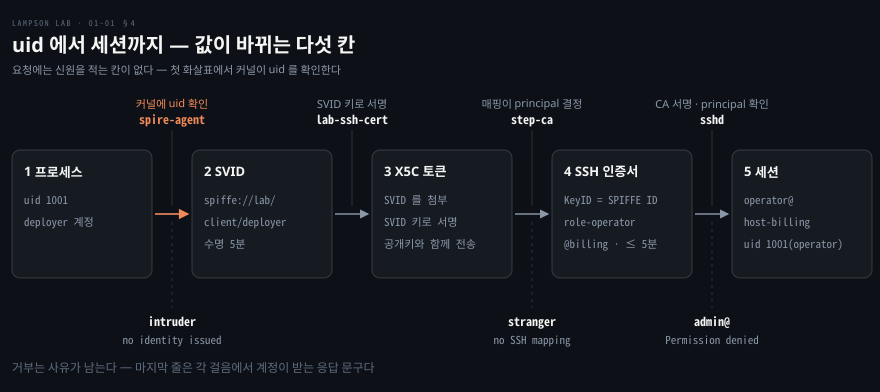

# 고정 키를 버리고 5분짜리 인증서를 쓴다

---

> 저장소 README 의 「왜 필요한가」와 「동작 구조」를 한 편으로 묶었습니다. 고정 SSH 키를 짧게 사는 인증서로 바꾸는 이유와, 그 인증서가 만들어져 호스트에 닿기까지의 전체 경로를 한 바퀴 돕니다.

## 핵심 요약

> 이 편이 매달린 하나의 생각은 **고정 키를 없애면 문제가 "누가 인증서를 요청할 수 있는가" 로 옮겨 간다**는 것입니다.

SSH 개인키를 파일로 들고 있고 호스트마다 그 공개키를 등록해 두는 방식은 키에 만료가 없습니다. 그래서 유출, 퇴사, 키 공유 같은 일이 모두 누군가 지울 때까지 이어집니다. 호스트가 CA 공개키 하나만 믿고, 접속할 때마다 CA 가 서명한 5분짜리 인증서를 쓰게 바꾸면 만료와 권한 회수와 신원 기록이 한꺼번에 풀립니다.

그런데 인증서를 짧게 만들어도 CA 에 요청할 수 있는 쪽은 모든 호스트에 들어갈 수 있습니다. CA 앞에 패스워드나 API 토큰을 두면 사람이 없는 자동화 서버에서는 그 토큰이 파일로 남아 또 하나의 고정 키가 됩니다. lampson-lab 은 요청자를 비밀값이 아니라 프로세스가 실행된 계정(uid)으로 확인해서 이 문제를 풉니다.

저장소 이름은 Butler Lampson 의 "speaks for" 모델에서 따왔습니다. 이 모델이 설명하는 체인은 워크로드에서 신원, 역할, 계정으로 이어지고, 저장소가 그 체인을 구현합니다.

이 랩에서 프로세스의 uid 는 SVID 가 됩니다. SVID 는 principal 이 적힌 SSH 인증서가 되고, 그 principal 이 호스트의 역할 계정을 엽니다.


## 학습 목표

> 이 편을 읽고 나면 아래 다섯 가지를 스스로 해낼 수 있습니다.

1. 고정 SSH 키가 남기는 세 가지 문제를 대고, 단기 인증서가 각각을 어떻게 푸는지 설명할 수 있습니다.
2. `ssh-keygen -L` 출력의 다섯 필드가 호스트에서 쓰이는 곳을 말할 수 있습니다.
3. 인증서를 짧게 만든 뒤에도 요청자 확인이 남는 이유를 말할 수 있습니다.
4. uid 에서 세션까지 여섯 걸음을 순서대로 대고, 걸음마다 값이 무엇으로 바뀌는지 말할 수 있습니다.
5. 계정 넷이 각각 어느 걸음에서 어떤 결과를 받는지 말할 수 있습니다.

이 편에서 새로 만나는 낱말입니다. `어디서` 는 그 낱말이 실제로 설명되는 절입니다.

| 키워드 | 뜻 | 학습 포인트·연결 개념 | 어디서 |
|---|---|---|---|
| 고정 키 | 만료 없는 SSH 개인키와 `authorized_keys` 의 공개키 | 유출되면 지울 때까지 유효 · 호스트마다 등록 | §1 |
| SSH 인증서 | CA 가 서명한 SSH 공개키 | 유효 기간 · principal · Key ID | §2 |
| principal | 인증서로 들어갈 수 있는 이름 | `role-<역할>@<호스트 그룹>` 형식 | §2 |
| TrustedUserCAKeys | sshd 가 믿는 CA 공개키 파일 | 사용자 키를 하나하나 등록하지 않음 | §2 |
| SVID | SPIFFE ID 를 담은 짧게 사는 X.509 증명서 | 프로세스의 uid 로 발급 | §3 |
| X5C 토큰 | SVID 를 첨부하고 SVID 키로 서명한 요청서 | step-ca 의 입장권 | §4 |
| 계정 넷 | deployer · monitor · stranger · intruder | 걸리는 걸음이 각자 다름 | §4 |

아래는 이 편의 절 넷이 읽히는 순서입니다.




## 1. 고정 키가 남기는 세 가지 문제

> 고정 키는 파일이라서 복사되고, 호스트마다 흩어져 있어서 거두기 어렵고, 여럿이 나눠 쓰면 구별되지 않습니다.

흔한 방식에서는 사람이나 자동화 서버가 SSH 개인키를 파일로 들고 있고, 접속 대상 호스트마다 `authorized_keys` 에 그 공개키를 등록합니다. 이 구성의 문제는 키에 만료가 없다는 한 가지 사실에서 세 갈래로 갈라집니다.

### 만료 없는 키의 유출

백업, 이미지, CI 로그에 섞여 나간 개인키는 몇 달 뒤에도 그대로 쓸 수 있습니다. 키에는 시계가 달려 있지 않아서 "이제 못 쓰게 된다" 는 시점이 없고, 무효화는 사람이 호스트를 돌며 한 줄씩 지우는 작업입니다.

### 호스트마다 흩어진 권한

퇴사나 역할 변경 때 호스트 한 곳이라도 빠뜨리면 접근이 남습니다. 지금 누가 어디에 들어갈 수 있는지 묻는 질문의 답도 호스트마다 흩어진 파일 안에 있어서 한눈에 볼 수 없습니다.

### 로그에서 흐려지는 행위자

여러 사람이나 서버가 키 하나를 나눠 쓰면 호스트 로그에는 그 키 하나만 남습니다. 같은 키로 들어온 두 사람을 로그로는 가를 수 없습니다.


## 2. SSH 인증서가 바꾸는 것

> 호스트는 사용자 키를 하나하나 믿는 대신 CA 공개키 하나만 믿고, 접속하는 쪽이 CA 가 서명한 짧은 인증서를 내밉니다.

앞 절의 세 문제는 키에 시계가 달려 있지 않다는 데서 나왔습니다. 키에 시계를 달아 줄 서명자가 있으면 되고, 그 서명자가 CA 입니다.

SSH 인증서는 CA 가 서명한 SSH 공개키이고, 서명된 내용 안에 유효 기간과 principal 이 적혀 있습니다. 호스트가 CA 공개키 하나를 믿으면 그 CA 가 서명한 인증서는 모두 서명 검증을 통과합니다. 그래서 사용자 키를 호스트마다 등록할 필요가 없어집니다. X.509 인증서와 CA 의 역할은 [컨테이너 보안 노트](../../../08_cloud/book/container-security/11-01.TLS%EB%A1%9C%20%EC%BB%B4%ED%8F%AC%EB%84%8C%ED%8A%B8%20%EC%95%88%EC%A0%84%ED%95%98%EA%B2%8C%20%EC%97%B0%EA%B2%B0%ED%95%98%EA%B8%B0%20%E2%80%94%20%ED%82%A4%C2%B7%EC%9D%B8%EC%A6%9D%EC%84%9C%C2%B7CA%EC%9D%98%20%EC%97%AD%ED%95%A0.md)에서 다룹니다.

### 인증서에 적힌 필드

`ssh-keygen -L` 은 인증서 안에 서명된 필드를 그대로 보여 줍니다. 이 랩이 deployer 계정에 내준 인증서는 이렇게 읽힙니다.

```bash
Signing CA: ECDSA SHA256:Bamy0ogJjQqS/ijriP5sed6QmTIkBugmYU1bsrLaQKc (using ecdsa-sha2-nistp256)
Key ID: "spiffe://lab/client/deployer"
Serial: 6060638994358994433
Valid: from 2026-11-09T04:22:01 to 2026-11-09T04:26:38
Principals:
        role-operator@billing
Critical Options: (none)
Extensions:
        permit-pty
```

필드마다 호스트가 쓰는 곳이 다릅니다. `Signing CA` 는 호스트가 믿는 CA 와 같아야 하고, `Valid` 가 지나면 새 인증은 거부됩니다. `Principals` 는 접속하려는 계정에 허용된 이름과 맞아야 합니다. `Key ID` 는 누구에게 내줬는지를 적은 이름이고 이 랩에서는 SPIFFE ID 가 들어갑니다. `Serial` 은 인증서마다 다른 번호라서 호스트 로그의 한 줄을 이 인증서로 거슬러 올라가는 열쇠가 됩니다.

`Extensions` 에는 `permit-pty` 하나만 있습니다. 인증서가 허락하는 기능은 extension 으로 적힌 것뿐이라서, 이 랩은 터미널 할당만 허락하고 포워딩 같은 다른 기능은 넣지 않습니다. 이 선택이 호스트에서 어떻게 드러나는지는 같은 폴더의 04편이 다룹니다.

### 호스트가 믿는 파일 셋

호스트의 sshd 설정에서 인증서를 받는 부분은 세 줄입니다.

```ini
TrustedUserCAKeys /etc/ssh/user_ca.pub
AuthorizedKeysFile none
AuthorizedPrincipalsFile /etc/ssh/auth_principals/%u
```

첫 줄은 이 파일에 든 CA 가 서명한 사용자 인증서를 받아들이라는 뜻입니다. 둘째 줄은 `authorized_keys` 를 아예 읽지 않게 해서, CA 서명이 없는 키로는 들어올 수 없게 만듭니다. 셋째 줄의 `%u` 는 접속하려는 계정 이름으로 치환되므로, 인증서의 principal 이 그 계정 파일에 적힌 이름과 맞아야 합니다. billing 그룹 호스트의 operator 계정 파일에는 `role-operator@billing` 한 줄이 들어 있습니다.

### 세 문제가 풀리는 방식

| 고정 키의 문제 | 인증서에서는 | 이 랩의 값 |
|---|---|---|
| 만료가 없다 | `Valid` 가 끝나면 새 인증이 거부됩니다 | 최대 5분 |
| 호스트마다 등록한다 | 호스트에는 CA 공개키 하나만 두고, 누구에게 무엇을 줄지는 CA 쪽의 매핑과 policy 가 정합니다 | `authorized_keys` 없음 |
| 누구인지 흐려진다 | 인증서마다 Key ID 와 Serial 이 있습니다 | Key ID 는 SPIFFE ID 이고 sshd 로그에 Serial 과 함께 남음 |

짧은 인증서가 제한하는 것은 새로 인증할 수 있는 기간입니다. 인증서는 접속하는 순간에만 확인되므로, 만료 전에 열어 둔 연결은 만료 뒤에도 이어집니다. 이 간극을 호스트가 어떻게 메우는지는 06편이 다룹니다.


## 3. 남는 문제는 요청자

> 인증서를 짧게 만들어도 CA 에 요청할 수 있는 쪽이 모든 호스트에 들어갑니다. 그 자격을 비밀값으로 확인하면 고정 키가 한 칸 뒤로 밀릴 뿐입니다.

### 비밀값 토큰이라는 막다른 길

CA 앞에 패스워드나 API 토큰을 두는 것이 보통의 답입니다. 사람이 입력하는 자리라면 괜찮습니다. 사람이 없는 자동화 서버에서는 그 토큰이 파일이나 환경 변수로 남습니다.

만료 없는 비밀이 SSH 키에서 CA 토큰으로 자리만 옮긴 셈입니다. 그 토큰을 가진 쪽은 모든 호스트의 열쇠를 가집니다.

### 프로세스를 증명으로 바꾸기

lampson-lab 은 요청자를 비밀값이 아니라 프로세스 자체로 확인합니다. client 옆에서 SPIRE agent 가 돌고, 요청한 프로세스가 어느 계정(uid)에서 실행됐는지를 커널에 직접 묻습니다. 요청에는 "나는 deployer 다" 같은 내용을 적는 칸이 없어서 프로세스가 거짓을 말할 여지가 없습니다. agent 는 등록된 계정에만 증명서를 줍니다.

낱말을 정리하면 이렇습니다. SPIRE 는 프로세스에 신원 증명서를 주는 시스템입니다. server 가 증명서를 서명하고, agent 가 client 옆에서 요청자를 확인해 나눠 줍니다. SPIFFE ID 는 워크로드의 이름으로 `spiffe://lab/client/deployer` 같은 URI 꼴입니다. SVID 는 SPIFFE ID 가 든 X.509 인증서와 그 개인키로, "이 프로세스는 deployer 다" 를 짧게 사는 증명서로 만든 것입니다. 수명은 deployer 5분, monitor 15분입니다. 네 규격 자체는 [istio 부록 노트](../../../08_cloud/book/istio-in-action/a0-03.%EB%B6%80%EB%A1%9D%20%E2%80%94%20%EC%8B%A0%EC%9B%90%EC%9D%84%20%EB%AC%B8%EC%84%9C%EB%A1%9C%20%EB%A7%8C%EB%93%9C%EB%8A%94%20%EB%84%A4%20%EA%B7%9C%EA%B2%A9.md)에 있어서 여기서는 다시 풀지 않습니다.

### 훔칠 수 있는 것의 크기

디스크에 오래 사는 비밀이 없으므로 훔칠 수 있는 것은 몇 분짜리 SVID 와 인증서뿐입니다. 요청자는 자기 권한도 고르지 못합니다. 인증서의 principal 은 요청 내용이 아니라 CA 의 매핑이 신원을 보고 정하기 때문입니다.

한 워크로드가 뚫려도 피해는 그 역할에 머뭅니다. deployer 계정이 뚫리면 공격자가 얻는 것은 billing 그룹의 operator 권한이고, 들고 나간 인증서는 5분 뒤에 쓸모가 없어집니다. 다만 이 랩은 워크로드를 계정 단위로만 가르므로, 같은 계정으로 실행한 프로세스는 어떤 프로그램이든 같은 신원을 받습니다. 이 한계는 02편이 다룹니다.


## 4. uid 에서 세션까지 한 바퀴

> 준비 단계에서 누가 누구를 믿을지 정해 두고, 접속할 때마다 여섯 걸음이 값의 모양을 바꿔 가며 이어집니다.

### 등장하는 것들

SPIRE 와 SVID 는 앞 절에서 풀었으므로 나머지 이름만 정리합니다.

| 이름 | 하는 일 |
|---|---|
| client | 접속하는 쪽 컨테이너입니다. 리눅스 계정이 넷 있고, 계정은 커널이 숫자(uid)로 구별합니다 |
| step-ca | SSH 인증서를 서명하는 CA 입니다. 이 랩에서는 SVID 를 제시한 요청만 받고, 그 규칙을 담은 provisioner 이름이 `x5c-spire` 입니다 |
| X5C 토큰 | 요청서입니다. SVID 인증서를 첨부하고 SVID 개인키로 서명한 JWT 라서, SVID 개인키를 가진 쪽만 만들 수 있습니다 |
| sshd 호스트 | 접속 대상입니다. host-billing(그룹 billing)과 host-crm(그룹 crm)이 있고, 개인 계정 없이 역할 계정 `admin` · `operator` · `readonly` 만 있습니다 |
| bootstrap | `make up` 때 실행되는 준비 스크립트입니다 |

### 준비 단계에서 정해지는 신뢰

준비는 `make up` 때 한 번 하는 일이고, 누가 누구를 믿을지를 정합니다.

- bootstrap 이 랩 루트 CA 를 만들고 그 키로 SPIRE 의 중간 인증서를 서명합니다. 그래서 SPIRE 가 내주는 SVID 는 모두 랩 루트까지 이어지는 서명 체인을 가집니다.
- SPIRE 에 entry 를 등록합니다. "uid 1001 에게는 `spiffe://lab/client/deployer`" 같은 계정과 SPIFFE ID 의 대응표입니다.
- step-ca 에는 신뢰할 루트로 랩 루트 하나만 넣습니다. SPIFFE ID 별 principal 매핑도 넣고, 절대 주지 않을 principal 을 막는 policy 도 넣습니다.
- 호스트에는 step-ca 의 SSH user CA 공개키만 심습니다.

### 접속할 때마다 거치는 여섯 걸음

아래는 deployer 가 host-billing 에 들어가는 경로입니다. 화살표 위는 그 걸음을 하는 쪽이고, 아래는 그 걸음에서 막히는 계정과 받는 응답 문구입니다.



1. 프로세스가 agent 의 소켓(Workload API)에 증명서를 달라고 요청합니다. 요청에는 신원을 적는 칸이 없습니다.
2. agent 가 소켓 반대편 프로세스의 uid 를 커널에 물어, entry 에 있는 uid 면 SVID 와 개인키를 돌려줍니다. entry 에 없는 계정은 여기서 아무것도 받지 못합니다.
3. 프로세스가 이번 접속에만 쓸 SSH 키 쌍을 새로 만들고, 그 공개키를 X5C 토큰과 함께 step-ca 에 보냅니다.
4. step-ca 가 토큰을 검사한 뒤 서명합니다. 검사 항목은 다섯 가지입니다. 첫째는 SVID 가 랩 루트까지 이어지는지이고, 둘째는 토큰 서명이 그 SVID 키로 된 것이며 처음 쓴 토큰인지입니다. 셋째는 그 SPIFFE ID 에 매핑이 있는지, 넷째는 policy 에 걸리지 않는지, 다섯째는 수명이 5분 이하이면서 SVID 만료 전인지입니다. 인증서의 principal 은 요청이 고른 이름이 아니라 매핑이 정한 값입니다. 03편이 이 검사를 다룹니다.
5. 받은 인증서로만 `operator@host-billing` 에 ssh 합니다. 호스트는 인증서가 user CA 로 서명됐고 유효 기간 안인지, principal 이 그 역할 계정에 허용된 이름인지를 확인합니다.
6. 접속에 성공하면 operator 계정의 권한으로 일합니다. 인증서는 접속하는 순간에만 확인되고, 열린 지 60분이 지난 연결은 호스트가 끊으므로 다시 들어가려면 1번부터 새로 합니다.

### 계정 넷이 걸리는 곳

client 에는 계정이 넷이고, 걸음마다 다른 결과를 받습니다.

| 계정 | SPIFFE ID | 받는 principal | 결과 |
|---|---|---|---|
| deployer (1001) | `spiffe://lab/client/deployer` | `role-operator@billing` | `operator@host-billing` 접속 성공 |
| monitor (1002) | `spiffe://lab/client/monitor` | `role-readonly@billing`, `role-readonly@crm` | `readonly@host-billing`, `readonly@host-crm` 접속 |
| stranger (1003) | `spiffe://lab/client/stranger` | 없음 | SVID 는 받지만 4번에서 발급 거부 |
| intruder (1004) | 없음 | 없음 | 2번에서 SVID 거부 |

`role-admin@*` 는 누구에게도 발급되지 않아서 `admin@*` 에는 아무도 들어가지 못합니다.

intruder 가 걸리는 2번은 [02편](./02-01.%EC%8B%A0%EC%9B%90%EC%9D%80%20%ED%94%84%EB%A1%9C%EC%84%B8%EC%8A%A4%EC%97%90%EC%84%9C%20%EB%82%98%EC%98%A8%EB%8B%A4.md)에서, stranger 가 걸리는 4번은 [03편](./03-01.principal%20%EC%9D%80%20%ED%81%B4%EB%9D%BC%EC%9D%B4%EC%96%B8%ED%8A%B8%EA%B0%80%20%EA%B3%A0%EB%A5%B4%EC%A7%80%20%EC%95%8A%EB%8A%94%EB%8B%A4.md)에서, 호스트가 principal 을 맞대는 5번은 04편에서 자세히 다룹니다.


## 5. 실습 메모

> 이 맥(arm64, OrbStack)에서 `make up` 으로 랩을 띄우고, 계정마다 인증서 발급과 접속을 한 번씩 돌려 얻은 출력입니다.

### 띄우기

`make up` 은 빌드와 기동, bootstrap 까지 수동 단계 없이 끝냈고 49초가 걸렸습니다. 마지막 줄은 `lab is up` 이었고 컨테이너 일곱 개가 모두 Healthy 거나 정상 종료(bootstrap) 상태였습니다. 이후 명령은 비대화형으로 돌리려고 `docker compose exec` 에 `-T` 를 붙였습니다.

### 발급된 인증서 읽기

deployer 계정으로 인증서를 받고 `ssh-keygen -L` 로 읽은 결과가 위 §2 의 출력입니다.

```bash
docker compose exec -T -u deployer client \
  lab-ssh-cert role-operator@billing
docker compose exec -T -u deployer client \
  ssh-keygen -L -f /home/deployer/.lab-ssh/id_ecdsa-cert.pub
```

`Valid` 는 04:22:01 에서 04:26:38 까지로 4분 37초입니다. 시각은 컨테이너 시계(UTC)입니다. 이어서 `lab-login` 으로 받은 인증서는 04:22:02 에서 04:26:38 까지였습니다.

두 인증서를 1초 간격으로 받았는데 끝 시각이 같습니다. 끝이 요청 시각에 5분을 더한 값이 아니라 근거가 된 SVID 의 만료에 눌렸다는 뜻입니다. 인증서는 SVID 보다 오래 갈 수 없다는 저장소의 설명과 맞습니다.

### 접속과 거부

```bash
docker compose exec -T -u deployer client \
  lab-login role-operator@billing operator@host-billing id
```

```bash
lab-login: certificate key id "spiffe://lab/client/deployer", serial 4435070469515311656, valid 2026-11-09T04:22:02 to 2026-11-09T04:26:38
Warning: Permanently added 'host-billing' (ED25519) to the list of known hosts.
uid=1001(operator) gid=1001(lab-operator) groups=1001(lab-operator)
```

같은 방식으로 받은 deployer 인증서(serial 1104491781651996652)로 `admin@host-billing` 에 들어가려 하면 호스트가 거부했습니다.

```bash
admin@host-billing: Permission denied (publickey).
```

호스트 로그에는 접속에 성공한 줄이 인증서의 Key ID 와 Serial 로 남았고, Serial 이 `lab-login` 이 찍은 번호와 일치했습니다.

```bash
Accepted publickey for operator from … ssh2: ECDSA-CERT SHA256:… ID spiffe://lab/client/deployer (serial 4435070469515311656) CA ECDSA SHA256:…
```

나머지 두 계정은 인증서 단계 앞에서 걸렸습니다. stranger 는 SVID 를 받았지만 step-ca 가 매핑이 없다며 거부했고, intruder 는 SVID 자체를 받지 못했습니다.

```bash
The request could not be completed: x5c-spire: spiffe://lab/client/stranger has no SSH mapping.
```

```bash
rpc error: code = PermissionDenied desc = no identity issued
lab-ssh-cert: no SVID for uid 1004
```

### 실측 요약

| 항목 | 값 |
|---|---|
| `make up` 소요 | 49초 |
| deployer 인증서 `Valid` | 04:22:01 에서 04:26:38 (4분 37초) |
| `lab-login` 인증서 `Valid` | 04:22:02 에서 04:26:38 |
| `operator@host-billing` 접속 | `uid=1001(operator)` |
| 호스트 로그의 Serial | 4435070469515311656 (`lab-login` 이 찍은 번호와 일치) |
| `admin@host-billing` 접속 | `Permission denied (publickey)` |
| stranger 발급 | `has no SSH mapping` |
| intruder SVID | `no identity issued` |

이 맥에서 호스트 셸로 `make test` 를 돌리려면 bash 4.4 이상이 필요합니다. macOS 기본 bash 3.2 에서는 `tests/run.sh` 가 1초 만에 멈췄습니다. bash 5.3.20 으로 다시 돌린 `make test` 에서는 AC-01 ~ AC-20 이 PASS 했습니다. 위 결과는 테스트 스위트가 아니라 손으로 돌린 명령의 출력입니다. 테스트가 판정하는 내용은 05편이 다룹니다.


## 관련 문서

- [lampson-lab 실습 인덱스](./README.md) — 폴더 구성과 여섯 편의 목표
- [신원은 프로세스에서 나온다](./02-01.%EC%8B%A0%EC%9B%90%EC%9D%80%20%ED%94%84%EB%A1%9C%EC%84%B8%EC%8A%A4%EC%97%90%EC%84%9C%20%EB%82%98%EC%98%A8%EB%8B%A4.md) — 1~2번 걸음, SPIRE 가 uid 로 SVID 를 내주는 방식
- [principal 은 클라이언트가 고르지 않는다](./03-01.principal%20%EC%9D%80%20%ED%81%B4%EB%9D%BC%EC%9D%B4%EC%96%B8%ED%8A%B8%EA%B0%80%20%EA%B3%A0%EB%A5%B4%EC%A7%80%20%EC%95%8A%EB%8A%94%EB%8B%A4.md) — 3~4번 걸음, step-ca 의 매핑·policy·TTL
- [istio 부록 — 신원을 문서로 만드는 네 규격](../../../08_cloud/book/istio-in-action/a0-03.%EB%B6%80%EB%A1%9D%20%E2%80%94%20%EC%8B%A0%EC%9B%90%EC%9D%84%20%EB%AC%B8%EC%84%9C%EB%A1%9C%20%EB%A7%8C%EB%93%9C%EB%8A%94%20%EB%84%A4%20%EA%B7%9C%EA%B2%A9.md) — SPIFFE ID 와 SVID 규격
- [컨테이너 보안 — 키·인증서·CA 의 역할](../../../08_cloud/book/container-security/11-01.TLS%EB%A1%9C%20%EC%BB%B4%ED%8F%AC%EB%84%8C%ED%8A%B8%20%EC%95%88%EC%A0%84%ED%95%98%EA%B2%8C%20%EC%97%B0%EA%B2%B0%ED%95%98%EA%B8%B0%20%E2%80%94%20%ED%82%A4%C2%B7%EC%9D%B8%EC%A6%9D%EC%84%9C%C2%B7CA%EC%9D%98%20%EC%97%AD%ED%95%A0.md) — 인증서 서명 체인의 일반 원리
