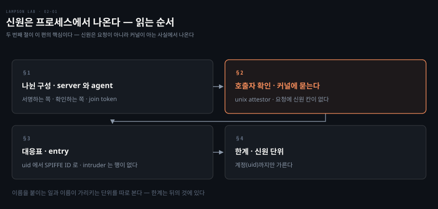
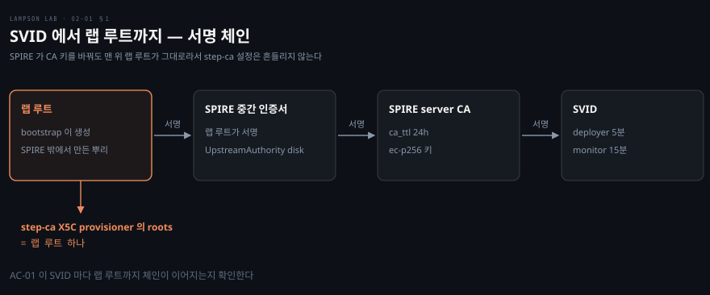
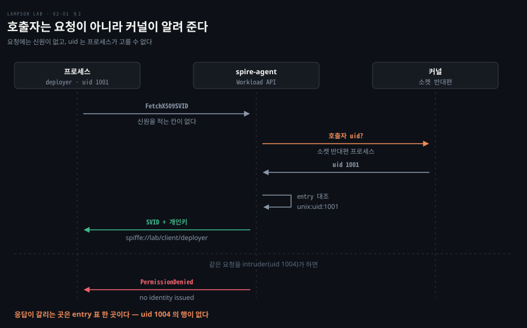

# 신원은 프로세스에서 나온다

---

> 저장소 README 「동작 구조」의 1·2번 걸음과 SPIRE 설정을 묶었습니다. 요청한 프로세스가 누구인지를 비밀값 없이 증명하는 부분이 어떻게 짜여 있는지 봅니다.

## 핵심 요약

> 이 편이 매달린 하나의 생각은 **신원이 요청에 적힌 말이 아니라 커널이 아는 사실에서 나온다**는 것입니다.

SVID 를 달라는 요청에는 신원을 적는 칸이 없습니다. agent 는 소켓 반대편 프로세스의 계정(uid)을 커널에 직접 묻습니다. 그 uid 를 등록된 entry 와 맞춰 SPIFFE ID 를 정합니다. 프로세스가 자기 신원을 속이려면 uid 를 바꿔야 하는데, client 컨테이너는 capability 가 하나도 없어서 root 도 uid 를 바꾸지 못합니다.

그래서 이 구조를 지키는 것은 비밀값이 아니라 배치입니다. client 는 agent 와 PID 네임스페이스를 공유하고, entry 표가 계정과 이름을 짝짓습니다. 표에 행이 없는 intruder 는 SVID 를 받지 못합니다.

다만 이 구조가 가르는 단위는 계정입니다. 같은 계정으로 실행한 프로세스는 어떤 프로그램이든 같은 신원을 받습니다.


## 학습 목표

> 이 편을 읽고 나면 아래 다섯 가지를 스스로 해낼 수 있습니다.

1. SPIRE server 와 agent 가 각각 하는 일을 말하고, agent 가 join token 으로 처음 등록되는 과정을 설명할 수 있습니다.
2. SVID 에서 랩 루트까지 이어지는 서명 체인을 대고, step-ca 가 루트 하나만 믿는 이유를 말할 수 있습니다.
3. unix workload attestor 가 호출자의 uid 를 알아내는 방식을 설명할 수 있습니다. client 가 agent 와 PID 네임스페이스를 공유하는 이유도 말할 수 있습니다.
4. entry 한 행을 읽고 intruder 가 SVID 를 받지 못하는 이유를 설명할 수 있습니다.
5. 신원 단위가 uid 뿐이라는 한계가 무엇을 허락하는지 말할 수 있습니다.

이 편에서 새로 만나는 낱말입니다. `어디서` 는 그 낱말이 실제로 설명되는 절입니다.

| 키워드 | 뜻 | 학습 포인트·연결 개념 | 어디서 |
|---|---|---|---|
| SPIRE server | SVID 를 서명하고 entry 를 보관하는 쪽 | CA 키 · 데이터스토어 · trust domain | §1 |
| SPIRE agent | client 옆에서 요청자를 확인해 SVID 를 나눠 주는 쪽 | Workload API 소켓 · SVID 캐시 | §1 |
| join token | agent 가 server 에 처음 등록할 때 쓰는 일회용 토큰 | 한 번 쓰면 끝 · TTL 600초 | §1 |
| workload attestor | 호출한 프로세스의 속성을 셀렉터로 바꾸는 플러그인 | 이 랩은 `unix` 하나 | §2 |
| 셀렉터 | 프로세스가 가진 속성 하나 | `unix:uid:1001` · entry 와 맞추는 단위 | §2 |
| entry | 셀렉터와 SPIFFE ID 를 짝짓는 대응표의 한 행 | parent · SPIFFE ID · TTL | §1 · §3 |
| `unix:sha256` | 실행 파일 해시 셀렉터 | 이 랩은 쓰지 않음 | §4 |

아래는 이 편의 절 넷이 읽히는 순서입니다.




## 1. 서명하는 쪽과 확인하는 쪽

> server 는 CA 키를 갖고 서명하고, agent 는 client 옆에서 요청자를 확인합니다. 둘을 나눈 구성에서 먼저 풀 일은 server 가 agent 를 믿게 만드는 것입니다.

### 서명하는 server 와 확인하는 agent

SPIRE server 는 trust domain `lab` 의 CA 입니다. CA 키는 디스크에 두어서 server 가 재시작돼도 같은 CA 를 이어 씁니다.

데이터스토어(sqlite)에는 entry 가 들어 있습니다. entry 는 "이 속성의 프로세스에는 이 SPIFFE ID 를 준다"는 대응표의 한 행입니다. §3 에서 한 행씩 읽습니다.

SVID 는 이 CA 가 서명합니다. 수명은 entry 마다 정하고, 정하지 않으면 1시간입니다.

SPIRE agent 는 client 옆에서 돌면서 Workload API 요청을 받습니다. Workload API 는 agent 가 Workload Endpoint 로서 같은 호스트의 워크로드에게 로컬 소켓으로 여는 API 입니다. 워크로드는 이것으로 자기 SVID 를 받아 갑니다.[^spiffe-workload-api]

요청은 소켓 `/tmp/spire-agent/public/api.sock` 으로 들어옵니다. agent 는 server 에서 받아 둔 entry 와 SVID 를 가지고 있다가 요청한 프로세스에 맞는 것을 내줍니다. entry 를 지운 뒤에도 agent 는 수 초 동안 캐시된 SVID 를 계속 내줍니다.

### join token 으로 신뢰 시작

agent 가 server 에 자기 정체를 증명하는 방법이 node attestor 이고, 이 랩은 `join_token` 을 씁니다. server 가 일회용 토큰을 발급하면 agent 가 시작할 때 `-joinTokenFile` 로 받아서 등록을 마칩니다.

bootstrap 은 `spire-server token generate` 로 토큰을 만들어 볼륨 파일에 씁니다. 옵션은 `-spiffeID spiffe://lab/agent/client` 와 `-ttl 600` 입니다.

토큰은 한 번만 쓸 수 있습니다. join token 으로 등록한 agent 는 다시 등록할 수도 없습니다. 그래서 agent 가 아직 유효한 SVID 를 가지고 있으면 bootstrap 은 새 토큰을 만들지 않습니다. 랩을 1시간(agent SVID 수명) 넘게 멈춰 둔 경우에는 만료된 agent 를 정리하고 새 토큰을 발급합니다.

agent 의 ID 에는 토큰이 들어갑니다. 그래서 SPIRE 는 이 ID 를 로그와 데이터스토어에 남기고, bootstrap 은 자기 로그에서 토큰 부분을 가립니다. 이 노출은 저장소의 알려진 한계로 적혀 있습니다.

workload entry 의 parent 는 토큰이 든 agent ID 가 아니라 `spiffe://lab/agent/client` 라는 별칭입니다. `token generate -spiffeID` 가 이 별칭 entry 를 만들어 줍니다. 그래서 agent 가 새 토큰으로 다시 등록돼도 workload entry 표는 그대로 남습니다.

### SVID 가 랩 루트까지 이어지는 길

SPIRE server 의 CA 는 스스로 루트가 되지 않습니다. bootstrap 이 만든 랩 루트가 SPIRE 중간 인증서를 서명합니다. server 는 `UpstreamAuthority "disk"` 로 그 중간 인증서를 상위 CA 로 씁니다. agent 는 `trust_bundle_path` 에 놓인 랩 루트로 server 를 처음 신뢰합니다.



step-ca 가 믿는 것은 이 체인의 맨 위인 랩 루트 하나입니다. SPIRE 의 CA 키가 바뀌어도 랩 루트는 그대로여서 step-ca 설정을 고칠 일이 없습니다. server 설정의 주석이 이 독립성을 의도로 밝혀 둡니다. step-ca 쪽 검사는 03편이 다룹니다.


## 2. 커널이 알려 주는 호출자

> agent 는 요청에 적힌 말을 믿지 않습니다. 소켓 반대편이 누구인지는 커널이 알고, agent 는 그것을 물어서 받습니다.

### 요청에 신원이 없는 이유

SVID 를 달라는 요청에는 "나는 deployer 다" 같은 내용을 적을 곳이 없습니다. 적을 곳이 있으면 프로세스가 아무 이름이나 적을 수 있으니, 이름은 요청 바깥에서 정해야 합니다. 이 랩은 그 바깥을 커널로 잡았습니다.

### unix attestor 와 셀렉터

SVID 를 요청한 프로세스가 누구인지 agent 는 플러그인에 맡깁니다. 그 플러그인이 workload attestor 이고, 호출한 프로세스의 속성을 셀렉터로 바꿉니다. 셀렉터는 `unix:uid:1001` 처럼 종류와 값이 붙은 속성 하나입니다.

unix 플러그인은 uid 말고도 사용자 이름, gid, 그룹 이름, 보조 그룹 같은 셀렉터를 냅니다. 실행 파일 경로와 해시(`sha256`) 셀렉터는 `discover_workload_path = true` 를 켤 때만 나옵니다.[^spire-unix-attestor] 이 랩의 agent 설정은 `WorkloadAttestor "unix"` 를 빈 설정으로 켜 두어서 그 둘은 나오지 않습니다. entry 에서는 `unix:uid` 하나만 씁니다.

한 번의 요청이 처리되는 순서는 아래와 같습니다. 같은 요청을 intruder 가 하면 마지막 응답만 달라집니다.



### 같은 PID 네임스페이스

unix attestor 는 PID 로 호출자를 찾습니다. 그래서 client 컨테이너는 `pid: "service:spire-agent"` 로 agent 와 PID 네임스페이스를 공유합니다. 대신 agent 가 멈추거나 다시 시작되면 client 도 함께 종료되므로, 이때는 `make up` 을 다시 실행해야 합니다.

### 속일 길을 막는 설정

신원이 uid 에서 나오니 uid 를 바꿀 수 있으면 신원도 바꿀 수 있습니다. client 컨테이너는 `cap_drop: [ALL]` 과 `no-new-privileges` 로 뜹니다. root 가 되어도 uid 를 바꾸지 못하고, 공유된 PID 네임스페이스에서 `/proc/1/root` 를 통해 agent 의 파일에 닿지도 못합니다.

`make shell-client` 가 주는 root 셸에는 entry 가 없어서 SVID 를 받지 못합니다. 그래서 README 는 계정을 지정해 들어가라고 안내합니다.


## 3. uid 에 이름을 붙이는 entry

> entry 는 셀렉터와 SPIFFE ID 를 짝짓는 대응표의 한 행입니다. 표에 없는 uid 는 이름을 받지 못합니다.

### 표 한 줄 읽기

bootstrap 이 SPIRE 에 넣는 workload entry 의 원본은 `bootstrap/spire-entries.txt` 입니다.

```bash
# account  uid   SPIFFE ID                      X509-SVID TTL (s; 0 = server default 1h)
deployer   1001  spiffe://lab/client/deployer   300
monitor    1002  spiffe://lab/client/monitor    900
stranger   1003  spiffe://lab/client/stranger   0
```

한 행은 entry 하나가 됩니다. parent 는 앞 절의 별칭 `spiffe://lab/agent/client` 입니다. 셀렉터는 `unix:uid:<uid>`, SPIFFE ID 는 셋째 열, SVID 수명은 넷째 열입니다. 0 은 server 기본값인 1시간을 뜻합니다.

| 계정 | uid | SPIFFE ID | SVID 수명 |
|---|---|---|---|
| deployer | 1001 | `spiffe://lab/client/deployer` | 5분 |
| monitor | 1002 | `spiffe://lab/client/monitor` | 15분 |
| stranger | 1003 | `spiffe://lab/client/stranger` | 1시간 |
| intruder | 1004 | 행 없음 | 없음 |

SVID 수명은 `step/ssh-mapping.json` 의 `maxTTL`(deployer 300초, monitor 900초)과 같은 값으로 맞췄습니다. step-ca 템플릿이 SVID 의 남은 수명이 `maxTTL` 보다 길면 발급을 거절하기 때문입니다. 다만 monitor 의 인증서는 15분이 아니라 5분에서 잘립니다. 이 연결은 03편에서 다룹니다.

### 표를 파일 하나로 고정

bootstrap 은 `make up` 마다 workload entry 를 이 파일과 정확히 같게 맞춥니다. 파일에 없거나 필드가 하나라도 다른 entry 는 지우고, 없는 entry 는 만듭니다. entry 를 손으로 바꿨다면 `make up` 을 다시 실행해 되돌리면 됩니다.

### 행이 없는 intruder

intruder(uid 1004)는 표에 행이 없습니다. agent 가 uid 1004 에 맞는 entry 를 찾지 못하므로 SVID 를 내주지 않고 `PermissionDenied` 로 답합니다.

AC-02 는 이 거부를 세 겹으로 확인합니다. 먼저 같은 실행에서 deployer 가 SVID 를 받는지 보아 agent 가 살아 있음을 확인합니다. 그다음 intruder 의 거부 사유가 소켓 오류가 아니라 agent 의 `no identity issued` 인지 봅니다. 마지막으로 서버 쪽 entry 가 intruder 의 어떤 unix 셀렉터와도 맞지 않는지 봅니다. uid, 사용자 이름, gid, 그룹, 보조 gid·그룹을 모두 대 봅니다.

AC-01 은 반대쪽을 지킵니다. deployer, monitor, stranger 가 각각 SVID 를 정확히 하나씩 받는지 봅니다. SPIFFE ID 가 기대와 같은지, 랩 루트까지 체인이 이어지는지도 봅니다.

서버 쪽에서는 각 계정을 고르는 entry 가 정확히 하나인지 확인합니다. 기대값은 구현 설정을 읽지 않고 테스트 코드에 직접 적어 두었습니다. 그래서 매핑이 틀리면 테스트가 실패합니다.


## 4. 신원 단위의 한계

> 이 랩의 신원은 계정까지만 가릅니다. 같은 계정으로 실행한 프로세스는 어떤 프로그램이든 그 계정의 SVID 를 받습니다.

### 계정이 신원의 최소 단위

entry 의 셀렉터가 `unix:uid` 하나뿐이므로 uid 가 같은 프로세스는 구별되지 않습니다. deployer 계정에서 도는 모든 프로그램은 deployer 의 SVID 를 받고, 그 SVID 로 같은 SSH 인증서도 받을 수 있습니다. 한 워크로드가 뚫렸을 때 피해가 그 역할에 머문다는 01편의 말은 이 단위를 전제로 합니다.

### sha256 셀렉터로 좁히는 길

실행 파일 해시 셀렉터 `unix:sha256` 을 함께 쓰면 "이 계정의 이 프로그램" 으로 좁힐 수 있습니다. 이 랩은 쓰지 않습니다. 쓰려면 agent 설정에서 `discover_workload_path` 를 켜야 하고, agent 가 워크로드의 `/proc/<PID>/exe` 를 읽을 수 있어야 합니다.[^spire-unix-attestor] 해시는 프로그램이 바뀔 때마다 entry 를 고쳐야 하는 부담도 함께 가져오기 때문에, 계정 단위가 이 랩이 보이려는 체인을 가장 단순하게 보여 줍니다.

### 한계가 이어지는 곳

신원이 계정에서 멈추므로 그 뒤의 선택, 곧 어떤 principal 을 줄지는 신원만 보고 CA 가 정해야 합니다. 다음 편은 그 CA 쪽 규칙을 다룹니다.


## 5. 실습 메모

> 이 맥(arm64, OrbStack)에서 `make up` 으로 랩을 띄운 뒤 계정별로 SVID 와 인증서를 요청해 본 출력입니다.

### 띄울 때 남은 줄

`make up` 의 PKI 단계가 로그에 남긴 줄 가운데 셋입니다. 랩 루트가 먼저 만들어지고, 그 아래에 SPIRE 중간 인증서가 만들어집니다.

```bash
[bootstrap] creating lab root
[bootstrap] creating SPIRE intermediate under the lab root
[bootstrap] PKI ready
```

### 계정마다 받은 응답

intruder 로 인증서를 요청하면 SVID 단계에서 멈췄습니다.

```bash
docker compose exec -T -u intruder client \
  lab-ssh-cert role-operator@billing
```

```bash
rpc error: code = PermissionDenied desc = no identity issued
lab-ssh-cert: no SVID for uid 1004
```

stranger 는 SVID 를 받았습니다. 그래서 step-ca 가 그 SPIFFE ID 를 읽고 매핑이 없다고 답했습니다.

```bash
docker compose exec -T -u stranger client \
  lab-ssh-cert role-operator@billing
```

```bash
The request could not be completed: x5c-spire: spiffe://lab/client/stranger has no SSH mapping.
```

deployer 가 받은 인증서의 Key ID 는 `spiffe://lab/client/deployer` 였습니다. 이 값은 요청이 아니라 SVID 의 SPIFFE ID 에서 옵니다.

### 실측 요약

| 계정 | 결과 |
|---|---|
| intruder (1004) | `PermissionDenied`, `no identity issued`, `no SVID for uid 1004` |
| stranger (1003) | SVID 수령, step-ca 가 `has no SSH mapping` 으로 거부 |
| deployer (1001) | 인증서 Key ID `spiffe://lab/client/deployer` |

기본 bash 3.2 로는 `tests/run.sh` 가 1초 만에 멈췄습니다. Homebrew bash 5.3.20 으로 다시 돌린 `make test` 에서 AC-01 과 AC-02 는 모두 PASS 했습니다. 위 출력은 그와 별도로 손으로 돌린 명령의 결과입니다. 호스트에서 `make test` 를 돌리려면 bash 4.4 이상이 필요합니다.


## 관련 문서

- [lampson-lab 실습 인덱스](./README.md) — 폴더 구성과 여섯 편의 목표
- [고정 키를 버리고 5분짜리 인증서를 쓴다](./01-01.%EA%B3%A0%EC%A0%95%20%ED%82%A4%EB%A5%BC%20%EB%B2%84%EB%A6%AC%EA%B3%A0%205%EB%B6%84%EC%A7%9C%EB%A6%AC%20%EC%9D%B8%EC%A6%9D%EC%84%9C%EB%A5%BC%20%EC%93%B4%EB%8B%A4.md) — 전체 경로와 이 편이 맡는 1·2번 걸음
- [principal 은 클라이언트가 고르지 않는다](./03-01.principal%20%EC%9D%80%20%ED%81%B4%EB%9D%BC%EC%9D%B4%EC%96%B8%ED%8A%B8%EA%B0%80%20%EA%B3%A0%EB%A5%B4%EC%A7%80%20%EC%95%8A%EB%8A%94%EB%8B%A4.md) — SVID 를 받은 뒤 step-ca 가 하는 일
- [istio 부록 — 신원을 문서로 만드는 네 규격](../../../08_cloud/book/istio-in-action/a0-03.%EB%B6%80%EB%A1%9D%20%E2%80%94%20%EC%8B%A0%EC%9B%90%EC%9D%84%20%EB%AC%B8%EC%84%9C%EB%A1%9C%20%EB%A7%8C%EB%93%9C%EB%8A%94%20%EB%84%A4%20%EA%B7%9C%EA%B2%A9.md) — SPIFFE ID, SVID, trust bundle 규격

[^spiffe-workload-api]: SPIFFE — Workload Endpoint 규격 §1·§2·§3(로컬 소켓으로 노출)과 Workload API 규격 §1(Workload Endpoint 가 서빙). 커밋 고정: <https://github.com/spiffe/spiffe/blob/5d15e3ee8782e205048d1f206fbf944e075f7bae/standards/SPIFFE_Workload_Endpoint.md> · <https://github.com/spiffe/spiffe/blob/5d15e3ee8782e205048d1f206fbf944e075f7bae/standards/SPIFFE_Workload_API.md>
[^spire-unix-attestor]: SPIRE v1.16.0 — WorkloadAttestor "unix" 의 `discover_workload_path` 와 셀렉터 표. <https://github.com/spiffe/spire/blob/v1.16.0/doc/plugin_agent_workloadattestor_unix.md>
