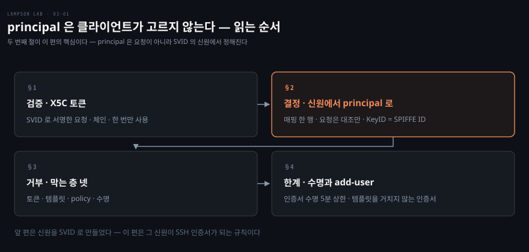
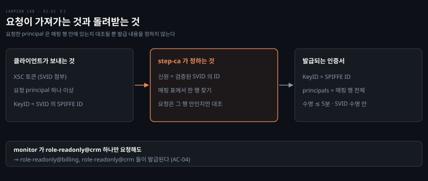
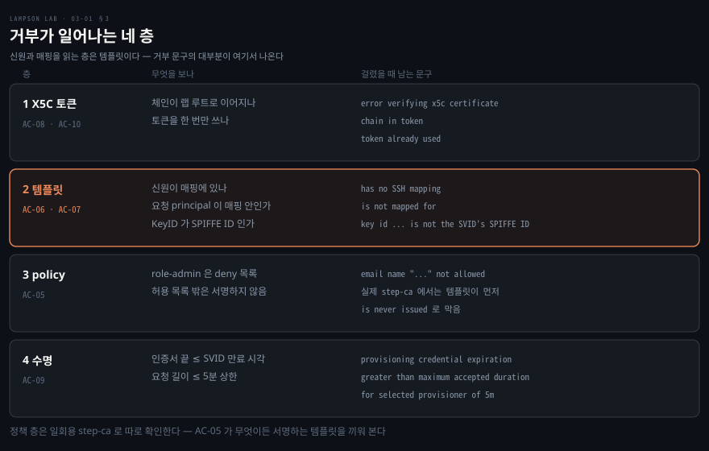

# principal 은 클라이언트가 고르지 않는다

---

> 저장소 README 「동작 구조」의 3·4번 걸음, step-ca 설정과 거부 테스트를 묶었습니다. SVID 를 받은 프로세스가 SSH 인증서를 달라고 할 때 step-ca 가 무엇을 믿고 무엇을 거부하는지 봅니다.

## 핵심 요약

> 이 편이 매달린 하나의 생각은 **요청에 적힌 principal 이 아니라 검증된 SVID 의 신원이 발급 내용을 정한다**는 것입니다.

인증서를 달라는 요청에는 principal 을 적는 칸이 있습니다. 그 칸을 그대로 믿으면 요청자가 원하는 역할을 마음대로 받으므로, step-ca 는 칸의 값을 발급 근거로 쓰지 않습니다.

step-ca 는 SVID 에서 SPIFFE ID 를 읽습니다. 매핑 표에서 그 신원의 행을 찾고, 그 행에 적힌 principal 전체를 발급합니다.

요청한 principal 은 그 행 안에 있는지 대조될 뿐입니다. 행 밖의 값이거나 `role-admin@` 이면 발급이 거부됩니다. 그래서 monitor 가 principal 하나만 요청해도 매핑된 둘이 함께 발급됩니다.

이 구조에도 남는 한계가 둘 있습니다. 하나는 수명입니다. 인증서 수명은 계정별 상한이 아니라 provisioner 의 5분 상한으로 묶입니다. 다른 하나는 step-ca 0.30.2 가 템플릿을 거치지 않는 두 번째 인증서를 서명한다는 것입니다.


## 학습 목표

> 이 편을 읽고 나면 아래 다섯 가지를 스스로 해낼 수 있습니다.

1. X5C 토큰이 무엇을 담고 step-ca 가 그것을 어떻게 검증하는지 설명할 수 있습니다.
2. 매핑 표 한 행이 principal 과 수명 상한이 되는 과정을 따라갈 수 있습니다.
3. 요청한 principal 이 발급 내용을 정하지 못하는 이유를 monitor 예시로 설명할 수 있습니다.
4. 거부 경로 다섯 가지가 어느 층에서 어떤 문구로 막히는지 짚을 수 있습니다.
5. 수명 상한과 add-user 인증서라는 남는 한계를 설명할 수 있습니다.

이 편에서 새로 만나는 낱말입니다. `어디서` 는 그 낱말이 실제로 설명되는 절입니다.

| 키워드 | 뜻 | 학습 포인트·연결 개념 | 어디서 |
|---|---|---|---|
| X5C provisioner | 인증서 체인이 든 토큰으로 요청자를 확인하는 step-ca 의 인증 방식 | `x5c-spire` · roots = 랩 루트 | §1 |
| principal | SSH 인증서가 로그인을 허락하는 이름 | `role-operator@billing` · 호스트 쪽 파일과 대조 | §1 · §2 |
| 매핑 | SPIFFE ID 와 principal 목록, 수명 상한을 짝짓는 표 | `ssh-mapping.json` · maxTTL | §2 |
| Key ID | 인증서에 적히는 발급 대상 식별자 | SPIFFE ID 와 같아야 함 · sshd 로그에 남음 | §2 |
| 템플릿 | 인증서에 무엇을 넣을지 정하고 어긋나면 발급을 막는 코드 | 검사 순서 · `fail` | §2 |
| policy | 허용·거부 principal 목록 | `role-admin` deny | §3 |
| add-user 인증서 | 요청하면 따라 나오는 두 번째 SSH 인증서 | principal `provisioner` | §4 |

아래는 이 편의 절 넷이 읽히는 순서입니다.




## 1. SVID 로 서명한 요청

> step-ca 가 요청자를 믿으려면 요청이 SVID 의 주인에게서 왔다는 증거가 필요합니다. X5C 토큰이 그 증거를 나릅니다.

### 토큰 한 장에 든 것

요청자가 비밀번호나 API 토큰을 들고 있으면 그것이 또 하나의 고정 키가 됩니다. 이 랩의 요청자는 이미 SVID 와 그 개인키를 갖고 있으니, 요청을 그 개인키로 서명하는 것만으로 신원을 증명할 수 있습니다. 이렇게 만든 요청서가 X5C 토큰입니다.

토큰의 헤더에는 SVID 인증서 체인이 실려 있고, 서명은 SVID 의 개인키로 한 것입니다. step-ca 는 두 가지를 봅니다. 체인이 `x5c-spire` provisioner 에 등록된 roots 까지 이어지는지, 그리고 서명이 체인 맨 아래 인증서의 키로 한 것인지입니다.

`lab-ssh-cert` 는 이 일을 한 번에 합니다. agent 에서 SVID 를 받아 SPIFFE ID 를 읽습니다. 그다음 `step ssh certificate` 에 SVID 인증서와 개인키를 넘깁니다. 요청에 실리는 principal 은 인자로 받은 값입니다.

### 믿는 뿌리는 하나

X5C provisioner `x5c-spire` 의 roots 는 랩 루트 하나입니다. 02편에서 본 체인의 맨 위입니다. SPIRE 가 내부 CA 키를 바꿔도 이 설정은 흔들리지 않습니다. AC-08 이 roots 가 정확히 랩 루트 한 장인지, provisioner 가 `x5c-spire` 하나뿐인지를 확인합니다.

`bootstrap/bootstrap.sh` 가 `ca.json` 을 만들 때 이 provisioner 의 claims 도 정합니다. SSH 인증서 발급을 켜고(`enableSSHCA`), 갱신을 끕니다(`disableRenewal`). 길이는 최소 1분, 기본 5분, 최대 5분으로 묶습니다.

X.509 인증서 쪽은 `fail` 로 막혀 있어서 이 provisioner 로는 SSH 사용자 인증서만 나옵니다. 관리 API 도 없어서 설정을 바꿔 가며 다른 경로로 발급할 길이 없습니다.

step-ca 의 TLS 루트는 랩 루트와 일부러 분리했습니다. step-ca 의 intermediate 키가 SVID 로 통하는 인증서를 만들 수 없게 하려는 것입니다. 저장소 문서는 이 결정을 D-10 으로 적습니다.


## 2. 신원에서 principal 로

> 인증서에 무엇을 넣을지를 요청이 정하면 요청자가 곧 발급자가 됩니다. step-ca 는 그 결정을 SVID 와 매핑 표로 옮겨 놓았습니다.

### 매핑 표 한 행

신원과 principal 의 대응은 `step/ssh-mapping.json` 에 있습니다. 파일은 두 행뿐입니다.

```json
{
  "spiffe://lab/client/deployer": {
    "principals": ["role-operator@billing"],
    "maxTTL": 300
  },
  "spiffe://lab/client/monitor": {
    "principals": ["role-readonly@billing", "role-readonly@crm"],
    "maxTTL": 900
  }
}
```

principal 은 SSH 인증서가 로그인을 허락하는 이름입니다. 이 랩에서는 `role-<역할>@<그룹>` 꼴입니다. 호스트가 이 이름을 자기 파일과 대조하는 쪽은 04편이 다룹니다.

bootstrap 은 이 파일을 `ca.json` 의 템플릿 데이터로 넣습니다. `ca.json` 은 bootstrap 이 실행될 때마다 저장소 파일로 다시 쓰이므로, 설정과 저장소가 어긋난 채 남지 않습니다.

### 템플릿의 검사 순서

`step/templates/ssh-user.tpl` 이 인증서를 만들기 전에 아래를 차례로 확인하고, 하나라도 어긋나면 `fail` 로 발급을 멈춥니다. 기본값이나 대체 경로는 없습니다.

1. 인증서 종류가 user 인가.
2. SVID 에 URI SAN 이 정확히 하나 있는가.
3. 그 SPIFFE ID 가 매핑 표에 있는가. 없으면 `has no SSH mapping`.
4. 매핑 행에 `role-admin@` 로 시작하는 principal 이 적혀 있지 않은가.
5. 요청의 Key ID 가 SVID 의 SPIFFE ID 와 같은가.
6. 요청한 principal 이 모두 매핑 행 안에 있고 `role-admin@` 가 아닌가.
7. SVID 의 남은 수명이 행의 `maxTTL` 이하인가.

신원은 3번에서 SVID 의 URI SAN 에서 읽습니다. 토큰의 subject 나 요청 본문은 신원 근거가 아닙니다. 발급되는 인증서의 Key ID 도 같은 SPIFFE ID 입니다. 그래서 sshd 로그의 `ID spiffe://lab/client/deployer` 줄이 곧 누가 접속했는지의 기록입니다.

### 요청 principal 의 자리

6번은 요청한 principal 을 매핑 행과 맞춰 보기만 합니다. 통과해도 발급되는 목록은 요청이 아니라 행 전체입니다. 템플릿 끝의 출력이 그렇게 되어 있습니다.



AC-04 가 이 성질을 확인합니다. monitor 가 `role-readonly@billing` 하나만 요청해도 결과는 같습니다. `role-readonly@crm` 하나만, 또는 둘 다 요청해도 같은 두 principal 이 나옵니다.

요청을 줄여서 더 좁은 인증서를 받는 길은 없습니다. 요청을 늘려서 더 넓은 인증서를 받는 길도 없습니다.

발급되는 인증서에는 `permit-pty` 확장 하나만 들어가고 critical option 은 없습니다. AC-03 이 deployer 의 인증서를 기대값과 필드마다 맞춥니다. 기대값은 구현 설정을 읽지 않고 테스트 코드에 직접 적었습니다.


## 3. 막는 층 넷

> 거부 경로는 다섯 가지입니다. 어느 층이 막는지를 알아야 문구를 보고 원인을 짚을 수 있습니다.

### 층별 검사 대상

토큰, 템플릿, policy, 수명이 각각 다른 것을 봅니다. 이 편은 층의 순서를 가정하지 않습니다. 어느 층이든 걸리면 인증서는 나오지 않고, 층마다 남기는 문구가 다릅니다.



### admin 은 두 겹

`role-admin@*` 는 한 곳이 아니라 두 곳에서 막힙니다. 템플릿이 4번과 6번에서 거부하고, policy 의 deny 목록에도 `role-admin@billing`, `role-admin@crm` 이 올라 있습니다. 이 목록은 이메일 규칙으로 읽히는데, `role-x@group` 꼴이 이메일처럼 생겼기 때문입니다.

AC-05 는 두 겹을 따로 확인합니다. 먼저 실제 step-ca 에서 deployer 가 admin 을 요청하면 `is never issued` 로 거부되는지 봅니다.

step-ca 는 허용 목록 밖과 deny 목록 적중을 같은 문구로 보고합니다. 그래서 실행 중인 `ca.json` 에서 deny 목록과 허용 목록을 읽어 따로 확인합니다.

그다음 무엇이든 서명하는 템플릿을 끼운 일회용 step-ca 를 띄웁니다. 템플릿이 뚫렸다고 가정해도 policy 만으로 admin 이 막히는지 보려는 것입니다. 이 일회용 step-ca 는 TLS 키와 SSH user CA 키를 새로 만들어 씁니다. 그래서 그것이 서명한 인증서는 랩의 sshd 호스트가 믿지 않습니다. X5C roots 는 랩 루트 그대로여서 deployer 의 SVID 요청은 받습니다.

### 다른 그룹과 미매핑 신원

deployer 가 `role-operator@crm` 을 요청하면 역할은 맞지만 그룹이 다릅니다. `role-readonly@billing` 은 다른 신원에만 매핑돼 있습니다. 둘 다 `is not mapped for spiffe://lab/client/deployer` 로 거부됩니다.

AC-06 은 먼저 deployer 가 자기 인증서를 받는지 확인합니다. 거부가 신원 문제가 아님을 보이려는 것입니다.

stranger 는 SVID 가 있지만 매핑이 없어서 어떤 principal 로도 `has no SSH mapping` 이 나옵니다. AC-07 은 stranger 의 SVID 가 실제로 있는 것부터 확인합니다.

SPIRE 가 자기 신원으로 쓰는 agent 의 SVID 와 server 의 신원도 같은 랩 루트 아래에 있습니다. 체인은 통과하지만 이쪽도 `has no SSH mapping` 입니다. 체인이 맞다고 발급되는 것이 아니라 매핑에 이름이 있어야 발급됩니다.

### 위조 토큰과 토큰 재사용

SVID 가 없는 intruder 가 자기 인증서에 deployer 의 SPIFFE ID 를 넣고 X5C 토큰을 만들면 거부됩니다. AC-08 은 두 방식을 시험합니다. 자기 서명한 인증서와, 랩 루트와 이름이 똑같은 가짜 루트 아래 만든 인증서입니다.

둘 다 체인이 roots 로 이어지지 않아 `error verifying x5c certificate chain in token` 이 나옵니다. 이름만 같은 가짜 루트는 통과하지 못합니다.

진짜 토큰도 두 번 쓸 수는 없습니다. AC-10 은 deployer 가 토큰 하나로 인증서를 두 번 요청하게 합니다. 첫 번째는 발급되고 두 번째는 거부되며, step-ca 로그에 `token already used` 가 남는지까지 봅니다.


## 4. 수명과 add-user

> 이 구조가 못 막는 것이 둘 있습니다. 저장소 README 의 알려진 한계 표에서 이 편에 걸린 두 행입니다.

### 수명을 묶는 세 곳

인증서 수명은 한 곳이 아니라 세 곳에서 묶입니다. 템플릿 7번은 SVID 의 남은 수명이 `maxTTL` 보다 길면 거부합니다. step-ca 는 길이를 지정하지 않은 요청이면 기본 길이와 SVID 의 남은 수명 중 짧은 쪽으로 끝을 정합니다. SVID 만료보다 늦은 끝을 지정한 요청은 거부합니다.[^step-ca-ssh-limit] provisioner 는 최대 5분으로 묶습니다.

세 곳이 겹치므로 요청이 길이를 얼마로 말하든 인증서는 SVID 가 끝난 뒤까지 이어지지 않습니다. 줄어들거나 거부됩니다. AC-09 는 두 방식으로 길게 요청해 봅니다.

한 시간을 요청하면 SVID 보다 길어서 `provisioning credential expiration` 이 나옵니다. 9분 전에 시작해 1분 뒤에 끝나는 10분 창을 요청하면 provisioner 의 5분 상한에 걸립니다. 문구는 `is greater than maximum accepted duration` 으로 시작합니다.

그런데 monitor 는 SVID 수명이 15분이어도 인증서가 5분에서 잘립니다. provisioner 의 상한이 모든 계정에 같게 걸리고, step-ca 0.30.2 는 계정별 길이 상한을 지원하지 않기 때문입니다. 매핑 표의 `maxTTL` 900 은 템플릿 쪽 상한일 뿐, 15분짜리 인증서가 나온다는 뜻이 아닙니다. 저장소는 이를 알려진 한계로 둡니다.

### 템플릿을 거치지 않는 인증서

step-ca 0.30.2 는 `--add-user` 를 주면 두 번째 인증서를 서명합니다. principal 이 `provisioner` 이고 Key ID 는 SPIFFE ID 가 아닙니다. 이 인증서는 템플릿과 policy 를 거치지 않고, 끌 수 있는 설정도 없습니다.

저장소는 이것을 막지 못하는 대신 쓸모가 없음을 보입니다. AC-12 와 AC-13 은 deployer 와 monitor 의 add-user 인증서로 접속을 시도합니다. 대상은 두 호스트의 admin, operator, readonly, provisioner, root 열 곳입니다. 인증서마다 열 번 모두 거부됩니다.

계정이 있는 곳은 호스트 로그에 `Failed publickey` 와 그 인증서의 serial 이 남습니다. `provisioner` 는 호스트에 계정 자체가 없어서 `Invalid user provisioner` 가 남습니다.

한계는 한계로 남습니다. 인증서가 막히는 이유가 step-ca 의 규칙이 아니라 호스트의 principal 파일이라는 점은 04편에서 이어집니다.


## 5. 실습 메모

> 이 맥(arm64, OrbStack)에서 `make up` 으로 랩을 띄운 뒤 deployer 로 인증서를 받아 열어 본 출력입니다.

### deployer 의 인증서

```bash
docker compose exec -T -u deployer client \
  lab-ssh-cert role-operator@billing
```

받은 인증서를 `ssh-keygen -L` 로 열면 요청한 것과 발급된 것이 맞아 떨어졌습니다.

```bash
Key ID: "spiffe://lab/client/deployer"
Serial: 6060638994358994433
Valid: from 2026-11-09T04:22:01 to 2026-11-09T04:26:38
Principals:
        role-operator@billing
Critical Options: (none)
Extensions:
        permit-pty
```

Key ID 는 `lab-ssh-cert` 가 SVID 에서 읽어 보낸 값과 같습니다. principal 은 매핑의 deployer 행 하나입니다.

수명은 5분이 아니라 4분 37초입니다. 이어서 로그인에 쓴 인증서도 끝 시각이 04:26:38 로 같았습니다. 두 인증서의 끝 시각이 같다는 것은, step-ca 가 끝을 근거 SVID 의 만료 시각으로 줄였다는 뜻입니다. SVID 의 만료 시각 자체는 이 출력에 나타나지 않습니다.

### 거부 응답

stranger 는 SVID 를 받았지만 매핑이 없었습니다.

```bash
The request could not be completed: x5c-spire: spiffe://lab/client/stranger has no SSH mapping.
```

step-ca 로그에도 같은 사유가 `level=warning` 한 줄로 남았습니다. 가장 앞 층인 SVID 단계에서 멈춘 intruder 는 이 로그에 나타나지 않습니다.

### 실측 요약

| 계정 | 걸린 곳 | 결과 |
|---|---|---|
| deployer (1001) | 걸리지 않음 | `role-operator@billing`, `permit-pty`, 4분 37초 |
| stranger (1003) | 템플릿 3번 | `has no SSH mapping` |
| intruder (1004) | SVID 단계 | `no identity issued`, step-ca 에 요청이 오지 않음 |

같은 방식으로 받은 deployer 인증서(serial 1104491781651996652)로 `admin@host-billing` 에 접속하면 `Permission denied (publickey)` 로 거부됐습니다. 인증서를 받은 뒤의 이 거부는 호스트 쪽 규칙이라 04편에서 읽습니다. bash 5.3.20 으로 다시 돌린 `make test` 에서 AC-03 부터 AC-10 까지 모두 PASS 했습니다. 위 출력은 손으로 돌린 명령의 결과입니다. 호스트에서 `make test` 를 돌리려면 bash 4.4 이상이 필요합니다.


## 관련 문서

- [lampson-lab 실습 인덱스](./README.md) — 폴더 구성과 여섯 편의 목표
- [고정 키를 버리고 5분짜리 인증서를 쓴다](./01-01.%EA%B3%A0%EC%A0%95%20%ED%82%A4%EB%A5%BC%20%EB%B2%84%EB%A6%AC%EA%B3%A0%205%EB%B6%84%EC%A7%9C%EB%A6%AC%20%EC%9D%B8%EC%A6%9D%EC%84%9C%EB%A5%BC%20%EC%93%B4%EB%8B%A4.md) — 전체 경로와 이 편이 맡는 3·4번 걸음
- [신원은 프로세스에서 나온다](./02-01.%EC%8B%A0%EC%9B%90%EC%9D%80%20%ED%94%84%EB%A1%9C%EC%84%B8%EC%8A%A4%EC%97%90%EC%84%9C%20%EB%82%98%EC%98%A8%EB%8B%A4.md) — 이 편이 믿고 시작하는 SVID 와 랩 루트 체인
- [TLS로 컴포넌트 안전하게 연결하기](../../../08_cloud/book/container-security/11-01.TLS%EB%A1%9C%20%EC%BB%B4%ED%8F%AC%EB%84%8C%ED%8A%B8%20%EC%95%88%EC%A0%84%ED%95%98%EA%B2%8C%20%EC%97%B0%EA%B2%B0%ED%95%98%EA%B8%B0%20%E2%80%94%20%ED%82%A4%C2%B7%EC%9D%B8%EC%A6%9D%EC%84%9C%C2%B7CA%EC%9D%98%20%EC%97%AD%ED%95%A0.md) — 인증서와 CA 와 체인 검증의 기본

[^step-ca-ssh-limit]: smallstep/certificates v0.30.2 — `sshLimitDuration` 은 끝을 지정하지 않으면 기본 길이와 X5C leaf 의 남은 수명 중 짧은 쪽으로 끝을 정하고, 지정한 끝이 NotAfter 보다 늦으면 `provisioning credential expiration ... is before requested certificate validBefore` 로 거부합니다. <https://github.com/smallstep/certificates/blob/v0.30.2/authority/provisioner/sign_ssh_options.go> · 적용 지점 <https://github.com/smallstep/certificates/blob/v0.30.2/authority/provisioner/x5c.go#L345>
