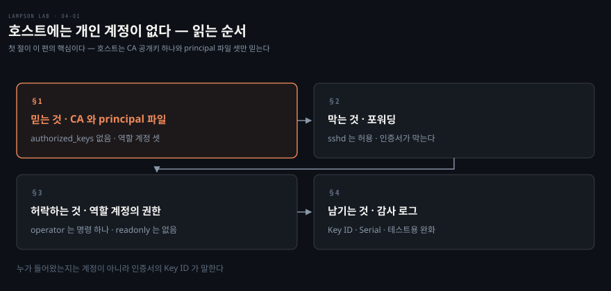
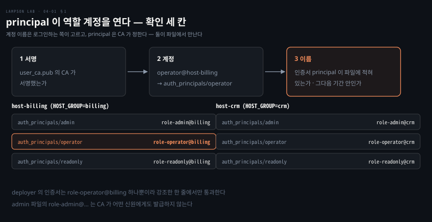
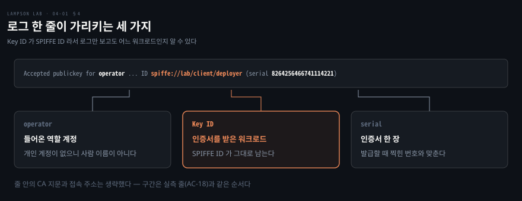

# 호스트에는 개인 계정이 없다

---

> 저장소의 sshd 쪽을 한 편으로 묶었습니다. 호스트가 사람 계정 대신 무엇을 믿는지, 인증서가 무엇을 막고 허락하는지, 접속이 로그에 어떻게 남는지를 설정 파일과 테스트 출력으로 읽습니다.

## 핵심 요약

> 이 편이 매달린 하나의 생각은 **개인 계정이 없는 호스트는 CA 공개키 하나와 계정당 한 줄짜리 principal 파일만 믿으면 된다**는 것입니다.

사람마다 계정을 만들고 공개키를 등록하는 호스트는 입사, 퇴사, 역할 변경 때마다 손이 갑니다. lampson-lab 의 호스트에는 `admin`, `operator`, `readonly` 역할 계정 셋뿐입니다. `authorized_keys` 는 읽지 않습니다. 호스트가 아는 것은 CA 공개키 하나와, 역할 계정마다 principal 한 줄이 든 파일입니다.

권한의 경계도 인증서와 계정에서 끝납니다. 인증서가 허락한 기능은 터미널 할당뿐이라서 sshd 가 포워딩을 열어 두어도 포워딩은 거부됩니다. `operator` 는 sudo 로 명령 하나만 실행하고 `readonly` 는 sudo 를 쓰지 못합니다. 접속할 때마다 sshd 로그에 Key ID 와 Serial 이 남아서, 계정 이름이 사람을 가리지 못하는 자리를 인증서가 메웁니다.

이 편의 주장은 AC-11 에서 AC-18 까지의 PASS 줄로 확인했습니다. 호스트가 안 열리는 경우, 열리는 경우, 열려도 못 하는 일을 테스트가 각각 따로 판정합니다.


## 학습 목표

> 이 편을 읽고 나면 아래 여섯 가지를 스스로 해낼 수 있습니다.

1. 개인 계정이 없는 호스트의 sshd 설정에서 인증을 닫는 줄을 대고, 줄마다 닫는 길을 말할 수 있습니다.
2. 인증서의 principal 이 역할 계정에 닿기까지의 세 가지 확인을 순서대로 말할 수 있습니다.
3. sshd 가 포워딩을 허용하는데도 포워딩이 거부되는 이유를 말할 수 있습니다.
4. 세 역할 계정이 sudo 로 할 수 있는 일을 구분할 수 있습니다.
5. sshd 로그 한 줄에서 워크로드와 인증서를 거슬러 찾을 수 있습니다.
6. `PerSourcePenalties no` 를 테스트에서만 꺼 두는 이유를 말할 수 있습니다.

이 편에서 새로 만나는 낱말입니다. `어디서` 는 그 낱말이 실제로 설명되는 절입니다.

| 키워드 | 뜻 | 학습 포인트·연결 개념 | 어디서 |
|---|---|---|---|
| 역할 계정 | 사람이 아니라 역할 이름으로 만든 리눅스 계정 | admin · operator · readonly | §1 |
| AuthorizedKeysFile | sshd 가 등록된 공개키를 찾는 파일 | `none` 이면 등록 키로 못 들어옴 | §1 |
| AuthorizedPrincipalsFile | 계정마다 허용할 principal 을 적은 파일 | `%u` 는 로그인 계정 이름 | §1 |
| extension | 인증서가 허락하는 기능을 적은 칸 | `permit-pty` 만 있으면 포워딩 불가 | §2 |
| sudoers | 계정이 root 로 실행할 수 있는 명령의 목록 | operator 는 명령 하나 | §3 |
| Key ID · Serial | 인증서마다 붙은 이름과 번호 | sshd 로그의 Accepted 줄에 남음 | §4 |
| PerSourcePenalties | 인증에 실패한 주소를 잠시 거부하는 sshd 기능 | 테스트에서만 끔 | §4 |

아래는 이 편의 절 넷이 읽히는 순서입니다.




## 1. 호스트가 믿는 두 가지

> 호스트에 개인 키 목록이 없으므로 믿을 것은 CA 공개키 하나와 계정별 principal 파일뿐이고, 둘 다 컨테이너가 시작할 때 만들어집니다.

사람마다 계정을 두는 호스트에서는 누가 팀을 떠날 때 호스트마다 계정과 키를 지워야 합니다. 이 랩의 호스트는 그 목록 자체를 없앴고, 두 호스트(`host-billing` 과 `host-crm`)가 같은 구성입니다.

### 역할 계정 셋

호스트에 있는 계정은 역할 이름을 가진 셋입니다. 계정마다 `lab-<역할>` 그룹이 하나씩 딸려 있습니다. 사람의 이름이 들어갈 자리가 없으므로 호스트는 누구인지가 아니라 무슨 역할인지만 압니다.

| 계정 | 하는 일 |
|---|---|
| `admin` | 모든 명령을 root 로 실행할 수 있는 계정입니다 |
| `operator` | 서비스 재시작 명령 하나만 root 로 실행할 수 있는 계정입니다 |
| `readonly` | root 권한이 전혀 없는 계정입니다 |

### CA 공개키 하나

인증서로 들어오는 길은 sshd 설정의 이 줄로 열립니다.

```ini
TrustedUserCAKeys /etc/ssh/user_ca.pub
```

`sshd_config(5)` 는 이 파일에 든 CA 가 서명한 인증서를 인증에 쓸 수 있다고 설명합니다. 이 랩에서는 컨테이너가 시작할 때 `entrypoint.sh` 가 step-ca 의 SSH user CA 공개키를 설치합니다. 설치 위치가 `/etc/ssh/user_ca.pub` 입니다. 파일에 키가 정확히 하나가 아니면 `entrypoint.sh` 는 시작을 멈춥니다.

설치된 파일이 step-ca 가 내놓는 CA 와 같은지는 AC-15 가 지문으로 확인합니다. 두 호스트 모두 같은 지문이었습니다. 아래 지문은 `make test` 를 돌린 기동의 값이고, §4 의 Accepted 줄은 첫 기동에서 캡처한 것이라 CA 지문이 다릅니다.

```bash
AC-15 PASS host-billing: sshd -T matches CONTRACT §5.4; TrustedUserCAKeys is exactly step-ca's SSH user CA (SHA256:LKsy8evRY9X3N+Ss3KBgHpKJCjaDXuLCXvPuotYex1A)
AC-15 PASS host-crm: sshd -T matches CONTRACT §5.4; TrustedUserCAKeys is exactly step-ca's SSH user CA (SHA256:LKsy8evRY9X3N+Ss3KBgHpKJCjaDXuLCXvPuotYex1A)
```

### 인증이 들어오는 다른 길 닫기

CA 를 믿게 만들었어도 다른 길이 열려 있으면 인증서는 우회됩니다. 설정 파일은 그 길을 한 줄씩 닫습니다.

| 설정 | 닫는 길 |
|---|---|
| `AuthorizedKeysFile none` | `authorized_keys` 에 등록한 공개키 |
| `PasswordAuthentication no` | 비밀번호 |
| `KbdInteractiveAuthentication no` | 키보드 대화형 입력 |
| `PermitRootLogin no` | root 로 직접 로그인 |
| `HostbasedAuthentication no` · `GSSAPIAuthentication no` | 호스트 기반 인증과 Kerberos 경로 |

가장 믿을 만한 확인은 일부러 우회를 시도해 보는 것입니다. AC-15 는 평범한 공개키를 `~operator/.ssh/authorized_keys` 에 직접 써 넣은 뒤 그 키로 접속해 봅니다. 거부되면 `AuthorizedKeysFile none` 이 실제로 동작한다는 뜻입니다. 이 랩이 믿지 않는 CA 가 서명한 인증서도 같은 방식으로 시험하고, 둘 다 거부됐습니다.

```bash
AC-15 PASS plain key (also in ~operator/.ssh/authorized_keys) refused for operator@host-billing
AC-15 PASS certificate for role-operator@billing from an untrusted CA refused for operator@host-billing
```

### principal 파일과 확인 세 칸

CA 서명만으로는 어느 계정이든 열 수 있다는 뜻이 아닙니다. 인증서의 principal 이 로그인하려는 계정의 파일에 적혀 있어야 합니다.

```ini
AuthorizedPrincipalsFile /etc/ssh/auth_principals/%u
```

`%u` 는 로그인하려는 계정 이름으로 바뀝니다. 그래서 `operator` 로 들어오려는 인증서는 `/etc/ssh/auth_principals/operator` 를 거칩니다. `entrypoint.sh` 는 시작할 때 계정마다 이 파일을 새로 만들고 한 줄을 씁니다. 줄의 모양은 `role-<역할>@<호스트 그룹>` 이고, 호스트 그룹은 컨테이너의 `HOST_GROUP` 값(billing 또는 crm)입니다.

아래 그림은 sshd 가 이 세 가지를 차례로 확인하는 순서와 두 호스트의 파일 내용입니다.



호스트 그룹이 이름에 들어 있어서 같은 역할도 그룹마다 다른 principal 이 됩니다. `role-operator@billing` 은 `host-crm` 의 operator 파일에 없습니다. 그래서 deployer 의 인증서는 `host-crm` 의 어느 계정도 열지 못합니다. 파일 내용 자체도 테스트가 지킵니다. AC-12 는 두 호스트의 파일이 위 그림과 정확히 같은지를 읽습니다.

```bash
AC-12 PASS host-billing: principals files are exactly admin=role-admin@billing;operator=role-operator@billing;readonly=role-readonly@billing;
AC-12 PASS host-crm: principals files are exactly admin=role-admin@crm;operator=role-operator@crm;readonly=role-readonly@crm;
```

`admin` 파일에도 `role-admin@…` 가 들어 있습니다. 다만 CA 가 그 principal 을 누구에게도 발급하지 않아서 `admin` 으로 들어오는 인증서는 없습니다. 이 발급 거부는 03편이 다룹니다.

거부된 경우 sshd 는 어느 인증서가 왜 막혔는지를 로그에 남깁니다. 테스트는 거부 응답 `Permission denied (publickey)` 와 그 인증서가 찍힌 로그 줄을 함께 요구합니다. 로그에 남지 않은 거부는 sshd 가 아닌 다른 이유로 막혔을 수 있기 때문입니다.

```bash
AC-12 PASS deployer -> operator@host-crm: refused; host-crm: certificate serial 2393889364823288582 has no authorized principal for operator
AC-12 PASS deployer -> admin@host-billing: refused; host-billing: certificate serial 7046522657379290078 has no authorized principal for admin
```

step-ca 는 요청하면 템플릿과 policy 를 거치지 않는 두 번째 인증서(add-user 인증서)를 서명합니다. 이 인증서의 principal 은 `provisioner` 입니다. AC-12 와 AC-13 은 이 인증서로 로그인해 봅니다. 대상은 두 호스트의 역할 계정 셋과 `provisioner`, `root` 까지 열 곳이고, 전부 거부되는 것을 확인했습니다.

```bash
AC-12 PASS deployer's add-user certificate (role-operator@billing-provisioner, serial 3098525713064764780) logs in nowhere: 10 targets refused
```


## 2. 포워딩 차단

> sshd 는 포워딩을 허용으로 두었는데도 포워딩이 거부됩니다. 막는 쪽이 설정 파일이 아니라 인증서이기 때문입니다.

sshd 설정으로 포워딩을 끄면 호스트마다 설정을 맞춰야 하고, 셸이 열린 사용자는 다른 방법으로 터널을 만들 수 있습니다. `sshd_config(5)` 도 셸 접근을 막지 않은 채 포워딩만 끄는 것은 소용이 없다고 설명합니다.

### sshd 는 허용, 인증서는 거부

이 랩은 일부러 sshd 쪽을 열어 두었습니다.

```ini
AllowTcpForwarding yes
```

설정 파일의 주석은 이유를 적어 두었습니다. 포워딩을 막는 것이 인증서여야 하기 때문입니다. `ssh-keygen(1)` 의 CERTIFICATES 절에 따르면 인증서가 허락하는 기능은 extension 으로 적힙니다. 포워딩은 `permit-port-forwarding` extension 이 있어야 허락됩니다. step-ca 의 SSH 인증서 템플릿은 extension 을 `permit-pty` 하나로만 정했고 critical option 은 두지 않습니다. 그래서 인증서로 들어온 세션은 터미널은 받지만 포워딩은 받지 못합니다.

### 테스트가 거부의 원인을 가르는 법

거부가 sshd 설정에서 나왔다면 이 설계는 증명되지 않습니다. AC-14 는 먼저 `sshd -T` 로 호스트의 유효 설정이 `allowtcpforwarding yes` 인지 확인합니다. 그다음 monitor 의 인증서로 `-L` 포워딩을 요청해, 세션은 열리고 포워딩만 거부되는지를 봅니다.

```bash
AC-14 PASS monitor -> readonly@host-billing with -L: session ok, forward refused (administratively prohibited; sshd: refused local port forward)
```

세션은 열렸습니다. 클라이언트는 `administratively prohibited` 를 받았습니다. sshd 로그에는 `refused local port forward` 가 남았습니다. 포워딩의 세 모양(local, remote, dynamic)은 [SSH 포트 포워딩 노트](../../book/sshm_ssh-mastery/09-01.%ED%8F%AC%ED%8A%B8%20%ED%8F%AC%EC%9B%8C%EB%94%A9%20%E2%80%94%20local%C2%B7remote%C2%B7dynamic%20%EA%B3%BC%20%EB%A6%AC%EB%B2%84%EC%8A%A4%20%ED%84%B0%EB%84%90%EC%9D%98%20%EC%B5%9C%EC%86%8C%20%EB%AA%A8%ED%98%95.md)에 정리돼 있습니다.


## 3. 역할 계정의 권한

> 같은 호스트의 세 계정은 sudo 로 할 수 있는 일이 서로 다르고, 허락의 크기가 sudoers 한 줄에서 바로 읽힙니다.

호스트에 셸이 열리면 그 계정이 root 로 무엇을 할 수 있는지가 곧 피해의 크기가 됩니다. `/etc/sudoers.d/lab-roles` 는 이 크기를 계정마다 한 줄로 정합니다.

```ini
admin    ALL=(ALL:ALL) NOPASSWD: ALL
operator ALL=(root) NOPASSWD: /usr/local/bin/demo-restart ""
```

`readonly` 는 줄이 없습니다. 아래 표는 세 계정을 나란히 놓은 것입니다.

| 계정 | sudo 로 할 수 있는 일 | 닿을 수 있는 사람 |
|---|---|---|
| admin | 모든 명령 | 없음 (`role-admin@*` 는 발급되지 않음) |
| operator | `demo-restart` 를 인자 없이 | deployer |
| readonly | 없음 | monitor |

### operator 의 명령 하나

`demo-restart` 뒤의 `""` 는 sudoers 매뉴얼에서 이 명령을 인자 없이만 실행할 수 있다는 뜻입니다. 같은 명령에 `--force` 를 붙이는 것도, 다른 명령을 실행하는 것도, 다른 계정으로 바꿔 실행하는 것도 목록에 없습니다. AC-16 은 네 가지를 모두 시도했고, 허락된 한 가지만 실행됐습니다.

```bash
AC-16 PASS operator: sudo /usr/local/bin/demo-restart ran as root, called by operator
AC-16 PASS operator: 'sudo id' refused by sudo (sudo: a password is required)
AC-16 PASS operator: 'sudo /usr/local/bin/demo-restart --force' refused by sudo (sudo: a password is required)
AC-16 PASS operator: 'sudo -u admin /usr/local/bin/demo-restart' refused by sudo (sudo: a password is required)
```

거부 문구는 비밀번호를 말하지만 `operator` 에는 비밀번호가 없습니다(`*` 로 잠겨 있습니다). 테스트가 쓰는 `sudo -n` 은 허락 목록에 없는 명령을 만나면 비밀번호를 물으려다 이 문구로 답합니다.

`demo-restart` 는 시스템을 바꾸지 않는 더미 서비스입니다. 호출한 사람의 이름을 출력할 때 `SUDO_USER` 는 root 로 sudo 를 거쳐 실행됐을 때만 믿습니다. 일반 사용자가 환경 변수로 `SUDO_USER` 를 속여도 출력되는 이름은 실제 사용자입니다.

sudo 규칙이 허락한 것 그대로인지도 목록 자체를 읽어 확인합니다. 두 호스트 모두 같았습니다.

```bash
AC-16 PASS host-billing: sudo rules for operator are exactly: (root) NOPASSWD: /usr/local/bin/demo-restart ""
AC-16 PASS host-billing: sudo rules for admin are exactly: (ALL : ALL) NOPASSWD: ALL
```

### readonly 의 한계

`readonly` 는 sudo 를 쓸 수 없고 root 만 읽을 수 있는 파일도 읽지 못합니다. 호스트에는 `/etc/demo/secret.conf` 가 root 소유 0600 으로 놓여 있습니다. AC-17 은 readonly 가 이 파일을 읽으려 하면 `Permission denied` 를 받는지 확인했습니다.

```bash
AC-17 PASS readonly@host-billing: every sudo refused (no sudo rights), secret.conf (root:root 0600) Permission denied
AC-17 PASS host-billing: sudo -l -U readonly: not allowed to run sudo
```


## 4. 감사 로그

> 개인 계정이 없으니 로그의 계정 이름만으로는 사람을 가릴 수 없고, 그 자리를 인증서의 Key ID 와 Serial 이 채웁니다.

계정이 역할 이름이면 로그의 `Accepted publickey for operator` 만으로는 어느 워크로드가 들어왔는지 모릅니다. 이 구분은 로그 줄의 다른 구간이 맡습니다.

### Accepted 줄 읽기

`ssh-keygen(1)` 은 key identifier 를 인증서가 쓰일 때 서버가 남기는 값이라고 설명합니다. 이 랩은 Key ID 자리에 SPIFFE ID 를 넣어 발급하므로 로그가 워크로드의 이름을 그대로 담습니다. OpenSSH 10.0 소스 기준으로 아래 `Accepted publickey` 줄의 Key ID 와 Serial 은 기본 수준(INFO)에서도 남습니다. 설정 파일의 `LogLevel VERBOSE` 는 `Accepted certificate` 줄과, 거부 테스트가 읽는 `Failed publickey` 줄을 남기려고 켭니다.



한 번의 접속에 두 종류의 줄이 남습니다. 인증서 자체를 받아들인 줄(이 접속에서는 두 번 찍혔습니다)과 계정으로 들어온 줄입니다. 모두 같은 Serial 을 담고 있습니다. 아래 두 줄과 §5 의 「손으로 본 접속」은 첫 기동에서 손으로 캡처한 장면이고, AC 줄은 다시 띄운 랩의 `make test` 출력입니다. 기동마다 CA 를 새로 만들어서 두 출처의 CA 지문과 Serial 은 서로 다릅니다.

```bash
Accepted certificate ID "spiffe://lab/client/deployer" (serial 4435070469515311656) signed by ECDSA CA SHA256:Bamy0ogJjQqS/ijriP5sed6QmTIkBugmYU1bsrLaQKc via /etc/ssh/user_ca.pub
Accepted publickey for operator from … ssh2: ECDSA-CERT SHA256:… ID spiffe://lab/client/deployer (serial 4435070469515311656) CA ECDSA SHA256:…
```

AC-18 은 두 호스트에서 이 줄이 남는지 확인합니다. sshd 는 컨테이너의 PID 1 로 `-D -e` 를 붙여 실행되므로 이 줄을 `docker compose logs` 로 읽을 수 있습니다. `sshd(8)` 매뉴얼은 `-e` 를 디버그 로그를 시스템 로그 대신 표준 오류로 쓰게 하는 옵션이라고 설명합니다. 이 랩에서는 Accepted 줄도 표준 오류로 나오고 AC-18 이 그 줄을 읽습니다.

```bash
AC-18 PASS host-billing: Accepted publickey for operator ... ID spiffe://lab/client/deployer (serial 8264256466741114221)
AC-18 PASS host-crm: Accepted publickey for readonly ... ID spiffe://lab/client/monitor (serial 2613493219998084704)
AC-18 PASS host-billing: PID 1 is /usr/sbin/sshd running with -D -e
```

### 테스트에서만 끄는 PerSourcePenalties

OpenSSH 10 의 sshd 는 인증에 실패했거나 인증을 끝내지 못한 연결이 많은 주소를 잠시 거부합니다. `PerSourcePenalties` 는 매뉴얼에서 기본으로 켜져 있고, 이 랩의 설정 파일은 이 줄만 꺼 둡니다.

```ini
PerSourcePenalties no
```

이유는 테스트 구조에 있습니다. 거부를 확인하는 AC-12, AC-13, AC-15 는 일부러 같은 client 주소에서 로그인에 실패합니다. 기능이 켜져 있으면 테스트 도중 그 주소가 거부되어 실제 결과가 `connection refused` 로 덮입니다. 호스트 설정이 아니라 테스트가 만든 거부가 섞이는 셈입니다.

저장소 README 의 알려진 한계 표는 이 줄을 테스트 완화로 따로 적어 둡니다. 운영에서는 이 줄을 지우고 기본값(켜짐)을 씁니다. 꺼 둔 채 운영하면 인증 실패를 반복하는 주소를 호스트가 막아 주지 않습니다.


## 5. 실습 메모

> 이 맥(arm64, OrbStack)에서 랩을 띄워 `make test` 를 돌린 출력과, 첫 기동에서 손으로 캡처한 접속 장면으로 호스트가 설정대로 닫히고 열리는지를 읽었습니다. 기동마다 CA 를 새로 만들어서 두 출처의 지문과 Serial 은 서로 다릅니다.

### 실행 환경

`make test` 는 호스트 셸에서 테스트 스크립트를 돌리므로 bash 4.4 이상이 필요합니다. macOS 기본 bash 3.2 에서는 스위트가 시작 직후 멈춥니다. 이 맥에서는 Homebrew 로 bash 를 설치하고 PATH 앞에 두었습니다.

```bash
brew install bash
PATH=/opt/homebrew/bin:$PATH \
  make test
```

이때 bash 는 `GNU bash, version 5.3.20(1)-release (aarch64-apple-darwin25.6.0)` 였습니다.

### 판정 줄

이 편이 인용한 AC-11 에서 AC-18 은 모두 PASS 였습니다. 전체로 보면 AC-01 에서 AC-20 까지는 PASS 였고 AC-21, AC-22, EP-11 은 이 맥에서 FAIL 이었습니다. 세 항목이 실패한 원인은 05편이 다룹니다.

```bash
AC-11 PASS deployer -> operator@host-billing: logged in, 'operator | host-billing' (certificate serial 16718319967013741105)
AC-13 PASS monitor -> readonly@host-billing: logged in, 'readonly | host-billing' (certificate serial 5508870134710315650)
AC-13 PASS monitor -> operator@host-billing: refused; host-billing: certificate serial 5423117448198328880 has no authorized principal for operator
```

### 손으로 본 접속

첫 기동에서 deployer 의 인증서로 `operator@host-billing` 에 들어가 `id` 를 실행하면 계정은 operator 로 열립니다. 같은 인증서로 `admin@host-billing` 을 열려고 하면 거부됩니다.

```bash
docker compose exec -T -u deployer client \
  lab-login role-operator@billing operator@host-billing id
```

```bash
uid=1001(operator) gid=1001(lab-operator) groups=1001(lab-operator)
```

```bash
docker compose exec -T -u deployer client \
  lab-login role-operator@billing admin@host-billing id
```

```bash
admin@host-billing: Permission denied (publickey).
```

### 실측 요약

| 항목 | 값 |
|---|---|
| principal 파일 내용 | 두 호스트 모두 `role-<역할>@<그룹>` 한 줄씩 (AC-12) |
| `TrustedUserCAKeys` 의 CA 지문 | `SHA256:LKsy8evR…` 두 호스트 동일 (AC-15) |
| 평범한 공개키 · 믿지 않는 CA 의 인증서 | 둘 다 거부 (AC-15) |
| 포워딩 `-L` | 세션 정상, 포워딩 거부 (AC-14) |
| operator 의 sudo | `demo-restart` 만 실행, 세 가지는 거부 (AC-16) |
| readonly 의 sudo | 전부 거부, `secret.conf` 읽기 거부 (AC-17) |
| Accepted 줄 | Key ID 와 Serial 이 남음, sshd 는 PID 1 (AC-18) |


## 관련 문서

- [lampson-lab 실습 인덱스](./README.md) — 폴더 구성과 여섯 편의 목표
- [고정 키를 버리고 5분짜리 인증서를 쓴다](./01-01.%EA%B3%A0%EC%A0%95%20%ED%82%A4%EB%A5%BC%20%EB%B2%84%EB%A6%AC%EA%B3%A0%205%EB%B6%84%EC%A7%9C%EB%A6%AC%20%EC%9D%B8%EC%A6%9D%EC%84%9C%EB%A5%BC%20%EC%93%B4%EB%8B%A4.md) — 인증서의 필드와 호스트 설정 세 줄의 첫 소개
- [principal 은 클라이언트가 고르지 않는다](./03-01.principal%20%EC%9D%80%20%ED%81%B4%EB%9D%BC%EC%9D%B4%EC%96%B8%ED%8A%B8%EA%B0%80%20%EA%B3%A0%EB%A5%B4%EC%A7%80%20%EC%95%8A%EB%8A%94%EB%8B%A4.md) — `role-admin@*` 가 발급되지 않는 이유
- [실패해야 할 것이 실패하는지 본다](./05-01.%EC%8B%A4%ED%8C%A8%ED%95%B4%EC%95%BC%20%ED%95%A0%20%EA%B2%83%EC%9D%B4%20%EC%8B%A4%ED%8C%A8%ED%95%98%EB%8A%94%EC%A7%80%20%EB%B3%B8%EB%8B%A4.md) — AC-11 에서 AC-18 을 포함한 테스트 설계
- [만료돼도 열린 연결은 남는다](./06-01.%EB%A7%8C%EB%A3%8C%EB%8F%BC%EB%8F%84%20%EC%97%B4%EB%A6%B0%20%EC%97%B0%EA%B2%B0%EC%9D%80%20%EB%82%A8%EB%8A%94%EB%8B%A4.md) — 인증서 만료와 열린 연결의 간극
- [SSH 포트 포워딩 노트](../../book/sshm_ssh-mastery/09-01.%ED%8F%AC%ED%8A%B8%20%ED%8F%AC%EC%9B%8C%EB%94%A9%20%E2%80%94%20local%C2%B7remote%C2%B7dynamic%20%EA%B3%BC%20%EB%A6%AC%EB%B2%84%EC%8A%A4%20%ED%84%B0%EB%84%90%EC%9D%98%20%EC%B5%9C%EC%86%8C%20%EB%AA%A8%ED%98%95.md) — local · remote · dynamic 포워딩의 모양
- [istio 부록 — 신원을 문서로 만드는 네 규격](../../../08_cloud/book/istio-in-action/a0-03.%EB%B6%80%EB%A1%9D%20%E2%80%94%20%EC%8B%A0%EC%9B%90%EC%9D%84%20%EB%AC%B8%EC%84%9C%EB%A1%9C%20%EB%A7%8C%EB%93%9C%EB%8A%94%20%EB%84%A4%20%EA%B7%9C%EA%B2%A9.md) — SPIFFE ID 와 SVID 규격
