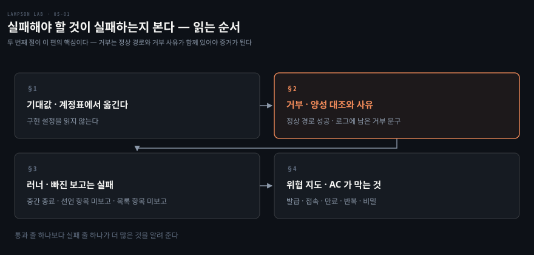
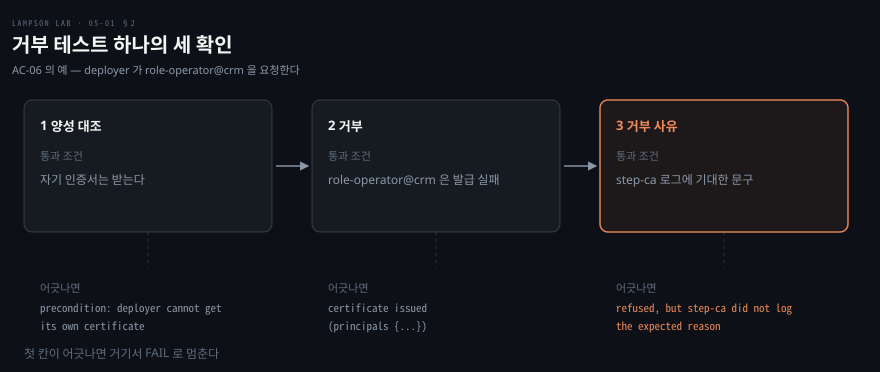
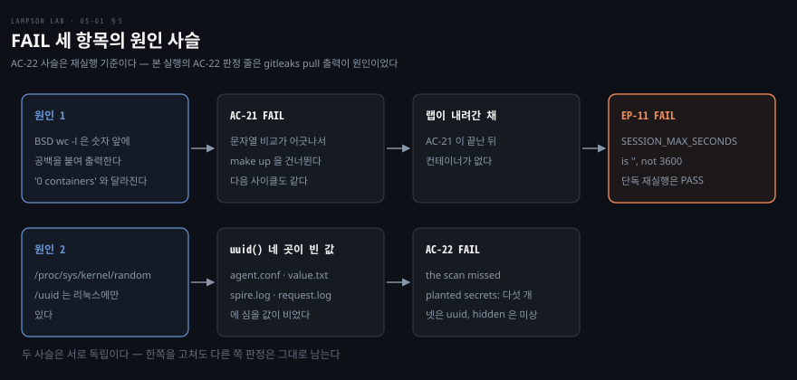

# 실패해야 할 것이 실패하는지 본다

---

> 저장소의 수용 테스트를 위협 모델로 읽은 한 편입니다. 기대값을 어디서 가져오는지, 거부를 어떻게 판정하는지, 러너가 무엇을 실패로 세는지를 코드에서 읽고, 이 맥에서 돌린 결과를 이어서 봅니다.

## 핵심 요약

> 이 편이 매달린 하나의 생각은 **거부 테스트는 거부 하나만 보지 않고 정상 경로의 성공과 로그에 남은 거부 사유까지 함께 봐야 증거가 된다**는 것입니다.

접근 거부는 이유가 무엇이든 똑같이 거부로 보입니다. 설계대로 막힌 것과 오타나 네트워크 오류로 막힌 것을 가르려고, 이 랩의 거부 테스트는 같은 실행에서 정상 경로가 성공하는지를 먼저 봅니다. 그다음 막아야 할 요청이 거부되는지, step-ca 나 sshd 의 로그에 기대한 사유가 남았는지를 봅니다.

기대값은 구현 설정이 아니라 계정표에서 테스트 코드로 옮겼습니다. 러너는 PASS 줄이 없는 것도 실패로 셉니다. 테스트 파일이 중간에서 끝나거나, 선언한 수용 기준을 보고하지 않거나, `expected-acs` 에 적힌 수용 기준을 아무 테스트도 보고하지 않으면 FAIL 입니다.

이 맥에서는 AC-01 에서 AC-20 까지 PASS 였고 AC-21, AC-22, EP-11 이 FAIL 이었습니다. 실패한 줄을 열어 보니 AC-21 과 재실행한 AC-22 는 테스트 스크립트가 리눅스 호스트를 가정한 곳에서, EP-11 은 그 연쇄에서 나왔습니다. 본 실행의 AC-22 판정 줄은 gitleaks 이미지를 처음 받는 출력이 섞여서 나왔습니다.


## 학습 목표

> 이 편을 읽고 나면 아래 여섯 가지를 스스로 해낼 수 있습니다.

1. 기대값을 구현 설정이 아니라 계정표에서 가져오는 이유를 말할 수 있습니다.
2. 거부 테스트가 확인하는 세 가지를 대고, 하나가 빠지면 무엇이 틀려지는지 말할 수 있습니다.
3. 러너가 한 수용 기준을 FAIL 로 세는 경우를 말할 수 있습니다.
4. 수용 기준 묶음마다 막는 공격이나 실수를 말할 수 있습니다.
5. AC-21 과 AC-22 가 되풀이와 비밀 유출을 어떻게 판정하는지 말할 수 있습니다.
6. 실패한 줄을 열어 원인을 호스트 가정과 연쇄로 가를 수 있습니다.

이 편에서 새로 만나는 낱말입니다. `어디서` 는 그 낱말이 실제로 설명되는 절입니다.

| 키워드 | 뜻 | 학습 포인트·연결 개념 | 어디서 |
|---|---|---|---|
| 수용 기준(AC) | 랩이 갖춰야 할 동작을 한 줄로 적은 항목 | AC-01 에서 AC-22, 그리고 EP-11 | §1 |
| 양성 대조 | 거부를 시험하기 전에 정상 경로가 성공하는지 보는 확인 | 거부가 다른 이유로 나온 것이 아님을 보임 | §2 |
| 거부 사유 | 거부한 쪽의 로그에 남은 문구 | step-ca 로그 · sshd 로그의 Serial | §2 |
| 완료 표지 | 테스트 파일이 끝까지 돌았음을 알리는 파일 | `exit` 로 끝난 테스트를 잡음 | §3 |
| expected-acs | 반드시 보고돼야 할 수용 기준의 목록 | 빠지면 FAIL | §3 |
| 멱등성 | 같은 일을 되풀이해도 결과가 같은 성질 | AC-21 | §4 |
| 호스트 가정 | 테스트 스크립트가 호스트 OS 의 명령과 경로에 거는 전제 | BSD `wc` · `/proc` | §5 |

아래는 이 편의 절 넷이 읽히는 순서입니다.




## 1. 계정표에서 옮긴 기대값

> 설정에서 기대값을 읽어 오는 테스트는 설정이 틀려도 통과합니다. 이 랩은 계정표를 테스트 코드에 직접 옮겨서 설정과 독립된 기준을 둡니다.

설정 파일을 읽어 기대값을 만드는 테스트는 설정이 틀리면 틀린 값을 기대하고 통과합니다. 테스트가 검증해야 할 대상과 같은 곳에서 답을 가져온 셈이기 때문입니다.

### 계정표를 코드에 적은 모양

저장소 README 의 계정표는 계정 넷이 받는 uid, SPIFFE ID, principal 을 적습니다. AC-01 은 이 표의 앞 세 줄을 배열로 옮겨 적고 실제 SVID 와 맞춥니다.

```bash
ac01_expect=(
  "deployer 1001 spiffe://lab/client/deployer"
  "monitor  1002 spiffe://lab/client/monitor"
  "stranger 1003 spiffe://lab/client/stranger"
)
```

AC-03 과 AC-04 도 인증서의 Key ID, principal 집합, 수명 상한을 같은 방식으로 직접 적습니다. 부트스트랩 설정이나 이미지에서 읽지 않으므로, 매핑이 잘못 구성되면 이 값과 어긋나서 FAIL 이 됩니다.

```bash
AC-03 PASS deployer -> role-operator@billing: key id spiffe://lab/client/deployer, principals {role-operator@billing}, permit-pty only, valid 292s (<= 300s), serial 12338218234014574611
AC-04 PASS monitor -> {role-readonly@billing}: key id spiffe://lab/client/monitor, principals {role-readonly@billing,role-readonly@crm}, permit-pty only, valid 300s (<= 900s), serial 16283990488033795714
```

monitor 의 상한 900초는 통과 조건이고 실제 수명은 300초였습니다. 상한과 실측이 같은 줄에 나란히 찍혀서 둘의 차이도 눈에 보입니다.

### 있어야 할 것과 없어야 할 것

기대값은 있어야 할 것만 적지 않습니다. AC-01 은 계정마다 SVID 가 정확히 하나인지, SPIRE 서버에 그 계정을 고르는 entry 가 정확히 하나인지를 함께 봅니다. 같은 uid 에 신원이 하나 더 붙으면 그것도 계약 위반이기 때문입니다.

```bash
AC-01 PASS deployer (uid 1001): exactly one SVID, spiffe://lab/client/deployer, chains to the lab root
AC-01 PASS deployer: spire-server has exactly one entry selecting it, spiffe://lab/client/deployer
```


## 2. 거부 판정

> 거부 테스트는 정상 경로의 성공, 막아야 할 요청의 거부, 로그에 남은 거부 사유를 모두 확인합니다.

거부됐다는 결과만으로는 증거가 되지 않습니다. 오타나 네트워크 오류, 꺼진 랩 때문에도 같은 결과가 나옵니다. 거부만 세면 아무것도 하지 않는 랩도 거부 테스트를 모두 통과합니다.

### 양성 대조

AC-06 은 deployer 가 `role-operator@crm` 을 요청하는 시나리오입니다. 거부를 시험하기 전에 같은 계정이 자기 인증서를 받을 수 있는지 먼저 확인하고, 받지 못하면 거기서 실패로 멈춥니다.

```bash
control=$(client_helper deployer sshcert.sh role-operator@billing)
if [[ $(field issue "$control") != ok ]]; then
  fail AC-06 "precondition: deployer cannot get its own certificate ($(field issue_error "$control"))"
else
  # 여기서부터 거부를 시험한다
fi
```

AC-02 는 deployer 가 SVID 를 받는지 먼저 봅니다. intruder 의 거부가 agent 가 멈춰서 난 소켓 오류가 아니라 agent 가 `no identity issued` 로 답한 거부임을 가르려는 것입니다. AC-07 은 stranger 가 SVID 를 가졌는지 먼저 봅니다. 거부의 원인이 "신원이 없어서" 가 아니라 "매핑이 없어서" 임을 가르려는 것입니다.

### 거부 사유

양성 대조가 통과해도 거부가 엉뚱한 이유로 나올 수 있습니다. 그래서 거부한 쪽의 로그에 기대한 문구가 남았는지를 함께 봅니다. 발급 거부는 시험 시작 시각 이후의 step-ca 로그에서 문구를 찾습니다. 접속 거부는 sshd 로그에서 그 인증서의 Serial 이 찍힌 줄을 찾습니다.

아래 그림은 거부 테스트 하나가 확인하는 세 가지와, 어긋날 때 찍히는 실패 문구입니다.



실제로 남은 줄을 보면 사유가 거부마다 다릅니다. 같은 "거부" 가 어느 방어에서 나왔는지가 문구로 갈립니다.

```bash
AC-06 PASS deployer -> role-operator@crm: refused; step-ca: x5c-spire: role-operator@crm is not mapped for spiffe://lab/client/deployer
AC-07 PASS stranger -> role-operator@billing: refused; step-ca: x5c-spire: spiffe://lab/client/stranger has no SSH mapping
AC-08 PASS intruder, self-signed certificate as spiffe://lab/client/deployer: refused; step-ca: error verifying x5c certificate chain in token
AC-12 PASS deployer -> operator@host-crm: refused; host-crm: certificate serial 2393889364823288582 has no authorized principal for operator
```

### 방어를 하나씩 따로 시험하기

방어가 두 겹이면 앞 겹이 막아서 뒤 겹이 시험되지 않을 수 있습니다. AC-05 는 `role-admin@*` 의 발급을 두 겹으로 막고 각 겹을 따로 시험합니다. 첫 겹은 템플릿이고, 둘째 겹은 policy 입니다. 둘째 겹은 일부러 아무 principal 이나 서명하는 템플릿을 쓴 임시 step-ca 에 같은 policy 를 얹어 확인합니다.

```bash
AC-05 PASS template: deployer -> {role-admin@billing}: refused; step-ca: x5c-spire: role-admin@billing is never issued
AC-05 PASS policy: role-admin@billing denied with a permissive template; step-ca: email name "role-admin@billing" not allowed
```

AC-14 는 거부의 출처를 사전 조건으로 가릅니다. 포워딩이 거부됐을 때 그 원인이 sshd 설정이 아니라 인증서이려면, 호스트의 유효 설정이 포워딩을 허용하고 있어야 합니다. 그래서 `sshd -T` 로 `allowtcpforwarding` 이 yes 인지를 먼저 확인합니다. 이 설계는 04편이 다룹니다.


## 3. 러너가 FAIL 로 세는 것

> 러너는 PASS 줄이 없는 것도 실패로 셉니다. 테스트가 중간에 끝나도 초록으로 남지 않게 하기 위해서입니다.

테스트 파일이 중간에서 죽거나 `exit` 로 끝나면 그 앞의 PASS 줄만 남습니다. 줄을 세는 것만으로는 전체가 통과한 것처럼 보입니다. `tests/run.sh` 는 이 빈틈을 네 갈래로 막습니다.

### 한 수용 기준이 FAIL 이 되는 경우

| 경우 | 막는 것 |
|---|---|
| 검사 하나라도 `fail` 을 찍는다 | 일부만 통과한 수용 기준 |
| 테스트 파일이 비정상 종료한다 | 중간에 죽은 테스트 |
| 파일이 마지막 줄 전에 끝난다 | `exit` · `return` 으로 조기 종료한 테스트 |
| 선언한 수용 기준을 보고하지 않거나, `expected-acs` 의 항목을 아무도 보고하지 않는다 | 검사가 통째로 빠진 수용 기준 |

### 완료 표지

조기 종료를 잡는 장치는 한 줄입니다. 러너는 테스트 파일 본문 뒤에 `touch <표지 파일>` 을 붙여서 한 덩어리로 실행합니다.

```bash
( source <(cat "$t"; printf '\ntouch %q\n' "$marker") )
```

파일이 끝까지 돌아야 이 `touch` 가 실행됩니다. 중간에 `exit` 나 `return` 이 있으면 표지 파일이 생기지 않아서 러너가 "마지막 줄 전에 끝났다" 로 판정합니다. 각 테스트는 하위 셸에서 실행되어 변수가 다음 테스트로 새지 않습니다.

### 목록과 건너뛰기

`tests/expected-acs` 는 반드시 검사가 있어야 하는 수용 기준을 적은 목록입니다. AC-01 에서 AC-22 와 EP-11 이 들어 있습니다. 어느 파일도 보고하지 않은 항목이 있으면 FAIL 입니다. 테스트 파일이 선언한 것만 믿지 않고, 있어야 할 것의 목록을 따로 둔 것입니다.

건너뛰는 길은 둘뿐입니다. `--fast` 는 `# slow` 줄이 있는 파일을 건너뜁니다. AC-21 이 안에서 `make test` 를 다시 돌릴 때는 `LAB_INSIDE_AC21=1` 로 AC-21 파일 자신을 건너뜁니다. 건너뛴 수용 기준은 목록에서 빠진 것으로 세지 않습니다. 다른 방법으로 건너뛸 수는 없습니다.


## 4. 수용 기준이 막는 것

> 22개 수용 기준과 EP-11 을 막는 대상으로 다시 묶으면 표 한 장이 됩니다. 번호가 아니라 어떤 공격이나 실수를 막는지로 읽습니다.

수용 기준 번호만 나열하면 어떤 공격이 막혔는지 보이지 않습니다. 테스트 파일의 설명에서 막는 대상을 뽑아 묶었습니다.

### 막는 공격과 실수

| 수용 기준 | 막는 공격이나 실수 |
|---|---|
| AC-01 · AC-02 | 등록 안 된 계정이 SVID 를 받는 것, 한 계정이 신원을 둘 받는 것 |
| AC-03 · AC-04 | 인증서가 계약과 다른 principal, extension, 수명으로 나오는 것 |
| AC-05 | `role-admin@*` 가 발급되는 것 |
| AC-06 · AC-07 | 맞는 신원이 엉뚱한 그룹과 역할을 받는 것, 매핑 없는 신원이 principal 을 받는 것 |
| AC-08 | SVID 없는 계정이 X5C 토큰을 위조하는 것 |
| AC-09 | 5분 상한을 넘는 인증서를 요청하는 것 |
| AC-10 | 같은 토큰을 두 번 쓰는 것 |
| AC-11 · AC-12 · AC-13 | 정상 접속이 안 되는 것, 엉뚱한 호스트와 계정으로 들어가는 것 |
| AC-14 | 인증서로 포워딩하는 것 |
| AC-15 | 평범한 공개키나 믿지 않는 CA 로 들어가는 것, sshd 의 유효 설정이 계약과 달라지는 것 |
| AC-16 · AC-17 | operator 가 sudo 로 더 하는 것, readonly 가 root 파일을 읽는 것 |
| AC-18 | 누가 들어왔는지 로그에 남지 않는 것 |
| AC-19 · AC-20 · EP-11 | 만료된 인증서로 새로 접속하는 것, 열린 연결이 한없이 사는 것 (06편) |
| AC-21 | 처음부터 다시 띄웠을 때 결과가 달라지는 것 |
| AC-22 | 키나 토큰이 저장소 이력에 남는 것 |

발급 쪽(AC-03 에서 AC-10)은 03편이, 접속 쪽(AC-11 에서 AC-18)은 04편이, 만료 쪽은 06편이 다룹니다.

### 되풀이해도 같은 결과

같은 일을 되풀이해도 결과가 같은 성질을 멱등성이라고 합니다. AC-21 은 `make down && make up && make test` 를 두 번 돌려 이 성질을 확인합니다. 사이클마다 세 가지를 봅니다.

- `make down` 뒤에 이 랩의 컨테이너, 볼륨, 네트워크가 0개인지 봅니다.
- `make up` 뒤의 랩 루트 지문이 새 값인지 봅니다.
- 안에서 돌린 `make test` 가 AC-21 을 뺀 모든 수용 기준을 덮고 종료 코드 0 인지 봅니다.

두 사이클 사이에는 수용 기준별 판정과 통과한 검사의 목록이 같아야 합니다. 검사 이름에서 Serial, 지문, 시각은 지우고 비교합니다.

이 항목은 실행 중인 랩을 내리므로 오래 걸리고(`# slow`) 끝쪽에서 돌립니다. 뒤에는 랩이 필요 없는 AC-22 와, 남은 랩을 쓰는 EP-11 이 옵니다. 끝나면 새로 만든 랩이 남습니다.

### 저장소에 비밀이 없는가

AC-22 는 git 이력 전체에서 키와 토큰을 찾습니다. 직접 만든 `secret-scan.py` 가 이력의 모든 blob 을 내보내 파일 이름과 바이너리까지 봅니다. gitleaks 8.30.1 은 내보낸 blob 들을 훑습니다. gitleaks 는 태그와 digest 로 고정한 이미지를 `--network none --read-only` 로 실행합니다.

스캐너가 아무것도 못 찾았다는 결과도 증거가 못 됩니다. 그래서 양성 대조를 둡니다. 테스트는 변장한 비밀 17개를 임시 저장소에 심고 스캐너가 전부 찾아내는지를 먼저 확인합니다. 이름이 무해한 OpenSSH 키, CRLF 줄바꿈, YAML 들여쓰기 안의 값이 그 예입니다. 암호화된 PKCS#8, SPIRE join token 이 든 설정과 로그, 커밋했다가 지운 키도 있습니다. 하나라도 놓치면 `precondition: the scan missed planted secrets` 로 FAIL 입니다.

README 는 AC-22 가 호스트의 `python3`, `openssl`, `ssh-keygen` 을 쓴다고 적습니다. `/proc` 에 기대는 것은 적혀 있지 않습니다.


## 5. 실습 메모

> 이 맥(arm64, OrbStack)에서 bash 5.3 으로 `make test` 를 돌려 실패한 줄을 열었습니다. 원인은 테스트 스크립트의 호스트 가정과 그 연쇄, 그리고 gitleaks 이미지를 처음 받는 출력으로 갈렸습니다.

### 실행과 판정

테스트 스크립트는 호스트 셸에서 돌아서 bash 4.4 이상이 필요합니다. macOS 기본 bash 3.2 에서는 스위트가 시작 직후 멈췄고, Homebrew 로 bash 를 설치한 뒤 PATH 앞에 두었습니다.

```bash
brew install bash
PATH=/opt/homebrew/bin:$PATH \
  make test
```

```bash
GNU bash, version 5.3.20(1)-release (aarch64-apple-darwin25.6.0)
```

`make up` 은 10초에 끝났습니다. `make test` 는 181초 뒤 종료 코드 2 로 끝났고, 검사 줄은 PASS 70 줄과 FAIL 7 줄이었습니다. 수용 기준 단위로는 AC-01 에서 AC-20 까지 20개가 PASS 이고 AC-21, AC-22, EP-11 이 FAIL 이었습니다. AC-21 이 두 사이클을 모두 건너뛰었으므로 181초는 전체 실행 시간이 아닙니다.

| 판정 | 항목 |
|---|---|
| PASS | AC-01 에서 AC-20 |
| FAIL | AC-21, AC-22, EP-11 |

### 실패한 줄 열기

AC-21 은 `make down` 뒤 남은 것을 세어 문자열 `"0 containers, 0 volumes, 0 networks"` 와 비교합니다. 이 맥에서 찍힌 줄은 숫자 앞에 공백이 길게 붙어 있었습니다.

```bash
AC-21 FAIL cycle 1: after make down        0 containers,        0 volumes,        0 networks of the lab are left
AC-21 FAIL cycle 2: after make down        0 containers,        0 volumes,        0 networks of the lab are left
AC-21 FAIL verdicts differ: 1=[none] 2=[none]
```

BSD `wc -l` 은 숫자 앞에 공백을 붙여 출력합니다. 이 맥의 셸에서 `echo "x$(wc -l </dev/null)x"` 를 실행하면 `x       0x` 가 찍힙니다. 값은 0 개로 맞았지만 비교가 어긋나서 `continue` 가 `make up` 을 건너뛰었고, 랩은 내려간 채로 남았습니다.

AC-22 다음의 EP-11 은 이 내려간 랩 위에서 시작했습니다. 컨테이너 이름이 비어 있어서 연쇄로 실패했습니다.

```bash
invalid container name or ID: value is empty
EP-11 FAIL host-billing: SESSION_MAX_SECONDS is '', not 3600
EP-11 FAIL precondition: could not start the throwaway host lampson-lab-session-probe
```

AC-22 는 본 실행에서 다른 이유로 막혔습니다. gitleaks 이미지를 처음 받는 출력이 스캐너 결과 자리에 섞여 `gitleaks did not run` 으로 보고됐습니다. 이미지를 처음 받는 실행이면 어느 OS 에서도 나올 수 있는 출력입니다. 같은 본 실행 로그에는 아래 `cat` 실패 네 줄도 찍혀 있었습니다. 테스트가 스캐너가 돌지 않은 경우를 먼저 판정해서 판정 줄에는 이 문제가 드러나지 않았습니다. 이미지를 받은 뒤 AC-22 만 다시 돌리자 `cat` 이 네 번 실패했고 판정이 바뀌었습니다.

```bash
cat: /proc/sys/kernel/random/uuid: No such file or directory
AC-22 FAIL precondition: the scan missed planted secrets: hidden agent.conf value.txt spire.log request.log
```

`/proc/sys/kernel/random/uuid` 는 리눅스에만 있는 경로입니다. 테스트의 `uuid()` 함수가 이 경로를 읽습니다. 이 함수는 `agent.conf`, `value.txt`, `spire.log`, `request.log` 를 만들 때 네 번 불립니다. `cat` 실패 네 줄은 이 네 곳에서 심을 값이 비었다는 뜻입니다.

위 보고에서 스캐너가 놓친 파일은 다섯 개입니다. 그중 네 개가 이 파일들입니다. 나머지 하나인 `hidden`(`.gitattributes` 로 diff 를 끈 파일)은 `uuid()` 를 쓰지 않아서 놓친 원인을 이 실행으로는 가리지 못했습니다. 이런 호스트 가정은 테스트를 호스트 셸에서 돌리는 구조에서 나옵니다.



### 원인 가르기

랩을 다시 올린 뒤 EP-11 만 단독으로 돌리자 세 줄이 모두 PASS 였습니다. 단독 실행은 저장소를 고치지 않고 `tests/lib.sh` 를 source 한 다음 해당 테스트 파일을 source 하는 방식이었습니다.

```bash
EP-11 PASS host-billing: lab-session-reaper running, connections closed 3600s after they open
EP-11 PASS host-crm: lab-session-reaper running, connections closed 3600s after they open
EP-11 PASS 20s host: connection with certificate serial 5706698330866146710 closed 24s after its session started (reaper: age=24s, user child 32), its multiplexed sessions with it
```

랩을 올린 직후에 바로 돌렸을 때는 `no SVID for uid 1001` 로 한 번 FAIL 했고, 20초 기다린 뒤에는 PASS 였습니다. 이 FAIL 줄은 실행 보고서 서술이며 찍힌 로그는 보관하지 않았습니다. SVID 가 퍼지기 전에 테스트가 먼저 시작되는 타이밍 경쟁으로 보입니다.

| 항목 | 찍힌 줄 | 원인 | 분류 |
|---|---|---|---|
| AC-21 | `after make down        0 containers, …` | BSD `wc -l` 의 공백 | 호스트 명령 차이 |
| EP-11 (본 실행) | `SESSION_MAX_SECONDS is ''` | AC-21 이 랩을 내린 채 끝남 | 연쇄 |
| EP-11 (직후 실행) | (실행 보고서 서술, 로그 미보관) `no SVID for uid 1001` | SVID 전파 전에 시작 | 타이밍 |
| AC-22 (본 실행) | `gitleaks did not run` | 이미지 pull 출력이 섞임 | 첫 실행 |
| AC-22 (재실행) | `cat: /proc/sys/kernel/random/uuid` | 리눅스 전용 경로. `hidden` 누락은 원인 미확인 | 호스트 경로 차이 |

제품 동작을 판정하는 AC-01 에서 AC-20 은 모두 PASS 였습니다. 실패 세 항목 중 AC-21 과 재실행한 AC-22 는 테스트 스크립트가 리눅스 호스트를 가정한 곳에서 나왔습니다. EP-11 은 그 연쇄에서, 본 실행의 AC-22 는 gitleaks 이미지를 처음 받는 출력에서 나왔습니다. AC-22 의 `hidden` 누락은 원인을 가리지 못했습니다.


## 관련 문서

- [lampson-lab 실습 인덱스](./README.md) — 폴더 구성과 여섯 편의 목표
- [principal 은 클라이언트가 고르지 않는다](./03-01.principal%20%EC%9D%80%20%ED%81%B4%EB%9D%BC%EC%9D%B4%EC%96%B8%ED%8A%B8%EA%B0%80%20%EA%B3%A0%EB%A5%B4%EC%A7%80%20%EC%95%8A%EB%8A%94%EB%8B%A4.md) — AC-03 에서 AC-10 이 확인하는 발급 쪽 규칙
- [호스트에는 개인 계정이 없다](./04-01.%ED%98%B8%EC%8A%A4%ED%8A%B8%EC%97%90%EB%8A%94%20%EA%B0%9C%EC%9D%B8%20%EA%B3%84%EC%A0%95%EC%9D%B4%20%EC%97%86%EB%8B%A4.md) — AC-11 에서 AC-18 이 확인하는 호스트 쪽 설정
- [만료돼도 열린 연결은 남는다](./06-01.%EB%A7%8C%EB%A3%8C%EB%8F%BC%EB%8F%84%20%EC%97%B4%EB%A6%B0%20%EC%97%B0%EA%B2%B0%EC%9D%80%20%EB%82%A8%EB%8A%94%EB%8B%A4.md) — AC-19, AC-20, EP-11 의 시간 축
