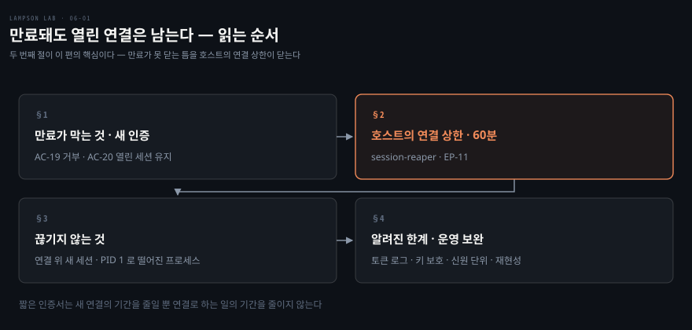
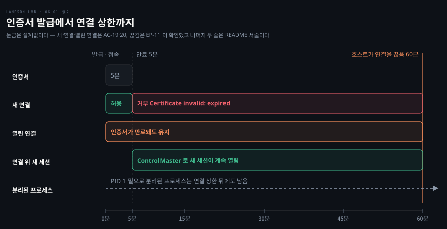

# 만료돼도 열린 연결은 남는다

---

> 저장소의 마지막 편입니다. 인증서가 만료됐을 때 막히는 것과 남는 것을 AC-19, AC-20, EP-11 의 시간 축으로 읽고, 저장소가 알려진 한계로 적은 항목을 운영에서 어떻게 메울지 봅니다.

## 핵심 요약

> 이 편이 매달린 하나의 생각은 **인증서 만료는 새 인증만 막으므로 이미 열린 연결을 닫는 일은 호스트의 연결 상한이 맡는다**는 것입니다.

sshd 는 인증서의 유효기간을 인증하는 순간에만 확인합니다. 5분짜리 인증서로 연 연결은 인증서가 만료된 뒤에도 계속 쓰이고, 그 연결 위에서는 새 세션도 열립니다. 같은 시각에 새로 접속하는 것은 거부됩니다. 단기 인증서가 줄이는 것은 새 연결을 맺을 수 있는 기간이고 연결로 하는 일의 기간은 줄이지 못합니다.

그래서 이 랩의 호스트는 연결이 열린 지 60분(`SESSION_MAX_SECONDS: 3600`)이 지나면 끊습니다. `lab-session-reaper` 가 5초마다 연결의 나이를 보고 상한을 넘은 연결을 정리합니다. 세션 안에서 PID 1 밑으로 분리된 프로세스는 이 방법으로 찾지 못하고 연결이 끊긴 뒤에도 남습니다.

이 맥에서는 AC-19 와 AC-20 이 PASS 였습니다. EP-11 은 전체 실행에서 앞 항목의 연쇄로 FAIL 했고, 랩을 올린 뒤 단독으로 돌리자 PASS 였습니다.


## 학습 목표

> 이 편을 읽고 나면 아래 여섯 가지를 스스로 해낼 수 있습니다.

1. sshd 가 인증서 유효기간을 확인하는 시점을 말하고, AC-19 와 AC-20 이 각각 무엇을 확인하는지 말할 수 있습니다.
2. 1분짜리 인증서로 시험하는 순서를 시간 축 위에 놓을 수 있습니다.
3. 호스트의 연결 상한이 어떤 프로세스를 어떻게 정리하는지 말할 수 있습니다.
4. `ChannelTimeout` 과 `UnusedConnectionTimeout` 이 상한을 대신하지 못하는 이유를 말할 수 있습니다.
5. 상한이 닫지 못하는 것 둘을 대고 각각이 남는 이유를 말할 수 있습니다.
6. 알려진 한계 네 항목마다 운영에서 쓸 보완책을 대고, 문서로 확인한 것과 운영 판단을 가를 수 있습니다.

이 편에서 새로 만나는 낱말입니다. `어디서` 는 그 낱말이 실제로 설명되는 절입니다.

| 키워드 | 뜻 | 학습 포인트·연결 개념 | 어디서 |
|---|---|---|---|
| SESSION_MAX_SECONDS | 연결이 열린 뒤 호스트가 끊기까지의 최대 초 | 이 랩은 3600 | §2 |
| lab-session-reaper | 연결의 나이를 보고 상한을 넘으면 끊는 호스트의 감시 프로세스 | 5초 간격 · 최대 5초 늦음 | §2 |
| ChannelTimeout | 쓰이지 않는 채널을 정리하는 sshd 옵션 | 쓰고 있는 연결은 못 끊음 | §2 |
| ControlMaster | 한 연결 위에 세션을 더 열게 하는 OpenSSH 다중화 옵션 | 만료 뒤에도 새 세션이 열림 | §2 |
| 분리된 프로세스 | 부모를 잃고 PID 1 의 자식이 된 프로세스 | 연결 정리에서 빠짐 | §3 |
| unix:sha256 | 실행 파일 해시로 워크로드를 가르는 SPIRE 선택자 | 신원 단위를 계정에서 프로그램으로 좁힘 | §4 |

아래는 이 편의 절 넷이 읽히는 순서입니다.




## 1. 만료가 막는 것

> 만료된 인증서로 접속이 되면 단기 인증서는 의미가 없고, 만료와 함께 열린 세션이 죽으면 작업이 끊깁니다. sshd 는 이 둘 중 앞쪽만 막습니다.

### 확인은 인증할 때 한 번

OpenSSH 의 sshd 는 인증서의 유효기간을 인증할 때 한 번만 확인합니다. 인증이 끝난 세션에는 인증서가 더 관여하지 않고, sshd 에는 인증서가 만료되면 세션을 끊는 기능이 없습니다. KRL(인증서 폐기 목록)도 새 인증만 막습니다.

그래서 단기 인증서가 제한하는 것은 새 SSH 연결을 맺을 수 있는 기간입니다. 연결을 한 번 맺고 나면 그 연결로 할 수 있는 일의 기간은 인증서 수명과 관계가 없어집니다. AC-20 은 이 동작을 설계 목표로 주장하지 않고 알려진 동작으로 고정해 두는 문서화 테스트입니다.

### 1분 인증서로 시험하기

`tests/helpers/expiry.sh` 는 클라이언트 컨테이너 안에서 `lab-ssh-cert --ttl 1m` 으로 1분짜리 인증서를 받습니다. 5분을 기다리지 않으려는 것입니다. 세션은 인증서가 유효할 때 열고 `validBefore` 60초 뒤까지 5초마다 `date +%s` 를 찍게 합니다. 만료 5초 뒤에는 같은 인증서로 새로 접속해 봅니다.

한 번의 실행에서 두 가지가 동시에 나옵니다. 새로 접속하는 쪽은 거부돼야 하고(AC-19), 먼저 열어 둔 세션은 만료 60초 뒤까지 출력을 이어 가고 정상 종료해야 합니다(AC-20). 거부 사유는 sshd 로그의 `Certificate invalid: expired` 로 확인합니다.


## 2. 호스트의 연결 상한

> 열린 연결의 수명은 인증서가 정하지 못하므로 호스트가 따로 정해야 합니다. 이 랩은 연결마다 나이를 재서 60분이 넘으면 끊습니다.

### 상한과 감시자

호스트 컨테이너(host-billing, host-crm)에는 환경 변수로 연결 상한이 들어 있습니다.

```yaml
SESSION_MAX_SECONDS: 3600
```

엔트리포인트가 호스트마다 `lab-session-reaper` 를 root 로 띄웁니다. 이 감시자는 5초마다 sshd 의 연결별 프로세스(`sshd-session: <user> [priv]`)를 훑어 나이가 상한을 넘은 연결을 끊습니다. 점검 간격이 5초라서 실제로는 60분에서 최대 5초 늦게 끊깁니다. 연결 전체가 정리 대상이라서 그 위의 다중화 세션과 세션이 실행한 명령도 함께 끝납니다.

끊을 때는 호스트 로그에 다음 형식의 줄을 남깁니다.

```bash
lab-session-reaper: closed connection: user=<계정> pid=<n> user-child=<m> ... age=<초>s
```

`user-child` 값은 sshd 로그의 `User child is on pid <m>` 와 짝이 됩니다. 그 줄 바로 앞의 `Accepted publickey ... (serial <n>)` 가 이 연결의 인증서입니다. 감시자가 멈추면 호스트의 healthcheck 가 실패해서 unhealthy 로 보입니다.

sshd 설정만으로는 이 상한을 만들 수 없습니다. `ChannelTimeout` 은 쉬는 채널을, `UnusedConnectionTimeout` 은 열린 채널이 없는 연결을 정리하므로 명령을 계속 돌리는 연결은 그대로 둡니다. sshd 에는 연결의 절대 수명을 정하는 설정이 없어서 이 랩은 호스트 쪽에 감시자를 따로 두었습니다.

### 20초 호스트로 시험하기

60분을 기다릴 수는 없어서 EP-11 은 두 단계로 나뉩니다. 먼저 host-billing 과 host-crm 이 상한 3600 과 실행 중인 감시자를 갖고 있는지 봅니다. 다음으로 상한 20초, 점검 간격 5초인 일회용 호스트(`lampson-lab-session-probe`)를 띄워 같은 동작을 짧은 시간에 시험합니다.

`tests/helpers/session-limit.sh` 는 인증서 한 장으로 다음을 차례로 합니다.

1. 시간을 계속 찍는 ControlMaster 연결(한 연결을 열어 두고 그 위로 세션을 더 여는 OpenSSH 다중화)을 연다.
2. 그 연결 위에 세션을 하나 더 연다.
3. 호스트가 연결을 닫기를 최대 120초 기다린다.
4. 닫힌 뒤에 다중화할 master 연결이 남았는지 `-O check` 로 묻는다.

상한 20초에 점검 간격 5초이므로 연결이 닫히는 시각은 열린 지 20초에서 25초 사이에 놓입니다.

### 시간 축 한 장

아래 그림은 인증서 발급에서 연결 상한까지를 한 축에 놓은 것입니다. 눈금은 설계값(5분 인증서, 60분 상한)입니다. 새 연결 거부와 열린 연결 유지는 AC-19 와 AC-20 이 1분 인증서로, 연결 상한은 EP-11 이 20초 호스트로 확인했고, 연결 위 새 세션 줄과 맨 아래 줄은 README 의 서술입니다.




## 3. 끊기지 않는 것

> 상한이 닫는 것은 연결입니다. 연결 위에서 일어난 일이 모두 그 연결에 매여 있는 것은 아닙니다.

### 연결 위의 새 세션

ControlMaster 는 한 번 맺은 SSH 연결을 열어 두고 같은 연결 위로 세션을 더 여는 OpenSSH 옵션입니다. 새 세션은 새 인증이 아니라서 인증서의 유효기간 확인을 거치지 않습니다. 그래서 인증서가 만료된 뒤에도 열어 둔 연결로 명령을 더 실행할 수 있습니다. 저장소 README 는 1분짜리 인증서로 만료 11초 뒤에도 새 세션이 열렸고 같은 시각의 새 접속은 거부됐다고 적습니다. 이 맥의 실행에는 이 장면을 따로 잰 줄이 없습니다.

이 틈은 인증서만으로는 닫을 수 없습니다. 연결 자체를 끝내야 새 세션도 막히고, EP-11 의 시험이 이를 확인합니다. 닫힌 뒤에는 다중화 연결이 남아 있지 않아서 `-O check` 가 실패해야 합니다.

### PID 1 밑으로 분리된 프로세스

감시자는 연결의 `[priv]` 프로세스에서 시작해 부모 자식 관계를 따라 내려가며 정리할 프로세스를 찾습니다. 세션이 실행한 명령은 이 줄기에 달려 있어서 연결과 함께 끝납니다. 데몬처럼 스스로 분리해 부모가 PID 1 이 된 프로세스는 이 줄기 밖에 있습니다. 감시자는 그런 프로세스를 찾지 못하고, 연결이 끊긴 뒤에도 남습니다.

이 편의 실측에는 분리된 프로세스를 직접 만들어 확인한 줄이 없습니다. 이 한계는 저장소가 README 에 적은 것을 옮겼습니다. 인증서 만료는 이미 실행 중인 프로세스를 정리하지 않습니다. 연결 상한은 연결에 매인 프로세스만 정리하고, 이미 PID 1 밑으로 분리된 프로세스는 정리하지 못합니다.


## 4. 알려진 한계와 운영 보완

> 저장소는 README 의 알려진 한계 표에 여덟 항목을 적었습니다. 열린 연결은 §3 에서 다뤘고, 아래 네 항목은 운영에 올리기 전에 메워야 할 자리입니다.

| 한계 | 저장소가 적은 내용 | 운영에서 쓸 보완 | 근거 |
|---|---|---|---|
| 로그의 토큰 | step-ca 는 요청의 X5C 토큰을, SPIRE 는 join token 이 든 agent ID 를 로그와 DB 에 남김 | 로그를 읽을 수 있는 계정과 보관 기간을 좁힘 | 운영 판단 |
| 키 보호 | CA 키가 암호화 없이 Docker 볼륨에 있음 (KMS/HSM 은 비목표) | KMS 나 HSM 에 CA 키를 둠 | step-ca 문서 |
| 신원 단위 | 워크로드를 계정(uid)으로만 구별함 | `unix:sha256` 선택자로 프로그램까지 좁힘 | SPIRE 1.16.0 문서 |
| 빌드 재현성 | 이미지는 태그로, apt 패키지는 버전 없이 받음 | 이미지는 다이제스트로, apt 는 버전을 지정해 고정 | 저장소 AC-22 의 방식 |

나머지 한계 중 add-user 인증서와 테스트용으로 끈 `PerSourcePenalties` 는 [호스트에는 개인 계정이 없다](./04-01.%ED%98%B8%EC%8A%A4%ED%8A%B8%EC%97%90%EB%8A%94%20%EA%B0%9C%EC%9D%B8%20%EA%B3%84%EC%A0%95%EC%9D%B4%20%EC%97%86%EB%8B%A4.md)에서 다뤘고, monitor 수명은 03편에서 5분 상한으로 다뤘습니다.

### 로그의 토큰

토큰이 로그에 남는다는 것은 로그를 읽을 수 있는 사람이 토큰을 읽을 수 있다는 뜻입니다. 그래서 로그의 접근 범위와 보관 기간으로 노출을 줄입니다. 이 보완은 문서로 확인한 것이 아니라 운영 판단입니다.

### 키 보호

step-ca 문서는 CA 의 서명 키를 디스크에 암호화해 둔다고 적습니다. 보호를 더 높이는 방법으로는 클라우드 KMS, PKCS #11 HSM, TPM 2.0, YubiKey PIV 를 듭니다.

HSM 에 든 키는 내보낼 수 없고 자격증명은 PIN 이나 `pin-source` 파일로 건넵니다. CA 키가 새면 그 CA 가 서명하는 모든 인증서를 믿을 수 없게 됩니다. 키·인증서·CA 의 역할은 [TLS 로 컴포넌트 안전하게 연결하기](../../../08_cloud/book/container-security/11-01.TLS%EB%A1%9C%20%EC%BB%B4%ED%8F%AC%EB%84%8C%ED%8A%B8%20%EC%95%88%EC%A0%84%ED%95%98%EA%B2%8C%20%EC%97%B0%EA%B2%B0%ED%95%98%EA%B8%B0%20%E2%80%94%20%ED%82%A4%C2%B7%EC%9D%B8%EC%A6%9D%EC%84%9C%C2%B7CA%EC%9D%98%20%EC%97%AD%ED%95%A0.md)에 정리돼 있습니다.

### 신원 단위

이 랩의 SPIRE 는 워크로드를 계정(uid)으로만 가릅니다. 같은 계정으로 돌아가는 프로세스는 어떤 프로그램이든 같은 SVID 를 받고, 따라서 같은 SSH 인증서도 받을 수 있습니다. SVID 와 SPIFFE ID 의 규격은 [부록 — 신원을 문서로 만드는 네 규격](../../../08_cloud/book/istio-in-action/a0-03.%EB%B6%80%EB%A1%9D%20%E2%80%94%20%EC%8B%A0%EC%9B%90%EC%9D%84%20%EB%AC%B8%EC%84%9C%EB%A1%9C%20%EB%A7%8C%EB%93%9C%EB%8A%94%20%EB%84%A4%20%EA%B7%9C%EA%B2%A9.md)에 있습니다.

SPIRE 1.16.0 의 unix 워크로드 어테스터 문서에서 `unix:path` 선택자는 경로 탐색이 켜져 있어야 쓸 수 있습니다. 경로 탐색은 `discover_workload_path = true` 로 켜며 기본값은 false 입니다. `unix:sha256` 선택자도 경로 탐색이 필요하고, `workload_size_limit` 가 음수이면 해시 계산이 꺼집니다. 실행 파일 내용이 바뀌면 해시도 달라지므로, 이 선택자를 쓰면 배포마다 entry 의 해시를 고쳐야 합니다.

### 빌드 재현성

이 랩의 이미지는 태그로 받고 apt 패키지는 버전 없이 받아서, 같은 저장소를 다른 날 빌드하면 다른 내용이 들어올 수 있습니다. AC-22 는 gitleaks 이미지를 태그와 다이제스트(`v8.30.1@sha256:…`)로 함께 고정해 둡니다. 같은 방식을 이미지에 쓰고 apt 패키지에는 버전을 적으면 빌드를 다시 만들 수 있습니다. 이것은 저장소가 이미 쓰는 방식을 넓히는 것이라 문서 근거를 따로 달지 않았습니다.


## 5. 실습 메모

> 이 맥(arm64, OrbStack)에서 bash 5.3 으로 `make test` 를 돌린 출력 중 AC-19, AC-20, EP-11 에 해당하는 줄입니다.

### 만료 시험 두 줄

```bash
AC-19 PASS certificate serial 6959324304488330999 expired at 1794198430; new login at validBefore+5s refused (sshd: Certificate invalid: expired)
AC-20 PASS session opened at validBefore-60s kept running until validBefore+60s (25 lines, rc 0)
```

`1794198430` 은 epoch 초이고 2026-11-09 13:27:10(+0900)입니다. 세션 루프는 만료 60초 전부터 60초 뒤까지 120초 동안 5초마다 한 줄을 찍습니다. 한 줄씩 세면 25줄이어서, 줄 수 25 는 세션이 만료 60초 뒤까지 살아 있었다는 계산과 맞습니다.

### 연결 상한 줄

전체 실행의 EP-11 은 앞의 AC-21 이 랩을 내린 채 끝나서 연쇄로 FAIL 했습니다.

```bash
invalid container name or ID: value is empty
EP-11 FAIL host-billing: SESSION_MAX_SECONDS is '', not 3600
EP-11 FAIL precondition: could not start the throwaway host lampson-lab-session-probe
```

랩을 다시 올린 뒤 EP-11 만 단독으로 돌리자 세 줄이 모두 PASS 였습니다. 마지막 줄에서 인증서 한 장으로 연 연결이 세션 시작 24초 뒤에 닫혔고, 감시자 로그의 `age=24s` 와 같습니다. 상한 20초에 점검 간격 5초이므로 20초에서 25초 사이라는 §2 의 범위 안입니다.

```bash
EP-11 PASS host-billing: lab-session-reaper running, connections closed 3600s after they open
EP-11 PASS host-crm: lab-session-reaper running, connections closed 3600s after they open
EP-11 PASS 20s host: connection with certificate serial 5706698330866146710 closed 24s after its session started (reaper: age=24s, user child 32), its multiplexed sessions with it
```

랩을 올린 직후에 EP-11 을 바로 돌렸을 때는 `no SVID for uid 1001` 로 한 번 FAIL 했고(실행 보고서 서술이며 이 줄이 찍힌 로그는 보관하지 않았습니다), 20초 뒤에는 PASS 였습니다. 연쇄와 타이밍으로 가른 근거는 [실패해야 할 것이 실패하는지 본다](./05-01.%EC%8B%A4%ED%8C%A8%ED%95%B4%EC%95%BC%20%ED%95%A0%20%EA%B2%83%EC%9D%B4%20%EC%8B%A4%ED%8C%A8%ED%95%98%EB%8A%94%EC%A7%80%20%EB%B3%B8%EB%8B%A4.md)에 있습니다.

### 실행 환경

테스트 스크립트는 호스트 셸에서 돌아서 bash 4.4 이상이 필요합니다. macOS 기본 bash 3.2 대신 Homebrew 의 bash 를 PATH 앞에 두었습니다.

```bash
brew install bash
PATH=/opt/homebrew/bin:$PATH \
  make test
```

### 로그 속 토큰

§4 의 로그 한계를 확인하려고 이 실행에서 모은 step-ca 로그의 거부 줄을 열었더니 토큰 자리는 `ott=[REDACTED]` 로 가려져 있었습니다. 이 표시는 step-ca 가 찍은 것이 아니라, 실행 기록을 저장할 때 `eyJ` 로 시작하는 JWT 를 `[REDACTED]` 로 바꾼 결과입니다. 그래서 저장본으로는 로그에 토큰이 남는지 판정할 수 없습니다. 가려진 자리가 `ott=` 값이라는 점은 step-ca 가 요청 토큰을 로그에 남긴다는 README 의 서술과 같은 자리입니다.


## 관련 문서

- [lampson-lab 실습 인덱스](./README.md) — 폴더 구성과 여섯 편의 목표
- [고정 키를 버리고 5분짜리 인증서를 쓴다](./01-01.%EA%B3%A0%EC%A0%95%20%ED%82%A4%EB%A5%BC%20%EB%B2%84%EB%A6%AC%EA%B3%A0%205%EB%B6%84%EC%A7%9C%EB%A6%AC%20%EC%9D%B8%EC%A6%9D%EC%84%9C%EB%A5%BC%20%EC%93%B4%EB%8B%A4.md) — 5분이라는 수명이 나오는 곳
- [호스트에는 개인 계정이 없다](./04-01.%ED%98%B8%EC%8A%A4%ED%8A%B8%EC%97%90%EB%8A%94%20%EA%B0%9C%EC%9D%B8%20%EA%B3%84%EC%A0%95%EC%9D%B4%20%EC%97%86%EB%8B%A4.md) — 호스트가 믿는 것과 sshd 로그에 남는 Key ID 와 Serial
- [실패해야 할 것이 실패하는지 본다](./05-01.%EC%8B%A4%ED%8C%A8%ED%95%B4%EC%95%BC%20%ED%95%A0%20%EA%B2%83%EC%9D%B4%20%EC%8B%A4%ED%8C%A8%ED%95%98%EB%8A%94%EC%A7%80%20%EB%B3%B8%EB%8B%A4.md) — 이 맥에서 FAIL 한 세 항목의 원인
- [TLS 로 컴포넌트 안전하게 연결하기](../../../08_cloud/book/container-security/11-01.TLS%EB%A1%9C%20%EC%BB%B4%ED%8F%AC%EB%84%8C%ED%8A%B8%20%EC%95%88%EC%A0%84%ED%95%98%EA%B2%8C%20%EC%97%B0%EA%B2%B0%ED%95%98%EA%B8%B0%20%E2%80%94%20%ED%82%A4%C2%B7%EC%9D%B8%EC%A6%9D%EC%84%9C%C2%B7CA%EC%9D%98%20%EC%97%AD%ED%95%A0.md) — 키·인증서·CA 의 역할
- [부록 — 신원을 문서로 만드는 네 규격](../../../08_cloud/book/istio-in-action/a0-03.%EB%B6%80%EB%A1%9D%20%E2%80%94%20%EC%8B%A0%EC%9B%90%EC%9D%84%20%EB%AC%B8%EC%84%9C%EB%A1%9C%20%EB%A7%8C%EB%93%9C%EB%8A%94%20%EB%84%A4%20%EA%B7%9C%EA%B2%A9.md) — SPIFFE ID 와 SVID
