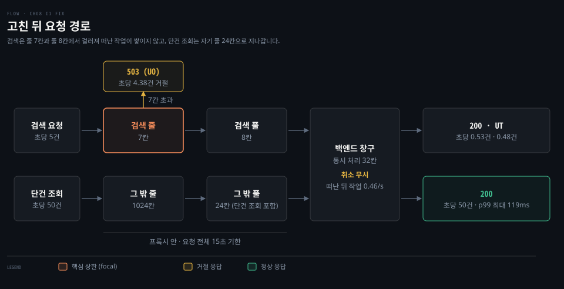
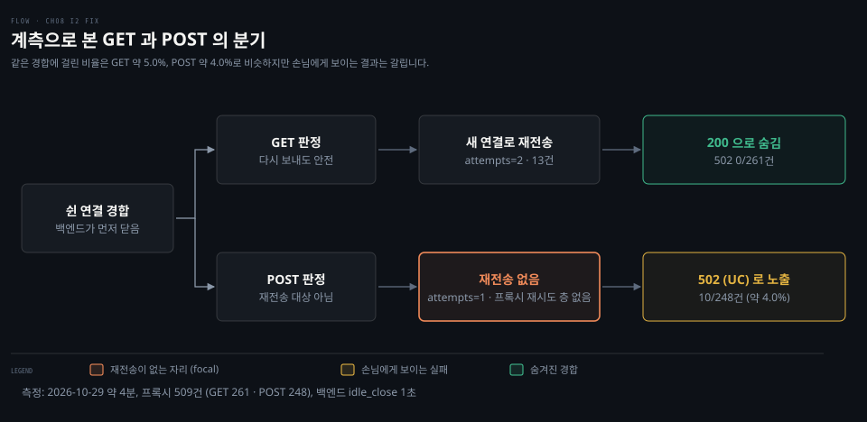
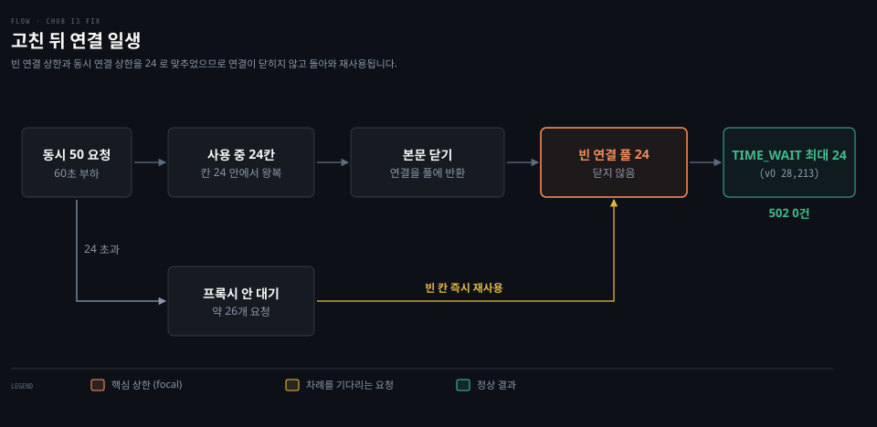

# 기본값 리버스 프록시가 겪는 장애 - 느린 검색·포트 고갈·POST 502·회복 지연·중복 등록

---

> 기본 설정 그대로 배포한 리버스 프록시가 실제 운영 환경에서 맞닥뜨리는 장애 양상을 진단하고 해결책을 도출합니다. 원인을 모르는 상태에서 유입된 장애 신고를 출발점으로 삼아 지표와 로그를 대조하며 원인을 좁힙니다.

## 리허설 환경

> 원인을 숨긴 장애 주입 상태에서 관측 지표의 변화를 추적합니다.


```bash
./bin/fakeinv -addr 127.0.0.1:9090
./bin/npgproxy -addr 127.0.0.1:18080 -admin 127.0.0.1:18081 -upstream http://127.0.0.1:9090
./bin/npgwatch -proxy http://127.0.0.1:18081/debug/vars        # http://127.0.0.1:8090
./bin/npgload -url 'http://127.0.0.1:18080/v1/devices/7' -rate 50 -poisson -d 10m -label get
./bin/npgload -url 'http://127.0.0.1:18080/v1/devices?q=edge' -rate 5 -poisson -d 10m -label search
```

- 기존 Java 프로세스의 포트 점유로 프록시를 18080과 18081 포트에 배치했습니다.
- 장애는 fakeinv 의 `/_faults` 경로로 몰래 주입하며, 신고와 관측 신호만으로 진단합니다.

| 장면 | 신고서 한 줄 | 상태 |
|---|---|---|
| I1. 검색 하나가 단건 조회까지 멈췄다 | 장비 검색이 느린 건 알고 있었는데, 10분 전부터 장비 단건 조회까지 p99 가 50ms → 8초입니다. 프록시 메모리도 계속 오릅니다. | 고침 완료 (v0.8.0) |
| I2. 가끔 POST 만 502 가 난다 | 하루 수십 건, 장비 등록(POST)에서만 502 가 납니다. GET 은 0건입니다. 백엔드 로그에는 그 요청이 아예 없습니다. | 보관 4초 배포·효과 미확인 (v0.8.0) |
| I3. 부하 시험만 하면 포트가 바닥난다 | 동시 50 으로 부하 시험을 하면 프록시 호스트에 TIME_WAIT 가 수만 개 쌓이고 connect: cannot assign requested address 가 납니다. | 고침 완료 (v0.8.0) |
| I4. 장애는 끝났는데 회복이 안 된다 | 백엔드 배포 실수로 10초간 느려졌고 바로 롤백했습니다. 그런데 에러율이 30분 동안 내려오지 않았습니다. 백엔드팀은 그 사이 요청이 평소의 몇 배였다고 합니다. | 돌리지 않음 (알려진 한계) |
| I5. 장비가 두 번 등록됐다 | 어제 백엔드가 느리던 시간대에 같은 장비가 두 번 등록된 건이 12건 있습니다. 클라이언트는 한 번만 보냈다고 합니다. | 돌리지 않음 (알려진 한계) |


## I1. 느린 검색이 막은 단건 조회

> 느린 검색 요청이 백엔드의 한정된 공유 창구를 잠식하여 빠른 단건 조회까지 대기열에 묶여 지연되었습니다. 프록시에 응답 기한과 경로별 격벽이 없어 백엔드의 체류 시간 증가가 전체 서비스 지연으로 번졌습니다.


### 신고

> 신고: "장비 검색이 느린 건 알고 있었는데, 10분 전부터 장비 단건 조회(`GET /v1/devices/{id}`)까지 p99 가 50ms → 8초입니다. 프록시 메모리도 계속 오릅니다."

장애 발생 전 단건 조회(get) 지연 시간은 p50 6ms, p99 8ms 안팎이었습니다. 15:06 재현 당시 이전 부하 도구가 중복 실행되어 15:06~15:08 구간 수치는 부하가 약 세 배 부풀려 측정되었습니다.

### 관측 신호


- 1단계에서는 `inflight` 상승을 확인했으나, 이는 **리틀 법칙**상 체류 시간이 늘어난 결과 증상일 뿐 원인은 아니었습니다.
- 2단계에서는 npgwatch 지표로 대기열(`queued` 2933)이 프록시가 아닌 백엔드에 쌓였음을 확인했습니다.
- 3단계에서는 get 완료 건수 `n` 이 0을 기록하는 현상이 8초 주기로 반복되어 검색이 공유 창구를 잠식했음을 확인했습니다.

- 4단계에서는 검색 처리 창구 40개(5/s × 8s)가 백엔드 전체 창구 32개를 초과함을 리틀 법칙으로 계산했습니다.
- 5단계에서 "끊는 쪽은 프록시다"라는 가설은 UT 가 0건이고 손님 콘솔에 타임아웃이 기록되어 버렸습니다. Go 기본 설정은 응답 기한이 없어 30초에 도달한 손님이 먼저 연결을 끊었습니다.
- 6단계에서 "백엔드가 취소를 모른다"는 가설은 절반만 맞았습니다. Go 서버는 연결이 끊기면 `r.Context()` 를 취소합니다. 백엔드는 취소 알림을 받았으나 비즈니스 코드가 컨텍스트를 보지 않고 8초 연산을 끝까지 수행했습니다.

초당 집계 화면의 지연 시간은 완료된 요청만 집계하므로 `n` 과 `inflight` 를 같이 읽어야 합니다.
실제로 `n=1 p50=7ms` 다음 초에 `inflight=112 n=0` 이 발생하여 막힌 순간이 오히려 빨라 보이는 착시가 관측되었습니다.

`inflight` 는 세 군데에서 따로 셉니다. 손님(npgload)이 답을 기다리는 수, 프록시 핸들러 안의 수, 백엔드 핸들러 안의 수(대기열 포함)입니다. 프록시는 줄을 세우지 않고 바로 넘기므로 프록시 `inflight` 의 요청은 실제로 백엔드에서 기다립니다. 손님이 떠난 뒤에도 백엔드가 일을 계속하면 백엔드 `inflight` 가 더 클 수 있습니다.

`requests` 는 오르기만 하는 카운터이고 `inflight` 는 오르내리는 게이지입니다. `reasons` 는 상태 코드가 아니라 실패 원인 코드별 개수입니다. 원인 코드는 DC 손님 이탈, UT 기한 초과, UF 연결 실패, UC 연결 끊김, UO 줄 넘침의 다섯 가지입니다. 502 하나에 UF 와 UC 가 섞이므로 원인으로 따로 셉니다.

### 사고 실험


- 프록시에 2초 응답 기한을 두거나 호스트당 연결 상한 32를 두어도 대기 장소가 바뀔 뿐 백엔드 창구는 풀리지 않습니다.
- 경로별 **격벽**을 도입하면 단건 조회의 자리를 보호할 수 있습니다.
- 프록시 상한은 프록시가 직접 쥔 자원만 통제합니다.
- 백엔드가 취소를 무시하면 검색 상한 8개와 2초 기한을 두어도 백엔드에서는 8 × (8/2) = 32 창구가 그대로 묶입니다.

### 근본 원인


- 정체는 fakeinv 대기열에서 작업자 32개 창구로 진입하는 구간에서 발생했습니다.
- v0 프록시에는 응답 기한과 연결 상한이 없어 백엔드 소켓이 2966개까지 늘어났습니다.
- 백엔드는 클라이언트의 취소를 무시하고 8초 연산을 끝까지 수행하여 작업 창구를 놓지 않았습니다.

### 고친 뒤

프록시가 `http.DefaultTransport` 대신 전용 Transport 를 쓰도록 바꾸었습니다. DefaultTransport 는 프로세스 공용 객체라 필드를 고치면 같은 프로세스의 다른 HTTP 클라이언트까지 바뀌기 때문입니다. 판단은 여섯 자리로 나뉘며 ADR 0012 에 결정으로 남아 있습니다. I2 와 I3 절은 이 표의 번호만 가리킵니다.

| 결정 | 고른 값 | 이유 |
|---|---|---|
| 1. 응답 기한 | 요청 전체 15초 | 손님의 30초보다 먼저 프록시가 끊어 실패 원인이 UT(504)로 드러납니다 |
| 2. 연결 수 | 검색 풀 8칸, 그 밖의 풀 24칸, 빈 연결 상한은 칸 수와 같게 | 백엔드 창구 32개 안에서 느린 경로가 자기 몫만 쓰고 끝난 연결은 닫히지 않습니다 |
| 3. 빈 연결 보관 | 4초 | 흔한 서버 기본값 5초보다 짧게 두어 프록시가 먼저 닫습니다(I2) |
| 4. 맺기 기한 | 5초 | 닿지 않는 백엔드를 요청 기한 15초보다 먼저 5초에 끊어 원인을 UT 가 아닌 UF 로 남깁니다 |
| 5. 환경 변수 프록시 | `Proxy: nil` | `HTTP_PROXY` 가 업스트림 경로를 몰래 바꾸지 못합니다 |
| 6. 프록시 안 줄 | 검색 7칸, 그 밖 1024칸, 넘치면 503(UO) | 프록시가 기한으로 떠나는 일을 줄여, 떠난 뒤 백엔드에 남는 일을 줄입니다 |

결정 6 은 처음 설계에 없었습니다. 결정 1~5 만 적용한 재확인(2026-10-28 17:17)에서 드러난 구멍을 메우려고 더했습니다. 그 재확인에서 검색은 15초에 UT 로 끝났지만 단건 조회도 성공이 0건이었고 p99 가 약 15초였습니다. 프록시 격벽은 연결 수만 묶고, 백엔드가 아끼는 것은 처리 창구 32개입니다.

줄에서 오래 기다린 검색은 남은 기한이 백엔드의 8초보다 짧았습니다. 그래서 백엔드가 일하는 도중에 프록시가 UT 로 떠나고, 비워진 칸에 새 요청을 보냈습니다. 백엔드는 취소를 무시하는 설정(`honor_cancel=false`)이라 떠난 요청도 끝까지 처리했습니다. 떠난 뒤에도 끝까지 처리한 작업은 초당 약 41건이었습니다. 그 결과 백엔드 줄이 초당 약 13건씩 길어져 처리 중 요청이 최대 2,433건(대기 2,401건)까지 쌓였습니다. 같은 줄에 선 단건 조회도 15초를 넘겼습니다.

결정 6 을 더한 재확인(2026-10-29 10:33~10:34, 100초)에서 프록시 줄은 7칸을 넘는 검색을 곧바로 503(UO)으로 거절했습니다. 단건 조회는 고장이 이어지는 동안 초당 50건 모두 200 이었습니다. p99 는 최대 119ms 였고 백엔드 처리 중 요청은 최대 13건, 대기는 0건, 열린 소켓은 최대 17개였습니다. 초당 5.39건이 들어온 검색은 UO 4.38건, 200 0.53건, UT 0.48건으로 갈렸습니다.

검색 200 이 처리량 초당 1건(8칸 ÷ 8초)의 절반에 머문 것은 줄 7칸의 계산에서 나옵니다. 들어오는 검색이 초당 5건이라 줄은 늘 가득 찬 채였습니다. 칸을 얻는 검색은 줄 끝에서 약 7초를 기다린 뒤 백엔드 8초가 더해져 15초 기한에 닿았습니다. 칸이 비는 간격이 들쭉날쭉해서 절반은 14.8초에 200 으로 끝났고 절반은 15초에 UT 가 되었습니다.

UT 로 끝난 검색도 백엔드는 끝까지 처리했지만 떠난 뒤 작업이 초당 0.46건이라 몇 초 안에 끝나 더 쌓이지 않았습니다. 평소 검색은 30ms 라 줄 7칸이 순간 몰림만 받아 줍니다. 8초 지연이 이어지는 고장 때만 검색이 쓰는 몫을 칸 8과 줄 7을 합친 15개로 묶어 단건 조회를 지킵니다. 넘침이 계속되면 줄 길이가 곧 기다림 시간이 되는 점은 리틀 법칙으로 설명되며 ADR 0012 의 한계로 남겼습니다.

프록시의 상한은 프록시가 쥔 연결만 셉니다. 백엔드가 아끼는 자원은 처리 창구이고, 프록시가 기한으로 떠나면 칸은 비지만 백엔드의 일은 남습니다. 그래서 떠나는 일 자체를 줄이는 줄 상한이 필요했습니다.

실무 프록시도 같은 자리에 장치를 두지만 방식이 다릅니다. Envoy 는 줄 길이 상한(`max_pending_requests`, 기본 1024)을 넘으면 503(UO)으로 거절합니다. HAProxy 는 기다린 시간 상한(`timeout queue`)으로 오래 기다린 요청을 잘라 503 으로 돌려보냅니다. nginx 오픈소스는 줄 없이 칸이 차면 바로 실패합니다.

어느 방식이든 줄에서 기다린 시간과 백엔드 처리 시간의 합이 요청 기한을 넘지 않아야 떠난 작업이 생기지 않습니다. 백엔드가 `r.Context()` 취소를 존중하게 만드는 근본 해결은 8장 범위 밖이라 알려진 한계로 남겼습니다(ADR 0012 의 단순화 목록).



표의 `worked_after_cancel` 은 손님이 떠난 뒤에도 백엔드가 일을 끝낸 요청의 누적 수입니다. 이 지표와 `reasons` 는 개선 전 칸이 누적 건수이고 개선 후 칸이 초당 비율이라, 두 칸을 곧바로 견줄 수 없고 쌓이는지는 비율로 읽어야 합니다.

| 지표 | 개선 전 (v0) | 개선 후 |
|---|---|---|
| get p99 (고장 중) | 약 8s, 이후 30s(손님 포기) | 최대 119ms, 초당 50건 모두 200 |
| 백엔드 `conns_open` 최대 | 2966 | 17 |
| 백엔드 `worked_after_cancel` | 26204 (15:06:33 이후 누적) | 초당 0.46 (쌓이지 않음) |
| 프록시 `reasons` | DC 49150, UT 0 | UO 초당 4.38, UT 0.48 |


## I2. 쉰 연결로 보낸 POST 만 502

> 프록시와 백엔드의 빈 연결 보관 시간이 달라 백엔드가 먼저 닫은 연결로 전송된 POST 요청이 실패했습니다. Go HTTP 클라이언트는 쓰던 연결이 끊겼을 때 GET 요청만 다시 전송하므로 POST 장애만 502 에러로 드러났습니다.


### 신고

이 장면은 OrbStack `ubuntu` 환경에서 실행했습니다.

> 신고: "한산한 시간대에도 하루 수십 건씩 장비 등록(POST)에서만 502 가 납니다. 같은 시간에 단건 조회(GET)는 0건입니다. 백엔드 로그를 뒤져 보면 실패한 그 등록 요청은 아예 들어온 기록이 없습니다. 부하가 몰릴 때가 아니라 오히려 조용할 때 납니다."

숨긴 조건 둘(`idle_close` 1초·`netem` 100ms)은 진단 뒤 공개했고, 시간 압축으로 하루 수십 건을 10분에 보이게 했습니다.

### 관측 신호


- 1단계 "거의 실패 없음" 가설은 10분에 UC 44건(요청 1,813건)이 기록되어 1초 그래프로는 안 보여 버렸습니다.
- 2단계에서는 프록시 로그의 EOF·UC 경고와 같은 시각의 접근 로그 줄에서 `method`·`reused`·`idle` 속성을 확인했습니다.
- 3단계 502 9건은 모두 `method=POST reused=true idle=807~973ms` 였고, 재사용 GET 121건은 실패가 0건이었습니다.
- 4단계는 프록시 요청 1,813건 − 백엔드 1,770건 = 43건이 UC 44건과 거의 같아 백엔드에 닿지 않음을 밝혔습니다.
- 5단계 CLOSE_WAIT 는 Go 가 풀 연결마다 `readLoop` 로 읽어 FIN 즉시 닫으므로 보정했고, 실패는 FIN 이 오는 중의 경합이었습니다.
- 6단계에서는 서버에도 빈 연결 보관 시간(`http.Server.IdleTimeout`)이 따로 있음을 확인했습니다. 이를 흉내 낸 백엔드 `idle_close` 1초가 프록시의 90초보다 짧아 양쪽 보관 시간이 어긋났습니다.
- 7단계에서는 Go Transport 가 끊긴 연결에 대해 안전한 요청만 다시 보내므로 GET 은 살아남고 POST 는 502 가 되었습니다.
- 8단계에서는 재전송 판단식인 `isReplayable` 을 대조하여 메서드별 동작 규칙 차이를 검증했습니다.

Go 가 다시 보내는 요청은 GET·HEAD·OPTIONS·TRACE 와 `Idempotency-Key` 헤더뿐이며, PUT 과 DELETE 는 빠집니다.

### 근본 원인


- 프록시는 빈 연결을 90초 보관하지만 백엔드는 1초 만에 닫아 보관 시간 차이가 발생했습니다.
- 백엔드가 닫은 직후 FIN 이 프록시에 닿기 전 보낸 요청은 백엔드에 닿지 못하고 EOF 가 되었습니다.
- Go 는 끊긴 연결의 GET 요청을 조용히 새 연결로 재전송해 숨겼고, POST 요청은 다시 보내지 않아 502(UC)로 드러났습니다.

다만 GET 이 실제로 다시 보내졌는지는 관측 횟수를 직접 세지 않았고 소스 코드 동작으로 확인했습니다.

### 고친 뒤

두 가지를 정했습니다. 첫째, 프록시 Transport 의 빈 연결 보관을 90초에서 4초로 줄였습니다(ADR 0012 결정 3). 둘째, 프록시에 재시도 층을 두지 않았습니다(ADR 0013 결정 1). 빈 연결은 요청을 보내는 쪽이 먼저 닫아야 안전하므로, Node.js 와 Apache 의 기본값 5초보다 짧은 4초를 골랐습니다. 5초 Node.js 백엔드 앞의 Envoy 에서 503 UC 가 나자 `idle_timeout` 을 4초로 낮춘 Istio 포럼의 사례도 같은 값입니다.

재시도를 넣지 않은 이유는 POST 에 있습니다. RFC 9110 §9.2.2 는 "MUST NOT automatically retry non-idempotent requests" 라고 정합니다. 주어는 프록시입니다. 502 면 세 번 다시 보내는 핫픽스는 백엔드에 닿았는지 모르는 POST 를 두 번 등록시킬 수 있습니다(I5). 또 장애 중 요청을 곱으로 늘려 회복을 막을 수 있습니다(I4, 이번 장에서 돌리지 않음). 재시도 결정은 ADR 0013 에 네 가지로 남아 있습니다.

| 결정 | 내용 | 근거 |
|---|---|---|
| 0013-1. 프록시 재시도 층 | 두지 않고 Go Transport 재시도만 둡니다 | RFC 9110 §9.2.2, nginx `non_idempotent` 기본 꺼짐 |
| 0013-2. 키 붙은 POST | 본문을 담지 않고 헤더만 그대로 넘깁니다. 다시 보낼지는 손님이, 중복 방지는 백엔드가 키로 맡습니다 | 본문을 메모리에 담으면 요청마다 크기만큼 쓰고, 키가 진짜 멱등인지 프록시가 알 수 없습니다 |
| 0013-3. 층 사이 원칙 | 재시도는 손님 한 층에서 백오프·지터·상한으로 합니다 | 5층에서 층마다 3번이면 맨 아래 부하가 243배입니다(AWS Builders' Library) |
| 0013-4. 계측 | 접근 로그에 `attempts`, 카운터에 `retries` 를 냅니다 | GET 이 실제로 다시 보내졌는지 직접 보려는 것입니다 |

ADR 0012 재확인(약 4분)에서는 POST UC 가 약 21/318건으로, v0 재확인의 약 20/329건과 달라지지 않았습니다. 이 장면의 백엔드 `idle_close` 가 1초로 압축되어 프록시의 4초보다 짧았으므로, 프록시가 먼저 닫는다는 결정 3의 전제가 성립하지 않았습니다. 4초가 흔한 5초 백엔드에서 경합을 없애는지는 이 장면으로 보일 수 없고, 5초와 4초의 비율을 지키며 시간을 압축한 새 장면이 따로 필요합니다(미정).

ADR 0013 재확인은 2026-10-29 에 약 4분 동안 같은 장면에 계측을 더해 돌렸습니다. 프록시가 받은 요청은 509건으로 GET 261건과 POST 248건이었습니다. 백엔드가 받은 요청은 499건으로 GET 261건과 POST 238건이었고 5xx 는 0건이었습니다.

POST 는 10/248건이 502 UC 로 손님에게 갔고 비율은 약 4.0%입니다. 모두 `attempts=1` 이라 프록시는 한 번도 다시 보내지 않았습니다. 백엔드에 닿지 못한 10건, 곧 248 − 238 이 그대로 손님의 실패가 된 것입니다. GET 은 502 가 0/261건이었고 `attempts=2` 가 13건으로 비율은 약 5.0%이며 카운터 `retries` 13과 같았습니다. 백엔드가 받은 GET 이 프록시가 받은 GET 과 같은 261건이므로 첫 시도는 백엔드에 닿지 않았습니다. GET 이 다시 보내졌다는 사실을 처음으로 직접 본 것입니다.

`attempts` 는 첫 시도를 포함한 횟수라 `attempts=2` 는 한 번 다시 보냈다는 뜻입니다. Go 는 모든 GET 을 다시 보내지 않고, 풀에서 꺼낸 연결이 이미 닫혀 있던 경우에만 새 연결로 다시 보냅니다.

경합에 걸린 비율은 GET 약 5.0%, POST 약 4.0%로 비슷합니다. 같은 경합을 GET 은 Go 가 숨기고 POST 는 드러낸다는 진단과 계측 결과가 맞습니다. 다만 약 4분 한 번 잰 값이고 표본은 GET 13건, POST 10건입니다. 502 는 시간 초과가 아닙니다. 시간 초과는 504(UT)이고, 502(UC)는 백엔드가 먼저 닫는 것처럼 응답 없이 연결이 끊긴 경우입니다.

보관 시간을 맞추어도 상대의 기한을 알 수 없거나 연결이 끊기면 경합은 남습니다. 그래서 프록시는 맹목적으로 다시 보내지 않고 역할을 나누었습니다. 손님이 `Idempotency-Key` 와 지수 백오프로 다시 보냅니다. 백엔드는 키로 중복을 막습니다(fakeinv `idempotency=true`).



| 지표 | 개선 전 (v0) | 개선 후 |
|---|---|---|
| POST 502(UC) / 프록시가 받은 POST (10분 두 번) | 56 / 1,206 (약 4.6%) | 10 / 248 (약 4.0%, ADR 0013 재확인 약 4분). 변화 없음. 같은 장면 v0 재확인은 약 20 / 329(6.1%), 보관 4초 뒤 재확인은 약 21 / 318(6.6%) |
| GET 502 / GET | 0 / 1,199 | 0 / 261 (`attempts=2` 13건) |
| 502 의 idle 범위 | 807~973ms | 재지 않음 |
| 백엔드에 닿지 않은 요청 | 55 | 10 (POST 248 − 238) |


## I3. 닫은 연결이 출발 포트를 채웠다

> 프록시가 호스트당 빈 연결을 2개만 남기고 연결 상한 없이 매번 48개를 닫았습니다. 리눅스 TIME_WAIT 가 풀리기 전에 닫은 연결이 쌓여 출발 포트가 바닥났습니다.


### 신고

이 장면은 OrbStack `ubuntu` 환경에서 실행했습니다.

> 신고: "동시 50 으로 부하 시험을 하면 프록시 호스트에 TIME_WAIT 가 수만 개 쌓이고 `connect: cannot assign requested address` 가 납니다."

백엔드에는 숨긴 장애가 없고 닫힌 고리 동시 50 부하 조건만으로 발생했습니다.
가상 머신의 `net.ipv4.tcp_tw_reuse` 설정이 2여서 루프백에서는 포트 고갈이 재현되지 않으므로 백엔드를 eth0 주소에 배치했습니다.

### 관측 신호


- 1단계에서는 16:47:19 첫 에러 이후 502(UF 37,381건) 급증을 확인하고 출발 포트 고갈 가설을 남겼습니다.
- 2단계에서는 TIME_WAIT 가 프록시에 쌓여 프록시가 먼저 연결을 닫았음을 확인했습니다.
- 3단계에서 "처리량 제한" 가설은 `MaxConnsPerHost` 가 0으로 상한이 없고 제한은 남기는 쪽에 있어 버렸습니다.
- 4단계에서 "손님 요청이 초당 1000개 쌓인다"는 가설은 `-c 50` 닫힌 고리이며 백엔드에 닿지 않고 UF 로 즉시 끝나 회전이 빨라진 것이라 버렸습니다.
- 5단계에서 "빈 연결 50개를 남겨 재사용한다"는 추론은 맞고 관찰이 반대였습니다. 매초 수천 개를 새로 연다는 사실은 쓰고 난 연결을 대부분 닫는다는 뜻입니다.
- 6단계에서는 Go `DefaultTransport` 가 `MaxIdleConnsPerHost` 부재 시 기본값 2를 써서 2개 초과 연결을 닫음을 확인했습니다.
- 8단계에서 "풀이 보내는 길목이다"라는 가설은 풀이 지름길이며 50개 요청이 풀 2개와 새 연결 48개로 나뉘어 전달되므로 버렸습니다.

학습자가 정리한 원인에서 고갈된 자원은 fd 가 아니라 출발 포트(`cannot assign requested address`)였습니다. 실패는 손님이 아닌 프록시 dial 에서 시작했습니다. UF 줄에서는 연결을 얻지 못해 `GotConn` 이 불리지 않으므로 `reused=false`·`idle=0` 은 0 값일 뿐입니다. `reused=false` 는 새 연결과 연결 없음을 가르지 못하니 flags 와 함께 읽습니다.

### 사고 실험

- `MaxConnsPerHost` 와 `MaxIdleConnsPerHost` 를 100으로 키워도 동시 300이면 200개를 닫아 더 크게 다시 납니다.
- `MaxConnsPerHost = N`, `MaxIdleConnsPerHost ≥ N` 으로 맞추면 연결 닫힘은 사라집니다.
- 다만 N 을 초과하는 요청은 프록시 대기열에서 기다리게 되므로 I1 에서 겪은 대기 자리 이동 문제가 발생합니다.

### 근본 원인


- 프록시는 호스트당 빈 연결을 2개만 남겨 동시 50 요청이 끝날 때마다 48개 연결을 먼저 닫았습니다.
- 동시 연결 상한이 없어 매번 새 연결을 열었고, 닫는 속도가 TIME_WAIT 60초 회수보다 빨라 출발 포트 28,232개가 바닥났습니다.
- 프록시의 dial 실패가 손님에게 502(UF) 에러로 반환되었습니다.

16:47 실행 당시 새 연결 카운터(14,148)가 포트 범위의 절반인데도 다이얼이 실패했던 차이의 원인은 확인하지 않았습니다.

### 고친 뒤

남겨 두는 빈 연결 상한과 여는 동시 연결 상한을 한 쌍으로 맞추었습니다(ADR 0012 결정 2). 일반 경로 풀은 `MaxConnsPerHost` 와 `MaxIdleConnsPerHost` 가 모두 24이고 검색 경로 풀은 모두 8입니다. 칸 수는 백엔드 창구 32개를 나눈 값이며, 빈 연결 상한이 칸 수와 같아서 응답을 마친 연결은 풀로 돌아와 닫히지 않습니다.

재확인(리눅스 VM, 동시 50, 60초)에서는 칸 24보다 많은 약 26개 요청이 프록시 안 `connsPerHostWait` 에서 기다립니다. 앞선 요청이 응답 본문을 닫고 연결을 풀에 돌려놓으면 기다리던 요청이 그 연결을 바로 받아 핸드셰이크 없이 보냅니다. 그 결과 171,580건이 모두 200 이었고 502 는 0건이었습니다.

새 연결은 첫 1초에 19개만 열렸고 그 뒤로는 0개였습니다. 요청은 초당 약 2,900건씩 기존 연결을 재사용했습니다. TIME_WAIT 는 최대 24개에 머물렀습니다(v0 28,213개). 이 24 를 어디서 어떻게 셌는지는 기록에 없어 확인하지 못했습니다. p99 는 같은 재확인에서 잰 v0 의 204ms 에서 31ms 로 낮아졌습니다. 같은 재확인에서 v0 는 74,192건 중 22,284건(30%)이 UF 502 였습니다.

백엔드의 열린 소켓은 최대 25개였습니다. 프록시가 센 새 연결은 19개라 25개의 내역은 확인하지 않았습니다. 프록시 풀과 npgwatch 수집 연결이 후보입니다. 개선 전 장애 구간에서는 초당 약 1,000건이 도는 것처럼 보였습니다. 그중 대부분인 약 750건은 백엔드에 닿지 못하고 dial 실패로 곧바로 끝난 회전이었습니다(관측 신호 4단계). 개선 뒤의 171,580건은 모두 백엔드를 왕복한 요청이라 초당 약 2,860건(171,580 ÷ 60초)이 실제 처리량입니다.

두 상한 중 하나만 바꾸면 문제가 다른 모양으로 남습니다. 빈 연결 상한만 키우면 동시 연결이 그 값을 넘는 순간 같은 닫힘이 더 큰 규모로 일어납니다. 동시 연결 상한만 두면 요청은 줄을 서지만 끝난 연결은 여전히 닫혀 TIME_WAIT 가 쌓입니다.

둘을 맞추면 닫힘이 사라지는 대신 상한을 넘는 요청이 프록시 안에서 기다리게 됩니다. 그 줄이 끝없이 길어지지 않도록 I1 의 결정 6(줄 상한)이 받칩니다.



| 지표 | 개선 전 (v0) | 개선 후 |
|---|---|---|
| 502(UF) / 보낸 요청 (60초) | 37,381 / 88,831 | 0 / 171,580 (모두 200) |
| 백엔드로 간 TIME_WAIT 최대 | 28,213 | 24 |
| 새 연결/초 (부하 초반) | 1,364 | 첫 1초 19, 그 뒤 0 (재사용 초당 약 2,900) |
| 꺾일 때까지 걸린 시간 | 약 9초 | 꺾이지 않음 |


## 알려진 한계

> 이번 장에서 돌리지 않았거나 측정으로 확인하지 못해 고침이 닿는 범위를 가르는 항목입니다.

- I4(재시도 증폭)와 I5(중복 등록)는 돌리지 않아 재시도 증폭과 중복 등록을 실측하지 않았습니다.
- I2 장면은 백엔드 유휴가 1초라 ADR 0012 결정 3(프록시 4초 < 백엔드 5초)의 효과를 증명하지 못했습니다. 백엔드가 4초보다 짧은 유휴 기한을 쓰면 I2 가 돌아오므로 그 업스트림만 따로 값을 줘야 합니다.
- 101 Switching Protocols(업그레이드) 응답은 줄 세기 층이 본문을 감싸 Go 가 연결을 넘겨받지 못하고 `ErrorHandler` 로 갑니다. 손님은 502 를 받고 접근 로그에는 502·UC 로 남습니다(코드 읽기, 실행 확인 안 함). 지금은 업그레이드를 쓰지 않습니다.
- 백엔드가 `r.Context()` 취소를 존중하지 않아 떠난 요청을 끝까지 처리합니다(8장 범위 밖, ADR 0012 단순화 목록).
- 요청 전체 기한 15초는 본문 복사 중에도 끊습니다. 헤더를 보낸 뒤 끊기면 `ErrorHandler` 를 거치지 않고 `panic(http.ErrAbortHandler)` 로 연결을 끊습니다. 그래서 접근 로그의 flags 가 UT 로 남지 않습니다. 지금 응답이 작은 JSON 이라 드뭅니다.
- HTTP/2 업스트림은 다른 재시도 경로(`http2shouldRetryRequest`)를 타는데 지금 프록시는 HTTP/1.1 만 씁니다.
- 접근 로그의 `reused=false` 는 새 연결과 연결 없음(UF)을 가르지 못해 flags 와 함께 읽어야 합니다.


## 참고 자료

> 이 문서가 풀지 않고 넘긴 개념을 다룬 문서와, 진단에 쓴 Go 소스·오픈소스 프록시의 1차 원문입니다.

### 개념 문서

- [DefaultTransport 기본값](../../../01_language/docs/go/net-http/02-01.Client·Transport.md#3-defaulttransport-기본값-읽기): 풀링 규칙과 유휴 보관
- [포트 고갈·TIME_WAIT 튜닝](../../book/systems-performance/10-03.네트워크%20—%20방법론·실험·튜닝.md): 임시 포트 고갈과 한계
- [TCP 상태 전이·TIME_WAIT](../../book/tii_tcp-ip-illustrated/13-03.TCP%20상태는%20연결의%20과거를%20기억하고%20RST는%20그%20기억을%20끊는다.md): 능동 닫기와 4-tuple 재사용
- [결제 시스템 멱등 키](../../../03_architecture/book/bytebytego-system-design/07-02.결제%20정확성은%20멱등%20키로%20이중%20청구를%20막고%20대사로%20장부%20불일치를%20찾고%20토큰화로%20카드%20정보를%20지킨다.md): 멱등 키와 이중 요청 방지
- [네트워크 재시도 전략](../../../09_spring/03_network/resilience/01-03.Retry%20—%20exponential%20backoff·jitter·재시도%20폭주%20방지.md): 지수 백오프와 재시도 폭주
- [HTTP 클라이언트 타임아웃](../../book/npg_network-programming-with-go/08-02.Go%20HTTP%20클라이언트는%20응답%20본문을%20닫아야%20연결을%20재사용하고%20context%20로%20요청을%20끊는다.md): 본문과 취소
- [메트릭 수집·계측](../../book/npg_network-programming-with-go/13-03.메트릭은%20카운터·게이지·히스토그램으로%20서버를%20재고%20Prometheus%20가%20그%20값을%20긁어%20간다.md): 지표와 관측
- [Envoy 서킷 브레이커](../../../08_cloud/book/istio-in-action/06-01.실패를%20견디는%20일을%20프록시로%20옮겼을%20때.md): 복원력 설계
- [스레드 풀·세마포어 격벽](../../../09_spring/03_network/resilience/01-04.Bulkhead%20—%20Semaphore%20vs%20ThreadPool%20격리.md): 격벽과 격리
- [TCP 타임아웃·데드라인](../../book/npg_network-programming-with-go/03-03.타임아웃은%20Dialer·context%20로,%20유휴%20감지는%20데드라인과%20하트비트로%20건다.md): 타임아웃 감지
- [리틀 법칙 풀 크기](../../../03_architecture/book/bytebytego-system-design/06-01.IaaS·PaaS·SaaS%20와%20가상%20머신·컨테이너·서버리스는%20운영%20책임을%20어디까지%20넘기는지로%20갈린다.md): 리틀 법칙 풀링

### 원문 근거

- Go 1.25.1 `net/http/transport.go:808-852` `shouldRetryRequest` — 새 연결이면 재전송하지 않고, 아무것도 쓰지 못했거나 멱등 요청이 서버 유휴 종료로 끊겼을 때 다시 보냅니다.
- Go 1.25.1 `net/http/request.go:1534` `isReplayable` — 본문이 없거나 되감을 수 있는 GET·HEAD·OPTIONS·TRACE 와 `Idempotency-Key` 헤더 요청만 다시 보낼 수 있다고 규정합니다.
- Go 1.25.1 `net/http/transport.go:2431` `readLoopPeekFailLocked` — 풀에서 유휴 대기 중인 연결이 EOF 를 받으면 `errServerClosedIdle` 로 소켓을 닫습니다.
- Go 1.25.1 `net/http/transport.go:1009-1013` `errServerClosedIdle` — 멱등 요청에 대해서는 이 에러가 사용자에게 노출되지 않는다고 명시합니다.
- Go 1.25.1 `net/http/server.go:3040-3044` `http.Server.IdleTimeout` — 지속 연결이 켜졌을 때 다음 요청을 기다리는 최대 대기 시간으로 정의합니다.
- Go 1.25.1 `net/http/transport.go:213-218` — `MaxConnsPerHost` 설정에 연결 제한 초과 시 다이얼이 대기한다고 명시합니다. 기본값 0 은 무제한입니다.
- Go 1.25.1 `net/http/request.go:349` — 서버 수신 요청은 클라이언트 연결이 닫힐 때 컨텍스트가 취소된다고 규정합니다.
- envoy v1.40.1 `api/envoy/config/cluster/v3/circuit_breaker.proto:78-89` — `max_connections`, `max_pending_requests`, `max_requests` 기본값은 1024입니다.
- nginx `ngx_http_upstream_module` `max_conns` — 기본값 0 은 동시 연결 수에 제한이 없음을 의미합니다.
- haproxy 3.2 `configuration.txt` server `maxconn` — 연결 상한 초과 시 요청이 큐에서 대기한다고 설명합니다. 기본값 0 은 무제한입니다.
- Apache Tomcat 10.1 HTTP Connector — `maxConnections` 8192(NIO), `maxThreads` 200, `acceptCount` 100 으로 연결 수와 처리 일꾼 수를 분리합니다.
- Go 1.25.1 `net/http/transport.go:45-56` — `DefaultTransport` 리터럴은 `MaxIdleConns: 100` 만 설정하고 `MaxIdleConnsPerHost` 는 두지 않습니다.
- Go 1.25.1 `net/http/transport.go:60` — `const DefaultMaxIdleConnsPerHost = 2` 상수를 정의합니다.
- Go 1.25.1 `net/http/transport.go:1040-1045` `maxIdleConnsPerHost` — 호스트당 빈 연결 상한이 0 이면 2 를 반환합니다.
- Go 1.25.1 `net/http/transport.go:1115` — 호스트당 빈 연결이 상한에 이르면 `errTooManyIdleHost` 를 반환하고, `:1034-1037` 에서 넣지 못한 연결을 닫습니다.
- Go 1.25.1 `net/http/transport.go:1515-1516` `getConn` — 풀에서 먼저 찾고(`queueForIdleConn`) 없으면 새로 연결을 엽니다(`queueForDial`).
- Go 1.25.1 `net/http/transport.go:1568` `queueForDial` — `MaxConnsPerHost` 가 0 이하이면 상한 없이 바로 새 연결을 엽니다.
- npg-lab `docs/adr/0012-upstream-deadlines-and-pool.md` — 전용 Transport, 요청 전체 15초·맺기 5초·빈 연결 4초 기한, 검색 8칸/나머지 24칸 격벽, 프록시 안 줄 상한의 여섯 결정입니다.
- npg-lab `docs/adr/0013-upstream-retry-and-idempotency.md` — 프록시 재시도 층을 두지 않고 `attempts`·`retries` 로 다시 보낸 횟수를 세는 네 결정입니다.
- [RFC 9110 §9.2.2](https://www.rfc-editor.org/rfc/rfc9110#section-9.2.2) — "A proxy MUST NOT automatically retry non-idempotent requests."
