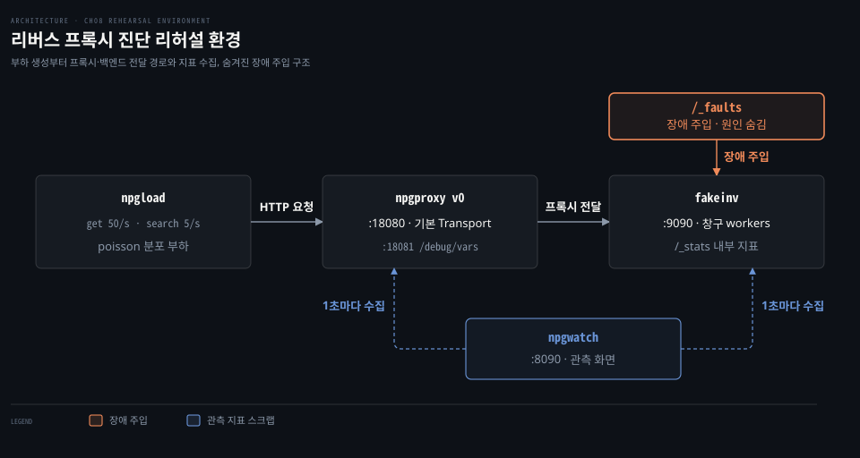
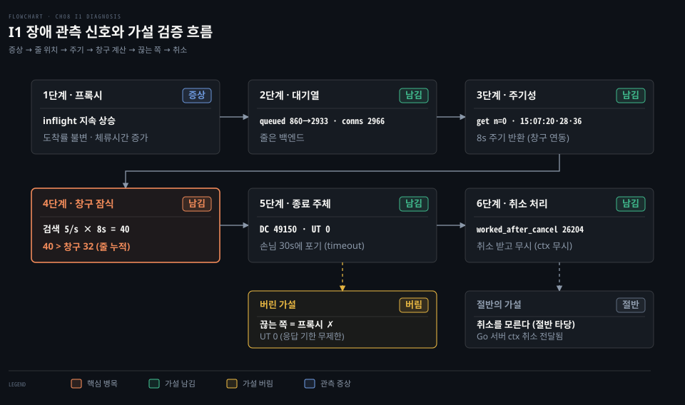
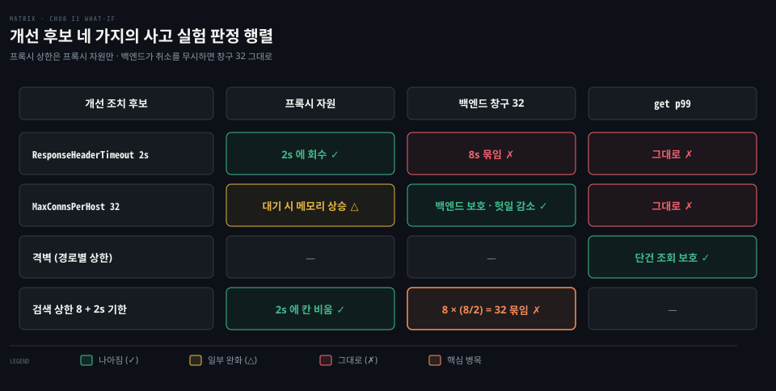
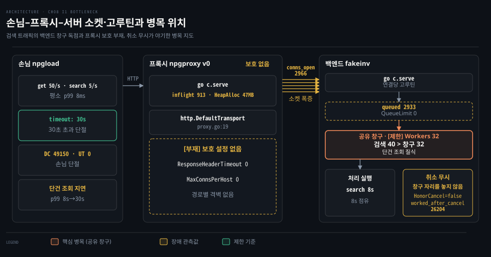
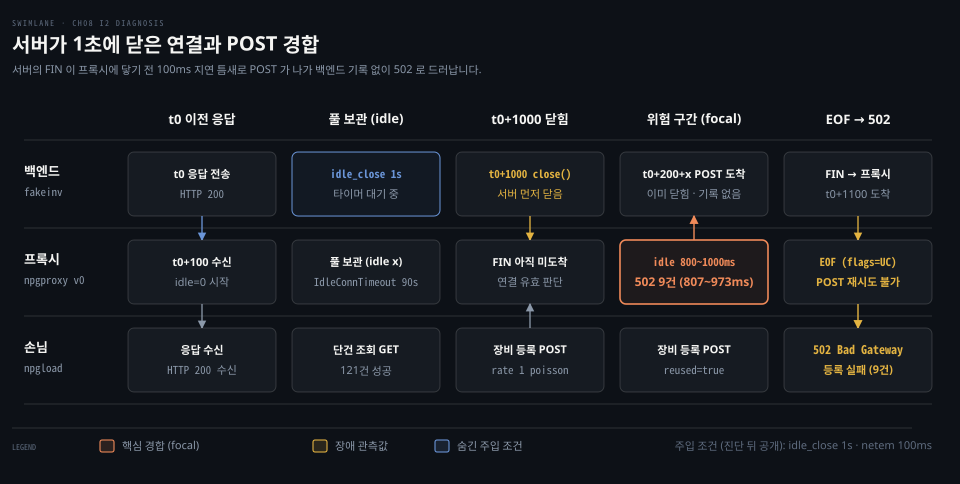
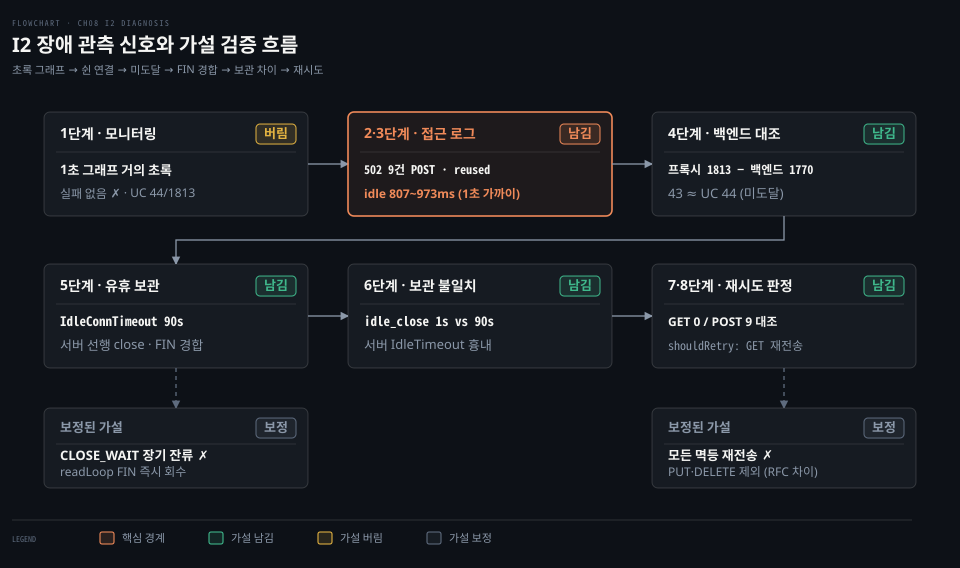
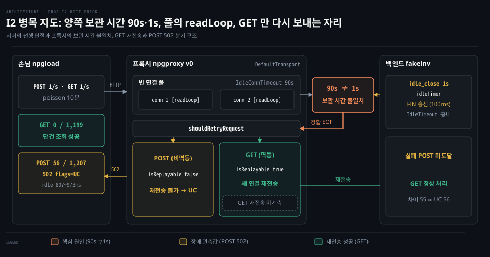
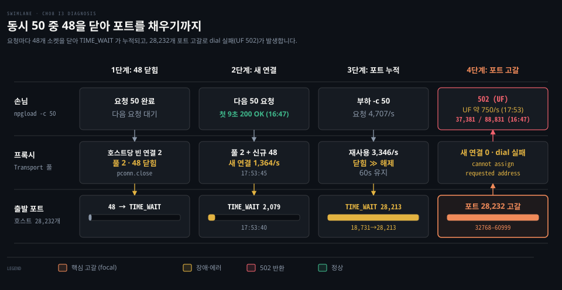
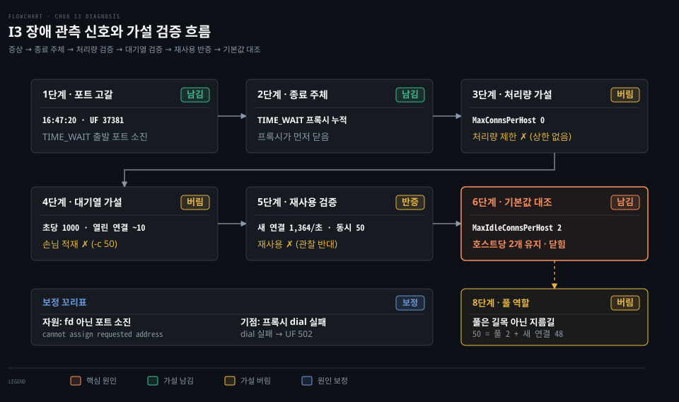
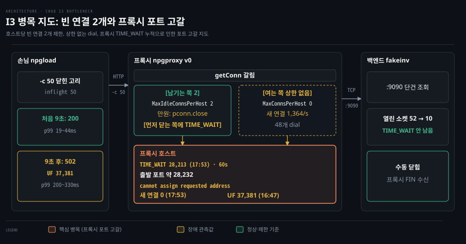

# 기본값 리버스 프록시가 겪는 장애 - 느린 검색·포트 고갈·POST 502·회복 지연·중복 등록

---

> 기본 설정 그대로 배포한 리버스 프록시가 실제 운영 환경에서 맞닥뜨리는 장애 양상을 진단하고 해결책을 도출합니다. 원인을 모르는 상태에서 유입된 장애 신고를 출발점으로 삼아 지표와 로그를 대조하며 원인을 좁힙니다.

## 리허설 환경

> 원인을 숨긴 장애 주입 상태에서 관측 지표의 변화를 추적합니다.



```bash
./bin/fakeinv -addr 127.0.0.1:9090
./bin/npgproxy -addr 127.0.0.1:18080 -admin 127.0.0.1:18081 -upstream http://127.0.0.1:9090
./bin/npgwatch -proxy http://127.0.0.1:18081/debug/vars        # http://127.0.0.1:8090
./bin/npgload -url 'http://127.0.0.1:18080/v1/devices/7' -rate 50 -poisson -d 10m -label get
./bin/npgload -url 'http://127.0.0.1:18080/v1/devices?q=edge' -rate 5 -poisson -d 10m -label search
```

- 기존 Java 프로세스의 포트 점유로 프록시를 18080과 18081 포트에 배치했습니다.
- 장애는 fakeinv 의 `/_faults` 경로로 몰래 주입하며, 신고와 관측 신호만으로 진단합니다.

| 장면 | 신고서 한 줄 | 상태 |
|---|---|---|
| I1. 검색 하나가 단건 조회까지 멈췄다 | 장비 검색이 느린 건 알고 있었는데, 10분 전부터 장비 단건 조회까지 p99 가 50ms → 8초입니다. 프록시 메모리도 계속 오릅니다. | 진단 완료 |
| I2. 가끔 POST 만 502 가 난다 | 하루 수십 건, 장비 등록(POST)에서만 502 가 납니다. GET 은 0건입니다. 백엔드 로그에는 그 요청이 아예 없습니다. | 진단 완료 |
| I3. 부하 시험만 하면 포트가 바닥난다 | 동시 50 으로 부하 시험을 하면 프록시 호스트에 TIME_WAIT 가 수만 개 쌓이고 connect: cannot assign requested address 가 납니다. | 진단 완료 |
| I4. 장애는 끝났는데 회복이 안 된다 | 백엔드 배포 실수로 10초간 느려졌고 바로 롤백했습니다. 그런데 에러율이 30분 동안 내려오지 않았습니다. 백엔드팀은 그 사이 요청이 평소의 몇 배였다고 합니다. | 예정 |
| I5. 장비가 두 번 등록됐다 | 어제 백엔드가 느리던 시간대에 같은 장비가 두 번 등록된 건이 12건 있습니다. 클라이언트는 한 번만 보냈다고 합니다. | 예정 |


## I1. 느린 검색이 막은 단건 조회

> 느린 검색 요청이 백엔드의 한정된 공유 창구를 잠식하여 빠른 단건 조회까지 대기열에 묶여 지연되었습니다. 프록시에 응답 기한과 경로별 격벽이 없어 백엔드의 체류 시간 증가가 전체 서비스 지연으로 번졌습니다.


### 신고

> 신고: "장비 검색이 느린 건 알고 있었는데, 10분 전부터 장비 단건 조회(`GET /v1/devices/{id}`)까지 p99 가 50ms → 8초입니다. 프록시 메모리도 계속 오릅니다."

장애 발생 전 단건 조회(get) 지연 시간은 p50 6ms, p99 8ms 안팎이었습니다. 15:06 재현 당시 이전 부하 도구가 중복 실행되어 15:06~15:08 구간 수치는 부하가 약 세 배 부풀려 측정되었습니다.

### 관측 신호



- 1단계에서는 `inflight` 상승을 확인했으나, 이는 **리틀 법칙**상 체류 시간이 늘어난 결과 증상일 뿐 원인은 아니었습니다.
- 2단계에서는 npgwatch 지표로 대기열(`queued` 2933)이 프록시가 아닌 백엔드에 쌓였음을 확인했습니다.
- 3단계에서는 get 완료 건수 `n` 이 0을 기록하는 현상이 8초 주기로 반복되어 검색이 공유 창구를 잠식했음을 확인했습니다.

- 4단계에서는 검색 처리 창구 40개(5/s × 8s)가 백엔드 전체 창구 32개를 초과함을 리틀 법칙으로 계산했습니다.
- 5단계에서 "끊는 쪽은 프록시다"라는 가설은 UT 가 0건이고 손님 콘솔에 타임아웃이 기록되어 버렸습니다. Go 기본 설정은 응답 기한이 없어 30초에 도달한 손님이 먼저 연결을 끊었습니다.
- 6단계에서 "백엔드가 취소를 모른다"는 가설은 절반만 맞았습니다. Go 서버는 연결이 끊기면 `r.Context()` 를 취소합니다. 백엔드는 취소 알림을 받았으나 비즈니스 코드가 컨텍스트를 보지 않고 8초 연산을 끝까지 수행했습니다.

초당 집계 화면의 지연 시간은 완료된 요청만 집계하므로 `n` 과 `inflight` 를 같이 읽어야 합니다.
실제로 `n=1 p50=7ms` 다음 초에 `inflight=112 n=0` 이 발생하여 막힌 순간이 오히려 빨라 보이는 착시가 관측되었습니다.

### 사고 실험



- 프록시에 2초 응답 기한을 두거나 호스트당 연결 상한 32를 두어도 대기 장소가 바뀔 뿐 백엔드 창구는 풀리지 않습니다.
- 경로별 **격벽**을 도입하면 단건 조회의 자리를 보호할 수 있습니다.
- 프록시 상한은 프록시가 직접 쥔 자원만 통제합니다.
- 백엔드가 취소를 무시하면 검색 상한 8개와 2초 기한을 두어도 백엔드에서는 8 × (8/2) = 32 창구가 그대로 묶입니다.

### 근본 원인



- 정체는 fakeinv 대기열에서 작업자 32개 창구로 진입하는 구간에서 발생했습니다.
- v0 프록시에는 응답 기한과 연결 상한이 없어 백엔드 소켓이 2966개까지 늘어났습니다.
- 백엔드는 클라이언트의 취소를 무시하고 8초 연산을 끝까지 수행하여 작업 창구를 놓지 않았습니다.

### 다음 조치

장애 개선 방안은 I3 및 I2 시나리오 진단을 마친 뒤 설계 결정 문서(ADR 0012)로 확정합니다.

| 지표 | 개선 전 (v0) | 개선 후 |
|---|---|---|
| get p99 (장애 30초 뒤) | 약 8s, 이후 30s(손님 포기) | (ADR 0012 뒤) |
| 백엔드 `conns_open` 최대 | 2966 | (ADR 0012 뒤) |
| 백엔드 `worked_after_cancel` | 26204 (15:06:33 이후 누적) | (ADR 0012 뒤) |
| 프록시 `reasons` | DC 49150, UT 0 | (ADR 0012 뒤) |


## I2. 쉰 연결로 보낸 POST 만 502

> 프록시와 백엔드의 빈 연결 보관 시간이 달라 백엔드가 먼저 닫은 연결로 전송된 POST 요청이 실패했습니다. Go HTTP 클라이언트는 쓰던 연결이 끊겼을 때 GET 요청만 다시 전송하므로 POST 장애만 502 에러로 드러났습니다.



### 신고

이 장면은 OrbStack `ubuntu` 환경에서 실행했습니다.

> 신고: "한산한 시간대에도 하루 수십 건씩 장비 등록(POST)에서만 502 가 납니다. 같은 시간에 단건 조회(GET)는 0건입니다. 백엔드 로그를 뒤져 보면 실패한 그 등록 요청은 아예 들어온 기록이 없습니다. 부하가 몰릴 때가 아니라 오히려 조용할 때 납니다."

숨긴 조건 둘(`idle_close` 1초·`netem` 100ms)은 진단 뒤 공개했고, 시간 압축으로 하루 수십 건을 10분에 보이게 했습니다.

### 관측 신호



- 1단계 "거의 실패 없음" 가설은 10분에 UC 44건(요청 1,813건)이 기록되어 1초 그래프로는 안 보여 버렸습니다.
- 2단계에서는 프록시 로그의 EOF·UC 경고와 같은 시각의 접근 로그 줄에서 `method`·`reused`·`idle` 속성을 확인했습니다.
- 3단계 502 9건은 모두 `method=POST reused=true idle=807~973ms` 였고, 재사용 GET 121건은 실패가 0건이었습니다.
- 4단계는 프록시 요청 1,813건 − 백엔드 1,770건 = 43건이 UC 44건과 거의 같아 백엔드에 닿지 않음을 밝혔습니다.
- 5단계 CLOSE_WAIT 는 Go 가 풀 연결마다 `readLoop` 로 읽어 FIN 즉시 닫으므로 보정했고, 실패는 FIN 이 오는 중의 경합이었습니다.
- 6단계에서는 서버에도 빈 연결 보관 시간(`http.Server.IdleTimeout`)이 따로 있음을 확인했습니다. 이를 흉내 낸 백엔드 `idle_close` 1초가 프록시의 90초보다 짧아 양쪽 보관 시간이 어긋났습니다.
- 7단계에서는 Go Transport 가 끊긴 연결에 대해 안전한 요청만 다시 보내므로 GET 은 살아남고 POST 는 502 가 되었습니다.
- 8단계에서는 재전송 판단식인 `isReplayable` 을 대조하여 메서드별 동작 규칙 차이를 검증했습니다.

Go 가 다시 보내는 요청은 GET·HEAD·OPTIONS·TRACE 와 `Idempotency-Key` 헤더뿐이며, PUT 과 DELETE 는 빠집니다.

### 근본 원인



- 프록시는 빈 연결을 90초 보관하지만 백엔드는 1초 만에 닫아 보관 시간 차이가 발생했습니다.
- 백엔드가 닫은 직후 FIN 이 프록시에 닿기 전 보낸 요청은 백엔드에 닿지 못하고 EOF 가 되었습니다.
- Go 는 끊긴 연결의 GET 요청을 조용히 새 연결로 재전송해 숨겼고, POST 요청은 다시 보내지 않아 502(UC)로 드러났습니다.

다만 GET 이 실제로 다시 보내졌는지는 관측 횟수를 직접 세지 않았고 소스 코드 동작으로 확인했습니다.

### 다음 조치

빈 연결 보관 시간을 업스트림보다 짧게 설정하는 기준은 ADR 0012 에서 정합니다.
실패한 POST 요청을 언제 다시 전송해도 되는지에 대한 재시도 정책은 ADR 0013 에서 논의하여 확정합니다.

| 지표 | 개선 전 (v0) | 개선 후 |
|---|---|---|
| POST 502(UC) / 프록시가 받은 POST (10분 두 번) | 56 / 1,206 (약 4.6%) | (ADR 뒤) |
| GET 502 / GET | 0 / 1,199 | (ADR 뒤) |
| 502 의 idle 범위 | 807~973ms | (ADR 뒤) |
| 백엔드에 닿지 않은 요청 | 55 | (ADR 뒤) |


## I3. 닫은 연결이 출발 포트를 채웠다

> 프록시가 호스트당 빈 연결을 2개만 남기고 연결 상한 없이 매번 48개를 닫았습니다. 리눅스 TIME_WAIT 가 풀리기 전에 닫은 연결이 쌓여 출발 포트가 바닥났습니다.



### 신고

이 장면은 OrbStack `ubuntu` 환경에서 실행했습니다.

> 신고: "동시 50 으로 부하 시험을 하면 프록시 호스트에 TIME_WAIT 가 수만 개 쌓이고 `connect: cannot assign requested address` 가 납니다."

백엔드에는 숨긴 장애가 없고 닫힌 고리 동시 50 부하 조건만으로 발생했습니다.
가상 머신의 `net.ipv4.tcp_tw_reuse` 설정이 2여서 루프백에서는 포트 고갈이 재현되지 않으므로 백엔드를 eth0 주소에 배치했습니다.

### 관측 신호



- 1단계에서는 16:47:19 첫 에러 이후 502(UF 37,381건) 급증을 확인하고 출발 포트 고갈 가설을 남겼습니다.
- 2단계에서는 TIME_WAIT 가 프록시에 쌓여 프록시가 먼저 연결을 닫았음을 확인했습니다.
- 3단계에서 "처리량 제한" 가설은 `MaxConnsPerHost` 가 0으로 상한이 없고 제한은 남기는 쪽에 있어 버렸습니다.
- 4단계에서 "손님 요청이 초당 1000개 쌓인다"는 가설은 `-c 50` 닫힌 고리이며 백엔드에 닿지 않고 UF 로 즉시 끝나 회전이 빨라진 것이라 버렸습니다.
- 5단계에서 "빈 연결 50개를 남겨 재사용한다"는 추론은 맞고 관찰이 반대였습니다. 매초 수천 개를 새로 연다는 사실은 쓰고 난 연결을 대부분 닫는다는 뜻입니다.
- 6단계에서는 Go `DefaultTransport` 가 `MaxIdleConnsPerHost` 부재 시 기본값 2를 써서 2개 초과 연결을 닫음을 확인했습니다.
- 8단계에서 "풀이 보내는 길목이다"라는 가설은 풀이 지름길이며 50개 요청이 풀 2개와 새 연결 48개로 나뉘어 전달되므로 버렸습니다.

학습자가 정리한 원인에서 고갈된 자원은 fd 가 아니라 출발 포트(`cannot assign requested address`)였습니다. 실패는 손님이 아닌 프록시 dial 에서 시작했습니다.

### 사고 실험

- `MaxConnsPerHost` 와 `MaxIdleConnsPerHost` 를 100으로 키워도 동시 300 요청 후 200개를 닫아 더 큰 규모로 다시 납니다.
- `MaxConnsPerHost = N`, `MaxIdleConnsPerHost ≥ N` 으로 맞추면 연결 닫힘은 사라집니다.
- 다만 N 을 초과하는 요청은 프록시 대기열에서 기다리게 되므로 I1 에서 겪은 대기 자리 이동 문제가 발생합니다.

### 근본 원인



- 프록시는 호스트당 빈 연결을 2개만 남겨 동시 50 요청이 끝날 때마다 48개 연결을 먼저 닫았습니다.
- 동시 연결 상한이 없어 매번 새 연결을 열었고, 닫는 속도가 TIME_WAIT 60초 회수보다 빨라 출발 포트 28,232개가 바닥났습니다.
- 프록시의 dial 실패가 손님에게 502(UF) 에러로 반환되었습니다.

16:47 실행 당시 새 연결 카운터(14,148)가 포트 범위의 절반인데도 다이얼이 실패했던 차이의 원인은 확인하지 않았습니다.

### 다음 조치

호스트당 빈 연결 상한과 최대 연결 수를 맞추는 설정 기준은 ADR 0012 에서 정합니다.

| 지표 | 개선 전 (v0) | 개선 후 |
|---|---|---|
| 502(UF) / 보낸 요청 (60초) | 37,381 / 88,831 | (ADR 0012 뒤) |
| 백엔드로 간 TIME_WAIT 최대 | 28,213 | (ADR 0012 뒤) |
| 새 연결/초 (부하 초반) | 1,364 | (ADR 0012 뒤) |
| 꺾일 때까지 걸린 시간 | 약 9초 | (ADR 0012 뒤) |


## 참고 자료

> 이 문서가 풀지 않고 넘긴 개념을 다룬 문서와, 진단에 쓴 Go 소스·오픈소스 프록시의 1차 원문입니다.

### 개념 문서

- [DefaultTransport 기본값](../../../01_language/docs/go/net-http/02-01.Client·Transport.md#3-defaulttransport-기본값-읽기): 풀링 규칙과 유휴 보관
- [포트 고갈·TIME_WAIT 튜닝](../../book/systems-performance/10-03.네트워크%20—%20방법론·실험·튜닝.md): 임시 포트 고갈과 한계
- [TCP 상태 전이·TIME_WAIT](../../book/tii_tcp-ip-illustrated/13-03.TCP%20상태는%20연결의%20과거를%20기억하고%20RST는%20그%20기억을%20끊는다.md): 능동 닫기와 4-tuple 재사용
- [결제 시스템 멱등 키](../../../03_architecture/book/bytebytego-system-design/07-02.결제%20정확성은%20멱등%20키로%20이중%20청구를%20막고%20대사로%20장부%20불일치를%20찾고%20토큰화로%20카드%20정보를%20지킨다.md): 멱등 키와 이중 요청 방지
- [네트워크 재시도 전략](../../../09_spring/03_network/resilience/01-03.Retry%20—%20exponential%20backoff·jitter·재시도%20폭주%20방지.md): 지수 백오프와 재시도 폭주
- [HTTP 클라이언트 타임아웃](../../book/npg_network-programming-with-go/08-02.Go%20HTTP%20클라이언트는%20응답%20본문을%20닫아야%20연결을%20재사용하고%20context%20로%20요청을%20끊는다.md): 본문과 취소
- [메트릭 수집·계측](../../book/npg_network-programming-with-go/13-03.메트릭은%20카운터·게이지·히스토그램으로%20서버를%20재고%20Prometheus%20가%20그%20값을%20긁어%20간다.md): 지표와 관측
- [Envoy 서킷 브레이커](../../../08_cloud/book/istio-in-action/06-01.실패를%20견디는%20일을%20프록시로%20옮겼을%20때.md): 복원력 설계
- [스레드 풀·세마포어 격벽](../../../09_spring/03_network/resilience/01-04.Bulkhead%20—%20Semaphore%20vs%20ThreadPool%20격리.md): 격벽과 격리
- [TCP 타임아웃·데드라인](../../book/npg_network-programming-with-go/03-03.타임아웃은%20Dialer·context%20로,%20유휴%20감지는%20데드라인과%20하트비트로%20건다.md): 타임아웃 감지
- [리틀 법칙 풀 크기](../../../03_architecture/book/bytebytego-system-design/06-01.IaaS·PaaS·SaaS%20와%20가상%20머신·컨테이너·서버리스는%20운영%20책임을%20어디까지%20넘기는지로%20갈린다.md): 리틀 법칙 풀링

### 원문 근거

- Go 1.25.1 `net/http/transport.go:808-852` `shouldRetryRequest` — 새 연결이면 재전송하지 않고, 아무것도 쓰지 못했거나 멱등 요청이 서버 유휴 종료로 끊겼을 때 다시 보냅니다.
- Go 1.25.1 `net/http/request.go:1534` `isReplayable` — 본문이 없거나 되감을 수 있는 GET·HEAD·OPTIONS·TRACE 와 `Idempotency-Key` 헤더 요청만 다시 보낼 수 있다고 규정합니다.
- Go 1.25.1 `net/http/transport.go:2431` `readLoopPeekFailLocked` — 풀에서 유휴 대기 중인 연결이 EOF 를 받으면 `errServerClosedIdle` 로 소켓을 닫습니다.
- Go 1.25.1 `net/http/transport.go:1009-1013` `errServerClosedIdle` — 멱등 요청에 대해서는 이 에러가 사용자에게 노출되지 않는다고 명시합니다.
- Go 1.25.1 `net/http/server.go:3040-3044` `http.Server.IdleTimeout` — 지속 연결이 켜졌을 때 다음 요청을 기다리는 최대 대기 시간으로 정의합니다.
- Go 1.25.1 `net/http/transport.go:213-218` — `MaxConnsPerHost` 설정에 연결 제한 초과 시 다이얼이 대기한다고 명시합니다. 기본값 0 은 무제한입니다.
- Go 1.25.1 `net/http/request.go:349` — 서버 수신 요청은 클라이언트 연결이 닫힐 때 컨텍스트가 취소된다고 규정합니다.
- envoy v1.40.1 `api/envoy/config/cluster/v3/circuit_breaker.proto:78-89` — `max_connections`, `max_pending_requests`, `max_requests` 기본값은 1024입니다.
- nginx `ngx_http_upstream_module` `max_conns` — 기본값 0 은 동시 연결 수에 제한이 없음을 의미합니다.
- haproxy 3.2 `configuration.txt` server `maxconn` — 연결 상한 초과 시 요청이 큐에서 대기한다고 설명합니다. 기본값 0 은 무제한입니다.
- Apache Tomcat 10.1 HTTP Connector — `maxConnections` 8192(NIO), `maxThreads` 200, `acceptCount` 100 으로 연결 수와 처리 일꾼 수를 분리합니다.
- Go 1.25.1 `net/http/transport.go:45-56` — `DefaultTransport` 리터럴은 `MaxIdleConns: 100` 만 설정하고 `MaxIdleConnsPerHost` 는 두지 않습니다.
- Go 1.25.1 `net/http/transport.go:60` — `const DefaultMaxIdleConnsPerHost = 2` 상수를 정의합니다.
- Go 1.25.1 `net/http/transport.go:1040-1045` `maxIdleConnsPerHost` — 호스트당 빈 연결 상한이 0 이면 2 를 반환합니다.
- Go 1.25.1 `net/http/transport.go:1115` — 호스트당 빈 연결이 상한에 이르면 `errTooManyIdleHost` 를 반환하고, `:1034-1037` 에서 넣지 못한 연결을 닫습니다.
- Go 1.25.1 `net/http/transport.go:1515-1516` `getConn` — 풀에서 먼저 찾고(`queueForIdleConn`) 없으면 새로 연결을 엽니다(`queueForDial`).
- Go 1.25.1 `net/http/transport.go:1568` `queueForDial` — `MaxConnsPerHost` 가 0 이하이면 상한 없이 바로 새 연결을 엽니다.
