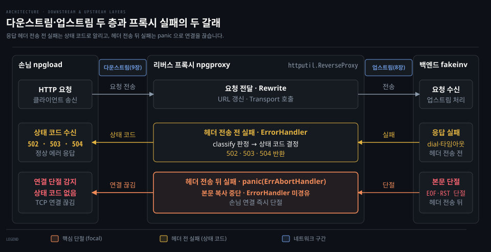
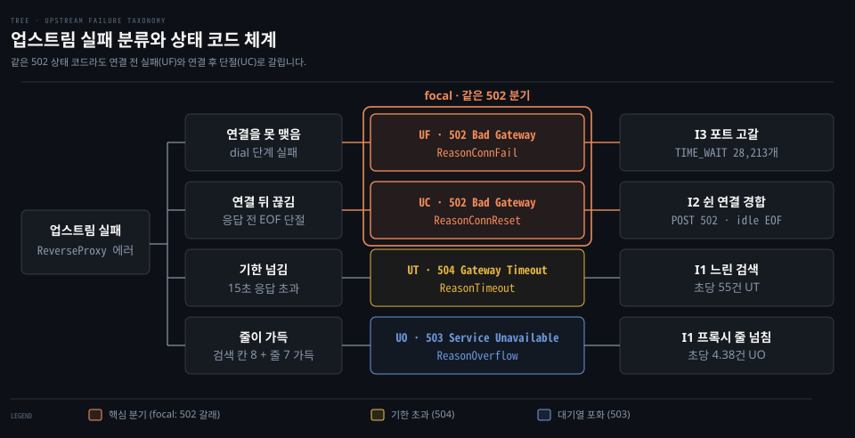
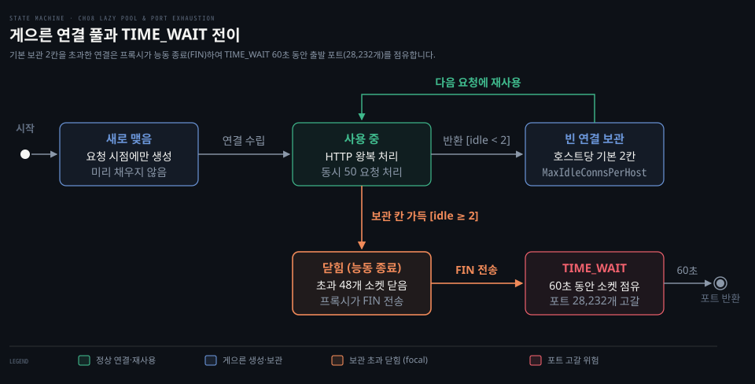
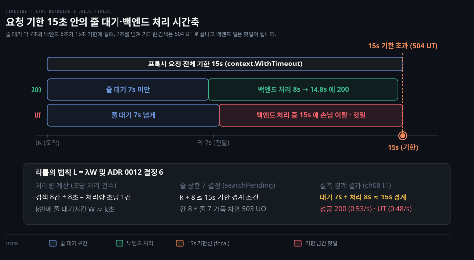
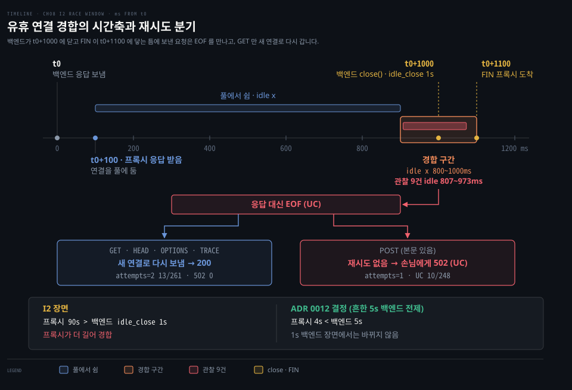

# 리버스 프록시 업스트림 층 — 연결 풀·기한·대기열·재시도와 실패 분류

---

> 리버스 프록시가 백엔드로 요청을 중계할 때 필요한 연결 풀링, 기한과 대기열 제어, 재시도 판단과 실패 분류 원리를 다룹니다. [01-01 문서](./01-01.기본값%20리버스%20프록시가%20겪는%20장애%20-%20느린%20검색·포트%20고갈·POST%20502·회복%20지연·중복%20등록.md)가 기본 설정 프록시의 장애 장면을 기록했다면, 이 문서는 그 밑에 깔린 업스트림 이론을 큰 틀에서 정리합니다.

## 리버스 프록시의 두 층

> 리버스 프록시는 손님과 맞닿은 다운스트림과 백엔드로 요청을 중계하는 업스트림의 두 층으로 나뉩니다. 응답 헤더가 나간 뒤에 일어난 실패는 상태 코드로 바꿀 수 없어 연결을 직접 끊어야 합니다.

리버스 프록시는 손님과 통신하는 **다운스트림**과 백엔드와 통신하는 **업스트림**으로 책임을 분리합니다. Envoy 는 Listener 와 Cluster 로 경계를 나눕니다. Nginx 도 `server` 블록과 `upstream` 모듈로 자리를 가릅니다(ADR 0011). 8장은 백엔드로 향하는 연결 풀과 기한을 다루는 업스트림 층을 구현하고, 9장에서 손님 쪽 서버 타임아웃과 드레인을 다룹니다.

두 층 사이에서 실패를 다루는 방식은 응답 진행 시점에 따라 갈립니다. 프록시가 백엔드 응답 헤더를 받기 전에 실패하면 `ErrorHandler` 가 개입하여 손님에게 502·503·504 상태 코드를 반환합니다.

반면 응답 헤더를 이미 손님에게 전송한 뒤 본문 복사 중에 실패가 나면 상태 코드를 바꾸지 못합니다(Go 1.25.1 `httputil/reverseproxy.go:531-543`). 이때 프록시는 `panic(http.ErrAbortHandler)` 를 일으켜 TCP 연결을 즉시 끊습니다. Go HTTP 서버는 이 패닉을 받으면 스택 로깅 없이 연결을 조용히 닫습니다(Go 1.25.1 `net/http/server.go:1905-1909,1940`).

## 실패 이름 분류

> 프록시 실패를 502 상태 코드 하나로 뭉뚱그리면 문제의 시작점을 찾기 어렵습니다. 실패 원인을 고유한 이름으로 분류해야 백엔드 장애와 프록시 설정 결함을 구별합니다.

HTTP 상태 코드 502 는 배후의 서로 다른 실패를 하나로 덮어버립니다. 손님은 백엔드 다운인지, 연결 도중 끊김인지, 포트 고갈인지 알 길이 없습니다. 프록시는 실패 지점에 따라 **원인 코드**를 부여하여 기록합니다.

연결 맺기(dial) 실패는 UF 로 502, 첫 응답 바이트 전 상대 닫힘은 UC 로 502 를 반환합니다. 응답 기한 초과는 UT 로 504, 프록시 대기열 가득 참은 UO 로 503 을 반환합니다.

원인 코드는 장애 진단에서 원인을 좁히는 핵심 단서입니다. I1 장면에서는 UT 가 0 이고 DC 만 쌓여, 프록시에 응답 기한이 없어 손님이 먼저 떠났음을 확정했습니다. I2 장면에서는 한산할 때 UC 가 찍혀 백엔드가 먼저 유휴 연결을 닫았음을 밝혔습니다. I3 장면에서는 수만 건의 UF 가 찍혀 출발 포트 고갈로 새 연결을 열지 못했음을 좁혔습니다. 502 하나로 뭉치지 않고 UF 와 UC 를 가른 덕분에 물리 장애와 연결 수명 불일치를 혼동하지 않았습니다.

## 게으른 연결 풀

> Go 기본 연결 풀은 미리 연결을 채우지 않고 요청이 끝난 뒤에야 호스트당 두 개만 남깁니다. 넘친 연결을 프록시가 능동적으로 닫으면 출발 포트가 바닥나 새 요청을 맺지 못합니다.

Go 의 `http.Transport` 풀은 미리 채우지 않고 요청 시 연결을 맺는 게으른 풀입니다(Go 1.25.1 `net/http/transport.go:1515-1516`). 풀은 호스트별 칸으로 나뉩니다. 유휴 상한 `MaxIdleConnsPerHost` 기본값은 2개입니다(Go 1.25.1 `net/http/transport.go:60,1040-1045`). 세부 필드 뜻은 [02-01 문서](../../../01_language/docs/go/net-http/02-01.Client·Transport.md#3-defaulttransport-기본값-읽기)에서 다룹니다.

동시 요청 50개가 끝나면 2개만 풀에 남고 48개는 `errTooManyIdleHost` 로 닫힙니다(Go 1.25.1 `net/http/transport.go:1115`). 능동적으로 닫은 프록시에 60초간 `TIME_WAIT` 가 남아 임시 출발 포트 약 28,000개가 바닥납니다(I3).

포트 고갈로 새 연결을 열지 못하면 UF 실패가 폭증합니다. 해결책은 `MaxConnsPerHost` 와 `MaxIdleConnsPerHost` 를 같은 크기로 맞춰 돌아온 연결을 닫지 않는 조치입니다(ADR 0012).

## 기한과 대기열

> 요청 전체 기한과 라우트별 격벽을 두어 특정 경로의 지연이 전체 시스템으로 번지지 않게 막아야 합니다. 대기열이 가득 찬 상태에서는 줄 길이가 곧 지연 시간이 되므로 대기 상한을 엄격히 통제해야 합니다.

프록시에 기한 제어가 없으면 백엔드 지연이 시스템 전체로 번집니다. 특정 경로가 느려졌을 때 전체 창구가 마비되는 현상을 막으려면 경로별 독립 풀을 배정하는 **격벽**을 세워야 합니다. npg-lab 은 백엔드 창구 32개를 기준으로 느린 검색에 8칸, 일반 조회에 24칸을 나누어 격리했습니다(ADR 0012). 손님 30초 기한보다 짧은 15초 요청 전체 기한도 두어 프록시가 먼저 상황을 통제하도록 했습니다.

격벽과 기한만으로는 대기열 문제를 완전히 풀지 못합니다. 프록시가 15초 기한으로 포기하더라도 백엔드는 취소를 무시하고 8초 연산을 끝까지 수행합니다(I1). 손님이 떠난 헛일이 누적되면 백엔드 창구는 비지 않습니다.

대기열이 계속 찰 때 대기 시간은 리틀 법칙을 따릅니다. 처리량이 초당 1건일 때 줄 길이가 7이면 대기 시간은 7초입니다. 대기 7초에 백엔드 처리 8초를 더하면 기한 15초 경계에 도달합니다(ADR 0012 결정 6). 이 경계를 넘긴 줄은 기한 초과(UT)로 백엔드 일만 낭비하므로, 프록시 대기열 상한을 7로 제한하고 넘친 요청은 503 UO 로 즉각 거절해야 합니다.

## 유휴 기한과 재시도

> 유휴 연결 보관 기한은 연결을 다시 사용하는 프록시 쪽이 백엔드보다 짧아야 유령 연결 경합을 방지합니다. Go 는 풀에서 꺼낸 연결이 닫혀 있을 때 GET 같은 조회 요청만 새 연결로 다시 보냅니다.

지속 연결 환경에서는 유휴 기한 순서가 안정성을 좌우합니다. 프록시의 빈 연결 보관 기한 `IdleConnTimeout` 이 백엔드보다 길면 경합이 납니다. 프록시가 풀에서 쉬던 연결로 보낸 요청이 백엔드가 그 연결을 닫은 뒤에 닿으면 EOF 를 만나 UC 502 로 끝납니다(I2). I2 에서는 백엔드가 닫기 100ms 전부터 그 FIN 이 프록시에 닿기 전까지 보낸 요청이 이 틈에 걸렸습니다. 따라서 연결을 다시 쓰는 프록시 쪽 기한 4초를 받는 백엔드 5초보다 항상 짧게 잡아 프록시가 먼저 닫아야 합니다.

상대가 이미 닫은 연결에 맞닥뜨렸을 때 Go 는 엄격한 조건에서만 요청을 다시 보냅니다(Go 1.25.1 `net/http/transport.go:808-852`). 새 연결 실패는 다시 보내지 않고 풀에서 꺼낸 연결이 끊겼을 때만 재시도합니다. 아무것도 쓰지 못한 경우는 본문이 없거나 되감을 수 있으면 메서드와 상관없이 다시 보냅니다. 그 밖에는 본문 조건에 더해 GET·HEAD·OPTIONS·TRACE 이거나 `Idempotency-Key` 헤더가 있어야 합니다(Go 1.25.1 `net/http/request.go:1534`).

프록시를 지나는 POST 본문은 되감을 수 없어 Go 가 다시 보내지 않습니다. 프록시도 비멱등 요청을 따로 재시도하지 않습니다(RFC 9110 §9.2.2). 프록시는 시도 수 `attempts` 와 다시 보낸 횟수 `retries` 를 따로 셉니다. 그래서 풀 경합에 걸린 GET 은 다시 보내지고 POST 는 502 로 드러나는 차이가 기록에 남습니다(ADR 0013).

## 참고 자료

> 본문에서 다룬 연결 풀·기한·대기열·재시도 이론의 실습 장면과 기초 개념 문서, 1차 원문 출처입니다.

### 짝 문서

- [01-01 리허설 환경](./01-01.기본값%20리버스%20프록시가%20겪는%20장애%20-%20느린%20검색·포트%20고갈·POST%20502·회복%20지연·중복%20등록.md#리허설-환경): 관측 지표와 장애 주입 환경
- [01-01 I1. 느린 검색](./01-01.기본값%20리버스%20프록시가%20겪는%20장애%20-%20느린%20검색·포트%20고갈·POST%20502·회복%20지연·중복%20등록.md#i1-느린-검색이-막은-단건-조회): 검색 지연이 부른 단건 조회 고갈
- [01-01 I2. POST 502](./01-01.기본값%20리버스%20프록시가%20겪는%20장애%20-%20느린%20검색·포트%20고갈·POST%20502·회복%20지연·중복%20등록.md#i2-쉰-연결로-보낸-post-만-502): 유휴 연결 경합과 POST 재시도 부재
- [01-01 I3. 포트 고갈](./01-01.기본값%20리버스%20프록시가%20겪는%20장애%20-%20느린%20검색·포트%20고갈·POST%20502·회복%20지연·중복%20등록.md#i3-닫은-연결이-출발-포트를-채웠다): 빈 연결 상한 부족과 TIME_WAIT 누적
- [01-01 알려진 한계](./01-01.기본값%20리버스%20프록시가%20겪는%20장애%20-%20느린%20검색·포트%20고갈·POST%20502·회복%20지연·중복%20등록.md#알려진-한계): 8장 범위 밖의 한계와 미해결 항목

### 개념 문서

- [DefaultTransport 기본값](../../../01_language/docs/go/net-http/02-01.Client·Transport.md#3-defaulttransport-기본값-읽기): 풀링 규칙과 유휴 보관 필드 동작
- [Client 타임아웃과 httptrace](../../../01_language/docs/go/net-http/02-02.Client.Timeout·Transport%20타임아웃·httptrace.md): 타임아웃 단계와 연결 추적
- [HTTP 클라이언트 본문과 취소](../../book/npg_network-programming-with-go/08-02.Go%20HTTP%20클라이언트는%20응답%20본문을%20닫아야%20연결을%20재사용하고%20context%20로%20요청을%20끊는다.md): 본문 닫기와 컨텍스트 기반 취소 제어

### 원문 근거

- npg-lab `docs/adr/0011-reverse-proxy-product.md` — 8장은 업스트림 층, 9장은 다운스트림 층을 구현하는 결정입니다.
- npg-lab `docs/adr/0012-upstream-deadlines-and-pool.md` — 전용 Transport, 기한 셋, 격벽 둘, 줄 상한을 정한 여섯 결정입니다.
- npg-lab `docs/adr/0013-upstream-retry-and-idempotency.md` — 자체 재시도 층 없이 `attempts`·`retries` 계측을 추가한 네 결정입니다.
- npg-lab `docs/rehearsals/ch08-slow-search-starves-lookup.md` — I1 검색 지연 장애 리허설 기록입니다.
- npg-lab `docs/rehearsals/ch08-server-idle-close-post-502.md` — I2 유휴 연결 종료와 POST 502 장애 리허설 기록입니다.
- npg-lab `docs/rehearsals/ch08-port-exhaustion-time-wait.md` — I3 출발 포트 고갈과 TIME_WAIT 장애 리허설 기록입니다.
- Go 1.25.1 `src/net/http/httputil/reverseproxy.go:531-543` — 헤더 전송 후 복사 실패 시 `panic(http.ErrAbortHandler)` 호출 규정입니다.
- Go 1.25.1 `src/net/http/server.go:1905-1909,1940` — `ErrAbortHandler` 패닉 시 로깅 억제 및 핸들러 종료 처리입니다.
- Go 1.25.1 `src/net/http/transport.go:60` — `const DefaultMaxIdleConnsPerHost = 2` 기본값 선언입니다.
- Go 1.25.1 `src/net/http/transport.go:808-852` `shouldRetryRequest` — 새 연결 실패는 재시도하지 않고, 재사용한 연결에서 아무것도 못 썼거나 다시 보낼 수 있는 요청이 닫힌 유휴 연결을 만났을 때만 재전송합니다.
- Go 1.25.1 `src/net/http/transport.go:1040-1045` `maxIdleConnsPerHost` — 호스트당 유휴 연결 수가 0 이면 기본값 2 를 반환합니다.
- Go 1.25.1 `src/net/http/transport.go:1115` `tryPutIdleConn` — 호스트당 빈 연결 상한 초과 시 `errTooManyIdleHost` 로 연결을 닫습니다.
- Go 1.25.1 `src/net/http/transport.go:1515-1516` `getConn` — 풀(`queueForIdleConn`)에서 먼저 찾고 없으면 새 연결(`queueForDial`)을 생성합니다.
- Go 1.25.1 `src/net/http/transport.go:1568` `queueForDial` — `MaxConnsPerHost` 가 0 이하이면 상한 없이 다이얼을 즉시 시작합니다.
- Go 1.25.1 `src/net/http/request.go:1534` `isReplayable` — 본문이 없거나 `GetBody` 가 있어야 합니다. 그때 GET·HEAD·OPTIONS·TRACE 와 `Idempotency-Key`·`X-Idempotency-Key` 헤더 요청만 재전송을 허용합니다.
- [RFC 9110 §9.2.2](https://www.rfc-editor.org/rfc/rfc9110#section-9.2.2) — 프록시는 비멱등 요청을 자동으로 재시도해서는 안 됨을 규정합니다.
