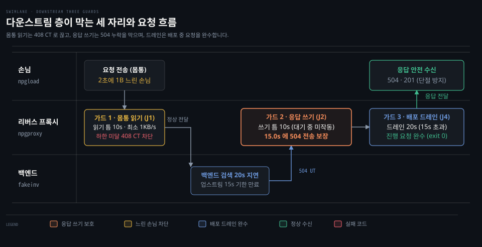
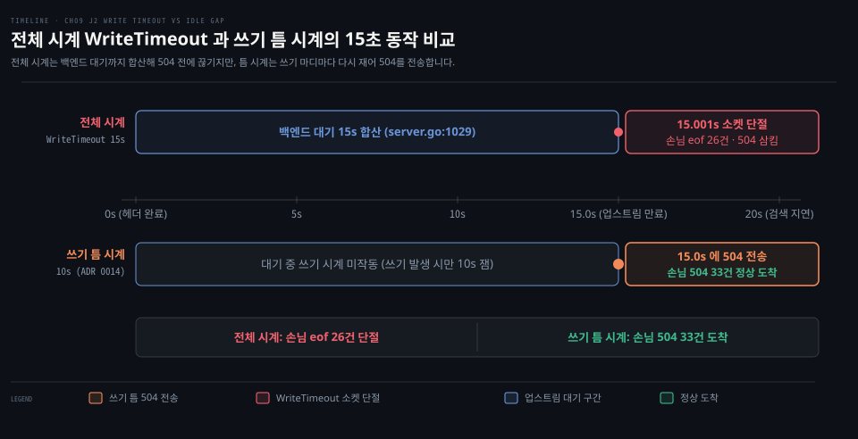
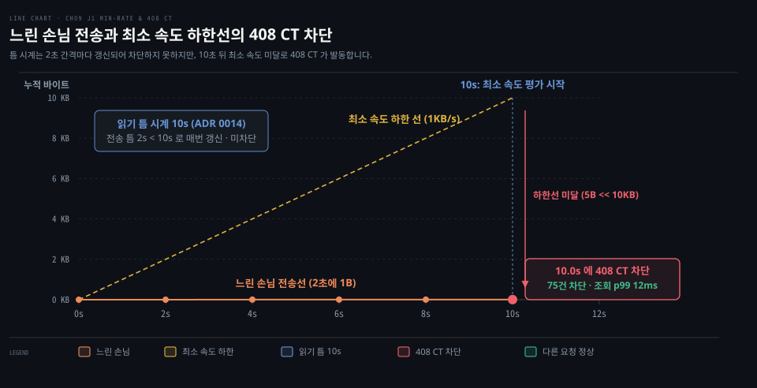
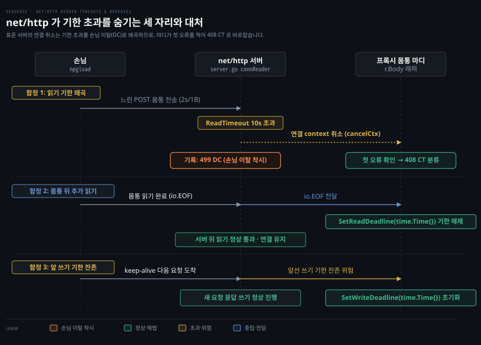
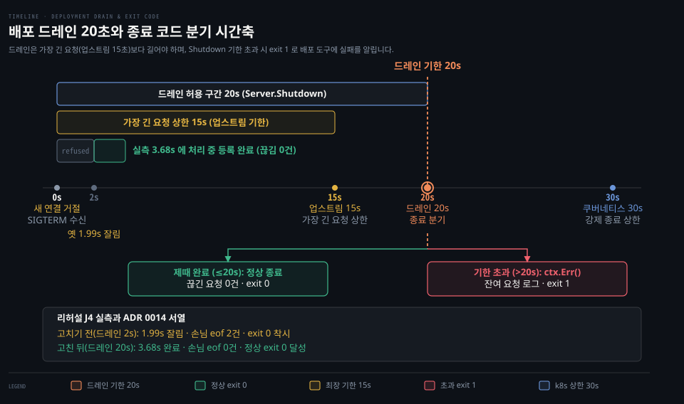

# 리버스 프록시 다운스트림 층 — 틈 시계·최소 속도·드레인

---

> 리버스 프록시가 손님과 통신할 때 필요한 틈 시계, 최소 속도, 배포 드레인 원리를 다룹니다. [01-02 문서](./01-02.리버스%20프록시%20업스트림%20층%20—%20연결%20풀·기한·대기열·재시도와%20실패%20분류.md)가 백엔드와의 업스트림 층을 다루었다면, 이 문서는 손님 쪽 수명과 종료 신호를 다룹니다.

## 다운스트림 층이 막는 것

> 손님과 통신하는 다운스트림 층은 느린 전송, 응답 쓰기 기한, 배포 중 끊김을 통제합니다. 백엔드 연결 풀을 관리하는 업스트림 층과 달리 손님 쪽 연결의 수명을 직접 보호합니다.

8장의 업스트림 층이 백엔드로 향하는 연결 풀과 대기열을 다루었다면, 9장의 **다운스트림** 층은 손님과 맞닿은 연결을 직접 맞이합니다.

다운스트림 층은 손님 쪽에서 발생하는 세 가지 장애를 막습니다. 첫째는 2초에 1바이트씩 몸통을 보내 백엔드 연결 칸을 붙잡는 느린 손님입니다. 둘째는 백엔드 지연으로 손님에게 504 오류를 쓰지 못하고 끊기는 쓰기 기한 문제입니다. 셋째는 프록시를 배포할 때 처리 중이던 손님의 요청이 끊기는 문제입니다.

다운스트림과 업스트림의 기한은 바깥 시계가 안쪽 시계보다 길어야 합니다. 손님 앱 30초, 배포 드레인 20초, 업스트림 요청 15초 순서로 시간을 맞추어야 안쪽의 결과를 바깥 손님에게 안전하게 전달합니다.

## 전체 시계와 틈 시계

> 전체 시계는 응답 완료까지 걸린 시간을 한 번에 재어 백엔드를 기다리는 동안 조기에 만료됩니다. 틈 시계는 전송 사이의 빈 시간만 다시 재어 정상적인 대기 처리를 보호합니다.

J2 리허설에서 백엔드 검색이 20초로 지연되자 프록시 로그는 `504 UT bytes=0` 을 남겼습니다. 하지만 손님 앱은 504 상태 코드를 받지 못하고 15.001초에 26건 모두 연결 끊김(eof)을 겪었습니다.

Go `WriteTimeout` 은 손님 헤더 직후 시작해 백엔드 대기까지 셉니다(Go 1.25.1 `src/net/http/server.go:1029-1031`).

상용 제품은 전체 시계 대신 바이트 전송 사이의 간격을 재는 **틈 시계**(idle timeout)를 씁니다. nginx 는 `client_body_timeout` 과 `send_timeout` 으로 60초 간격을 잽니다. caddy 도 `read_idle_timeout` 과 `write_idle_timeout` 으로 1분 간격을 둡니다.

npg-lab 은 `WriteTimeout` 을 끄고 쓰기 틈 10초를 선택했습니다(ADR 0014). 응답을 쓰는 마디가 데이터를 보낼 때마다 `SetWriteDeadline` 으로 시계를 다시 겁니다. 백엔드를 기다리는 동안에는 쓰기 시계가 돌지 않아 손님에게 504 응답 33건이 15.0초에 도착했습니다.

## 느린 손님과 최소 속도

> 틈 시계만으로는 주기적으로 데이터를 조금씩 흘리는 느린 손님을 끊지 못합니다. 전송 평균 속도의 하한인 최소 속도를 두어야 자원 고갈을 막고 장애 기록을 바르게 남깁니다.

J1 리허설에서 손님이 2초에 1바이트씩 몸통을 보내자 단건 조회 지연 p99 가 7.6초까지 늘어났습니다. 핫픽스로 `ReadTimeout` 10초를 두자 연결은 끊겼지만 85건 모두 손님이 떠났다는 **DC**(downstream closed)로 기록되었습니다.

2초마다 1바이트를 보내는 손님은 읽기 틈 10초 안에 다음 바이트를 보내므로 틈 시계만으로는 끊지 못합니다.

caddy 는 `read_min_rate` 로 평균 속도 하한을 두고 Apache 는 `mod_reqtimeout` 의 `MinRate` 로 끊습니다. nginx 는 장애 분석을 위해 손님 기한 초과인 408 과 손님 이탈인 499 를 기록에서 분리합니다. haproxy 도 기한 초과 `cR` 과 손님 끊김 `CR` 을 구분합니다.

npg-lab 은 읽기 틈 10초와 초당 1KB 의 **최소 속도**를 함께 채택했습니다(ADR 0014). 몸통을 읽기 시작하고 10초가 지난 시점부터 평균 속도를 잽니다. 기준에 미달하면 408 상태 코드와 **CT**(client timeout) 플래그를 남깁니다. 개선 후 75건 모두 10.0초에 408 CT 로 끊겼고 조회 p99 는 12ms 로 회복되었습니다.

408 CT 와 499 DC 를 나누지 않으면 프록시가 기한 초과로 끊은 것인지 손님이 먼저 떠난 것인지 운영자가 구분하지 못합니다. 원인 코드를 분리해야 백엔드 창구 부족이 손님 지연 탓인지 프록시 설정 결함인지 밝혀냅니다.

## net/http 가 기한 초과를 숨기는 자리

> Go 표준 서버는 읽기 기한이 지나도 연결 컨텍스트만 취소하여 기한 초과를 손님 이탈로 숨깁니다. 몸통을 감싼 마디에서 첫 오류를 기록하고 EOF 직후와 새 요청 시작 시 기한을 지워야 합니다.

첫째 함정은 읽기 기한 초과가 손님 이탈로 왜곡되는 문제입니다. Go 의 `net/http` 는 읽기 기한이 지나도 연결 context 를 조용히 취소합니다(`server.go` `connReader`). 프록시는 이를 손님이 먼저 끊은 것으로 오판하여 DC 를 남깁니다. 프록시는 `r.Body` 를 감싼 마디를 두어 첫 오류가 `os.ErrDeadlineExceeded` 인지 확인하고 CT 로 분류해야 합니다.

둘째 함정은 몸통을 다 읽은 뒤 서버가 백그라운드에서 수행하는 추가 읽기입니다. Go 서버는 손님 이탈을 감시하려고 몸통 끝 뒤에서 읽기를 시도합니다. 이때 앞선 읽기 틈 기한이 남아 있으면 정상 요청이 기한 초과에 걸려 연결이 끊깁니다. 따라서 몸통 읽기 마디는 `io.EOF` 를 만나는 즉시 `SetReadDeadline` 에 빈 시간을 넘겨 기한을 지워야 합니다.

셋째 함정은 지속 연결이 앞선 요청의 쓰기 기한을 그대로 들고 오는 현상입니다. 이전 요청에서 설정한 쓰기 기한이 남아 있으면 다음 요청은 응답을 쓰기도 전에 시간 초과 오류를 만납니다. 따라서 프록시는 새 요청을 처리하기 전에 연결의 쓰기 기한을 먼저 초기화해야 합니다.

## 배포 드레인과 종료 코드

> 배포 대기 시간은 평균 처리 시간이 아니라 최장 요청 기한보다 길게 잡아야 안전합니다. 기한 안에 남은 요청을 다 끝내지 못하면 프로세스 종료 코드로 실패를 알려야 합니다.

J4 리허설에서 등록이 4초 걸릴 때 학습자가 배포를 두 번 하자 백엔드 등록 758건 중 7건이 중간에 끊기는 실패가 났습니다. 당시 프록시의 종료 대기는 2초에 불과하여 진행 중인 요청의 절반이 잘렸고 손님 성공은 751건에 그쳤습니다. 하지만 프록시는 정상 종료를 뜻하는 exit 0 으로 끝났습니다.

종료할 때 진행 중인 요청을 마칠 때까지 기다려 주는 **드레인**(drain) 시간은 평균이 아니라 가장 긴 요청인 업스트림 기한 15초보다 길어야 합니다.

nginx 는 `worker_shutdown_timeout` 기본 상한을 두지 않고 작업을 기다립니다. envoy 는 `--drain-time-s` 로 600초를 주고 caddy 도 `grace_period` 기본값을 0(끝까지 기다림)으로 둡니다. 쿠버네티스는 SIGTERM 을 보낸 뒤 30초의 `terminationGracePeriodSeconds` 가 지나면 강제로 종료합니다.

npg-lab 은 업스트림 15초보다 길고 쿠버네티스 30초보다 짧은 20초를 드레인 시간으로 정했습니다(ADR 0014). `Server.Shutdown` 이 돌려준 `ctx.Err()` 오류를 버리지 않고 잔여 요청 수와 함께 exit 1 로 끝냅니다. 개선 후 리허설에서는 3.68초 만에 처리 중이던 등록을 모두 마쳤고 백엔드 74건과 손님 성공 74건이 같아 끊긴 등록 0건을 달성했습니다.

프록시 인스턴스가 하나뿐이라 재시작 중 꺼진 2초 동안의 연결 거부(refused)는 남습니다. caddy 의 `shutdown_delay` 처럼 상위 부하 분산기에서 인스턴스를 먼저 빼 주는 조치는 다음 과제입니다. 업스트림 15초 기한이 요청을 먼저 끊으므로 exit 1 경로는 단위 시험으로 확인했습니다.

###### 

## 참고 자료

> 본문에서 다룬 다운스트림 틈 시계, 최소 속도, 배포 드레인 이론의 실습 장면과 기초 개념 문서, 1차 원문 출처입니다.

### 짝 문서

- [01-01 기본값 리버스 프록시 장애](./01-01.기본값%20리버스%20프록시가%20겪는%20장애%20-%20느린%20검색·포트%20고갈·POST%20502·회복%20지연·중복%20등록.md): 기본 설정 프록시의 장애 관측과 한계
- [01-02 리버스 프록시 업스트림 층](./01-02.리버스%20프록시%20업스트림%20층%20—%20연결%20풀·기한·대기열·재시도와%20실패%20분류.md): 백엔드 연결 풀과 업스트림 기한 제어

### 개념 문서

- [SetDeadline·SetReadDeadline·SetWriteDeadline](../../../01_language/docs/go/net/03-02.SetDeadline·SetReadDeadline·SetWriteDeadline.md): Go 네트워크 연결 기한 설정 원리와 동작

### 원문 근거

- npg-lab `docs/adr/0014-downstream-deadlines-and-drain.md` — 읽기·쓰기 틈 시계, 최소 속도, 드레인 20초와 exit 1 을 정한 결정입니다.
- npg-lab `docs/rehearsals/ch09-slow-post-body.md` — J1 느린 POST 몸통과 최소 속도 장애 리허설 기록입니다.
- npg-lab `docs/rehearsals/ch09-write-timeout-swallows-504.md` — J2 응답 쓰기 기한과 504 누락 장애 리허설 기록입니다.
- npg-lab `docs/rehearsals/ch09-deploy-drain-cut.md` — J4 배포 드레인과 조기 종료 장애 리허설 기록입니다.
- Go 1.25.1 `src/net/http/server.go:1029-1031,3033-3038` — 헤더를 읽은 직후 `WriteTimeout` 기한을 거는 동작 규정입니다.
- Go 1.25.1 `src/net/http/server.go:3159-3178` — `Server.Shutdown` 이 context 기한 초과 시 `ctx.Err()` 를 반환하는 규정입니다.
- nginx `release-1.31.8` `src/http/ngx_http_core_module.c` — `client_body_timeout` 및 `send_timeout` 설정입니다.
- caddy `v2.11.7` `modules/caddyhttp/server.go` — `read_idle_timeout`, `read_min_rate`, `write_idle_timeout` 설정입니다.
- caddy `v2.11.7` `modules/caddyhttp/app.go` — `grace_period`, `shutdown_delay` 설정입니다.
- envoy `v1.40.2` `docs/root/operations/cli.rst:297-306` — `--drain-time-s` 기본값 600초 규정입니다.
- haproxy `v3.4.0` `doc/configuration.txt:30138,30145` — 손님이 끊은 `CR` 과 `timeout http-request` 기한 초과 `cR` 종료 flag 설명입니다.
- Apache httpd `2.4.65` `docs/manual/mod/mod_reqtimeout.xml:69,103-105` — `RequestReadTimeout` 의 `MinRate` 설정입니다.
- kubernetes `k8s.io/api` `v0.37.2` `core/v1/types.go` — `terminationGracePeriodSeconds` 30초 규정입니다.
