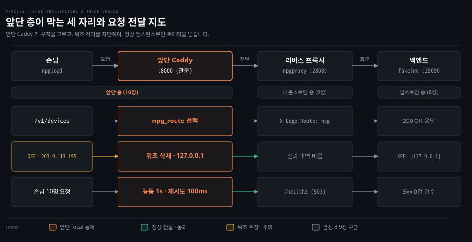
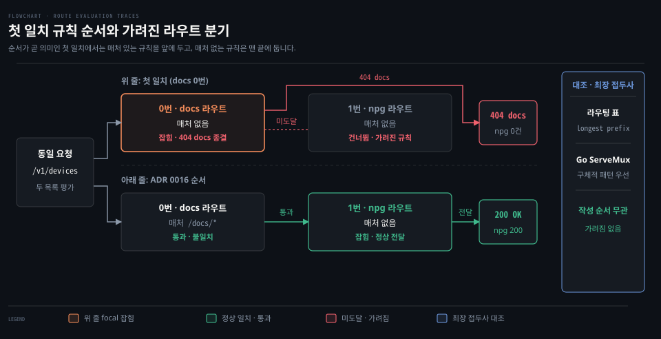
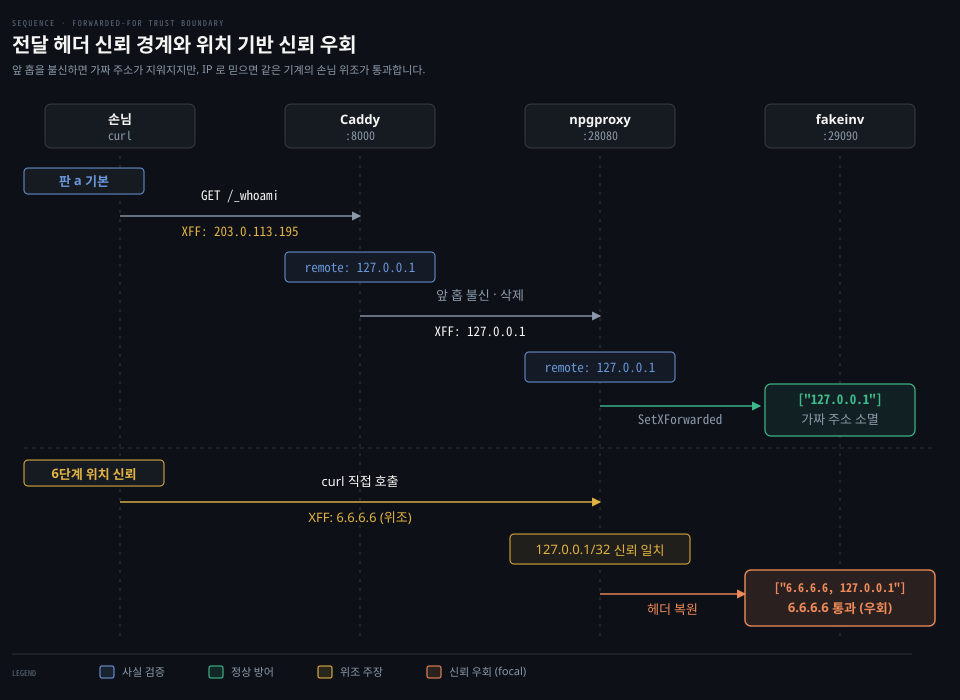
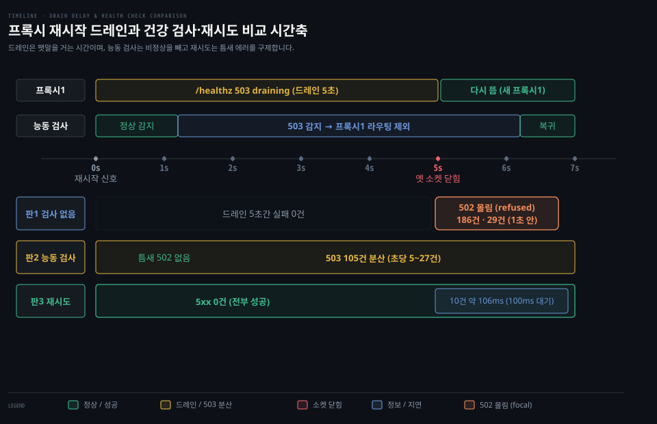

# 리버스 프록시 앞단 층 — 규칙 고르기·전달 헤더 신뢰·건강 검사

---

> 리버스 프록시 앞단이 담당하는 규칙 선택, 전달 헤더 신뢰, 건강 검사 원리를 다룹니다. 다운스트림 수명과 업스트림 연결 풀을 넘어 여러 프록시 층이 만나는 경계에서의 판단 기준을 정리합니다.

## 앞단 층이 막는 것

> 손님과 백엔드 사이에 여러 프록시가 늘어설 때 앞단 층은 규칙 선택, 클라이언트 주소 신뢰, 정상 백엔드 선별을 통제합니다. 단일 프록시 내부 통제를 넘어 홉과 홉 사이의 경계를 보호합니다.

8장의 업스트림 층은 백엔드 연결 풀을 다루었습니다. 9장의 다운스트림 층은 손님 쪽 연결 수명과 종료 신호를 다루었습니다. 10장의 **앞단**(edge) 층은 여러 프록시가 늘어선 시스템의 관문을 통제합니다.

손님과 백엔드 사이에 Caddy 와 npgproxy 가 차례로 서면 세 가지 문제가 발생합니다. 첫째는 겹치는 여러 라우팅 규칙 가운데 어느 핸들러가 요청을 가로채는가입니다. 둘째는 여러 홉을 건너온 손님의 실제 주소를 어느 홉의 주장까지 믿을 것인가입니다. 셋째는 뒤쪽 서버가 재시작하거나 내려갈 때 트래픽을 안전한 서버로만 보낼 수 있는가입니다.

앞단 층은 이 세 질문에 답하여 요청을 알맞은 서비스로 보냅니다. 위조된 클라이언트 주소를 차단하고 무중단 배포 중의 5xx 장애를 방어합니다.

## 규칙 고르기

> 겹치는 요청 규칙 가운데 어느 핸들러가 요청을 가로채는지 결정하는 원리를 다룹니다. 첫 일치와 최장 접두사 일치의 차이, 미들웨어 사슬의 특성, 이름 공간 분리와 호스트 분리의 득실을 비교합니다.

### 첫 일치와 최장 접두사 일치

리허설 E2 에서는 앞단 Caddy 에 매처 없는 npgproxy 라우트가 떠 있는 상태에서 사내 문서 라우트를 추가했습니다. 매처 없는 문서 라우트를 0번에 넣자 기존 `/v1/devices` 호출이 404 docs 오류로 실패했습니다. npgproxy 에는 요청이 1건도 도달하지 못했습니다. 문서 라우트를 맨 뒤에 덧붙이자 이번에는 문서 사이트가 한 번도 불리지 않았습니다.

요청 하나에 규칙 여러 개가 겹칠 때 시스템이 규칙을 선택하는 방식은 크게 둘로 나뉩니다.

**첫 일치**(first match)는 목록의 위에서부터 검사하여 가장 먼저 부합하는 규칙을 선택합니다. 방화벽 규칙, 접근 제어 목록, 조건문 switch, Caddy JSON `routes` 가 이 방식을 씁니다. 단순하고 검사가 빠르지만 순서가 곧 의미입니다. 조건이 넓은 규칙을 위에 두면 아래 규칙이 영원히 실행되지 않는 **가려진 규칙**(shadowed rule)이 발생합니다. 방화벽 맨 위에 전체 허용을 두어 아래 차단 규칙이 무력화되는 사고와 같은 원리입니다.

**가장 구체적인 일치**(most specific match)는 부합하는 후보 중 범위가 가장 좁은 규칙을 선택합니다. 라우팅 표의 **최장 접두사 일치**(longest prefix match)와 Go `http.ServeMux` 가 이 방식을 따릅니다. Go 표준 라이브러리는 가장 구체적인 패턴이 우선한다고 명시합니다. 작성 순서와 무관하게 동작하지만 규칙의 포괄 범위를 시스템이 명확히 비교할 수 있어야 합니다.

### 미들웨어 사슬과 응답 종결

Caddy JSON 의 `routes` 는 엄밀히 말해 단순한 첫 일치 목록이 아니라 하나의 긴 **미들웨어 사슬**입니다. 조건이 맞지 않는 라우트는 건너뛰고 부합하는 라우트는 내부 핸들러를 차례로 실행합니다.

핸들러는 두 부류로 나뉩니다. `headers` 나 `rewrite` 처럼 헤더를 바꾸거나 주소를 고치는 핸들러는 작업을 마치고 다음 핸들러로 제어를 넘깁니다. 반면 `file_server` 나 `reverse_proxy` 는 응답 본문을 직접 작성하여 사슬을 종결합니다.

파일 서버는 요청한 파일이 없더라도 별도 통과 설정이 없으면 404 상태 코드로 사슬을 끝냅니다. 따라서 응답을 직접 쓰는 핸들러를 가진 라우트 중 처음 일치한 규칙이 전체 요청을 종결짓습니다.

### 이름 공간 번역과 앞부분 떼기

URL 주소 경로와 디스크 파일 경로는 서로 다른 **이름 공간**(namespace)에 속합니다. 한 이름 공간을 다른 이름 공간의 하위 지점에 결합하면 결합 지점의 접두사를 떼어 내는 **앞부분 떼기**(strip prefix) 번역이 필요합니다.

리눅스에서 특정 디렉토리에 장치를 마운트하면 장치 내부에서는 마운트 지점의 상위 경로가 보이지 않는 이치입니다. Caddy 의 `file_server` 는 요청 경로를 정리하여 기본 디렉토리 뒤에 그대로 결합합니다. 경로 탈출만 막을 뿐 하위 경로 접두사를 스스로 떼어 내지 않습니다.

E2 리허설에서 `/docs/*` 매처만 달았을 때 파일 서버는 디스크의 `site/docs/docs/` 경로를 탐색하다가 404 를 냈습니다. `rewrite` 의 `strip_path_prefix` 로 앞부분을 떼어 내자 비로소 `site/docs/index.html` 을 찾아 정상 응답했습니다. Go 의 `http.StripPrefix` 표준 함수도 같은 번역을 수행합니다.

### 경로 분리와 호스트 분리

다중 서비스를 앞단에 배치할 때 URL 경로로 나누는 방식과 호스트 이름으로 나누는 방식이 있습니다.

경로 분리는 단일 도메인과 단일 인증서로 운영할 수 있습니다. 브라우저 관점에서 **동일 출처**(same-origin)이므로 쿠키를 공유하고 CORS 설정이 필요하지 않습니다. 하지만 앞단에서 접두사 떼기 번역을 유지해야 하고 라우팅 순서가 꼬이면 다른 서비스가 가려집니다.

호스트 분리는 도메인 이름별로 라우팅 규칙이 완전히 격리됩니다. 특정 서비스의 라우트 설정 실수가 다른 서비스로 번지지 않습니다. 서비스마다 주소와 인증서가 늘어나고 다른 서비스 자원을 호출할 때 CORS 설정이 요구됩니다.

npg-lab 은 매처가 있는 팻말 라우트를 앞단에 두고 매처 없는 기본 라우트는 맨 끝에 하나만 두는 순서 원칙을 채택했습니다(ADR 0016). 두 번째 서비스는 규칙 충돌을 근본적으로 방지하기 위해 호스트 분리를 기본으로 삼았습니다.

## 전달 헤더 신뢰

> 여러 프록시 층을 거칠 때 맨 뒤 백엔드가 실제 손님 주소를 식별하는 기준을 다룹니다. 조작 가능한 헤더 주장과 물리적 TCP 사실의 경계, 홉별 독립 신뢰와 mTLS 신원 증명을 설명합니다.

### 주장과 사실의 경계

E3 리허설에서 손님이 `X-Forwarded-For: 203.0.113.195` 헤더를 싣고 앞단에 요청을 보냈습니다. 기본 설정에서 백엔드가 확인한 상대 주소는 바로 앞 홉인 npgproxy 였고 전달 헤더는 `["127.0.0.1"]` 만 남았습니다. 가짜 주소는 사라졌습니다. Caddy 와 npgproxy 가 모두 앞 홉을 믿지 않아 가짜 헤더를 버렸기 때문입니다.

맨 뒤 서버가 받는 네트워크 정보는 두 종류로 갈립니다.

TCP 상대 주소(`r.RemoteAddr`)는 3방향 핸드셰이크로 물리적 통신이 확인된 **사실**입니다. 반면 `X-Forwarded-For` 나 `Via` 같은 HTTP 헤더는 송신자가 문자열로 임의 작성한 **주장**입니다.

여러 홉을 거친 프록시 구조에서 맨 뒤 서버가 확인하는 TCP 상대 주소는 최초 손님이 아니라 바로 앞 홉입니다. 손님이 누구였는지는 앞선 홉들이 기록해 넘겨준 주장으로만 파악할 수 있습니다.

### 홉별 독립 신뢰와 역추적 방식

헤더라는 주장은 그 헤더를 건넨 바로 앞 홉을 신뢰할 때만 받아들여야 합니다. 이것이 **신뢰 경계**(trust boundary)입니다. 앞 홉을 믿는 기준은 헤더가 아니라 사실인 TCP 상대 주소로 검증합니다.

신뢰는 홉마다 독립적이며 다음 홉으로 자동 전파되지 않습니다. E3 판 b 에서 Caddy 에 루프백 신뢰를 부여하자 Caddy 접근 로그의 클라이언트 주소는 손님이 주장한 `203.0.113.195` 로 기록되었습니다. 하지만 뒤쪽 npgproxy 가 신뢰 설정을 갖지 않자 백엔드가 받은 주소는 여전히 `127.0.0.1` 하나였습니다.

전달 헤더를 다루는 방식은 크게 둘로 나뉩니다.

첫째는 Caddy 가 기본으로 쓰는 덮어쓰기 방식입니다. 앞 홉을 신뢰하지 않으면 들어온 전달 헤더를 완전히 지우고 자신이 직접 확인한 상대 주소로 새로 작성합니다. 위조를 차단하기에 가장 단순하고 안전합니다.

둘째는 덧붙이기 방식입니다. 앞 홉을 믿을 때 들어온 헤더 뒤에 직전 홉 주소를 쉼표로 이어 붙입니다. Caddy 도 믿는 앞 홉이면 이렇게 이어 씁니다. 최종 소비 서버는 오른쪽 끝에서부터 사전에 등록된 신뢰 프록시 대역을 거슬러 올라가 처음으로 나타나는 비신뢰 주소를 실제 클라이언트 주소로 채택합니다. 이 역추적 방식을 안전하게 쓰려면 신뢰 프록시 대역 목록과 홉 수가 정확해야 합니다. Envoy 는 `xff_num_trusted_hops` 로 오른쪽 주소를 몇 개 더 믿을지 정합니다. nginx 는 `ngx_http_realip_module` 의 `set_real_ip_from` 으로 신뢰 주소를 정합니다.

### 메커니즘과 정책의 분리

Go 표준 라이브러리의 `httputil.ReverseProxy` 는 기본 설정에서 신뢰 목록 옵션을 직접 제공하지 않습니다.

현대의 `Rewrite` 구현은 함수 호출 전에 전달 헤더를 나가는 요청에서 무조건 삭제합니다. 라이브러리는 헤더 삭제와 덧붙이기(`SetXForwarded`)라는 **메커니즘**만 제공합니다. 누구를 신뢰할 것인가라는 **정책**은 애플리케이션 코드가 결정하도록 분리했습니다. 과거의 `Director` 경로는 들어온 헤더를 지우지 않고 이어 붙여 모두를 믿는 셈이었는데, `Rewrite` 는 그 기본을 뒤집었습니다.

신뢰하는 앞 홉일 때 헤더를 복원하는 코드는 반드시 `SetXForwarded` 호출보다 앞에 위치해야 합니다. 뒤에 두면 `SetXForwarded` 가 기록한 직전 홉 주소가 통째로 덮어써져 유일한 사실이 사라집니다.

### 위치 기반 신뢰의 전제와 신원 증명

IP 대역으로 신뢰를 부여하는 방식은 그 대역에 정당한 프록시만 존재한다는 네트워크 격리가 보장되어야 성립합니다.

E3 6단계에서는 npgproxy 에 `127.0.0.1/32` 신뢰를 주었습니다. curl 로 직접 `X-Forwarded-For: 6.6.6.6` 을 보내자 백엔드는 `6.6.6.6, 127.0.0.1` 을 수신했습니다. 단일 머신에서는 손님의 출발 주소도 `127.0.0.1` 이므로 위치만으로는 정당한 프록시와 악의적인 손님을 구별하지 못합니다.

위치를 공유하는 환경에서는 위치가 아닌 **신원**(identity)을 증명해야 합니다. **상호 TLS**(mTLS)는 TLS 핸드셰이크 과정에서 클라이언트 인증서의 개인키 보유를 수학적으로 검증합니다. 네트워크 주소가 아니라 암호학적 키 소유 사실로 상대를 증명하는 것이 제로 트러스트의 핵심 생각입니다.

npg-lab 은 `-trusted-proxies` 플래그로 신뢰 대역을 지정했습니다(ADR 0017). 지정한 CIDR 대역에서 온 요청만 헤더를 이어 씁니다. 기본값은 빈 목록으로 두어 설정을 생략해도 아무도 믿지 않는 안전한 동작을 유지했습니다.

## 건강 검사

> 뒤쪽 서버의 장애나 재시작 상황에서 앞단이 정상 인스턴스를 선별하는 기법을 다룹니다. 라운드로빈의 한계, 능동 검사와 재시도의 상호 보완, 드레인 지연을 통한 무중단 배포를 정리합니다.

### 상태를 모르는 차례 분배

E4 리허설에서는 앞단 Caddy 뒤에 npgproxy 두 대를 두고 **라운드로빈**(round-robin)으로 부하를 분배했습니다. 손님 10명이 지속 요청을 보내는 도중에 프록시 한 대를 재시작했습니다.

검사와 재시도가 없는 기본 상태로 두 번 돌렸습니다. 드레인 5초 동안은 실패가 없었고 드레인이 끝나 옛 소켓이 닫힌 직후 1초 안에 502 connection refused 가 각각 186건·29건 몰렸습니다. 단순 라운드로빈 알고리즘은 뒤쪽 서버의 생사나 가용성을 전혀 고려하지 않고 차례만 세기 때문입니다. 정상 서버가 한 대 남아 있어도 요청의 절반을 내려간 서버로 보냅니다.

연결이 거절되면 재시도 설정이 없는 앞단 프록시는 즉시 502 상태 코드로 바꾸어 손님에게 돌려줍니다.

### 능동 검사와 수동 검사의 역할

앞단이 뒤쪽 서버의 상태를 파악하는 방식은 크게 수동 검사와 능동 검사로 나뉩니다.

**수동 검사**(passive health check)는 실제 손님 요청이 실패하는 횟수를 집계하여 기준을 넘긴 서버를 후보에서 뺍니다. 초기 손님들이 실패를 직접 겪어야만 감지할 수 있습니다.

**능동 검사**(active health check)는 앞단 프록시가 백엔드의 `/healthz` 같은 전용 경로로 주기적인 검사 요청을 보냅니다. 손님 트래픽과 무관하게 비정상 서버를 사전에 분리합니다.

E4 판 2 에서 1초 주기 능동 검사를 적용하자 재시작 틈새의 502 거절 오류는 사라졌습니다. 하지만 프록시가 빠져 있는 5초 내내 초당 5~27건씩 총 105건의 503 오류가 분산되어 발생했습니다. 능동 검사만으로는 일시적인 서버 제외 순간의 실패를 구제하지 못합니다.

**재시도**(retry)는 특정 서버로의 요청이 실패했을 때 다른 가용 서버로 요청을 다시 보냅니다. E4 판 3 에서 재시도를 적용하자 5xx 오류는 0건이 되었습니다. 대가는 요청 10건이 약 106ms 걸린 것뿐입니다(`try_interval` 100ms 대기 + 평소 6ms). 그중 5건은 그사이 다시 뜬 프록시1 에서 끝났습니다.

재시도는 손님이 겪을 에러를 막고 능동 검사는 비정상 서버를 제외하여 지연을 막습니다.

### 드레인 지연과 우아한 종료

서버가 종료 신호를 받았을 때 즉시 프로세스를 닫으면 진행 중이던 요청과 새로 진입하는 요청이 강제로 끊깁니다.

이를 방지하는 기법이 **드레인 지연**(drain delay)입니다. 듣는 소켓을 열어 둔 채 `/healthz` 경로의 응답만 503 `draining` 으로 전환하고 일정 시간 대기합니다. 이 시간 동안 기존 요청을 모두 처리하면서 앞단 프록시가 503 응답을 확인하고 해당 서버를 라우팅 후보에서 뺄 시간을 벌어 줍니다.

드레인 지연 시간은 앞단의 검사 주기와 시간제한의 합보다 길어야 합니다. Caddy 의 검사 주기 1초와 타임아웃 500ms 를 고려하여 npg-lab 은 5초의 드레인 지연을 채택했습니다(ADR 0018). 이 값은 이 실습의 값이고 일반 권장값이 아닙니다. 쿠버네티스의 `preStop` 동작과 같은 원리입니다.

이 지연 처리는 01-02 의 멱등성 기반 재시도, 01-03 의 최장 요청 기한을 고려한 다운스트림 종료 대기와 맞물려 무중단 배포를 완성합니다.

### 재시도와 고르기 경쟁

Caddy 의 라운드로빈 구현은 루프 안에서 공용 원자 카운터를 증가시킵니다. 동시 요청이 많을 때 여러 고루틴이 카운터를 건너뛰면 이미 제외된 비정상 서버를 중복 조회하여 가용 서버를 찾지 못하고 빈 값을 돌려줍니다. 판 2 에서 503 오류가 흩어져 발생한 원인입니다.

프록시 한 대를 완전히 정지시킨 변형 실험에서 능동 검사와 재시도의 결합 효과가 뚜렷하게 드러났습니다. 재시도만 둔 변형 5 에서는 5xx 오류가 없었지만 초당 처리량이 약 1,200건에서 90건 안팎으로 폭락했습니다. 죽은 서버를 계속 골라 100ms 씩 대기한 결과입니다.

손님 10명이 닫힌 고리로 요청할 때 1회 대기 비용 100ms 로 인해 평균 응답시간은 약 0.108초가 됩니다. **리틀의 법칙**(Little's law)에 따라 처리량은 손님 수를 평균 응답시간으로 나눈 약 92건이 되며 실측치와 일치합니다.

능동 검사를 함께 켠 변형 6 에서는 비정상 서버가 후보에서 제거되어 처리량이 약 2/3(초당 775~1,209건) 남았습니다. npg-lab 은 능동 검사와 재시도를 함께 구성하여 가용성을 보장했습니다.

## 참고 자료

> 본문에서 다룬 규칙 고르기, 전달 헤더 신뢰, 건강 검사 이론의 실습 장면과 기초 개념 문서, 1차 원문 출처입니다.

### 짝 문서

- [01-01 기본값 리버스 프록시 장애](./01-01.기본값%20리버스%20프록시가%20겪는%20장애%20-%20느린%20검색·포트%20고갈·POST%20502·회복%20지연·중복%20등록.md): 기본 설정 프록시의 장애 관측과 한계
- [01-02 리버스 프록시 업스트림 층](./01-02.리버스%20프록시%20업스트림%20층%20—%20연결%20풀·기한·대기열·재시도와%20실패%20분류.md): 백엔드 연결 풀과 업스트림 기한 제어
- [01-03 리버스 프록시 다운스트림 층](./01-03.리버스%20프록시%20다운스트림%20층%20—%20틈%20시계·최소%20속도·드레인.md): 손님 연결 수명과 다운스트림 기한 제어

### 개념 문서

- [10-01 Caddy JSON 설정과 관리 API](../../book/npg_network-programming-with-go/10-01.Caddy%20는%20JSON%20설정을%20관리%20API%20로%20실시간%20바꾸고%20모듈과%20어댑터로%20넓힌다.md): Caddy 관리 API 와 동적 설정 제어
- [10-02 Caddy 리버스 프록시와 자동 HTTPS](../../book/npg_network-programming-with-go/10-02.Caddy%20를%20앞단에%20두고%20백엔드로%20리버스%20프록시하며%20정적%20파일과%20자동%20HTTPS%20를%20붙인다.md): 앞단 리버스 프록시 배치와 헤더 전달
- [09-02 미들웨어와 ServeMux](../../book/npg_network-programming-with-go/09-02.미들웨어는%20핸들러를%20감싸고%20ServeMux%20는%20경로를%20나누며%20HTTP2%20서버%20푸시는%20브라우저가%20걷어냈다.md): Go 핸들러 감싸기와 라우팅 규칙 선택

### 원문 근거

- npg-lab `docs/adr/0015-caddy-edge-in-front-of-npgproxy.md` — Caddy 를 npgproxy 앞단에 배치하고 whoami 엔드포인트를 정의한 결정입니다.
- npg-lab `docs/adr/0016-edge-route-order-and-host-split.md` — 라우트 순서 원칙과 호스트 분리 원칙을 수립한 결정입니다.
- npg-lab `docs/adr/0017-forwarded-for-trust-only-named-hops.md` — 이름 댄 앞 홉만 X-Forwarded-For 를 이어 쓰는 신뢰 경계 결정입니다.
- npg-lab `docs/adr/0018-npgproxy-healthz-and-drain-delay.md` — healthz 엔드포인트와 드레인 지연을 통한 무중단 롤링 배포 결정입니다.
- npg-lab `docs/rehearsals/ch10-e2-route-order.md` — E2 라우트 순서와 디스크 경로 매핑 장애 리허설 기록입니다.
- npg-lab `docs/rehearsals/ch10-e3-forwarded-for-trust.md` — E3 위조 헤더와 위치 기반 신뢰 우회 장애 리허설 기록입니다.
- npg-lab `docs/rehearsals/ch10-e4-health-check-and-retry.md` — E4 건강 검사와 재시도 비교 장애 리허설 기록입니다.
- Go 1.25.1 `src/net/http/httputil/reverseproxy.go:434-437` — `Rewrite` 실행 전 전달 헤더 삭제 규정입니다.
- Go 1.25.1 `src/net/http/httputil/reverseproxy.go:66-79` — `SetXForwarded` 동작 및 헤더 복원 순서 규정입니다.
- Go 1.25.1 `src/net/http/server.go:2551-2553` — `ServeMux` 의 가장 구체적인 패턴 우선 규정입니다.
- Go 1.25.1 `src/net/http/example_test.go:66-68` — `StripPrefix` 를 이용한 하위 경로 매핑 규정입니다.
- Caddy `v2.11.7` `modules/caddyhttp/routes.go:45-49,256-324` — 미들웨어 사슬 순회 및 `wrapRoute` 동작 규정입니다.
- Caddy `v2.11.7` `modules/caddyhttp/fileserver/staticfiles.go:338,783-788` — 파일 경로 결합 및 사슬 종결 규정입니다.
- Caddy `v2.11.7` `modules/caddyhttp/reverseproxy/selectionpolicies.go:334-347` — 라운드로빈 카운터 증가 및 서버 선택 규정입니다.
- Caddy `v2.11.7` `modules/caddyhttp/reverseproxy/reverseproxy.go:660-668,1409-1429` — 업스트림 부재 503 처리 및 재시도 규정입니다.
