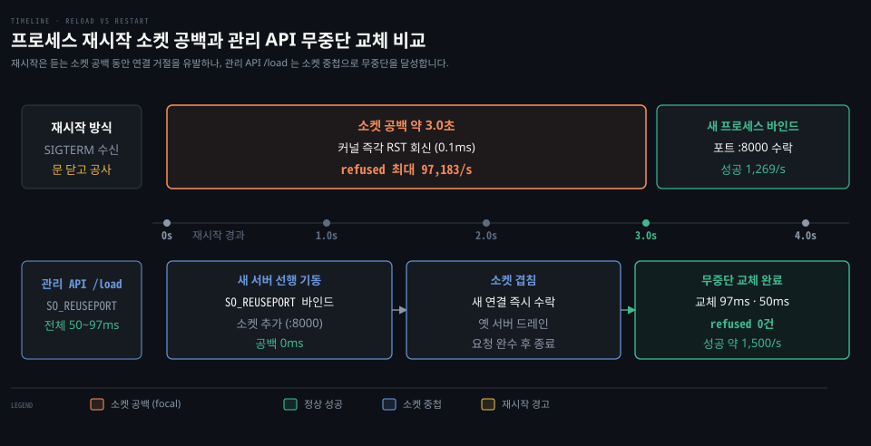
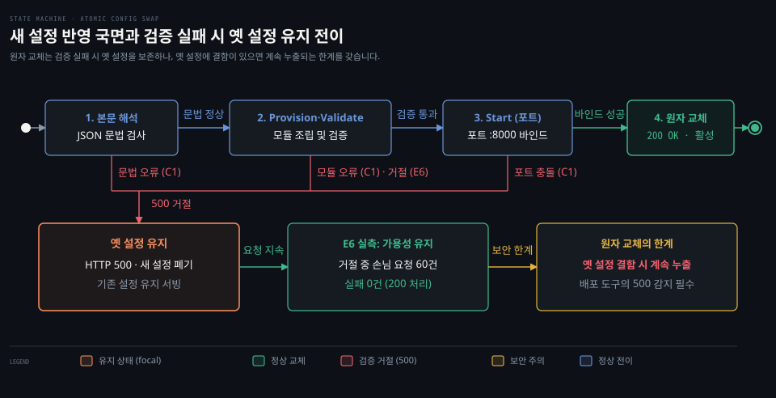
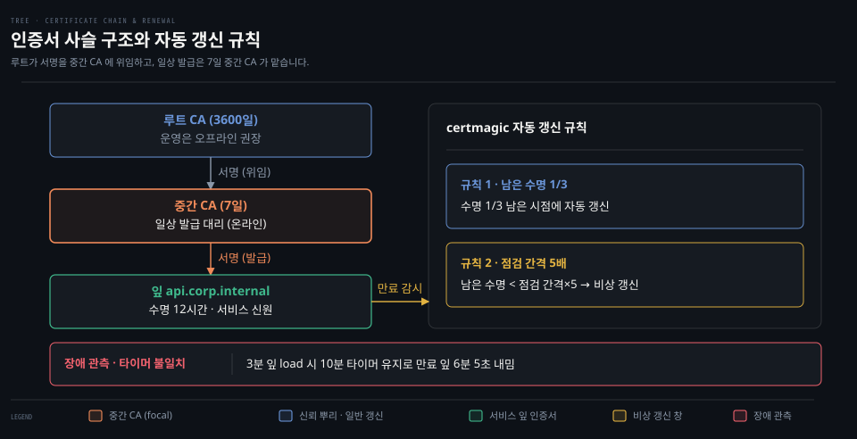
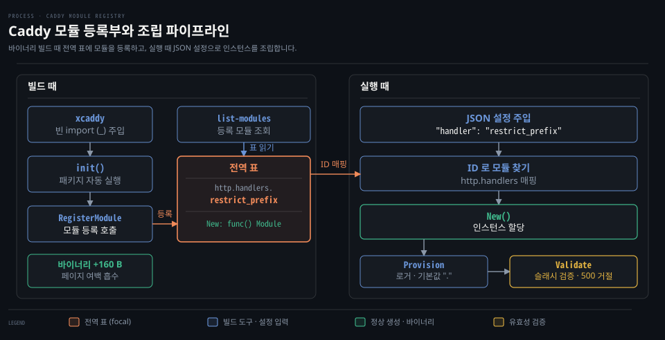

# 프록시 운영 — 무중단 설정 교체·인증서 사슬·모듈 등록부

---

> 손님의 요청을 처리하는 통로와 프록시 자체의 설정을 바꾸는 운영 제어 층을 분리하고 끊김 없는 설정 교체, 인증서 사슬 갱신, 커스텀 모듈 등록의 세 핵심 원리를 다룹니다.

## 운영 층이 다루는 것

> 요청이 지나가는 데이터 통로와 프록시 자체의 동작을 제어하는 운영 층을 가르고 무중단 설정 교체, 인증서 사슬 관리, 커스텀 모듈 확장의 세 축을 살펴봅니다.

01 묶음의 문서들이 클라이언트와 백엔드 사이에서 요청을 전달하는 데이터 통로를 다루었다면 이 문서는 프록시 자체를 안전하게 운영하는 제어 층을 다룹니다. [01-04 앞단 층 문서](./01-04.리버스%20프록시%20앞단%20층%20—%20규칙%20고르기·전달%20헤더%20신뢰·건강%20검사.md)가 라우팅 규칙과 전달 헤더 신뢰를 정리했다면 이 문서는 실행 중인 서버의 구성을 끊김 없이 바꾸는 운영 원리를 정리합니다.

운영 층이 담당하는 핵심 과제는 크게 세 가지입니다. 첫째는 트래픽이 유입되는 도중에도 연결 실패 없이 새로운 설정을 주입하는 무중단 설정 교체입니다. 둘째는 암호화 통신을 유지하기 위해 인증서 사슬을 구성하고 만료 전에 교체하는 인증서 생애주기 관리입니다. 셋째는 기본 기능 밖의 정책을 안전하게 추가하는 모듈 등록부 기반의 확장 구조입니다.

이러한 제어 기능은 단순한 편의 도구가 아니라 서비스 가용성을 좌우하는 기반 기술입니다. 프로세스를 재시작하지 않고 메모리 안에서 설정을 원자적으로 교체해야 합니다. 암호화 키를 안전한 계층으로 격리하고 검증된 코드만 단일 바이너리로 묶어 배포하는 운영 원칙을 세워야 합니다.


## 무중단 설정 교체

> 프로세스 재시작 시 발생하는 소켓 공백과 대량 연결 거부를 관측하고 소켓 재사용과 순차 조립으로 무중단 교체를 달성하는 원리를 다룹니다.



설정을 바꿀 때 왜 대량의 연결 거부 오류가 발생하는지 확인하기 위해 E1 리허설을 진행했습니다. 정상 부하가 유입되는 도중에 프로세스를 재시작하자 약 3.0초 동안 초당 최대 97,183건의 `refused` 오류가 쏟아졌습니다. 반면 관리 API 로 동일한 설정을 교체했을 때는 1회 97ms 와 2회 50ms 만에 완료되었습니다. 초당 약 1,500건의 성공을 유지하며 연결 거부는 0건을 기록했습니다.

대량의 연결 거부가 발생한 이유는 클라이언트의 연결 요청을 기다리는 **듣는 소켓**(listening socket)이 닫혔기 때문입니다. 듣는 소켓은 새로운 TCP 3방향 핸드셰이크를 받아들이기 위해 특정 포트에 열어 둔 소켓입니다. 프로세스가 종료되어 듣는 소켓이 비어 있는 동안 유입된 SYN 패킷에 대해 커널은 즉시 RST 패킷을 회신하여 연결을 거절합니다. 로컬 루프백에서 즉각 반환되는 거절은 0.1ms 안팎에 끝나므로 리틀의 법칙에 따라 초당 거절 수가 폭증했습니다.

이미 맺힌 지속 연결과 듣는 소켓은 운영체제 수준에서 완전히 다른 자원입니다. Nginx 는 설정을 다시 읽을 때 마스터 프로세스가 듣는 소켓을 쥔 채 새 워커를 띄웁니다. Envoy 는 핫 리스타트 때 옛 프로세스가 듣는 소켓을 새 프로세스에 넘깁니다. Caddy 는 Unix 환경에서 `SO_REUSEPORT` 옵션을 사용하여 이전 서버가 실행되는 동안 동일한 포트에 새 소켓을 먼저 열어 공백을 제거합니다.

설정을 교체하는 순서도 안전성을 결정합니다. C1 리허설에서 확인했듯이 Caddy 는 새 설정을 받으면 Provision 단계에서 구성 요소를 조립합니다. 이어 Validate 검증과 새 소켓을 여는 Start 까지 마친 뒤에 기존 서버를 교체합니다. 포트가 이미 사용 중이거나 모듈이 없으면 오류를 반환하고 기존 설정을 유지합니다.

기존에 맺힌 연결은 그것을 수락했던 이전 서버가 끝까지 책임지고 처리 중인 요청을 마친 뒤 연결을 닫습니다. 새 연결은 새로 띄운 소켓이 즉시 맞이합니다. 이 동작은 [01-03 문서](./01-03.리버스%20프록시%20다운스트림%20층%20—%20틈%20시계·최소%20속도·드레인.md)에서 다룬 배포 드레인 원리와 맞물려 진행 중인 손님 트래픽의 유실을 방지합니다.

관리 API 로 설정을 변경하면 수정 사항은 프로세스 메모리와 `autosave.json` 에만 저장됩니다. 정본 설정 파일을 함께 고치지 않고 프로세스를 다시 시작하면 파일 내용으로 덮어쓰여 변경 사항이 사라집니다. 따라서 임시 변경이라도 정본 설정 파일에 즉시 반영해야 합니다. 관리 API 는 기본적으로 Host 헤더를 검사하고 Origin 헤더가 있으면 출처를 확인하여 403 오류로 외부의 부정한 접근을 차단합니다.


## 원자 교체가 막지 못하는 것

> 실패 시 기존 설정을 보존하는 원자 교체의 한계를 짚고 검증 단계에서 침묵 실패를 차단해야 하는 이유와 배포 자동화의 상태 확인 책임을 다룹니다.



설정을 통째로 바꾸거나 아예 바꾸지 않는 교체가 왜 서비스 안전을 보장하지 못하는지 확인하기 위해 E6 리허설을 진행했습니다. 정적 폴더에 잘못 들어간 `.env` 파일을 차단하기 위해 접두사 모듈을 적용하는 과정에서 슬래시가 포함된 잘못된 접두사 `"/admin"` 을 주입했습니다. 관리 API 는 HTTP 500 오류를 반환하며 설정을 거절했고 프록시는 이전 설정을 그대로 유지했습니다. 그 사이 유입된 60건의 손님 요청은 오류 없이 처리되었습니다.

이러한 **원자 교체**(atomic swap)는 변경이 통째로 반영되거나 하나도 반영되지 않게 해서 반쯤 바뀐 상태를 막는 방식입니다. 그러나 원자 교체가 시스템의 안전을 온전히 보장하지는 않습니다. 원자 교체는 새 설정 반영에 실패했을 때 이전 설정을 유지할 뿐입니다. 만약 유지되는 이전 설정이 `.env` 파일을 외부로 유출하는 결함 상태였다면 손님은 계속해서 기밀 정보를 열람하게 됩니다.

접두사 차단 모듈이 슬래시가 포함된 접두사를 Validate 단계에서 거절하는 이유는 소켓 생성 전 단계라서가 아닙니다. 경로를 슬래시 단위로 나누어 검사하면 슬래시가 든 접두사는 어떤 조각과도 맞지 않습니다. 결국 조용히 아무것도 막지 않는 침묵 실패를 초래하기 때문입니다. 차단 기능이 아무것도 막지 못하면 심각한 보안 사고가 발생하므로 설정을 불러오는 시점에 즉시 거절해야 합니다.

경로 인코딩에 대한 방어도 중요합니다. Go 언어의 `net/url` 에서 `URL.Path` 는 퍼센트 디코딩이 끝난 값입니다. `URL.RawPath` 는 인코딩이 기본 모양과 다를 때만 원본을 담습니다. 모듈이 디코딩된 `Path` 를 검사하므로 `/%2eenv` 같은 인코딩 요청도 `/.env` 로 풀려 차단을 우회하지 못합니다. 다만 `/a%2fb` 처럼 인코딩된 슬래시는 디코딩 과정에서 경로 조각의 경계를 변경할 수 있으므로 주의해야 합니다.

배포 자동화 도구는 원자 교체의 특성을 이해하고 관리 API 의 응답을 엄격하게 검증해야 합니다. 관리 API 가 200 이 아닌 400 이나 500 오류를 반환하면 이전 설정으로 서비스가 유지됩니다. 하지만 배포 작업은 즉시 중단하고 실패로 다루어야 합니다.


## 인증서 사슬과 갱신

> 신뢰의 뿌리부터 도메인까지 이어지는 인증서 사슬의 구조와 역할을 분석하고 자동 갱신 시계의 동작 조건과 루트 저장소 관리 원칙을 다룹니다.

인증서를 세 단계로 구성하고 왜 주기적으로 교체해야 하는지 규명하기 위해 E5 리허설을 진행했습니다. 사내 도메인 `api.corp.internal` 에 HTTPS 를 적용했습니다. Caddy 는 루트 CA 3600일, 중간 CA 7일, 잎 인증서 12시간의 세 단계 사슬을 만들었습니다. 손님이 `intermediate.crt` 만 넘겨도 통신에 성공했습니다. curl 이 부분 체인(partial chain)을 기본으로 신뢰하기 때문입니다.

인증서 사슬을 셋으로 분리하는 핵심 이유는 신뢰의 뿌리를 보호하기 위함입니다. **중간 CA**(intermediate CA)는 루트의 서명 권한을 위임받아 실제 서비스용 인증서를 발급하는 대리 기관 인증서입니다. **잎 인증서**(leaf certificate)는 사슬의 맨 끝에서 실제 서비스 도메인의 신원을 증명하는 최종 인증서입니다.

만약 루트 CA 의 개인키로 도메인 인증서를 직접 서명한다면 발급 시스템이 침해되었을 때 신뢰 체계 전체가 붕괴합니다. 루트가 훼손되면 수많은 클라이언트 기기의 신뢰 저장소에 등록된 인증서를 일일이 다시 배포해야 합니다. 따라서 프로덕션 환경이라면 루트 CA 는 오프라인에 격리하여 보관하고 일상적인 발급은 수명이 짧은 중간 CA 에게 위임해야 합니다. 중간 CA 가 노출되더라도 오프라인 루트 CA 로 새 중간 CA 를 발행하면 클라이언트의 신뢰 저장소는 변경할 필요가 없습니다.

인증서 자동 갱신은 수명이 다하기 전에 미리 이루어져야 합니다. certmagic 라이브러리는 남은 수명이 3분의 1이 되는 시점에 갱신을 시도하며 점검 간격의 5배 이하로 남으면 비상 갱신 창을 작동시킵니다. 그러나 점검 타이머는 프로세스 첫 기동 시 기본값 10분으로 한 번만 생성됩니다. 관리 API 로 갱신 간격을 단축해도 기존 타이머가 유지되어 3분짜리 잎 인증서가 만료된 채 6분 5초 동안 손님에게 제공되는 문제가 발생했습니다.

이러한 타이머 불일치는 프로세스를 완전히 재시작하여 20초 주기 타이머를 다시 등록해야만 해결됩니다. 또한 로컬 저장소를 삭제하고 재시작하면 새로운 루트 CA 가 임의로 생성되어 기존 루트를 신뢰하던 모든 클라이언트에서 인증서 오류가 발생합니다. 사내 환경에서도 루트 인증서는 영구 스토리지에 보관하고 만료 시계의 동작 특성을 고려하여 갱신 정책을 수립해야 합니다.





## 모듈 등록부

> JSON 설정의 문자열 식별자가 Go 코드로 연결되는 모듈 등록부의 원리와 정적 링크 빌드 및 의존성 격리 설계를 다룹니다.

JSON 설정의 핸들러 이름이 왜 코드 구조체로 바로 연결되지 못하고 등록부가 필요한지 규명하기 위해 E6 리허설을 진행했습니다. 커스텀 모듈을 추가한 바이너리에서 `list-modules` 명령을 실행하자 우리 모듈이 조회되었습니다. 모듈 추가 후 파일 크기는 단 160바이트만 증가했습니다. 핵심 패키지가 이미 포함되어 있어 추가된 코드가 페이지 정렬 여백에 흡수되었기 때문입니다.

설정의 문자열을 실제 실행 객체로 바꾸어 주는 중심 장치가 바로 **모듈 등록부**(module registry)입니다. 모듈 등록부는 바이너리에 포함된 확장 기능들을 고유한 식별자로 찾아 인스턴스를 생성할 수 있도록 관리하는 전역 등록 표입니다. Go 언어의 `init()` 함수는 패키지가 임포트될 때 메인 함수보다 먼저 실행되어 모듈 정보를 전역 표에 스스로 등록합니다.

`caddy list-modules` 명령은 바로 이 전역 모듈 등록부를 순회하여 등록된 모듈 목록을 출력합니다. 모듈 등록 코드는 다음과 같이 작성합니다.

```go
func init() {
	caddy.RegisterModule(RestrictPrefix{})
	httpcaddyfile.RegisterHandlerDirective("restrict_prefix", parseCaddyfile)
}

func (RestrictPrefix) CaddyModule() caddy.ModuleInfo {
	return caddy.ModuleInfo{
		ID:  "http.handlers.restrict_prefix",
		New: func() caddy.Module { return new(RestrictPrefix) },
	}
}
```

Caddy 는 실행 중에 모듈을 붙이지 않고 모듈까지 하나의 실행 파일로 다시 빌드합니다. Caddy 문서는 모듈을 새 Go 모듈로 만들라고 합니다. 문서에 따르면 xcaddy 는 Caddy 와 그 모듈을 함께 require 하는 Go 모듈을 새로 만듭니다. 그리고 모듈이 컴파일에 들어가도록 빈 import(`_`)를 더합니다.



모듈 코드를 어느 Go 모듈에 둘지도 의존성 문제입니다. 저장소 사본의 루트 `go.mod` 에 Caddy 를 넣자 require 가 22줄에서 174줄로 늘고 Go 버전이 1.26.0 으로 올랐습니다. 

Bazel 쪽 비용은 더 컸습니다. Bazel 은 외부 모듈 cel-go 의 BUILD 파일에 `interpreter` 타깃이 없어 caddy 를 import 하는 타깃을 빌드하지 못했습니다. 그래서 `bazel test //net/npg/...` 가 분석 단계에서 멈춰 시험이 0개로 끝났고, CI 도 같은 명령을 쓰므로 함께 막힙니다. ADR 0019 는 모듈 폴더에 따로 `go.mod` 를 두고 xcaddy 로 빌드하기로 했습니다. 루트 `go.mod` 와 `MODULE.bazel` 은 바뀌지 않는 대신 이 모듈의 시험은 그 폴더에서 따로 돌려야 합니다.


## 참고 자료

> 본문에서 다룬 무중단 설정 교체, 인증서 사슬, 모듈 등록부 이론의 실습 장면과 기초 개념 문서, 1차 원문 출처입니다.

### 짝 문서

- [01-03 리버스 프록시 다운스트림 층](./01-03.리버스%20프록시%20다운스트림%20층%20—%20틈%20시계·최소%20속도·드레인.md): 손님 쪽 틈 시계, 최소 속도, 배포 드레인 원리
- [01-04 리버스 프록시 앞단 층](./01-04.리버스%20프록시%20앞단%20층%20—%20규칙%20고르기·전달%20헤더%20신뢰·건강%20검사.md): 라우트 규칙 순서와 전달 헤더 신뢰 경계

### 개념 문서

- [Listen·ListenConfig·TCPListener](../../../01_language/docs/go/net/02-02.Listen·ListenConfig·TCPListener.md): Go 소켓 바인딩과 SO_REUSEPORT 제어 원리
- [패키지 internal 감추기와 init 함수](../../../01_language/book/lgo_learning-go/10-02.패키지는%20대문자로%20내보내고%20이름으로%20기능을%20말하며%20internal%20로%20감춥니다.md): Go init 함수의 패키지 초기화와 등록 패턴
- [Go 바이너리 빌드 정보와 모듈 의존](../../../01_language/book/lgo_learning-go/11-04.Go%20바이너리는%20빌드%20정보를%20품고%20GOOS·GOARCH%20와%20빌드%20태그로%20대상을%20가립니다.md): go version -m 빌드 정보와 바이너리 의존 구조
- [Caddy JSON 설정과 관리 API](../../book/npg_network-programming-with-go/10-01.Caddy%20는%20JSON%20설정을%20관리%20API%20로%20실시간%20바꾸고%20모듈과%20어댑터로%20넓힌다.md): 관리 엔드포인트와 모듈 확장 기본 구조
- [Caddy 리버스 프록시와 자동 HTTPS](../../book/npg_network-programming-with-go/10-02.Caddy%20를%20앞단에%20두고%20백엔드로%20리버스%20프록시하며%20정적%20파일과%20자동%20HTTPS%20를%20붙인다.md): 프록시 앞단 배치와 내부 TLS 발급 정책
- [TLS 클라이언트와 CA 인증서 검증](../../book/npg_network-programming-with-go/11-01.TLS%20클라이언트는%20CA%20서명으로%20서버를%20확인하고%20서버는%20리스너를%20감싸며%20피닝은%20믿을%20인증서를%20좁힌다.md): 인증서 체인 검증과 신뢰 범위 제어

### 원문 근거

- npg-lab `docs/rehearsals/ch10-c1-admin-api-control.md` — 관리 API 엔드포인트 조작과 원자적 설정 교체 실패 리허설 기록입니다.
- npg-lab `docs/rehearsals/ch10-e1-restart-vs-reload.md` — 재시작과 관리 API 교체 시의 연결 거부 장애 리허설 기록입니다.
- npg-lab `docs/rehearsals/ch10-e5-internal-tls.md` — 내부 CA 발급, 부분 체인 검증, 인증서 갱신 주기 장애 리허설 기록입니다.
- npg-lab `docs/rehearsals/ch10-e6-restrict-prefix-module.md` — 경로 접두사 차단 커스텀 모듈과 검증 거절 장애 리허설 기록입니다.
- npg-lab `docs/adr/0019-custom-caddy-module-separate-go-mod.md` — 커스텀 모듈을 별도 go.mod 로 분리하고 xcaddy 로 빌드하기로 결정한 근거입니다.
- caddy `v2.11.7` `caddy.go` — `changeConfig` 원자적 설정 교체 및 롤백 규정입니다.
- caddy `v2.11.7` `listen_unix.go` — Unix 에서 `SO_REUSEPORT` 로 같은 포트에 소켓을 하나 더 여는 코드입니다.
- caddy `v2.11.7` `admin.go` — 관리 API Host 검사 및 Origin 검증 규정입니다.
- caddy `v2.11.7` `modules/caddypki/ca.go` — 루트 CA 3600일 및 중간 CA 7일 수명 규정입니다.
- caddy `v2.11.7` `modules/caddytls/internalissuer.go` — 내부 발급 잎 인증서 12시간 수명 규정입니다.
- certmagic `v0.25.6` `certificates.go`, `maintain.go` — 남은 수명 1/3 갱신 규칙 및 점검 간격 5배 비상 갱신 창 규정입니다.
- Go `go1.25.1` `src/net/url/url.go` — `Path` 디코딩과 `RawPath` 원본 인코딩 처리 규정입니다.
