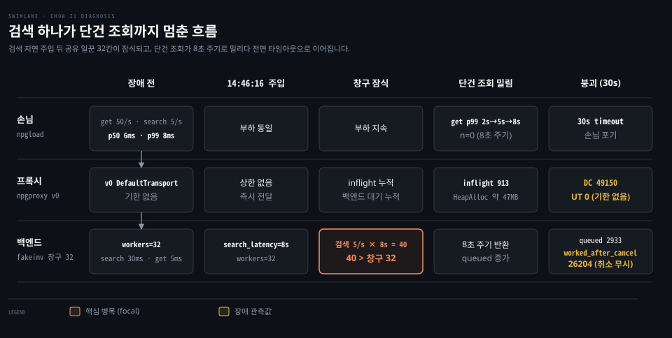

# 기본값 리버스 프록시가 겪는 장애 - 느린 검색·포트 고갈·POST 502·회복 지연·중복 등록

---

> 기본 설정 그대로 배포한 리버스 프록시가 실제 운영 환경에서 맞닥뜨리는 장애 양상을 진단하고 해결책을 도출합니다. 원인을 모르는 상태에서 유입된 장애 신고를 출발점으로 삼아 지표와 로그를 대조하며 원인을 좁힙니다.

## 리허설 환경

> 프록시와 가짜 백엔드, 관측 도구와 부하 생성기를 격리된 환경에 구성하여 장애를 재현합니다. 원인을 숨긴 장애 주입 상태에서 관측 지표의 변화를 추적합니다.

장애 리허설 환경은 다음 네 가지 컴포넌트로 구성됩니다.

- `fakeinv`: 장애 주입 엔드포인트(`/_faults`)를 갖추고 재고 관리를 모사하는 가짜 백엔드 서버입니다.
- `npgproxy v0`: Go 표준 라이브러리의 기본 `Transport` 설정을 사용하는 리버스 프록시입니다.
- `npgwatch`: 프록시와 백엔드의 실시간 처리 상태 및 내부 지표를 집계하여 보여 주는 관측 화면입니다.
- `npgload`: 포아송 분포 기반으로 실제 트래픽과 유사한 요청을 생성하는 부하 발생 도구입니다.

실습 환경을 구동하는 실행 명령은 다음과 같습니다.

```bash
./bin/fakeinv -addr 127.0.0.1:9090
./bin/npgproxy -addr 127.0.0.1:18080 -admin 127.0.0.1:18081 -upstream http://127.0.0.1:9090
./bin/npgwatch -proxy http://127.0.0.1:18081/debug/vars        # http://127.0.0.1:8090
./bin/npgload -url 'http://127.0.0.1:18080/v1/devices/7' -rate 50 -poisson -d 10m -label get
./bin/npgload -url 'http://127.0.0.1:18080/v1/devices?q=edge' -rate 5 -poisson -d 10m -label search
```

이 맥에서는 기존 Java 프로세스가 8080 및 8081 포트를 점유하고 있어 프록시를 18080과 18081 포트에 배치했습니다.

장애는 fakeinv 의 `/_faults` 경로를 통해 관리자가 백엔드 내부에 몰래 주입합니다. 학습자는 사전에 어떤 장애가 켜졌는지 알지 못한 채 오직 접수된 장애 신고 문장과 관측 도구의 신호만으로 진단을 시작합니다.

| 장면 | 신고서 한 줄 | 상태 |
|---|---|---|
| I1. 검색 하나가 단건 조회까지 멈췄다 | 장비 검색이 느린 건 알고 있었는데, 10분 전부터 장비 단건 조회까지 p99 가 50ms → 8초입니다. 프록시 메모리도 계속 오릅니다. | 진단 완료 |
| I2. 가끔 POST 만 502 가 난다 | 하루 수십 건, 장비 등록(POST)에서만 502 가 납니다. GET 은 0건입니다. 백엔드 로그에는 그 요청이 아예 없습니다. | 예정 |
| I3. 부하 시험만 하면 포트가 바닥난다 | 동시 50 으로 부하 시험을 하면 프록시 호스트에 TIME_WAIT 가 수만 개 쌓이고 connect: cannot assign requested address 가 납니다. | 예정 |
| I4. 장애는 끝났는데 회복이 안 된다 | 백엔드 배포 실수로 10초간 느려졌고 바로 롤백했습니다. 그런데 에러율이 30분 동안 내려오지 않았습니다. 백엔드팀은 그 사이 요청이 평소의 몇 배였다고 합니다. | 예정 |
| I5. 장비가 두 번 등록됐다 | 어제 백엔드가 느리던 시간대에 같은 장비가 두 번 등록된 건이 12건 있습니다. 클라이언트는 한 번만 보냈다고 합니다. | 예정 |


## I1. 느린 검색이 막은 단건 조회

> 느린 검색 요청이 백엔드의 한정된 공유 창구를 잠식하여 빠른 단건 조회까지 대기열에 묶여 지연되었습니다. 프록시에 응답 기한과 경로별 격벽이 없어 백엔드의 체류 시간 증가가 전체 서비스 지연으로 번졌습니다.



### 신고

장애 접수 채널을 통해 다음과 같은 사용자 신고가 들어왔습니다.

> 신고: "장비 검색이 느린 건 알고 있었는데, 10분 전부터 장비 단건 조회(`GET /v1/devices/{id}`)까지 p99 가 50ms → 8초입니다. 프록시 메모리도 계속 오릅니다."

장애 발생 전 단건 조회(get) 요청의 지연 시간은 p50 6ms, p99 8ms 안팎이었습니다.

진단 완료 후 확인된 가짜 백엔드 fakeinv 의 장애 주입 경로인 `/_faults` 설정 내역은 다음과 같았습니다.

| 시각 | fakeinv `/_faults` | 설정 내용 |
|---|---|---|
| 14:45:31 | `workers=32` | 백엔드가 동시에 처리하는 요청 수 상한을 32개로 제한했습니다. 모든 경로가 같은 32칸을 공유합니다. |
| 14:46:16 | `search_latency=8s` | 검색 처리 시간을 평소 30ms에서 8초로 지연시켰습니다. |
| (기본값) | `honor_cancel=false` | 손님이 떠나도 처리 코드가 context 취소를 확인하지 않고 끝까지 동작합니다. |

동일한 조건을 15:06에 백엔드를 재기동하여 한 번 더 재현했습니다. 이때 앞선 실행의 부하 도구 세 개가 다른 터미널에서 15:07:50까지 중복 실행되었습니다. 이에 따라 15:06~15:08 구간의 수치는 부하가 약 세 배 부풀려 측정되었습니다.

### 진단 흐름

운영자는 접수된 신고를 바탕으로 열 단계의 신호 관측과 가설 검증을 거쳤습니다.

1단계에서는 npgload 출력에서 `inflight` 수치가 지속적으로 상승하는 현상을 확인했습니다. 운영자는 처음에 "inflight 가 오르면 장애 원인이다"라는 가설을 검토했습니다. 그러나 **리틀 법칙**(도착률과 체류 시간의 곱)에 따르면 inflight 는 도착률에 체류 시간을 곱한 결과값입니다. 도착률이 일정할 때 inflight 의 상승은 요청이 시스템 내부에 머무는 시간이 늘어났음을 의미합니다. 따라서 이 현상은 원인이 아닌 증상으로 남겼습니다.

2단계에서는 npgwatch 의 "처리 중·대기 중" 화면을 살펴보았습니다. 백엔드의 처리 중 요청과 대기열이 동시에 치솟고 있었습니다. 백엔드 통계(`/_stats`)에서 `queued` 수치가 860에서 2933으로 급증했고 `conns_open` 도 2966에 도달했습니다. 프록시는 큐를 두지 않고 요청을 받는 즉시 백엔드로 전달합니다. 줄은 백엔드 내부에 서고 있었으며, 프록시 inflight 의 상승은 백엔드 대기열의 요청이 비친 결과였습니다. 이 가설은 사실로 남겼습니다.

3단계에서는 경로별 지연 시간 추이를 대조했습니다. get 요청 지연 시간은 p50 기준 4.3s에서 7.5s를 거쳐 9.8s까지 올랐습니다. search 요청 지연 시간은 p50 기준 17.6s에서 29s로 치솟았습니다.

특히 get 경로의 1초간 완료 건수 `n` 이 0을 기록하는 현상이 8초 주기로 관측되었습니다. 15:07:20, 15:07:28, 15:07:36 시점에 완료 건수가 0이었습니다. 본래 5ms 면 끝나는 단건 조회가 8초 주기로 묶여 풀리는 현상은 검색이 공유 창구를 오래 붙잡았기 때문입니다. 이 가설도 남겼습니다.

4단계에서는 리틀 법칙을 적용해 백엔드 수용 용량을 계산했습니다. 장애 상황에서 검색 요청의 도착률은 초당 5건이었고 소요 시간은 8초였습니다. 검색 요청만을 처리하는 데 필요한 최소 작업 창구는 5/s × 8s = 40개였습니다.

반면 백엔드가 제공하는 전체 작업 창구는 32개에 불과했습니다. 필요한 용량인 40이 한도인 32를 초과(40 > 32)하므로 대기열이 매초 누적되어 p99 지연 시간이 꾸준히 올랐습니다. 검색이 창구를 독점하여 단건 조회까지 질식시키는 상태였습니다. 이 가설도 남겼습니다.

5단계에서는 연결 종료의 주체를 확인했습니다. 프록시 종료 사유(`reasons`)를 조회하자 클라이언트 연결 단절인 DC 가 49150건이었습니다. 반면 업스트림 타임아웃인 UT 는 0건이었습니다. search 클라이언트 콘솔에는 `timeout:` 오류가 기록되었습니다.

운영자는 처음에 "연결을 끊는 쪽은 프록시다"라는 가설을 세웠습니다. 그러나 UT 가 0이고 클라이언트 측에 타임아웃이 기록된 사실을 확인하고 이 가설을 버렸습니다. Go 표준 라이브러리의 `Transport` 기본값을 사용하는 v0 프록시는 `ResponseHeaderTimeout` 이 0입니다. 프록시가 먼저 연결을 끊지 못하고, 응답을 30초 동안 받지 못한 클라이언트가 먼저 포기하고 연결을 닫았습니다.

6단계에서는 백엔드의 취소 처리 방식을 추적했습니다. 백엔드 통계에서 취소 후 작업 수행 건수(`worked_after_cancel`)가 26204건까지 쌓였습니다. 운영자는 "백엔드가 연결 단절을 알지 못해 작업을 계속 수행했다"는 가설을 세웠습니다.

그러나 Go HTTP 서버는 클라이언트 연결이 끊기면 `r.Context()` 를 자동으로 취소합니다. 백엔드 서버는 연결 단절 알림을 받았으나 비즈니스 로직에서 컨텍스트 취소 신호를 검사하지 않았습니다. 이에 따라 백엔드가 취소를 인지하지 못했다는 가설은 절반만 채택하고, 취소 알림을 수신했으나 코드가 이를 무시했다는 결론을 남겼습니다.

7단계에서는 첫 번째 사고 실험으로 프록시에 2초의 응답 헤더 기한(`ResponseHeaderTimeout`)을 두는 방안을 검토했습니다. 프록시에 2초 기한을 설정하면 프록시 자체의 연결 자원은 2초 만에 회수됩니다. 하지만 백엔드의 공유 창구 32개는 여전히 8초 동안 검색 처리에 묶여 있습니다. 백엔드가 취소 신호를 감지하고 작업을 멈추지 않는 한 백엔드 작업 창구는 풀리지 않습니다. 따라서 단건 조회의 p99 지연 시간은 개선되지 않는다는 결론을 남겼습니다.

8단계에서는 두 번째 사고 실험으로 프록시의 호스트당 연결 상한(`MaxConnsPerHost`)을 32개로 제한하는 방안을 분석했습니다. 연결 상한을 32로 두면 백엔드로 향하는 동시 요청이 32개로 억제됩니다. 대기열이 백엔드 소켓에서 프록시 내부 큐로 이동할 뿐 단건 조회의 응답 지연 시간은 그대로 유지됩니다.

다만 프록시 대기열에 머무는 도중 클라이언트가 이탈하면 해당 요청을 백엔드로 보내지 않습니다. 따라서 백엔드의 무의미한 연산은 줄일 수 있습니다. 프록시 대기열 자체에 한도를 두지 않으면 프록시의 메모리 사용량이 계속 증가하는 문제는 남습니다.

9단계에서는 세 번째 사고 실험으로 API 경로별 상한을 분리하는 **격벽**(경로별 상한) 도입을 평가했습니다. 단건 조회와 검색의 작업 창구를 분리하면 검색 트래픽이 지연되더라도 단건 조회의 작업 창구는 유지됩니다. 이 가설은 남겼습니다. 다만 다음 10단계에서 보듯 백엔드가 취소를 무시하면 프록시 쪽 상한만으로는 백엔드 창구를 지키지 못합니다.

10단계에서는 네 번째 사고 실험으로 프록시에서 검색 상한을 8개로 두고 2초 기한을 부여하는 방안을 계산했습니다. 운영자는 처음에 "백엔드가 점유하는 검색 창구도 최대 8개로 억제된다"는 가설을 세웠습니다. 그러나 백엔드가 취소를 무시하고 8초간 동작하는 환경에서는 이 가설이 성립하지 않아 버렸습니다.

프록시는 2초마다 클라이언트 연결을 끊고 슬롯을 비워 새 요청을 백엔드로 보냅니다. 반면 백엔드는 이전 요청을 8초 동안 끝까지 처리합니다. 그 결과 백엔드에서는 8 × (8/2) = 32개의 작업 창구가 검색 처리에 계속 묶이게 됩니다. 프록시의 상한 설정은 프록시가 직접 쥔 자원만 통제합니다.

진단 과정에서 확인된 추가 관찰 사실은 다음과 같습니다.

장애 발생 직후 몇 초 동안은 검색 요청이 백엔드의 공유 창구 32개를 모두 채우기 전이었습니다. 이 짧은 구간에서는 단건 조회가 정상 응답했습니다. 그러나 검색 요청이 창구를 채운 직후부터 단건 조회의 p99 지연 시간이 2s에서 5s를 거쳐 8s로 급격히 올랐습니다. 보정 실행 기준으로 장애 발생 약 30초 시점에 get p99 가 8초에 도달했습니다.

장애가 지속되자 get 과 search 요청 모두 클라이언트 기한인 30초에 도달했습니다. 그 결과 대량의 `timeout` 오류로 종료되었습니다. 백엔드는 떠난 손님의 요청을 큐에서 버리지 않고 끝까지 처리했습니다. 이에 따라 백엔드 내부의 대기열이 전혀 줄어들지 않았습니다.

14:48 시점에 프록시의 `inflight` 수치는 913, `HeapAlloc` 은 약 47MB 까지 치솟았습니다. 백엔드는 15:11 기준 `inflight` 2965, `queued` 2933, `conns_open` 2966 을 기록했습니다. 프록시의 연결 종료 사유(`reasons`) 집계는 DC 49150건, UC 927건, UT 0건이었습니다. UC 는 백엔드를 재시작할 때 기존 연결이 끊어진 건수였습니다.

지표 관측 시 1초 단위 통계의 착시 현상도 확인했습니다. 초당 집계 화면의 p50 과 p99 는 해당 1초 동안 정상 완료된 요청만을 집계합니다. 완료 건수 `n` 과 처리 중인 요청 수 `inflight` 를 반드시 함께 보아야 합니다.

예를 들어 `n=1 p50=7ms` 다음 초에 `inflight=112 n=0` 이 발생하는 사례가 관측되었습니다. 요청 처리가 완전히 막혀 완료 건수가 0건인 초에는 지연 수치가 일시적으로 낮거나 정상처럼 보일 수 있습니다. 따라서 완료 건수와 대기 건수를 연계해서 판독해야 합니다.

### 근본 원인

이번 장애의 근본 원인은 백엔드의 자원 공유 구조와 프록시의 보호 장치 부재, 그리고 백엔드의 취소 처리 무시라는 세 가지 요인이 결합된 결과였습니다.

첫째 요인은 백엔드의 공유 작업 창구 32개를 느린 검색 요청이 독점한 점이었습니다. 백엔드는 모든 API 경로가 단일한 32개의 처리 창구를 공유하는 구조였습니다. 검색 처리 지연이 평소 30ms에서 8초로 늘어나자 유입된 검색 요청들이 32개 창구를 장시간 점유했습니다. 그 결과 빠른 단건 조회가 진입할 창구가 고갈되어 대기열에 갇혔습니다.

둘째 요인은 v0 프록시에 응답 기한과 연결 상한, 경로별 상한이 전혀 없었던 점이었습니다. Go 기본 설정을 사용하는 v0 프록시는 `ResponseHeaderTimeout` 과 `MaxConnsPerHost` 가 모두 0이었습니다. 백엔드 처리가 지연되어도 프록시가 연결을 먼저 끊지 않고 모든 요청을 백엔드로 전달했습니다. 아울러 경로별 동시성을 분리하는 격벽이 없어 특정 경로의 지연이 전체 시스템의 자원 고갈로 확산되었습니다.

셋째 요인은 백엔드가 클라이언트의 취소 신호를 감지하고도 작업을 중단하지 않은 점이었습니다. 대기 지연을 견디지 못한 클라이언트가 30초 타임아웃으로 연결을 끊었으나, 백엔드는 컨텍스트 취소 신호를 확인하지 않고 8초간의 연산을 끝까지 수행했습니다. 이미 떠난 요청을 처리하느라 한정된 작업 창구가 지속적으로 낭비되었으며, 누적된 대기열이 해소되지 않고 장애가 고착되었습니다.

### 다음 조치

장애 개선 작업은 I3 및 I2 시나리오 진단까지 마친 뒤 설계 결정 문서(ADR 0012)로 묶어 확정합니다. 이후 동일한 장애를 다시 발생시켜 개선 전후의 수치 변화를 이 절에 채울 예정입니다.

사고 실험을 통해 도출된 개선 후보는 다음과 같습니다.

- 후보 1: 업스트림 응답 헤더 기한(`ResponseHeaderTimeout`) 설정
- 후보 2: 호스트당 최대 연결 상한(`MaxConnsPerHost`) 설정
- 후보 3: API 경로별 동시 처리 한도를 분리하는 격벽 메커니즘 도입

아직 확정되지 않은 정책은 구현 단계에서 결정하며, 본 절에서는 개선 전 수치만 기록합니다.

| 지표 | 개선 전 (v0) | 개선 후 |
|---|---|---|
| get p99 (장애 30초 뒤) | 약 8s, 이후 30s(손님 포기) | (ADR 0012 뒤) |
| 백엔드 `conns_open` 최대 | 2966 | (ADR 0012 뒤) |
| 백엔드 `worked_after_cancel` | 26204 (15:06:33 이후 누적) | (ADR 0012 뒤) |
| 프록시 `reasons` | DC 49150, UT 0 | (ADR 0012 뒤) |


## 참고 자료

> 이 문서가 풀지 않고 넘긴 개념을 다룬 문서와, 진단에 쓴 Go 소스·오픈소스 프록시의 1차 원문입니다.

### 개념 문서

- [Go HTTP 클라이언트의 타임아웃과 컨텍스트 취소](../../book/npg_network-programming-with-go/08-02.Go%20HTTP%20%ED%81%B4%EB%9D%BC%EC%9D%B4%EC%96%B8%ED%8A%B8%EB%8A%94%20%EC%9D%91%EB%8B%B5%20%EB%B3%B8%EB%AC%B8%EC%9D%84%20%EB%8B%AB%EC%95%84%EC%95%BC%20%EC%97%B0%EA%B2%B0%EC%9D%84%20%EC%9E%AC%EC%82%AC%EC%9A%A9%ED%95%98%EA%B3%A0%20context%20%EB%A1%9C%20%EC%9A%94%EC%B2%AD%EC%9D%84%20%EB%81%8A%EB%8A%94%EB%8B%A4.md)
- [메트릭 수집과 카운터 계측 원리](../../book/npg_network-programming-with-go/13-03.%EB%A9%94%ED%8A%B8%EB%A6%AD%EC%9D%80%20%EC%B9%B4%EC%9A%B4%ED%84%B0%C2%B7%EA%B2%8C%EC%9D%B4%EC%A7%80%C2%B7%ED%9E%88%EC%8A%A4%ED%86%A0%EA%B7%B8%EB%9E%A8%EC%9C%BC%EB%A1%9C%20%EC%84%9C%EB%B2%84%EB%A5%BC%20%EC%9E%AC%EA%B3%A0%20Prometheus%20%EA%B0%80%20%EA%B7%B8%20%EA%B0%92%EC%9D%84%20%EA%B8%81%EC%96%B4%20%EA%B0%84%EB%8B%A4.md)
- [Envoy 프록시의 탄력성 설계와 서킷 브레이커](../../../08_cloud/book/istio-in-action/06-01.%EC%8B%A4%ED%8C%A8%EB%A5%BC%20%EA%B2%AC%EB%94%94%EB%8A%94%20%EC%9D%BC%EC%9D%84%20%ED%94%84%EB%A1%9D%EC%8B%9C%EB%A1%9C%20%EC%98%AE%EA%B2%BC%EC%9D%84%20%EB%95%8C.md)
- [스레드 풀과 세마포어를 활용한 격벽 분리](../../../09_spring/03_network/resilience/01-04.Bulkhead%20%E2%80%94%20Semaphore%20vs%20ThreadPool%20%EA%B2%A9%EB%A6%AC.md)
- [TCP 다이얼러 타임아웃과 데드라인 관리](../../book/npg_network-programming-with-go/03-03.%ED%83%80%EC%9E%84%EC%95%84%EC%9B%83%EC%9D%80%20Dialer%C2%B7context%20%EB%A1%9C%2C%20%EC%9C%A0%ED%9C%B4%20%EA%B0%90%EC%A7%80%EB%8A%94%20%EB%8D%B0%EB%93%9C%EB%9D%BC%EC%9D%B8%EA%B3%BC%20%ED%95%98%ED%8A%B8%EB%B9%84%ED%8A%B8%EB%A1%9C%20%EA%B1%B4%EB%8B%A4.md)
- [리틀의 법칙으로 풀 크기를 구한 예 (Firecracker 마이크로 VM 풀)](../../../03_architecture/book/bytebytego-system-design/06-01.IaaS%C2%B7PaaS%C2%B7SaaS%20%EC%99%80%20%EA%B0%80%EC%83%81%20%EB%A8%B8%EC%8B%A0%C2%B7%EC%BB%A8%ED%85%8C%EC%9D%B4%EB%84%88%C2%B7%EC%84%9C%EB%B2%84%EB%A6%AC%EC%8A%A4%EB%8A%94%20%EC%9A%B4%EC%98%81%20%EC%B1%85%EC%9E%84%EC%9D%84%20%EC%96%B4%EB%94%94%EA%B9%8C%EC%A7%80%20%EB%84%98%EA%B8%B0%EB%8A%94%EC%A7%80%EB%A1%9C%20%EA%B0%88%EB%A6%B0%EB%8B%A4.md)

### 원문 근거

- Go 1.25.1 `net/http/transport.go:213-218` — `MaxConnsPerHost` 설정에 연결 제한 초과 시 다이얼이 대기한다고 명시합니다. 기본값 0 은 무제한입니다.
- Go 1.25.1 `net/http/request.go:349` — 서버 수신 요청은 클라이언트 연결이 닫힐 때 컨텍스트가 취소된다고 규정합니다.
- envoy v1.40.1 `api/envoy/config/cluster/v3/circuit_breaker.proto:78-89` — `max_connections`, `max_pending_requests`, `max_requests` 기본값은 1024입니다.
- nginx `ngx_http_upstream_module` `max_conns` — 기본값 0 은 동시 연결 수에 제한이 없음을 의미합니다.
- haproxy 3.2 `configuration.txt` server `maxconn` — 연결 상한 초과 시 요청이 큐에서 대기한다고 설명합니다. 기본값 0 은 무제한입니다.
- Apache Tomcat 10.1 HTTP Connector — `maxConnections` 8192(NIO), `maxThreads` 200, `acceptCount` 100 으로 연결 수와 처리 일꾼 수를 분리합니다.
