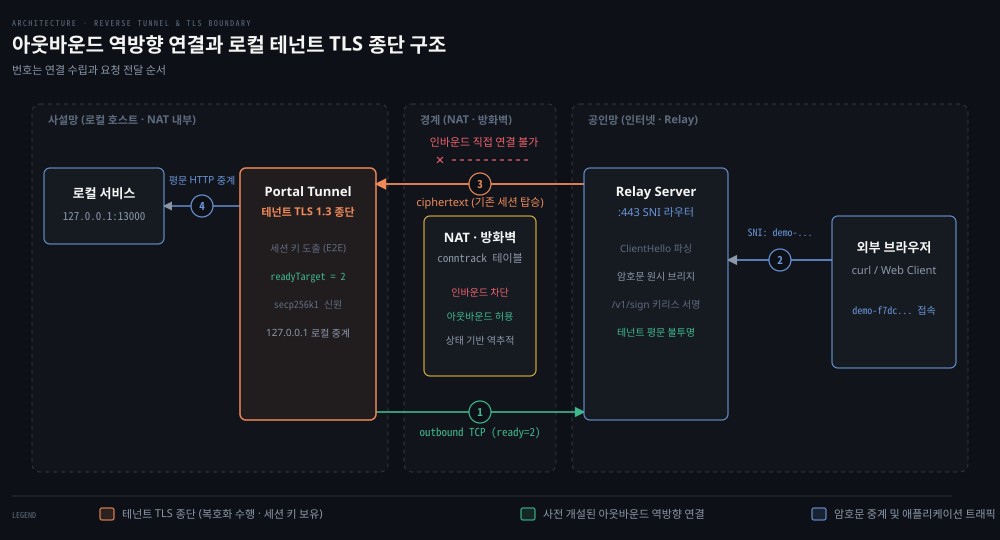

# What is Portal·비교 제품

---

> 로컬 개발 서비스를 외부 인터넷에 안전하게 공개하기 위한 역방향 터널의 원리를 살피고, Portal의 설계 차별점과 기존 터널링 도구 9종의 기술적 트레이드오프를 비교 분석합니다.

## 학습 목표와 범위

> 역방향 터널이 해결하는 네트워크 장벽을 설명하고, Portal의 보안 모델과 주요 터널링 대안의 구조적 차이를 판단할 수 있습니다.

1. 로컬 환경의 서비스를 인터넷에 공개할 때 마주치는 5가지 네트워크 제약과 역방향 터널의 해결 원리를 설명할 수 있습니다.
2. Portal이 릴레이 의존성과 신뢰를 줄이기 위해 도입한 테넌트 TLS, MITM 자가 검증, secp256k1 신원 체계의 동작과 한계를 비교할 수 있습니다.
3. ngrok, Cloudflare Tunnel, frp, Tailscale Funnel 등 9개 제품의 TLS 종단 위치와 운반 방식, 호스팅 모델의 차이를 비교표를 통해 설명할 수 있습니다.
4. 이 프로젝트를 깊이 이해하기 위해 필요한 기반 지식(소켓, TLS, 다중화, ACME, 암호학)과 관련 소스 코드 위치를 연결할 수 있습니다.

이 문서는 터널링 아키텍처의 개념과 비교를 다룹니다. 릴레이 서버의 구체적인 배포 운영 절차나 세부 암호화 수학 알고리즘의 전체 증명은 후속 편으로 넘깁니다.

기준 커밋 0a3b9c06 (2026-10-14)


## 문제와 필요성

> 사설망 내부의 로컬 서비스를 인터넷에 노출하지 못하게 가로막는 5대 네트워크 장벽과 이를 역방향 터널로 극복하는 원리를 살펴봅니다.

로컬 개발 장비에서 실행 중인 웹 서버를 동료에게 시연하거나 외부 웹훅을 받으려면 인터넷에서 해당 프로세스로 패킷이 닿아야 합니다. 하지만 일반적인 개발 환경에서는 공유기의 사설 IP 할당, 방화벽의 인바운드 차단, 유동 IP 환경, 공인 도메인 부재, 공인 TLS 인증서 미발급이라는 다섯 가지 장벽이 외부 진입을 막습니다.

전통적인 포트 포워딩에는 공유기 관리자 권한이 필요합니다. 사설망 내부 포트를 공용 인터넷에 무방비로 노출하는 보안 취약점도 만듭니다. 반면 **역방향 터널**(reverse tunnel)은 사설망 클라이언트가 공인 중계 서버로 먼저 아웃바운드 TCP 연결을 수립합니다. 방화벽의 연결 상태 추적 테이블에 세션이 등록되어 외부 인바운드 트래픽을 안전하게 끌어올 수 있습니다.



위 도식은 Portal이 로컬 서비스(`127.0.0.1:13000`)를 외부 인터넷에 노출하는 전체 구조를 보여줍니다. 터널 프로세스는 방화벽 규칙에 따라 아웃바운드 방향으로 릴레이 서버(`:443`)에 TCP 연결을 2개 미리 열어 둡니다(`sdk/listener.go:37`). 외부 브라우저가 도메인 네임으로 접속하면 릴레이의 SNI 라우터(`portal/server.go:968`)가 ClientHello만 확인한 뒤 미리 맺어 둔 역방향 연결로 암호화 스트림을 전달합니다. 실제 TLS 핸드셰이크와 복호화는 로컬 터널 내부에서 종단됩니다.

### 사설망 외부 노출을 가로막는 5가지 장벽

로컬 프로세스를 인터넷에 서비스하려면 5가지 문제를 동시에 해결해야 합니다.

- 사설 IP와 NAT: 개발 장비는 사설 IP를 부여받으므로 외부 라우터가 직접 목적지로 지정할 수 없습니다.
- 인바운드 방화벽 차단: 공유기와 OS 방화벽은 내부에서 시작되지 않은 외부 SYN 패킷을 기본적으로 거부합니다.
- 유동 공인 IP: 가정과 사무실 인터넷 망의 공인 IP는 수시로 바뀌어 외부 클라이언트가 고정 주소로 신뢰할 수 없습니다.
- 공인 DNS 레코드 부재: IP가 수시로 바뀌면 안정적인 도메인 네임을 등록하고 관리하기 어렵습니다.
- 신뢰받는 TLS 인증서 부재: 브라우저 경고 없이 통신하려면 Let's Encrypt 같은 공인 CA로부터 도메인 소유권을 증명하고 인증서를 발급받아야 합니다.

### 아웃바운드 역방향 연결의 해결 메커니즘

인터넷 방화벽은 내부 호스트가 외부 공인 서버로 나가는 아웃바운드 트래픽에 관대합니다. 내부에서 SYN 패킷이 나가면 방화벽의 연결 상태 추적(conntrack) 테이블에 엔트리가 등록되고 이 세션에 속한 응답 패킷만 통과할 수 있습니다.

역방향 터널은 이 비대칭성을 활용합니다. 터널 클라이언트가 공인망의 릴레이 서버로 TCP 연결을 미리 맺어 둡니다(`sdk/listener.go:588`). 외부 사용자가 릴레이 서버로 접속하면 릴레이는 사설망으로 새 연결을 직접 시도하지 않습니다. 이미 열려 있는 역방향 세션 채널 위로 클라이언트 요청을 밀어 넣습니다(`portal/server.go:1049`). 방화벽 입장에서는 내부에서 시작된 기존 연결로 데이터가 오갈 뿐이므로 차단하지 않습니다.


## Portal의 차별점과 보안 모델

> 단순 중계를 넘어 중앙 계정 없는 암호학적 신원 체계와 테넌트 종단 TLS로 릴레이 신뢰 비용을 최소화한 설계를 분석합니다.

기존 상용 터널 서비스는 대부분 중앙 집중식 클라우드 플랫폼에서 계정과 API 키를 발급받아야 동작합니다. 중계 엣지 서버에서 TLS를 종단하므로 중계 서비스 운영자가 사용자의 애플리케이션 평문 데이터를 들여다볼 수 있다는 구조적 위험도 있습니다. Portal은 이 신뢰 문제를 줄이려고 탈중앙 신원과 종단간 암호화 설계를 결합했습니다.

### 무계정 암호학적 신원 체계

Portal은 사용자 이름이나 이메일, SaaS 계정을 요구하지 않습니다. 터널 클라이언트는 처음 실행될 때 secp256k1 기반 타원곡선 암호화 키 쌍을 담은 `identity.json` 파일을 로컬에 자동으로 만듭니다(`portal/identity/identity.go:73`의 `Generate`).

로컬 개인키에서 도출한 이더리움 주소가 서비스의 고유 식별자가 됩니다. 릴레이에 임대를 등록할 때는 EIP-4361 표준인 SIWE 챌린지에 로컬 개인키로 전자 서명해 권한을 증명합니다(`portal/identity/siwe.go:29` `FormatSIWEMessage`, 검증은 `:76` `VerifySIWEMessage`). 릴레이 운영자는 사용자의 신원이나 신용카드 정보를 모르고 공개키 서명이 유효한지만 검증합니다.

### 테넌트 TLS와 키리스 서명

Portal의 기본 스트림 모드에서는 릴레이가 TLS를 종단하지 않습니다(`docs/src/routes/security-model/+page.md:72`). 브라우저가 보낸 TLS ClientHello 패킷이 릴레이에 도착하면 릴레이는 암호문을 복호화하지 않은 채 SNI 헤더만 파싱해 대상 테넌트 임대를 조회합니다(`portal/server.go:979`).

```pseudocode
외부 브라우저
  -> Relay SNI 라우터 (ClientHello/SNI 확인 후 테넌트 암호문 전달)
  -> 역방향 세션 (Reverse session)
  -> Portal 터널 (로컬에서 TLS 1.3 핸드셰이크 완료 및 세션 키 유도)
  -> 로컬 서비스 (:13000 HTTP 평문 전달)
```

도메인 인증서 개인키는 릴레이가 보관하지만 브라우저와 맺는 실제 TLS 1.3 핸드셰이크와 대칭 세션 키 생성은 로컬 터널 내부에서 일어납니다. tunnel 쪽 TLS 종단은 `portal/keyless/client.go:143`의 `TerminateConn`에서 처리합니다.

터널은 핸드셰이크 과정에서 인증서 서명이 필요할 때만 릴레이의 `/v1/sign` API를 호출해 서명값을 받아옵니다. relay 서명 핸들러는 `portal/keyless/signer.go:66`의 `(*Signer).ServeHTTP`입니다. 릴레이는 서명만 제공할 뿐 대칭 세션 키를 모르므로 오가는 애플리케이션 평문 데이터를 열람할 수 없습니다.

### MITM 자가 검증과 다중 릴레이 장애 조치

Portal은 자체 검증 프로브를 실행해 공개 릴레이가 약속을 어기고 브라우저와 터널 사이에서 TLS를 임의로 가로채 종단하는지 감시합니다(`sdk/mitm.go:125` `probeTLSPassthrough`, 쿨다운 상수는 `:63`).

실제 사용자 트래픽이 시작되면 터널 클라이언트는 자신의 공개 도메인으로 별도의 TLS 연결을 스스로 맺습니다. 양 끝단에서 TLS 1.3 키 재료 내보내기 값을 추출해 대조합니다(`sdk/mitm.go:196` `ExportKeyingMaterial`). 릴레이가 중간에서 세션을 끊고 재암호화했다면 세션 키가 달라져 검출값이 일치하지 않습니다. 불일치가 확인되면 `--ban-mitm` 설정에 따라 해당 릴레이를 즉시 차단합니다. 단일 릴레이 장애에 대비해 여러 릴레이에 동시에 역방향 세션을 유지하는 다중 릴레이 풀도 지원합니다(`docs/src/routes/features/+page.md:27`).

### 보안 모델의 한계와 남는 신뢰 경계

Portal은 릴레이에 대한 신뢰를 줄이지만 완전히 제거하지는 못합니다(`docs/src/routes/security-model/+page.md:8`).

첫째, 릴레이가 도메인의 TLS 인증서 개인키를 쥐고 있다면 악의적인 릴레이 운영자가 테넌트를 사칭해 브라우저와 직접 TLS 세션을 맺고 스푸핑할 가능성이 이론적으로 남아 있습니다. 둘째, MITM 자가 프로브는 모든 연결이 아니라 표본 연결 하나를 비동기로 검사하므로 정밀하게 선별된 공격까지 완전히 증명하지는 못합니다. 셋째, 정적 파일 캐시 옵션(`--cache`)을 켜면 릴레이가 브라우저 TLS를 직접 종단하고 파일을 서빙하므로 릴레이를 완전히 신뢰해야 합니다.


## 대안과 비교

> 널리 쓰이는 터널링 도구 9종과 Portal의 기술적 선택 축을 비교하고 상황별 적합성을 분석합니다.

로컬 서비스를 외부로 노출할 도구는 고르기가 쉽지 않습니다. 제품마다 감수해야 하는 보안 트레이드오프와 신뢰 경계가 크게 다르기 때문입니다. 아래 표는 각 프로젝트의 공식 문서와 소스 코드에서 확인한 기술 사양을 기준으로 정리한 결과입니다.

| 제품 | Self-host 가능 | TLS 종단 위치 | 운반 방식 (Transport) | 계정 및 인증 방식 | 라이선스 |
|---|---|---|---|---|---|
| **Portal** | 가능 (relay-server) | 로컬 터널 (기본) / 릴레이 (캐시) | TCP, WebSocket (WASM), QUIC (UDP) | 계정 없음 (secp256k1 서명) | MIT |
| **ngrok** | 기본은 클라우드. Enterprise 용 자체 호스팅(Private Edition)이 있다고 알려짐(미확인) | `tls://` 에이전트 종단 가능(agent_tls_termination), https 엣지 종단은 공식 문서 명시 미확인 | TLS(그 이상 미확인) | 미확인 | 미확인 |
| **Cloudflare Tunnel** | 불가 (엣지 종속) | Cloudflare 글로벌 엣지 | `--protocol auto`(QUIC 우선, UDP 막히면 HTTP/2) | 미확인 | 클라이언트 Apache-2.0 |
| **frp** | 가능 (frps 서버) | https 프록시는 frps가 SNI로 라우팅, `https2http`/`https2https` 플러그인으로 frpc 쪽 종단 가능 (frpc↔frps 구간은 v0.50.0부터 TLS 기본) | TCP, KCP, QUIC, WebSocket, WSS | 계정 없음 (사전 공유 토큰, OIDC) | Apache-2.0 |
| **rathole** | 가능 (서버 직접 운영) | TLS 종단 없음 (바이트 전달) | TCP, TLS, Noise(Noise_NK_25519_ChaChaPoly_BLAKE2s), WebSocket | 계정 없음 (서비스별 토큰) | Apache-2.0 |
| **bore** | 가능 (초경량 러스트 서버) | TLS 종단 없음 (핸드셰이크 뒤 트래픽 암호화 없음) | TCP 원시 스트림 | 선택 사항 (공유 비밀 + 연결별 HMAC 챌린지) | MIT |
| **zrok** | 가능 (오픈소스 컨트롤러) | 공개 공유의 TLS 종단 위치 미확인 | OpenZiti 제로 트러스트 패브릭 | `zrok invite` → `zrok enable` | Apache-2.0 |
| **Tailscale Funnel** | 불가 (Tailscale이 운영하는 Funnel ingress 서버) | 로컬 노드 (`tailscaled` 종단, 공개 포트 443·8443·10000) | 공개 인터넷 → Funnel ingress(TCP, SNI만 읽고 암호문 전달) → tailnet | Tailscale 계정 (SSO/OIDC) | 클라이언트 BSD-3-Clause (GUI 래퍼 일부 비공개) |
| **inlets (pro)** | 가능 (출구 서버 배포) | L4/L7 종단 위치 미확인 | WebSocket (TLS) | 계정 없음 (라이선스 키/토큰) | 상용 (EULA, 라이선스 키/구독) |
| **sish** | 가능 (단일 바이너리) | sish 서버 (`--https` 종단) 또는 종단 없이 라우팅 (SNI 프록시) | SSH 원격 포트 포워딩 (`-R`) | 계정 없음 (SSH 키/비밀번호) | MIT |

비교표 출처:
- Cloudflare Tunnel: [Cloudflare Docs — Tunnel run parameters](https://developers.cloudflare.com/cloudflare-one/connections/connect-networks/configure-tunnels/tunnel-run-parameters/), [cloudflared](https://github.com/cloudflare/cloudflared)
- frp: [fatedier/frp — frpc_full_example.toml](https://raw.githubusercontent.com/fatedier/frp/dev/conf/frpc_full_example.toml)
- rathole: [rapiz1/rathole](https://github.com/rapiz1/rathole)
- bore: [ekzhang/bore](https://github.com/ekzhang/bore)
- zrok: [openziti/zrok](https://github.com/openziti/zrok)
- Tailscale Funnel: [Introducing Tailscale Funnel](https://tailscale.com/blog/introducing-tailscale-funnel), [Tailscale KB — Funnel](https://tailscale.com/kb/1223/funnel)
- inlets: [inlets/inlets-pro](https://github.com/inlets/inlets-pro)
- sish: [antoniomika/sish](https://github.com/antoniomika/sish)

### 비교표 상세 분석과 설계 트레이드오프

위 비교표에서 보듯 현대 터널링 도구들은 엔지니어링 목표가 서로 달라 각자 다른 트레이드오프를 감수합니다.

첫째 축인 TLS 종단 지점부터 보면 ngrok과 Cloudflare Tunnel 같은 관리형 서비스는 엣지 서버에서 TLS를 종단합니다. 그래서 중계 운영자가 복호화된 평문을 들여다볼 수 있습니다. Tailscale Funnel은 Portal처럼 ingress가 SNI만 읽고 암호문을 넘기는 구조여서 가장 가까운 비교 대상입니다. rathole과 bore는 TLS를 종단하지 않고 L4 바이트를 그대로 넘깁니다(애플리케이션이 직접 TLS를 처리할 때 결과적으로 종단 간 암호화 성립). Portal과 Funnel은 중계자가 평문에 접근할 수 없도록 로컬 노드에서 TLS를 종단합니다.

운반 계층과 클라이언트 의존성에서는 sish가 별도의 전용 클라이언트 설치 없이 운영체제 기본 `ssh` 명령어로 즉시 터널을 뚫을 수 있다는 장점이 있습니다. rathole은 frp 대비 높은 처리량과 적은 메모리를 주장합니다(README, 로컬 루프백 벤치마크라고 스스로 단서). Portal은 웹 브라우저 WASM 런타임용 WebSocket부터 UDP 터널링에 쓰는 QUIC Datagram까지 다양한 통신 경로를 지원합니다.

마지막으로 신원 및 거버넌스 모델을 보면 기업용 서비스인 Cloudflare와 Tailscale은 SSO 및 OIDC 기반 중앙 계정 관리를 강제해 사내 거버넌스와 감사 추적을 제공합니다. Portal은 가입 절차나 API 키 없이 비대칭 개인키 파일 하나로 즉시 구동할 수 있어 무허가 개발과 AI 에이전트 자동화 환경에 최적화되어 있습니다.


## 개발 공부 방향

> Portal의 구현 원리를 파악하고 기여하기 위해 선행 학습해야 할 핵심 네트워크 개념과 소스 코드 위치를 정리합니다.

Portal의 소스 코드를 처음 분석할 때 어디서부터 읽어야 할지 파악하기 어려운 이유는 소켓 프로그래밍, 비대칭 암호학, 스트림 다중화, ACME 프로토콜이 한데 얽혀 있기 때문입니다. 이미 작성된 기초 실습과 로드맵 문서를 순서대로 이어서 학습하면 코드의 설계 의도를 분명히 파악할 수 있습니다.

### 1. 소켓 프로그래밍과 NAT 트래버설

로컬 터널 클라이언트가 릴레이 서버로 유휴 연결을 유지하고 브라우저 연결을 매핑하는 흐름을 이해하려면 소켓 제어와 NAT 상태 추적 원리를 알아야 합니다.

- **저장소 위치**: `sdk/listener.go:37`에서 `defaultReadyTarget = 2` 상수로 유휴 역방향 연결을 유지합니다. `portal/server.go:1037`의 `record.reverse.Acquire` 메서드는 브리지 세션을 획득합니다.
- **관련 학습 문서**: [연결은 양 끝만의 일이 아니다](../../project/network-fundamentals-lab/05-01.연결은 양 끝만의 일이 아니다.md) 문서로 방화벽 conntrack 테이블의 상태 전이와 사설망 통과 규칙을 학습합니다. [gonet-lab 프로젝트](../../project/gonet-lab/README.md)에서는 Go 표준 라이브러리의 `net.Conn`과 `net.Listener` 기반 소켓 핸들링 기초를 복습할 수 있습니다.

### 2. TLS 1.3 핸드셰이크와 SNI 라우팅

공개 도메인 요청을 복호화 없이 올바른 테넌트로 라우팅하고 로컬에서 핸드셰이크를 완성하는 방식을 파악해야 합니다.

- **저장소 위치**: `portal/server.go:968`에서 `ServerName`을 파싱합니다(`:979`). relay 서명 핸들러는 `portal/keyless/signer.go:66`의 `(*Signer).ServeHTTP`입니다. tunnel 쪽 TLS 종단은 `portal/keyless/client.go:143`의 `TerminateConn`에서 테넌트 로컬 핸드셰이크 트랜스크립트 서명과 종단을 처리합니다.
- **관련 학습 문서**: [네트워크 로드맵 8단계: 오버레이와 신뢰](../../../roadmap/network-roadmap.md)의 해당 행(keyless TLS·SNI)에서 TLS 1.3 및 SNI 라우팅 관련 개념과 자료를 확인합니다.

### 3. 스트림 다중화 (yamux 및 QUIC)

스트림 다중화는 단일 연결 위에서 여러 가상 스트림을 충돌 없이 나누고 UDP 데이터그램을 중계합니다.

- **저장소 위치**: `portal/transport/stream_mux.go:244`(`AcceptReverseMux`), `:263`(`DialReverseMux`), `:290`(`reverseMuxConfig`)에서 yamux 다중화를 처리합니다. `portal/transport/quic_backhaul.go:49`(`DialQUICBackhaul`)는 UDP 프록시용 QUIC Datagram 백홀을 담당합니다.
- **관련 학습 문서**: 다중화는 [gonet-lab 프로젝트](../../project/gonet-lab/README.md)의 Phase 9(예정)에서 다룹니다. 현재 gonet-lab은 Phase 0~4(소켓, TCP echo, UDP, DNS, 포트 스캐너)를 제공합니다.

### 4. 자동 인증서 발급과 ACME

공인 릴레이 서버는 이 체계로 도메인의 와일드카드 TLS 인증서를 자동으로 발급받고 갱신합니다.

- **저장소 위치**: 발급과 갱신은 `portal/acme/acme.go:127`의 `EnsureCertificate`에서 처리합니다. `portal/acme/maintenance.go:44`의 `maintenanceLoop`는 Let's Encrypt 자동 인증서 발급과 갱신의 생명주기를 주기적으로 관리합니다.
- **관련 학습 문서**: [네트워크 로드맵 8단계: 오버레이와 신뢰](../../../roadmap/network-roadmap.md)의 해당 행(ACME·DNS-01)에서 공개키 기반구조(PKI)와 도메인 소유권 검증 관련 개념을 확인합니다.

### 5. 비대칭키 신원과 SIWE 서명

이 암호 기법은 중앙 데이터베이스 없이 공개키 서명만으로 테넌트 임대 권한을 안전하게 검증합니다.

- **저장소 위치**: `portal/identity/secp256k1.go:107`의 `AddressFromCompressedPublicKeyHex`에서 secp256k1 개인키로부터 이더리움 주소를 유도합니다. `portal/identity/siwe.go:76`의 `VerifySIWEMessage`는 챌린지 서명을 검증합니다(메시지 형식은 `:29`의 `FormatSIWEMessage`).
- **관련 학습 문서**: [네트워크 로드맵 8단계: 오버레이와 신뢰](../../../roadmap/network-roadmap.md)의 해당 행에서 비대칭 키 기반 신원 및 서명 검증 관련 개념과 자료를 확인합니다.


## 리뷰 노트

> 소스 코드 분석과 로컬 실측 과정에서 관측된 시스템 동작 및 문서와의 차이점을 정리합니다.

- macOS LibreSSL과 OpenSSL의 와일드카드 도메인 검증 불일치: macOS 기본 curl(LibreSSL) 환경에서 `demo-f7dc...localhost:18443` 요청 시 인증서 오류가 발생했습니다. 확인 근거는 로컬 실측(2026-10-17, README 「직접 띄워 보기」)이며 `-k` 옵션이 필요했습니다. 인증서 SAN은 `*.localhost`입니다(`portal/acme/certificate.go:238`). OpenSSL 3.6과 macOS curl(LibreSSL)은 와일드카드 매칭을 거부하고 Go `crypto/x509`는 통과시키므로 검증기 정책 차이로 보입니다(추정).
- 인증서 키 보유 릴레이의 스푸핑 가능성: 릴레이가 인증서 개인키를 쥐고 있으므로 악의적 릴레이가 테넌트를 사칭할 위험이 여전히 남아 있습니다. `portal/keyless/signer.go:66`과 보안 모델 문서(`docs/src/routes/security-model/+page.md:13`)에 따르면 세션 키를 로컬에서 생성하더라도 능동적 가장 공격은 암호학적으로 원천 배제되지 않습니다.
- MITM 자가 프로브의 선별적 공격 탐지 한계: `sdk/mitm.go:125`의 MITM 자가 프로브는 트래픽 시작 후 비동기로 단 1개의 표본 연결만 키 재료 내보내기 값을 대조합니다(`sdk/mitm.go:196`). 악의적 릴레이가 일반 연결과 자체 프로브를 구분해 일반 트래픽만 골라 도청하면 탐지하지 못한다는 한계가 있습니다.
- IPv6 와일드카드 기본 리슨과 루프백 주소 바인딩: relay-server 기동 시 기본 리슨 주소는 `[::]:18443`입니다(로컬 실측, 2026-10-17, README 「직접 띄워 보기」). 코드 상의 리슨 설정은 `portal/server.go:460`입니다. tunnel 클라이언트는 `localhost`를 IPv6 루프백(`::1`)으로 우선 연결합니다. IPv6가 비활성화된 컨테이너 환경에서 문제가 될 수 있다는 점은 확인하지 않은 추정입니다.


## 자가 점검 질문

> 본문에서 다룬 역방향 터널의 원리와 Portal의 보안 모델을 스스로 검증하기 위한 질문입니다.

1. 로컬 환경의 서비스를 인터넷에 공개할 때 포트 포워딩 방식과 역방향 터널 방식이 방화벽 통과 관점에서 어떻게 다른지 설명할 수 있습니까?
2. Portal에서 릴레이 서버가 트래픽을 중계하면서도 사용자 애플리케이션의 평문 데이터를 열람할 수 없는 이유는 무엇입니까?
3. ngrok과 Cloudflare Tunnel 같은 전통적 관리형 터널과 비교할 때, Portal의 무계정(secp256k1) 신원 체계가 갖는 장점과 운영상 한계는 무엇입니까?
4. Portal의 테넌트 TLS 구조에서 릴레이 서버가 인증서 개인키를 소유하고 있어서 생기는 보안상 한계는 무엇입니까?


## 정답 (자답 후 펼치기)

> 위 자가 점검 질문에 대한 핵심 답변입니다.

1. 포트 포워딩은 외부에서 들어오는 인바운드 SYN 패킷을 허용하도록 방화벽에 포트 개방 규칙을 직접 등록해야 하므로 관리자 권한이 필요하고 보안 노출면이 커집니다. 반면 역방향 터널은 내부 호스트가 공인 릴레이로 아웃바운드 연결을 먼저 수립해 conntrack 테이블에 상태를 등록합니다. 그래서 추가 포트 개방 없이 기존 세션을 거꾸로 타고 들어오는 트래픽을 처리합니다.
2. 릴레이의 SNI 라우터가 TLS ClientHello의 도메인 이름만 확인하고 암호문을 복호화하지 않은 채 테넌트로 원시 전달하기 때문입니다. 실제 TLS 1.3 핸드셰이크와 대칭 세션 키 도출도 로컬 터널 내부에서 종단됩니다. 릴레이는 `/v1/sign`으로 핸드셰이크 트랜스크립트 서명만 제공할 뿐 세션 암호화 키를 전달받지 못합니다.
3. 장점은 이메일 가입, 신용카드 등록, API 키 발급 없이 개인키 파일 하나로 즉시 임대 등록이 가능해 자동화와 프라이버시가 보장된다는 점입니다. 한계는 개인키를 분실하면 임대 권한을 복구할 수 있는 중앙 지원 창구가 없다는 점입니다. 웹 기반의 중앙 대시보드나 일괄 권한 회수 같은 엔터프라이즈 거버넌스 기능도 제공하기 어렵습니다.
4. 릴레이가 인증서 개인키를 쥐고 있으므로 악의적인 릴레이 운영자가 테넌트를 사칭해 외부 브라우저와 직접 TLS 세션을 맺고 능동적 가장 공격을 수행할 수 있습니다. Portal의 테넌트 TLS는 정직한 릴레이의 우발적 평문 노출을 방지하지만 인증서 키를 보유한 릴레이의 능동적 사칭을 암호학적으로 원천 차단하지는 못합니다.


## 출처와 관련 문서

> 본문 작성에 참고한 1차 공식 자료와 저장소 내부의 연관 문서 목록입니다.

- [gosuda/portal-tunnel 공식 저장소](https://github.com/gosuda/portal-tunnel/tree/0a3b9c06): 기준 커밋 0a3b9c06 소스 코드 및 공식 README
- [Portal Documentation: What is Portal?](https://gosuda.github.io/portal-tunnel/what-is-portal): 공식 아키텍처 개요 및 핵심 원칙
- [Portal Documentation: Feature Inventory](https://gosuda.github.io/portal-tunnel/features): 20여 개 기능 및 인터페이스별 신뢰 경계 공식 명세
- [Portal Documentation: Security Model](https://gosuda.github.io/portal-tunnel/security-model): 테넌트 TLS 보장 범위 및 릴레이 신뢰 경계
- [awesome-tunneling](https://github.com/anderspitman/awesome-tunneling): 터널링 및 역방향 프록시 오픈소스 카탈로그
- [Cloudflare Tunnel 공식 문서](https://developers.cloudflare.com/cloudflare-one/connections/connect-networks/configure-tunnels/tunnel-run-parameters/): tunnel run 파라미터 및 프로토콜 자동 전환
- [Cloudflare cloudflared 저장소](https://github.com/cloudflare/cloudflared): Apache-2.0 오픈소스 클라이언트
- [frp 구성 예제](https://raw.githubusercontent.com/fatedier/frp/dev/conf/frpc_full_example.toml): v0.50.0 이상 TLS 기본 활성화 및 transport 옵션
- [rapiz1/rathole 저장소](https://github.com/rapiz1/rathole): L4 프록시, 암호화 transport 및 루프백 벤치마크
- [ekzhang/bore 저장소](https://github.com/ekzhang/bore): 초경량 TCP 터널 및 HMAC 챌린지 인증
- [openziti/zrok 저장소](https://github.com/openziti/zrok): Apache-2.0 오픈소스 제로 트러스트 터널링
- [Tailscale Blog: Introducing Tailscale Funnel](https://tailscale.com/blog/introducing-tailscale-funnel): Funnel 아키텍처 및 노드 TLS 종단
- [Tailscale KB: Funnel](https://tailscale.com/kb/1223/funnel): 허용 포트 및 Funnel 제약 사항
- [inlets/inlets-pro 저장소](https://github.com/inlets/inlets-pro): 상용 라이선스 터널링 소프트웨어
- [antoniomika/sish 저장소](https://github.com/antoniomika/sish): MIT 라이선스 단일 바이너리 SSH 터널링
- [연결은 양 끝만의 일이 아니다](../../project/network-fundamentals-lab/05-01.연결은 양 끝만의 일이 아니다.md): NAT 매핑 테이블과 방화벽 conntrack의 인바운드 차단 원리
- [gonet-lab 프로젝트](../../project/gonet-lab/README.md): Go 표준 라이브러리 기반 TCP/UDP 소켓 실습 기록
- [네트워크 로드맵 8단계: 오버레이와 신뢰](../../../roadmap/network-roadmap.md): 오버레이 네트워크, TLS 1.3 핸드셰이크 및 제로 트러스트 신뢰 모델
