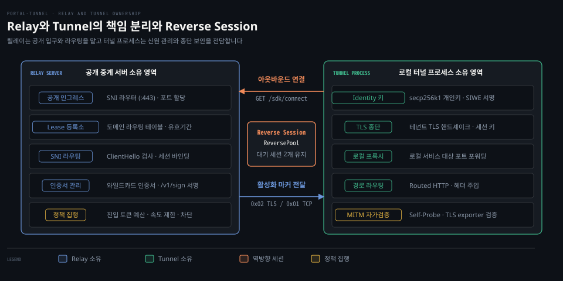
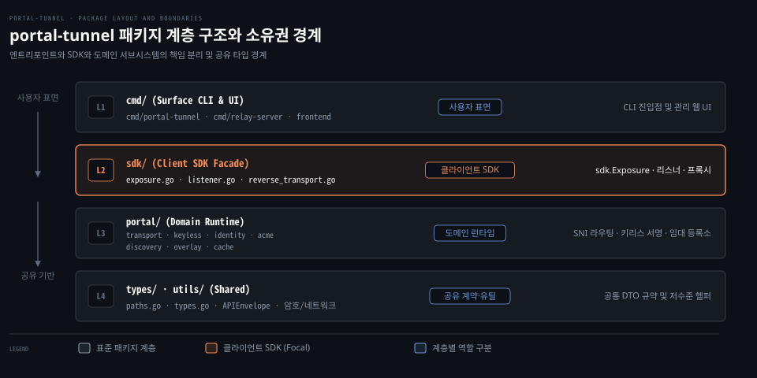

# Concepts

---

> 이 문서는 portal-tunnel 시스템의 핵심 개념과 구성요소 간 책임 분리를 다루는 종합 지도입니다.

## 학습 목표와 범위

> 전체 아키텍처의 책임 분리와 트래픽 전달 흐름을 이해하고 각 서브시스템의 설계 이유를 설명할 수 있습니다.

1. 공용 중계 서버와 로컬 터널 프로세스가 각각 소유하는 자원과 책임 경계를 설명할 수 있습니다.
2. 기본 스트림 경로에서 테넌트 TLS가 릴레이를 거쳐 종단되는 전 과정을 순서대로 추적할 수 있습니다.
3. 정식 호스트명과 친화적 별칭이 공존하는 이유와 시스템 전반의 아키텍처 불변식을 제시할 수 있습니다.

이 문서는 시리즈 전체를 조망하는 개념 지도입니다. 개별 프로토콜의 세부 프레이밍이나 암호학적 서명 검증의 상세 바이트 단위 구현은 후속 편에서 다룹니다.

기준 커밋 0a3b9c06 (2026-10-14)


## 1. Relay 와 Tunnel 의 책임 분리

> 공용 인프라와 테넌트 사설 영역의 소유권을 엄격히 격리해 중계 서버의 애플리케이션 데이터 복호화를 원천 차단합니다.

사설망 내부의 로컬 서비스를 외부에 열기 위해 인바운드 방화벽 포트를 개방하면 보안 위협이 급증합니다. 반대로 중앙 프록시 서버에 TLS 개인키를 맡기고 트래픽을 복호화하게 만들면 프록시 운영자를 전적으로 신뢰해야 하는 신뢰 비용이 발생합니다.

portal-tunnel은 이 문제를 해결하기 위해 시스템 책임을 **릴레이**(Relay)와 **터널 프로세스**(Tunnel Process) 둘로 엄격하게 나눕니다. 릴레이는 공개 443 포트 수신, 도메인 라우팅, 인증서 발급, 서비스 진입 정책 집행을 소유합니다. 터널 프로세스는 고유 신원 키 관리, 테넌트 종단 암호화, 로컬 서비스 연결, 중간자 변조 자가 검증을 전담합니다.

이 구조의 중심에는 **임대**(Lease)가 있습니다. 임대란 터널 프로세스가 릴레이에 특정 호스트명이나 전용 포트를 점유하겠다고 등록한 권한이자 라우팅 상태 레코드입니다. 릴레이는 임대 정보를 바탕으로 트래픽을 전달하지만 테넌트의 평문 바이트나 TLS 세션 키는 전혀 소유하지 않습니다. 둘 사이는 터널이 릴레이를 향해 바깥 방향으로 여는 **역방향 세션**(Reverse Session)으로 이어집니다.



위 도식은 릴레이와 터널 프로세스가 소유하는 자원 칩과 역방향 세션 통로를 보여줍니다. 좌측 릴레이는 라우팅을 맡고 우측 터널은 신원과 종단 보안을 소유하며 중앙의 세션 풀로 결합합니다.

자세한 내용은 다음 편에서 다룹니다:
- `01-03.Control Plane Flow`(예정)
- `01-06.lease·record`(예정)
- `03-03.relay policy`(예정)


## 2. Default Stream Path

> 브라우저에서 출발한 TLS 암호문은 릴레이를 관통하여 터널 프로세스에서 비로소 복호화됩니다.

기존 프록시처럼 공용 서버가 TLS를 종료하면 중계자가 테넌트의 평문 트래픽을 모두 복호화합니다. 다중 테넌트 환경에서 릴레이 운영자가 사용자 데이터를 가로채거나 위조할 위험이 남습니다.

portal-tunnel의 기본 노출 명령어(`portal expose 3000`)가 구성하는 **기본 스트림 경로**(Default Stream Path)는 이 위험을 종단 간 암호화로 제거합니다.

1. **ClientHello 수신**: 외부 브라우저가 릴레이의 443 포트로 접속하여 TLS ClientHello 패킷을 전송합니다.
2. **SNI 라우팅**: 릴레이는 ClientHello 내부의 SNI(Server Name Indication) 호스트명을 살짝 엿보고 일치하는 임대 레코드를 찾은 뒤 대기 중이던 역방향 세션을 선점합니다.
3. **세션 활성화**: 릴레이는 선점한 역방향 세션 연결에 `0x02` 마커 바이트와 16바이트 바인딩 값을 기록하여 세션을 깨웁니다 (`portal/transport/reverse_framing.go:16-17`).
4. **로컬 핸드셰이크**: 터널 프로세스는 세션 활성화 신호를 받아 로컬에서 **키리스 TLS**(Keyless TLS) 핸드셰이크를 직접 완주합니다. 인증서 서명은 릴레이의 `/v1/sign` API를 호출해 얻지만 암호화 세션 키는 로컬 터널 내부 메모리에서만 파생됩니다.
5. **암호문 양방향 전달**: 핸드셰이크가 끝나면 릴레이는 브라우저와 터널 사이에서 암호화된 원시 바이트를 양방향으로 복사(bridge)할 뿐 평문에 일절 접근하지 못합니다.
6. **로컬 포워딩**: 터널 프로세스가 로컬에서 복호화한 평문 HTTP 요청을 실제 로컬 대상(예: `127.0.0.1:3000`)으로 전달합니다.

로컬 실측(2026-10-17, README 「직접 띄워 보기」)에 따르면 터널 프로세스는 기동 직후 릴레이로 2개의 아웃바운드 TCP 역방향 세션(`defaultReadyTarget = 2`, `sdk/listener.go:37`)을 미리 맺어 둡니다. 외부 브라우저 요청이 들어오면 대기 중이던 세션 하나가 소비되고 SDK는 즉시 새로운 역방향 연결을 하나 맺어 풀의 대기 수를 항상 2개로 유지합니다.

자세한 내용은 다음 편에서 다룹니다:
- `01-04.reverse_pool·reverse_framing`(예정)
- `02-02.SNI routing·ClientHello`(예정)
- `02-03.keyless TLS`(예정)


## 3. Routed HTTP Mode

> 단일 공용 도메인 아래에서 여러 로컬 마이크로서비스를 경로 단위로 묶어 라우팅합니다.

프론트엔드 정적 서버와 백엔드 API 서버가 서로 다른 로컬 포트에서 동작하면 포트마다 도메인을 따로 발급받아야 합니다. 이 경우 교차 출처 리소스 공유(CORS) 문제가 발생하고 도메인 관리 비용도 늘어납니다.

portal-tunnel은 `--http-route` 옵션을 제공하는 **경로 기반 HTTP 모드**(Routed HTTP Mode)로 이 문제를 풉니다.

```bash
portal expose --name myapp \
  --http-route /api=http://127.0.0.1:3001 \
  --http-route /=http://127.0.0.1:5173
```

이 모드에서도 릴레이는 순수한 암호화 스트림 전달자 역할만 유지합니다. 스트림을 수신하여 복호화한 로컬 터널 프로세스가 직접 역방향 프록시 로직을 수행합니다.

- **최장 접두사 일치**: 등록된 라우트 규칙 중 가장 긴 경로 접두사를 먼저 대조합니다 (`longest-prefix-first`).
- **접두사 제거**: 상위 업스트림으로 요청을 넘기기 전 마운트된 경로 접두사를 잘라냅니다 (`strip prefix`).
- **전달 헤더 주입**: 원본 클라이언트 접속 정보를 업스트림이 알 수 있도록 `X-Forwarded-Host`와 `X-Forwarded-Proto: https`를 추가합니다.
- **클라이언트 Host 보존**: 모든 업스트림에 클라이언트가 요청한 공용 도메인 호스트명을 온전히 전달합니다.
- **리다이렉트 및 쿠키 재작성**: 업스트림 응답의 `Location` 헤더 경로와 쿠키 경로를 공개 마운트 접두사에 맞게 자동으로 다시 씁니다.

경로 기반 모드에는 인라인 **x402 소액 결제**(x402 Micropayments) 기능도 결합할 수 있습니다. 특정 HTTP 라우트에 가격 정책을 명시하고 수취 지갑 주소를 지정하면 터널이 동일 출처에서 `/x402/prepare` 엔드포인트와 자바스크립트 클라이언트를 서빙합니다. 이 엔드포인트와 클라이언트로 브라우저 지갑의 가스비 없는 서명을 유도하고 결제가 완료된 요청만 업스트림으로 통과시킵니다.

자세한 내용은 다음 편에서 다룹니다:
- `04-01.sdk.Expose·Listener`(예정)
- `04-02.CLI·Agent`(예정)


## 4. Dedicated Raw TCP · UDP Relay

> TLS 가 없는 레거시 서비스와 실시간 데이터그램 프로토콜을 위해 전용 포트와 QUIC 백홀을 배정합니다.

데이터베이스나 게임 서버 같은 순수 TCP 프로토콜은 TLS 핸드셰이크가 없어 단일 443 포트에서 SNI로 목적지를 판별할 수 없습니다. 실시간 데이터 전송에 쓰이는 UDP 프로토콜 역시 호스트명 개념이 없습니다.

portal-tunnel은 이런 비-TLS 트래픽을 위해 전용 포트 할당 방식을 제공합니다.

순수 TCP의 경우 릴레이가 설정된 포트 범위(`MIN_PORT`부터 `MAX_PORT`) 내에서 전용 공용 TCP 포트를 동적으로 할당합니다. 외부 클라이언트가 이 전용 포트로 접속하면 릴레이는 대기 중인 역방향 세션에 `0x01` 마커 바이트를 기록합니다 (`portal/transport/reverse_framing.go:15`). 터널 프로세스는 `0x01`을 확인하고 TLS 핸드셰이크를 건너뛴 채 로컬 대상 포트로 원시 TCP 스트림을 즉시 가교합니다.

UDP 프로토콜 노출은 **QUIC 데이터그램 백홀**(QUIC Datagram Backhaul)을 활용합니다.

```bash
portal expose localhost:8080 --udp --udp-addr localhost:19132
```

릴레이가 공용 UDP 포트를 열고 터널 프로세스는 릴레이의 표준 포트로 ALPN `portal-tunnel`을 갖는 QUIC 연결을 수립합니다. 외부 클라이언트가 UDP 포트로 패킷을 보내면 릴레이는 플로우 식별자(Flow ID)를 부여한 뒤 QUIC DATAGRAM 프레임으로 감싸 터널로 전달합니다. 로컬 터널은 프레임을 풀어 지정된 로컬 UDP 포트로 전달하고 응답 역시 QUIC 데이터그램을 거쳐 외부 클라이언트에게 돌아갑니다.

자세한 내용은 다음 편에서 다룹니다:
- `01-07.quic_backhaul·datagram`(예정)


## 5. MITM Self-Probe

> 릴레이의 악의적인 TLS 세션 가로채기를 터널 프로세스가 런타임에 능동적으로 적발합니다.

종단 간 암호화 구조라도 악의적인 릴레이 운영자가 인증서를 임의로 조작하거나 중간에서 클라이언트 TLS 연결을 가로채 종단(MITM)할 가능성이 남습니다. 테넌트는 릴레이를 무조건 신뢰하지 않고 검증할 수 있는 수단이 필요합니다.

portal-tunnel은 스트림 트래픽이 시작된 후 비동기로 실행되는 **중간자 자가 점검**(MITM Self-Probe) 메커니즘을 내장합니다.

터널 프로세스는 실제 외부 트래픽이 흐르기 시작하면 30초 쿨다운을 거친 뒤 자신의 공개 URL로 직접 TLS 클라이언트 연결을 시도합니다. 이 프로브 연결이 릴레이의 SNI 라우터를 거쳐 다시 자신의 테넌트 서버로 되돌아옵니다.

이때 터널 프로세스는 클라이언트 측과 서버 측 양쪽 끝단에서 TLS exporter(`ExportKeyingMaterial`, TLS 1.3 에서는 RFC 8446 §7.5)로 키 자료를 각각 추출합니다. 양 끝단에서 계산된 암호학적 키 자료가 정확히 일치하면 패킷이 중간에서 복호화되지 않고 온전히 통과했음이 증명됩니다. 값이 어긋나면 릴레이의 무단 TLS 종단으로 판정하며 `--ban-mitm` 플래그가 설정되어 있으면 해당 릴레이를 즉시 차단합니다.

자세한 내용은 다음 편에서 다룹니다:
- `02-04.MITM self-probe`(예정)


## 6. Identity 와 Lease 인증

> 중앙 인증 기관 없이 타원곡선 개인키와 웹3 서명으로 도메인 소유권을 증명하고 자격증명을 얻습니다.

터널을 외부에 등록할 때 중앙 계정 서버나 비밀번호 관리에 의존하면 자격증명 유출과 관리 비용이 뒤따릅니다. 중앙 인증 기관에 의존하지 않는 독립적인 권한 검증이 필요합니다.

portal-tunnel은 로컬에서 독립적으로 생성되는 **암호학적 신원**(Identity) 체계를 사용합니다.

터널 프로세스를 처음 실행하면 `identity.json` 파일에 secp256k1 타원곡선 키 쌍이 생성됩니다. 이 공개키로부터 이더리움 표준 주소(예: `0xF7DC9a...`)가 유도됩니다 (로컬 실측(2026-10-17, README 「직접 띄워 보기」)).

릴레이에 임대를 등록할 때는 EIP-4361 SIWE(Sign-In with Ethereum) 챌린지 메시지를 받아 개인키로 전자서명(`personal_sign`)하여 전송합니다. 릴레이는 서명을 검증하여 주소 소유권을 확인한 후 임대 갱신용 ES256K JWT `access_token`과 역방향 세션 전용 권한 토큰을 별도로 발급합니다. 이 키 파일을 보존하면 세션이 종료된 후에도 동일한 서브도메인 권한을 유지할 수 있습니다.

자세한 내용은 다음 편에서 다룹니다:
- `03-02.identity·SIWE·lease token`(예정)


## 7. Domain Boundary

> 임의의 서브도메인 충돌과 신원 위조를 막기 위해 정식 호스트명과 친화적 별칭의 이중 주소를 유지합니다.

공용 멀티테넌트 릴레이 환경에서는 여러 사용자가 `demo`나 `api`처럼 흔한 이름을 등록하려 할 때 이름 충돌이 발생합니다. 짧은 친화적 도메인만 허용하면 다른 사용자의 유명 서비스 이름을 가로채는 도메인 하이재킹 공격에 취약해집니다.

portal-tunnel은 이 문제를 해결하기 위해 모든 서비스에 **정식 호스트명**(Canonical Hostname)과 **친화적 별칭**(Friendly Alias) 두 가지 주소를 부여합니다.

로컬 실측(2026-10-17, README 「직접 띄워 보기」)에서 `portal expose 13000 --name demo`를 실행했을 때 출력된 두 URL이 바로 이 경계를 보여줍니다.

- **정식 호스트명**: `demo-f7dc9a9730292fb2df94a95e9fbde9e993b1e658.localhost` 처럼 이름 뒤에 SIWE로 검증된 소문자 40자리 이더리움 주소가 결합된 형태입니다.
- **친화적 별칭**: `demo.localhost` 처럼 사용자가 읽고 입력하기 편한 짧은 도메인입니다.

공식 아키텍처 규칙(`architecture/+page.md Control Plane Flow §1`)에 따르면 등록 이름이 22자 이하인 경우 `<name>-<주소40hex>.<root>` 규칙으로 정식 호스트명을 유도합니다. 22자를 초과하면 SHA-256 해시 기반의 21자리 식별자를 사용해 `<21자해시>--<주소40hex>.<root>` 형태로 만듭니다.

친화적 별칭은 선점자가 먼저 점유하면 후속 사용자가 쓸 수 없습니다. 반면 정식 호스트명은 암호학적 주소에 직접 묶여 있으므로 다른 사용자와 결코 충돌하지 않습니다. 릴레이의 정적 캐시 기능(`--serve --cache`) 역시 보안 경계를 보장하기 위해 오직 정식 호스트명 요청만 처리하며 친화적 별칭 요청은 실시간 원본 서버로 강제 우회시킵니다.

자세한 내용은 다음 편에서 다룹니다:
- `01-03.Control Plane Flow`(예정)
- `02-05.ACME·DNS-01·ENS`(예정)


## 8. Architecture Invariants 요약

> 시스템 전반의 보안 모델과 일관성을 지탱하기 위해 코드가 반드시 준수해야 하는 핵심 불변식입니다.

공식 아키텍처 문서(`architecture/+page.md §Architecture Invariants`)는 기능 확장 시 결코 깨뜨려서는 안 되는 설계 제약들을 명시합니다. 학습자가 구현과 리뷰 과정에서 반드시 기억해야 할 핵심 불변식을 아래 표로 정리합니다.

| 도메인 영역 | 핵심 설계 불변식 | 원문 문장 위치 및 내용 |
| :--- | :--- | :--- |
| 전송 및 라우팅 | 순수 TCP 역방향 연결이 표준 스트림 전송 규약이며, WebSocket/yamux는 브라우저 호환 carrier로서 기본 경로에 새 웹소켓 경로를 넣지 않습니다. | Architecture §Transport and Routing: "Raw TCP reverse-connect is the canonical stream transport." |
| TLS 및 신원 | 릴레이는 ClientHello의 SNI만 확인하며 테넌트 TLS는 항상 로컬 터널에서 종단합니다. | Architecture §TLS and Identity: "relay peeks ClientHello for SNI and bridges encrypted bytes; tenant TLS terminates at the tunnel." |
| 키리스 원격 서명 | 릴레이는 `/v1/sign` 서명만 제공하며 세션 키 유도와 핸드셰이크는 로컬 터널이 완주합니다. | Architecture §TLS and Identity: "SDK/tunnel endpoint still runs the TLS server handshake and derives tenant TLS session keys locally." |
| 세션 제어 마커 | 역방향 TCP 세션의 첫 바이트(`0x00`, `0x01`, `0x02`)는 프로토콜 상태를 구분하는 불변 규약입니다. | Architecture §Reverse Session Protocol: "Reverse TCP marker bytes remain protocol state: 0x00 = idle keepalive, 0x01 = raw TCP, 0x02 = TLS activation." |
| 공유 계약 격리 | `types/` 패키지는 통신 와이어 DTO와 공통 경로 상수만 포함하며 구현 로직을 소유하지 않습니다. | Architecture §JSON and Shared Contract: "`types/` is reserved for shared wire/public types and cross-package constants only." |
| 운영 격리 경계 | 릴레이의 모든 인증서와 신원, 영속 상태 파일은 `IDENTITY_PATH` 디렉터리 내부에만 격리 저장합니다. | Architecture §Operational Constraints: "Relay stores its state under `IDENTITY_PATH`, including `identity.json`, `policy.json`, and certificate material." |

이 불변식들은 새로운 기능을 추가하거나 코드를 리팩터링할 때 릴레이가 테넌트 세션 키를 탈취하지 못하게 막고 다중 플랫폼 간 와이어 호환성을 유지하는 절대 기준선이 됩니다.


## 9. 패키지 지도

> CLI 표면에서 SDK 파사드, 도메인 런타임 서브시스템, 공유 타입으로 이어지는 계층형 소유권 구조를 확립합니다.

모놀리식 저장소 안에서 다양한 CLI 도구와 라이브러리가 공존할 때 패키지 간의 순환 참조나 책임 침범이 발생하기 쉽습니다. portal-tunnel은 소스 트리의 패키지별 역할을 명확히 분리합니다 (`docs/maintainer/architecture.md §Package Boundaries`).

| 최상위 디렉터리 경로 | 컴포넌트 역할 | 소유하는 핵심 책임과 파일 |
| :--- | :--- | :--- |
| `cmd/relay-server` | 릴레이 서버 실행 엔트리포인트 | 서버 CLI 플래그 파싱, 정적 프론트엔드 에셋 임베딩, 릴레이 런타임 기동 |
| `cmd/portal-tunnel` | 터널 클라이언트 CLI 엔트리포인트 | `portal expose` 등 사용자 명령어 처리, SDK 파사드 조율 |
| `portal/` | 릴레이 코어 런타임 | 중앙 HTTP API 서버(`api_server.go`), 임대 라우팅 레코드 관리(`record.go`, `lease.go`) |
| `portal/transport` | 역방향 전송 프레이밍 | 마커 프로토콜(`reverse_framing.go`), 세션 풀(`reverse_pool.go`), 브라우저 yamux |
| `portal/keyless` | 키리스 TLS 서브시스템 | 테넌트 TLS 종단 엔진(`t13server`), `/v1/sign` 원격 서명 검증기 |
| `portal/identity` | 웹3 신원 서브시스템 | secp256k1 키 관리, EIP-4361 SIWE 메시지 포맷팅 및 전자서명 복원 검증 |
| `portal/acme` | 자동 인증서 발급 관리 | ACME DNS-01 챌린지 검증, 임베디드 자체 권위 DNS 서버, ENS 도메인 동기화 |
| `portal/discovery` | 릴레이 발견 가십 네트워크 | 릴레이 간 피어 디스커버리, 서명된 디스크립터 발표(`/discovery/announce`) 및 릴레이 선택 |
| `portal/overlay` | 오버레이 네트워크 연동 | 독립 IVNP 오버레이 망을 통한 역방향 스트림 브리징 및 게이트웨이 인증 |
| `portal/cache` | 정적 파일 캐시 서브시스템 | 원본 스냅샷 동기화, 릴레이 저장소 관리, 캐시 만료 주기 제어 |
| `sdk/` | 클라이언트 통합 라이브러리 | 다중 릴레이 리스너(`listener.go`), 노출 인터페이스(`expose.go`), MITM 검증(`mitm.go`) |
| `types/` | 공통 와이어 규약 | DTO 봉투(`APIEnvelope`), 공용 경로 상수(`paths.go`), 에러 코드 정의 |
| `utils/` | 저수준 헬퍼 라이브러리 | 프로세스 신호 처리, 네트워크 다이얼러, 파일 권한 제어, 암호화 보조 함수 |
| `e2e/` | 종단 간 통합 테스트 | 릴레이와 터널 간 실제 다중 프로세스 네트워크 시나리오 검증 하네스 |
| `frontend/` | 웹 관리자 대시보드 | React(TSX, Vite, shadcn) 기반 릴레이 관리 웹 UI 정적 산출물 |
| `docs/` | 공식 문서 소스 | 공식 사이트 문서 소스 및 메인테이너 아키텍처 기술 가이드 |

패키지 의존 관계 실측에 따르면 `cmd/relay-server`는 설치 스크립트 배포를 위해 `cmd/portal-tunnel/installer`를 참조합니다. `cmd/portal-tunnel`은 `portal/discovery`·`portal/identity`·`types`·`utils`와 자기 하위 패키지(agent·tunnel·gateway 등)를 사용합니다. 클라이언트 라이브러리인 `sdk`는 릴레이 코어 중 `portal/cache`·`discovery`·`identity`·`keyless`·`transport`를 선별적으로 참조합니다.

정적 캐시(`portal/cache`), x402 결제 프로토콜, 웹 대시보드(`frontend/`), 그리고 VS Code 확장은 본 학습 문서 시리즈의 핵심 네트워크 전송 범위에서 벗어나므로 이후 편에서 별도로 다루지 않습니다.



위 계층 도식은 고수준 CLI 표면(`cmd/*`)에서 시작하여 클라이언트 SDK(`sdk/`), 릴레이 핵심 런타임(`portal/*`), 그리고 가장 밑단의 공유 계약(`types/`, `utils/`)으로 내려가는 4단계 의존 흐름을 나타냅니다.

자세한 내용은 다음 편에서 다룹니다:
- `04-03.AGENTS.md·e2e 하네스`(예정)
- `05-01.코드 리뷰`(예정)


## 리뷰 노트

> 구현 분석과 공식 문서 대조 과정에서 확인한 환경 마찰과 설계 세부 사항을 기록합니다.

- 로컬 실측(2026-10-17, README 「직접 띄워 보기」) 환경 마찰: 인증서 SAN이 `*.localhost`(와일드카드 아래 한 라벨)일 때 클라이언트 검증 동작이 갈립니다. OpenSSL 3.6과 macOS 기본 curl(LibreSSL)은 이 와일드카드 매칭을 거부합니다(`SSL: no alternative certificate subject name matches target host name`). 반면 Go `crypto/x509`는 매칭을 통과시킵니다(`portal/acme/certificate.go:238`). 원인은 검증기 라이브러리 간 정책 차이로 보입니다(추정). 로컬 개발 환경에서는 `-k` 옵션이 필요하며 향후 자체 호스팅 가이드에 주의 사항으로 추가할 필요가 있습니다.
- `sdk/listener.go:37` 세션 풀 기본값: 공식 개념 문서(`concepts/+page.md`)에는 역방향 세션이 대기한다고만 서술되어 있습니다. 실제 코드에서는 `defaultReadyTarget = 2` 상수로 상시 2개의 유휴 TCP 연결을 선제적으로 열어두고 요청 1건마다 즉시 보충하는 풀 모델로 구현되어 있습니다. 문서의 정적 설명보다 실제 런타임이 훨씬 능동적인 연결 풀 정책을 취합니다.
- `architecture/+page.md §TLS and Identity` HTTP/2 비활성화: 릴레이 관리자 및 API 엔드포인트에서 HTTP/2가 비활성화되어 있습니다. 이는 단순 레거시가 아니라 `/sdk/connect` 엔드포인트의 HTTP/1.1 연결 하이재킹 계약과 키리스 TLS 인증서 공유 메커니즘이 HTTP/1.1 전송 계층에 직접 결합되어 있기 때문입니다.


## 정답 (자답 후 펼치기)

> 본문에서 다룬 핵심 원리와 설계 판단에 대한 자가 점검 정답입니다.

Q1. 릴레이 서버가 외부 브라우저의 TLS 트래픽을 중계하면서도 세션 키나 사용자 평문을 전혀 알 수 없는 이유는 무엇입니까?
- 정답: 릴레이는 외부 브라우저의 ClientHello에서 오직 SNI 도메인 문자열만 읽고 암호화된 TCP 스트림 바이트를 터널 프로세스로 그대로 전달(bridge)합니다. 테넌트 TLS 핸드셰이크를 실제로 완료하고 암호화 세션 키를 유도하는 주체는 로컬 터널 프로세스이기 때문입니다. 릴레이는 원격 서명(`/v1/sign`)만 제공할 뿐 세션 키 유도에는 참여하지 않습니다.

Q2. 왜 짧은 친화적 별칭(Friendly Alias) 외에 긴 주소가 결합된 정식 호스트명(Canonical Hostname)을 별도로 발급합니까?
- 정답: 친화적 별칭은 사용자 간 이름 충돌이 발생할 수 있고 도메인 가로채기(하이재킹) 공격에 취약하기 때문입니다. 정식 호스트명은 터널의 암호학적 secp256k1 주소를 도메인 라벨에 영구 결합하여 전역 유일성과 소유권을 보장하며 정적 캐시 등 엄격한 보안 경계의 기준점으로 사용됩니다.


## 출처와 관련 문서

> 핵심 주장에 사용한 공식 1차 자료와 실측 기록입니다.

- [portal-tunnel GitHub 원전 저장소](https://github.com/gosuda/portal-tunnel/tree/0a3b9c06): 기준 커밋 `0a3b9c06` 소스 트리 및 패키지 구조
- [Portal Concepts 공식 문서](https://gosuda.github.io/portal-tunnel/concepts): 릴레이와 터널의 책임 분리 및 전송 모델
- [Portal Architecture 공식 문서](https://gosuda.github.io/portal-tunnel/architecture): 시스템 시퀀스 다이어그램 및 설계 불변식 규약
- portal-tunnel 로컬 실측 기록(2026-10-17, README 「직접 띄워 보기」): 릴레이 및 터널 로컬 기동 실측 로그
