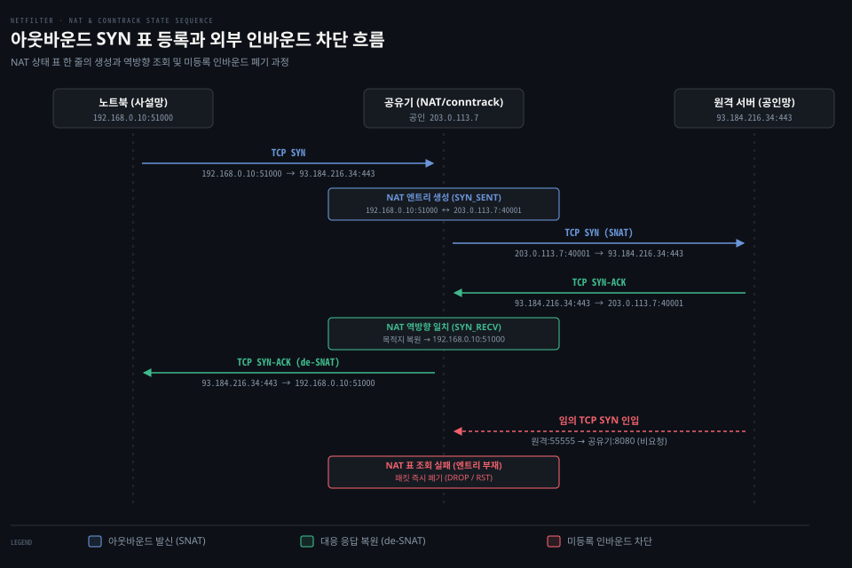
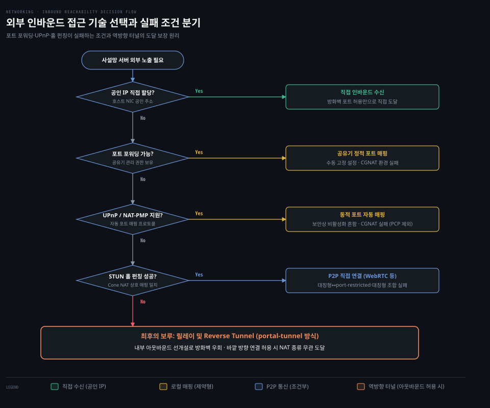

# NAT·conntrack·outbound connection

---

> 이 문서는 사설망 내부의 장치가 왜 외부 인바운드 연결을 직접 받지 못하고, 어떻게 아웃바운드 연결과 conntrack 상태 추적으로 응답을 받으며, reverse tunnel 이 이 비대칭을 어떻게 활용하는지 다루는 기초 개념 문서입니다.

## 학습 목표와 범위

> 사설망과 NAT의 주소 변환 원리, conntrack 상태 추적의 작동 방식, reverse tunnel이 인바운드 방화벽을 우회하는 메커니즘을 이해하고 설명할 수 있습니다.

1. 사설 IP 대역(RFC 1918)과 통신사 CGNAT(RFC 6598) 환경에서 외부에서 내부 호스트로 직접 TCP 연결을 맺을 수 없는 원인을 설명할 수 있습니다.
2. NAT 및 Netfilter conntrack 테이블의 상태 전이와 유휴 타임아웃 메커니즘을 구체적인 주소 변환 표로 제시할 수 있습니다.
3. 포트 포워딩, UPnP, STUN 홀 펀칭, 릴레이(Reverse Tunnel)의 동작 차이와 각 방식이 실패하는 제약 조건을 비교할 수 있습니다.
4. reverse tunnel이 아웃바운드 연결을 통해 인바운드 트래픽을 거꾸로 전달하는 단계별 흐름을 추적할 수 있습니다.

이 문서는 NAT와 conntrack의 네트워크 기초 원리를 다룹니다. 개별 다중화 프레이밍이나 QUIC 데이터그램의 상세 바이트 구조는 후속 편(`01-05.stream_mux·yamux`, `01-07.quic_backhaul·datagram`)으로 넘깁니다.

기준 커밋 0a3b9c06 (2026-10-14)


## 1. 사설 주소와 공인 주소

> 인터넷의 모든 컴퓨터가 서로 직접 통신할 수 없는 이유는 주소 체계의 고갈과 격리 설계에 있습니다.

로컬 개발 환경에서 웹 서버를 띄우면 내 노트북에서는 `http://localhost:3000`이나 `http://192.168.0.10:3000`으로 잘 접속됩니다. 하지만 같은 사무실 동료의 스마트폰이나 외부 카페에서는 이 주소로 내 서버에 접속할 수 없습니다.

컴퓨터가 속한 네트워크가 **사설망**(Private Network)이기 때문입니다. IPv4 주소는 약 43억 개뿐이라 전 세계 장비에 고유한 주소를 하나씩 나눠 주기에 모자랍니다. RFC 1918 §3은 이 문제를 덜려고 세 가지 주소 대역을 규정했습니다. 인터넷 공용 라우터는 이 대역을 중계하지 않으며 로컬 조직은 내부에서만 자유롭게 씁니다:

- `10.0.0.0/8` (`10.0.0.0` ~ `10.255.255.255`)
- `172.16.0.0/12` (`172.16.0.0` ~ `172.31.255.255`)
- `192.168.0.0/16` (`192.168.0.0` ~ `192.168.255.255`)

인터넷 백본의 공용 라우터는 목적지 IP가 위 대역에 속한 패킷을 받으면 바로 버립니다. 여러 조직이 같은 `192.168.0.10`을 겹쳐 쓸 수 있으니 공용 인터넷에서는 목적지를 특정할 수 없기 때문입니다. 사설 IP 주소는 공유기나 로컬 스위치가 만든 내부 울타리를 벗어나는 순간 라우팅 자체가 불가능합니다.

요즘 가정용 인터넷이나 모바일 이동통신망에서는 공유기의 외부 WAN 인터페이스조차 공인 IP를 받지 못하는 경우가 흔합니다. 통신사도 공인 IPv4 주소가 모자라서 가입자 공유기 위에 대규모 주소 변환 장비를 한 겹 더 둡니다. 이것이 **캐리어 등급 NAT**(Carrier-Grade NAT, CGNAT)입니다.

RFC 6598 §7(IANA Considerations)은 CGNAT 전용으로 `100.64.0.0/10` 대역을 정의했습니다. 가정용 공유기의 WAN IP가 `100.64`~`100.127`로 시작한다면 공유기 위에 통신사의 거대한 NAT가 하나 더 있는 2중 NAT 구조에 갇힌 것입니다. 이때는 공유기 설정 화면에서 포트 포워딩을 아무리 걸어도 소용이 없습니다. 통신사 상단 장비에 구멍이 없어서 외부에서는 내 공유기조차 찾아오지 못합니다.


## 2. NAT 가 하는 일

> 나가는 패킷의 출발지 주소를 바꾸고 표에 기록해 두었다가 돌아오는 응답만 원래 주소로 되돌립니다.

내부 사설 주소를 쓰는 노트북이 인터넷의 공용 웹 서버 `93.184.216.34:443`에 접속하려면 중간에서 주소를 바꿔 줄 장비가 필요합니다. 공유기나 라우터가 맡는 이 일을 **네트워크 주소 변환**(Network Address Translation, NAT)이라고 부릅니다.

포트 번호까지 함께 바꾸면 **네트워크 주소 포트 변환**(NAPT)이라 부릅니다. RFC 3022 §2.2와 TCP NAT 동작 표준인 RFC 5382(UDP는 RFC 4787 §4)가 이를 규정합니다.

NAT 장비는 나가는 패킷의 사설 IP와 임의의 포트 번호를 공유기의 공인 IP와 새 포트 번호로 바꾸고 이 매핑을 메모리 안의 **변환 표**(NAT Table)에 적어 둡니다.

연결 하나가 맺어지는 흐름을 주소 변화로 따라가면 세 단계입니다:

1. **아웃바운드 발신 (SNAT)**: 내부 노트북 `192.168.0.10`이 포트 `51000`을 열어 원격 웹 서버 `93.184.216.34:443`으로 TCP SYN 패킷을 보냅니다. 공유기는 이 패킷을 가로채 출발지 주소를 공인 IP `203.0.113.7`로 바꿉니다. 출발지 포트도 충돌 시 또는 장비 정책에 따라 비어 있는 포트 `40001`로 바꿉니다. 리눅스 MASQUERADE/SNAT은 포트 보존(Port Preservation, RFC 4787 REQ-3 권고) 규칙에 따라 충돌이 없으면 원본 포트 `51000`을 유지합니다. 여기서는 변환 과정을 보이려고 포트가 바뀌는 상황을 가정합니다. 변환 표에는 `192.168.0.10:51000 ↔ 203.0.113.7:40001 ↔ 93.184.216.34:443` 엔트리가 기록됩니다.
2. **원격 응답 인입**: 원격 서버는 받은 패킷의 출발지 `203.0.113.7:40001`을 목적지로 삼아 SYN-ACK 패킷을 돌려보냅니다.
3. **인바운드 역변환 (de-SNAT)**: 공유기는 들어온 패킷의 목적지 포트 `40001`과 원격 출발지 `93.184.216.34:443`으로 변환 표를 찾습니다. 방금 적어 둔 엔트리와 맞으므로 목적지 주소를 원래 노트북 주소 `192.168.0.10:51000`으로 되돌려(netfilter의 de-SNAT 처리) 사설망 안으로 넘깁니다.

여기서 결정적인 **연결 비대칭성**(Connection Asymmetry)이 생깁니다.

이번에는 외부의 임의 호스트가 내부 노트북에 먼저 접속하려고 공유기의 공인 IP(`203.0.113.7:8080`)로 TCP SYN 패킷을 보낸다고 가정하겠습니다. 공유기는 목적지 포트로 변환 표를 조회하지만 내부에서 먼저 시작한 연결이 없으니 맞는 엔트리도 없습니다. 공유기는 이 패킷을 사설망의 어느 장비로 보낼지 알 수 없어서 그 자리에서 버리거나 연결 거부(RST) 응답을 돌려보냅니다.



위 시퀀스 도식에서 NAT 표 엔트리는 내부 호스트가 보낸 아웃바운드 SYN 패킷이 만듭니다. 돌아오는 SYN-ACK 응답은 이 엔트리 덕분에 정상적으로 역변환됩니다. 외부에서 먼저 들어온 비요청 SYN 패킷은 표에 맞는 엔트리가 없어 즉시 폐기됩니다.


## 3. 상태 추적(conntrack)과 방화벽

> 방화벽은 패킷 하나하나를 독립적으로 보지 않고 연결의 전후 문맥을 기억하여 통과 여부를 결정합니다.

공유기와 리눅스 라우터는 "안에서 나간 요청의 응답만 들이고 밖에서 시작된 요청은 막는다"는 정책을 넷필터의 **연결 추적**(Connection Tracking, conntrack) 모듈로 구현합니다.

단순한 패킷 필터는 IP 헤더와 TCP 포트만 보므로 돌아오는 패킷이 정당한 응답인지 위조된 공격인지 가리기 어렵습니다. conntrack 서브시스템은 이와 달리 패킷의 흐름을 지켜보며 TCP 3-way 핸드셰이크의 상태 머신을 커널 메모리에 유지합니다.

conntrack은 패킷을 대표적인 4가지 상태로 분류합니다:

- **NEW**: 새로운 연결을 생성하려는 첫 번째 패킷(일반적으로 TCP SYN 패킷).
- **ESTABLISHED**: 양방향 패킷 왕복이 확인되어 정식으로 수립된 연결에 속한 패킷.
- **RELATED**: 기존에 수립된 연결에 의해 부수적으로 파생된 연결(예: FTP 데이터 세션이나 ICMP 오류 통지).
- **INVALID**: 어떤 기존 연결 상태와도 일치하지 않고 정상적인 TCP 순서 번호나 플래그 규칙을 벗어난 비정상 패킷.

리눅스 방화벽(`iptables`/`nftables`)으로 인바운드를 보호할 때는 기본 정책을 드롭으로 두고 허용할 트래픽만 골라 들이는 구성이 표준 관례입니다:

```bash
iptables -P INPUT DROP
iptables -A INPUT -i lo -j ACCEPT
iptables -A INPUT -m conntrack --ctstate ESTABLISHED,RELATED -j ACCEPT
iptables -A INPUT -m conntrack --ctstate INVALID -j DROP
```

이 규칙은 루프백(`lo`) 인터페이스를 허용합니다. 내가 먼저 외부로 접속해 커널 conntrack 표에 올라간 연결이라면 그 응답 패킷(`ESTABLISHED,RELATED`)도 통과시킵니다. 상태를 추적할 수 없는 비정상 패킷(`INVALID`)이나 외부에서 시작된 비요청 새 연결(`NEW`)은 기본 정책(DROP)에 따라 폐기합니다.

공유기처럼 NAT 뒤의 LAN 호스트를 보호하는 장비는 호스트 자체로 들어오는 `INPUT` 체인이 아니라 포워딩 경로인 `FORWARD` 체인에 같은 conntrack 상태 판정 규칙을 적용합니다. 이 규칙 덕분에 내부 호스트는 외부 서버와 세션을 유지하면서 외부에서 시작된 무단 침입 시도를 차단합니다.

네트워크 계층과 커널이 패킷을 판정하는 과정은 아래 문서에서 더 자세히 다룹니다:
- [network-fundamentals-lab 05-01.연결은 양 끝만의 일이 아니다](../../project/network-fundamentals-lab/05-01.연결은 양 끝만의 일이 아니다.md)
- [02-02.Netfilter·Conntrack·라우팅](../../../08_cloud/book/networking-and-kubernetes/02-02.커널이 패킷을 판정하는 층 — Netfilter·Conntrack·라우팅.md)


## 4. 유휴 타임아웃

> 연결 상태를 기록하는 메모리는 유한하므로 조용한 연결의 표 줄은 일정 시간 후 강제로 지워집니다.

공유기와 방화벽 장비의 메모리 용량은 유한합니다. 한 번 맺은 NAT·conntrack 표 엔트리를 영원히 붙들고 있으면 장비 메모리가 금방 바닥나 새 연결을 전혀 맺을 수 없게 됩니다.

모든 NAT 장비와 방화벽 커널이 **유휴 타임아웃**(Idle Timeout) 타이머를 운영하는 이유입니다. 이 타이머는 패킷이 오가지 않는 연결을 주기적으로 정리합니다.

리눅스 커널 Netfilter conntrack은 TCP 상태별 기본 타임아웃 값을 `/proc/sys/net/netfilter/` 경로의 커널 파라미터로 정해 둡니다:

- `nf_conntrack_tcp_timeout_established`: `432000`초 (5일)
- `nf_conntrack_tcp_timeout_syn_sent`: `120`초 (2분)
- `nf_conntrack_tcp_timeout_close_wait`: `60`초 (1분)
- `nf_conntrack_tcp_timeout_time_wait`: `120`초 (2분)

리눅스 표준 커널의 `ESTABLISHED` 기본값은 5일로 넉넉합니다. RFC 5382 REQ-5는 NAT가 종단의 생존 여부를 직접 판단할 수 없을 때 유휴 타임아웃을 최소 2시간 4분 이상으로 유지해야 한다(MUST NOT be less than 2 hours 4 minutes)고 규정합니다. 하지만 일반 가정용 공유기나 상용 엔터프라이즈 방화벽, 클라우드 인프라의 NAT 게이트웨이는 수많은 동시 연결을 감당해야 하므로 타임아웃을 공격적으로 잡습니다.

예를 들어 AWS NAT Gateway의 유휴 타임아웃은 공식적으로 350초(약 5.8분)로 설정되어 있습니다. 보급형 가정용 유무선 공유기도 대다수가 연결이 유휴 상태에 빠지면 수 분에서 수십 분 안에 NAT 테이블 엔트리를 지웁니다.

엔트리가 지워진 뒤에 벌어지는 일은 치명적입니다. 양 끝 호스트의 애플리케이션은 소켓이 아직 열려 있다고 여기는데 중간 NAT 장비는 매핑 정보를 이미 지운 상태입니다. 이때 원격 서버가 데이터를 보내면 NAT 장비는 매핑 대상을 찾지 못해 패킷을 버리거나 TCP RST를 돌려보냅니다. 연결은 예고 없이 끊어집니다.

이 유휴 고사를 막는 가장 보편적인 해법이 **하트비트**(Heartbeat) 또는 **keepalive** 패킷입니다(PCP의 lifetime 갱신 요청이나 NAT 설정 변경 등의 대안도 있습니다). 주고받을 데이터가 없어도 중간 장비의 타임아웃 만료 시점보다 짧은 주기로 더미 패킷을 흘려보내야 합니다. 그래야 conntrack·NAT 테이블 엔트리의 남은 유휴 시간이 432000초 같은 타임아웃 기준치로 다시 채워집니다.


## 5. 밖에서 들어오게 하는 방법들 비교

> 사설망 내부 장비에 도달하기 위한 여러 시도들은 환경의 제약과 보안 정책에 부딪혀 한계를 드러냅니다.

외부에서 사설망 안의 서버에 닿으려 할 때 검토할 만한 네트워크 기술을 표로 비교합니다.

| 기술 | 동작 원리 | 장점 | 실패 조건 및 한계 |
|---|---|---|---|
| **포트 포워딩** (RFC 3022) | 공유기 NAT 표에 특정 외부 포트와 내부 IP:포트를 정적으로 고정 등록 | 설정 완료 시 오버헤드 없이 직접 연결 | 공유기 관리 권한 필수, 공인 IP 필수, CGNAT 2중 NAT 환경에서 작동 불가 |
| **UPnP / NAT-PMP** (RFC 6886) | 내부 프로그램이 공유기 제어 프로토콜로 동적 포트 매핑을 요청 | 수동 공유기 조작 없이 프로그램이 자동 개방 | 악성코드 악용 우려로 기업·가정에서 기본 비활성화 흔함, CGNAT 실패(PCP 제외) |
| **PCP** (RFC 6887) | NAT-PMP 후속 규격으로 호스트가 공유기뿐 아니라 상단 통신사 CGNAT 장비에도 포트 매핑 요청 | CGNAT 2중 NAT 환경에서도 상단 매핑 개방 가능 | 통신사 CGNAT 장비의 PCP 지원 및 정책 허용 필요, 비지원 시 작동 불가 |
| **홀 펀칭** (STUN/ICE, RFC 8489/8445) | 양단이 공용 STUN 서버로 공인 매핑을 파악한 뒤 ICE로 직접 경로 협상 | 중계 서버 부하 없는 직접 P2P 통신 | 대칭형↔port-restricted cone 및 대칭형↔대칭형 조합에서 실패, 엄격한 방화벽 차단 |
| **릴레이 및 역방향 터널** (RFC 8656 TURN 등) | 내부 장비가 외부 릴레이로 아웃바운드 연결을 먼저 맺고 대기 | 인바운드 정책과 NAT 유형에 무관하게, 아웃바운드 TLS가 허용되는 한 도달 보장 | 모든 트래픽이 릴레이를 경유하므로 지연 발생, egress 차단·MITM 환경 제한 |

표의 대칭형 NAT와 원뿔형 NAT는 RFC 3489의 고전 분류 용어입니다. RFC 4787과 RFC 5382는 이 분류의 한계를 지적하고 NAT 동작을 매핑과 필터링 동작으로 나누어 다시 정의했습니다. 매핑 동작은 UDP 표준인 RFC 4787과 TCP 표준인 RFC 5382 모두 EIM, ADM, APDM으로 세분합니다.

고전 개념으로 보면 원뿔형 NAT(EIM)는 목적지가 달라도 같은 내부 소켓에는 늘 같은 공인 포트 매핑을 재사용합니다. 대칭형 NAT(APDM)는 반대로 목적지 IP나 포트가 다르면 서로 다른 공인 포트를 할당합니다.

STUN/ICE 기반 홀 펀칭은 Cone NAT 환경에서 양쪽이 STUN 서버로 확인한 공인 매핑에 패킷을 보내 연결에 성공합니다. 한쪽이 대칭형 NAT여도 상대가 Full-cone이나 Address-restricted cone이라면 대칭형 쪽이 상대의 알려진 매핑으로 패킷을 먼저 보내 상대 필터를 통과시킬 수 있습니다.

대칭형↔Port-restricted cone이나 대칭형↔대칭형 조합은 사정이 다릅니다. 상대의 매핑 포트를 특정하기 어려워 홀 펀칭이 통상 실패합니다. 포트가 순차 할당되는 장비라면 포트 번호 예측 기법으로 성공하기도 하지만 무작위 포트 할당이나 엄격한 기업 방화벽 환경에서는 연결이 성립하지 않습니다.

모바일 망, 기숙사, 카페, 사내망처럼 네트워크를 통제할 수 없는 곳에서 외부 접근을 확보하는 가장 확실한 해법은 결국 **릴레이**(Relay)와 **역방향 터널**(Reverse Tunnel)입니다. 양단 모두 공인 IPv6 주소를 받아 직접 통신하는 환경도 대안이지만 레거시 IPv4 사설망에서는 보편적으로 적용하기 어렵습니다.

역방향 터널은 아웃바운드 TLS 연결이 허용되는 한 인바운드 정책이나 NAT 유형과 상관없이 안정적으로 닿습니다. 다만 엄격한 아웃바운드 egress 차단 정책이나 MITM 프록시 환경에서는 연결이 제한될 수 있습니다.



위 플로우차트에는 외부 도달 경로를 정할 때 마주치는 기술적 갈림길이 담겨 있습니다. 공인 IP와 포트 제어권이 없는 환경에서는 포트 포워딩, UPnP, 홀 펀칭이 차례로 배제됩니다. 마지막까지 남는 선택지는 역방향 터널이며 아웃바운드 연결이 허용되는 한 안정적인 도달성을 보장합니다.


## 6. reverse tunnel 의 원리

> 나가는 연결은 자유롭다는 네트워크의 특성을 역이용하여 외부 요청을 거꾸로 흐르게 만듭니다.

사설망 안에서 서비스를 운영할 때 인바운드 방화벽 포트를 열려면 보안 관리자의 승인을 받기 어렵고 침입 경로를 열어 주는 위험도 따릅니다. 공유기 설정을 바꿀 수 없는 환경이라면 서비스 노출 자체가 불가능해집니다.

역방향 터널은 방화벽의 비대칭성을 이용해 이 난관을 넘습니다. "외부에서 안으로 들어오는 문은 닫혀 있지만 안에서 밖으로 나가는 문은 활짝 열려 있다"는 비대칭입니다.

사설망 안의 호스트가 외부 공인 중계 서버로 아웃바운드 연결을 먼저 열어 둡니다. 외부에서 도착한 요청은 그 연결 통로로 거꾸로 밀어 넣어 서비스합니다.

브라우저가 사설망 안의 로컬 웹 서버(`http://localhost:3000`)에 보낸 HTTP 요청은 네 단계를 거쳐 처리됩니다:

1. **역방향 세션 수립 (사전 준비)**: 사설망 내부의 터널 에이전트(노트북)가 인터넷 공용 공간에 떠 있는 릴레이 서버(`relay.portal.dev:443`)로 아웃바운드 TCP 연결을 맺습니다.
   - 내부 공유기와 방화벽은 이 연결을 내부 호스트가 시작한 정상 아웃바운드 트래픽으로 판정해 NAT·conntrack 표에 `ESTABLISHED` 엔트리를 만듭니다.
   - 릴레이 서버는 이 연결을 즉시 닫지 않고 메모리 풀에 대기 상태로 보관합니다.
2. **외부 사용자 요청 도착**: 세계 어디에 있든 사용자 브라우저는 도메인 주소(`https://my-app.portal.dev`)로 릴레이 서버의 공용 443 포트에 TCP 핸드셰이크를 맺고 HTTP 요청 패킷을 보냅니다.
3. **가상 브리지 결합과 역방향 전달**: 릴레이 서버는 브라우저가 요청한 도메인 이름을 확인한 뒤 그 테넌트 몫으로 미리 대기시켜 둔 역방향 TCP 소켓을 풀에서 꺼냅니다.
   - 릴레이는 외부 브라우저 소켓과 내부 터널의 역방향 소켓 사이에서 패킷 바이트를 단순히 양방향 복사(Bridge)합니다.
   - 브라우저의 HTTP 요청 바이트는 미리 열려 있던 역방향 TCP 연결을 타고 거꾸로 사설망 안으로 흘러 들어갑니다.
4. **로컬 처리 및 응답 반환**: 사설망 안의 터널 프로세스는 역방향 소켓에서 흘러나온 HTTP 요청을 읽어 로컬에서 실행 중인 웹 서버(`http://localhost:3000`)로 넘깁니다.
   - 로컬 웹 서버가 만든 HTTP 200 응답 바이트는 터널 프로세스를 거쳐 다시 역방향 TCP 파이프를 타고 릴레이로 올라갑니다.
   - 릴레이가 이 바이트를 기다리던 브라우저 소켓으로 넘기면 화면에 웹 페이지가 표시됩니다.

아웃바운드 통신이 허용되는 환경이라면 인바운드 방화벽 규칙을 단 1개도 고칠 필요가 없고 공유기 포트 포워딩 권한이 없어도 안정적인 인그레스 경로가 열립니다. 이 방식의 핵심 이점입니다.


## 7. 직접 보기 — 리눅스에서 conntrack 과 ss 확인

> 커널이 관리하는 실제 연결 표와 소켓 상태를 명령어로 직접 관찰할 수 있습니다.

연결이 왜 끊어지는지 또는 NAT 표에 내 연결이 제대로 올라가 있는지 확인하지 못하면 네트워크 트러블슈팅은 추측에 기대게 됩니다. 리눅스는 커널 conntrack 모듈이 관리하는 세션 정보와 로컬 프로세스의 소켓 상태를 직접 들여다보는 진단 도구를 제공합니다.

첫 번째 도구는 `conntrack-tools` 패키지가 제공하는 `conntrack -L` 명령(또는 커널 가상 파일 시스템인 `cat /proc/net/nf_conntrack`)입니다. `/proc/net/nf_conntrack`는 배포판 커널의 `CONFIG_NF_CONNTRACK_PROCFS` 옵션이 켜져 있어야 존재하며 줄 앞에 `ipv4     2` 같은 3계층 프로토콜 필드가 추가로 표시됩니다.

NAT 변환을 직접 수행하는 리눅스 라우터에서 `conntrack -L`을 실행하면 이런 형식의 레코드가 나옵니다(내부 노트북에서 직접 실행하면 reply 방향 dst가 공유기 공인 IP가 아닌 로컬 IP `192.168.0.10`으로 보입니다):

```bash
tcp      6 431998 ESTABLISHED src=192.168.0.10 dst=93.184.216.34 sport=51000 dport=443 \
                       src=93.184.216.34 dst=203.0.113.7 sport=443 dport=40001 [ASSURED] mark=0 use=1
```

필드를 하나씩 읽으면 커널이 패킷을 어떻게 기억하고 변환하는지 드러납니다:

- `tcp 6`: 전송 계층 프로토콜 이름과 IP 프로토콜 번호(TCP는 6).
- `431998`: 이 엔트리가 만료되어 메모리에서 삭제되기까지 남은 유휴 시간(초 단위, 기본 432000초에서 카운트다운).
- `ESTABLISHED`: conntrack 커널 상태 머신상의 현재 연결 상태.
- `src=192.168.0.10 dst=... sport=51000 dport=443`: 요청 방향의 4계층 튜플.
- `src=93.184.216.34 dst=203.0.113.7 sport=443 dport=40001`: 응답 방향의 기대 튜플입니다. 목적지 IP는 공유기 공인 IP(`203.0.113.7`)로, 목적지 포트는 `40001`로 바뀐 채 응답을 기다립니다.
- `[ASSURED]`: 양방향으로 유효한 트래픽 왕복이 확인된 연결이라는 표시입니다. 커널 메모리 공간이 부족해질 때 비정상 세션이 먼저 정리되며 ASSURED 마킹이 붙은 세션은 강제 축출 우선순위에서 보호됩니다.

두 번째 도구는 소켓 상태를 진단하는 `ss -tnp` 명령입니다:

```bash
ss -tnp
```

실행하면 로컬 장비의 활성 TCP 소켓 목록과 소켓을 소유한 프로세스 이름·PID(`users:(("portal",pid=1234,fd=7))`)가 나옵니다. 역방향 터널 프로세스가 릴레이 서버의 443 포트로 `ESTABLISHED` 상태를 안정적으로 유지하는지 확인할 때 씁니다.


## 8. portal 에서는

> 포털 터널은 이 비대칭성과 유휴 타임아웃의 현실적인 제약을 3가지 핵심 메커니즘으로 돌파합니다.

단순한 아웃바운드 연결만으로는 실제 프로덕션 환경의 클라이언트 접속 지연과 중간 공유기의 세션 만료 문제를 해결할 수 없습니다. 포털 터널(`gosuda/portal-tunnel`) 코드베이스는 NAT와 conntrack의 특성을 구현 깊숙이 반영합니다:

1. **사전 연결 풀 2개 유지 (`sdk/listener.go:37`, `01-03`, `01-04`)**:
   외부 사용자가 웹 사이트에 접속한 뒤에야 터널이 릴레이로 리버스 소켓을 연결하면 TCP 핸드셰이크 지연 시간이 첫 방문자에게 그대로 넘어갑니다.
   포털 터널 SDK는 `sdk/listener.go:37`의 상수 `defaultReadyTarget = 2`에 따라 외부 요청이 들어오기 전부터 리버스 TCP 연결 2개를 릴레이 쪽으로 늘 열어 둡니다.
   로컬 실측(2026-10-17, README 「직접 띄워 보기」)에서도 터널 에이전트를 띄우자마자 릴레이 로그에 `ready=1`, `ready=2`가 찍혀 아웃바운드 연결 2개가 먼저 확보되는 모습을 볼 수 있습니다.
2. **15초 주기 `0x00` 하트비트 (`portal/lease.go:33`, `portal/transport/reverse_framing.go:14,74`, `01-04`)**:
   가정용 공유기나 상용 NAT 장비의 conntrack 표는 패킷이 없는 유휴 소켓을 수 분 내에 폐기합니다.
   릴레이는 이를 막으려고 `portal/lease.go:33`의 기본 유휴 주기(`defaultIdleKeepalive = 15 * time.Second`)를 씁니다. `portal/transport/reverse_pool.go:186-200`(`keepIdle`)의 티커(ticker)가 대기 풀을 순회합니다. 아직 브라우저 세션에 할당되지 않은 유휴 소켓에는 `portal/transport/reverse_framing.go:74`의 `WriteKeepalive`를 호출합니다.
   이 함수는 소켓에 단 1바이트짜리 하트비트 마커 `0x00`(`markerKeepalive = 0x00`)을 기록합니다. 리버스 연결은 `reverseTLS`(`sdk/reverse_transport.go:53-58`, `openRaw`)로 감싸져 있어서 평문 1바이트인 이 `0x00`도 회선에서는 TLS 1.3 레코드 한 개(약 23바이트)로 전송됩니다. 이 패킷과 뒤따르는 TCP ACK 회신을 본 중간 NAT 장비는 세션이 살아 있다고 인식해 conntrack 엔트리를 유지합니다. 터널 측 수신 루프(`ReadStart`, `reverse_framing.go:45-47`)는 `0x00`을 읽으면 무시하고 다음 바이트를 계속 기다립니다.
3. **열린 이슈 #470: NAT-PMP/UPnP 직접 인그레스 (`03장`, `05-01`)**:
   역방향 터널에서는 모든 사용자 트래픽이 릴레이 서버를 거칩니다. 안전하지만 대규모 파일을 전송하면 릴레이 서버의 대역폭과 비용 부담이 커집니다.
   현재 포털 저장소의 오픈 이슈 `#470: Add NAT-PMP/UPnP direct ingress with relay fallback`이 이 문제를 다룹니다. UPnP로 공유기 포트 개방을 먼저 시도하고 실패하거나 CGNAT 환경일 때만 릴레이로 폴백하는 로드맵입니다.


## 자가 점검 질문

1. **질문 1**: 가정용 공유기 내부의 노트북에서 웹 서버를 띄웠을 때 외부에서 직접 접속할 수 없는 이유를 RFC 1918 사설 주소와 NAT 연결 비대칭성의 관점에서 설명하십시오.
2. **질문 2**: 리눅스 Netfilter conntrack의 `ESTABLISHED` 기본 타임아웃은 5일(`432000`초)에 달하지만 왜 포털 터널은 15초마다 `0x00` 하트비트를 보내야 합니까?
3. **질문 3**: STUN/ICE 기반의 홀 펀칭 기술이 대칭형 NAT(Symmetric NAT) 조합이나 기업 방화벽 환경에서 통상 실패하는 이유와 reverse tunnel이 높은 도달성을 확보할 수 있는 이유는 무엇입니까?


## 리뷰 노트

> 코드 분석 과정에서 확인한 릴레이 큐 한도 설정과 읽기 타임아웃 재연결 동작입니다.

- `portal/lease.go:33-34` 및 `sdk/listener.go:37`: 터널 에이전트는 2개의 유휴 리버스 연결(`defaultReadyTarget = 2`)을 유지합니다. 릴레이 ReversePool의 기본 한도는 8개(`defaultReadyQueueLimit = 8`)입니다. 릴레이 큐 한도 8개는 60초 읽기 데드라인 만료로 생기는 중복 연결을 흡수할 안전 여유분으로 해석됩니다(추정, 근거 미확인).
- `portal/transport/reverse_framing.go:45-47`: 터널은 15초마다 들어오는 `0x00` 하트비트를 무시하고 연결을 유지합니다. 네트워크 단절로 읽기 데드라인 동안 바이트를 받지 못하면 타임아웃 오류를 반환하고 3초 대기 후(`defaultRetryWait = 3s`, `sdk/listener.go:38`) 소켓을 재연결합니다.


## 출처와 관련 문서

- [RFC 1918: Address Allocation for Private Internets](https://datatracker.ietf.org/doc/html/rfc1918): 사설 IP 대역(10/8, 172.16/12, 192.168/16) 규정
- [RFC 6598: IANA-Reserved IPv4 Prefix for Shared Address Space](https://datatracker.ietf.org/doc/html/rfc6598): 통신사 CGNAT(100.64.0.0/10) 대역 정의
- [RFC 3022: Traditional IP Network Address Translator (Traditional NAT)](https://datatracker.ietf.org/doc/html/rfc3022): 전통적인 NAPT/NAT 주소 변환 원리
- [RFC 4787: Network Address Translation (NAT) Behavioral Requirements for Unicast UDP](https://datatracker.ietf.org/doc/html/rfc4787): RFC 3489 고전 분류를 매핑(EIM/ADM/APDM) 및 필터링 동작으로 재정의한 UDP NAT 표준
- [RFC 5382: NAT Behavioral Requirements for TCP](https://datatracker.ietf.org/doc/html/rfc5382): TCP NAT 매핑·필터링 요구사항 및 ESTABLISHED 유휴 타임아웃(REQ-5)
- [RFC 8489: Session Traversal Utilities for NAT (STUN)](https://datatracker.ietf.org/doc/html/rfc8489): STUN을 통한 공인 주소 확인 및 홀 펀칭(RFC 5389 폐기 후 현행)
- [RFC 8656: Traversal Using Relays around NAT (TURN)](https://datatracker.ietf.org/doc/html/rfc8656): 릴레이 서버 기반의 NAT 통과 표준(RFC 5766 폐기 후 현행)
- [RFC 8445: Interactive Connectivity Establishment (ICE)](https://datatracker.ietf.org/doc/html/rfc8445): STUN/TURN 후보를 종합하여 최적 경로를 수립하는 P2P 프로토콜
- [RFC 6886: NAT Port Mapping Protocol (NAT-PMP)](https://datatracker.ietf.org/doc/html/rfc6886): 클라이언트-공유기 간 포트 자동 매핑
- [RFC 6887: Port Control Protocol (PCP)](https://datatracker.ietf.org/doc/html/rfc6887): NAT-PMP를 확장하여 CGNAT 환경까지 지원하는 포트 제어 프로토콜
- [00-01.What is Portal·비교 제품.md](00-01.What%20is%20Portal·비교%20제품.md): reverse tunnel 기반 인그레스 제품군 비교
- [00-02.Concepts.md](00-02.Concepts.md): 릴레이와 터널의 책임 분리 및 아키텍처 개요
- [01-03.Control Plane Flow.md](01-03.Control%20Plane%20Flow.md): 터널 등록과 2개 사전 리버스 연결 수립 흐름
- [01-04.reverse_pool·reverse_framing.md](01-04.reverse_pool·reverse_framing.md): 리버스 연결 풀 관리 및 0x00 하트비트 프레이밍 세부


## 정답 (자답 후 펼치기)

1. **정답 1**: RFC 1918 사설 IP 대역(`192.168.x.x` 등)은 공용 인터넷 라우터에서 라우팅되지 않고 즉시 폐기되므로 외부에서 직접 패킷을 보낼 수 없습니다. NAT 장비도 내부에서 외부로 먼저 나간 아웃바운드 패킷의 변환 쌍만 표에 기록하고 그 응답만 역변환합니다. 그래서 외부에서 먼저 들어온 비요청(Unsolicited) 인바운드 패킷은 변환 표에 일치하는 엔트리가 없어 폐기됩니다.
2. **정답 2**: 리눅스 커널의 기본 conntrack 타임아웃은 5일이지만 실제 경로의 중간 장비인 보급형 공유기, 방화벽, AWS NAT Gateway 등은 메모리를 아끼려고 짧은 유휴 타임아웃을 적용합니다. 15초마다 1바이트 패킷과 TCP ACK를 주고받아야 중간 NAT 장비들의 표 수명이 계속 리셋됩니다.
3. **정답 3**: STUN/ICE 홀 펀칭은 양단 매핑을 파악해 직접 연결을 뚫습니다. 그런데 대칭형 NAT와 Port-restricted cone 조합이나 대칭형끼리의 조합에서는 목적지에 따라 달라지는 포트 매핑을 확정하기 어려워 연결에 실패합니다(순차 예측 실패 또는 무작위 할당 시). 대칭형과 Full-cone 또는 Address-restricted cone 조합은 상대 필터 조건에 따라 성공할 수 있습니다. reverse tunnel은 이와 달리 아웃바운드 방향으로 공인 릴레이에 먼저 연결을 수립해 두고 트래픽을 거꾸로 중계합니다. 그래서 아웃바운드 연결이 허용되는 한 중간 NAT 유형이나 인바운드 차단 정책과 무관하게 연결이 성립합니다.
