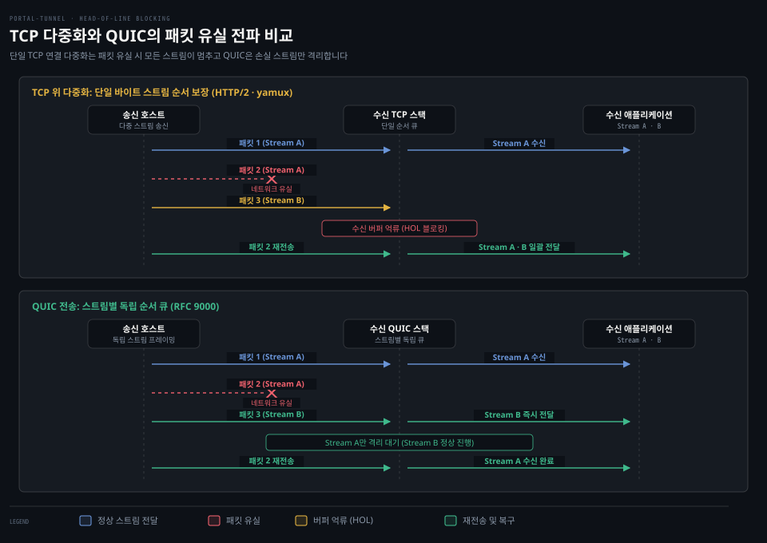
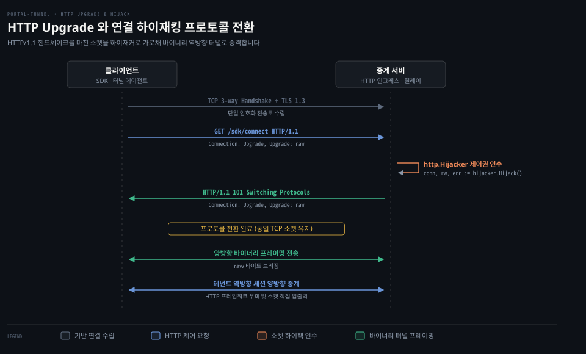

# Stream multiplexing·HTTP Upgrade·QUIC

---

> 연결 하나로 여러 스트림을 동시에 교환하는 다중화 원리와 TCP 헤드오브라인 차단의 한계, 이를 해결한 QUIC 전송 규약, 그리고 기존 HTTP 연결을 승격하는 HTTP Upgrade 메커니즘을 살펴봅니다.

## 학습 목표와 범위

> 다중화 프레이밍, 절반 종료(half-close), 전송 계층 블로킹, 프로토콜 승격의 원리를 비교하고 포털 터널의 전송 캐리어 설계를 설명할 수 있습니다.

1. 단일 연결에서 여러 요청을 주고받기 위한 프레이밍 및 스트림 식별 원리와 흐름 제어 창의 역할을 설명할 수 있습니다.
2. TCP 기반 다중화에서 단일 패킷 손실이 무관한 스트림까지 멈추게 하는 헤드오브라인 블로킹의 원인을 규명하고 QUIC이 이를 해결한 방식을 비교할 수 있습니다.
3. 양방향 통신에서 송신 종료와 수신 지속을 분리하는 절반 종료(half-close)의 동작과 수명주기 관리 규칙을 제시할 수 있습니다.
4. HTTP/1.1 Upgrade 헤더와 101 응답, 소켓 하이재킹으로 기존 전송로를 임의의 바이너리 프로토콜로 전환하는 흐름을 설명할 수 있습니다.
5. 포털 터널이 네이티브 TCP 풀, 브라우저 웹소켓 yamux, 비신뢰성 UDP QUIC 백홀을 목적에 맞게 조합한 근거를 설명할 수 있습니다.

이 문서는 애플리케이션 계층 다중화와 전송 규약의 기초 원리를 다룹니다. 릴레이의 분산 라우팅이나 블록체인 기반 신원 인증은 다른 편에서 설명합니다.

기준 커밋 129b6de5 (2026-10-20)


## 1. 연결 하나에 요청 하나의 비용

> 요청마다 새 TCP 연결을 맺으면 핸드셰이크와 암호화 협상, 혼잡 제어 초기화 비용이 반복되어 네트워크 지연이 급증합니다.

초기 HTTP/1.0 환경에서는 단일 요청을 처리할 때마다 새로운 TCP 연결을 맺고 응답 직후 연결을 끊었습니다. 웹 페이지 하나에 수십 개의 이미지와 스타일시트가 들어가자 이 방식으로는 성능이 크게 떨어졌습니다.

클라이언트와 서버가 연결을 맺을 때마다 TCP 3-way handshake로 패킷이 한 번 왕복하는 시간(1 RTT, Round-Trip Time)만큼 지연이 추가됩니다. 여기에 HTTPS를 적용하면 TLS 1.3 기준으로도 핸드셰이크에 1 RTT가 더 듭니다. 운영체제 커널에서도 소켓 생성과 파일 디스크립터 할당, 송수신 버퍼 확보가 매번 반복됩니다.

더 큰 문제는 TCP의 혼잡 제어 메커니즘인 **느린 시작**(Slow Start)입니다. 새 연결은 네트워크의 가용 대역폭을 알지 못하므로 작은 혼잡 창에서 출발합니다. 패킷 왕복을 거치며 창을 조금씩 키우는 동안 단발성 연결은 대역폭을 다 쓰지도 못하고 끝납니다.

HTTP/1.1은 이 비용을 줄이려고 **지속 연결**(persistent connection, RFC 9112 §9.3) 모델을 기본으로 도입했습니다. 별도 헤더 없이도 한 번 수립한 TCP 연결을 닫지 않고 후속 요청에 재사용하며 연결을 종료할 때만 `Connection: close` 헤더를 보냅니다(`Connection: keep-alive`는 HTTP/1.0의 비표준 확장입니다). 하지만 HTTP/1.1의 지속 연결에도 한계가 있습니다.

단일 연결 위에서 요청과 응답은 반드시 순서대로 직렬화되어 오가야 합니다. 요청을 연달아 보내는 파이프라이닝 기술이 제안되었지만 서버는 여전히 요청이 들어온 순서대로 응답을 반환해야 했습니다. 첫 요청의 처리가 늦어지면 뒤따르는 응답이 모두 대기 큐에 묶였습니다. 브라우저는 호스트당 6개 안팎의 TCP 연결을 동시에 열어 이를 우회했지만 서버 자원 낭비와 네트워크 혼잡이 늘었습니다.


## 2. 다중화의 기본 모델과 프레임 헤더

> 요청마다 새 연결을 열지 않고 지속 연결 하나만 쓸 때 발생하는 직렬화 병목을 해결하려면 프레임 단위 다중화가 필요합니다.

단일 연결의 직렬화 병목을 푸는 원리가 **스트림 다중화**(Stream Multiplexing)입니다. 다중화는 전송할 바이트 스트림을 프레임이라는 독립된 작은 단위로 조각냅니다. 프레임 머리에는 그 데이터가 어느 논리 대화에 속하는지 알려 주는 스트림 식별자를 붙입니다.

송신측은 여러 스트림의 프레임을 물리 연결 하나에 번갈아 끼워 넣습니다. 수신측은 도착한 프레임의 스트림 식별자를 보고 스트림별 버퍼로 나눠 담아 원래 데이터를 다시 조립합니다. 어느 한 스트림의 처리가 길어져도 다른 스트림의 프레임이 그 사이를 통과하므로 연결 전체가 멈추지 않습니다.

다중화 프로토콜에는 프레임으로 상태를 제어하는 장치 세 가지가 공통으로 들어 있습니다.

- **스트림 개설과 종료**: 새 스트림을 시작하는 개설 신호와 송신 종료를 알리는 완료 신호를 프레임 플래그로 전달합니다.
- **스트림 식별자 규칙**: yamux와 HTTP/2 기준으로 양측이 동시에 스트림을 열어도 번호가 겹치지 않도록 클라이언트는 홀수 번호, 서버는 짝수 번호를 사용합니다. 식별자 0은 연결 전체 제어용으로 예약합니다.
- **흐름 제어 창**: 수신측 버퍼 고갈을 막도록 수신 가능한 바이트 한도를 통지하고 소비에 맞춰 창 갱신 프레임을 보냅니다.

HashiCorp의 경량 다중화 프로토콜 yamux는 명세에서 12바이트 고정 크기 헤더를 정의합니다.

```pseudocode
+----------------+----------------+----------------+----------------+
|  Version (8b)  |   Type (8b)    |           Flags (16b)           |
+----------------+----------------+----------------+----------------+
|                          StreamID (32b)                           |
+----------------+----------------+----------------+----------------+
|                           Length (32b)                            |
+----------------+----------------+----------------+----------------+
```

yamux 헤더 12바이트는 아래 필드로 나뉩니다.

- `Version` (1바이트): 프로토콜 버전이며 현재 `0x00`을 사용합니다.
- `Type` (1바이트): 프레임 유형을 지정합니다. 데이터 전송(`0x0`), 흐름 제어 창 갱신(`0x1`), 핑 세션 점검(`0x2`), 세션 종료 통지(`0x3`)를 구분합니다.
- `Flags` (2바이트): 스트림 상태 플래그입니다. 개설 `SYN`(`0x0001`), 수락 `ACK`(`0x0002`), 종료 `FIN`(`0x0004`), 강제 리셋 `RST`(`0x0008`) 비트를 조합합니다.
- `StreamID` (4바이트): 대상 논리 스트림 번호입니다.
- `Length` (4바이트): 데이터 프레임에서는 페이로드 바이트 길이이고 창 갱신 프레임에서는 추가 제공 윈도우 크기입니다.

예를 들어 클라이언트가 스트림 3번을 열면서 첫 데이터 256바이트를 보내면 헤더 바이트는 `00 00 00 01 00 00 00 03 00 00 01 00`이 됩니다. 버전 0, 데이터 타입(`0x0`), SYN 플래그(`0x0001`), 스트림 ID 3, 페이로드 길이 256이 순서대로 놓입니다. yamux 명세가 허용하는 형태입니다. 단 포털 터널이 쓰는 hashicorp/yamux Go 구현체는 스트림을 열 때 데이터 대신 창 갱신 타입 `0x1`에 SYN 플래그를 실은 프레임을 먼저 보냅니다.

웹 표준인 HTTP/2(RFC 9113 §4.1)도 같은 프레이밍 원리로 동작하며 9바이트 헤더로 헤더 프레임과 데이터 프레임을 다중화합니다.


## 3. 절반 종료(half-close)와 스트림 수명

> 요청 본문 전송을 마쳤다고 해서 연결 전체를 닫아 버리면 서버가 돌려주는 응답 데이터를 읽을 수 없습니다.

네트워크 통신에서 연결 종료는 단순한 양방향 차단에 그치지 않습니다. 한쪽 종단이 요청 데이터는 다 보냈지만 서버가 처리한 뒤 보내올 응답은 아직 받아야 하는 상황이 자주 생깁니다. 이렇게 자신의 송신 방향만 닫고 수신 방향은 열어 두는 상태를 **절반 종료**(half-close, 송신측 종료)라고 부릅니다.

운영체제의 표준 TCP 소켓 계층에서 절반 종료는 POSIX `shutdown(fd, SHUT_WR)` 시스템 콜로 구현됩니다. 일반 `close(fd)`는 소켓 전체를 닫으며 정상 상태에서는 FIN 세그먼트로 종료합니다. 하지만 close 시점에 수신 버퍼에 읽지 않은 데이터가 남았거나 `SO_LINGER`가 0인 경우, 혹은 닫힌 뒤 데이터가 도착하면 RST를 보내 연결을 강제로 초기화합니다.

`shutdown(SHUT_WR)`은 송신 방향으로만 FIN 세그먼트를 내보내고 수신 스트림은 그대로 살려 둡니다. Go 언어의 `net.TCPConn`에서는 `CloseWrite()` 메서드가 같은 일을 합니다.

다중화 프로토콜은 이 절반 종료를 스트림 단위로 그대로 가져옵니다. yamux에서는 `Stream.Close()`가 호출되면 그 스트림 헤더에 `FIN`(`0x0004`) 플래그를 실어 보냅니다. 상대는 이 프레임을 받고 그 스트림의 입력이 끝났음을 알지만 반대 방향으로는 여전히 데이터를 보낼 수 있습니다. HTTP/2는 마지막 데이터 프레임에 `END_STREAM` 플래그를 실어 같은 절반 종료 상태를 나타냅니다.

일반 HTTP 요청은 `Content-Length` 헤더나 청크 전송 인코딩(chunked transfer encoding)으로 본문 경계를 표시하므로 절반 종료 없이도 응답을 받을 수 있습니다. 하지만 포털 터널의 TLS 암호문 브리징 같은 원시 바이트 터널은 애플리케이션 프레임 경계 없이 순수 바이트 스트림을 전달합니다. 이런 터널에서는 송신 방향의 EOF가 데이터가 끝났다는 유일한 신호입니다. 절반 종료를 지원하지 않아 송신 완료를 알리려고 소켓 전체를 닫아 버리면 서버는 처리 결과를 돌려보내지 못합니다. 프로토콜 완결성을 유지하려면 절반 종료가 필수입니다.


## 4. TCP 위 다중화의 한계: 헤드오브라인 블로킹

> 애플리케이션 계층에서 스트림을 아무리 잘게 쪼개어 보내도 하부 전송 계층이 순차 전달을 고수하면 병목이 다시 발생합니다.

다중화는 애플리케이션 계층의 요청 직렬화 문제를 해결했지만 TCP 위에서 동작하는 한 전송 계층의 **헤드오브라인 블로킹**(Head-of-Line Blocking)이라는 한계에 부딪힙니다.

TCP는 애플리케이션에 손실 없는 단일 바이트 스트림을 순서대로 전달하겠다고 약속하는 프로토콜입니다. 송신측 커널은 바이트 스트림을 MSS(최대 세그먼트 크기) 단위의 세그먼트로 나누어 IP 패킷에 실어 보냅니다. 수신측 커널은 바이트 단위 순서번호(sequence number)에 빈틈이 생기면 뒤이어 도착한 세그먼트를 모두 수신 큐에 보관합니다. 중간 세그먼트가 재전송되어 빈틈이 채워지기 전에는 소켓 읽기 버퍼로 올려보내지 않습니다.

단일 TCP 연결 위에 다중화된 스트림 A와 스트림 B가 함께 흐르는 상황을 살펴봅니다. 송신 호스트가 각 스트림 세그먼트를 실은 패킷 1, 패킷 2(스트림 A), 패킷 3(스트림 B)을 연이어 전송했습니다. 네트워크 중간 경로에서 스트림 A의 패킷 2가 유실되었습니다.

스트림 B의 패킷 3은 수신 호스트에 정상 도착했고 안에는 스트림 B의 데이터가 온전히 들어 있습니다. 하지만 수신 커널의 TCP 스택은 패킷 2가 유실되어 순서번호에 빈틈이 생겼다는 이유로 패킷 3을 소켓 버퍼에 억류합니다. 스트림 B는 패킷 손실을 겪지 않았는데도 스트림 A의 유실 패킷이 재전송되어 올 때까지 함께 멈춥니다.

손실률이 1%뿐인 네트워크에서도 이 문제는 두드러집니다. 다중화된 스트림이 많을수록 패킷 하나가 유실될 때 모든 스트림의 지연 시간이 한꺼번에 늘어납니다.



위 도식은 같은 패킷 손실 하나가 TCP 다중화와 QUIC에서 각각 어떻게 전파되는지 나란히 놓았습니다. 상단 TCP 환경에서는 패킷 2가 유실되면 스트림 B 데이터가 정상 도착했는데도 커널 수신 버퍼에 억류됩니다. 하단 QUIC 환경에서는 스트림마다 오프셋이 따로 있어 스트림 B가 곧바로 애플리케이션으로 전달되고 스트림 A만 격리되어 기다립니다.


## 5. QUIC: UDP 위의 독립 스트림과 비신뢰성 데이터그램

> TCP 커널 스택의 순서 보장 한계를 극복하려면 UDP 위에 암호화와 독립 스트림 전송을 통합한 새로운 전송 규약이 필요합니다.

IETF는 TCP의 이 한계를 넘으려고 UDP 기반의 차세대 전송 계층 프로토콜인 **QUIC**(RFC 9000)을 표준화했습니다.

QUIC은 OS 커널 TCP 스택에 기대지 않고 주로 사용자 공간 애플리케이션 라이브러리 형태로 구현되며 전송 계층과 TLS 1.3 보안 계층(RFC 9001)을 하나로 통합했습니다. msquic 같은 커널 모드 구현체도 있지만 대다수 환경은 사용자 공간 스택을 채택합니다.

QUIC에서 달라진 구조를 하나씩 봅니다.

- **독립적인 스트림 오프셋**: QUIC 패킷에는 손실 탐지와 수신 확인(ACK)을 위한 연결 단위 패킷 번호(RFC 9000 §12.3)가 있습니다. 하지만 데이터 전달 순서를 결정하는 기준은 패킷 번호가 아니라 각 스트림 고유의 바이트 오프셋입니다. 스트림 A의 특정 프레임이 유실되어도 스트림 B는 오프셋이 온전하므로 받는 즉시 애플리케이션에 전달됩니다. 지연은 해당 스트림 안으로 국한됩니다.
- **TLS 1.3 기본 결합**: 전송 핸드셰이크와 암호화 핸드셰이크를 1 RTT만에 함께 끝냅니다. 사전 공유 키가 있다면 0-RTT 재연결도 지원합니다.
- **연결 식별자(CID)**: IP 주소와 포트 조합 대신 연결 식별자(Connection ID, RFC 9000 §5.1)로 세션을 식별합니다. CID는 라우팅 정보를 인코딩할 수 있으며 길이가 0일 수도 있습니다(0이면 연결 이동 불가). 클라이언트 IP가 바뀌어도 경로 검증(`PATH_CHALLENGE`/`PATH_RESPONSE`)을 거친 뒤 링크 추적을 막는 새 CID로 기존 전송을 유지합니다. 연결 이동은 클라이언트만 개시할 수 있으며 서버 측의 능동 이동은 지원하지 않습니다(RFC 9000 §9).
- **QUIC DATAGRAM 확장**: 스트림 재전송이 필요 없는 음성이나 게임 트래픽을 위해 신뢰성 없는 데이터그램 프레임(RFC 9221)을 같은 QUIC 연결 안에서 전송할 수 있습니다.
- **ALPN**: TLS 핸드셰이크 과정에서 클라이언트와 서버가 어떤 응용 프로토콜을 사용할지 암호문 전송 전에 미리 확정하는 표준 확장(RFC 7301)입니다.


## 6. HTTP Upgrade 와 WebSocket 핸드셰이크

> 새로운 전송 프로토콜을 위해 별도 포트를 열면 방화벽에 막히므로 기존 HTTP 포트 위에서 연결을 승격시키는 기법이 필요합니다.

웹 인프라 환경에서 방화벽과 프록시는 80번 HTTP와 443번 HTTPS 포트만 통과시킵니다. 새 프로토콜용 전용 포트를 열면 대다수 기업망에서 차단됩니다. HTTP 규격은 이 문제를 풀려고 연결 승격 규약인 **HTTP Upgrade**(RFC 9110 §7.8)를 정의합니다.

클라이언트는 평범한 HTTP/1.1 GET 요청에 전환을 요구하는 헤더를 실어 보냅니다.

```http
GET /sdk/connect HTTP/1.1
Host: relay.example.com
Connection: Upgrade
Upgrade: websocket
Sec-WebSocket-Key: dGhlIHNhbXBsZSBub25jZQ==
Sec-WebSocket-Version: 13
```

서버가 그 프로토콜 전환을 지원하고 인가하면 HTTP 상태 코드 `101 Switching Protocols`로 응답합니다.

```http
HTTP/1.1 101 Switching Protocols
Upgrade: websocket
Connection: Upgrade
Sec-WebSocket-Accept: s3pPLMBiTxaQ9kYGzzhZRbK+xOo=
```

101 응답이 오간 직후부터 그 TCP 소켓은 더 이상 HTTP 요청과 응답 규약에 구속되지 않습니다. 양 끝단은 합의된 대상 프로토콜의 임의의 바이너리 바이트를 양방향으로 주고받습니다. 이 메커니즘을 쓰는 대표 표준이 RFC 6455로 정의된 **WebSocket**입니다. WebSocket은 101 핸드셰이크를 마친 뒤 텍스트·바이너리·제어 프레임을 주고받으며 전이중 통신을 유지합니다(RFC 6455 §5.1에 따라 클라이언트에서 서버로 보내는 모든 프레임은 마스킹해야 하며 서버가 클라이언트로 보낼 때는 마스킹하지 않습니다).

Go 언어의 표준 HTTP 서버에서는 이 프로토콜 전환을 `http.Hijacker` 인터페이스로 구현합니다. 표준 핸들러 함수가 끝나면 HTTP 서버는 소켓을 닫거나 keep-alive 풀로 회수하려 합니다. 핸들러 안에서 `ResponseWriter`를 `http.Hijacker`로 타입 단언한 뒤 `Hijack()` 메서드를 호출하면 소켓의 원시 `net.Conn`과 버퍼 입출력 객체의 소유권을 직접 가로챕니다.

```go
hijacker, ok := w.(http.Hijacker)
if !ok {
    http.Error(w, "hijack unsupported", http.StatusInternalServerError)
    return
}
conn, rw, err := hijacker.Hijack()
// 이후 conn 과 rw 를 통해 HTTP 프레임워크 간섭 없이 바이너리 직접 제어
```



위 시퀀스 도식은 클라이언트의 Upgrade 요청, 서버의 소켓 제어권 하이잭, 101 응답 뒤 이어지는 양방향 바이너리 프레임 전송을 차례로 그립니다. 기존 TCP 연결은 닫히지 않은 채 애플리케이션 고유의 터널 통로로 승격됩니다.


## 7. 직접 보기: curl 과 패킷 덤프로 관측하기

> 프로토콜 승격 과정이나 QUIC 데이터그램 흐름을 직접 관측하지 않으면 전송 계층의 동작을 추측에 의존하게 됩니다.

프로토콜 승격 과정은 일반 브라우저뿐 아니라 터미널 명령어로도 관측됩니다. `curl`에 `--http1.1` 플래그와 업그레이드 헤더를 명시하면 서버가 101 응답으로 전환하는 과정이 상세 로그에 찍힙니다.

```bash
curl -v --http1.1 --max-time 5 \
  -H "Connection: Upgrade" \
  -H "Upgrade: websocket" \
  -H "Sec-WebSocket-Key: dGhlIHNhbXBsZSBub25jZQ==" \
  -H "Sec-WebSocket-Version: 13" \
  https://echo.websocket.org/
```

이 명령을 실행하면 TLS 핸드셰이크에 이어 클라이언트의 GET 요청이 전송됩니다. 서버가 `HTTP/1.1 101 Switching Protocols` 응답 헤더를 돌려주는 과정도 터미널에 그대로 나타납니다. curl은 101 전환 후 서버가 보낸 프레임 바이트를 받으며 기다리다가 `--max-time` 제한(실측: `Operation timed out ... 34 bytes received`)으로 종료됩니다. 그래도 101 헤더 교환과 프로토콜 승격 단계 자체는 상세 로그에 고스란히 드러납니다.

QUIC 트래픽에서는 `tcpdump`나 Wireshark로 전송 계층의 차이가 보입니다. 웹 브라우저로 HTTP/3 지원 사이트에 접속하면서 패킷을 감시합니다.

```bash
sudo tcpdump -i any -n "udp port 443"
```

웹 브라우저는 통상 첫 접속을 TCP로 시도하고, HTTP/3 지원을 확인하면 UDP 443 포트의 QUIC으로 전환합니다. 지원 여부는 서버가 응답에 실어 보내는 대체 서비스 안내(`Alt-Svc` 헤더)나, 도메인을 조회할 때 지원 프로토콜을 함께 알려 주는 DNS 레코드(`SVCB`/`HTTPS` RR)로 전달됩니다. 실제 네트워크에서는 초기 TCP 패킷과 후속 UDP 패킷이 함께 관측될 수 있습니다.

UDP 트래픽을 Wireshark로 분석하면 Initial 및 Handshake 패킷이 먼저 나타납니다. 핸드셰이크가 끝나면 암호화된 1-RTT 데이터 패킷(Wireshark 표기 `Protected Payload (KP0)`)과 QUIC 프레임이 오갑니다.


## 8. portal 에서는: 세 가지 전송 캐리어의 결합

> 단일 전송 방식 하나만으로는 사설망 서버와 브라우저 클라이언트, 비웹 UDP 트래픽의 상반된 요구를 동시에 만족시키기 어렵습니다.

포털 터널 시스템은 전송 방식 하나만 고집하지 않습니다. 터널 에이전트의 실행 환경과 중계 대상 트래픽의 성격에 따라 전송 캐리어 세 가지를 나눠 씁니다.

### 원시 TCP 하이재킹 풀

네이티브 Go 환경의 웹 역방향 터널에는 **원시 TCP 하이재킹 풀**을 적용합니다 (`01-03.Control Plane Flow`, `01-04.reverse_pool·reverse_framing`). SDK가 릴레이의 `GET /sdk/connect` 엔드포인트로 리버스 연결을 시도하면 릴레이의 `HandleConnect` 핸들러(`portal/api_server.go:518`)가 동작합니다.

릴레이는 `ProtoMajor != 1` 검사로 HTTP/1.1 전용임을 확인한 뒤 `http.Hijacker`(`portal/api_server.go:558-577`)로 소켓을 가로챕니다. `101 Switching Protocols`와 `Upgrade: raw` 헤더를 내려보내고 나면 가로챈 소켓을 임대의 리버스 연결 대기 풀(`lease.reverse.Offer(conn)`, `portal/api_server.go:583`)에 등록합니다.

SDK 쪽은 유휴 리버스 연결이 일정 수(`sdk/listener.go:37`, `defaultReadyTarget = 2`)로 유지되도록 백그라운드에서 계속 보충합니다. 외부 요청이 들어오면 릴레이가 대기 소켓 하나를 클레임해 테넌트 TLS 암호문을 1:1로 바이너리 브리징합니다. 다중화 프레이밍 연산 오버헤드가 없어 TCP 처리량이 온전히 유지됩니다.

### 브라우저 환경의 WebSocket yamux 캐리어

웹 브라우저나 WASM 환경의 커넥터에는 **WebSocket yamux 다중화 캐리어**를 적용합니다 (`01-05.stream_mux·yamux`). 브라우저는 보안 샌드박스 때문에 임의의 아웃바운드 원시 TCP 소켓을 생성할 수 없습니다.

대신 `Upgrade: websocket` 헤더로 표준 WebSocket 연결을 수립합니다(`portal/api_server.go:529`, `portal/transport/stream_mux.go:31`). 이 WebSocket 파이프 하나 안에서 `hashicorp/yamux` 세션을 구동해 필요한 수만큼 논리 스트림을 다중화합니다.

`reverseMuxConn.CloseWrite`(`portal/transport/stream_mux.go:72`)는 yamux 스트림의 FIN 플래그로 절반 종료를 수행합니다. 다만 하부 라이브러리 기본 설정(`portal/transport/stream_mux.go:290-294`)을 따르므로 절반 종료 뒤에는 5분 스트림 종료 타이머(`StreamCloseTimeout = 5 * time.Minute`)가 걸립니다.

### 독립 데이터그램을 위한 QUIC 백홀

DNS 질의나 게임 패킷 같은 독립 데이터그램 트래픽에는 **QUIC DATAGRAM 백홀**을 적용합니다 (`01-07.quic_backhaul·datagram`). UDP 패킷을 TCP 리버스 연결 풀에 직렬화하면 전송 계층 헤드오브라인 블로킹이 생겨 뒤따르는 패킷이 줄줄이 지연됩니다.

포털 터널은 전용 QUIC 백홀(클라이언트 다이얼 `portal/transport/quic_backhaul.go:49`, ALPN `quic_backhaul.go:21`)을 수립합니다. RFC 9221 비신뢰성 데이터그램 프레임(`EnableDatagrams: true`, `portal/transport/quic_backhaul.go:302`)으로 패킷을 중계합니다.

릴레이는 TCP SNI 라우터와 같은 443 포트에 UDP 리스너(`portal/transport/quic_backhaul.go:42` `ListenQUICBackhaul`, `portal/server.go:1081`)를 함께 엽니다. 패킷이 유실되어도 다른 데이터그램은 손실분의 재전송을 기다리지 않으므로(`portal/transport/datagram_session.go:127`) 헤드오브라인 블로킹 없이 독립 데이터그램이 전송됩니다.

이 다중화 설계는 [gonet-lab 프로젝트](../../project/gonet-lab/README.md)의 **Phase 9 Stream Multiplexing**(예정) 실습 목표와 직결됩니다. 물리 연결 하나 위에서 논리 스트림을 쪼개고 혼잡과 배압을 제어하는 원리는 이후 랩에서 실제 코드로 검증됩니다.


## 리뷰 노트

> 구현 분석과 공식 문서 대조 과정에서 확인한 환경 마찰과 설계 세부 사항을 기록합니다.

- `portal/api_server.go:522-525` HTTP/1.1 전용 강제: `/sdk/connect` 핸들러는 `r.ProtoMajor != 1` 조건으로 HTTP/2 접속을 거부합니다. HTTP/2 규격은 101 Switching Protocols와 Upgrade 헤더로 연결을 전환하는 것 자체를 금지합니다(RFC 9113 §8.6, WebSocket 전환은 RFC 8441 확장 CONNECT 필요). 프로토콜 수준에서도 스트림 단위 전송만 허용하고 소켓 전체 제어권 하이재킹을 지원하지 않습니다. 포털 터널의 리버스 연결 확립(`/sdk/connect`)이 HTTP/1.1 규약에 결합된 이유입니다. 키리스 TLS 서명(`/v1/sign`)은 HTTPS POST JSON 호출이라 이 제약과 무관합니다(`portal/keyless/client.go:57`).
- `portal/transport/stream_mux.go:40-55` WebSocket capability 헤더 마스킹: 브라우저 WebSocket API는 커스텀 HTTP 헤더를 직접 설정할 수 없습니다. 포털 터널은 임대 인가 capability 토큰을 URL 쿼리 파라미터 대신 `Sec-WebSocket-Protocol` 서브프로토콜 헤더 목록으로 전달받습니다. 덕분에 토큰 문자열이 중계 웹서버의 URL 접근 로그에 평문으로 남아 유출되는 사고를 막습니다.
- `portal/transport/stream_mux.go:290-294` yamux 5분 종료 타이머 하드코딩: `reverseMuxConfig()` 함수는 기본 설정을 복제한 뒤 로그 출력만 버립니다. 그 결과 yamux의 기본 스트림 종료 타이머인 5분(`StreamCloseTimeout = 5 * time.Minute`)이 그대로 적용됩니다. 대용량 파일 업로드 후 긴 응답을 받아야 하는 환경에서는 5분을 넘기면 RST가 발생할 위험이 있으므로 향후 외부 설정 주입이 필요합니다.


## 자가 점검 질문

> 본문에서 다룬 스트림 다중화, 절반 종료(half-close), QUIC 전송, HTTP Upgrade의 원리를 스스로 검증하기 위한 질문입니다.

1. HTTP/1.1 지속 연결 환경에서 여러 요청을 동시에 전송할 때 발생하는 직렬화 병목의 원인은 무엇입니까?
2. TCP 위에서 동작하는 다중화 프로토콜에서 단일 패킷 유실이 발생했을 때 무관한 다른 스트림까지 지연되는 원인은 무엇입니까?
3. 절반 종료(half-close)가 필요한 이유와 TCP 소켓 및 yamux 스트림에서 이를 발생시키는 API를 각각 설명할 수 있습니까?
4. HTTP Upgrade 요청에 서버가 101 Switching Protocols로 응답한 뒤 Go 언어의 `http.Hijacker`가 수행하는 역할은 무엇입니까?
5. 포털 터널이 UDP 트래픽 전달 시 기존의 TCP 리버스 연결 풀 대신 QUIC DATAGRAM 백홀을 별도로 운영하는 이유는 무엇입니까?


## 정답 (자답 후 펼치기)

> 위 자가 점검 질문에 대한 핵심 답변입니다.

1. HTTP/1.1 파이프라이닝은 요청을 연속으로 보낼 수 있지만 서버는 반드시 요청이 수신된 순서대로 응답을 반환해야 한다는 규약 제약이 있기 때문입니다. 앞선 요청의 응답 처리가 지연되면 뒤따르는 모든 응답이 대기 큐에 묶여 애플리케이션 수준의 헤드오브라인 차단이 발생합니다.
2. TCP 전송 계층이 애플리케이션에 단일 바이트 스트림의 순차 전달을 보장하기 때문입니다. 중간 세그먼트가 유실되면 뒤이어 도착한 정상 세그먼트도 유실 세그먼트가 재전송되어 메워질 때까지 커널 수신 큐에 억류된 채 상위 애플리케이션에 전달되지 못합니다.
3. 클라이언트가 요청 데이터 전송 완료를 상대방에게 알리면서도 서버의 처리 결과 응답은 계속 수신하기 위해 필요합니다. 특히 프레임 경계 없이 EOF로 데이터 끝을 식별하는 원시 바이트 터널에서는 필수입니다. TCP 소켓에서는 POSIX `shutdown(SHUT_WR)` 또는 Go의 `net.TCPConn.CloseWrite()`로 발생시킵니다. yamux에서는 `Stream.Close()` 호출로 스트림 헤더에 `FIN`(`0x0004`) 플래그를 실어 보냅니다.
4. HTTP 프레임워크가 핸들러 종료 후 소켓을 회수하거나 임의로 닫지 못하게 막습니다. 하부 전송 계층의 원시 TCP 소켓과 버퍼 입출력 객체의 제어권을 애플리케이션에 영구히 넘겨 임의의 바이너리 프로토콜을 직접 구동하게 만듭니다.
5. UDP 패킷을 신뢰성 기반의 TCP 리버스 연결에 직렬화하면 패킷 하나만 손실되어도 뒤따르는 독립 UDP 데이터그램이 모두 TCP 수신 버퍼에 억류되는 헤드오브라인 블로킹이 발생하기 때문입니다. QUIC DATAGRAM 백홀은 재전송 없는 독립 프레임 전송을 지원하므로 패킷이 유실되어도 다른 데이터그램은 손실분의 재전송을 기다리지 않고 독립적으로 전송됩니다.


## 출처와 관련 문서

> 본문 작성에 참고한 1차 공식 자료와 저장소 내부의 연관 문서 목록입니다.

- [RFC 9112: HTTP/1.1](https://www.rfc-editor.org/rfc/rfc9112): 지속 연결 및 메시지 구문 표준 규격
- [RFC 9113: HTTP/2](https://www.rfc-editor.org/rfc/rfc9113): 이진 프레이밍 및 스트림 다중화 표준 규격
- [RFC 9000: QUIC Transport](https://www.rfc-editor.org/rfc/rfc9000): UDP 기반의 다중화 및 안전한 전송 프로토콜 명세
- [RFC 9001: Using TLS to Secure QUIC](https://www.rfc-editor.org/rfc/rfc9001): QUIC과 TLS 1.3 결합 핸드셰이크 규격
- [RFC 9221: An Unreliable DATAGRAM Extension to QUIC](https://www.rfc-editor.org/rfc/rfc9221): 비신뢰성 데이터그램 프레임 확장 명세
- [RFC 9110 §7.8: HTTP Semantics - Upgrade](https://www.rfc-editor.org/rfc/rfc9110#section-7.8): HTTP 연결 프로토콜 전환 표준 절차
- [RFC 8441: Bootstrapping WebSockets with HTTP/2](https://www.rfc-editor.org/rfc/rfc8441): HTTP/2 환경에서의 WebSocket 확장 규격
- [RFC 6455: The WebSocket Protocol](https://www.rfc-editor.org/rfc/rfc6455): WebSocket 핸드셰이크 및 데이터 프레이밍 규격
- [RFC 7301: TLS ALPN](https://www.rfc-editor.org/rfc/rfc7301): 응용 계층 프로토콜 협상 확장 규격
- [HashiCorp yamux Spec](https://github.com/hashicorp/yamux/blob/master/spec.md): yamux 프레임 형식 및 스트림 상태 기계 명세
- [gosuda/portal-tunnel 저장소](https://github.com/gosuda/portal-tunnel/tree/129b6de5): 기준 커밋 129b6de5 소스 코드
