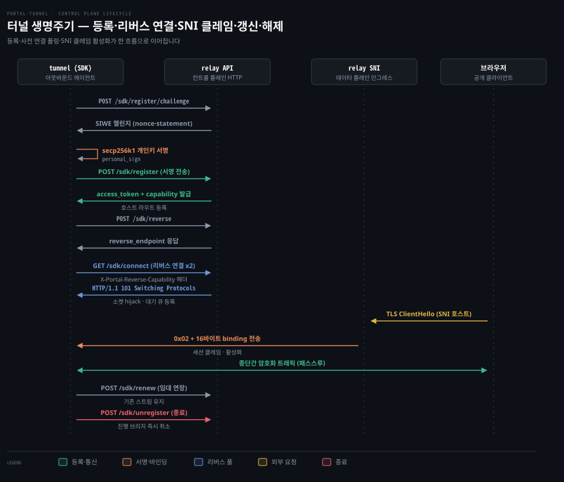
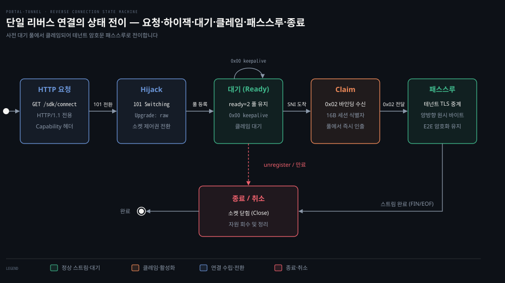

# Control Plane Flow

---

> 터널 에이전트가 릴레이에 호스트를 등록하고 리버스 연결을 열어 유지하며 안전하게 닫는 제어 평면의 네 단계 규약을 다룹니다.


## 왜 data plane 과 control plane 을 나누나

> 사용자 데이터 트래픽과 서비스 등록·인가 요청은 부하 특성과 보안 경계가 다르므로 분리해야 안전합니다.

방화벽 안쪽에 있는 로컬 서버를 외부에 공개하려면 터널 에이전트와 릴레이 서버가 통신해야 합니다. 이때 바이트 스트림을 그대로 중계하는 일과, 어떤 에이전트에게 어떤 도메인을 허용할지 결정하는 일을 하나의 연결이나 같은 처리 루프에 섞으면 데이터 중계가 느려지고 제어 평면의 자원이 고갈됩니다.

사용자 데이터 트래픽(SNI 라우팅을 거치는 바이트 스트림 중계)과 제어 요청(도메인 등록, 소유권 증명, 임대 갱신)은 부하 특성과 보안 경계가 다릅니다. 도메인 등록과 챌린지 검증은 암호학적 서명 검증과 상태 관리가 필요한 고비용 인가 작업입니다.

릴레이는 디코딩 및 서명 검증 전에 발신 IP별·전역 사전 인증 예산을 먼저 차감합니다(`cmd/relay-server/policy/mux.go:60-71`, `docs/maintainer/architecture.md:131-136`). 허용 예산을 초과한 요청은 작업을 수행하지 않고 즉시 429로 거절됩니다. 만약 데이터 연결마다 매번 무거운 서명 검증을 요구하거나 제어용 HTTP 핸들러가 사용자 데이터 소켓을 직접 쥐고 있으면 데이터 중계 지연과 제어 평면의 자원 고갈이 발생합니다.

보안 관점에서도 둘은 완전히 갈라집니다. 릴레이는 클라이언트 브라우저와 터널 사이의 종단간 암호화 트래픽을 복호화하지 않고 바이너리 형태로 전달해야 합니다. 반면 제어 평면은 릴레이 자신이 직접 JSON API로 터널 에이전트와 대화하며 신원을 증명받아야 합니다. 따라서 포털 터널은 임대 등록과 연결 관리를 맡는 제어 평면과 실제 세션을 이어붙여 바이트를 나르는 데이터 평면을 명확히 분리합니다.

기준 커밋 0a3b9c06 (2026-10-14)


## 경로 지도

> 릴레이의 모든 터널 제어 API는 `/sdk/*` 하위 경로에 모여 있으며 각자 전담 핸들러로 라우팅됩니다.

릴레이는 단일 포트에서 HTTP API로 제어 요청을 처리합니다. 기본 포트는 443입니다(`portal/server.go:216` `DefaultSNIPort`). `--sni-port`가 0이면 `PORTAL_URL`의 명시 포트를 따르고 없으면 443을 씁니다. 18443은 로컬 실측(2026-10-17, README 「직접 띄워 보기」)에서 지정한 포트입니다.

`types/paths.go:28-37`에 선언된 `/sdk/*` 상수는 릴레이 라우터(`cmd/relay-server/policy/mux.go:90-125`)에서 각각의 전담 서버 핸들러로 등록됩니다.

| 경로 | HTTP 메서드 | 호출 주체 | Relay 핸들러 (`cmd/relay-server/policy/mux.go`) | 주 목적 |
|---|---|---|---|---|
| `/sdk/domain` | GET | SDK | `s.HandleDomain` (`:95`) | 도메인 상태 및 정적 캐시 설정 조회 |
| `/sdk/certificate-chain` | GET | SDK | `s.HandleCertificateChain` (`:97`) | 릴레이 인증서 체인 획득 |
| `/sdk/register/challenge` | POST | SDK | `s.HandleRegisterChallenge` (`:98`) | SIWE 로그인 챌린지 발급 |
| `/sdk/register` | POST | SDK | `s.HandleRegister` (`:110`) | 서명 검증 및 임대(Lease) 등록 |
| `/sdk/renew` | POST | SDK | `s.HandleRenew` (`:122`) | 임대 유효기간(TTL) 연장 |
| `/sdk/reverse` | POST | SDK | `s.HandleReverseEndpoint` (`:123`) | 리버스 엔드포인트 단독 재발급 |
| `/sdk/connect` | GET | SDK | `s.HandleConnect` (`:125`) | 소켓 하이잭 및 리버스 연결 수립 |
| `/sdk/unregister` | POST | SDK | `s.HandleUnregister` (`:124`) | 임대 해제 및 활성 브리지 종료 |
| `/sdk/cache` | GET/PUT | SDK | `s.HandleStaticCache` (`:126`) | 정적 파일 캐시 업로드 및 동기화 |

이 중 터널의 생명주기를 결정하는 핵심 흐름은 등록, 리버스 연결, 갱신, 해제의 네 단계입니다.



위 도식은 터널 에이전트가 챌린지를 받아 서명하고 등록한 뒤 리버스 연결을 미리 2개 확보해 두고 브라우저 요청을 맞이하는 전 과정을 보여줍니다. 실제 데이터 전달은 SNI 라우터가 `0x02` 바인딩을 보낸 뒤 시작되며 임대 종료 시점에는 등록 취소로 자원을 정리합니다.


## Register

> 신원 위조를 방지하기 위해 릴레이는 단일 요청 등록 대신 서명 챌린지 기반의 2단계 등록을 강제합니다.

### 2단계 등록 흐름과 서명 검증

터널이 도메인을 독점하거나 다른 노드의 이름을 가로채지 못하도록 릴레이는 이더리움 표준 로그인 규격인 SIWE(Sign-In with Ethereum, EIP-4361)를 사용합니다. 클라이언트는 먼저 챌린지를 요청하고 자신의 secp256k1 개인키로 서명한 뒤 등록을 완료합니다.

```go
// sdk/api_client.go:146-163 발췌
if request.ChallengeID == "" || !time.Now().Before(challenge.ExpiresAt) {
    err = utils.HTTPDoAPIPath(ctx, c.httpClient(), c.relayURL, http.MethodPost, types.PathSDKRegisterChallenge, registerReq, nil, &challenge)
    // 챌린지 검증 후 개인키로 personal_sign 수행
    signature, err := identity.NewLocalAuthority(registerReq.Identity).SignEthereumPersonalMessage(challenge.SIWEMessage)
    request = types.RegisterRequest{ChallengeID: challenge.ChallengeID, SIWEMessage: challenge.SIWEMessage, SIWESignature: signature, ReportedIP: reportedIP}
} else {
    err = utils.HTTPDoAPIPath(ctx, c.httpClient(), c.relayURL, http.MethodPost, types.PathSDKRegister, request, nil, &resp)
}
```

클라이언트는 `sdk/api_client.go:146`에서 `POST /sdk/register/challenge`를 호출합니다. 서버의 `portal/api_server.go:384`(`HandleRegisterChallenge`)는 챌린지를 생성합니다. `portal/identity/register_challenge.go:35`(`NewRegisterChallenge`)로 난수(Nonce)와 만료 시각이 포함된 메시지를 만들어 클라이언트에 반환합니다.

클라이언트는 수신한 챌린지를 로컬 개인키로 서명합니다. 그 뒤 `sdk/api_client.go:161`에서 `POST /sdk/register`를 호출해 등록 요청을 전송합니다. 서버의 `portal/api_server.go:324`(`HandleRegister`)는 전달된 서명을 복원해 공개키 주소가 일치하는지 확인합니다.

### 등록 응답의 세 가지 핵심 자산

등록이 성공하면 서버는 `types/api.go:102`(`RegisterResponse`) 구조체를 반환합니다. 공식 문서(`docs/src/routes/architecture/+page.md:461`)가 설명하듯 응답에는 세 가지가 핵심으로 포함됩니다.

첫째, 임대 범위로 한정된 `access_token`입니다. secp256k1 곡선 ECDSA 서명(ES256K)을 붙인 JWT(JSON Web Token) 형식이며, 이후 갱신(`POST /sdk/renew`)이나 등록 취소(`POST /sdk/unregister`) 같은 임대 관리 작업은 이 토큰으로만 인가됩니다. 둘째, 리버스 연결을 여는 데만 쓸 수 있는 권한 증표인 `reverse-only capability`입니다. 셋째, 실제 소켓을 연결할 `reverse_endpoint` URL입니다. 권한을 분리해 두었으므로 리버스 연결을 맺는 권한으로는 임대 자체를 변조할 수 없습니다.

공개 호스트는 기본적으로 고유 주소가 결합된 정규 이름과 기억하기 쉬운 별칭으로 나뉩니다. 상세한 이름 결정 규칙은 00-02 편에서 다룹니다.

### 사전 인증 예산 (Admit)

서명 검증은 CPU 부하가 크기 때문에 무차별 요청 공격에 취약합니다. 릴레이는 `cmd/relay-server/policy/mux.go:60-71`의 `admit` 래퍼를 두어 JSON 디코딩이나 서명 검증을 시작하기도 전에 발신 IP별 사전 인증 예산을 먼저 차감합니다.

```go
// cmd/relay-server/policy/mux.go:60-68 발췌
admit := func(cost int, next sourceHandler) http.HandlerFunc {
    return func(w http.ResponseWriter, r *http.Request) {
        source := ingress.SourceAddr(r)
        if admission != nil {
            if retry, _ := admission.Allow(source, cost); retry > 0 {
                WriteRetryAfter(w, retry, "pre-auth request budget exhausted")
                return
            }
        }
        next(w, r, source)
    }
}
```

`cmd/relay-server/policy/mux.go:98,110`을 보면 챌린지 발급과 등록 핸들러 모두 `admit`으로 감싸져 있습니다. 허용 예산을 초과한 요청은 작업을 수행하지 않고 즉시 HTTP 429(`Retry-After`)로 거절됩니다. 세부적인 속도 제한 알고리즘과 토큰 버킷 구조는 03-03 편에서 깊이 다룹니다.


## Reverse Connect

> 외부 인바운드 트래픽을 방화벽 내부로 들여오기 위해 터널이 아웃바운드로 연결 통로를 미리 개설합니다.

### 하이잭과 세션 전환

NAT나 사설망 내부의 터널 에이전트는 외부에서 들어오는 TCP SYN 패킷을 직접 받을 수 없습니다. 그래서 터널 에이전트가 릴레이 쪽으로 바깥 방향 TCP 연결을 맺고 이를 인바운드 데이터를 수신하는 통로로 재활용해야 합니다.

터널 에이전트는 엔드포인트 정보가 필요할 때 `sdk/api_client.go:239`에서 `POST /sdk/reverse`를 호출해 엔드포인트 URL을 확인합니다(`portal/api_server.go:468` `HandleReverseEndpoint`). 그 뒤 에이전트는 `GET /sdk/connect`를 호출하면서 `X-Portal-Reverse-Capability` 헤더(`types/types.go:15`)에 capability를 담아 보냅니다.

```go
// portal/api_server.go:522-570 발췌
if r.ProtoMajor != 1 {
    utils.WriteAPIError(w, http.StatusHTTPVersionNotSupported, types.APIErrorCodeHTTP11Only, "reverse connect requires HTTP/1.1")
    return
}
// capability 인가 검증 생략 ...
hijacker, ok := w.(http.Hijacker)
conn, rw, err := hijacker.Hijack()
if _, err := rw.WriteString("HTTP/1.1 101 Switching Protocols\r\nUpgrade: raw\r\nConnection: Upgrade\r\n\r\n"); err != nil {
    _ = conn.Close()
    return
}
_ = rw.Flush()
lease.reverse.Offer(conn)
```

`portal/api_server.go:522`에서 보듯 리버스 연결은 반드시 HTTP/1.1이어야 합니다. 서버는 capability를 검증한 뒤 표준 HTTP 응답 루프를 끊고 `http.Hijacker` 인터페이스를 사용해 기반 TCP 소켓을 직접 획득합니다(`:564`). 이어 클라이언트에 `101 Switching Protocols`를 내려보낸 뒤 그 소켓을 해당 임대의 대기 큐(`lease.reverse.Offer`)에 집어넣습니다.

### 활성화 마커와 바인딩

소켓이 하이잭되었다고 해서 곧바로 브라우저 데이터가 흐르는 것은 아닙니다. 브라우저가 특정 서브도메인으로 접속해 TLS ClientHello를 보내기 전까지 이 소켓은 릴레이 풀 안에서 유휴 상태로 대기합니다.

외부 브라우저의 TLS 연결이 릴레이 SNI 라우터에 들어오면 릴레이는 대상 임대의 리버스 풀에서 대기 소켓 하나를 인출(Claim)합니다. 그리고 `portal/transport/reverse_framing.go:16,64`(`WriteTLSStart`)에 정의된 활성화 마커 바이트 `0x02`를 소켓에 씁니다. 뒤이어 16바이트 바인딩 토큰을 함께 전송합니다(`docs/src/routes/architecture/+page.md:481`).

터널 에이전트는 `0x02` 마커를 읽자마자 이 소켓이 특정 외부 브라우저 요청과 연결되었음을 감지합니다. 이후 소켓은 투명한 바이트 전달 통로가 되며 릴레이는 암호문을 복호화하지 않고 브라우저와 터널 간에 그대로 전달합니다.

### 2개 사전 연결 실측

브라우저가 접속했을 때 그제서야 리버스 연결을 맺으면 핸드셰이크 지연이 크게 늘어납니다. 포털 터널은 브라우저 접속 전에 리버스 연결 2개를 항시 미리 열어 둡니다.

코드 `sdk/listener.go:37`에는 `defaultReadyTarget = 2` 상수가 정의되어 있습니다. 로컬 실측(2026-10-17, README 「직접 띄워 보기」)에서도 터널이 구동되자마자 릴레이 로그에서 리버스 연결 2개가 즉시 생성되는 것을 확인했습니다.

```bash
INF sdk reverse connected address=0xF7DC… lease_name=demo ready=1 remote_addr=[::1]:56760
INF sdk reverse connected address=0xF7DC… lease_name=demo ready=2 remote_addr=[::1]:56761
```

로컬 실측(2026-10-17, README 「직접 띄워 보기」)에서도 브라우저 요청으로 연결 하나가 소비되면 `ready=1`로 줄어드는 동작이 관측되었습니다. 그 연결을 맡았던 작업 슬롯이 곧바로 새 연결을 여는 것은 아닙니다. TLS 연결이면 로컬 TLS 핸드셰이크(`TerminateConn`)를 먼저 끝내고 소켓을 수락 채널(`l.accepted`)에 넘긴 뒤에야 새 `/sdk/connect`를 보내 `ready=2`를 채웁니다(`sdk/listener.go:668-692`). 이 리버스 풀 내부 큐의 동시성 제어와 고갈 처리 메커니즘은 01-04 편에서 다룹니다.



위 상태 전이 도식은 하나의 TCP 연결이 HTTP/1.1 핸드셰이크에서 출발해 하이잭을 거쳐 대기 풀에 머무르고 클레임 이후 종단간 스트림으로 쓰인 뒤 종료되는 일생을 나타냅니다.


## Renew

> 에이전트 종료 시 유령 라우트가 남아 도메인을 영구 점유하는 문제를 막으려면 주기적으로 갱신해야 합니다.

터널 에이전트가 비정상 종료되거나 네트워크가 끊겼을 때 유령 라우트가 릴레이에 남는 문제를 방지하기 위해 모든 임대는 기본 120초(`types/api.go:81`)의 수명(TTL)을 갖습니다. 터널 에이전트는 만료 30초 전(`sdk/listener.go:36` `defaultRenewBefore = 30 * time.Second`)에 주기적으로 갱신 요청을 보냅니다.

클라이언트는 `sdk/api_client.go:221`에서 `access_token`을 실어 `POST /sdk/renew`를 호출합니다. 서버의 `portal/api_server.go:423`(`HandleRenew`)은 토큰을 검증하고 임대 만료 시각을 연장한 뒤 갱신된 토큰과 리버스 엔드포인트를 반환합니다.

여기서 가장 중요한 설계 원칙은 갱신 시 기존 연결의 지속성입니다. 메인테이너 아키텍처 문서(`docs/maintainer/architecture.md:173`)는 "Ordinary renewal preserves existing streams"라고 명시합니다. 임대를 갱신한다고 해서 이미 진행 중인 사용자 브라우저와의 TLS 통신이나 TCP 스트림이 끊어지지 않으며 백그라운드에서 임대 만료 시각만 연장됩니다.


## Unregister

> 터널 종료 시 라우트를 즉시 지우지 않으면 외부 요청이 끊긴 터널로 전달되어 실패하는 문제가 발생합니다.

터널 프로세스가 종료될 때 라우트를 즉시 지우지 않으면 외부 요청이 실패하므로 정상 종료 시 반드시 해제를 알려야 합니다. 클라이언트는 `sdk/api_client.go:270`에서 임대 `access_token`을 담아 `POST /sdk/unregister`를 호출합니다.

서버의 `portal/api_server.go:447`(`HandleUnregister`)은 레지스트리에서 해당 임대 레코드를 삭제하고 연동된 DNS 라우트를 제거합니다. 메인테이너 아키텍처 문서(`docs/maintainer/architecture.md:173-174`)에 명시된 대로 등록 해제가 발생하면 대기 중이던 리버스 연결뿐만 아니라 진행 중인 활성 TCP 브리지까지 모두 즉시 취소되고 양쪽 소켓 엔드포인트가 닫힙니다. 유예 시간 없이 즉각 차단하여 불필요한 고아 연결이 남지 않도록 보장합니다.


## 실패 지도

> 제어 평면의 각 단계는 엄격한 인가와 자원 한계에 부딪혀 실패할 수 있으며 정해진 오류 코드로 반응합니다.

아래 표는 코드와 공식 문서에서 확인한 제어 평면의 주요 실패 지점과 처리 방식입니다.

| 단계 | 발생 조건 | HTTP 상태 / 오류 코드 | 코드 위치 및 대응 동작 |
|---|---|---|---|
| 사전 인증 | 단일 IP의 챌린지·등록 요청 예산 초과 | 429 Too Many Requests | `cmd/relay-server/policy/mux.go:65` (`WriteRetryAfter`), `Retry-After` 헤더 뒤 재시도 |
| 등록 챌린지 | 챌린지 유효시간 초과 | `types.APIErrorCodeInvalidRequest` | `portal/identity/register_challenge.go:22` (`ErrRegisterChallengeExpired`), 클라이언트 재발급 |
| 등록 서명 | SIWE 서명 불일치 또는 위조 | 403 Forbidden (`unauthorized`) | `portal/api_server.go:334`, `ErrRegisterChallengeInvalidSignature` 반환 후 등록 거부 |
| 옵션 등록 | 릴레이에 UDP 기능 비활성화 | 403 Forbidden (`udp_disabled`) | `types/error.go:21`, 서버 `UDP_ENABLED=false` 시 거절 (`architecture/+page.md:462`) |
| 옵션 등록 | UDP 포트 범위 고갈 또는 한도 초과 | 503 Service Unavailable (`udp_capacity_exceeded`) | `types/error.go:20,22`, 포트 풀 부족 시 등록 거절 |
| 옵션 등록 | 릴레이에 전용 TCP 포트 비활성화 | 403 Forbidden (`tcp_port_disabled`) | `types/error.go:24`, 서버 `TCP_ENABLED=false` 시 거절 (`architecture/+page.md:463`) |
| 옵션 등록 | 전용 TCP 포트 용량 초과 | 503 Service Unavailable (`tcp_port_capacity_exceeded`) | `types/error.go:23,25`, 할당 가능 포트 부족 시 등록 실패 |
| 리버스 연결 | HTTP/2 이상으로 `/sdk/connect` 호출 | 505 HTTP Version Not Supported (`http11_only`) | `portal/api_server.go:523`, 소켓 하이잭 불가로 연결 거부 |
| 리버스 연결 | Capability 토큰 위조 또는 불일치 | 403 Forbidden (`unauthorized`) | `portal/api_server.go:70,554`, 권한 없는 소켓 거부 후 연결 즉시 닫음 |
| 클레임 대기 | 대기 중인 리버스 연결이 없을 때 외부 SNI 인입 | 최대 10초 대기 후 타임아웃 | `portal/server.go:37,1036-1039` `Acquire(claimCtx)` 실패 시 10초 뒤 연결 종료(HTTP 응답 없음) |
| 임대 갱신 | 만료 후 갱신 시도 또는 잘못된 토큰 | 404 Not Found (`lease_not_found`) | `portal/api_server.go:435`, 클라이언트가 신규 등록으로 재진입해야 함 |


## 리뷰 노트

> 소스 코드와 로컬 실측을 대조하며 확인한 주의점과 개선 검토 사항입니다.

- macOS LibreSSL 와일드카드 검증 마찰: 로컬 실측(2026-10-17, README 「직접 띄워 보기」) 시 macOS 내장 curl(LibreSSL)은 접속을 거부했습니다. 인증서 SAN은 `*.localhost`로 와일드카드 아래에 한 라벨만 존재합니다. OpenSSL 3.6과 macOS curl(LibreSSL)은 이 매칭을 거부하지만 Go `crypto/x509`는 통과시킵니다(`portal/acme/certificate.go:238`). 원인은 검증기 정책 차이로 보입니다(추정). 자체 서명 인증서를 쓰는 로컬 개발 환경에서는 `-k` 플래그가 필요했습니다. 셀프 호스팅 가이드 문서에서 이 와일드카드 동작 방식을 별도로 안내하는지는 미확인 상태입니다.
- HTTP/1.1 강제 조건 (`portal/api_server.go:522`): `HandleConnect`는 `r.ProtoMajor != 1` 조건을 명시적으로 검사하여 HTTP/2나 HTTP/3 요청을 거부합니다. 리버스 프록시(Nginx, Caddy, Cloudflare 등) 뒤에 릴레이를 둘 때는 프록시가 백엔드 구간을 TLS 없는 평문 HTTP/2(h2c)로 바꿔 보내지 않도록 HTTP/1.1로 고정해야 합니다.
- 임대 만료와 브리지 즉각 단절의 영향 (`docs/maintainer/architecture.md:173-174`): 등록 해제(`unregister`) 시 진행 중인 TCP 브리지가 지연 시간 없이 즉시 취소됩니다. 대용량 파일 업로드나 긴 스트림이 흐르고 있을 때 프로세스를 재시작하면 클라이언트 연결이 끊어지므로 서비스 운영 시 그레이스풀 드레인 지원 여부를 추가 점검할 필요가 있습니다.
- 등록 직후 기본 차단 격리 (`portal/api_server.go:341`): 핸들러는 챌린지 검증 직후 `suspendIdentity`로 그 신원을 먼저 차단 상태에 둡니다(fail-closed, 판단이 끝나기 전에는 막아 두는 방식). 그 뒤 접근 결정을 적용하고 성공 응답을 반환합니다. 승인 전 임대로 트래픽이 라우팅되는 틈을 차단하는 순서입니다.
- DNS 동기화 실패 시 임대 정리 (`portal/api_server.go:360`): 등록 중 `syncLeaseDNS`가 실패하면 `Unregister`와 `deleteLeaseDNS`로 방금 만든 임대를 즉시 되돌립니다. 외부 DNS 동기화에 실패했을 때 고아 임대가 남아 유령 라우트를 형성하지 않도록 보장합니다.
- SIWE 챌린지 URI 스킴과 프록시 (`portal/api_server.go:390`): 챌린지 생성 시 `r.TLS == nil`로 스킴을 정하고 요청 `Host`로 domain을 구성합니다. 서버가 자신이 발급한 원문 메시지와 정확히 일치하는지만 검증하므로 위조 공격 경로가 되지는 않습니다. 다만 TLS를 앞단 프록시에서 종단하는 배치 환경에서는 릴레이 수신 소켓에 TLS가 없어 서명 문구의 scheme이 `http`로 찍힐 수 있습니다. 프록시 배치를 고려한 의도된 동작인지 `X-Forwarded-Proto` 반영이 필요한 지점인지는 추가 확인이 필요합니다.


## 검증과 복습

> 이 문서에서 배운 핵심 동작 규약을 세 가지 질문으로 스스로 확인합니다.

Q1. 릴레이 등록 시 왜 `POST /sdk/register` 단일 호출 대신 챌린지 발급(`POST /sdk/register/challenge`)과 등록의 2단계를 거치며 릴레이는 서명 연산 부하를 어떻게 방어합니까?

Q2. 터널 에이전트는 왜 리버스 연결을 미리 2개(`defaultReadyTarget = 2`) 열어 두며 외부 브라우저의 연결이 들어왔을 때 이 연결은 어떤 바이트 마커를 통해 활성화됩니까?

Q3. 임대 유효기간을 갱신하는 `POST /sdk/renew`가 발생할 때 이미 외부 사용자와 활발히 통신 중이던 기존 TCP 스트림들은 어떻게 됩니까?


## 정답 (자답 후 펼치기)

> 위 세 가지 질문에 대한 해답과 코드 근거입니다.

Q1 정답. 도메인 무단 점유와 신원 위조를 방지하기 위해 릴레이가 발급한 최신 챌린지(Nonce 포함)를 터널 에이전트의 secp256k1 개인키로 서명(SIWE)해야 하기 때문입니다. 서명 검증 부하로 인한 서비스 거부 공격을 막기 위해 릴레이는 `cmd/relay-server/policy/mux.go:60-71`의 `admit` 래퍼로 JSON 파싱과 서명 검증 전에 IP별 사전 인증 예산을 먼저 차감하여 초과 시 429로 즉시 방어합니다.

Q2 정답. 브라우저 요청이 들어왔을 때 리버스 연결을 맺으면 핸드셰이크 지연 시간이 사용자에게 고스란히 전가되므로 즉시 클레임할 수 있도록 2개를 항시 대기시켜 둡니다. 외부 요청이 들어오면 릴레이 SNI 라우터는 대기 소켓에 `portal/transport/reverse_framing.go:16,64`에 정의된 `0x02` 마커와 16바이트 세션 바인딩을 전송하여 테넌트 TLS 패스스루 세션으로 즉시 활성화합니다.

Q3 정답. 기존 스트림은 아무런 영향 없이 유지됩니다. 메인테이너 아키텍처 문서(`docs/maintainer/architecture.md:173`)에 명시되었듯 일반 갱신은 진행 중인 스트림을 보존하며 백그라운드에서 임대 만료 시각만 연장합니다. 반면 등록 해제(`POST /sdk/unregister`)는 모든 진행 중인 브리지를 즉시 취소합니다.


## 출처와 관련 문서

- [portal-tunnel 기준 커밋 소스 트리](https://github.com/gosuda/portal-tunnel/tree/0a3b9c06): 기준 커밋 0a3b9c06 소스 코드
- [Portal Public Architecture Guide](https://gosuda.github.io/portal-tunnel/architecture): 공식 아키텍처 가이드 및 Control Plane Flow
- `docs/maintainer/architecture.md`: 메인테이너 아키텍처 및 패키지 경계 문서
- `types/paths.go`, `cmd/relay-server/policy/mux.go`, `portal/api_server.go`: 제어 평면 HTTP 라우팅 및 핸들러 구현
- `sdk/api_client.go`, `sdk/listener.go`: SDK 측 제어 평면 호출 및 리버스 리스너 구현
