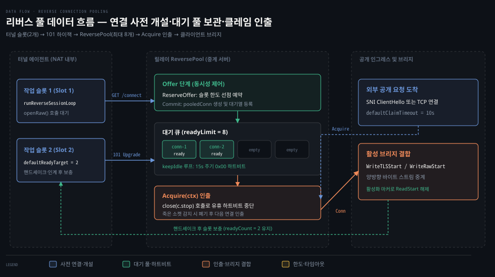
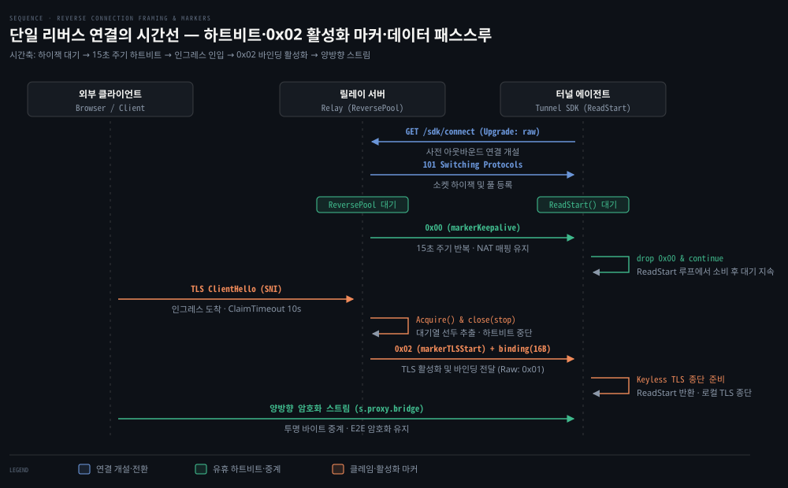

# reverse_pool·reverse_framing

---

> 공개 요청이 들어왔을 때 릴레이가 사용할 터널 쪽 연결을 확보하고 관리하는 ReversePool 구조와, 유휴 연결 유지 및 활성화 신호를 제어하는 첫 바이트 프레이밍 규약을 다룹니다.


## 왜 연결을 미리 열어 두나

> 인바운드 접속이 불가능한 사설망 내부의 터널과 즉시 통신하기 위해 터널이 아웃바운드로 연결을 미리 수립해 두어야 합니다.

외부 인터넷 사용자가 릴레이 서버에 접속해 터널링된 도메인으로 HTTP나 TLS 요청을 보낼 때, 릴레이는 사설망 내부에 위치한 터널 에이전트를 향해 먼저 TCP 연결을 개설할 수 없습니다.

일반적인 개발 환경이나 사내망은 NAT(Network Address Translation)와 방화벽 뒤에 있습니다. 외부 공인망에서 내부 사설망으로 들어오는 인바운드 SYN 패킷은 라우터에서 즉시 차단되거나 폐기됩니다. 공개 요청이 들어온 직후에 릴레이가 터널에 연결을 새로 열어 달라고 요청할 방법은 없습니다.

이 문제를 해결하려면 터널 에이전트가 릴레이를 향해 바깥 방향(Outbound) TCP 연결을 미리 맺어 두어야 합니다. 릴레이는 이렇게 미리 들어온 연결을 풀에 보관해 두었다가 외부 클라이언트의 요청이 도착하는 순간 대기 중인 연결을 인출해 양방향 스트림으로 이어붙입니다.

사전 연결의 대기 개수는 지연 시간과 자원 소비 사이의 균형점으로 결정됩니다. 너무 많으면 유휴 소켓과 고루틴이 낭비되고 너무 적으면 요청이 연달아 들어올 때 대기 시간이 늘어납니다. 포털 터널 SDK는 `sdk/listener.go:37`의 상수 `defaultReadyTarget = 2`로 유휴 연결 2개를 늘 유지합니다.

터널 에이전트 안에서는 `sdk/listener.go:588-591`의 슬롯 루프가 돕니다. 슬롯 개수만큼 고루틴을 띄워 각각 `sdk/listener.go:636`의 `runReverseSessionLoop`를 실행합니다.

```go
// sdk/listener.go:588-593 발췌
for sessionSlot := range defaultReadyTarget {
    sessionSlot++
    workers.Add(1)
    go func() {
        defer workers.Done()
        if err := l.runReverseSessionLoop(leaseCtx, lease.tenantTLS, sessionSlot, reverseTransport); err != nil {
            // 오류 수집 및 취소 루프
        }
    }()
}
```

각 작업 슬롯은 릴레이로 연결을 연 뒤 활성화 마커가 올 때까지 기다립니다. 실제로 로컬 실측(2026-10-17, README 「직접 띄워 보기」)에서는 터널 프로세스가 뜨자마자 릴레이 로그에 `ready=1`, `ready=2`가 연달아 찍히고 리버스 연결 2개가 곧바로 확보되는 것을 확인할 수 있습니다.

외부 사용자가 접속하여 연결 하나가 소비되더라도 슬롯 고루틴이 `ReadStart` 직후 즉시 새 연결을 맺는 것은 아닙니다. TLS 연결이면 `tenantTLS.TerminateConn` 핸드셰이크(최대 30초)를 동일 고루틴에서 먼저 끝냅니다. 그 뒤 버퍼 크기 4인 `l.accepted` 채널(`sdk/listener.go:178`)에 소켓을 넣은 뒤에야 다음 `Open`으로 넘어갑니다(`sdk/listener.go:668-692`). 슬롯 보충은 핸드셰이크 시간만큼 늦어집니다. 애플리케이션의 `Accept` 처리가 밀려 채널이 가득 차면 소켓이 채널에 들어갈 때까지 기다립니다.

기준 커밋 0a3b9c06 (2026-10-14)


## 터널이 리버스 연결을 여는 방법

> 터널은 표준 HTTP 요청에 업그레이드 헤더와 임대 권한을 실어 보내며, 릴레이는 이를 인가하고 원시 소켓으로 하이잭합니다.

사전 연결을 열 때 인증이나 제어 절차 없이 아무 TCP 소켓이나 열면 릴레이는 이 연결이 어떤 임대(Lease)에 속하는지 알 수 없습니다. 그래서 터널 에이전트는 HTTP/1.1 프로토콜과 인가 헤더로 소켓을 안전하게 등록합니다.

터널 SDK의 전송 계층은 `sdk/reverse_transport.go:53`의 `openRaw` 메서드로 연결을 만듭니다.

```go
// sdk/reverse_transport.go:62-80 발췌
dialer := &tls.Dialer{
    NetDialer: reverseTCPDialer(t.listener.isAlternateReverseEndpoint(reverseURL.String())),
    Config:    reverseTLS,
}
conn, err := dialer.DialContext(ctx, "tcp", utils.EnsurePort(reverseURL.Host))
if err != nil {
    return nil, err
}

req := &http.Request{
    Method: http.MethodGet,
    URL:    reverseURL,
    Host:   reverseURL.Host,
    Header: make(http.Header),
}
req.Header.Set(types.HeaderReverseCapability, capability)
req.Header.Set("Connection", "Upgrade")
req.Header.Set("Upgrade", "raw")
```

에이전트는 릴레이의 리버스 엔드포인트로 TLS 연결을 맺은 뒤 `GET /sdk/connect` 요청을 보냅니다. 요청의 `X-Portal-Reverse-Capability` 헤더(`types/types.go:15`)에는 임대를 등록할 때 발급받은 capability 문자열을 싣습니다. 프로토콜을 전환하도록 `Connection: Upgrade`와 `Upgrade: raw` 헤더도 지정합니다.

릴레이 서버의 핸들러(`portal/api_server.go:520` `HandleConnect`)는 이 요청을 받아 처리합니다.

```go
// portal/api_server.go:522-570 발췌
if r.ProtoMajor != 1 {
    utils.WriteAPIError(w, http.StatusHTTPVersionNotSupported, types.APIErrorCodeHTTP11Only, "reverse connect requires HTTP/1.1")
    return
}

lease, err := s.registry.admitReverseCapability(capability)
if err != nil {
    writeAPIErrorResponse(w, err)
    return
}

hijacker, ok := w.(http.Hijacker)
conn, rw, err := hijacker.Hijack()
if _, err := rw.WriteString("HTTP/1.1 101 Switching Protocols\r\nUpgrade: raw\r\nConnection: Upgrade\r\n\r\n"); err != nil {
    _ = conn.Close()
    return
}
_ = rw.Flush()
```

서버는 먼저 `r.ProtoMajor != 1` 조건을 검사합니다. HTTP/2나 HTTP/3는 단일 스트림 단위의 소켓 하이잭을 표준 인터페이스로 제공하지 않으므로 연결을 거절합니다. capability 인가를 통과하면 `http.Hijacker` 인터페이스를 호출해 표준 HTTP 핸들러 루프에서 기저 TCP 소켓을 떼어냅니다(`:564`).

이후 클라이언트에 `HTTP/1.1 101 Switching Protocols` 응답을 내려보내고 버퍼를 비운 뒤 이렇게 얻은 원시 소켓을 임대 전용 풀(`lease.reverse.Offer`)에 넘깁니다.

한편 터널 SDK 전송 계층의 `Open` 메서드는 `runtime.GOOS == "js"`(브라우저 WASM) 환경일 때만 `openMux`(`sdk/reverse_transport.go:34-39, 104`)를 호출합니다. 그 외 모든 네이티브 환경에서는 항상 단일 소켓 단위의 `openRaw`를 사용합니다. WebSocket 기반 yamux 세션을 맺는 다중화 규약은 01-05 편에서 상세히 다룹니다.


## 릴레이의 리버스 풀 관리와 생명주기

> 릴레이는 임대별 ReversePool 에 대기 연결을 보관하며, 2단계 등록으로 경합을 막고 인출 시 끊긴 소켓을 안전하게 걸러냅니다.

릴레이가 하이잭된 소켓을 단순한 슬라이스나 언버퍼드 채널에 그냥 보관하면 동시성 경쟁과 자원 누수가 생깁니다. 릴레이는 `portal/transport/reverse_pool.go:16`의 **ReversePool** 타입에 유휴 소켓을 담아 테넌트 임대마다 따로 관리합니다.

풀의 기본값은 `portal/lease.go:33-34`에 있습니다. 유휴 소켓을 검사하는 하트비트 간격 `defaultIdleKeepalive`는 15초이고 임대당 대기 큐 상한 `defaultReadyQueueLimit`는 8개입니다.

```go
// portal/transport/reverse_pool.go:16-26 발췌
type ReversePool struct {
    mu           sync.Mutex
    cond         *sync.Cond
    notify       chan struct{}
    ready        []*pooledConn
    idleInterval time.Duration
    readyLimit   int
    reserved     int
    closing      bool
    closeOnce    sync.Once
}
```

### 2단계 Offer 등록 절차

소켓을 풀에 등록할 때 릴레이는 한 번에 넣지 않고 예약(Reserve)과 확정(Commit) 2단계를 거칩니다(`portal/transport/reverse_pool.go:52-99`).

```go
// portal/transport/reverse_pool.go:52-60 발췌
func (p *ReversePool) Offer(conn net.Conn) error {
    r, err := p.ReserveOffer(conn)
    if err == nil {
        err = r.Commit()
    }
    if err != nil && conn != nil {
        _ = conn.Close()
    }
    return err
}
```

`ReserveOffer`(`:66`)는 뮤텍스를 걸고 대기 소켓 수와 예약 수의 합이 상한선(`readyLimit = 8`)에 도달했는지 확인합니다. 큐가 꽉 차 있으면 `errPoolFull`(`:11`)을 반환합니다. 직접 등록 경로인 `Offer`(`:52-61`)는 `ReserveOffer`와 `Commit`을 연달아 호출합니다. 단순 등록에는 뮤텍스 하나로 상한 검사가 충분하기 때문입니다.

이 2단계가 분리되어 쓰이는 곳은 오버레이 네트워크 인가 경로(`portal/server.go:612-638`, `reverse_pool.go:37-38, 63-64` 주석)입니다. 원격 오퍼에 수락(`offer.Accept()`)을 보내기 전에 릴레이 풀 용량을 먼저 확보하고 부족하면 `RejectCapacity()`를 회신할 수 있도록 예약과 확정을 나눈 것입니다.

슬롯이 확보되면 `Commit`(`:82`)이 호출됩니다. 원시 연결은 `pooledConn`으로 감싸져 `p.ready` 큐 맨 뒤에 추가됩니다. 동시에 백그라운드 유휴 감시 고루틴(`go p.keepIdle(c)`)이 구동됩니다. 이때 `p.signalLocked()`가 `p.notify` 채널을 닫아 대기 중인 인출 스레드를 깨웁니다.

함께 호출되는 `p.cond.Broadcast()`는 인출 스레드를 깨우는 신호가 아닙니다. 풀 종료(`p.Close()`) 시 잔여 예약이 0이 될 때까지 `cond.Wait()`으로 대기하던 스레드를 깨우는 용도입니다(`reverse_pool.go:144-150, 159-161`). 등록에 실패하면 소켓은 즉시 `conn.Close()`로 닫힙니다.

### Acquire 인출과 죽은 소켓 필터링

외부 요청이 들어오면 릴레이는 `Acquire(ctx)`(`portal/transport/reverse_pool.go:112`)를 호출해 유휴 소켓을 꺼냅니다.

```go
// portal/transport/reverse_pool.go:122-142 발췌
if len(p.ready) > 0 {
    c := p.ready[0]
    p.ready[0] = nil
    p.ready = p.ready[1:]
    close(c.stop)
    p.mu.Unlock()
    select {
    case <-c.done:
    case <-ctx.Done():
        _ = c.Close()
        <-c.done
        return nil, ctx.Err()
    }
    if c.err != nil {
        continue
    }
    if err := ctx.Err(); err != nil {
        _ = c.Close()
        return nil, err
    }
    return c.Conn, nil
}
```

`Acquire`는 큐의 가장 앞쪽 소켓(`p.ready[0]`)을 꺼낸 뒤 즉시 `close(c.stop)`을 실행합니다. 백그라운드에서 주기적으로 하트비트를 보내던 `keepIdle` 고루틴에게 유휴 쓰기를 멈추라고 알리는 신호입니다.

그 뒤 `<-c.done` 채널을 기다려 감시 고루틴이 쓰기 작업을 완전히 마쳤는지 확인합니다. 유휴 상태에서 네트워크가 끊겨 `c.err != nil`이 기록되어 있으면 `Acquire`는 그 소켓을 버리고 루프를 돌아 대기열의 다음 소켓을 바로 꺼냅니다. 대기열에 소켓이 하나도 없으면 새 소켓이 들어올 때까지 `p.notify` 채널에서 블로킹 대기합니다.



위 데이터 흐름 도식을 따라가면 터널의 작업 슬롯 2개가 101 하이잭으로 릴레이 ReversePool에 소켓을 넣습니다. 릴레이는 8개 한도 안에서 유휴 하트비트를 유지하다가 공개 요청이 도착하면 `Acquire`로 소켓을 꺼내 브리지에 결합합니다.


## 조용한 유휴 연결이 끊어지는 문제와 하트비트

> 패킷이 오가지 않는 유휴 연결은 NAT 라우터와 중간 방화벽의 연결 추적 테이블에서 소리 없이 삭제되므로 주기적 하트비트가 필수적입니다.

사전 연결을 맺어 풀에 넣어 두었더라도 패킷이 오가지 않는 유휴 상태가 오래 이어지면 네트워크 장애가 생깁니다.

가정용 공유기, 클라우드 NAT 게이트웨이, 기업 방화벽과 같은 상태 저장형 중간 장비는 내부 테이블에 활성 TCP 세션 매핑 정보를 유지합니다. 출발지 IP와 포트, 변환된 공인 IP와 포트를 기록해 두어야 응답 패킷을 올바른 사설망 호스트로 되돌려줄 수 있기 때문입니다. 이를 연결 추적, 즉 conntrack 이라고 부릅니다. 이 동작 메커니즘과 상태 보존의 한계는 [network-fundamentals-lab 05-01 "연결은 양 끝만의 일이 아니다"](../../project/network-fundamentals-lab/05-01.연결은%20양%20끝만의%20일이%20아니다.md)에서 자세히 다룹니다.

문제는 conntrack 테이블의 메모리가 유한하다는 점입니다. 대부분의 NAT 장비는 일정 시간 동안 양방향 데이터 송수신이 없는 연결을 비활성 상태로 간주하고 테이블 엔트리를 조용히 지워버립니다(Silent Drop). 이때 양 끝단의 엔드포인트에는 TCP FIN이나 RST 패킷이 전달되지 않습니다.

릴레이와 터널은 소켓이 정상 연결되어 있다고 착각하지만 실제로는 중간 경로가 증발한 유령 소켓이 됩니다. 이 상태에서 외부 요청이 들어와 데이터를 보내려 하면 패킷이 유실되고 긴 타임아웃이 발생해 서버가 멈춥니다. 이 유휴 소켓 누수가 시스템 전반에 미치는 영향은 [gonet-lab 01-01 "조용한 연결이 서버를 멈춘다"](../../project/gonet-lab/01-01.조용한%20연결이%20서버를%20멈춘다%20-%20goroutine·FD·idle%20timeout.md)에 상세히 정리되어 있습니다.

릴레이는 이 문제를 막으려고 대기 중인 모든 소켓마다 `keepIdle`(`portal/transport/reverse_pool.go:186`) 고루틴을 실행합니다.

```go
// portal/transport/reverse_pool.go:186-213 발췌
func (p *ReversePool) keepIdle(c *pooledConn) {
    defer close(c.done)
    if p.idleInterval <= 0 {
        <-c.stop
        return
    }
    ticker := time.NewTicker(p.idleInterval)
    defer ticker.Stop()
    for {
        select {
        case <-c.stop:
            return
        case <-ticker.C:
        }
        if c.err = WriteKeepalive(c.Conn); c.err != nil {
            _ = c.Close()
            p.mu.Lock()
            for i, queued := range p.ready {
                if queued == c {
                    p.ready = append(p.ready[:i], p.ready[i+1:]...)
                    break
                }
            }
            p.mu.Unlock()
            return
        }
    }
}
```

감시 고루틴은 `p.idleInterval`(15초)마다 티커를 깨워 `portal/transport/reverse_framing.go:74`에 정의된 `WriteKeepalive`를 호출합니다. 이 함수는 소켓에 하트비트 마커인 단일 바이트 `0x00`을 기록합니다.

릴레이가 15초마다 1바이트 패킷(`0x00`)을 단방향으로 전송하면 터널이 TCP 계층 ACK를 회신합니다. 이 왕복 덕분에 중간 NAT 장비는 세션을 활성 상태로 보고 conntrack 엔트리를 유지합니다. 터널의 `ReadStart`(`portal/transport/reverse_framing.go:45-47`)는 `0x00`을 읽어도 상위 응답 데이터를 쓰지 않고 루프를 계속 돕니다.

대신 루프가 돌 때마다 읽기 데드라인(`2 * timeout` = 60초, `sdk/listener.go:670`, `reverse_framing.go:39`)이 새로 갱신됩니다. 그래서 릴레이의 하트비트는 터널 쪽에서도 소켓 타임아웃을 막는 생존 신호가 됩니다. 네트워크가 끊기거나 터널이 종료되어 쓰기 오류가 나면 오류를 `c.err`에 기록하고 풀 대기열에서 그 소켓을 즉시 빼냅니다(`append(p.ready[:i], p.ready[i+1:]...)`).


## 첫 바이트 규약과 세션 활성화

> 릴레이는 대기 소켓을 활성화할 때 프로토콜 종류를 구별하는 단일 바이트 마커와 16바이트 바인딩 토큰을 소켓 첫머리에 주입합니다.

하이잭된 원시 TCP 소켓은 단순한 바이트 스트림 통로일 뿐입니다. 소켓에 데이터가 들어와도 터널 에이전트는 이것이 유휴 하트비트인지, 순수 TCP 포워딩인지, 테넌트 종단 TLS 요청인지 스스로 알 수 없습니다. 포털 터널은 프레임의 맨 첫 바이트를 규약 마커로 써서 소켓의 용도를 구분합니다.

프레이밍 상수 규격은 `portal/transport/reverse_framing.go:13-19`에 정의되어 있습니다.

```go
// portal/transport/reverse_framing.go:13-19 발췌
const (
    markerKeepalive          = 0x00
    markerRawStart           = 0x01
    markerTLSStart           = 0x02
    tlsBindingSize           = 16
    defaultSessionWriteLimit = 5 * time.Second
)
```

- **0x00 (markerKeepalive)**: 유휴 유지 하트비트 신호입니다. 추가 데이터 없이 1바이트만 전달됩니다.
- **0x01 (markerRawStart)**: 원시 TCP 포트 포워딩 활성화 신호입니다. 바인딩 데이터 없이 1바이트로 끝납니다.
- **0x02 (markerTLSStart)**: 테넌트 종단 TLS 웹 세션 활성화 신호입니다. 마커 1바이트 뒤에 정확히 16바이트의 바인딩 토큰이 이어 붙어 총 17바이트 프레임으로 구성됩니다.
- **defaultSessionWriteLimit**: 릴레이가 활성화 프레임을 전송할 때 적용하는 쓰기 제한 시간으로 5초입니다.

### 릴레이의 활성화 프레임 전송

외부 요청이 들어왔을 때 릴레이는 대상 트래픽 유형에 맞춰 프레임을 작성합니다.

TLS 인그레스 라우팅은 `portal/server.go:1026`의 `bridgeLeaseConn` 함수가 처리합니다.

```go
// portal/server.go:1034-1049 발췌
binding := s.registry.bindings.Issue(record.id, helloSpan)
defer s.registry.bindings.Discard(binding)
for {
    session, err := record.reverse.Acquire(claimCtx)
    if err != nil {
        return fmt.Errorf("acquire lease connection: %w", err)
    }
    if err := s.registry.activateBridge(record, bridge, session); err != nil {
        _ = session.Close()
        return err
    }
    if err := transport.WriteTLSStart(session, binding); err != nil {
        _ = session.Close()
        continue
    }
    s.proxy.bridge(bridge.ctx, conn, session, record.ServiceKey(), s.registry.bps)
    return nil
}
```

릴레이는 `crypto/rand`로 16바이트 난수 바인딩 토큰을 생성하고 ClientHello의 SHA-256 해시와 함께 보관합니다(`s.registry.bindings.Issue`, `portal/keyless/bindings.go:32-45`). ClientHello 패킷 바이트는 토큰 생성 재료가 아니라 사후 위변조 검증을 위한 해시로 결합됩니다.

그 뒤 대기 풀에서 꺼낸 소켓에 `WriteTLSStart(session, binding)`(`:1045`)을 호출해 `0x02` 마커와 바인딩 16바이트를 전송합니다. 이 바인딩 토큰이 왜 꼭 필요한지는 터널이 릴레이에 서명을 위임하는 무키(Keyless) TLS 규약을 다루는 02-03 편에서 상세히 설명합니다.

반면 전용 TCP 포트로 들어온 순수 TCP 트래픽은 `portal/server.go:668`의 `bridgeTCPConn`이 처리합니다. 여기서는 바인딩 토큰 없이 `transport.WriteRawStart(reverse)`(`:680`)를 호출해 단일 바이트 `0x01`만 보냅니다.

프레임 전송 함수인 `writeStartFrame`(`reverse_framing.go:78`)은 항상 `SetWriteDeadline`을 걸어 5초 안에 전송을 끝내도록 강제합니다. 소켓 버퍼가 막힌 느린 터널 때문에 릴레이 인그레스 스레드가 끝없이 기다리는 일을 막습니다.

### 터널의 프레임 수신 루프

터널 에이전트의 작업 루프는 `ReadStart`(`portal/transport/reverse_framing.go:23`)를 호출해 첫 프레임을 읽어냅니다.

```go
// portal/transport/reverse_framing.go:34-61 발췌
var marker [1]byte
for {
    if err := ctx.Err(); err != nil {
        return nil, err
    }
    if err := conn.SetReadDeadline(time.Now().Add(2 * timeout)); err != nil {
        return nil, err
    }
    if _, err := io.ReadFull(conn, marker[:]); err != nil {
        return nil, err
    }
    switch marker[0] {
    case markerKeepalive:
        continue
    case markerTLSStart:
        binding = make([]byte, tlsBindingSize)
        if _, err := io.ReadFull(conn, binding); err != nil {
            return nil, err
        }
    case markerRawStart:
    default:
        return nil, fmt.Errorf("unexpected reverse marker: 0x%02x", marker[0])
    }
    if err := conn.SetReadDeadline(time.Time{}); err != nil {
        return nil, err
    }
    return binding, nil
}
```

수신 루프는 1바이트 마커를 읽어 분기합니다. 마커가 `0x00`(하트비트)이면 아무 일도 하지 않고 루프를 계속 돌아 다음 바이트를 기다립니다.

마커가 `0x02`(TLS 활성화)이면 뒤이어 도착하는 16바이트를 마저 읽어 `binding` 슬라이스에 담아 반환합니다. `0x01`(Raw TCP)이면 바인딩 없이 `nil`을 반환합니다. 약속되지 않은 마커를 받으면 오류를 내며 소켓을 즉시 닫습니다.

프레임 수신이 끝나면 `sdk/listener.go:676-680`에서 `len(binding) != 0`인지 검사합니다. TLS 요청이면 `tenantTLS.TerminateConn`으로 로컬 TLS 핸드셰이크를 마치고 최종 사용자 요청을 받습니다.



위 시퀀스 도식은 리버스 연결 하나의 시간선입니다. 미리 맺어 둔 연결은 15초마다 릴레이의 `0x00` 단방향 하트비트를 받아 60초 읽기 데드라인을 갱신하며 기다립니다. 외부 요청이 들어오면 `0x02` 마커와 16바이트 바인딩으로 깨어나 투명 암호화 스트림으로 바뀝니다.


## 리버스 풀의 한계와 실패 지점

> 대기열 고갈, 큐 포화, 프레임 송신 타임아웃 등 극단적 상황에서 릴레이와 터널은 엄격한 경계 조건으로 자원을 보호합니다.

코드에서 확인된 리버스 풀과 프레이밍 계층의 주요 실패 조건과 대응 동작입니다.

| 실패 상황 | 발생 조건 | 오류 코드 및 상수 | 시스템 대응 동작 |
|---|---|---|---|
| 대기열 고갈 타임아웃 | 외부 트래픽 폭주로 대기 연결이 소진되어 10초 내 새 연결 미도착 | `portal/server.go:37` `defaultClaimTimeout = 10s` | 인그레스 요청 취소, 연결 종료(HTTP 응답 없음) |
| 대기 큐 포화 거절 | 클라이언트 오류로 임대당 동시 대기 연결 수가 8개를 초과 | `portal/transport/reverse_pool.go:11` `errPoolFull` | `ReserveOffer` 거절, 초과 소켓 즉시 `Close()` 차단 |
| 프레임 쓰기 타임아웃 | 터널 측 소켓 버퍼 적체로 활성화 마커 전송이 5초 초과 지연 | `reverse_framing.go:18` `defaultSessionWriteLimit = 5s` | 해당 소켓 즉시 폐기, 풀에서 다음 대기 소켓 재인출 시도 |
| 유휴 하트비트 전송 실패 | 네트워크 단절이나 터널 프로세스 비정상 종료로 쓰기 실패 | `portal/transport/reverse_pool.go:200` `c.err != nil` | 소켓 닫힘 처리, `p.ready` 대기열에서 불량 엔트리 즉시 적출 |
| 비정상 마커 수신 | 프레임 손상으로 `0x00`, `0x01`, `0x02` 외의 바이트 인입 | `reverse_framing.go:55` `unexpected reverse marker` | `ReadStart` 오류 반환, 비정상 연결 즉시 강제 종료 |
| 등록 해제 시 고아 소켓 | 터널이 `POST /sdk/unregister`를 호출해 임대 해제 | `portal/transport/reverse_pool.go:154` `p.Close()` | 풀에 남은 모든 유휴 소켓 순회하며 즉시 `c.Close()` |


## 리뷰 노트

> 소스 코드와 로컬 실측을 대조하며 확인한 주의점과 개선 검토 사항입니다.

- **101 응답과 풀 등록 순서 (`portal/api_server.go:570-583`)**: 릴레이 `HandleConnect`는 `101 Switching Protocols`를 먼저 플러시한 뒤 `lease.reverse.Offer`를 호출합니다. 순간적인 동시 접속으로 대기 큐가 꽉 차서 `errPoolFull`이 발생하면 터널 에이전트는 101 성공 응답을 받은 직후 소켓이 끊기는 마찰을 겪습니다. `ReserveOffer`로 슬롯을 먼저 선점한 뒤 101 응답을 보내는 편이 에이전트 상태 혼선을 줄일 수 있을 것으로 보입니다.
- **사전 대기 목표(2)와 릴레이 큐 한도(8)의 마진 (`sdk/listener.go:37`, `portal/lease.go:34`)**: 단일 터널의 슬롯은 유휴 소켓을 최대 2개만 유지합니다(`sdk/listener.go:636-722`). 릴레이 큐 한도 8개는 코드·문서 근거가 없는 추정 영역입니다. 터널이 60초 데드라인 만료로 재연결할 때 생기는 일시적 중복을 수용하려는 안전 여유분으로 해석됩니다.
- **Acquire 시 감시 고루틴 완료 대기 블로킹 (`portal/transport/reverse_pool.go:128-134`)**: `Acquire`는 `close(c.stop)` 신호를 보낸 뒤 `<-c.done`이 닫힐 때까지 대기합니다. `keepIdle`이 네트워크 I/O 블로킹 상태에 걸려 있다면 인그레스 요청 스레드가 순간적으로 지연될 수 있습니다. `WriteKeepalive`에 5초의 쓰기 제한(`defaultSessionWriteLimit`)이 걸려 있어 무한 지연은 방지되지만 고부하 환경에서는 지연 시간 꼬리(P99)가 늘어날 수 있습니다.


## 검증과 복습

> 이 문서에서 다룬 핵심 원리와 구현 세부사항을 세 가지 질문으로 스스로 점검합니다.

1. **질문 1**: 사설망 내부의 터널 에이전트는 왜 릴레이를 향해 리버스 연결을 미리 2개 열어 두며, 연결 하나가 외부 요청에 소비되었을 때 새 연결은 어느 시점에 보충됩니까?
2. **질문 2**: 릴레이의 `ReversePool`은 왜 2단계 `Offer`(`ReserveOffer`와 `Commit`)를 사용하며, 유휴 연결을 15초 간격으로 깨우는 `keepIdle` 하트비트는 어떤 네트워크 문제를 해결합니까?
3. **질문 3**: 릴레이가 대기 풀에서 인출한 소켓을 활성화할 때 첫머리에 기록하는 세 가지 마커(`0x00`, `0x01`, `0x02`)의 차이점과 `0x02` 뒤에 붙는 16바이트 바인딩의 역할은 무엇입니까?


## 정답 (자답 후 펼치기)

> 위 세 가지 질문에 대한 해답과 코드 근거입니다.

1. **정답 1**: NAT와 사내 방화벽은 외부에서 들어오는 인바운드 TCP SYN 패킷을 차단하므로 릴레이가 터널 쪽으로 직접 연결을 열 수 없기 때문입니다. 지연 없이 트래픽을 중계하려고 터널이 아웃바운드로 `defaultReadyTarget = 2`개의 연결을 항시 대기시킵니다. 터널 내부의 `runReverseSessionLoop`(`sdk/listener.go:636`) 고루틴은 `ReadStart` 직후 즉시 연결을 보충하지 않습니다. TLS 연결이면 `tenantTLS.TerminateConn` 핸드셰이크를 끝내고 `l.accepted` 채널(버퍼 4)에 넣은 뒤에야 다음 반복으로 넘어가 새 `openRaw` 연결을 맺습니다.
2. **정답 2**: 2단계 `Offer`가 분리된 주된 이유는 분산 오버레이 경로(`portal/server.go:612-638`) 때문입니다. 원격 오퍼에 수락(`offer.Accept()`)을 보내기 전에 슬롯을 선점하고 용량이 부족하면 `RejectCapacity` 거절을 보낼 수 있도록 예약(`ReserveOffer`)과 확정(`Commit`)을 나눕니다. 직접 등록 경로인 `Offer`는 두 메서드를 연달아 호출합니다. 15초마다 전송되는 `0x00` 단방향 하트비트(`keepIdle`)는 중간 NAT 장비의 conntrack 테이블 엔트리가 지워지는 문제를 방지합니다. 하트비트는 터널 측의 60초 읽기 데드라인을 주기적으로 갱신하는 생존 신호이기도 합니다.
3. **정답 3**: `0x00`은 유휴 상태를 유지하는 하트비트 신호로 터널의 `ReadStart`가 수신 즉시 무시하고 계속 대기합니다. `0x01`은 원시 TCP 포트 포워딩 활성화 신호입니다. `0x02`는 테넌트 종단 TLS 웹 세션 활성화 신호이며 뒤이어 16바이트의 고유 바인딩 토큰이 전달됩니다. 이 바인딩 토큰은 브라우저의 TLS ClientHello와 특정 리버스 연결을 하나로 묶어 무키(Keyless) TLS 서명 검증 시 안전한 세션 식별자로 사용됩니다.


## 출처와 관련 문서

- [portal-tunnel 기준 커밋 소스 트리](https://github.com/gosuda/portal-tunnel/tree/0a3b9c06): 기준 커밋 0a3b9c06 소스 코드
- [00-01.What is Portal·비교 제품.md](00-01.What%20is%20Portal·비교%20제품.md): 리버스 터널 기초 개념 및 포털 터널의 특징
- [00-02.Concepts.md](00-02.Concepts.md): 도메인 명명 규칙과 리버스 연결의 개념적 모델
- [01-03.Control Plane Flow.md](01-03.Control%20Plane%20Flow.md): 제어 평면 등록, 리버스 연결, 갱신 및 해제 생명주기
- [gonet-lab 01-01 "조용한 연결이 서버를 멈춘다"](../../project/gonet-lab/01-01.조용한%20연결이%20서버를%20멈춘다%20-%20goroutine·FD·idle%20timeout.md): 유휴 연결 누수와 타임아웃의 원리
- [network-fundamentals-lab 05-01 "연결은 양 끝만의 일이 아니다"](../../project/network-fundamentals-lab/05-01.연결은%20양%20끝만의%20일이%20아니다.md): NAT 와 conntrack 테이블의 동작 구조
- `portal/transport/reverse_pool.go`: 릴레이 측 리버스 연결 풀 및 동시성 제어 구현
- `portal/transport/reverse_framing.go`: 하트비트 및 세션 활성화 프레이밍 프로토콜
- `sdk/listener.go`, `sdk/reverse_transport.go`: 터널 측 리버스 연결 작업 슬롯 및 HTTP 업그레이드 전송
